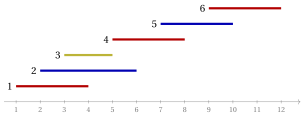

# Colorazione dei vertici: limiti dell'approssimazione

**Parte 5 · Algoritmi di approssimazione · Capitolo 37** · [:material-file-pdf-box: Dispensa, volume 5 (PDF)](../pdf/dispensa-5-algoritmi-di-approssimazione.pdf) · [:material-pencil: Esercizi: Colorazione dei vertici (VCP)](../esercizi/coloring-inapproximability.md)

!!! nota "Prerequisiti"

    - Da questo modulo, il capitolo [«Principi degli algoritmi di approssimazione»](approximation.md): rapporto di prestazione, algoritmo di $\alpha$-approssimazione, garanzia di prestazione additiva.

    - Da questo modulo, il capitolo [«Problemi di colorazione»](../problemi-di-ottimizzazione-combinatoria/coloring/index.md): la definizione del VCP, il numero cromatico $\chi(G)$, il bound di cricca $\omega(G)\le\chi(G)$ e il grafo di Petersen.

    - Dal modulo <em>Algoritmi</em> ([pagina principale del modulo](https://fabiofurini.github.io/algoritmi/)): visita in ampiezza, tempo polinomiale e NP-completezza.

!!! chiave "Obiettivi"

    Alla fine di questo capitolo saremo in grado di:

    - dimostrare che nessun algoritmo polinomiale ha un rapporto di prestazione inferiore a $\frac43$ per il VCP, a meno che $P=NP$;

    - enunciare il risultato di Zuckerman e spiegare perché il VCP non ha una garanzia costante;

    - colorare all'ottimo i grafi bipartiti e i grafi di intervalli, e limitare i colori della colorazione greedy con $\Delta(G)+1$;

    - dimostrare che i grafi planari si possono colorare con $5$ colori in tempo polinomiale, e ricavarne una garanzia additiva.

Il problema di questo capitolo è il [problema della colorazione dei vertici (VCP)](../problemi-di-ottimizzazione-combinatoria/coloring/index.md): la sua definizione e le sue ipotesi sono nella sua pagina.

## 37.1 Notazione

- Come nella pagina del problema, $G=(V,E)$ è un grafo semplice con $n$ vertici e $m$ spigoli, $N(v)$ è l'insieme dei vicini di $v$, $\deg(v)=|N(v)|$ il suo grado, e $\Delta(G)=\max_{v\in V}\deg(v)$ il <strong>grado massimo</strong>. Il valore ottimo del VCP è il numero cromatico, $z(I)=\chi(G)$.

- <strong>Richiamo.</strong> Come nel capitolo [«Principi degli algoritmi di approssimazione»](approximation.md#box-2-def-pratio), $\mathscr{A}(I)$ è il numero di colori della colorazione restituita dall'algoritmo $\mathscr{A}$. Il VCP è un problema di minimo, quindi

    $$
    \mathscr{A}(I) \ge \chi(G) ~~~~~~~\text{e}~~~~~~~ \frac{\mathscr{A}(I)}{\chi(G)} \ge 1
    $$

    per ogni istanza $I$.

- Dare a ogni vertice un colore diverso è sempre ammissibile, quindi $\chi(G)\le n$, e il rapporto $n$ è banale. Questo capitolo mostra che un algoritmo polinomiale non può fare molto meglio su tutti i grafi, e poi le classi di grafi su cui invece può.

## 37.2 Il VCP non è approssimabile

### 37.2.1 Nessun rapporto inferiore a quattro terzi

- La dimostrazione segue lo schema di tutti i risultati negativi dell'approssimazione: un algoritmo con una garanzia troppo buona deciderebbe in tempo polinomiale un problema NP-completo.

- Il problema NP-completo è la <strong>3-colorabilità</strong>: dato un grafo $G$, decidere se $\chi(G)\le 3$. Resta NP-completo sui grafi planari di grado massimo $4$ (Garey, Johnson e Stockmeyer, 1976).

!!! teorema "Teorema 37.1"

    Sia $\mathscr{A}$ un algoritmo polinomiale per il VCP. Se $P\neq NP$, esiste un grafo $G$ tale che

    $$
    \frac{\mathscr{A}(I)}{\chi(G)} \;\ge\; \frac{4}{3} .
    $$

??? dimostrazione "Dimostrazione"

    Supponiamo che $\frac{\mathscr{A}(I)}{\chi(G)}<\frac43$ per ogni grafo $G$, ed eseguiamo $\mathscr{A}$ su un grafo $G$.

    1. Se $\chi(G)\le 3$, allora $\mathscr{A}(I)<\frac43\,\chi(G)\le 4$. Il numero di colori è un intero, quindi $\mathscr{A}(I)\le 3$.

    2. Se $\chi(G)\ge 4$, allora $\mathscr{A}(I)\ge\chi(G)\ge 4$, perché $\mathscr{A}$ restituisce una colorazione ammissibile.

    Quindi $\chi(G)\le 3$ se e solo se $\mathscr{A}(I)\le 3$. Eseguire $\mathscr{A}$ e contarne i colori richiede tempo polinomiale, quindi la 3-colorabilità sarebbe in $P$, e $P=NP$. □

- La dimostrazione usa solo l'interezza di $\chi(G)$: un rapporto inferiore a $\frac43$ non può confondere $3$ colori con $4$. Con $2$ colori lo stesso argomento non dice nulla, perché decidere se $\chi(G)\le 2$ è facile (Sezione [37.3.1](#sez-vci-sec-bip)).

- I grafi planari di grado massimo $4$ sono un caso particolare del VCP: il teorema vale anche su di essi.

### 37.2.2 Risultati molto più forti

- Il teorema esclude solo i rapporti inferiori a $\frac43$. Si sa molto di più, e lo enunciamo senza dimostrazione.

!!! teorema "Teorema 37.2: Zuckerman, 2007"

    Per ogni $\varepsilon>0$, se $P\neq NP$, nessun algoritmo polinomiale $\mathscr{A}$ per il VCP soddisfa, per ogni grafo $G$ con $n$ vertici,

    $$
    \frac{\mathscr{A}(I)}{\chi(G)} \;\le\; n^{1-\varepsilon} .
    $$

- Il rapporto $n$ è banale, quindi il numero cromatico è sostanzialmente difficile da approssimare quanto più è possibile. La dimostrazione usa le dimostrazioni verificabili in modo probabilistico (PCP) e gli estrattori.

- In precedenza, Garey e Johnson (1976) avevano alzato il bound $\frac43$ a $2$, e Feige e Kilian (1998) avevano dimostrato il bound $n^{1-\varepsilon}$ sotto un'ipotesi più forte di $P\neq NP$.

!!! teorema "Corollario 37.3"

    Se $P\neq NP$, il VCP non ha alcun algoritmo di $\alpha$-approssimazione, per nessuna costante $\alpha\ge1$.

??? dimostrazione "Dimostrazione"

    Sia $\mathscr{A}$ un algoritmo polinomiale di $\alpha$-approssimazione, e prendiamo $\varepsilon=\frac12$. I grafi con $n>\alpha^2$ vertici soddisfano $\frac{\mathscr{A}(I)}{\chi(G)}\le\alpha<n^{1/2}$. I grafi con $n\le\alpha^2$ vertici si risolvono esattamente per enumerazione, in un tempo limitato da una costante che dipende solo da $\alpha$, con rapporto $1\le n^{1/2}$. L'algoritmo che si ottiene è polinomiale e ha rapporto al più $n^{1/2}$ su ogni grafo, contro il [Teorema 37.2](#box-2-vci-thmZ). □

!!! chiave ""

    Il VCP non è approssimabile: a meno che $P=NP$, nessun algoritmo polinomiale ha una garanzia di prestazione costante, e nemmeno una garanzia della forma $n^{1-\varepsilon}$. I risultati positivi esistono solo su classi particolari di grafi.

## 37.3 Casi particolari

- Sulle quattro classi di questa sezione il VCP si risolve esattamente, o con una garanzia, in tempo polinomiale. Le classi si riconoscono dal grafo, o sono date con esso (gli intervalli di un grafo di intervalli).

### 37.3.1 Grafi bipartiti { #sez-vci-sec-bip }

!!! definizione "Definizione 37.4: grafo bipartito"

    Un grafo $G=(V,E)$ è <strong>bipartito</strong> se $\chi(G)\le 2$, cioè se $V$ si può dividere in due insiemi stabili.

!!! teorema "Proposizione 37.5"

    Decidere se $\chi(G)\le 2$, e trovare una colorazione con $2$ colori quando esiste, richiede tempo $O(n+m)$.

??? dimostrazione "Dimostrazione"

    Eseguiamo una visita in ampiezza da un vertice di ogni componente connessa, e sia $\ell(v)$ il livello di $v$, la sua distanza dalla radice della sua componente. Coloriamo $v$ con il colore $1$ se $\ell(v)$ è pari e con il colore $2$ altrimenti.

    1. Se nessuno spigolo unisce due vertici di livelli con la stessa parità, la colorazione è ammissibile.

    2. Altrimenti, sia $\{u,v\}$ uno spigolo di questo tipo. I cammini dell'albero di visita dalla radice a $u$ e a $v$, con lo spigolo $\{u,v\}$, formano un cammino chiuso di lunghezza dispari $\ell(u)+\ell(v)+1$. Un cammino chiuso di lunghezza dispari contiene un ciclo di lunghezza dispari, che richiede $3$ colori: $\chi(G)\ge 3$.

    La visita e il controllo degli spigoli richiedono tempo $O(n+m)$. □

- La dimostrazione mostra la caratterizzazione classica: un grafo è bipartito se e solo se non ha cicli di lunghezza dispari (Konig, 1936).

- Su un grafo con almeno uno spigolo, la visita dà $\chi(G)=2$, oppure il certificato $\chi(G)\ge 3$ fornito da un ciclo dispari.

### 37.3.2 Grafi di grado massimo limitato

- La <strong>colorazione greedy</strong> $GC$ esamina i vertici in un ordine dato e assegna a ogni vertice il colore minimo, fra $1,2,3,\dots$, non usato dai suoi vicini già colorati. Richiede tempo $O(n+m)$.

!!! teorema "Proposizione 37.6"

    Per ogni grafo $G$ e ogni ordine dei vertici,

    $$
    GC(I) \;\le\; \Delta(G)+1 .
    $$

??? dimostrazione "Dimostrazione"

    Quando il vertice $v$ viene colorato, i suoi vicini già colorati usano al più $\deg(v)\le\Delta(G)$ colori. Uno dei colori $1,2,\dots,\Delta(G)+1$ è quindi libero, e il colore libero minimo è al più $\Delta(G)+1$. □

- Il bound confronta $GC(I)$ con $\Delta(G)+1$, non con $\chi(G)$: su tutti i grafi non è una garanzia di prestazione, perché $\Delta(G)$ può valere $n-1$ mentre $\chi(G)=2$ (una stella).

- Sui grafi di grado massimo al più una costante <em>fissata</em> $\Delta$, lo è. Ogni grafo con uno spigolo ha $\chi(G)\ge 2$, quindi

    $$
    \frac{GC(I)}{\chi(G)} \;\le\; \frac{\Delta+1}{2} .
    $$

- Il bound $\Delta(G)+1$ è raggiunto dai grafi completi e dai cicli di lunghezza dispari, qualunque sia l'ordine.

- <strong>Osservazione (Brooks, 1941).</strong> Un grafo connesso che non è né completo né un ciclo di lunghezza dispari soddisfa $\chi(G)\le\Delta(G)$, e una colorazione di questo tipo si trova in tempo lineare.

### 37.3.3 Grafi planari

- Un grafo è <strong>planare</strong> se si può disegnare nel piano senza spigoli che si incrociano. Stabilire se un grafo è planare, e trovarne un disegno quando lo è, si fa in tempo lineare (Hopcroft e Tarjan, 1974).

!!! teorema "Lemma 37.7"

    Ogni grafo planare con $n\ge 3$ vertici ha $m\le 3n-6$ spigoli, e un vertice di grado al più $5$.

??? dimostrazione "Dimostrazione"

    Aggiungere spigoli a un disegno senza creare incroci non diminuisce $m$, quindi possiamo supporre che non si possa aggiungere alcuno spigolo di questo tipo: il disegno è connesso e ogni faccia è un triangolo. La formula di Eulero per un disegno planare connesso con $f$ facce dà $n-m+f=2$. Ogni faccia ha $3$ spigoli e ogni spigolo delimita $2$ facce, quindi $3f=2m$, e

    $$
    2 = n-m+f \;=\; n-m+\frac{2m}{3} \qquad\Longrightarrow\qquad m\le 3n-6 .
    $$

    I gradi sommano a $2m\le 6n-12<6n$, quindi qualche vertice ha grado al più $5$. □

!!! teorema "Teorema 37.8: Heawood, 1890"

    Ogni grafo planare si può colorare con $5$ colori, e una colorazione di questo tipo si trova in tempo polinomiale.

??? dimostrazione "Dimostrazione"

    Per induzione su $n$; i grafi con $n\le 5$ sono banali. Sia $v$ un vertice di grado al più $5$ ([Lemma 37.7](#box-7-vci-lemDeg5)), e coloriamo $G-v$, che è planare, con $5$ colori.

    1. Se i vicini di $v$ usano al più $4$ colori, $v$ prende il quinto.

    2. Altrimenti $v$ ha $5$ vicini $v_1,\dots,v_5$, in quest'ordine intorno a $v$ nel disegno, con colori $1,\dots,5$. Sia $H_{13}$ il grafo indotto dai vertici di colore $1$ e $3$.

    3. Se $v_1$ e $v_3$ stanno in componenti diverse di $H_{13}$, scambiamo i colori $1$ e $3$ nella componente di $v_1$: la colorazione resta ammissibile, e il colore $1$ diventa libero per $v$.

    4. Altrimenti un cammino di colori $1$ e $3$ unisce $v_1$ a $v_3$; con $v$, chiude un ciclo che separa $v_2$ da $v_4$ nel disegno. Un cammino da $v_2$ a $v_4$ deve attraversare quel ciclo, quindi $v_2$ e $v_4$ stanno in componenti diverse di $H_{24}$: scambiando $2$ e $4$ nella componente di $v_2$ si libera il colore $2$ per $v$.

    Ogni passo usa una visita in tempo $O(n+m)=O(n)$, e i passi sono $n$: in totale tempo $O(n^2)$. □

- <strong>Osservazione (il teorema dei quattro colori).</strong> Ogni grafo planare si può colorare con $4$ colori (Appel e Haken, 1977). La dimostrazione usa un calcolatore; Robertson, Sanders, Seymour e Thomas (1997) l'hanno semplificata e hanno dato un algoritmo che trova una colorazione di questo tipo in tempo $O(n^2)$.

- L'algoritmo $PL$ per i grafi planari combina i risultati precedenti: se $G$ non ha spigoli, usa $1$ colore; se $G$ è bipartito, usa $2$ colori ([Proposizione 37.5](#box-5-vci-propBFS)); altrimenti usa i $5$ colori del [Teorema 37.8](#box-8-vci-thm5).

!!! teorema "Corollario 37.9"

    $PL$ è un algoritmo polinomiale di approssimazione $2$-additivo per il VCP sui grafi planari:

    $$
    PL(I)-\chi(G) \;\le\; 2 .
    $$

    Con l'algoritmo dei quattro colori al posto di quello dei cinque colori, l'errore additivo è al più $1$.

??? dimostrazione "Dimostrazione"

    Nei primi due casi $PL$ è esatto. Nel terzo caso $G$ ha un ciclo di lunghezza dispari, quindi $\chi(G)\ge 3$, mentre $PL(I)\le 5$: l'errore additivo è al più $5-3=2$. Con $4$ colori è al più $4-3=1$. □

- L'errore additivo $1$ non si può ridurre a $0$: decidere se un grafo planare ha $\chi(G)\le 3$ è NP-completo. Per lo stesso motivo, il rapporto $\frac43$ della versione con quattro colori è il migliore possibile sui grafi planari ([Teorema 37.1](#box-1-vci-thm43)).

### 37.3.4 Grafi di intervalli

!!! definizione "Definizione 37.10: grafo di intervalli"

    Un grafo $G=(V,E)$ è un <strong>grafo di intervalli</strong> se a ogni vertice $v$ è associato un intervallo chiuso $[a_v,b_v]$ della retta reale, e $\{u,v\}\in E$ se e solo se i due intervalli si intersecano.

- I grafi di intervalli descrivono richieste nel tempo che sono in conflitto quando si sovrappongono: lezioni che richiedono un'aula, prenotazioni che richiedono una risorsa. Un colore è un'aula.

!!! teorema "Proposizione 37.11"

    Su un grafo di intervalli, la colorazione greedy con i vertici in ordine di estremo sinistro $a_v$ non decrescente usa $\omega(G)$ colori. È quindi ottima: $GC(I)=\omega(G)=\chi(G)$.

??? dimostrazione "Dimostrazione"

    Sia $v$ un vertice che riceve il colore $k$. I colori $1,\dots,k-1$ sono usati da vicini $u$ di $v$ colorati prima di $v$, quindi con $a_u\le a_v$.

    1. Poiché $[a_u,b_u]$ interseca $[a_v,b_v]$ e $a_u\le a_v$, abbiamo $b_u\ge a_v$: il punto $a_v$ sta nell'intervallo di ciascuno di questi vicini, e nell'intervallo di $v$.

    2. I $k$ intervalli che contengono $a_v$ si intersecano a due a due, quindi i loro vertici formano una cricca e $k\le\omega(G)$.

    Quindi $GC(I)\le\omega(G)\le\chi(G)\le GC(I)$, per il bound di cricca. □

- Ordinare gli intervalli richiede tempo $O(n\log n)$, e la colorazione $O(n+m)$.

- L'ordine conta: con un altro ordine la colorazione greedy può usare più di $\omega(G)$ colori su un grafo di intervalli ([Esempio 37.2](#box-13-vci-ex-int)).

## 37.4 Esempi

!!! esempio "Esempio 37.1: I casi particolari sul grafo di Petersen"

    L'istanza di riferimento del VCP è il grafo di Petersen, con $n=10$, $m=15$ e $\Delta(G)=3$.

    { .fig loading=lazy  }

    - <strong>È bipartito?</strong> La visita dal vertice $1$ dà il livello $0$ al vertice $1$, $1$ ai vertici $2,5,6$, e $2$ agli altri sei. Lo spigolo $\{3,4\}$ unisce due vertici di livello $2$: con i cammini $1,2,3$ e $1,5,4$ chiude il ciclo dispari $1,2,3,4,5$, quindi $\chi(G)\ge 3$.

    - <strong>Colorazione greedy.</strong> Nell'ordine $1,2,\dots,10$, $GC$ assegna i colori $1,2,1,2,3,2,1,3,3,2$ (rosso, blu, giallo nella figura): $GC(I)=3\le\Delta(G)+1=4$.

    - Insieme, $3\le\chi(G)\le GC(I)=3$: la colorazione greedy è ottima su questa istanza.

!!! esempio "Esempio 37.2: La colorazione greedy su un grafo di intervalli"

    Sei intervalli, con gli spigoli fra intervalli che si intersecano:

    { .fig loading=lazy  }

    $$
    [a_v,b_v]:\ [1,4],\ [2,6],\ [3,5],\ [5,8],\ [7,10],\ [9,12],
    $$

    $$
    E=\big\{\{1,2\},\{1,3\},\{2,3\},\{2,4\},\{3,4\},\{4,5\},\{5,6\}\big\}.
    $$

    - Gli estremi sinistri sono già in ordine crescente. $GC$ assegna i colori $1,2,3,1,2,1$ (rosso, blu, giallo nella figura): $GC(I)=3$.

    - Gli intervalli $1,2,3$ contengono il punto $3$, quindi $\{1,2,3\}$ è una cricca e $\omega(G)=3$: la colorazione è ottima, come garantisce la [Proposizione 37.11](#box-11-vci-propInt).

    - Con l'ordine $1,2,3,5,4,6$ i colori sono $1,2,3$, poi $1$ al vertice $5$ e $4$ al vertice $4$, i cui vicini $2,3,5$ usano i colori $1,2,3$: $4$ colori, uno in più di $\chi(G)$.

## 37.5 Fonti

- M.R. Garey, D.S. Johnson, L. Stockmeyer, Some simplified NP-complete graph problems, <em>Theoretical Computer Science</em> 1(3):237–267, 1976.

- M.R. Garey, D.S. Johnson, The complexity of near-optimal graph coloring, <em>Journal of the ACM</em> 23(1):43–49, 1976.

- U. Feige, J. Kilian, Zero knowledge and the chromatic number, <em>Journal of Computer and System Sciences</em> 57(2):187–199, 1998.

- D. Zuckerman, Linear degree extractors and the inapproximability of max clique and chromatic number, <em>Theory of Computing</em> 3:103–128, 2007.

- R.L. Brooks, On colouring the nodes of a network, <em>Proceedings of the Cambridge Philosophical Society</em> 37(2):194–197, 1941.

- P.J. Heawood, Map-colour theorem, <em>Quarterly Journal of Pure and Applied Mathematics</em> 24, 1890.

- J. Hopcroft, R. Tarjan, Efficient planarity testing, <em>Journal of the ACM</em> 21(4):549–568, 1974.

- K. Appel, W. Haken, Every planar map is four colorable, <em>Illinois Journal of Mathematics</em> 21, 1977.

- N. Robertson, D. Sanders, P. Seymour, R. Thomas, The four-colour theorem, <em>Journal of Combinatorial Theory, Series B</em> 70(1):2–44, 1997.

## 37.6 Errori tipici

!!! attenzione "Attenzione"

    - <strong>Chiamare il bound $\Delta(G)+1$ una garanzia di prestazione.</strong> Confronta la colorazione greedy con $\Delta(G)+1$, non con $\chi(G)$; diventa un rapporto costante solo sui grafi di grado massimo limitato.

    - <strong>Leggere il teorema del $\frac43$ come un upper bound.</strong> Afferma che i rapporti inferiori a $\frac43$ sono impossibili, non che un rapporto di $\frac43$ sia raggiungibile: per il risultato di Zuckerman, nessun rapporto costante lo è.

    - <strong>Usare il teorema dei quattro colori come algoritmo esatto.</strong> Colora ogni grafo planare con al più $4$ colori, ma decidere se bastano $3$ colori resta NP-completo sui grafi planari.

    - <strong>Ordinare gli intervalli per estremo destro, o per lunghezza.</strong> La [Proposizione 37.11](#box-11-vci-propInt) usa l'ordine degli estremi sinistri: gli intervalli dei colori usati prima di $v$ contengono tutti il punto $a_v$.

    - <strong>Dimenticare il ciclo dispari.</strong> Una visita in ampiezza che trova un conflitto dimostra $\chi(G)\ge 3$ solo attraverso il ciclo dispari che chiude; il ciclo è il certificato.

## 37.7 In sintesi

!!! chiave "In sintesi"

    - A meno che $P=NP$, nessun algoritmo polinomiale colora ogni grafo con meno di $\frac43\chi(G)$ colori: deciderebbe la 3-colorabilità. Per il risultato di Zuckerman, non è possibile nemmeno il rapporto $n^{1-\varepsilon}$: il VCP non è approssimabile.

    - I grafi bipartiti e i grafi di intervalli si colorano all'ottimo in tempo polinomiale; sui grafi di grado limitato la colorazione greedy ha rapporto $\frac{\Delta+1}{2}$; sui grafi planari l'errore additivo è al più $2$, o $1$ con il teorema dei quattro colori.

    
<table>
    <tr>
    <th>grafi</th>
    <th>algoritmo</th>
    <th>risultato</th>
    </tr>
    <tr>
    <td>tutti i grafi</td>
    <td>polinomiale</td>
    <td>nessun rapporto costante, salvo \(P=NP\)</td>
    </tr>
    <tr>
    <td>bipartiti</td>
    <td>visita in ampiezza</td>
    <td>esatto, \(O(n+m)\)</td>
    </tr>
    <tr>
    <td>grado massimo \(\le\Delta\)</td>
    <td>colorazione greedy</td>
    <td>al più \(\Delta+1\) colori</td>
    </tr>
    <tr>
    <td>planari</td>
    <td>\(PL\)</td>
    <td>errore additivo \(\le 2\) (o \(\le 1\))</td>
    </tr>
    <tr>
    <td>di intervalli</td>
    <td>greedy per estremo sinistro</td>
    <td>esatto, \(\omega(G)\) colori</td>
    </tr>
    </table>

    <strong>Quadro riassuntivo dell'istanza di riferimento.</strong>

    
<table>
    <tr>
    <th>Istanza</th>
    <th>Lower bound</th>
    <th>Valore euristico</th>
    <th>Valore ottimo</th>
    </tr>
    <tr>
    <td>grafo di Petersen</td>
    <td>\(3\), ciclo dispari</td>
    <td>\(GC\) \(3\)</td>
    <td>\(3\)</td>
    </tr>
    </table>

---

**Esercizi su questo capitolo:** [:material-pencil: Colorazione dei vertici (VCP)](../esercizi/coloring-inapproximability.md)
