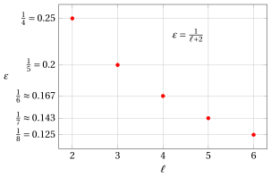

# Algoritmi di approssimazione per lo zaino

**Parte 5 · Algoritmi di approssimazione · Capitolo 35** · [:material-file-pdf-box: Dispensa, volume 5 (PDF)](../pdf/dispensa-5-algoritmi-di-approssimazione.pdf) · [:material-pencil: Esercizi: Zaino 0/1 (KP)](../esercizi/knapsack-approximation.md) · [:material-gesture-tap: App: Zaino 0/1: greedy, Ext-Greedy, H² e FPTAS](../laboratorio/zaino-approssimazione.md) · [:material-gesture-tap: App: Istanze tight](../laboratorio/istanze-tight.md)

!!! nota "Prerequisiti"

    - Da questo modulo, il capitolo [«Principi degli algoritmi di approssimazione»](approximation.md): rapporto di prestazione, garanzie di prestazione relative e assolute, tightness, schemi di approssimazione, PTAS e FPTAS.

    - Da questo modulo, i capitoli [«Problemi di zaino»](../problemi-di-ottimizzazione-combinatoria/knapsack/index.md) e [«Formulazioni dei problemi di zaino»](../formulazioni/knapsack-formulations/index.md): il KP, il rilassamento lineare $\mathrm{LP}_{\mathrm{KP}}$ e il bound di Dantzig, che usa l'oggetto critico.

    - Da questo modulo, i capitoli [«Euristiche costruttive»](../algoritmi-euristici/constructive-heuristics/index.md) e [«PD per il problema dello zaino 0/1»](../programmazione-dinamica/dp-knapsack/index.md): l'algoritmo greedy e la programmazione dinamica sui profitti, usati dall'algoritmo Basic-FPTAS.

!!! chiave "Obiettivi"

    Alla fine di questo capitolo saremo in grado di:

    - eseguire a mano gli algoritmi greedy, Ext-Greedy, $H^2$, $H^{\ell}$ e Basic-FPTAS su un'istanza del KP;

    - spiegare perché l'algoritmo greedy non ha una garanzia costante e perché Ext-Greedy ha garanzia $2$;

    - dimostrare le garanzie $\frac{4}{3}$ di $H^2$, $\frac{\ell+2}{\ell+1}$ di $H^{\ell}$ e $\frac{1}{1-\varepsilon}$ dell'algoritmo Basic-FPTAS;

    - confrontare i tempi di calcolo di $H^{\ell}$ e dell'algoritmo Basic-FPTAS, e dire perché solo il secondo è un FPTAS;

    - spiegare perché una garanzia di prestazione assoluta per il KP richiede un algoritmo esatto.

Il problema di questo capitolo è il [problema dello zaino 0/1 (KP)](../problemi-di-ottimizzazione-combinatoria/knapsack/il-problema-dello-zaino-0-1.md): la sua definizione e le sue ipotesi sono nella sua pagina.

## 35.1 Notazione

- Come nella pagina del problema, $c$ è la capacità dello zaino e $\mathscr{I}=\{1,2,\dots,n\}$ l'insieme degli oggetti; in questo capitolo l'oggetto $i\in\mathscr{I}$ ha profitto $p_i$ e peso $w_i$.

- Indichiamo con $z(I)$ il <strong>valore ottimo</strong> del KP sull'istanza $I$, e con $\mathscr{A}(I)$ il profitto della soluzione ammissibile restituita da un algoritmo euristico $\mathscr{A}$. Poiché ogni algoritmo euristico di questo capitolo restituisce una soluzione ammissibile,

    $$
    \mathscr{A}(I) \le z(I) ~~~~~~~\text{e}~~~~~~~ \frac{z(I)}{\mathscr{A}(I)} \ge 1
    $$

    per ogni istanza $I$ del KP.

- Supponiamo sempre che gli oggetti siano ordinati per efficienza non crescente

    $$
    \frac{p_i}{w_i} \ge \frac{p_{i+1}}{w_{i+1}}
    \qquad \text{per ogni} \qquad
    i \in \{1,2,\dots,n-1\},
    $$

    il che richiede tempo $O(n \log n)$, una funzione polinomiale del numero $n$ di oggetti.

## 35.2 Oggetto critico e capacità residua

!!! definizione "Definizione 35.1: oggetto critico e capacità residua"

    Dato un insieme $\mathscr{I}=\{1,2,\dots,n\}$ di $n$ oggetti ordinati per efficienza non crescente, l'<strong>oggetto critico</strong> è l'oggetto

    \begin{equation*}
    {s} \in \mathscr{I}
    ~~~~\text{tale che }~~~~
    \sum_{i=1}^{s-1} w_i \leq c
    ~~~~{\rm  e }~~~~
    \sum_{i=1}^{s} w_i > c
    \label{eq:split_item} \tag{35.1}
    \end{equation*}

    e la <strong>capacità residua</strong> è

    \begin{equation*}
    \mathit{rc} = c - \sum_{i=1}^{s-1} w_i
    \label{eq:residual_capacity} \tag{35.2}
    \end{equation*}

- L'oggetto critico è il primo che non entra per intero nello zaino se tutti i precedenti sono selezionati.

- La capacità residua è la capacità dello zaino che rimane quando tutti gli oggetti che precedono l'oggetto critico sono selezionati.

- Ordinare gli oggetti per efficienza non crescente richiede tempo $O(n \log n)$, e l'oggetto critico si trova poi scorrendoli. L'oggetto critico si può trovare anche in tempo $O(n)$, senza ordinare, con una ricerca della mediana pesata: l'ordinamento è comodo, non necessario.

!!! esempio "Esempio 35.1: oggetto critico e capacità residua"

    Consideriamo uno zaino di capacità $c = 9$ e un insieme $\mathscr{I} = \{1,2,3,4,5,6,7\}$ di $7$ oggetti ($n = 7$), con i seguenti profitti e pesi:

    $$
    \begin{array}{l|ccccccc}
    \hline  & {i=1} & {i=2} & {i=3} & {i=4} & {i=5} & {i=6} & {i=7} \\
    \hline {p_i} & {6} & {5} & {8} & {9} & {6} & {7} & {3} \\
    {w_i} & {2} & {3} & {6} & {7} & {5} & {9} & {4} \\
    \hline
    \end{array}
    $$

    Le efficienze degli oggetti sono:

    $$
    \frac{p_1}{w_1}=\frac{6}{2},\quad
    \frac{p_2}{w_2}=\frac{5}{3},\quad
    \frac{p_3}{w_3}=\frac{8}{6},\quad
    \frac{p_4}{w_4}=\frac{9}{7},\quad
    \frac{p_5}{w_5}=\frac{6}{5},\quad
    \frac{p_6}{w_6}=\frac{7}{9},\quad
    \frac{p_7}{w_7}=\frac{3}{4}.
    $$

    Quindi gli oggetti sono ordinati per efficienza non crescente: $(1,\,2,\,3,\,4,\,5,\,6,\,7)$. L'oggetto critico è $s=3$ poiché:

    $$
    \sum_{i=1}^{2} w_i = 2+3= 5 \le 9 {\rm ~~~e~~~} \sum_{i=1}^{3} w_i = 2+3 + 6= 11 > 9
    $$

    e la capacità residua è:

    $$
    \mathit{rc} = c - \sum_{i=1}^{2} w_i = 9 - 2 - 3 = 4
    $$

## 35.3 L'algoritmo greedy

- Supponiamo che gli oggetti siano ordinati per efficienza non crescente

    $$
    \frac{p_i}{w_i} \ge \frac{p_{i+1}}{w_{i+1}}
    \quad \text{per ogni} \quad
    i \in \{1,2,\dots,n-1\}
    $$

!!! chiave ""

    L'algoritmo <em>greedy</em> (indicato con $GR$) è un'euristica costruttiva per il KP. Costruisce una soluzione ammissibile esaminando gli oggetti in ordine di <em>efficienza</em> non crescente, dove l'efficienza è il rapporto fra profitto e peso. Partendo da un sottoinsieme vuoto di oggetti, ogni oggetto viene aggiunto alla soluzione se e solo se il vincolo di capacità non viene violato.

- Lo pseudocodice di $GR$ è il seguente:

!!! algoritmo "Algoritmo: Greedy"

    

<strong>Input:</strong> istanza \(I\) del KP con \(n\) oggetti, profitti \(p[1..n]\), pesi \(w[1..n]\), capacità \(c\)

<strong>Output:</strong> soluzione ammissibile \(x[1..n]\) del KP

1<strong>Function</strong> Greedy(\(n, p, w, c\))

2\(x := \text{nuovo vettore}[1..n]\) ▹ oggetti selezionati

3<strong>for</strong> \(i := 1\) <strong>to</strong> \(n\) <strong>do</strong>

4\(x[i] \leftarrow 0\) ▹ all'inizio l'oggetto \(i\) non è selezionato

5<strong>end</strong>

6\(rc := c\) ▹ capacità residua

7<strong>for</strong> \(i := 1\) <strong>to</strong> \(n\) <strong>do</strong>

8<strong>if</strong> \(w[i] \le rc\) <strong>then</strong>

9\(x[i] \leftarrow 1\)
    \(rc \leftarrow rc - w[i]\) ▹ selezionare l'oggetto \(i\) aggiornare la capacità residua

10<strong>end</strong>

11<strong>end</strong>

12<strong>return</strong> \(x\)

Esegui in Colab:

- Dato l'oggetto critico $s$, $GR$ seleziona tutti gli oggetti che precedono l'oggetto critico, cioè

    $$
    \{1,2,\dots,s-1\}\subseteq S
    \qquad\text{e}\qquad
    GR(I)\ge \sum_{i=1}^{s-1} p_i.
    $$

    Inoltre, l'oggetto $s$ non viene selezionato da $GR$, mentre $GR$ può selezionare anche alcuni oggetti che seguono l'oggetto critico.

!!! esempio "Esempio 35.2: Esecuzione di $GR$"

    Per l'istanza del KP dell'[Esempio 35.1](#box-2-ex-split), gli oggetti sono ordinati per efficienza non crescente:

    $$
    (1,\,2,\,3,\,4,\,5,\,6,\,7).
    $$

    L'esecuzione di $GR$ procede come segue:

    1. L'oggetto $1$ (peso $w_1=2$) viene selezionato. La capacità disponibile $rc$ diventa $9-2=7$.

    2. L'oggetto $2$ (peso $w_2=3$) viene selezionato. La capacità disponibile $rc$ diventa $7-3=4$.

    3. L'oggetto $3$ (peso $w_3=6$) non viene selezionato perché non entra nella capacità disponibile $rc=4$.

    4. L'oggetto $4$ (peso $w_4=7$) non viene selezionato perché non entra nella capacità disponibile $rc=4$.

    5. L'oggetto $5$ (peso $w_5=5$) non viene selezionato perché non entra nella capacità disponibile $rc=4$.

    6. L'oggetto $6$ (peso $w_6=9$) non viene selezionato perché non entra nella capacità disponibile $rc=4$.

    7. L'oggetto $7$ (peso $w_7=4$) viene selezionato. La capacità disponibile $rc$ diventa $4-4=0$.

    Quindi $GR$ restituisce la soluzione ammissibile:

    $$
    S=\{1,2,7\}.
    $$

    Il profitto totale della soluzione ammissibile è:

    $$
    GR(I)=\sum_{i\in S} p_i = p_1+p_2+p_7 = 6+5+3 = 14.
    $$

    Pertanto, $14$ è un lower bound valido sul valore ottimo $z(I)$:

    $$
    14 \le z(I).
    $$

    In questa istanza l'oggetto critico è $s=3$. Di conseguenza, $GR$ seleziona tutti gli oggetti che precedono l'oggetto critico, cioè gli oggetti $1$ e $2$, non seleziona l'oggetto $3$ (l'oggetto critico), e poi seleziona anche l'oggetto $7$, che segue l'oggetto critico.

!!! esempio "Esempio 35.3: Esecuzione di $GR$"

    Consideriamo uno zaino di capacità $c = 10$ e un insieme $\mathscr{I} = \{1,2,3,4\}$ di $4$ oggetti ($n = 4$), con i seguenti profitti e pesi:

    $$
    \begin{array}{l|cccc}
    \hline  & {i=1} & {i=2} & {i=3} & {i=4} \\
    \hline {p_i} & {6} & {8} & {19} & {4} \\
    {w_i} & {2} & {3} & {9} & {5} \\
    \hline
    \end{array}
    $$

    Le efficienze degli oggetti sono:

    $$
    \frac{p_1}{w_1}=\frac{6}{2},\quad
    \frac{p_2}{w_2}=\frac{8}{3},\quad
    \frac{p_3}{w_3}=\frac{19}{9},\quad
    \frac{p_4}{w_4}=\frac{4}{5}.
    $$

    Quindi gli oggetti sono ordinati per efficienza non crescente: $(1,\,2,\,3,\,4)$. L'oggetto critico è $s=3$ poiché:

    $$
    \sum_{i=1}^{2} w_i = 2+3= 5 \le 10
    \ \ {\rm ~~~e~~~}\ \
    \sum_{i=1}^{3} w_i = 2+3+9= 14 > 10
    $$

    e la capacità residua è:

    $$
    \mathit{rc} = c - \sum_{i=1}^{2} w_i = 10 - 2 - 3 = 5.
    $$

    L'esecuzione di $GR$ procede come segue:

    1. L'oggetto $1$ (peso $w_1=2$) viene selezionato. La capacità disponibile $rc$ diventa $10-2=8$.

    2. L'oggetto $2$ (peso $w_2=3$) viene selezionato. La capacità disponibile $rc$ diventa $8-3=5$.

    3. L'oggetto $3$ (peso $w_3=9$) non viene selezionato perché non entra nella capacità disponibile $rc=5$.

    4. L'oggetto $4$ (peso $w_4=5$) viene selezionato. La capacità disponibile $rc$ diventa $5-5=0$.

    Quindi $GR$ restituisce la soluzione ammissibile:

    $$
    S=\{1,2,4\}.
    $$

    Il profitto totale della soluzione ammissibile è:

    $$
    GR(I)=\sum_{i\in S} p_i = p_1+p_2+p_4 = 6+8+4 = 18.
    $$

    Pertanto, $18$ è un lower bound valido sul valore ottimo $z(I)$:

    $$
    18 \le z(I).
    $$

    In questa istanza l'oggetto critico è $s=3$. Di conseguenza, $GR$ seleziona tutti gli oggetti che precedono l'oggetto critico, cioè gli oggetti $1$ e $2$, non seleziona l'oggetto $3$ (l'oggetto critico), e poi seleziona l'oggetto $4$, che segue l'oggetto critico. L'oggetto $3$ ha il profitto massimo ($p_3=19$) e selezionarlo da solo è ottimo, ma $GR$ non lo seleziona.

!!! esempio "Esempio 35.4: Esecuzione di $GR$"

    Consideriamo uno zaino di capacità $c = 10$ e un insieme $\mathscr{I} = \{1,2,3,4,5\}$ di $5$ oggetti ($n = 5$), con i seguenti profitti e pesi:

    $$
    \begin{array}{l|ccccc}
    \hline  & {i=1} & {i=2} & {i=3} & {i=4} & {i=5} \\
    \hline {p_i} & {4} & {6} & {5} & {12} & {3} \\
    {w_i} & {1} & {2} & {2} & {6} & {2} \\
    \hline
    \end{array}
    $$

    Le efficienze degli oggetti sono:

    $$
    \frac{p_1}{w_1}=\frac{4}{1}=4,\quad
    \frac{p_2}{w_2}=\frac{6}{2}=3,\quad
    \frac{p_3}{w_3}=\frac{5}{2}=2.5,\quad
    \frac{p_4}{w_4}=\frac{12}{6}=2,\quad
    \frac{p_5}{w_5}=\frac{3}{2}=1.5.
    $$

    Quindi gli oggetti sono ordinati per efficienza non crescente: $(1,\,2,\,3,\,4,\,5)$. L'oggetto critico è $s=4$ poiché:

    $$
    \sum_{i=1}^{3} w_i = 1+2+2= 5 \le 10
    \ \ {\rm ~~~e~~~}\ \
    \sum_{i=1}^{4} w_i = 1+2+2+6= 11 > 10
    $$

    e la capacità residua è:

    $$
    \mathit{rc} = c - \sum_{i=1}^{3} w_i = 10 - 5 = 5.
    $$

    L'esecuzione di $GR$ procede come segue:

    1. L'oggetto $1$ (peso $w_1=1$) viene selezionato. La capacità disponibile $rc$ diventa $10-1=9$.

    2. L'oggetto $2$ (peso $w_2=2$) viene selezionato. La capacità disponibile $rc$ diventa $9-2=7$.

    3. L'oggetto $3$ (peso $w_3=2$) viene selezionato. La capacità disponibile $rc$ diventa $7-2=5$.

    4. L'oggetto $4$ (peso $w_4=6$) non viene selezionato perché non entra nella capacità disponibile $rc=5$.

    5. L'oggetto $5$ (peso $w_5=2$) viene selezionato. La capacità disponibile $rc$ diventa $5-2=3$.

    Quindi $GR$ restituisce la soluzione ammissibile:

    $$
    S=\{1,2,3,5\}.
    $$

    Il profitto totale della soluzione ammissibile è:

    $$
    GR(I)=\sum_{i\in S} p_i = p_1+p_2+p_3+p_5 = 4+6+5+3 = 18.
    $$

    Pertanto, $18$ è un lower bound valido sul valore ottimo $z(I)$:

    $$
    18 \le z(I).
    $$

    In questa istanza l'oggetto critico è $s=4$. Di conseguenza, $GR$ seleziona gli oggetti $1$, $2$ e $3$ (che precedono l'oggetto critico), salta l'oggetto $4$ (l'oggetto critico) e poi seleziona l'oggetto $5$. La soluzione ottima è $\tilde{S}=\{2,3,4\}$ di valore $z(I)=6+5+12=23$, migliore della soluzione trovata da $GR$.

!!! esempio "Esempio 35.5: Esecuzione di $GR$"

    Consideriamo uno zaino di capacità $c = 21$ e un insieme $\mathscr{I} = \{1,2,3,4,5,6\}$ di $6$ oggetti ($n = 6$), con i seguenti profitti e pesi:

    $$
    \begin{array}{l|cccccc}
    \hline  & {i=1} & {i=2} & {i=3} & {i=4} & {i=5} & {i=6} \\
    \hline {p_i} & {4} & {6} & {4} & {3} & {2} & {20} \\
    {w_i} & {1} & {2} & {2} & {2} & {2} & {21} \\
    \hline
    \end{array}
    $$

    Le efficienze degli oggetti sono:

    $$
    \frac{p_1}{w_1}=\frac{4}{1}=4,\quad
    \frac{p_2}{w_2}=\frac{6}{2}=3,\quad
    \frac{p_3}{w_3}=\frac{4}{2}=2,\quad
    \frac{p_4}{w_4}=\frac{3}{2}=1.5,\quad
    \frac{p_5}{w_5}=\frac{2}{2}=1,\quad
    \frac{p_6}{w_6}=\frac{20}{21}.
    $$

    Quindi gli oggetti sono ordinati per efficienza non crescente: $(1,\,2,\,3,\,4,\,5,\,6)$. L'oggetto critico è $s=6$ poiché:

    $$
    \sum_{i=1}^{5} w_i = 1+2+2+2+2= 9 \le 21
    \ \ {\rm ~~~e~~~}\ \
    \sum_{i=1}^{6} w_i = 1+2+2+2+2+21= 30 > 21
    $$

    e la capacità residua è:

    $$
    \mathit{rc} = c - \sum_{i=1}^{5} w_i = 21 - 9 = 12.
    $$

    L'esecuzione di $GR$ procede come segue:

    1. L'oggetto $1$ (peso $w_1=1$) viene selezionato. La capacità disponibile $rc$ diventa $21-1=20$.

    2. L'oggetto $2$ (peso $w_2=2$) viene selezionato. La capacità disponibile $rc$ diventa $20-2=18$.

    3. L'oggetto $3$ (peso $w_3=2$) viene selezionato. La capacità disponibile $rc$ diventa $18-2=16$.

    4. L'oggetto $4$ (peso $w_4=2$) viene selezionato. La capacità disponibile $rc$ diventa $16-2=14$.

    5. L'oggetto $5$ (peso $w_5=2$) viene selezionato. La capacità disponibile $rc$ diventa $14-2=12$.

    6. L'oggetto $6$ (peso $w_6=21$) non viene selezionato perché non entra nella capacità disponibile $rc=12$.

    Quindi $GR$ restituisce la soluzione ammissibile:

    $$
    S=\{1,2,3,4,5\}.
    $$

    Il profitto totale della soluzione ammissibile è:

    $$
    GR(I)=\sum_{i\in S} p_i = p_1+p_2+p_3+p_4+p_5 = 4+6+4+3+2 = 19.
    $$

    Pertanto, $19$ è un lower bound valido sul valore ottimo $z(I)$:

    $$
    19 \le z(I).
    $$

    In questa istanza l'oggetto di profitto massimo è l'oggetto $6$, con $p_6=20$, che compare per ultimo nell'ordine per efficienza. L'algoritmo greedy $GR$ seleziona tutti gli oggetti da $1$ a $5$ (che precedono l'oggetto critico), ma non seleziona l'oggetto $6$ (l'oggetto critico stesso) perché il suo peso $w_6=21$ supera la capacità residua $rc=12$. Da solo l'oggetto $6$ entrerebbe nello zaino (poiché $w_6=21 \le c=21$) e darebbe un profitto di $20$, migliore della soluzione greedy. La soluzione ottima è $\tilde{S}=\{6\}$ di valore $z(I)=20$.

## 35.4 L'algoritmo Ext-Greedy

!!! chiave ""

    L'algoritmo <em>Ext-Greedy</em> (indicato con $GR^e$) è un'euristica costruttiva per il KP. Prima calcola una soluzione ammissibile eseguendo l'algoritmo greedy $GR$. Poi confronta questa soluzione con la migliore soluzione ammissibile formata da un solo oggetto. Infine restituisce la migliore delle due soluzioni.

- Lo pseudocodice di $GR^e$ è il seguente:

!!! algoritmo "Algoritmo: Extended Greedy"

    

<strong>Input:</strong> istanza \(I\) del KP con \(n\) oggetti, profitti \(p[1..n]\), pesi \(w[1..n]\), capacità \(c\)

<strong>Output:</strong> soluzione ammissibile \(x[1..n]\) del KP

1<strong>Function</strong> ExtendedGreedy(\(n, p, w, c\))

2\(x := Greedy(n, p, w, c)\)
    \(z := 0\) ▹ soluzione greedy valore della soluzione greedy

3<strong>for</strong> \(i := 1\) <strong>to</strong> \(n\) <strong>do</strong>

4<strong>if</strong> \(x[i] = 1\) <strong>then</strong>

5\(z \leftarrow z + p[i]\) ▹ sommare il profitto di un oggetto selezionato

6<strong>end</strong>

7<strong>end</strong>

8\(i_m := 1\)
    \(p_{\max} := p[1]\) ▹ miglior oggetto singolo

9<strong>for</strong> \(i := 2\) <strong>to</strong> \(n\) <strong>do</strong>

10<strong>if</strong> \(p[i] > p_{\max}\) <strong>then</strong>

11\(i_m \leftarrow i\)
    \(p_{\max} \leftarrow p[i]\) ▹ aggiornare il miglior oggetto singolo aggiornare il suo profitto

12<strong>end</strong>

13<strong>end</strong>

14\(\bar{x} := \text{nuovo vettore}[1..n]\) ▹ migliore soluzione con un solo oggetto

15<strong>for</strong> \(i := 1\) <strong>to</strong> \(n\) <strong>do</strong>

16\(\bar{x}[i] \leftarrow 0\)

17<strong>end</strong>

18\(\bar{x}[i_m] \leftarrow 1\) ▹ selezionare solo l'oggetto \(i_m\)

19<strong>if</strong> \(z < p_{\max}\) <strong>then</strong>

20<strong>for</strong> \(i := 1\) <strong>to</strong> \(n\) <strong>do</strong>

21\(x[i] \leftarrow \bar{x}[i]\) ▹ copiare componente per componente

22<strong>end</strong>

23<strong>end</strong>

24<strong>return</strong> \(x\)

Esegui in Colab:

- Sia $p_{\max}$ il <strong>profitto massimo</strong>

    $$
    p_{\max}=\max\big\{~p_i:\ i\in\mathscr{I} ~\big\}.
    $$

    e sia $\bar{S}$ la <strong>migliore soluzione ammissibile con un solo oggetto</strong>

    $$
    \bar{S}=\big\{~i_m ~\big\}
    ~~\text{e}~~
    i_m\in \arg\max\big\{~p_i:\ i\in\mathscr{I}~\big\}
    $$

!!! esempio "Esempio 35.6: Esecuzione di $GR^e$"

    Partiamo dalla soluzione ammissibile calcolata da $GR$ sull'istanza del KP dell'[Esempio 35.1](#box-2-ex-split) ([Esempio 35.2](#box-3-ex-GR1)):

    $$
    S=\{1,2,7\},
    \qquad
    GR(I)=\sum_{i\in S} p_i = p_1+p_2+p_7 = 6+5+3 = 14.
    $$

    Calcoliamo ora il profitto massimo di un singolo oggetto:

    $$
    p_{\max}=\max\big\{~p_i:\ i\in\mathscr{I} ~\big\}=p_4=9,
    \qquad
    \bar{S}=\{4\}.
    $$

    Poiché $14\ge 9$, $GR^e$ mantiene la soluzione greedy e restituisce

    $$
    S=\{1,2,7\}.
    $$

!!! esempio "Esempio 35.7: Esecuzione di $GR^e$"

    Partiamo dalla soluzione ammissibile calcolata da $GR$ sull'istanza del KP dell'[Esempio 35.3](#box-4-ex-GR2):

    $$
    S=\{1,2,4\},
    \qquad
    GR(I)=\sum_{i\in S} p_i = p_1+p_2+p_4 = 6+8+4 = 18.
    $$

    Calcoliamo ora il profitto massimo di un singolo oggetto:

    $$
    p_{\max}=\max\big\{~p_i:\ i\in\mathscr{I} ~\big\}=p_3=19,
    \qquad
    \bar{S}=\{3\}.
    $$

    Poiché $18<19$, $GR^e$ sostituisce la soluzione greedy con la migliore soluzione ammissibile con un solo oggetto e restituisce

    $$
    S=\{3\}.
    $$

- Dato l'oggetto critico $s$, abbiamo

    $$
    GR^e(I)\ge GR(I)\ge \sum_{i=1}^{s-1} p_i.
    $$

    Inoltre, per definizione di $GR^e$, abbiamo

    $$
    GR^e(I)\ge p_{\max}
    $$

- Per ogni istanza $I$ del KP, i valori obiettivo soddisfano

    $$
    GR(I)\ \le\ GR^e(I)\ \le\ z(I).
    $$

    Questo vale perché $GR^e$ restituisce la migliore fra la soluzione greedy e la migliore soluzione ammissibile con un solo oggetto, quindi non può essere peggiore di $GR$, e il valore di ogni soluzione ammissibile è al più il valore ottimo $z(I)$.

## 35.5 L'algoritmo $H^2$ { #sez-sec-H2 }

!!! chiave ""

    L'algoritmo $H^2$ è un'euristica costruttiva per il KP; è l'algoritmo chiamato $G^{3/4}$ in letteratura. Enumera tutte le coppie ammissibili di oggetti $(i,k)$ e “scommette” che i due oggetti appartengano a una soluzione ottima. Per ogni coppia, fissa $i$ e $k$ nello zaino, costruisce un'istanza residua con la capacità rimanente e tenendo solo gli oggetti di profitto al più $\min\{p_i,p_k\}$, e poi completa la soluzione parziale eseguendo l'algoritmo Ext-Greedy $GR^e$ sull'istanza residua. Infine restituisce la migliore soluzione trovata su tutte le coppie, confrontandola anche con la migliore soluzione ammissibile con un solo oggetto.

!!! algoritmo "Algoritmo: $H^2$"

    

<strong>Input:</strong> istanza \(I\) del KP con insieme di oggetti \(\mathscr{I}=\{1,2,\dots,n\}\), profitti \(p[1..n]\), pesi \(w[1..n]\), capacità \(c\)

<strong>Output:</strong> valore ammissibile \(H^2(I)\) del KP

1<strong>Function</strong> H2(\(\mathscr{I}, p, w, c\))

2\(p_{\max} := \max\{p[j]: j\in \mathscr{I}\}\)

3\(lb := p_{\max}\)
    \(\mathscr{P} := \big\{(i,k)\in \mathscr{I}\times\mathscr{I}: i<k,\ w[i]+w[k]\le c\big\}\) ▹ miglior valore trovato

4<strong>for each</strong> \((i,k)\) <strong>in</strong> \(\mathscr{P}\) <strong>do</strong>

5\(\mathit{rc} := c-w[i]-w[k]\)
    \(\mathscr{I}(i,k) := \big\{j\in \mathscr{I}\setminus\{i,k\}: p[j]\le \min\{p[i],p[k]\},\ w[j]\le \mathit{rc}\big\}\) ▹ capacità residua

6\(I_{ik} := \text{istanza del KP ristretta a } \mathscr{I}(i,k) \text{ con capacità } \mathit{rc}\)

7\(z_{res} := GR^e\big(I_{ik}\big)\)
    \(lb_{ik} := p[i]+p[k]+z_{res}\) ▹ valore di \(GR^e\) sull'istanza residua

8<strong>if</strong> \(lb_{ik} > lb\) <strong>then</strong>

9\(lb \leftarrow lb_{ik}\)

10<strong>end</strong>

11<strong>end</strong>

12<strong>return</strong> \(lb\)

Esegui in Colab:

!!! definizione "Definizione 35.2: coppie ordinate ammissibili di oggetti"

    Data un'istanza del KP con insieme di oggetti $\mathscr{I}=\{1,2,\dots,n\}$ e capacità dello zaino $c$, l'<strong>insieme di tutte le coppie ordinate ammissibili di oggetti</strong> è

    \begin{equation*}
    \mathscr{P}
    =
    \Big\{~~ (i,k)\in \mathscr{I}\times\mathscr{I}:\ i<k,\ \ w_i+w_k\le c ~~\Big\}.
    \label{eq:feasible_pairs} \tag{35.3}
    \end{equation*}

- L'algoritmo $H^2$ si basa sulla seguente idea: una soluzione ottima o è formata da un solo oggetto, quello di profitto massimo, o contiene (almeno) due oggetti di profitto “grande”. L'algoritmo quindi <em>scommette</em> sui due oggetti di profitto maggiore di una soluzione ottima, enumerando tutte le coppie ammissibili in $\mathscr{P}$, e completa ogni scommessa su un'istanza residua.

- L'algoritmo $H^2$ considera le coppie di oggetti $(i,k) \in \mathscr{P}$, una alla volta, ed esegue tre operazioni:

    1. La <strong>prima operazione</strong> consiste nell'inserire gli oggetti $i$ e $k$ nello zaino. Si ottiene così una <strong>soluzione parziale</strong> di profitto $p_i+p_k$ e una <strong>capacità residua</strong> $c- w_i-w_k$.

    2. La <strong>seconda operazione</strong> è la costruzione di un'<strong>istanza residua</strong> (indicata con $I(i,k)$) che contiene solo gli oggetti di profitto minore o uguale ai profitti dei due oggetti inseriti. L'<strong>insieme residuo di oggetti</strong> è:

        $$
        \mathscr{I}(i,k)=\bigg\{j \in \mathscr{I} \setminus \{i,k\}:~~ p_j \le \min \big\{p_{i},p_{k}\},~~ w_{j} \le c - w_{i}-w_{k} \bigg\}
        $$

        Vengono scartati anche gli oggetti di peso maggiore della capacità residua.

    3. La <strong>terza operazione</strong> consiste nel completare la soluzione parziale eseguendo l'algoritmo $GR^e$ sull'istanza residua $I(i,k)$.

- Per ogni coppia di oggetti $(i,k) \in \mathscr{P}$, abbiamo il lower bound:

    $$
    lb(i,k) = p_i+p_k + GR^e\big(I(i,k)\big)
    $$

    il lower bound globale prodotto dall'algoritmo $H^2$ è:

    $$
    H^2(I) = \max \left\{ ~~\max_{(i,k) \in \mathscr{P}} \big\{ ~~lb(i,k)~~ \big\},~~ p_{\max} \right\}
    $$

!!! chiave ""

    Questo algoritmo euristico si può vedere come una “scommessa” sui due oggetti di profitto maggiore di una soluzione ottima (o sull'oggetto di profitto maggiore).

!!! esempio "Esempio 35.8: Algoritmo $H^2$"

    Consideriamo un insieme $\mathscr{I}=\{1,2,3,4,5,6,7\}$ di $7$ oggetti ($n=7$) con i seguenti profitti e pesi:

    
<table>
    <tr>
    <td>oggetto</td>
    <td>\(p_j\)</td>
    <td>\(w_j\)</td>
    <td>\(\frac{p_j}{w_j}\)</td>
    <td>efficienza</td>
    </tr>
    <tr>
    <td>\(j=1\)</td>
    <td>6</td>
    <td>2</td>
    <td>\(\frac{6}{2}\)</td>
    <td>\(=3\)</td>
    </tr>
    <tr>
    <td>\(j=2\)</td>
    <td>5</td>
    <td>3</td>
    <td>\(\frac{5}{3}\)</td>
    <td>\(\approx 1.66\)</td>
    </tr>
    <tr>
    <td>\(j=3\)</td>
    <td>8</td>
    <td>6</td>
    <td>\(\frac{8}{6}\)</td>
    <td>\(\approx 1.33\)</td>
    </tr>
    <tr>
    <td>\(j=4\)</td>
    <td>9</td>
    <td>7</td>
    <td>\(\frac{9}{7}\)</td>
    <td>\(\approx 1.28\)</td>
    </tr>
    <tr>
    <td>\(j=5\)</td>
    <td>6</td>
    <td>5</td>
    <td>\(\frac{6}{5}\)</td>
    <td>\(=1.2\)</td>
    </tr>
    <tr>
    <td>\(j=6\)</td>
    <td>7</td>
    <td>9</td>
    <td>\(\frac{7}{9}\)</td>
    <td>\(\approx 0.77\)</td>
    </tr>
    <tr>
    <td>\(j=7\)</td>
    <td>3</td>
    <td>4</td>
    <td>\(\frac{3}{4}\)</td>
    <td>\(=0.75\)</td>
    </tr>
    </table>

    e una capacità dello zaino $c=12$, per cui $p_{\max}=9$. La soluzione ottima è $\tilde{S}=\{1,2,4\}$, di peso $2+3+7=12$ e valore $z(I)=6+5+9=20$. L'oggetto critico è $s=4$, e $GR^e$ restituisce la soluzione $\{1,2,3\}$ con $GR^e(I)=6+5+8=19$.

    <strong>Esecuzione di $H^2$</strong> (inizializzazione $lb=p_{\max}=9$):

    - Coppia $(1,2)$: la capacità residua è $\mathit{rc}=12-2-3=7$, $\mathscr{I}(1,2)=\{7\}$ e $GR^e\big(I(1,2)\big)=3$, quindi $lb(1,2)=6+5+3=14>lb$ e $lb$ viene aggiornato a $14$.

    - Coppia $(1,3)$: la capacità residua è $\mathit{rc}=12-2-6=4$, $\mathscr{I}(1,3)=\{2,7\}$ e $GR^e\big(I(1,3)\big)=5$, quindi $lb(1,3)=6+8+5=19>lb$ e $lb$ viene aggiornato a $19$.

    - Coppia $(1,4)$: la capacità residua è $\mathit{rc}=12-2-7=3$, $\mathscr{I}(1,4)=\{2\}$ e $GR^e\big(I(1,4)\big)=5$, quindi $lb(1,4)=6+9+5=20>lb$ e $lb$ viene aggiornato a $20$.

    - Coppia $(1,5)$: la capacità residua è $\mathit{rc}=12-2-5=5$, $\mathscr{I}(1,5)=\{2,7\}$ e $GR^e\big(I(1,5)\big)=5$, quindi $lb(1,5)=6+6+5=17<lb$.

    - Coppia $(1,6)$: la capacità residua è $\mathit{rc}=12-2-9=1$, $\mathscr{I}(1,6)=\varnothing$, quindi $lb(1,6)=6+7=13<lb$.

    - Coppia $(1,7)$: la capacità residua è $\mathit{rc}=12-2-4=6$, $\mathscr{I}(1,7)=\varnothing$, quindi $lb(1,7)=6+3=9<lb$.

    - Le coppie $(i,k)$ con $i \ge 2$ si trattano allo stesso modo, e nessuna dà un valore maggiore di $20$. Quindi $H^2(I)=20=z(I)$: su questa istanza $H^2$ trova la soluzione ottima, che $GR^e$ non trova.

!!! teorema "Proposizione 35.3"

    L'algoritmo $H^2$ si può calcolare in tempo $O(n^3)$, e in tempo $O(n^2)$ con un'implementazione più accurata.

- Non diamo una dimostrazione formale, ma solo le idee principali.

- Il tempo di calcolo dell'algoritmo $H^2$ è determinato essenzialmente dall'esecuzione dell'algoritmo $GR^e$, che richiede tempo $O(n)$, per ogni coppia di oggetti. Il numero di esecuzioni di $GR^e$ è $n \choose 2$ che è in $O(n^2 )$, quindi il tempo di calcolo totale è $O(n^3)$.

- Con un'implementazione più accurata si può ridurre a $O(n^2 )$.

## 35.6 L'algoritmo $H^{\ell}$

!!! chiave ""

    L'algoritmo $H^{\ell}$ è un'euristica costruttiva per il KP. Prima calcola la migliore soluzione ammissibile formata da al più $\ell-1$ oggetti. Poi enumera tutti gli insiemi ammissibili $L$ di esattamente $\ell$ oggetti e “scommette” che siano gli $\ell$ oggetti di profitto maggiore di una soluzione ottima: per ogni insieme, inserisce gli oggetti di $L$, costruisce un'istanza residua con la capacità rimanente e gli oggetti di profitto al più $\min\{p_i : i \in L\}$, e completa la soluzione parziale eseguendo l'algoritmo Ext-Greedy $GR^e$ sull'istanza residua. Infine restituisce la migliore soluzione trovata.

!!! algoritmo "Algoritmo: $H^{\ell}$"

    

<strong>Input:</strong> istanza \(I\) del KP con insieme di oggetti \(\mathscr{I}=\{1,2,\dots,n\}\), profitti \(p[1..n]\), pesi \(w[1..n]\), capacità \(c\), intero \(\ell\) con \(2\le\ell\le n\)

<strong>Output:</strong> valore ammissibile \(H^{\ell}(I)\) del KP

1<strong>Function</strong> Hl(\(\mathscr{I}, p, w, c, \ell\))

2\(lb := \max\big\{\sum_{j\in S} p[j] : S \in \widehat{T}(\ell)\big\}\) ▹ insiemi ammissibili di al più \(\ell-1\) oggetti

3<strong>for each</strong> \(L\) <strong>in</strong> \(T(\ell)\) <strong>do</strong> ▹ insiemi ammissibili di esattamente \(\ell\) oggetti

4\(\mathit{rc} := c-\sum_{i\in L} w[i]\)
    \(\mathscr{I}(L) := \big\{j\in \mathscr{I}\setminus L: p[j]\le \min_{i\in L} p[i],\ w[j]\le \mathit{rc}\big\}\) ▹ capacità residua

5\(lb_L := \sum_{i\in L} p[i] + GR^e\big(I(L)\big)\) ▹ completare la scommessa

6<strong>if</strong> \(lb_L > lb\) <strong>then</strong>

7\(lb \leftarrow lb_L\)

8<strong>end</strong>

9<strong>end</strong>

10<strong>return</strong> \(lb\)

Esegui in Colab:

- L'algoritmo $H^2$ scommette sui <em>due</em> oggetti di profitto maggiore di una soluzione ottima. L'algoritmo $H^{\ell}$ generalizza questa idea: scommette sugli $\ell$ oggetti di profitto maggiore, per un intero fissato $\ell$ con $2 \le \ell \le n$. Per $\ell=2$ è esattamente l'algoritmo $H^2$.

- Definiamo le famiglie di tutti gli insiemi ammissibili di esattamente $\ell$ oggetti e di al più $\ell-1$ oggetti:

    $$
    T(\ell) = \left\{ L  \subseteq \mathscr{I}:~~ \sum_{j \in L} w_j \le c, ~~|L|  = \ell \right\}
    $$

    e

    $$
    {\widehat T}(\ell) = \left\{ L  \subseteq \mathscr{I}:~~ \sum_{j \in L} w_j \le c, ~~|L|  \le \ell-1 \right\}
    $$

- Per ogni insieme $L \in T(\ell)$ l'algoritmo esegue tre operazioni:

    1. inserisce nello zaino tutti gli oggetti $i \in L$, ottenendo una <strong>soluzione parziale</strong> di profitto $\sum_{i \in L} p_i$ e una <strong>capacità residua</strong> $c-\sum_{i \in L}w_i$;

    2. costruisce l'<strong>istanza residua</strong> $I(L)$, il cui <strong>insieme residuo di oggetti</strong> è

        $$
        \mathscr{I}(L)=\bigg\{j \in \mathscr{I} \setminus L:~~ p_j \le \min \big\{p_{i}: i \in L\},~~ w_{j} \le c - \sum_{i \in L} w_i \bigg\};
        $$

    3. completa la soluzione parziale eseguendo $GR^e$ su $I(L)$, ottenendo il valore

        $$
        lb(L) = \sum_{i \in L} p_i + GR^e\big(I(L)\big).
        $$

- Il valore restituito dall'algoritmo è

    $$
    H^{\ell}(I) = \max \left\{ \max_{L \in T(\ell)} lb(L),~~ \max_{S \in {\widehat T}(\ell)} \sum_{j \in S} p_j \right\}.
    $$

!!! esempio "Esempio 35.9: Esecuzione di $H^{\ell}$"

    Consideriamo uno zaino di capacità $c = 12$ e un insieme $\mathscr{I} = \{1,2,3,4,5\}$ di $5$ oggetti ($n=5$), con i seguenti profitti e pesi:

    $$
    \begin{array}{l|ccccc}
    \hline  & {i=1} & {i=2} & {i=3} & {i=4} & {i=5} \\[1ex]
    \hline {p_i} & {2} & {3} & {3} & {3} & {3} \\[1ex]
    {w_i} & {1} & {3} & {3} & {3} & {3} \\[1ex]
    \hline
    \end{array}
    $$

    Gli oggetti sono ordinati per efficienza non crescente, poiché $\frac{2}{1}=2>\frac{3}{3}=1$. La soluzione ottima inserisce i quattro oggetti di peso $3$, con $z(I)=12$.

    <strong>Con $\ell=2$</strong>, cioè l'algoritmo $H^2$ della Sezione [35.5](#sez-sec-H2). Una coppia di due oggetti di profitto $3$, per esempio $L=\{2,3\}$, lascia capacità residua $6$ e l'insieme residuo $\mathscr{I}(L)=\{1,4,5\}$: $GR^e$ inserisce l'oggetto $1$ e l'oggetto $4$, di profitto $2+3=5$, quindi $lb(L)=3+3+5=11$. Una coppia che contiene l'oggetto $1$ lascia un insieme residuo vuoto, poiché nessun altro oggetto ha profitto al più $2$. Quindi $H^2(I)=11<12$.

    <strong>Con $\ell=3$.</strong> Un insieme di tre oggetti di profitto $3$, per esempio $L=\{2,3,4\}$, lascia capacità residua $3$ e l'insieme residuo $\mathscr{I}(L)=\{1,5\}$: $GR^e$ restituisce la migliore fra l'oggetto $1$ da solo (profitto $2$, dopo il quale l'oggetto $5$ non entra più) e l'oggetto $5$ da solo (profitto $3$), quindi $lb(L)=9+3=12$. Quindi $H^3(I)=12=z(I)$.

    Scommettere su un oggetto in più basta per trovare la soluzione ottima su questa istanza, sulla quale $H^2$ non la trova.

!!! teorema "Osservazione 35.4"

    L'algoritmo $H^{\ell}$ si può calcolare in tempo $O(n^{\ell+1})$.

- Il tempo di calcolo è determinato dalle esecuzioni di $GR^e$, che richiede tempo $O(n)$, una per ogni insieme in $T(\ell)$. Questi insiemi sono al più $\binom{n}{\ell}$, che è in $O(n^{\ell})$, quindi il tempo di calcolo totale è $O(n^{\ell+1})$. Con un'implementazione più accurata si può ridurre a $O(n^{\ell})$.

- Oltre alla memorizzazione dei dati, non si usa memoria aggiuntiva significativa, e lo spazio totale richiesto è solo $O(n)$.

## 35.7 L'algoritmo Basic-FPTAS

- L'algoritmo $H^{\ell}$ enumera $O(n^{\ell})$ insiemi di oggetti, un numero che cresce molto rapidamente con $\ell$. L'algoritmo Basic-FPTAS segue una strada del tutto diversa: invece di scommettere sugli oggetti, arrotonda i profitti e risolve esattamente l'istanza arrotondata.

!!! chiave ""

    L'algoritmo <em>Basic-FPTAS</em> (indicato con $FP^{\varepsilon}$) sostituisce i profitti degli oggetti con profitti scalati, che assumono pochi valori distinti, e poi risolve l'istanza scalata <em>all'ottimo</em> con la programmazione dinamica sui profitti. La soluzione ottima dell'istanza scalata viene restituita come soluzione ammissibile dell'istanza originale, in generale non ottima.

!!! algoritmo "Algoritmo: Basic-FPTAS"

    

<strong>Input:</strong> istanza \(I\) del KP con \(n\) oggetti, profitti \(p[1..n]\), pesi \(w[1..n]\), capacità \(c\), accuratezza \(\varepsilon \in (0,1)\)

<strong>Output:</strong> soluzione ammissibile \(x[1..n]\) del KP

1<strong>Function</strong> BasicFPTAS(\(n, p, w, c, \varepsilon\))

2\(lb := GR^e(I)\)
    \(K := \varepsilon \cdot lb / n\) ▹ valore della soluzione Ext-Greedy, un lower bound su \(z(I)\) fattore di scala

3<strong>for</strong> \(j := 1\) <strong>to</strong> \(n\) <strong>do</strong>

4\(p'[j] \leftarrow \lfloor p[j]/K \rfloor\) ▹ profitto scalato

5<strong>end</strong>

6\(Q := \lfloor 2n/\varepsilon \rfloor\)
    \(x := DPProfits(n, p', w, c, Q)\) ▹ upper bound sul valore ottimo dell'istanza scalata istanza scalata risolta all'ottimo, tabella troncata a \(Q\)

7<strong>return</strong> \(x\)

Esegui in Colab:

- Il <strong>fattore di scala</strong> è

    $$
    K = \frac{\varepsilon\,GR^e(I)}{n},
    $$

    e i <strong>profitti scalati</strong> si ottengono arrotondando per difetto i profitti a un multiplo di $K$:

    $$
    p'_j = \left\lfloor \frac{p_j}{K} \right\rfloor
    \qquad \text{per ogni} \qquad j \in \mathscr{I}.
    $$

    L'istanza scalata $I'$ ha gli stessi pesi e la stessa capacità di $I$, quindi $I$ e $I'$ hanno esattamente le stesse soluzioni ammissibili.

- <strong>Si scalano i profitti, non i pesi.</strong> Arrotondare i pesi per difetto farebbe sembrare ammissibili soluzioni inammissibili, e arrotondarli per eccesso scarterebbe soluzioni ammissibili: in entrambi i casi l'istanza scalata risponderebbe a una domanda diversa. Arrotondare i profitti per difetto, invece, lascia intatto l'insieme delle soluzioni ammissibili e altera solo la funzione obiettivo.

- <strong>L'istanza scalata si risolve con la programmazione dinamica sui profitti</strong>, il [secondo algoritmo di PD](../programmazione-dinamica/dp-knapsack/un-secondo-algoritmo-di-pd.md) del capitolo [«PD per il problema dello zaino 0/1»](../programmazione-dinamica/dp-knapsack/index.md): $u(j,q)$ è il peso totale minimo di un sottoinsieme di $\{1,2,\dots,j\}$ di profitto totale esattamente $q$, e il valore ottimo è il massimo $q$ con $u(n,q)\le c$.

- La tabella è troncata a $Q=\lfloor 2n/\varepsilon\rfloor$. Questo valore non è minore del valore ottimo dell'istanza scalata, che è al più $\frac{z(I)}{K}\le\frac{2\,GR^e(I)}{K}=\frac{2n}{\varepsilon}$ per la garanzia $z(I)\le 2\,GR^e(I)$ di $GR^e$. La tabella ha dimensione $n\times Q$, e il tempo di calcolo è $O(n\,Q)=O(n^2/\varepsilon)$.

!!! esempio "Esempio 35.10: Esecuzione di $FP^{\varepsilon}$"

    Consideriamo uno zaino di capacità $c = 8$ e un insieme $\mathscr{I} = \{1,2,3,4\}$ di $4$ oggetti ($n = 4$), con i seguenti profitti e pesi:

    $$
    \begin{array}{l|cccc}
    \hline  & {i=1} & {i=2} & {i=3} & {i=4} \\[1ex]
    \hline {p_i} & {19} & {19} & {14} & {14} \\[1ex]
    {w_i} & {2} & {4} & {3} & {3} \\[1ex]
    \hline
    \end{array}
    $$

    Gli oggetti sono ordinati per efficienza non crescente, poiché $\frac{19}{2}=9.5 > \frac{19}{4}=4.75 > \frac{14}{3}\approx 4.67$. Eseguiamo $FP^{\varepsilon}$ con $\varepsilon=\frac{1}{2}$.

    <strong>Lower bound.</strong> $GR$ inserisce l'oggetto $1$ (capacità residua $8-2=6$) e l'oggetto $2$ (capacità residua $6-4=2$), mentre gli oggetti $3$ e $4$ non entrano, quindi $GR(I)=19+19=38$. Il miglior oggetto singolo ha profitto $19 \le 38$, quindi

    $$
    GR^e(I)=38 .
    $$

    <strong>Scalatura.</strong> Il fattore di scala e i profitti scalati sono

    $$
    K = \frac{\varepsilon\,GR^e(I)}{n} = \frac{\frac{1}{2}\cdot 38}{4} = 4.75,
    \qquad
    p'_1=p'_2=\left\lfloor \frac{19}{4.75} \right\rfloor = 4,
    \qquad
    p'_3=p'_4=\left\lfloor \frac{14}{4.75} \right\rfloor = 2 .
    $$

    Il profitto scalato totale è $P'=4+4+2+2=12$, non maggiore di $Q=\lfloor 2n/\varepsilon\rfloor=16$, quindi qui il troncamento non interviene.

    <strong>Programmazione dinamica sui profitti.</strong> Sull'istanza scalata, i pesi minimi $u(4,q)$ sono

    $$
    \begin{array}{l|ccccccc}
    \hline {q} & {0} & {2} & {4} & {6} & {8} & {10} & {12} \\[1ex]
    \hline {u(4,q)} & {0} & {3} & {2} & {5} & {6} & {9} & {12} \\[1ex]
    \hline
    \end{array}
    $$

    Il massimo $q$ con $u(4,q)\le c=8$ è $q=8$, ottenuto con gli oggetti $\{1,2\}$ di peso totale $6$.

    <strong>Soluzione restituita.</strong> $FP^{\varepsilon}$ restituisce $S=\{1,2\}$, di profitto effettivo

    $$
    FP^{\varepsilon}(I)=19+19=38 .
    $$

    La soluzione ottima è $\tilde{S}=\{1,3,4\}$, di peso $2+3+3=8$ e valore $z(I)=19+14+14=47$: la scalatura ha reso gli oggetti $1$ e $2$ buoni quanto gli oggetti $1$, $3$ e $4$ insieme. Il rapporto di prestazione è

    $$
    \frac{z(I)}{FP^{\varepsilon}(I)}=\frac{47}{38}\approx 1.24 .
    $$

## 35.8 Garanzie di prestazione

- Determiniamo ora il rapporto di prestazione nel caso peggiore degli algoritmi delle sezioni precedenti. Ricordiamo che, essendo il KP un problema di massimo, il rapporto di prestazione di un algoritmo $\mathscr{A}$ su un'istanza $I$ è $z(I)/\mathscr{A}(I)\ge 1$, e che $r(\mathscr{A})$ è il suo estremo superiore su tutte le istanze.

### 35.8.1 Il rapporto di prestazione nel caso peggiore di $GR$

!!! teorema "Proposizione 35.5"

    Esistono istanze $I$ del KP tali che:

    \begin{equation*}
    \frac{ z(I) }{GR(I)}  \to +\infty \qquad \text{per } c \to +\infty . \tag{35.4}
    \end{equation*}

??? dimostrazione "Dimostrazione"

    Fissiamo un intero $\vartheta>2$ e consideriamo l'istanza $I_{\vartheta}$ del KP con capacità dello zaino $c=\vartheta$ e l'insieme di oggetti $\mathscr{I}=\{1,2\}$, dove i profitti e i pesi degli oggetti sono

    $$
    p_1=2,\quad w_1=1,
    \qquad\text{e}\qquad
    p_2=\vartheta,\quad w_2=\vartheta.
    $$

    Una soluzione ottima inserisce l'oggetto $2$, quindi

    $$
    z(I_\vartheta)=\vartheta.
    $$

    Poiché

    $$
    \frac{p_1}{w_1}=2 \;>\; \frac{p_2}{w_2}=\frac{\vartheta}{\vartheta}=1,
    $$

    $GR$ inserisce per primo l'oggetto $1$, lasciando capacità disponibile $\vartheta-1$, quindi l'oggetto $2$ non si può aggiungere. Quindi

    $$
    GR(I_\vartheta)=2.
    $$

    Pertanto,

    $$
    \lim_{\vartheta\to +\infty}\frac{z(I_\vartheta)}{GR(I_\vartheta)}
    =
    \lim_{\vartheta\to +\infty}\frac{\vartheta}{2}
    =
    +\infty.
    $$

    
□

- L'osservazione mostra che non esiste una costante $\alpha \in [1,+\infty)$ tale che

    $$
    \frac{z(I)}{GR(I)} \le \alpha \qquad \text{per ogni istanza } I.
    $$

    Equivalentemente, il rapporto $\frac{z(I)}{GR(I)}$ può diventare grande a piacere con una scelta opportuna dell'istanza.

    In altre parole, non esiste una costante $\alpha \in [1,+\infty)$ tale che $GR$ sia un algoritmo di $\alpha$-approssimazione, e il rapporto di prestazione nel caso peggiore di $GR$ è illimitato:

    $$
    r(GR)=+\infty.
    $$

- Un difetto fondamentale di $GR$ è che può non selezionare l'oggetto di profitto massimo (anche quando quel solo oggetto è ottimo). In particolare, dando la priorità all'efficienza $p_i/w_i$, $GR$ può riempire lo zaino con oggetti di efficienza alta e lasciare una capacità disponibile insufficiente per l'oggetto di profitto massimo.

### 35.8.2 Il rapporto di prestazione nel caso peggiore di $GR^e$

!!! teorema "Proposizione 35.6"

    Per ogni istanza $I$ del KP, abbiamo:

    \begin{equation*}
    \frac{ z(I) }{GR^e(I)} \le 2 . \tag{35.5}
    \end{equation*}

??? dimostrazione "Dimostrazione"

    Supponiamo che gli oggetti siano ordinati per efficienza non crescente. Siano $s$ l'oggetto critico e $\mathit{rc}$ la capacità residua. Abbiamo

    $$
    \underbrace{\sum_{i=1}^{s-1} p_i \;+\; p_s\frac{\mathit{rc}}{w_s}}_{=z\big({\rm LP_{KP}}\big)}
    \ \le\
    \sum_{i=1}^{s-1} p_i \;+\; p_s
    \qquad\text{poich\'e}\qquad \mathit{rc} < w_s,
    $$

    dove $z\big({\rm LP_{KP}}\big)$ è il valore ottimo del rilassamento lineare della formulazione PLI naturale del KP. Di conseguenza,

    $$
    z(I) \le z\big({\rm LP_{KP}}\big) \le \sum_{i=1}^{s-1} p_i + p_s \le \sum_{i=1}^{s-1} p_i + p_{\max},
    $$

    poiché per definizione di $p_{\max}$ abbiamo $p_{\max}\ge p_s$. 

    Inoltre,

    $$
    GR^e(I)\ge GR(I)\ge \sum_{i=1}^{s-1} p_i
    ~~~\text{e}~~~
    GR^e(I)\ge p_{\max}.
    $$

    Sommando queste due disuguaglianze otteniamo

    $$
    2\,GR^e(I)=GR^e(I)+GR^e(I)\ \ge\ \sum_{i=1}^{s-1} p_i + p_{\max}.
    $$

    Pertanto,

    $$
    z(I)\le \sum_{i=1}^{s-1} p_i + p_{\max}\ \le\ 2\,GR^e(I).
    $$

    Dividendo per $GR^e(I)>0$ otteniamo

    $$
    \frac{z(I)}{GR^e(I)}\le 2.
    $$

    
□

!!! teorema "Proposizione 35.7"

    Esistono istanze $I$ del KP tali che:

    \begin{equation*}
    \frac{ z(I) }{GR^e(I)}  \to 2 \text{    per    } c \to +\infty . \tag{35.6}
    \end{equation*}

??? dimostrazione "Dimostrazione"

    Fissiamo un intero $\vartheta>2$ e consideriamo l'istanza $I_\vartheta$ del KP con capacità $c=2\vartheta$ e $3$ oggetti:

    $$
    p_1=2,\ w_1=1,
    \qquad
    p_2=\vartheta,\ w_2=\vartheta,
    \qquad
    p_3=\vartheta,\ w_3=\vartheta.
    $$

    Gli oggetti $2$ e $3$ entrano insieme nello zaino poiché $w_2+w_3=2\vartheta=c$; quindi una soluzione ottima inserisce gli oggetti $2$ e $3$ e

    $$
    z(I_\vartheta)=2\vartheta.
    $$

    Inoltre,

    $$
    \frac{p_1}{w_1}=2 \;>\; \frac{p_2}{w_2}=\frac{p_3}{w_3}=1,
    $$

    quindi $GR$ inserisce per primo l'oggetto $1$. Dopo l'inserimento dell'oggetto $1$, la capacità disponibile è $2\vartheta-1$, quindi si può aggiungere esattamente uno degli oggetti $2$ e $3$. Pertanto $GR$ restituisce una soluzione ammissibile di valore $\vartheta+2$. Poiché $p_{\max}=\max\{p_1,p_2,p_3\}=\vartheta$, abbiamo $\vartheta+2>p_{\max}$, e quindi

    $$
    GR^e(I_\vartheta)=\vartheta+2.
    $$

    Di conseguenza,

    $$
    \lim_{\vartheta\to +\infty}\frac{z(I_\vartheta)}{GR^e(I_\vartheta)}
    =
    \lim_{\vartheta\to +\infty}\frac{2\vartheta}{\vartheta+2}
    =
    \lim_{\vartheta\to +\infty}\frac{2}{1+\frac{2}{\vartheta}}
    =
    2.
    $$

    
□

!!! chiave ""

    Dalla [Proposizione 35.6](#box-16-prop-GRe2approx) e dalla [Proposizione 35.7](#box-17-prop-GRetight) segue che il rapporto di prestazione nel caso peggiore di $GR^e$ è due, cioè abbiamo

    $$
    r(GR^e)=2
    $$

    e $GR^e$ è un algoritmo di $2$-approssimazione.

- Un punto di forza di $GR^e$ è che attenua il difetto principale di $GR$: anche se l'inserimento greedy perde un oggetto molto redditizio a causa dell'ordine per efficienza, $GR^e$ confronta esplicitamente la soluzione greedy con la migliore soluzione ammissibile con un solo oggetto e restituisce la migliore, garantendo così un fattore di approssimazione costante.

- Tuttavia, la garanzia $r(GR^e)=2$ è tight: esistono istanze in cui $GR^e$ è ingannato dall'efficienza e, dopo aver selezionato all'inizio un oggetto di efficienza alta, non ha più capacità sufficiente per inserire insieme i due oggetti di profitto maggiore (che formano la soluzione ottima), con un rapporto vicino a piacere a $2$.

!!! chiave ""

    - Una soluzione che nel caso peggiore vale solo la metà della soluzione ottima non è un risultato molto soddisfacente.

    - Conviene quindi cercare un algoritmo di approssimazione migliore, eventualmente al prezzo di un tempo di calcolo maggiore.

- Nell'esempio di caso peggiore precedente $GR^e$ commette l'“errore” di escludere l'oggetto $3$, che ha un profitto molto alto. Per evitare questo errore servono algoritmi euristici più avanzati.

### 35.8.3 Il rapporto di prestazione nel caso peggiore di $H^2$

!!! teorema "Proposizione 35.8"

    Per ogni istanza $I$ del KP, abbiamo:

    \begin{equation*}
    \frac{ z(I) }{H^2(I)} \le \frac{4}{3} . \tag{35.7}
    \end{equation*}

??? dimostrazione "Dimostrazione"

    Se $z(I)$ è dato da un solo oggetto, abbiamo $H^2(I)=z(I)$.

    Altrimenti consideriamo una coppia ammissibile $(\tilde{\imath},\tilde{k}) \in \mathscr{P}$ che contribuisce con il profitto più alto in una soluzione ottima. L'istanza residua è $I(\tilde{\imath},\tilde{k})$ e l'insieme residuo di oggetti è $\mathscr{I}(\tilde{\imath},\tilde{k})$. L'algoritmo $H^2$ considera questa coppia di oggetti durante la sua esecuzione e applica $GR^e$ all'istanza residua $I(\tilde{\imath},\tilde{k})$.

    La coppia contiene i due oggetti di profitto maggiore di una soluzione ottima, quindi ogni altro oggetto di quella soluzione ha profitto al più $\min\{p_{\tilde{\imath}},p_{\tilde{k}}\}$ ed entra nella capacità residua: appartiene a $\mathscr{I}(\tilde{\imath},\tilde{k})$. Il valore ottimo si può quindi scrivere come:

    \begin{equation*}
    z(I) = z\big(I(\tilde{\imath},\tilde{k})\big) + p_{\tilde{\imath}} + p_{\tilde{k}} \label{HHHH} \tag{35.8}
    \end{equation*}

    dove $z\big(I(\tilde{\imath},\tilde{k})\big)$ è il valore ottimo dell'istanza residua $I(\tilde{\imath},\tilde{k})$.

    Dalle operazioni di $H^2$, abbiamo:

    \begin{equation*}
    H^2(I) ~~\ge~~ p_{\tilde{\imath}} + p_{\tilde{k}} + GR^e\big(I(\tilde{\imath},\tilde{k})\big)
    \label{KKKK} \tag{35.9}
    \end{equation*}

    e poiché $GR^e$ è un algoritmo di $2$-approssimazione, cioè $GR^e(I)\ge\frac{1}{2}\,z(I)$, abbiamo:

    $$
    GR^e\big(I(\tilde{\imath},\tilde{k})\big) ~~\ge~~ \frac{1}{2} \: z\big(I(\tilde{\imath},\tilde{k})\big)
    $$

    Di conseguenza:

    $$
    H^2(I) \ge p_{\tilde{\imath}} + p_{\tilde{k}} + \frac{1}{2} \: z\big(I(\tilde{\imath},\tilde{k})\big)
    $$

    Inoltre, per la $\eqref{HHHH}$, abbiamo:

    $$
    H^2(I) \ge p_{\tilde{\imath}} + p_{\tilde{k}} + \frac{1}{2} \big( z(I) - p_{\tilde{\imath}} - p_{\tilde{k}} \big) = \frac{1}{2} \big(z(I) + p_{\tilde{\imath}} +p_{\tilde{k}} \big)
    $$

    Consideriamo due casi possibili:

    - Caso $i)$:

        $$
        p_{\tilde{\imath}} + p_{\tilde{k}} \ge \frac{1}{2}\: z(I)
        $$

        In questo caso abbiamo:

        \begin{align*}
        H^2(I) & \ge  \frac{1}{2} \big(z(I) + p_{\tilde{\imath}} +p_{\tilde{k}} \big)\\[2ex]
        &\ge \frac{1}{2} \left(z(I) + \frac{1}{2}\: z(I) \right) = \frac{3}{4} \: z(I)
        \end{align*}

        e di conseguenza

        $$
        H^2(I) \ge \frac{3}{4} \: z(I)
        $$

    - Caso $ii)$:

        $$
        p_{\tilde{\imath}} + p_{\tilde{k}} < \frac{1}{2}\: z(I)
        $$

        Poiché i loro profitti sommano a meno di $\frac{1}{2}\,z(I)$, almeno uno dei due oggetti $\tilde{\imath}$, $\tilde{k}$ ha profitto minore di $\frac{1}{4}\,z(I)$.

        Dal rilassamento LP$_\text{KP}$ dell'istanza residua $I(\tilde{\imath},\tilde{k})$, abbiamo:

        \begin{align*}
        z\big(I(\tilde{\imath},\tilde{k})\big) &\le z\big({\rm LP_{KP}}\big)\\[2ex]
        &\le GR^e\big(I(\tilde{\imath},\tilde{k})\big)+ p_{s}\\[2ex]
        &\le GR^e\big(I(\tilde{\imath},\tilde{k})\big) + \frac{1}{4} \: z(I)
        \end{align*}

        dove $s$ è l'oggetto critico di $I(\tilde{\imath},\tilde{k})$ e $p_s < \frac{1}{4} z(I)$ poiché tutti i suoi oggetti hanno profitto al più $\min\{p_{\tilde{\imath}},p_{\tilde{k}}\}<\frac{1}{4} z(I)$ (per costruzione dell'istanza residua). Se tutti gli oggetti dell'istanza residua entrano nella capacità residua non c'è oggetto critico: allora $GR^e$ li inserisce tutti, $z\big(I(\tilde{\imath},\tilde{k})\big)=GR^e\big(I(\tilde{\imath},\tilde{k})\big)$, e le disuguaglianze valgono con $p_s:=0$. 

        Abbiamo:

        \begin{align*}
        z(I) & = p_{\tilde{\imath}} + p_{\tilde{k}} + z\big(I(\tilde{\imath},\tilde{k})\big)\\[2ex]
        & \le  \underbrace{p_{\tilde{\imath}} + p_{\tilde{k}} + GR^e\big(I(\tilde{\imath},\tilde{k})\big)}_{\le H^2(I), ~~ \text{eq. } \eqref{KKKK}} + \frac{1}{4} \: z(I) \\[2ex]
        & \le H^2(I) + \frac{1}{4} \: z(I)
        \end{align*}

        e di conseguenza:

        $$
        H^2(I) \ge \frac{3}{4} \: z(I)
        $$

    In entrambi i casi $H^2(I) \ge \frac{3}{4}\,z(I)$, cioè, dividendo per $H^2(I)>0$,

    $$
    \frac{z(I)}{H^2(I)} \le \frac{4}{3}.
    $$

    
□

!!! teorema "Proposizione 35.9"

    Esistono istanze $I_M$ del KP tali che:

    \begin{equation*}
    \frac{ z(I_M) }{H^2(I_M)} \;\to\; \frac{4}{3} \qquad\text{per}\qquad M\to+\infty . \tag{35.10}
    \end{equation*}

??? dimostrazione "Dimostrazione"

    Consideriamo l'istanza $I_M$ del KP con capacità $c=4\:M$ e $5$ oggetti:

    $$
    p_1=2,~~w_1= 1, {\rm ~~e~~} p_2=p_3=p_4=p_5=M,~~w_2=w_3=w_4=w_5=M,
    $$

    dove $M \in \Z_{\ge 1}, M>2$ è un numero intero. Una soluzione ottima inserisce i quattro oggetti grandi, poiché $w_2+w_3+w_4+w_5=4\:M=c$, quindi

    $$
    z(I_M)=4\:M.
    $$

    Le efficienze sono

    $$
    \frac{p_1}{w_1}=2 ~~~~>~~~~ \frac{p_2}{w_2}=\frac{p_3}{w_3}=\frac{p_4}{w_4}=\frac{p_5}{w_5} = \frac{M}{M}=1
    $$

    quindi l'oggetto $1$ viene per primo nell'ordine per efficienza.

    Consideriamo i due tipi possibili di coppia esaminati da $H^2$:

    1. una coppia di due oggetti grandi: la capacità residua è $2\:M$ e l'istanza residua mantiene l'oggetto $1$ e i due oggetti grandi rimanenti, quindi $GR^e$ inserisce l'oggetto $1$ e un oggetto grande, per un valore totale di $3\:M + 2$;

    2. una coppia formata dall'oggetto $1$ e da un oggetto grande: l'istanza residua è vuota, perché nessun oggetto ha profitto al più $\min\{2,M\}=2$, per un valore totale di $M + 2$.

    Il primo tipo di coppia dà il valore maggiore, quindi

    $$
    H^2(I_M)= 3\:M+2
    $$

    Di conseguenza,

    $$
    \lim_{M\to\infty}\frac{z(I_M)}{H^2(I_M)}
    =\lim_{M\to\infty}\frac{4\:M}{3\:M+2}
    =\lim_{M\to\infty}\frac{4}{3+\frac{2}{M}}
    =\frac{4}{3}.
    $$

    
□

!!! chiave ""

    Dalla [Proposizione 35.8](#box-18-prop-G34approx) e dalla [Proposizione 35.9](#box-19-prop-G34tight) segue che il rapporto di prestazione nel caso peggiore di $H^2$ è quattro terzi, cioè abbiamo

    $$
    r(H^2)=\frac{4}{3}
    $$

    e $H^2$ è un algoritmo di $\frac{4}{3}$-approssimazione. Scommettere su due oggetti invece che su uno fa scendere il rapporto dal $2$ di $GR^e$ a $\frac{4}{3}$.

### 35.8.4 Il rapporto di prestazione nel caso peggiore di $H^{\ell}$

!!! teorema "Proposizione 35.10"

    Per ogni istanza $I$ del KP, abbiamo:

    \begin{equation*}
    \frac{ z(I) }{H^{\ell}(I)} \le \frac{\ell+2}{\ell+1} . \tag{35.11}
    \end{equation*}

??? dimostrazione "Dimostrazione"

    Se una soluzione ottima contiene al più $\ell-1$ oggetti, l'algoritmo la trova fra gli insiemi di $\widehat{T}(\ell)$, e $H^{\ell}(I)=z(I)$.

    Altrimenti, sia $\tilde{L} \in T(\ell)$ l'insieme degli $\ell$ oggetti di profitto maggiore di una soluzione ottima. L'algoritmo considera $\tilde{L}$ durante la sua esecuzione e applica $GR^e$ all'istanza residua $I(\tilde{L})$. Tutti gli altri oggetti della soluzione ottima appartengono a $\mathscr{I}(\tilde{L})$, quindi

    \begin{equation*}
    z(I) = \sum_{i \in \tilde{L}} p_{i} + z\big(I(\tilde{L})\big),  \label{eq:Hlsplit} \tag{35.12}
    \end{equation*}

    dove $z\big(I(\tilde{L})\big)$ è il valore ottimo dell'istanza residua. Dalle operazioni di $H^{\ell}$, e poiché $GR^e$ è un algoritmo di $2$-approssimazione,

    $$
    H^{\ell}(I) \;\ge\; \sum_{i \in \tilde{L}} p_i + GR^e\big(I(\tilde{L})\big)
    \;\ge\; \sum_{i \in \tilde{L}} p_i + \frac{1}{2}\, z\big(I(\tilde{L})\big)
    \;=\; \frac{1}{2} \Big(z(I) + \sum_{i \in \tilde{L}} p_i \Big),
    $$

    dove l'ultima uguaglianza segue dalla $\eqref{eq:Hlsplit}$. Consideriamo due casi.

    - Caso $i)$: $\displaystyle \sum_{i \in \tilde{L}} p_i \ge \frac{\ell}{\ell+2}\, z(I)$. Allora

        $$
        H^{\ell}(I) \;\ge\; \frac{1}{2} \left(z(I) + \frac{\ell}{\ell+2}\, z(I) \right) = \frac{\ell + 1 }{\ell + 2}\, z(I).
        $$

    - Caso $ii)$: $\displaystyle \sum_{i \in \tilde{L}} p_i < \frac{\ell}{\ell+2}\, z(I)$. Allora almeno un oggetto di $\tilde{L}$ ha profitto minore di $\frac{1}{\ell+2}\, z(I)$, e lo stesso vale per tutti gli oggetti dell'istanza residua, i cui profitti sono al più $\min\{p_i : i \in \tilde{L}\}$. Sia $s$ l'oggetto critico di $I(\tilde{L})$ (se non esiste, $GR^e$ inserisce tutti gli oggetti di $I(\tilde{L})$, e le disuguaglianze seguenti valgono con $p_s:=0$). Il rilassamento lineare dell'istanza residua dà

        $$
        z\big(I(\tilde{L})\big) \;\le\; z\big({\rm LP_{KP}}\big) \;\le\; GR^e\big(I(\tilde{L})\big) + p_{s}
        \;<\; GR^e\big(I(\tilde{L})\big) + \frac{1}{\ell +2}\, z(I),
        $$

        e quindi, per la $\eqref{eq:Hlsplit}$,

        $$
        z(I) \;<\; \sum_{i \in \tilde{L}} p_{i} + GR^e\big(I(\tilde{L})\big) + \frac{1}{\ell +2}\, z(I)
        \;\le\; H^{\ell}(I) + \frac{1}{\ell +2}\, z(I),
        $$

        cioè $H^{\ell}(I) > \frac{\ell+1}{\ell+2}\, z(I)$.

    In entrambi i casi $H^{\ell}(I) \ge \frac{\ell+1}{\ell+2}\, z(I)$, e dividendo per $H^{\ell}(I)>0$ si ottiene l'enunciato. □

!!! teorema "Proposizione 35.11"

    Esistono istanze $I_M$ del KP tali che:

    \begin{equation*}
    \frac{ z(I_M) }{H^{\ell}(I_M)} \;\to\; \frac{\ell+2}{\ell+1} \qquad\text{per}\qquad M\to+\infty . \tag{35.13}
    \end{equation*}

??? dimostrazione "Dimostrazione"

    Fissiamo un intero $M>2$ e consideriamo l'istanza $I_M$ del KP con capacità $c=(\ell +2)\,M$ e $n=\ell +3$ oggetti, dove

    $$
    p_1=2,~~w_1= 1, {\rm ~~e~~} p_j=w_j=M ~~\text{per}~~ j \in \{2,3,\dots,n\}.
    $$

    Una soluzione ottima inserisce gli $\ell+2$ oggetti di peso $M$, che riempiono lo zaino, quindi $z(I_M)=(\ell +2)\,M$. L'oggetto $1$ viene per primo nell'ordine per efficienza, poiché $\frac{p_1}{w_1}=2>1$. Gli insiemi $L$ esaminati da $H^{\ell}$ sono di due tipi:

    1. $L$ formato da $\ell$ oggetti di profitto $M$: la capacità residua è $2M$, l'istanza residua mantiene l'oggetto $1$ e i due oggetti rimanenti di profitto $M$, e $GR^e$ inserisce l'oggetto $1$ e uno di essi, per un valore totale di $\ell M + M + 2=(\ell+1)\,M + 2$;

    2. $L$ che contiene l'oggetto $1$ e $\ell -1$ oggetti di profitto $M$: l'istanza residua è vuota, poiché nessun oggetto ha profitto al più $\min\{2,M\}=2$, per un valore totale di $(\ell -1)\,M + 2$.

    Anche gli insiemi di al più $\ell-1$ oggetti danno al più $(\ell-1)\,M+2$. Quindi $H^{\ell}(I_M)= (\ell +1)\,M + 2$ e

    $$
    \lim_{M\to\infty}\frac{z(I_M)}{H^{\ell}(I_M)}
    =\lim_{M\to\infty}\frac{(\ell+2)\,M}{(\ell+1)\,M+2}
    =\lim_{M\to\infty}\frac{\ell+2}{\ell+1+\frac{2}{M}}
    =\frac{\ell+2}{\ell+1}.
    $$

    Per $\ell=2$ è l'istanza usata per $H^2$. □

!!! chiave ""

    Dalla [Proposizione 35.10](#box-20-prop-Hlapprox) e dalla [Proposizione 35.11](#box-21-prop-Hltight) segue che il rapporto di prestazione nel caso peggiore di $H^{\ell}$ è

    $$
    r(H^{\ell})=\frac{\ell+2}{\ell+1}
    $$

    e $H^{\ell}$ è un algoritmo di $\frac{\ell+2}{\ell+1}$-approssimazione. Per $\ell=2$ ritroviamo $r(H^2)=\frac{4}{3}$, e il rapporto tende a $1$ al crescere di $\ell$.

### 35.8.5 Schemi di approssimazione

- Richiamiamo le definizioni del capitolo [«Principi degli algoritmi di approssimazione»](approximation.md). L'<strong>errore relativo</strong> di un algoritmo $\mathscr{A}$ su un'istanza $I$ del KP è $\frac{z(I)-\mathscr{A}(I)}{z(I)}$. Uno <strong>schema di approssimazione</strong> è una famiglia di algoritmi $\{\mathscr{A}_{\varepsilon}\}_{\varepsilon\in(0,1)}$ tale che, per ogni $\varepsilon$ e ogni istanza $I$, l'errore relativo di $\mathscr{A}_{\varepsilon}$ è al più $\varepsilon$; per un problema di massimo questo significa che $\mathscr{A}_{\varepsilon}$ è un algoritmo di $\frac{1}{1-\varepsilon}$-approssimazione. Lo schema è un <strong>PTAS</strong> se, per ogni $\varepsilon$ fissato, il tempo di calcolo di $\mathscr{A}_{\varepsilon}$ è polinomiale nella dimensione dell'istanza, e un <strong>FPTAS</strong> se è polinomiale sia nella dimensione dell'istanza sia nell'accuratezza $\frac{1}{\varepsilon}$.

- Per la [Proposizione 35.10](#box-20-prop-Hlapprox), $H^{\ell}(I)\ge\frac{\ell+1}{\ell+2}\,z(I)$, quindi l'errore relativo di $H^{\ell}$ è al più

    $$
    1-\frac{\ell+1}{\ell+2}=\frac{1}{\ell+2},
    $$

    che tende a $0$ al crescere di $\ell$:

{ .fig .ovale loading=lazy style="width:59%" }

- La relazione si può leggere al contrario: dato l'errore relativo $\varepsilon$ da raggiungere, basta scegliere $\ell$ con $\frac{1}{\ell+2}\le\varepsilon$, cioè $\ell \ge \frac{1}{\varepsilon}-2$.

!!! chiave ""

    Scegliendo

    $$
    \ell(\varepsilon) = \min \left\{ \max\left\{ \left\lceil \frac{1}{\varepsilon}\right\rceil -2,\; 2\right\},\; n \right\}
    $$

    otteniamo l'algoritmo $H^{\varepsilon}$, cioè $H^{\ell}$ con $\ell=\ell(\varepsilon)$, il cui errore relativo è al più $\varepsilon$ per ogni $\varepsilon \in (0,1)$.

- Per $\varepsilon \ge \frac{1}{4}$ abbiamo $\ell(\varepsilon)=2$, e $H^{\varepsilon}$ è l'algoritmo $H^2$. La dimensione $\ell$ degli insiemi scommessi non può superare $n$, e con $\ell=n$ l'algoritmo enumera tutte le soluzioni ammissibili ed è esatto.

!!! teorema "Osservazione 35.12"

    La famiglia $\{H^{\varepsilon}\}_{\varepsilon\in(0,1)}$ è un PTAS per il problema dello zaino 0/1.

- Per ogni $\varepsilon$ fissato, $\ell(\varepsilon)$ è una costante, e per l'[Osservazione 35.4](#box-13-obs-Hltime) il tempo di calcolo $O\big(n^{\ell(\varepsilon)+1}\big)$ è polinomiale nella dimensione $n$ dell'istanza.

- Tuttavia, $H^{\varepsilon}$ <strong>non</strong> è un FPTAS: l'esponente $\ell(\varepsilon)=\left\lceil \frac{1}{\varepsilon}\right\rceil-2$ cresce con l'accuratezza $\frac{1}{\varepsilon}$, quindi il tempo di calcolo non è polinomiale in $\frac{1}{\varepsilon}$. Il grafico mostra, per $n=10$ oggetti e $4\le\frac{1}{\varepsilon}\le 8$, il numero $n^{\frac{1}{\varepsilon}-2}$, un lower bound su $n^{\ell(\varepsilon)}$ (il limite $\ell(\varepsilon)\le n$ non interviene, poiché $\frac{1}{\varepsilon}\le 12$):

{ .fig .ovale loading=lazy style="width:53%" }

- L'algoritmo $H^{\varepsilon}$ è un metodo semplice e abbastanza facile da implementare, ma il suo tempo di calcolo esplode al crescere dell'accuratezza richiesta. Anche per un errore relativo moderato $\varepsilon=\frac{1}{10}$, cioè uno scostamento del $10$ per cento dal valore ottimo, abbiamo $\ell(\varepsilon)=8$ e un tempo di calcolo $O(n^9)$, o comunque $O(n^8)$ con l'implementazione migliorata.

### 35.8.6 Il rapporto di prestazione nel caso peggiore dell'algoritmo Basic-FPTAS

!!! teorema "Proposizione 35.13"

    Per ogni istanza $I$ del KP e ogni $\varepsilon \in (0,1)$, abbiamo:

    \begin{equation*}
    \frac{ z(I) }{FP^{\varepsilon}(I)} \le \frac{1}{1-\varepsilon} . \tag{35.14}
    \end{equation*}

??? dimostrazione "Dimostrazione"

    Siano $\tilde{S}$ una soluzione ottima di $I$ e $S$ la soluzione restituita da $FP^{\varepsilon}$, cioè una soluzione ottima dell'istanza scalata $I'$. Poiché $I$ e $I'$ hanno le stesse soluzioni ammissibili, $\tilde{S}$ è ammissibile anche per $I'$, e per l'ottimalità di $S$ per $I'$,

    $$
    \sum_{j\in S} p'_j \;\ge\; \sum_{j\in \tilde{S}} p'_j .
    $$

    Per definizione dei profitti scalati, $K\,p'_j \le p_j$ e $K\,p'_j > p_j-K$ per ogni oggetto $j$. Pertanto

    $$
    FP^{\varepsilon}(I)=\sum_{j\in S} p_j
    \;\ge\; K\sum_{j\in S} p'_j
    \;\ge\; K\sum_{j\in \tilde{S}} p'_j
    \;>\; \sum_{j\in \tilde{S}} \big( p_j-K \big)
    \;=\; z(I) - |\tilde{S}|\,K .
    $$

    Poiché una soluzione ottima contiene al più $n$ oggetti e $K = \varepsilon\,GR^e(I)/n$,

    $$
    |\tilde{S}|\,K \;\le\; n\,K \;=\; \varepsilon\,GR^e(I) \;\le\; \varepsilon\,z(I),
    $$

    dove l'ultima disuguaglianza vale perché $GR^e(I)$ è il valore di una soluzione ammissibile. Combinando le due relazioni,

    $$
    FP^{\varepsilon}(I) \;\ge\; z(I) - \varepsilon\,z(I) \;=\; (1-\varepsilon)\,z(I),
    $$

    e dividendo per $FP^{\varepsilon}(I)>0$ si ottiene l'enunciato. Sull'istanza dell'[Esempio 35.10](#box-14-ex-fptas), con $\varepsilon=\frac{1}{2}$, il rapporto è $\frac{47}{38}\approx 1.24$, ben al di sotto del bound $\frac{1}{1-\varepsilon}=2$. □

!!! teorema "Osservazione 35.14"

    L'algoritmo $FP^{\varepsilon}$ si può calcolare in tempo $O\big(n^2/\varepsilon\big)$.

??? dimostrazione "Dimostrazione"

    Sia $\tilde{q}$ il valore ottimo dell'istanza scalata $I'$. Ogni soluzione ammissibile di $I'$ è ammissibile per $I$, quindi

    $$
    \tilde{q} \;\le\; \frac{z(I)}{K} \;\le\; \frac{2\,GR^e(I)}{K} \;=\; \frac{2\,GR^e(I)\,n}{\varepsilon\,GR^e(I)}
    \;=\; \frac{2n}{\varepsilon},
    $$

    dove $z(I)\le 2\,GR^e(I)$ è esattamente la garanzia di prestazione relativa di $GR^e$. Poiché $\tilde{q}$ è un intero, $\tilde{q}\le Q=\lfloor 2n/\varepsilon\rfloor$, e troncare a $Q$ la tabella della programmazione dinamica non cambia il risultato.

    La tabella ha $n+1$ righe e $Q+1$ colonne, quindi la programmazione dinamica richiede tempo $O(n\,Q)=O(n^2/\varepsilon)$, mentre la scalatura e la chiamata a $GR^e$ richiedono tempo $O(n)$ e $O(n\log n)$.

    Senza il troncamento, la tabella arriverebbe al profitto scalato totale $P'=\sum_{j}p'_j$. Poiché $p_j\le GR^e(I)$ dà $p'_j\le \frac{n}{\varepsilon}$, abbiamo solo $P'\le \frac{n^2}{\varepsilon}$, valore che si può raggiungere, e il tempo di calcolo sarebbe $O(n\,P')=O(n^3/\varepsilon)$. □

!!! chiave ""

    Dalla [Proposizione 35.13](#box-23-prop-fptas) e dall'[Osservazione 35.14](#box-24-obs-fptastime) segue che la famiglia $\{FP^{\varepsilon}\}_{\varepsilon\in(0,1)}$ è uno <strong>schema di approssimazione</strong> il cui tempo di calcolo è polinomiale sia nella dimensione $n$ dell'istanza sia nell'accuratezza $\frac{1}{\varepsilon}$, cioè un <strong>FPTAS</strong> per il problema dello zaino 0/1.

- La garanzia di $GR^e$ si usa due volte, con due ruoli diversi: $GR^e(I)\le z(I)$ fissa il fattore di scala, e $z(I)\le 2\,GR^e(I)$ limita la dimensione della tabella della programmazione dinamica. Un'euristica migliore al posto di $GR^e$ accorcerebbe la tabella, non migliorerebbe la garanzia.

## 35.9 Garanzia di prestazione assoluta

- Per le garanzie di prestazione assolute del problema dello zaino 0/1 esiste purtroppo solo un risultato negativo.

- Il teorema seguente afferma che, se un algoritmo di approssimazione avesse una garanzia di prestazione assoluta $k$ per un certo $k$ fissato, allora questo algoritmo si potrebbe usare per risolvere all'ottimo qualsiasi istanza del problema dello zaino 0/1.

    !!! chiave ""

        Sia $f(n,c)$ una funzione che descrive il tempo di calcolo di un algoritmo per il KP con $n$ oggetti e capacità $c$.

!!! teorema "Teorema 35.15"

    Sia $\mathscr{A}$ un algoritmo di approssimazione per il KP con garanzia di prestazione assoluta $k$ e tempo di calcolo in $O\big(f( n, c)\big)$ per ogni istanza con $n$ oggetti e capacità $c$. Allora $\mathscr{A}$ calcola anche la soluzione ottima di ogni istanza di questo tipo in tempo $O(f(n,c))$.

??? dimostrazione "Dimostrazione"

    Consideriamo un algoritmo di approssimazione $\mathscr{A}$ per il KP con garanzia di prestazione assoluta $k$ e sia $I$ data da

    $$
    p_1,\dots,p_n,~~ w_1, \dots, w_n,~~c.
    $$

    Costruiamo la nuova istanza $I'$ con

    $$
    p'_1,\dots,p'_n,~~ w'_1, \dots, w'_n,~~c'
    $$

    tale che

    $$
    p'_j=(k+1)\:p_j,~~w_j'=w_j,~~\forall j \in \mathscr{I}, {\rm ~~e~~} c'=c.
    $$

    - Le due istanze $I$ e $I'$ hanno esattamente lo stesso insieme di soluzioni ammissibili.

    - Poiché il valore della funzione obiettivo di una soluzione di $I'$ è esattamente $k + 1$ volte il valore della funzione obiettivo della stessa soluzione per $I$, le due istanze hanno anche le stesse soluzioni ottime.

    Applicando l'algoritmo $\mathscr{A}$ all'istanza $I'$ otteniamo una soluzione di valore $\mathscr{A}(I')$ con

    $$
    z(I')-\mathscr{A}(I') \le k
    $$

    per la garanzia di prestazione assoluta di $\mathscr{A}$.

    Interpretando l'output di $\mathscr{A}$ come soluzione di $I$ otteniamo una soluzione ammissibile di valore $\mathscr{A}(I)$, e

    $$
    \mathscr{A}(I') = (k+ 1) \: \mathscr{A}(I) \qquad\text{e}\qquad z(I')=(k+1)\,z(I)
    $$

    Sostituendo nella disuguaglianza precedente otteniamo

    $$
    (k+ 1)\: z(I) - (k+ 1)\: \mathscr{A}(I) \le k \Longleftrightarrow z(I) - \mathscr{A}(I) \le \frac{k}{k+1}
    $$

    Ma poiché tutti i profitti sono interi, anche $z(I) - \mathscr{A}(I)$ deve essere intero, quindi questa disuguaglianza implica

    $$
    z(I) - \mathscr{A}(I) \le \left\lfloor \frac{k}{k+1} \right\rfloor \Longrightarrow z(I) - \mathscr{A}(I) \le 0 \Longrightarrow z(I) = \mathscr{A}(I)
    $$

    Poiché la soluzione approssimata di $I'$ è stata calcolata in tempo $O(f(n,c))$, una soluzione ottima di $I$ si può costruire nello stesso tempo. □

- Questo teorema indica che un algoritmo con garanzia di prestazione assoluta fissata per il KP avrebbe lo stesso tempo di calcolo sfavorevole di un algoritmo esatto.

    !!! chiave ""

        È molto improbabile che esista un algoritmo esatto per il KP con tempo di calcolo polinomiale in $n$.

- Quindi anche gli algoritmi di approssimazione con garanzia di prestazione assoluta fissata sono destinati ad avere un tempo di calcolo pseudo-polinomiale, che dipende in modo sfavorevole dalla grandezza dei dati.

## 35.10 Errori tipici

!!! attenzione "Attenzione"

    - <strong>Fermare l'algoritmo greedy all'oggetto critico.</strong> $GR$ salta l'oggetto critico $s$ ma continua a scorrere gli oggetti, e può selezionare oggetti che seguono $s$ ([Esempio 35.2](#box-3-ex-GR1)).

    - <strong>Confondere $i_m$ e $s$.</strong> In $GR^e$ l'oggetto $i_m$ è l'oggetto di profitto massimo $p_{\max}$, non l'oggetto critico $s$: i due coincidono solo per caso.

    - <strong>Dimenticare di ordinare per efficienza.</strong> Tutti gli algoritmi di questo capitolo suppongono gli oggetti ordinati per $\frac{p_j}{w_j}$ non crescente; l'oggetto critico e la soluzione greedy dipendono dall'ordine.

    - <strong>Chiamare $H^{\ell}$ un FPTAS.</strong> Il suo tempo di calcolo $O(n^{\ell+1})$ ha l'esponente $\ell(\varepsilon)=\lceil \frac{1}{\varepsilon}\rceil-2$ che cresce con $\frac{1}{\varepsilon}$: $H^{\varepsilon}$ è un PTAS, non un FPTAS.

    - <strong>Scalare i pesi.</strong> L'algoritmo Basic-FPTAS arrotonda per difetto solo i profitti; i pesi e la capacità restano invariati, così che le soluzioni ammissibili sono le stesse.

    - <strong>Contare l'intera tabella della programmazione dinamica.</strong> Il bound $O(n^2/\varepsilon)$ vale perché la tabella è troncata a $\lfloor 2n/\varepsilon\rfloor$; il profitto scalato totale può arrivare a $\frac{n^2}{\varepsilon}$.

## 35.11 In sintesi

!!! chiave "In sintesi"

    - $GR$ non ha una garanzia costante, $GR^e$ (il migliore fra $GR$ e il miglior oggetto singolo) ha $r(GR^e)=2$, $H^2$ ha $r(H^2)=\frac{4}{3}$ e $H^{\ell}$ ha $r(H^{\ell})=\frac{\ell+2}{\ell+1}$.

    - $\{H^{\varepsilon}\}$ è un PTAS con tempo di calcolo $O(n^{\ell+1})$; l'algoritmo Basic-FPTAS arrotonda per difetto i profitti, risolve esattamente l'istanza scalata con la programmazione dinamica ed è un FPTAS: garantisce $\frac{1}{1-\varepsilon}$ in tempo $O(n^2/\varepsilon)$.

    - Non esiste un algoritmo con garanzia di prestazione assoluta fissata, a meno che non risolva esattamente il KP.

    <strong>Quadro riassuntivo dell'istanza del KP</strong> dell'[Esempio 35.1](#box-2-ex-split) ($c=9$, $p=(6,5,8,9,6,7,3)$, $w=(2,3,6,7,5,9,4)$). I bound su $z(I)$ trovati finora:

    
<table>
    <tr>
    <th>Fonte</th>
    <th>Lower bound</th>
    <th>Upper bound</th>
    <th>Da</th>
    </tr>
    <tr>
    <td>Bound di Dantzig</td>
    <td>–</td>
    <td>\(16\)</td>
    <td>\(\left\lfloor \frac{49}{3} \right\rfloor\), con \(s=3\) e \(rc=4\)</td>
    </tr>
    <tr>
    <td>Questo capitolo, \(GR\) e \(GR^e\)</td>
    <td>\(14\)</td>
    <td>–</td>
    <td>\(S=\{1,2,7\}\)</td>
    </tr>
    <tr>
    <td>Questo capitolo, \(H^2\) e \(H^3\)</td>
    <td>\(15\)</td>
    <td>–</td>
    <td>\(S=\{1,4\}\)</td>
    </tr>
    <tr>
    <td>Questo capitolo, \(FP^{\varepsilon}\) con \(\varepsilon=\frac{1}{2}\)</td>
    <td>\(15\)</td>
    <td>–</td>
    <td>\(K=1\), l'istanza scalata è quella originale</td>
    </tr>
    <tr>
    <td>Bound migliori</td>
    <td>\(15\)</td>
    <td>\(16\)</td>
    <td>\(\UB-\LB=1\); il valore ottimo è \(15\)</td>
    </tr>
    </table>

---

**Esercizi su questo capitolo:** [:material-pencil: Zaino 0/1 (KP)](../esercizi/knapsack-approximation.md)

<!-- laboratorio-interattivo: sezione generata da interattivi.py -->

:material-flask-outline: **Nel laboratorio interattivo:** [Zaino 0/1: greedy, Ext-Greedy, H² e FPTAS](../laboratorio/zaino-approssimazione.md), [Istanze tight](../laboratorio/istanze-tight.md#voce=ge).