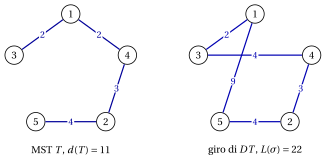
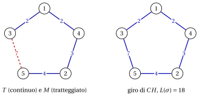

# TSP: il caso generale e il caso metrico

**Parte 5 · Algoritmi di approssimazione · Capitolo 39** · [:material-file-pdf-box: Dispensa, volume 5 (PDF)](../pdf/dispensa-5-algoritmi-di-approssimazione.pdf) · [:material-presentation: Slide](../pdf/slide-tsp-approximation.pdf) · [:material-pencil: Esercizi: Commesso viaggiatore (TSP)](../esercizi/tsp-approximation.md) · [:material-gesture-tap: App: TSP metrico: double tree e Christofides](../laboratorio/tsp-metrico-double-tree-christofides.md)

!!! nota "Prerequisiti"

    - Da questo modulo, il capitolo [«Principi degli algoritmi di approssimazione»](approximation.md): rapporto di prestazione, garanzia di prestazione relativa, garanzia tight e rapporto di prestazione nel caso peggiore.

    - Da questo modulo, il capitolo [«Problemi di routing»](../problemi-di-ottimizzazione-combinatoria/tsp/index.md): la definizione e l'istanza di riferimento del TSP.

    - Dal modulo <em>Algoritmi</em> ([pagina principale del modulo](https://fabiofurini.github.io/algoritmi/)): alberi ricoprenti di costo minimo (Kruskal), circuiti euleriani e le nozioni di NP-completezza e di tempo polinomiale.

!!! chiave "Obiettivi"

    Alla fine di questo capitolo saremo in grado di:

    - dimostrare che per il TSP generale non esiste una garanzia costante, a meno che $P=NP$;

    - spiegare perché è la disuguaglianza triangolare a rendere approssimabile il TSP;

    - eseguire a mano l'algoritmo del doppio albero e l'algoritmo di Christofides su un'istanza metrica;

    - dimostrare le garanzie $2$ del doppio albero e $\frac{3}{2}$ dell'algoritmo di Christofides;

    - costruire le famiglie di istanze che rendono tight queste garanzie.

Il problema di questo capitolo è il [problema del commesso viaggiatore (TSP)](../problemi-di-ottimizzazione-combinatoria/tsp/index.md): la sua definizione e le sue ipotesi sono nella sua pagina.

## 39.1 Il TSP generale non è approssimabile

- Come nella pagina del problema, un'istanza ha un insieme $\mathscr{V}=\{1,2,\dots,n\}$ di città, $n\ge 3$, e distanze simmetriche $d_{ij}=d_{ji}\in\Z_{\ge 1}$; un giro $\sigma$ è una permutazione di $\mathscr{V}$, di lunghezza $L(\sigma)=\sum_{k=1}^{n-1} d_{\sigma_k\sigma_{k+1}}+d_{\sigma_n\sigma_1}$, e la lunghezza va minimizzata.

- <strong>Richiamo.</strong> Come nel capitolo [«Principi degli algoritmi di approssimazione»](approximation.md#box-2-def-pratio), $z(I)$ è il valore ottimo dell'istanza $I$ e $\mathscr{A}(I)$ il valore della soluzione restituita dall'algoritmo $\mathscr{A}$. Il TSP è un problema di minimo, quindi

    $$
    \mathscr{A}(I) \ge z(I) ~~~~~~~\text{e}~~~~~~~ \frac{\mathscr{A}(I)}{z(I)} \ge 1
    $$

    per ogni istanza $I$, e il rapporto di prestazione nel caso peggiore è $r(\mathscr{A})=\sup_I \mathscr{A}(I)/z(I)$.

- Per il TSP generale nessun algoritmo polinomiale ha una garanzia costante, a meno che $P=NP$. La dimostrazione segue lo schema di tutti i risultati di questo tipo: un algoritmo di approssimazione con una garanzia troppo buona deciderebbe in tempo polinomiale un problema NP-completo.

!!! teorema "Proposizione 39.1"

    Sia $\alpha\ge1$ una costante. Se $P\neq NP$, non esiste un algoritmo polinomiale $\mathscr{A}$ per il TSP tale che, per ogni istanza $I$ del TSP,

    $$
    \frac{\mathscr{A}(I)}{z(I)} \;\le\; \alpha .
    $$

??? dimostrazione "Dimostrazione"

    Il <strong>problema del ciclo hamiltoniano</strong> chiede se un grafo $G=(V,E)$ ha un ciclo che passa per tutti i suoi vertici; è NP-completo. Supponiamo che $\mathscr{A}$ esista e, dato un grafo $G$ con $n\ge3$ vertici, costruiamo l'istanza $I_G$ del TSP sulle città $\mathscr{V}=V$ con

    $$
    d_{ij}=
    \begin{cases}
    1 & \text{se } \{i,j\}\in E,\\
    \lceil\alpha n\rceil+1 & \text{altrimenti.}
    \end{cases}
    $$

    Se $G$ ha un ciclo hamiltoniano, quel ciclo è un giro di lunghezza $n$, quindi $z(I_G)=n$ e $\mathscr{A}(I_G)\le\alpha n$. Se $G$ non ha un ciclo hamiltoniano, ogni giro usa almeno una coppia $\{i,j\}\notin E$, quindi

    $$
    \mathscr{A}(I_G)\;\ge\; z(I_G) \;\ge\; (n-1)+\lceil\alpha n\rceil+1 \;>\; \alpha n .
    $$

    Quindi $G$ è hamiltoniano se e solo se $\mathscr{A}(I_G)\le\alpha n$. Costruire $I_G$ ed eseguire $\mathscr{A}$ richiede tempo polinomiale, quindi il problema del ciclo hamiltoniano sarebbe in $P$, e $P=NP$. □

- L'istanza $I_G$ viola la <strong>disuguaglianza triangolare</strong> $d_{ij}\le d_{ik}+d_{kj}$ non appena $G$ ha un cammino $i,k,j$ con $\{i,j\}\notin E$: $d_{ij}=\lceil\alpha n\rceil+1>2=d_{ik}+d_{kj}$. La dimostrazione ha bisogno di distanze così grandi, e non dice nulla sulle istanze che soddisfano la disuguaglianza.

- Il risultato e la sua dimostrazione sono dovuti a Sahni e Gonzalez (1976), e la NP-completezza del problema del ciclo hamiltoniano a Karp (1972).

!!! chiave ""

    Il TSP generale non è approssimabile: a meno che $P=NP$, nessun algoritmo polinomiale ha una garanzia di prestazione costante. Il TSP <em>metrico</em>, il caso particolare con la disuguaglianza triangolare, è approssimabile, e il resto del capitolo è dedicato a esso.

## 39.2 Un caso particolare: il TSP metrico

!!! definizione "Definizione 39.2: TSP metrico"

    Un'istanza del TSP, con città $\mathscr{V}=\{1,2,\dots,n\}$ e distanze simmetriche $d_{ij}=d_{ji}\in\Z_{\ge 1}$, è <strong>metrica</strong> se le distanze soddisfano la disuguaglianza triangolare

    \begin{equation*}
    \label{eq:triangle}
    d_{ij} \le d_{ik} + d_{kj} \qquad \text{per ogni terna di città distinte } i,j,k \in \mathscr{V}. \tag{39.1}
    \end{equation*}

- Il <strong>TSP metrico</strong> è il TSP ristretto alle istanze metriche. Le istanze $I_G$ della [Proposizione 39.1](#box-1-prop-TSPinapx) non sono metriche: è proprio la disuguaglianza triangolare a rendere approssimabile il TSP, e ogni garanzia delle prossime sezioni la usa.

- L'istanza di riferimento ha $5$ città, è metrica, e il suo unico giro ottimo è $(1,3,5,2,4)$, con $z(I)=18$. Le sue distanze sono:

    $$
    \begin{array}{c|ccccc}
    \hline {d_{ij}} & {1} & {2} & {3} & {4} & {5} \\
    \hline {1} & --- & {5} & {2} & {2} & {9} \\
    {2} & {5} & --- & {4} & {3} & {4} \\
    {3} & {2} & {4} & --- & {4} & {7} \\
    {4} & {2} & {3} & {4} & --- & {7} \\
    {5} & {9} & {4} & {7} & {7} & --- \\
    \hline
    \end{array}
    $$

## 39.3 L'algoritmo del doppio albero e l'algoritmo di Christofides

- I due algoritmi di questa sezione costruiscono un giro a partire da un <strong>albero ricoprente di costo minimo</strong> (MST) del grafo completo su $\mathscr{V}$, con pesi degli spigoli $d_{ij}$. Lo calcoliamo con l'algoritmo di Kruskal: gli spigoli si esaminano per distanza non decrescente (pareggi per coppia di indici) e uno spigolo si prende se non chiude un ciclo con gli spigoli già presi. Il peso di un albero $T$ è $d(T)=\sum_{\{i,j\}\in T}d_{ij}$.

- Entrambi gli algoritmi costruiscono prima un cammino chiuso che passa per ogni città, eventualmente più di una volta, e poi lo trasformano in un giro con le <strong>scorciatoie</strong> (shortcutting): si segue il cammino e si salta ogni città già visitata, cioè una città si mantiene solo alla sua prima occorrenza.

- Un cammino chiuso che usa ogni spigolo di un (multi)grafo esattamente una volta è un <strong>circuito euleriano</strong>. Negli esempi lo costruiamo con la <strong>regola di Fleury</strong>: si parte dalla città $1$ e, a ogni passo, si lascia la città corrente lungo uno spigolo non usato verso il vicino di indice minimo, a meno che quello spigolo sia un <em>ponte</em> degli spigoli non usati (la sua rimozione li sconnette) e sia disponibile un altro spigolo.

### 39.3.1 L'algoritmo del doppio albero { #sez-sec-DT }

!!! chiave ""

    Il <em>Double Tree Algorithm</em> (algoritmo del doppio albero, indicato con $DT$) è un'euristica costruttiva per il TSP metrico. Calcola un albero ricoprente di costo minimo $T$, raddoppia ciascuno dei suoi spigoli, segue un circuito euleriano dell'albero raddoppiato, e lo trasforma in un giro con le scorciatoie.

!!! algoritmo "Algoritmo: Double Tree"

    

<strong>Input:</strong> istanza del TSP metrico con \(n\) città e distanze \(d[1..n][1..n]\)

<strong>Output:</strong> un giro \(\sigma\) e la sua lunghezza \(L(\sigma)\)

1<strong>Function</strong> DoubleTree(\(n, d\))

2\(T :=\) un albero ricoprente di costo minimo del grafo completo (Kruskal)

3\(D :=\) il multigrafo con due copie di ogni spigolo di \(T\)

4\(W :=\) un circuito euleriano di \(D\) dalla città \(1\) (Fleury)

5\(\sigma :=\) le città di \(W\) in ordine di prima occorrenza ▹ scorciatoie

6<strong>return</strong> \(\sigma\), \(L(\sigma)\)

- Nell'albero raddoppiato, la regola di Fleury non torna mai al padre finché resta da visitare un figlio, perché l'ultima copia dello spigolo verso il padre è un ponte. Il circuito euleriano è quindi una visita in profondità di $T$ dalla città $1$, con i figli in ordine crescente, e il giro $\sigma$ è l'ordine in cui la visita incontra le città per la prima volta (il <em>preordine</em>).

- Con l'algoritmo di Kruskal e una visita in profondità, $DT$ richiede tempo $O(n^2\log n)$.

!!! esempio "Esempio 39.1: $DT$ sull'istanza di riferimento del TSP"

    L'algoritmo di Kruskal esamina $\{1,3\}$ ($2$, preso), $\{1,4\}$ ($2$, preso), $\{2,4\}$ ($3$, preso), $\{2,3\}$ ($4$, chiude il ciclo $2,3,1,4$: scartato), $\{2,5\}$ ($4$, preso). L'albero è $T=\{\{1,3\},\{1,4\},\{2,4\},\{2,5\}\}$, con $d(T)=2+2+3+4=11$, ed è l'unico MST dell'istanza.

    { .fig loading=lazy  }

    Il circuito euleriano dell'albero raddoppiato dalla città $1$ è

    $$
    W=(1,3,1,4,2,5,2,4,1), \qquad 2+2+2+3+4+4+3+2=22=2\,d(T).
    $$

    Mantenendo ogni città alla sua prima occorrenza otteniamo $\sigma=(1,3,4,2,5)$, di lunghezza

    $$
    L(\sigma)=d_{13}+d_{34}+d_{42}+d_{25}+d_{51}=2+4+3+4+9=22.
    $$

    Le scorciatoie sostituiscono $3\to1\to4$ ($2+2$) con $3\to4$ ($4$) e $5\to2\to4\to1$ ($4+3+2$) con $5\to1$ ($9$): su questa istanza entrambe le disuguaglianze triangolari usate valgono all'uguaglianza, e le scorciatoie non fanno risparmiare nulla. Quindi $DT(I)=22$ e $\frac{DT(I)}{z(I)}=\frac{22}{18}=\frac{11}{9}$.

### 39.3.2 L'algoritmo di Christofides { #sez-sec-CH }

!!! chiave ""

    Il <em>Christofides Algorithm</em> (algoritmo di Christofides, indicato con $CH$) è un'euristica costruttiva per il TSP metrico. Calcola un albero ricoprente di costo minimo $T$ e, invece di raddoppiarlo, aggiunge a $T$ un abbinamento perfetto di peso minimo $M$ sulle città di grado dispari in $T$; poi segue un circuito euleriano di $T\cup M$ e lo trasforma in un giro con le scorciatoie.

!!! algoritmo "Algoritmo: Christofides"

    

<strong>Input:</strong> istanza del TSP metrico con \(n\) città e distanze \(d[1..n][1..n]\)

<strong>Output:</strong> un giro \(\sigma\) e la sua lunghezza \(L(\sigma)\)

1<strong>Function</strong> Christofides(\(n, d\))

2\(T :=\) un albero ricoprente di costo minimo del grafo completo (Kruskal)

3\(O := \{\, v\in\mathscr{V} : v \text{ ha grado dispari in } T \,\}\)
    \(M :=\) un abbinamento perfetto di peso minimo delle città in \(O\) ▹ \(|O|\) è pari

4\(D := T \cup M\) 
    \(W :=\) un circuito euleriano di \(D\) dalla città \(1\) (Fleury) ▹ multigrafo, tutti i gradi pari

5\(\sigma :=\) le città di \(W\) in ordine di prima occorrenza ▹ scorciatoie

6<strong>return</strong> \(\sigma\), \(L(\sigma)\)

- <strong>Perché $|O|$ è pari.</strong> I gradi di un grafo sommano al doppio del numero di spigoli, un numero pari, quindi il numero di vertici di grado dispari è pari, e un abbinamento perfetto di $O$ esiste (il grafo è completo).

- <strong>Perché $T\cup M$ ha gradi pari.</strong> Ogni città di $O$ riceve da $M$ esattamente uno spigolo in più, e le altre città nessuno. Se uno spigolo appartiene sia a $T$ sia a $M$, $D$ ne contiene due copie.

- Un abbinamento perfetto di peso minimo si può calcolare in tempo polinomiale, $O(n^3)$, con l'algoritmo blossom di Edmonds; negli esempi e negli esercizi $|O|\le 4$ e gli abbinamenti si enumerano ($|O|=4$ dà $3$ abbinamenti perfetti).

!!! esempio "Esempio 39.2: $CH$ sull'istanza di riferimento del TSP"

    L'MST è quello dell'[Esempio 39.1](#box-3-ex-dt), con gradi $\deg(1)=2$, $\deg(2)=2$, $\deg(3)=1$, $\deg(4)=2$, $\deg(5)=1$. Quindi $O=\{3,5\}$ e l'unico abbinamento perfetto è $M=\{\{3,5\}\}$, con $d(M)=7$.

    { .fig loading=lazy  }

    $T\cup M$ è un ciclo che passa per tutte le città. La regola di Fleury dalla città $1$ (vicini $3$ e $4$) va in $3$ e dà $W=(1,3,5,2,4,1)$, di lunghezza $d(T)+d(M)=11+7=18$, in cui nessuna città si ripete: non serve alcuna scorciatoia e $\sigma=(1,3,5,2,4)$, con $CH(I)=18=z(I)$. Sull'istanza di riferimento $CH$ trova il giro ottimo, mentre $DT$ lo supera di $4$ unità.

## 39.4 Proprietà strutturali

- Le garanzie della prossima sezione confrontano la lunghezza di un giro euristico con un lower bound su $z(I)$. Servono tre proprietà: le scorciatoie non aumentano la lunghezza, un MST è più corto di ogni giro, e lo stesso vale per (il doppio di) un abbinamento perfetto minimo di un insieme pari di città.

!!! teorema "Osservazione 39.3"

    In un'istanza del TSP metrico, sia $W$ un cammino chiuso che visita ogni città almeno una volta, e sia $\sigma$ il giro ottenuto da $W$ con le scorciatoie. Allora $L(\sigma)\le$ lunghezza di $W$.

??? dimostrazione "Dimostrazione"

    Ogni spigolo $\{\sigma_k,\sigma_{k+1}\}$ del giro (e lo spigolo di chiusura $\{\sigma_n,\sigma_1\}$) sostituisce un tratto $\sigma_k=u_0,u_1,\dots,u_q=\sigma_{k+1}$ di $W$ le cui città interne vengono saltate. Applicando la disuguaglianza triangolare $\eqref{eq:triangle}$ $q-1$ volte,

    $$
    d_{u_0u_q} \;\le\; d_{u_0u_1}+d_{u_1u_q} \;\le\; \dots \;\le\; \sum_{p=0}^{q-1} d_{u_pu_{p+1}} .
    $$

    I tratti sono parti disgiunte di $W$, quindi sommando su tutti gli spigoli di $\sigma$ si ottiene $L(\sigma)\le$ lunghezza di $W$. □

!!! teorema "Osservazione 39.4"

    Per ogni istanza del TSP (metrica o no) e ogni albero ricoprente di costo minimo $T$,

    $$
    d(T) \;\le\; z(I) .
    $$

??? dimostrazione "Dimostrazione"

    Togliendo uno spigolo qualsiasi da un giro ottimo resta un cammino che passa per tutte le città, che è un albero ricoprente. Il suo peso è $z(I)$ meno la distanza tolta, al più $z(I)$ poiché le distanze sono positive, e l'MST non pesa più di alcun albero ricoprente. □

!!! teorema "Osservazione 39.5"

    In un'istanza del TSP metrico, sia $O\subseteq\mathscr{V}$ con $|O|$ pari e $|O|\ge 2$, e sia $M$ un abbinamento perfetto di peso minimo di $O$. Allora

    $$
    d(M) \;\le\; \frac{z(I)}{2} .
    $$

??? dimostrazione "Dimostrazione"

    Sia $\tilde\sigma$ un giro ottimo e applichiamo le scorciatoie restringendolo alle città di $O$: otteniamo un ciclo $o_1,o_2,\dots,o_{|O|},o_1$ sulle città di $O$ che, per l'[Osservazione 39.3](#box-5-obs-shortcut), ha lunghezza al più $z(I)$. Poiché $|O|$ è pari, i suoi spigoli si dividono in due abbinamenti perfetti di $O$, prendendo alternativamente uno spigolo ciascuno:

    $$
    M_1=\{\{o_1,o_2\},\{o_3,o_4\},\dots\}, \qquad M_2=\{\{o_2,o_3\},\{o_4,o_5\},\dots,\{o_{|O|},o_1\}\}.
    $$

    Quindi $d(M_1)+d(M_2)\le z(I)$, uno dei due pesa al più $\frac{z(I)}{2}$, e $d(M)\le \min\{d(M_1),d(M_2)\}\le\frac{z(I)}{2}$. (Per $|O|=2$ il ciclo è lo spigolo $\{o_1,o_2\}$ percorso due volte e $M_1=M_2$.) □

- L'ultima proprietà che serve è classica: un multigrafo connesso in cui ogni vertice ha grado pari ha un circuito euleriano (un risultato classico di Eulero), e la regola di Fleury ne trova uno. L'albero raddoppiato di $DT$ e il multigrafo $T\cup M$ di $CH$ sono connessi (contengono $T$) e hanno gradi pari.

- Sull'istanza di riferimento: $d(T)=11\le 18$, e con $O=\{3,5\}$ il giro ottimo ristretto a $O$ è $3,5,3$, di lunghezza $14\le18$, quindi $d(M)=7\le 9$.

## 39.5 Garanzie di prestazione

### 39.5.1 Il rapporto di prestazione nel caso peggiore di DT

!!! teorema "Proposizione 39.6"

    Per ogni istanza $I$ del TSP metrico,

    $$
    \frac{DT(I)}{z(I)} \;\le\; 2 .
    $$

??? dimostrazione "Dimostrazione"

    Il circuito euleriano $W$ dell'albero raddoppiato usa ogni spigolo di $T$ due volte, quindi la sua lunghezza è $2\,d(T)$, e visita ogni città perché $T$ è ricoprente. Per l'[Osservazione 39.3](#box-5-obs-shortcut) e l'[Osservazione 39.4](#box-6-obs-mst),

    $$
    DT(I)=L(\sigma) \;\le\; 2\,d(T) \;\le\; 2\,z(I).
    $$

    
□

!!! teorema "Proposizione 39.7"

    Esistono istanze $I_n$ del TSP metrico, con $n\ge5$ dispari, tali che

    $$
    \frac{DT(I_n)}{z(I_n)} \;=\; \frac{2n}{n+2} \;\to\; 2 \qquad\text{per}\qquad n\to+\infty .
    $$

??? dimostrazione "Dimostrazione"

    Siano $n=2k+1$ con $k\ge2$, $a:=n$ e $b:=n+1$. La città $1$ è un centro e le città $2,\dots,n$ sono foglie; le foglie sono unite dal cammino

    $$
    P=(3,5,\dots,2k+1,\,2,4,\dots,2k),
    $$

    in cui città consecutive non hanno mai indici consecutivi (le differenze valgono $2$, e $2k-1\ge3$ per lo spigolo $\{2k+1,2\}$). Le distanze sono

    $$
    d_{ij}=
    \begin{cases}
    a & \text{se } i=1 \text{ o } j=1,\\
    b & \text{se } \{i,j\} \text{ è uno spigolo di } P,\\
    2a & \text{altrimenti.}
    \end{cases}
    $$

    Tutte le distanze sono comprese fra $a$ e $2a$, quindi $d_{ij}\le 2a\le d_{ik}+d_{kj}$: l'istanza è metrica.

    <em>$DT$.</em> Le sole distanze pari ad $a$ sono quelle dal centro, e un albero ricoprente ha $n-1$ spigoli, ciascuno di peso almeno $a$: la stella di centro $1$ è l'unico MST, con $d(T)=(n-1)a$. La visita in profondità dalla città $1$ incontra le foglie in ordine crescente, $\sigma=(1,2,3,\dots,n)$, e nessuna coppia di foglie consecutive è uno spigolo di $P$:

    $$
    DT(I_n)=a+(n-2)\,2a+a=2(n-1)a=2n(n-1).
    $$

    <em>Ottimo.</em> Un giro ha esattamente due spigoli nella città $1$ (di lunghezza $a$ ciascuno) e $n-2$ spigoli fra foglie (di lunghezza almeno $b$ ciascuno), quindi $z(I_n)\ge 2a+(n-2)b$. Il giro $(1,3,5,\dots,2k+1,2,4,\dots,2k)$ segue $P$ e raggiunge questo valore, quindi

    $$
    z(I_n)=2a+(n-2)b=2n+(n-2)(n+1)=(n+2)(n-1).
    $$

    Pertanto

    $$
    \frac{DT(I_n)}{z(I_n)}=\frac{2n(n-1)}{(n+2)(n-1)}=\frac{2n}{n+2}=\frac{2}{1+\frac2n}\;\to\;2 .
    $$

    
□

!!! chiave ""

    Dalla [Proposizione 39.6](#box-8-prop-DT) e dalla [Proposizione 39.7](#box-9-prop-DTtight) segue che $DT$ è un algoritmo di $2$-approssimazione per il TSP metrico, e che il suo rapporto di prestazione nel caso peggiore è

    $$
    r(DT)=2
    $$

- Per $n=5$: $a=5$, $b=6$, $P=(3,5,2,4)$, $DT(I_5)=40$, $z(I_5)=28$ e il rapporto è $\frac{10}{7}$; per $n=7$ e $n=9$ i rapporti sono $\frac{14}{9}$ e $\frac{18}{11}$.

- Sull'istanza di riferimento $DT(I)=22=2\,d(T)$: l'upper bound della dimostrazione è raggiunto, ma $z(I)=18>d(T)=11$, e il rapporto è solo $\frac{11}{9}$.

- L'analisi di $DT$ è dovuta a Rosenkrantz, Stearns e Lewis (1977).

### 39.5.2 Il rapporto di prestazione nel caso peggiore di CH

!!! teorema "Proposizione 39.8"

    Per ogni istanza $I$ del TSP metrico,

    $$
    \frac{CH(I)}{z(I)} \;\le\; \frac{3}{2} .
    $$

??? dimostrazione "Dimostrazione"

    Il circuito euleriano $W$ di $T\cup M$ usa ogni spigolo una volta, quindi la sua lunghezza è $d(T)+d(M)$, e visita ogni città. Per l'[Osservazione 39.3](#box-5-obs-shortcut), l'[Osservazione 39.4](#box-6-obs-mst) e l'[Osservazione 39.5](#box-7-obs-matching) (con l'insieme $O$ delle città di grado dispari, $|O|\ge2$ perché un albero con almeno due vertici ha almeno due foglie),

    $$
    CH(I)=L(\sigma) \;\le\; d(T)+d(M) \;\le\; z(I)+\frac{z(I)}{2} \;=\; \frac32\,z(I).
    $$

    
□

!!! teorema "Proposizione 39.9"

    Esistono istanze $I_n$ del TSP metrico, con $n\ge5$ dispari, tali che

    $$
    \frac{CH(I_n)}{z(I_n)} \;\to\; \frac{3}{2} \qquad\text{per}\qquad n\to+\infty .
    $$

??? dimostrazione "Dimostrazione"

    Siano $n\ge5$ dispari, $a:=n$ e $b:=n+1$, così che $a<b<2a$. Consideriamo il grafo $H$ sulle città $1,\dots,n$ con gli spigoli $\{i,i+1\}$ di lunghezza $a$ e $\{i,i+2\}$ di lunghezza $b$ (una striscia di triangoli), e sia $d_{ij}$ la lunghezza di un cammino minimo da $i$ a $j$ in $H$; le distanze di cammino minimo soddisfano sempre la disuguaglianza triangolare. Un cammino da $i$ a $j>i$ avanza di $1$ (costo $a$) o di $2$ (costo $b$) a ogni spigolo, e poiché $b<2a$ conviene avanzare di $2$ il più possibile:

    $$
    d_{ij}=\left\lfloor\frac{|i-j|}{2}\right\rfloor b+\big(|i-j| \bmod 2\big)\, a .
    $$

    <em>$CH$.</em> Le distanze pari ad $a$ sono esattamente quelle fra città consecutive, quindi, come nella dimostrazione precedente, il cammino $T=\{\{1,2\},\{2,3\},\dots,\{n-1,n\}\}$ è l'unico MST, con $d(T)=(n-1)a$.

    Le sue città di grado dispari sono $O=\{1,n\}$, quindi $M=\{\{1,n\}\}$, con $d(M)=\frac{n-1}{2}b$. $T\cup M$ è il ciclo $1,2,\dots,n,1$, la regola di Fleury lo segue dalla città $1$ verso la città $2$, e non serve alcuna scorciatoia:

    $$
    CH(I_n)=(n-1)a+\frac{n-1}{2}\,b=(n-1)\,\frac{3n+1}{2}.
    $$

    <em>Un upper bound sull'ottimo.</em> Il giro $(1,3,5,\dots,n,n-1,n-3,\dots,2)$ usa $n-2$ spigoli di lunghezza $b$ e i due spigoli $\{n,n-1\}$ e $\{2,1\}$ di lunghezza $a$, quindi

    $$
    z(I_n)\le (n-2)b+2a=(n-2)(n+1)+2n=(n+2)(n-1).
    $$

    Insieme alla [Proposizione 39.8](#box-10-prop-CH),

    $$
    \frac32 \;\ge\; \frac{CH(I_n)}{z(I_n)} \;\ge\; \frac{(n-1)(3n+1)}{2(n+2)(n-1)}=\frac{3n+1}{2n+4}
    =\frac{3+\frac1n}{2+\frac4n}\;\to\;\frac32 .
    $$

    
□

!!! chiave ""

    Dalla [Proposizione 39.8](#box-10-prop-CH) e dalla [Proposizione 39.9](#box-11-prop-CHtight) segue che $CH$ è un algoritmo di $\frac32$-approssimazione per il TSP metrico, e che il suo rapporto di prestazione nel caso peggiore è

    $$
    r(CH)=\frac32
    $$

- Per $n=5,7,9$ l'enumerazione di tutti i giri mostra che l'upper bound su $z(I_n)$ è l'ottimo ($28$, $54$, $88$), e i rapporti sono $\frac{32}{28}=\frac87$, $\frac{66}{54}=\frac{11}{9}$, $\frac{112}{88}=\frac{14}{11}$.

- L'algoritmo è stato trovato indipendentemente da Christofides (1976) e da Serdyukov (1978). Per più di quarant'anni non si è conosciuto per il TSP metrico alcun algoritmo polinomiale con una costante migliore; il primo miglioramento, di una costante piccolissima, è un algoritmo randomizzato di Karlin, Klein e Oveis Gharan (2021).

## 39.6 Fonti

- D.J. Rosenkrantz, R.E. Stearns, P.M. Lewis II, An analysis of several heuristics for the traveling salesman problem, <em>SIAM Journal on Computing</em> 6(3):563–581, 1977.

- N. Christofides, Worst-case analysis of a new heuristic for the travelling salesman problem, Report 388, Carnegie-Mellon University, 1976.

- A.I. Serdyukov, On some extremal walks in graphs, <em>Upravlyaemye Sistemy</em> 17:76–79, 1978.

- S. Sahni, T. Gonzalez, P-complete approximation problems, <em>Journal of the ACM</em> 23(3):555–565, 1976.

- R.M. Karp, Reducibility among combinatorial problems, in <em>Complexity of Computer Computations</em>, Plenum Press, 85–103, 1972.

## 39.7 Errori tipici

!!! attenzione "Attenzione"

    - <strong>Applicare $DT$ o $CH$ a un'istanza non metrica.</strong> Le garanzie $2$ e $\frac{3}{2}$ usano la disuguaglianza triangolare, nel passo delle scorciatoie; senza di essa non esiste alcuna garanzia costante.

    - <strong>Saltare una città visitata per la prima volta.</strong> Seguendo il circuito euleriano, una città si salta solo se è già stata visitata; la prima occorrenza si mantiene.

    - <strong>Abbinare le città sbagliate in $CH$.</strong> L'abbinamento perfetto si calcola sulle città di grado <em>dispari</em> nell'albero ricoprente, il cui numero è pari, e ha peso minimo.

## 39.8 In sintesi

!!! chiave "In sintesi"

    - Il TSP generale non è approssimabile: un algoritmo con una garanzia costante deciderebbe il problema del ciclo hamiltoniano in tempo polinomiale.

    - Il TSP metrico è il caso particolare approssimabile. Le garanzie di $DT$ e $CH$ si dimostrano con lower bound su $z(I)$: l'albero ricoprente di costo minimo e metà dell'abbinamento perfetto minimo; le scorciatoie, che usano la disuguaglianza triangolare, trasformano il circuito euleriano in un giro non più lungo.

    - Entrambi i rapporti sono tight, con famiglie di istanze costruite in questo capitolo.

    
<table>
    <tr>
    <th>problema</th>
    <th>algoritmo</th>
    <th>rapporto nel caso peggiore</th>
    </tr>
    <tr>
    <td>TSP generale</td>
    <td>qualsiasi polinomiale</td>
    <td>nessuna costante, a meno che \(P=NP\)</td>
    </tr>
    <tr>
    <td>TSP metrico</td>
    <td>\(DT\)</td>
    <td>\(2\) (tight)</td>
    </tr>
    <tr>
    <td>TSP metrico</td>
    <td>\(CH\)</td>
    <td>\(\frac32\) (tight)</td>
    </tr>
    </table>

    <strong>Quadro riassuntivo dell'istanza di riferimento.</strong> I bound su $z(I)$ trovati finora:

    
<table>
    <tr>
    <th>Istanza</th>
    <th>Lower bound</th>
    <th>Valori euristici</th>
    <th>Valore ottimo</th>
    </tr>
    <tr>
    <td>TSP metrico, \(5\) città</td>
    <td>\(11\), albero ricoprente di costo minimo</td>
    <td>\(DT\) \(22\), \(CH\) \(18\)</td>
    <td>\(18\)</td>
    </tr>
    </table>

---

**Esercizi su questo capitolo:** [:material-pencil: Commesso viaggiatore (TSP)](../esercizi/tsp-approximation.md)

<!-- laboratorio-interattivo: sezione generata da interattivi.py -->

:material-flask-outline: **Nel laboratorio interattivo:** [TSP metrico: double tree e Christofides](../laboratorio/tsp-metrico-double-tree-christofides.md).