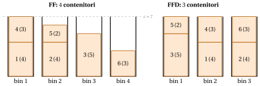

# 30.5 Il problema del bin packing: prima ordinare, poi riempire { #sez-sec-BPP }

**Parte 4 · Algoritmi euristici · Capitolo 30** · [:material-book-open-variant: Capitolo 30: Euristiche costruttive](index.md) · [:material-file-pdf-box: Dispensa, volume 4 (PDF)](../../pdf/dispensa-4-algoritmi-euristici.pdf) · [:material-presentation: Slide (1/2)](../../pdf/slide-constructive-heuristics-1.pdf) · [:material-presentation: Slide (2/2)](../../pdf/slide-constructive-heuristics-2.pdf) · [:material-pencil: Esercizi: Euristiche costruttive](../../esercizi/constructive-heuristics.md) · [:material-gesture-tap: App: Euristiche per il bin packing](../../laboratorio/euristiche-bin-packing.md) · [:material-gesture-tap: App: List scheduling e LPT](../../laboratorio/list-scheduling-lpt.md) · [:material-gesture-tap: App: Colorazione: greedy e DSATUR](../../laboratorio/colorazione-greedy-dsatur.md) · [:material-gesture-tap: App: TSP: nearest neighbour e 2-opt](../../laboratorio/tsp-nn-2opt.md)

- Quattro euristiche greedy classiche per il BPP elaborano gli oggetti <strong>nell'ordine di input</strong> e differiscono per la regola con cui scelgono il contenitore: Next Fit (NF) tiene aperto un solo contenitore, mentre First Fit (FF), Best Fit (BF) e Worst Fit (WF) tengono tutti i contenitori e scelgono, fra quelli in cui l'oggetto entra, il primo aperto, il più pieno o il più vuoto. Sull'istanza di riferimento del BPP ($c=7$, $w=(4,4,5,3,2,3)$, $z(I)=3$) danno

    $$
    NF(I)=5, \qquad FF(I)=4, \qquad BF(I)=3, \qquad WF(I)=4 .
    $$

- In queste euristiche il <em>contenitore</em> si sceglie con un criterio, ma l'<em>oggetto</em> no: gli oggetti arrivano nell'ordine dell'input, che può essere un cattivo ordine. Quando l'intera istanza è nota in anticipo — il caso <em>offline</em> — niente ci obbliga ad accettare quell'ordine. L'idea di questa sezione è scegliere anche l'ordine degli oggetti: <strong>prima ordinare, poi riempire</strong>.

- <strong>Perché prima gli oggetti grandi.</strong> Gli oggetti difficili di un'istanza del BPP sono quelli grandi: due oggetti più grandi di $\frac{c}{2}$ non stanno mai nello stesso contenitore, e un oggetto grande entra solo in un contenitore ancora quasi vuoto. Gli oggetti piccoli, al contrario, possono riempire i vuoti lasciati in qualunque contenitore. Se gli oggetti piccoli arrivano prima, si distribuiscono sui contenitori e occupano lo spazio che servirà dopo agli oggetti grandi; se gli oggetti grandi arrivano prima, ciascuno di essi ha il proprio contenitore, e gli oggetti piccoli servono poi a riempire i vuoti.

## 30.5.1 First Fit Decreasing { #sez-sec-FFD }

!!! chiave ""

    Il <em>First Fit Decreasing Algorithm</em> (indicato con FFD) è un'euristica costruttiva per il BPP. Prima ordina gli oggetti per peso non crescente, poi li inserisce in quest'ordine con First Fit: ogni oggetto va nel primo contenitore, nell'ordine in cui i contenitori sono stati aperti, in cui entra; se non entra in nessun contenitore, se ne apre uno nuovo.

!!! algoritmo "Algoritmo: First Fit Decreasing"

    

<strong>Input:</strong> istanza \(I\) del BPP con \(n\) oggetti, pesi \(w[1..n]\), capacità \(c\)

<strong>Output:</strong> assegnamento oggetti-contenitori \(bin[1..n]\) e numero di contenitori usati \(nb\)

1<strong>Function</strong> FirstFitDecreasing(\(n, w, c\))

2\(\rho :=\) gli oggetti ordinati per peso non crescente
    \(bin := \text{nuovo vettore}[1..n]\)
    \(rc := \text{nuovo vettore}[1..n]\)
    \(nb := 0\) ▹ prima ordinare assegnamento oggetti-contenitori capacità residue numero di contenitori

3<strong>for</strong> \(k := 1\) <strong>to</strong> \(n\) <strong>do</strong>

4\(j := \rho[k]\)
    \(s := -1\) ▹ poi riempire: \(k\)-esimo oggetto più grande contenitore selezionato

5<strong>for</strong> \(b := 1\) <strong>to</strong> \(nb\) <strong>do</strong>

6<strong>if</strong> \(w[j] \le rc[b]\) <strong>then</strong>

7\(s \leftarrow b\)

8<strong>break</strong>

9<strong>end</strong>

10<strong>end</strong>

11<strong>if</strong> \(s = -1\) <strong>then</strong>

12\(nb \leftarrow nb + 1\) 
    \(rc[nb] \leftarrow c\) ▹ aprire un nuovo contenitore

13\(s \leftarrow nb\)

14<strong>end</strong>

15\(bin[j] \leftarrow s\) 
    \(rc[s] \leftarrow rc[s] - w[j]\) ▹ assegnare l'oggetto

16<strong>end</strong>

17<strong>return</strong> \(bin\), \(nb\)

Esegui in Colab:

- Il ciclo di riempimento è esattamente il ciclo di FF: l'unica differenza è la riga che calcola l'ordinamento $\rho$. L'ordinamento costa $O(n\log n)$, e FFD richiede lo stesso tempo di FF, $O(n^2)$ con la semplice scansione dei contenitori.

!!! esempio "Esempio 30.2: FF e FFD sull'istanza di riferimento del BPP"

    <strong>FF</strong>, nell'ordine di input: gli oggetti $1$, $2$ e $3$ (pesi $4,4,5$) aprono un contenitore ciascuno, perché nessuna coppia di essi entra insieme; l'oggetto $4$ (peso $3$) va nel contenitore $1$ ($rc[1]=0$); l'oggetto $5$ (peso $2$) va nel contenitore $2$ ($rc[2]=1$); l'oggetto $6$ (peso $3$) non entra in nessun contenitore, le cui capacità residue sono $0,1,2$, e apre il contenitore $4$. Quindi $FF(I)=4$.

    <strong>FFD</strong>. I pesi ordinati per valore non crescente sono $5,4,4,3,3,2$, cioè $\rho=(3,1,2,4,6,5)$ (pareggi per indice). Quindi:

    1. Oggetto $3$ (peso $5$): nessun contenitore è aperto, FFD apre il contenitore $1$; $rc[1]=7-5=2$.

    2. Oggetto $1$ (peso $4$): $4> rc[1]=2$, FFD apre il contenitore $2$; $rc[2]=7-4=3$.

    3. Oggetto $2$ (peso $4$): $4>rc[1]=2$, $4>rc[2]=3$, FFD apre il contenitore $3$; $rc[3]=7-4=3$.

    4. Oggetto $4$ (peso $3$): $3>rc[1]=2$, $3\le rc[2]=3$: contenitore $2$; $rc[2]=0$.

    5. Oggetto $6$ (peso $3$): $3>rc[1]=2$, $3>rc[2]=0$, $3\le rc[3]=3$: contenitore $3$; $rc[3]=0$.

    6. Oggetto $5$ (peso $2$): $2\le rc[1]=2$: contenitore $1$; $rc[1]=0$.

    Quindi $bin=(2,3,1,2,1,3)$, i pattern di riempimento sono

    $$
    P_1=\{3,5\}, \qquad P_2=\{1,4\}, \qquad P_3=\{2,6\},
    $$

    e $FFD(I)=3=\left\lceil\frac{21}{7}\right\rceil$: la soluzione è ottima, e tutti e tre i contenitori sono pieni.

    { .fig loading=lazy  }

    In FF il piccolo oggetto $5$ arriva prima del grande oggetto $6$ e prende lo spazio che servirebbe all'oggetto $6$ nel contenitore $2$; in FFD l'oggetto $5$ arriva per ultimo e riempie il vuoto del contenitore $1$.

## 30.5.2 Best Fit Decreasing { #sez-sec-BFD }

!!! chiave ""

    Il <em>Best Fit Decreasing Algorithm</em> (indicato con BFD) è un'euristica costruttiva per il BPP. Prima ordina gli oggetti per peso non crescente, poi li inserisce in quest'ordine con Best Fit: ogni oggetto va nel contenitore con la capacità residua minima fra quelli in cui entra (in caso di pareggio, il contenitore aperto per primo); se non entra in nessun contenitore, se ne apre uno nuovo.

!!! algoritmo "Algoritmo: Best Fit Decreasing"

    

<strong>Input:</strong> istanza \(I\) del BPP con \(n\) oggetti, pesi \(w[1..n]\), capacità \(c\)

<strong>Output:</strong> assegnamento oggetti-contenitori \(bin[1..n]\) e numero di contenitori usati \(nb\)

1<strong>Function</strong> BestFitDecreasing(\(n, w, c\))

2\(\rho :=\) gli oggetti ordinati per peso non crescente
    \(bin := \text{nuovo vettore}[1..n]\)
    \(rc := \text{nuovo vettore}[1..n]\)
    \(nb := 0\) ▹ prima ordinare assegnamento oggetti-contenitori capacità residue numero di contenitori

3<strong>for</strong> \(k := 1\) <strong>to</strong> \(n\) <strong>do</strong>

4\(j := \rho[k]\)
    \(s := -1\) ▹ poi riempire: \(k\)-esimo oggetto più grande contenitore selezionato

5<strong>for</strong> \(b := 1\) <strong>to</strong> \(nb\) <strong>do</strong>

6<strong>if</strong> \(w[j] \le rc[b]\) <strong>and</strong> \((s=-1\) <strong>or</strong> \(rc[b] < rc[s])\) <strong>then</strong>

7\(s \leftarrow b\) ▹ contenitore più pieno trovato finora

8<strong>end</strong>

9<strong>end</strong>

10<strong>if</strong> \(s = -1\) <strong>then</strong>

11\(nb \leftarrow nb + 1\) 
    \(rc[nb] \leftarrow c\) ▹ aprire un nuovo contenitore

12\(s \leftarrow nb\)

13<strong>end</strong>

14\(bin[j] \leftarrow s\) 
    \(rc[s] \leftarrow rc[s] - w[j]\) ▹ assegnare l'oggetto

15<strong>end</strong>

16<strong>return</strong> \(bin\), \(nb\)

Esegui in Colab:

- Anche qui il ciclo di riempimento è quello di BF, preceduto dall'ordinamento.

!!! esempio "Esempio 30.3: BFD sull'istanza di riferimento del BPP"

    L'ordinamento è $\rho=(3,1,2,4,6,5)$, come per FFD. Gli oggetti $3$, $1$ e $2$ aprono i contenitori $1$, $2$, $3$, con capacità residue $2,3,3$. L'oggetto $4$ (peso $3$) entra nei contenitori $2$ e $3$, entrambi con capacità residua $3$: il pareggio si risolve a favore del contenitore $2$, e $rc[2]=0$. L'oggetto $6$ (peso $3$) entra solo nel contenitore $3$, e $rc[3]=0$. L'oggetto $5$ (peso $2$) entra solo nel contenitore $1$, e $rc[1]=0$. BFD restituisce gli stessi pattern di riempimento di FFD, $P_1=\{3,5\}$, $P_2=\{1,4\}$, $P_3=\{2,6\}$, e $BFD(I)=3$.

## 30.5.3 Che cosa dà l'ordinamento, e che cosa non dà

- <strong>Una garanzia migliore.</strong> Ordinare gli oggetti migliora il caso peggiore. FF e BF hanno rapporto di prestazione nel caso peggiore $\frac{17}{10}$. Per FFD è noto che

    $$
    FFD(I) \;\le\; \frac{11}{9}\, z(I) + \frac{6}{9} \qquad \text{per ogni istanza (del BPP) } I,
    $$

    e che il bound è tight. Un bound della forma $\frac{11}{9}z(I)+4$ fu dimostrato per la prima volta sia per FFD sia per BFD da D.S. Johnson, A. Demers, J.D. Ullman, M.R. Garey e R.L. Graham (<em>Worst-case performance bounds for simple one-dimensional packing algorithms</em>, SIAM Journal on Computing 3 (1974) 299–325); la costante additiva tight è dovuta a G. Dósa (<em>The tight bound of First Fit Decreasing bin-packing algorithm is $FFD(I)\le 11/9\,OPT(I)+6/9$</em>, ESCAPE 2007, LNCS 4614, pp. 1–11).

- <strong>Non una soluzione migliore su ogni istanza.</strong> Una garanzia nel caso peggiore confronta l'algoritmo con l'ottimo, non con un altro algoritmo: su alcune istanze l'ordine di input è più fortunato di quello ordinato.

!!! esempio "Esempio 30.4: L'ordinamento può peggiorare"

    Siano $c=7$ e $w=(2,2,3,2,2,3)$, con peso totale $14$, così che $z(I)\ge\left\lceil\frac{14}{7}\right\rceil=2$.

    <strong>FF</strong> mette gli oggetti $1,2,3$ nel contenitore $1$ ($2+2+3=7$) e gli oggetti $4,5,6$ nel contenitore $2$ ($2+2+3=7$): $FF(I)=2$, che è ottimo.

    <strong>FFD</strong> esamina gli oggetti nell'ordine $\rho=(3,6,1,2,4,5)$. Gli oggetti $3$ e $6$ vanno nel contenitore $1$ ($rc[1]=1$); gli oggetti $1$, $2$, $4$ non entrano nel contenitore $1$ e vanno nel contenitore $2$ ($rc[2]=1$); l'oggetto $5$ non entra in nessuno dei due contenitori e apre il contenitore $3$: $FFD(I)=3$.

    I due oggetti di peso $3$, messi insieme da FFD, sprecano un'unità di capacità nel contenitore $1$; l'ordine di input li accoppiava invece ciascuno con due oggetti di peso $2$, riempiendo esattamente entrambi i contenitori.

---

**Avanti:** [30.6 Scheduling su macchine parallele: prima i lavori più lunghi](scheduling-su-macchine-parallele-prima-i-lavori-piu-lunghi.md)
