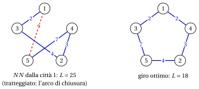
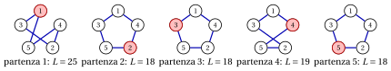
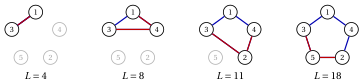
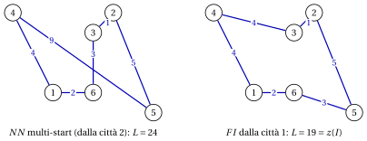

# 30.7 Il problema del commesso viaggiatore: accodare o inserire? { #sez-sec-TSP }

**Parte 4 · Algoritmi euristici · Capitolo 30** · [:material-book-open-variant: Capitolo 30: Euristiche costruttive](index.md) · [:material-file-pdf-box: Dispensa, volume 4 (PDF)](../../pdf/dispensa-4-algoritmi-euristici.pdf) · [:material-presentation: Slide (1/2)](../../pdf/slide-constructive-heuristics-1.pdf) · [:material-presentation: Slide (2/2)](../../pdf/slide-constructive-heuristics-2.pdf) · [:material-pencil: Esercizi: Euristiche costruttive](../../esercizi/constructive-heuristics.md) · [:material-gesture-tap: App: Euristiche per il bin packing](../../laboratorio/euristiche-bin-packing.md) · [:material-gesture-tap: App: List scheduling e LPT](../../laboratorio/list-scheduling-lpt.md) · [:material-gesture-tap: App: Colorazione: greedy e DSATUR](../../laboratorio/colorazione-greedy-dsatur.md) · [:material-gesture-tap: App: TSP: nearest neighbour e 2-opt](../../laboratorio/tsp-nn-2opt.md)

- Per il TSP ogni permutazione delle città è un giro ammissibile, quindi il test di ammissibilità è banale, e tutto il progetto sta nel criterio di selezione. Due famiglie di euristiche costruttive sono naturali, e differiscono per <strong>dove</strong> si colloca la nuova città:

    - <strong>accodare</strong>: la soluzione parziale è un cammino, e la nuova città si aggiunge alla sua fine;

    - <strong>inserire</strong>: la soluzione parziale è un sottogiro chiuso, e la nuova città si inserisce fra due città consecutive, dove costa meno.

## 30.7.1 Nearest neighbour { #sez-sec-NN }

!!! chiave ""

    Il <em>Nearest Neighbour Algorithm</em> (indicato con $NN$) è un'euristica costruttiva per il TSP. Partendo da una città data $s$, si sposta ripetutamente dall'ultima città visitata alla città <em>più vicina</em> non ancora visitata (in caso di pareggio, quella con l'indice minimo); quando tutte le città sono state visitate, torna in $s$.

!!! algoritmo "Algoritmo: Nearest Neighbour"

    

<strong>Input:</strong> istanza del TSP con \(n\) città, distanze \(d[1..n][1..n]\); città di partenza \(s\)

<strong>Output:</strong> giro \(\sigma[1..n]\)

1<strong>Function</strong> NearestNeighbour(\(n, d, s\))

2\(\sigma[1] \leftarrow s\)
    \(visited := \{s\}\) ▹ il cammino parte da \(s\)

3<strong>for</strong> \(len := 2\) <strong>to</strong> \(n\) <strong>do</strong>

4\(last := \sigma[len-1]\)
    \(k :=\) la città \(j\notin visited\) con \(d[last][j]\) minimo (indice minimo) ▹ ultima città del cammino

5\(\sigma[len] \leftarrow k\)
    \(visited \leftarrow visited \cup \{k\}\) ▹ accodare \(k\) alla fine

6<strong>end</strong>

7<strong>return</strong> \(\sigma\) ▹ il giro si chiude con l'arco \((\sigma[n],s)\)

Esegui in Colab:

- Il criterio è dinamico: le distanze che contano sono quelle dall'ultima città, che cambia a ogni passo. $NN$ richiede tempo $O(n^2)$.

- <strong>La debolezza di $NN$</strong> si vede nei suoi ultimi passi: le città rimaste sono quelle che non sono mai state le più vicine a niente, spesso lontane fra loro e da $s$, e l'arco di chiusura verso $s$ non viene scelto affatto, è forzato.

!!! esempio "Esempio 30.7: $NN$ sull'istanza di riferimento del TSP"

    Partendo dalla città $1$:

    1. dalla città $1$ le distanze verso $2,3,4,5$ sono $5,2,2,9$: le città $3$ e $4$ sono le più vicine, e il pareggio si risolve a favore della città $3$;

    2. dalla città $3$ le distanze verso $2,4,5$ sono $4,4,7$: città $2$ (pareggio con $4$);

    3. dalla città $2$ le distanze verso $4,5$ sono $3,4$: città $4$;

    4. dalla città $4$ resta solo la città $5$, a distanza $7$;

    5. il giro si chiude con l'arco $(5,1)$, di lunghezza $9$.

    Quindi $\sigma=(1,3,2,4,5)$ e

    $$
    NN(I)=d_{13}+d_{32}+d_{24}+d_{45}+d_{51}=2+4+3+7+9=25 ,
    $$

    il $39\%$ in più di $z(I)=18$; è il giro usato nel capitolo [«Algoritmi euristici: definizioni»](../heuristics.md) per illustrare il gap. I quattro archi scelti dal criterio hanno lunghezza $2+4+3+7=16$, e il solo arco di chiusura forzato costa $9$, la distanza più grande dell'istanza.

    { .fig loading=lazy  }

## 30.7.2 Nearest neighbour multi-start { #sez-sec-MSNN }

- Il risultato di $NN$ dipende dalla città di partenza, che è una scelta arbitraria: il giro è un ciclo e non ha una prima città naturale. Poiché $NN$ è veloce, lo si può semplicemente eseguire da ogni città.

!!! chiave ""

    L'<em>algoritmo nearest neighbour multi-start</em> esegue $NN$ una volta da ogni città $s\in\mathscr{V}$ e restituisce il più corto degli $n$ giri ottenuti (in caso di pareggio, il primo trovato).

!!! algoritmo "Algoritmo: Nearest Neighbour multi-start"

    

<strong>Input:</strong> istanza del TSP con \(n\) città, distanze \(d[1..n][1..n]\)

<strong>Output:</strong> giro \(\sigma^{best}[1..n]\)

1<strong>Function</strong> MultiStartNN(\(n, d\))

2\(L^{best} := +\infty\)

3<strong>for</strong> \(s := 1\) <strong>to</strong> \(n\) <strong>do</strong>

4\(\sigma :=\) NearestNeighbour(\(n, d, s\))

5<strong>if</strong> \(L(\sigma) < L^{best}\) <strong>then</strong>

6\(\sigma^{best} \leftarrow \sigma\), \(L^{best} \leftarrow L(\sigma)\) ▹ nuovo giro migliore

7<strong>end</strong>

8<strong>end</strong>

9<strong>return</strong> \(\sigma^{best}\)

Esegui in Colab:

- Il tempo di esecuzione è $n$ volte quello di $NN$, cioè $O(n^3)$. Il multi-start è il modo più semplice di trasformare una scelta arbitraria in una ricerca: ogni partenza dà una soluzione diversa, e si tiene la migliore.

!!! esempio "Esempio 30.8: $NN$ multi-start sull'istanza di riferimento del TSP"

    Le cinque esecuzioni di $NN$ danno

    
<table>
    <tr>
    <th>partenza \(s\)</th>
    <th>\(1\)</th>
    <th>\(2\)</th>
    <th>\(3\)</th>
    <th>\(4\)</th>
    <th>\(5\)</th>
    </tr>
    <tr>
    <td>giro</td>
    <td>\((1,3,2,4,5)\)</td>
    <td>\((2,4,1,3,5)\)</td>
    <td>\((3,1,4,2,5)\)</td>
    <td>\((4,1,3,2,5)\)</td>
    <td>\((5,2,4,1,3)\)</td>
    </tr>
    <tr>
    <td>\(L\)</td>
    <td>\(25\)</td>
    <td>\(18\)</td>
    <td>\(18\)</td>
    <td>\(19\)</td>
    <td>\(18\)</td>
    </tr>
    </table>

    I giri dalle città $2$, $3$ e $5$ sono il giro ottimo $(1,3,5,2,4)$, percorso da città diverse e in versi diversi; il multi-start restituisce il giro dalla città $2$, di lunghezza $18=z(I)$.

    { .fig loading=lazy  }

## 30.7.3 Euristiche di inserimento { #sez-sec-INS }

- $NN$ può solo aggiungere una città alla fine di un cammino. Un'<strong>euristica di inserimento</strong> mantiene un <em>sottogiro</em> chiuso $T$ attraverso alcune delle città, e inserisce la nuova città dove costa meno. Inserire la città $k$ fra due città consecutive $i$ e $j$ di $T$ sostituisce l'arco $(i,j)$ con gli archi $(i,k)$ e $(k,j)$, e aumenta la lunghezza del <strong>costo di inserimento</strong>

!!! chiave ""

    $$
    \Delta(i,k,j) \;=\; d_{ik} + d_{kj} - d_{ij} \qquad \text{per ogni arco } (i,j) \text{ del sottogiro } T .
    $$

    Sulle istanze metriche $\Delta(i,k,j)\ge 0$, per la disuguaglianza triangolare.

- Ogni passo prende due decisioni: <strong>quale</strong> città si inserisce (la regola di selezione) e <strong>dove</strong> (sempre l'arco di costo di inserimento minimo). Le tre euristiche classiche differiscono solo per la regola di selezione. Sia $d(q,T)=\min_{i\in T} d_{qi}$ la distanza della città $q$ dal sottogiro.

!!! chiave ""

    Le <em>euristiche di inserimento</em> per il TSP partono dal sottogiro $T=(s)$ e, finché tutte le città non sono in $T$, selezionano una città $k\notin T$ e la inseriscono nell'arco di $T$ di costo di inserimento minimo:

    
<table>
    <tr>
    <th><strong>nearest insertion</strong> (\(NI\)):</th>
    <th>\(k\) minimizza \(d(q,T)\), la distanza dal sottogiro</th>
    </tr>
    <tr>
    <td><strong>farthest insertion</strong> (\(FI\)):</td>
    <td>\(k\) massimizza \(d(q,T)\)</td>
    </tr>
    <tr>
    <td><strong>cheapest insertion</strong> (\(CI\)):</td>
    <td>\(k\) minimizza \(\min\limits_{(i,j)\in T}\Delta(i,q,j)\), il costo del suo inserimento</td>
    </tr>
    </table>

    I pareggi si risolvono a favore dell'indice minimo, per la città e per l'arco.

!!! algoritmo "Algoritmo: Inserimento (NI, FI, CI)"

    

<strong>Input:</strong> istanza del TSP con \(n\) città, distanze \(d[1..n][1..n]\); città di partenza \(s\); \(rule\in\{NI,FI,CI\}\)

<strong>Output:</strong> giro \(\sigma[1..n]\)

1<strong>Function</strong> Insertion(\(n, d, s, rule\))

2\(\sigma := (s)\) ▹ sottogiro con una città

3<strong>for</strong> \(len := 1\) <strong>to</strong> \(n-1\) <strong>do</strong>

4\(k :=\) la città \(q\notin\sigma\) selezionata da \(rule\)
    \(a :=\) la posizione \(a\in\{1,\dots,len\}\) che minimizza \(\Delta(\sigma[a],k,\sigma[a+1])\), con \(\sigma[len+1]=\sigma[1]\)
    inserire \(k\) fra \(\sigma[a]\) e \(\sigma[a+1]\) ▹ quale città dove

5<strong>end</strong>

6<strong>return</strong> \(\sigma\)

Esegui in Colab:

- <strong>Il sottogiro con una città.</strong> Il sottogiro $(s)$ è un giro chiuso con un solo “arco” $(s,s)$ di lunghezza $0$, quindi inserire $k$ costa $d_{sk}+d_{ks}-0=2d_{sk}$, e il sottogiro $(s,k)$ va da $s$ a $k$ e ritorno. Non serve alcun caso particolare.

- <strong>Accodare o inserire.</strong> Ogni giro costruito da $NN$ potrebbe essere costruito anche da un'euristica di inserimento, ma non viceversa: inserire in qualunque posizione mantiene il sottogiro chiuso a ogni passo, quindi la lunghezza dell'arco di chiusura si paga, e si controlla, fin dall'inizio.

- <strong>L'intuizione dietro FI.</strong> Prendere la città <em>più lontana</em> sembra assurdo per un algoritmo greedy, ma così si costruisce prima il contorno del giro, attraverso le città lontane fra loro, e poi si inseriscono le città rimanenti, che sono “di strada” e costano poco.

- Con le distanze $d(q,T)$ e i costi di inserimento minimi aggiornati in modo incrementale dopo ogni inserimento, $NI$ e $FI$ richiedono tempo $O(n^2)$; un'implementazione semplice di $CI$ richiede tempo $O(n^3)$.

!!! esempio "Esempio 30.9: $NI$ e $CI$ sull'istanza di riferimento del TSP"

    Partiamo da $T=(1)$. A ogni passo elenchiamo, per ogni città $q\notin T$, la sua distanza $d(q,T)$ e i suoi costi di inserimento sugli archi di $T$, nell'ordine di $T$.

    
<table>
    <tr>
    <th>sottogiro \(T\)</th>
    <th>\(d(q,T)\)</th>
    <th>costi di inserimento</th>
    <th>inserita</th>
    </tr>
    <tr>
    <td>\((1)\)</td>
    <td>\(2{:}\,5,\ 3{:}\,2,\ 4{:}\,2,\ 5{:}\,9\)</td>
    <td>\(2{:}\,10,\ 3{:}\,4,\ 4{:}\,4,\ 5{:}\,18\)</td>
    <td>\(3\) su \((1,1)\), costo \(4\)</td>
    </tr>
    <tr>
    <td>\((1,3)\)</td>
    <td>\(2{:}\,4,\ 4{:}\,2,\ 5{:}\,7\)</td>
    <td>\(2{:}\,(7,7),\ 4{:}\,(4,4),\ 5{:}\,(14,14)\)</td>
    <td>\(4\) su \((1,3)\), costo \(4\)</td>
    </tr>
    <tr>
    <td>\((1,4,3)\)</td>
    <td>\(2{:}\,3,\ 5{:}\,7\)</td>
    <td>\(2{:}\,(6,3,7),\ 5{:}\,(14,10,14)\)</td>
    <td>\(2\) su \((4,3)\), costo \(3\)</td>
    </tr>
    <tr>
    <td>\((1,4,2,3)\)</td>
    <td>\(5{:}\,4\)</td>
    <td>\(5{:}\,(14,8,7,14)\)</td>
    <td>\(5\) su \((2,3)\), costo \(7\)</td>
    </tr>
    </table>

    $NI$ seleziona la città con la $d(q,T)$ minima, $CI$ la città con il costo di inserimento minimo: su questa istanza le due regole selezionano le stesse città a ogni passo (la città $3$ al primo passo per il pareggio con la città $4$). Entrambe restituiscono $\sigma=(1,4,2,5,3)$, e

    $$
    NI(I)=CI(I)=4+4+3+7=18=z(I),
    $$

    il giro ottimo $(1,3,5,2,4)$ percorso nel verso opposto. I sottogiri crescono come segue (nuovi archi in rosso):

    { .fig loading=lazy  }

!!! esempio "Esempio 30.10: $FI$ sull'istanza di riferimento del TSP"

    Partiamo da $T=(1)$:

    
<table>
    <tr>
    <th>sottogiro \(T\)</th>
    <th>\(d(q,T)\)</th>
    <th>costi di inserimento della città selezionata</th>
    <th>inserita</th>
    </tr>
    <tr>
    <td>\((1)\)</td>
    <td>\(2{:}\,5,\ 3{:}\,2,\ 4{:}\,2,\ 5{:}\,9\)</td>
    <td>\(5{:}\,18\)</td>
    <td>\(5\) su \((1,1)\), costo \(18\)</td>
    </tr>
    <tr>
    <td>\((1,5)\)</td>
    <td>\(2{:}\,4,\ 3{:}\,2,\ 4{:}\,2\)</td>
    <td>\(2{:}\,(0,0)\)</td>
    <td>\(2\) su \((1,5)\), costo \(0\)</td>
    </tr>
    <tr>
    <td>\((1,2,5)\)</td>
    <td>\(3{:}\,2,\ 4{:}\,2\)</td>
    <td>\(3{:}\,(1,7,0)\)</td>
    <td>\(3\) su \((5,1)\), costo \(0\)</td>
    </tr>
    <tr>
    <td>\((1,2,5,3)\)</td>
    <td>\(4{:}\,2\)</td>
    <td>\(4{:}\,(0,6,4,4)\)</td>
    <td>\(4\) su \((1,2)\), costo \(0\)</td>
    </tr>
    </table>

    Al primo passo $FI$ prende la città $5$, la più lontana dalla città $1$, e il sottogiro $(1,5)$ ha già lunghezza $2d_{15}=18$. Le città $2$, $3$ e $4$ sono “di strada” e si inseriscono a costo zero, perché $d_{12}+d_{25}=d_{15}$, $d_{53}+d_{31}=d_{51}$ e $d_{14}+d_{42}=d_{12}$. Quindi $\sigma=(1,4,2,5,3)$ e $FI(I)=18=z(I)$: lo stesso giro di $NI$ e $CI$, costruito in un ordine completamente diverso.

    { .fig loading=lazy  }

- <strong>Che cosa si sa nel caso peggiore.</strong> Sulle istanze metriche, $NI$ e $CI$ non restituiscono mai un giro più lungo del doppio di quello ottimo, mentre il rapporto di $NN$ può crescere come $\log n$ e per $FI$ è noto solo un bound logaritmico (D.J. Rosenkrantz, R.E. Stearns, P.M. Lewis, <em>An analysis of several heuristics for the traveling salesman problem</em>, SIAM Journal on Computing 6 (1977) 563–581). In pratica, sulle istanze euclidee, $FI$ è di solito la migliore delle euristiche di inserimento, e i giri di $NN$ sono tipicamente circa il $25\%$ più lunghi dell'ottimo.

## 30.7.4 Un confronto su un'istanza più grande { #sez-sec-TSP6 }

- Sull'istanza di riferimento le tre euristiche di inserimento, da ogni città di partenza, trovano tutte il giro ottimo, e le differenze fra le regole non si vedono. Per confrontarle usiamo una seconda istanza del TSP, con $6$ città nel piano e distanze uguali alle distanze euclidee arrotondate all'intero più vicino. L'istanza è metrica (verificato su tutte le terne di città).

!!! esempio "Esempio 30.11: Un'istanza del TSP con $6$ città"

    Le città hanno coordinate

    $$
    1{:}\,(2,1),\quad 2{:}\,(5,5),\quad 3{:}\,(4,4),\quad 4{:}\,(0,5),\quad 5{:}\,(7,0),\quad 6{:}\,(4,1),
    $$

    e distanze

    $$
    \begin{array}{c|cccccc}
    \hline {d_{ij}} & {1} & {2} & {3} & {4} & {5} & {6} \\
    \hline {1} & --- & {5} & {4} & {4} & {5} & {2} \\
    {2} & {5} & --- & {1} & {5} & {5} & {4} \\
    {3} & {4} & {1} & --- & {4} & {5} & {3} \\
    {4} & {4} & {5} & {4} & --- & {9} & {6} \\
    {5} & {5} & {5} & {5} & {9} & --- & {3} \\
    {6} & {2} & {4} & {3} & {6} & {3} & --- \\
    \hline
    \end{array}
    $$

    L'istanza ha $\frac{5!}{2}=60$ giri distinti; enumerandoli, l'unico giro ottimo è $(1,4,3,2,5,6)$, con $z(I)=19$, e solo $7$ giri hanno lunghezza minore di $24$. Le euristiche di questa sezione danno:

    
<table>
    <tr>
    <th></th>
    <th colspan="6">città di partenza</th>
    </tr>
    <tr>
    <td></td>
    <td>\(1\)</td>
    <td>\(2\)</td>
    <td>\(3\)</td>
    <td>\(4\)</td>
    <td>\(5\)</td>
    <td>\(6\)</td>
    </tr>
    <tr>
    <td>\(NN\)</td>
    <td>\(25\)</td>
    <td>\(24\)</td>
    <td>\(25\)</td>
    <td>\(24\)</td>
    <td>\(24\)</td>
    <td>\(24\)</td>
    </tr>
    </table>

    
<table>
    <tr>
    <th>dalla città \(1\)</th>
    <th>\(L\)</th>
    </tr>
    <tr>
    <td>\(NI\)</td>
    <td>\(23\)</td>
    </tr>
    <tr>
    <td>\(FI\)</td>
    <td>\(19\)</td>
    </tr>
    <tr>
    <td>\(CI\)</td>
    <td>\(20\)</td>
    </tr>
    </table>

    Il giro migliore del $NN$ multi-start ha lunghezza $24$, il $26\%$ sopra l'ottimo, mentre $FI$ trova il giro ottimo $(1,6,5,2,3,4)$ (il giro ottimo nel verso opposto):

    { .fig loading=lazy  }

    Tutti e sei i giri di $NN$ contengono l'arco $(4,5)$, di lunghezza $9$, il più lungo dell'istanza: le città $4$ e $5$ sono agli estremi opposti dell'istanza, e $NN$, da qualunque città parta, lascia almeno una delle due agli ultimi passi, quando l'unica strada rimasta è quella lunga.

---

**Avanti:** [30.8 Colorazione dei vertici: greedy e DSATUR](colorazione-dei-vertici-greedy-e-dsatur.md)
