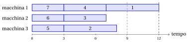
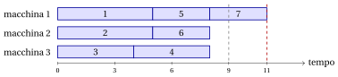

# 30.6 Scheduling su macchine parallele: prima i lavori più lunghi { #sez-sec-PCM }

**Parte 4 · Algoritmi euristici · Capitolo 30** · [:material-book-open-variant: Capitolo 30: Euristiche costruttive](index.md) · [:material-file-pdf-box: Dispensa, volume 4 (PDF)](../../pdf/dispensa-4-algoritmi-euristici.pdf) · [:material-presentation: Slide (1/2)](../../pdf/slide-constructive-heuristics-1.pdf) · [:material-presentation: Slide (2/2)](../../pdf/slide-constructive-heuristics-2.pdf) · [:material-pencil: Esercizi: Euristiche costruttive](../../esercizi/constructive-heuristics.md) · [:material-gesture-tap: App: Euristiche per il bin packing](../../laboratorio/euristiche-bin-packing.md) · [:material-gesture-tap: App: List scheduling e LPT](../../laboratorio/list-scheduling-lpt.md) · [:material-gesture-tap: App: Colorazione: greedy e DSATUR](../../laboratorio/colorazione-greedy-dsatur.md) · [:material-gesture-tap: App: TSP: nearest neighbour e 2-opt](../../laboratorio/tsp-nn-2opt.md)

- Per $P\,||\,C_{\max}$ gli elementi sono gli assegnamenti dei lavori alle macchine, e ogni assegnamento è ammissibile. Una regola greedy naturale assegna ogni lavoro alla macchina che in quel momento è <strong>la meno carica</strong>, così che i carichi crescano nel modo più uniforme possibile. Come per il BPP, la regola sceglie la macchina, e l'ordine dei lavori è una seconda scelta, indipendente.

## 30.6.1 List scheduling { #sez-sec-LIST }

!!! chiave ""

    Il <em>List Scheduling Algorithm</em> (indicato con $LIST$) è un'euristica costruttiva per $P\,||\,C_{\max}$. Esamina i lavori nell'ordine di una lista data $\rho$ e assegna ogni lavoro a una macchina con il carico corrente minimo (in caso di pareggio, la macchina con l'indice minimo).

!!! algoritmo "Algoritmo: List Scheduling"

    

<strong>Input:</strong> istanza di \(P\,||\,C_{\max}\) con \(n\) lavori, tempi \(t[1..n]\), \(m\) macchine; lista \(\rho[1..n]\)

<strong>Output:</strong> assegnamento lavori-macchine \(mach[1..n]\) e makespan \(C_{\max}\)

1<strong>Function</strong> ListScheduling(\(n, m, t, \rho\))

2\(mach := \text{nuovo vettore}[1..n]\) ▹ assegnamento lavori-macchine

3<strong>for</strong> \(h := 1\) <strong>to</strong> \(m\) <strong>do</strong>

4\(L[h] \leftarrow 0\) ▹ carichi delle macchine

5<strong>end</strong>

6<strong>for</strong> \(k := 1\) <strong>to</strong> \(n\) <strong>do</strong>

7\(j := \rho[k]\)
    \(s :=\) una macchina con \(L[s]\) minimo (indice minimo)
    \(mach[j] \leftarrow s\)
    \(L[s] \leftarrow L[s] + t[j]\) ▹ \(k\)-esimo lavoro della lista macchina meno carica assegnare il lavoro \(j\) alla macchina \(s\)

8<strong>end</strong>

9<strong>return</strong> \(mach\), \(C_{\max}=\max_h L[h]\)

Esegui in Colab:

- $LIST$ è il corrispondente, nello scheduling, di una regola <em>online</em>: non ha bisogno di conoscere i lavori futuri, e si usa, per esempio, quando i lavori arrivano uno alla volta. Con una scansione lineare delle macchine richiede tempo $O(nm)$, e tempo $O(n\log m)$ con un heap dei carichi.

- Nell'istanza di riferimento, $t=(5,5,4,4,3,3,3)$, i lavori sono elencati per tempo di esecuzione non crescente, che è un ordine favorevole. Per vedere l'effetto dell'ordine, l'esempio esamina gli stessi lavori nella lista inversa.

!!! esempio "Esempio 30.5: $LIST$ sull'istanza di riferimento, prima i lavori più brevi"

    Consideriamo la lista $\rho=(7,6,5,4,3,2,1)$, cioè i lavori per tempo di esecuzione non decrescente. I carichi prima di ogni assegnamento e la macchina scelta sono:

    
<table>
    <tr>
    <th>lavoro \(j\)</th>
    <th>\(t_j\)</th>
    <th>carichi \((L_1,L_2,L_3)\) prima</th>
    <th>macchina</th>
    </tr>
    <tr>
    <td>\(7\)</td>
    <td>\(3\)</td>
    <td>\((0,0,0)\)</td>
    <td>\(1\)</td>
    </tr>
    <tr>
    <td>\(6\)</td>
    <td>\(3\)</td>
    <td>\((3,0,0)\)</td>
    <td>\(2\)</td>
    </tr>
    <tr>
    <td>\(5\)</td>
    <td>\(3\)</td>
    <td>\((3,3,0)\)</td>
    <td>\(3\)</td>
    </tr>
    <tr>
    <td>\(4\)</td>
    <td>\(4\)</td>
    <td>\((3,3,3)\)</td>
    <td>\(1\)</td>
    </tr>
    <tr>
    <td>\(3\)</td>
    <td>\(4\)</td>
    <td>\((7,3,3)\)</td>
    <td>\(2\)</td>
    </tr>
    <tr>
    <td>\(2\)</td>
    <td>\(5\)</td>
    <td>\((7,7,3)\)</td>
    <td>\(3\)</td>
    </tr>
    <tr>
    <td>\(1\)</td>
    <td>\(5\)</td>
    <td>\((7,7,8)\)</td>
    <td>\(1\)</td>
    </tr>
    </table>

    I carichi finali sono $(12,7,8)$, con $J_1=\{7,4,1\}$, $J_2=\{6,3\}$, $J_3=\{5,2\}$, e $LIST(I)=12$:

    { .fig loading=lazy  }

    L'ultimo lavoro della lista è uno dei più lunghi: quando arriva, la macchina meno carica ha già carico $7$, e il makespan salta a $12$, tre unità sopra il lower bound $9$ (linea grigia tratteggiata).

!!! teorema "Proposizione 30.3"

    Per ogni istanza di $P\,||\,C_{\max}$, che indichiamo con $I$, e ogni lista $\rho$,

    $$
    LIST(I) \;\le\; \left(2-\frac{1}{m}\right) z(I) .
    $$

??? dimostrazione "Dimostrazione"

    Dimostrazione omessa. Il risultato è dovuto a

    R.L. Graham, <em>Bounds for certain multiprocessing anomalies</em>, Bell System Technical Journal 45 (1966) 1563–1581. □

!!! chiave ""

    $LIST$ è un algoritmo di $\left(2-\frac{1}{m}\right)$-approssimazione per $P\,||\,C_{\max}$, qualunque sia l'ordine della lista.

- Nell'esempio, $LIST(I)=12\le \frac{5}{3}\cdot 9=15$.

## 30.6.2 Longest processing time first { #sez-sec-LPT }

!!! chiave ""

    Il <em>Longest Processing Time first Algorithm</em> (indicato con $LPT$) è un'euristica costruttiva per $P\,||\,C_{\max}$. Ordina i lavori per tempo di esecuzione non crescente e applica $LIST$ a questa lista: ogni lavoro, dal più lungo al più breve, si assegna a una macchina meno carica.

!!! algoritmo "Algoritmo: Longest Processing Time first"

    

<strong>Input:</strong> istanza di \(P\,||\,C_{\max}\) con \(n\) lavori, tempi \(t[1..n]\), \(m\) macchine

<strong>Output:</strong> assegnamento lavori-macchine \(mach[1..n]\) e makespan \(C_{\max}\)

1<strong>Function</strong> LPT(\(n, m, t\))

2\(\rho :=\) i lavori ordinati per \(t[j]\) non crescente (pareggi per indice) ▹ prima i lavori più lunghi

3<strong>return</strong> ListScheduling(\(n, m, t, \rho\))

Esegui in Colab:

- <strong>Perché prima i lavori più lunghi.</strong> Il makespan è deciso dal lavoro che finisce per ultimo. Se i lavori in fondo alla lista sono brevi, gli ultimi assegnamenti possono aggiungere solo poco alla macchina meno carica, e fanno da “sabbia” che livella i carichi. Il parallelo con FFD è esatto: prima gli elementi grandi, poi quelli piccoli a riempire i vuoti.

- $LPT$ richiede tempo $O(n\log n + n\log m)$.

!!! esempio "Esempio 30.6: $LPT$ sull'istanza di riferimento"

    I lavori sono già ordinati, $\rho=(1,2,3,4,5,6,7)$. I lavori $1$, $2$, $3$ vanno sulle tre macchine vuote, con carichi $(5,5,4)$; il lavoro $4$ va sulla macchina $3$, la meno carica: $(5,5,8)$; il lavoro $5$ va sulla macchina $1$: $(8,5,8)$; il lavoro $6$ sulla macchina $2$: $(8,8,8)$; il lavoro $7$ trova tre macchine con carico $8$ e va sulla macchina $1$: $(11,8,8)$. Quindi $J_1=\{1,5,7\}$, $J_2=\{2,6\}$, $J_3=\{3,4\}$, $mach=(1,2,3,3,1,2,1)$, e $LPT(I)=11$:

    { .fig loading=lazy  }

    Il lower bound elementare del capitolo [«Algoritmi euristici: definizioni»](../heuristics.md) dà $z(I)\ge\max\left\{\max_j t_j,\left\lceil\frac{\sum_j t_j}{m}\right\rceil\right\}=\max\{5,9\}=9$, e $z(I)=9$. L'ordinamento migliora il makespan da $12$ a $11$, ma $LPT$ non è ottimo: dopo sei lavori i carichi sono perfettamente bilanciati, $(8,8,8)$, e il settimo lavoro li sbilancia di $3$.

!!! teorema "Proposizione 30.4"

    Per ogni istanza di $P\,||\,C_{\max}$, che indichiamo con $I$,

    $$
    LPT(I) \;\le\; \left(\frac{4}{3}-\frac{1}{3m}\right) z(I) .
    $$

??? dimostrazione "Dimostrazione"

    Dimostrazione omessa. Il risultato è dovuto a

    R.L. Graham, <em>Bounds on multiprocessing timing anomalies</em>, SIAM Journal on Applied Mathematics 17 (1969) 416–429. □

!!! chiave ""

    $LPT$ è un algoritmo di $\left(\frac{4}{3}-\frac{1}{3m}\right)$-approssimazione per $P\,||\,C_{\max}$: ordinare la lista abbassa la garanzia di $LIST$ da $2-\frac{1}{m}$ a $\frac{4}{3}-\frac{1}{3m}$.

- Per $m=3$ il bound è $\frac{4}{3}-\frac{1}{9}=\frac{11}{9}$, e sull'istanza di riferimento

    $$
    \frac{LPT(I)}{z(I)}=\frac{11}{9}.
    $$

    L'istanza di riferimento raggiunge esattamente il bound di Graham: appartiene alla famiglia di istanze, data da Graham, con $2m+1$ lavori di tempi di esecuzione $2m-1,2m-1,2m-2,2m-2,\dots,m+1,m+1,m,m,m$, su cui $LPT$ dà $4m-1$ e l'ottimo è $3m$. Per $m=3$ questi sono i tempi $(5,5,4,4,3,3,3)$. Il bound della [Proposizione 30.4](#box-10-prop-graham69) non si può quindi migliorare.

---

**Avanti:** [30.7 Il problema del commesso viaggiatore: accodare o inserire?](il-problema-del-commesso-viaggiatore-accodare-o-inserire.md)
