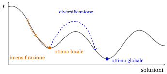

# Algoritmi euristici: definizioni

**Parte 4 · Algoritmi euristici · Capitolo 29** · [:material-file-pdf-box: Dispensa, volume 4 (PDF)](../pdf/dispensa-4-algoritmi-euristici.pdf) · [:material-pencil: Esercizi: Definizioni](../esercizi/heuristics.md)

!!! nota "Prerequisiti"

    - Da questo modulo, i capitoli [«Problemi di zaino»](../problemi-di-ottimizzazione-combinatoria/knapsack/index.md), [«Problemi di packing»](../problemi-di-ottimizzazione-combinatoria/bin-packing/index.md), [«Problemi di routing»](../problemi-di-ottimizzazione-combinatoria/tsp/index.md) e [«Problemi di scheduling»](../problemi-di-ottimizzazione-combinatoria/pcmax/index.md): istanze, soluzioni ammissibili e valori ottimi dei quattro problemi usati come esempi.

    - Dal modulo <em>Programmazione lineare intera</em>, [Capitolo 2 «Rilassamento lineare»](https://fabiofurini.github.io/programmazione-lineare-intera/models-and-bounds/lp-relaxation/): il rilassamento lineare come fonte di bound duali. Qui ne diamo un breve richiamo per il problema dello zaino 0/1.

!!! chiave "Obiettivi"

    Alla fine di questo capitolo saremo in grado di:

    - definire un algoritmo euristico e calcolarne il gap rispetto a un bound duale;

    - distinguere i bound primali dai bound duali sulle quattro istanze di riferimento;

    - classificare gli algoritmi euristici e descrivere la rappresentazione delle soluzioni e lo spazio di ricerca;

    - definire intorni e ottimi locali, e spiegare intensificazione e diversificazione;

    - valutare un algoritmo euristico in base a qualità, tempo di esecuzione ed esecuzioni ripetute.

## 29.1 Algoritmi euristici

!!! definizione "Definizione 29.1: Algoritmo euristico"

    Dato un <strong>problema di ottimizzazione</strong> $\mathscr{P}$, sia $z(I)$ il <strong>valore ottimo</strong> di $\mathscr{P}$ su un'<strong>istanza</strong> $I$. Un <strong>algoritmo euristico</strong> per $\mathscr{P}$ è un algoritmo che, per ogni istanza $I$ di $\mathscr{P}$, calcola una soluzione ammissibile di $I$, senza garantire che sia ottima. Indichiamo con $\mathscr{A}(I)$ il valore della soluzione calcolata dall'algoritmo euristico $\mathscr{A}$ sull'istanza $I$.

- Poiché la soluzione calcolata da $\mathscr{A}$ è ammissibile, per ogni istanza $I$

    $$
    \begin{cases}
    \mathscr{A}(I) \ge z(I) & \text{se } \mathscr{P} \text{ è un problema di minimo,}\\[1ex]
    \mathscr{A}(I) \le z(I) & \text{se } \mathscr{P} \text{ è un problema di massimo.}
    \end{cases}
    $$

- I quattro problemi usati come esempi — il problema dello zaino 0/1, il problema del bin packing, il problema del commesso viaggiatore e il problema di scheduling $P\,||\,C_{\max}$ — sono tutti <strong>NP-hard</strong>: un algoritmo esatto può richiedere un tempo di esecuzione che cresce esponenzialmente con la dimensione dell'istanza.

- Gli <strong>algoritmi di approssimazione</strong> sono algoritmi euristici con una garanzia <em>dimostrata</em> nel caso peggiore sul rapporto fra $\mathscr{A}(I)$ e $z(I)$. La maggior parte degli algoritmi euristici usati in pratica non ha questa garanzia: la loro qualità si valuta sulle istanze da risolvere, come descritto nella Sezione [29.8](#sez-sec-evaluation).

!!! chiave ""

    Un algoritmo euristico scambia la <strong>qualità</strong> della soluzione con il <strong>tempo di esecuzione</strong>: lo scopo di un'euristica è calcolare, in poco tempo, una soluzione il cui valore sia vicino a $z(I)$.

## 29.2 I problemi e le ipotesi { #sez-sec-problems }

- Gli algoritmi euristici di queste note sono illustrati su quattro problemi classici di ottimizzazione combinatoria: il [problema dello zaino 0/1 (KP)](../problemi-di-ottimizzazione-combinatoria/knapsack/il-problema-dello-zaino-0-1.md), il [problema del bin packing (BPP)](../problemi-di-ottimizzazione-combinatoria/bin-packing/il-problema-del-bin-packing.md), il [problema del commesso viaggiatore (TSP)](../problemi-di-ottimizzazione-combinatoria/tsp/il-problema-del-commesso-viaggiatore.md) e [$P\,||\,C_{\max}$](../problemi-di-ottimizzazione-combinatoria/pcmax/scheduling-su-macchine-parallele-identiche.md). Le loro definizioni e ipotesi sono nelle rispettive pagine; la tabella richiama la notazione.

<table>
<tr>
<th>problema</th>
<th>dati</th>
<th>soluzione</th>
<th>obiettivo</th>
</tr>
<tr>
<td>KP</td>
<td>oggetti \(\mathscr{I}\), profitti \(p_j\), pesi \(w_j\), capacità \(c\)</td>
<td>sottoinsieme di oggetti</td>
<td>max profitto totale</td>
</tr>
<tr>
<td>BPP</td>
<td>oggetti \(\mathscr{I}\), pesi \(w_j\), capacità \(c\)</td>
<td>schemi di riempimento</td>
<td>min numero di contenitori</td>
</tr>
<tr>
<td>TSP</td>
<td>città \(\mathscr{V}\), distanze \(d_{ij}\)</td>
<td>giro \(\sigma\)</td>
<td>min lunghezza \(L(\sigma)\)</td>
</tr>
<tr>
<td>\(P\,||\,C_{\max}\)</td>
<td>lavori \(\mathscr{J}\), tempi \(t_j\), macchine \(m\)</td>
<td>insiemi \(J_1,\dots,J_m\)</td>
<td>min makespan</td>
</tr>
</table>

- Assumiamo che ogni istanza soddisfi le ipotesi del suo problema: $w_j\le c$ per tutti gli oggetti e $\sum_j w_j > c$ per il KP e il BPP; $n\ge 3$ e distanze simmetriche per il TSP; $n>m$ per $P\,||\,C_{\max}$.

- Le quattro istanze seguenti si usano in tutte le note sugli algoritmi euristici. I loro valori ottimi sono noti, quindi la qualità di ogni soluzione euristica si può misurare esattamente.

!!! esempio "Esempio 29.1: Istanza di riferimento del KP"

    Uno zaino di capacità $c=9$ e $4$ oggetti con profitti e pesi

    $$
    \begin{array}{l|cccc}
    \hline  & {j=1} & {j=2} & {j=3} & {j=4} \\[1ex]
    \hline {p_j} & {10} & {7} & {6} & {4} \\
    {w_j} & {5} & {4} & {3} & {3} \\
    \hline
    \end{array}
    $$

    La soluzione ottima è $\tilde S=\{1,2\}$, di peso $9$ e profitto $z(I)=17$.

!!! esempio "Esempio 29.2: Istanza di riferimento del BPP"

    Contenitori di capacità $c=7$ e $6$ oggetti con pesi

    $$
    \begin{array}{l|cccccc}
    \hline  & {j=1} & {j=2} & {j=3} & {j=4} & {j=5} & {j=6} \\[1ex]
    \hline {w_j} & {4} & {4} & {5} & {3} & {2} & {3} \\
    \hline
    \end{array}
    $$

    Il peso totale è $21=3c$, quindi servono almeno $3$ contenitori, e gli schemi di riempimento $\{1,4\}$, $\{2,6\}$, $\{3,5\}$ usano esattamente $3$ contenitori, tutti pieni: $z(I)=3$.

!!! esempio "Esempio 29.3: Istanza di riferimento del TSP"

    $5$ città con le distanze simmetriche

    $$
    \begin{array}{c|ccccc}
    \hline {d_{ij}} & {1} & {2} & {3} & {4} & {5} \\
    \hline {1} & --- & {5} & {2} & {2} & {9} \\
    {2} & {5} & --- & {4} & {3} & {4} \\
    {3} & {2} & {4} & --- & {4} & {7} \\
    {4} & {2} & {3} & {4} & --- & {7} \\
    {5} & {9} & {4} & {7} & {7} & --- \\
    \hline
    \end{array}
    $$

    L'istanza è metrica. Fra i suoi $12$ giri distinti, l'unico ottimo è $\sigma=(1,3,5,2,4)$, di lunghezza $z(I)=18$.

!!! esempio "Esempio 29.4: Istanza di riferimento di $P\,||\,C_{\max}$"

    $m=3$ macchine identiche e $7$ lavori con tempi di lavorazione

    $$
    \begin{array}{l|ccccccc}
    \hline  & {j=1} & {j=2} & {j=3} & {j=4} & {j=5} & {j=6} & {j=7} \\[1ex]
    \hline {t_j} & {5} & {5} & {4} & {4} & {3} & {3} & {3} \\
    \hline
    \end{array}
    $$

    Il tempo di lavorazione totale è $27$, quindi il makespan è almeno $\lceil 27/3\rceil=9$, e gli insiemi $J_1=\{1,3\}$, $J_2=\{2,4\}$, $J_3=\{5,6,7\}$ lo raggiungono: $z(I)=9$.

## 29.3 Bound primali e duali

- Il valore di <em>qualunque</em> soluzione ammissibile limita il valore ottimo da un lato, e si chiama <strong>bound primale</strong>. Un algoritmo euristico è un metodo per calcolare bound primali.

- Un bound sul valore ottimo dall'<em>altro</em> lato, ottenuto senza calcolare una soluzione ammissibile, si chiama <strong>bound duale</strong>. I bound duali vengono da rilassamenti del problema, come il rilassamento lineare, o da semplici proprietà del problema.

- Per un problema di minimo un bound primale è un <strong>upper bound</strong> $\UB$ e un bound duale è un <strong>lower bound</strong> $\LB$; per un problema di massimo i ruoli si scambiano. In entrambi i casi il valore ottimo è compreso fra i due bound:

!!! chiave ""

    $$
    \begin{cases}
    \mathrm{LB}(I) \;\le\; z(I) \;\le\; \mathscr{A}(I) & \text{se } \mathscr{P} \text{ è un problema di minimo,}\\[1.5ex]
    \mathscr{A}(I) \;\le\; z(I) \;\le\; \mathrm{UB}(I) & \text{se } \mathscr{P} \text{ è un problema di massimo.}
    \end{cases}
    $$

- Il <strong>gap</strong> di un valore euristico $\mathscr{A}(I)$ è il gap relativo $\frac{\UB-\LB}{\LB}$ definito nel capitolo [«Problemi di ottimizzazione combinatoria»](../problemi-di-ottimizzazione-combinatoria/combinatorial-optimization/index.md): la differenza dei due bound divisa per il <strong>minore</strong>. Con il valore euristico al posto del bound primale diventa

    $$
    gap(I) =
    \begin{cases}
    \dfrac{\mathscr{A}(I) - \mathrm{LB}(I)}{\mathrm{LB}(I)} & \text{se } \mathscr{P} \text{ è un problema di minimo,}\\[3ex]
    \dfrac{\mathrm{UB}(I) - \mathscr{A}(I)}{\mathscr{A}(I)} & \text{se } \mathscr{P} \text{ è un problema di massimo.}
    \end{cases}
    $$

- L'<strong>errore relativo</strong> di $\mathscr{A}$ su $I$ è $\frac{\mathscr{A}(I)-z(I)}{z(I)}$ per un problema di minimo e $\frac{z(I)-\mathscr{A}(I)}{z(I)}$ per un problema di massimo. Non si può calcolare quando $z(I)$ è ignoto, che è la situazione tipica; il gap, invece, usa solo quantità calcolate.

!!! teorema "Proposizione 29.2"

    Per ogni istanza $I$, l'errore relativo di $\mathscr{A}$ su $I$ è al più $gap(I)$.

??? dimostrazione "Dimostrazione"

    Per un problema di minimo, $\mathrm{LB}(I)\le z(I)$, quindi $\frac{\mathscr{A}(I)}{z(I)} \le \frac{\mathscr{A}(I)}{\mathrm{LB}(I)}$ and

    $$
    \frac{\mathscr{A}(I)-z(I)}{z(I)} = \frac{\mathscr{A}(I)}{z(I)} - 1 \;\le\; \frac{\mathscr{A}(I)}{\mathrm{LB}(I)} - 1 = gap(I).
    $$

    Per un problema di massimo, $\mathscr{A}(I)\le z(I)\le \mathrm{UB}(I)$, quindi

    $$
    \frac{z(I)-\mathscr{A}(I)}{z(I)} \;\le\; \frac{z(I)-\mathscr{A}(I)}{\mathscr{A}(I)} \;\le\; \frac{\mathrm{UB}(I)-\mathscr{A}(I)}{\mathscr{A}(I)} = gap(I).
    $$

    
□

- Il gap è quindi un <strong>certificato</strong>: se $gap(I)\le 5\%$, la soluzione dista al più il $5\%$ dall'ottimo, anche se l'ottimo è ignoto. Se $gap(I)=0$, la soluzione è ottima.

!!! esempio "Esempio 29.5: Bound e gap sulle istanze di riferimento"

    <strong>KP.</strong> La soluzione $\{1,3\}$ ha peso $8\le 9$ e profitto $\mathscr{A}(I)=16$. Il rilassamento lineare, con gli oggetti ordinati per efficienza non crescente $(1,3,2,4)$, inserisce gli oggetti $1$ e $3$ e una frazione $\frac{1}{4}$ dell'oggetto $2$, quindi $z(I)\le 10+6+7\cdot\frac{1}{4}=17.75$ e, poiché i profitti sono interi, $\mathrm{UB}(I)=17$. Quindi $gap(I)=\frac{17-16}{16}=6.25\%$, mentre l'errore relativo è $\frac{17-16}{17}\approx 5.9\%$.

    <strong>BPP.</strong> Gli schemi di riempimento $\{1\}$, $\{2\}$, $\{3\}$, $\{4,5\}$, $\{6\}$ sono ammissibili e usano $\mathscr{A}(I)=5$ contenitori, mentre $\mathrm{LB}(I)=\left\lceil \frac{21}{7}\right\rceil=3$. Quindi $gap(I)=\frac{5-3}{3}\approx 66.7\%$.

    <strong>TSP.</strong> Il giro $(1,3,2,4,5)$ ha lunghezza $\mathscr{A}(I)=2+4+3+7+9=25$. Un bound duale è dato dalla [Proposizione 29.3](#box-8-prop-twoedges) più avanti: $\mathrm{LB}(I)=17$. Quindi $gap(I)=\frac{25-17}{17}\approx 47.1\%$, mentre l'errore relativo è $\frac{25-18}{18}\approx 38.9\%$.

    <strong>$P\,||\,C_{\max}$.</strong> La soluzione con $J_1=\{1,5,7\}$, $J_2=\{2,6\}$, $J_3=\{3,4\}$ ha makespan $\mathscr{A}(I)=11$, mentre $\mathrm{LB}(I)=\max\{5,\lceil 27/3\rceil\}=9$. Quindi $gap(I)=\frac{11-9}{9}\approx 22.2\%$.

    Sul BPP e su $P\,||\,C_{\max}$ il bound duale è uguale a $z(I)$, quindi il gap è uguale all'errore relativo. Anche sul KP il bound duale è uguale a $z(I)$, ma il gap divide per il valore minore $\mathscr{A}(I)$ ed è leggermente più grande. Sul TSP il bound duale è più debole, e il gap sovrastima l'errore relativo.

!!! teorema "Proposizione 29.3"

    Per ogni istanza $I$ del TSP, siano $a_i$ e $b_i$ le due distanze minime dalla città $i$ alle altre città. Allora

    $$
    z(I) \;\ge\; \left\lceil \frac{1}{2} \sum_{i\in\mathscr{V}} (a_i+b_i) \right\rceil .
    $$

??? dimostrazione "Dimostrazione"

    In ogni giro ogni città è estremo di esattamente due spigoli, di lunghezza almeno $a_i$ e $b_i$. Sommando le lunghezze dei due spigoli incidenti in ogni città si conta due volte ogni spigolo del giro, quindi

    $$
    2\,L(\sigma) \;=\; \sum_{i\in\mathscr{V}} \big(\text{lunghezze dei due spigoli incidenti in } i\big) \;\ge\; \sum_{i\in\mathscr{V}} (a_i+b_i)
    $$

    per ogni giro $\sigma$, e in particolare per uno ottimo. Poiché le distanze sono intere, $z(I)$ è un intero, e il bound si può arrotondare per eccesso. □

- Sull'istanza di riferimento le due distanze minime sono $(2,2)$ per la città $1$, $(3,4)$ per la città $2$, $(2,4)$ per la città $3$, $(2,3)$ per la città $4$ e $(4,7)$ per la città $5$, quindi $\mathrm{LB}(I)=\left\lceil\frac{4+7+6+5+11}{2}\right\rceil=\lceil 16.5\rceil=17$.

!!! chiave ""

    Un algoritmo euristico dà solo un lato del gap. Senza un bound duale sull'altro lato, non si può dire nulla sulla qualità della soluzione, per quanto buona possa sembrare.

## 29.4 Classificazione degli algoritmi euristici

- Gli algoritmi euristici si classificano in base a come producono e usano le soluzioni, nelle quattro classi seguenti.

<table>
<tr>
<th>classe</th>
<th>idea</th>
</tr>
<tr>
<td><strong>euristiche costruttive</strong></td>
<td>costruiscono una soluzione passo per passo, estendendo una soluzione parziale con un elemento alla volta; una scelta, una volta fatta, non viene mai rivista</td>
</tr>
<tr>
<td><strong>ricerca locale</strong></td>
<td>parte da una soluzione ammissibile e la sostituisce ripetutamente con una soluzione migliore ottenuta con una piccola modifica, finché nessuna piccola modifica la migliora</td>
</tr>
<tr>
<td><strong>metaeuristiche</strong></td>
<td>strategie generali che guidano una ricerca locale oltre il punto in cui si ferma, esplorando altre regioni delle soluzioni</td>
</tr>
<tr>
<td><strong>euristiche basate sulla PLI</strong></td>
<td>usano una formulazione di programmazione lineare intera mista, il suo rilassamento e un solver MIP per guidare la ricerca o per esplorare grandi insiemi di soluzioni</td>
</tr>
</table>

- Le classi non sono alternative: una ricerca locale ha bisogno di una soluzione di partenza, di solito calcolata da un'euristica costruttiva; una metaeuristica contiene una o più ricerche locali; un'euristica basata sulla PLI può partire dalla soluzione di una qualunque delle altre, e migliorarla.

## 29.5 Rappresentazione delle soluzioni e spazio di ricerca

- Un algoritmo euristico manipola soluzioni, che vanno memorizzate in una struttura dati: la <strong>rappresentazione</strong> delle soluzioni. L'insieme di tutti gli oggetti che la rappresentazione può descrivere è lo <strong>spazio di ricerca</strong>.

- La rappresentazione è una scelta di progetto, e determina quali modifiche di una soluzione sono facili da eseguire. Per i quattro problemi usiamo le rappresentazioni seguenti.

<table>
<tr>
<th>problema</th>
<th>rappresentazione</th>
<th>dimensione dello spazio di ricerca</th>
<th>ammissibile?</th>
</tr>
<tr>
<td>KP</td>
<td>vettore binario \(x\in\{0,1\}^n\)</td>
<td>\(2^n\)</td>
<td>non sempre: la capacità può essere superata</td>
</tr>
<tr>
<td>BPP</td>
<td>vettore \(bin\), con \(bin_j\) il contenitore dell'oggetto \(j\)</td>
<td>al più \(n^n\)</td>
<td>non sempre: un contenitore può essere troppo pieno</td>
</tr>
<tr>
<td>TSP</td>
<td>permutazione \(\sigma\) delle città</td>
<td>\(\frac{(n-1)!}{2}\) giri distinti</td>
<td>sempre</td>
</tr>
<tr>
<td>\(P\,||\,C_{\max}\)</td>
<td>vettore \(mach\), con \(mach_j\) la macchina del lavoro \(j\)</td>
<td>\(m^n\)</td>
<td>sempre</td>
</tr>
</table>

- Quando la rappresentazione può descrivere oggetti inammissibili, un'euristica deve limitarsi a quelli ammissibili oppure accettare quelli inammissibili e penalizzarli.

- Gli spazi di ricerca crescono molto rapidamente: un TSP con $n=20$ città ha $\frac{19!}{2}\approx 6\cdot 10^{16}$ giri distinti. Un'euristica esplora solo una minima parte dello spazio di ricerca, e la domanda è <em>quale</em> parte.

## 29.6 Intorni e ottimi locali

- Sia $\mathscr{F}(I)$ l'insieme delle soluzioni ammissibili dell'istanza $I$, e sia $f(S)$ il valore della soluzione $S\in\mathscr{F}(I)$, così che $z(I)$ sia il minimo (o il massimo) di $f$ su $\mathscr{F}(I)$.

!!! definizione "Definizione 29.4: Intorno"

    Un <strong>intorno</strong> è una funzione $N$ che associa a ogni soluzione ammissibile $S\in\mathscr{F}(I)$ un insieme $N(S)\subseteq\mathscr{F}(I)$ di soluzioni ammissibili, i <strong>vicini</strong> di $S$. Una <strong>mossa</strong> è la trasformazione di $S$ in uno dei suoi vicini.

- Un intorno si definisce di solito con una famiglia di piccole modifiche della rappresentazione: cambiare una componente del vettore $x$, spostare un lavoro su un'altra macchina, sostituire due spigoli di un giro.

!!! definizione "Definizione 29.5: Ottimo locale"

    Una soluzione ammissibile $S\in\mathscr{F}(I)$ è un <strong>ottimo locale</strong> rispetto all'intorno $N$ se nessun vicino di $S$ è migliore di $S$:

    $$
    \begin{cases}
    f(S) \le f(S') \quad \text{per ogni } S'\in N(S) & \text{se } \mathscr{P} \text{ è un problema di minimo,}\\[1ex]
    f(S) \ge f(S') \quad \text{per ogni } S'\in N(S) & \text{se } \mathscr{P} \text{ è un problema di massimo.}
    \end{cases}
    $$

    Una soluzione ottima si chiama anche <strong>ottimo globale</strong>.

- Un ottimo globale è un ottimo locale per ogni intorno, ma un ottimo locale non è necessariamente un ottimo globale. Inoltre, <strong>essere un ottimo locale dipende dall'intorno</strong>: la stessa soluzione può essere un ottimo locale per un intorno e non per un altro.

!!! esempio "Esempio 29.6: Due intorni per il KP"

    Sull'istanza di riferimento del KP ($c=9$), consideriamo la soluzione $x=(1,0,1,0)$, cioè gli oggetti $\{1,3\}$, di peso $8$ e profitto $16$.

    L'intorno <strong>flip</strong> cambia una componente di $x$, cioè aggiunge o toglie un oggetto:

    
<table>
    <tr>
    <th>vicino</th>
    <th>peso</th>
    <th>profitto</th>
    <th>ammissibile</th>
    </tr>
    <tr>
    <td>\((0,0,1,0)\)</td>
    <td>\(3\)</td>
    <td>\(6\)</td>
    <td>sì</td>
    </tr>
    <tr>
    <td>\((1,1,1,0)\)</td>
    <td>\(12\)</td>
    <td>—</td>
    <td>no</td>
    </tr>
    <tr>
    <td>\((1,0,0,0)\)</td>
    <td>\(5\)</td>
    <td>\(10\)</td>
    <td>sì</td>
    </tr>
    <tr>
    <td>\((1,0,1,1)\)</td>
    <td>\(11\)</td>
    <td>—</td>
    <td>no</td>
    </tr>
    </table>

    I vicini ammissibili hanno profitto $6$ e $10$, minore di $16$: $x$ è un <strong>ottimo locale</strong> rispetto all'intorno flip.

    L'intorno <strong>swap</strong> toglie un oggetto scelto e aggiunge un oggetto non scelto:

    
<table>
    <tr>
    <th>vicino</th>
    <th>peso</th>
    <th>profitto</th>
    <th>ammissibile</th>
    </tr>
    <tr>
    <td>\((0,1,1,0)\): esce \(1\), entra \(2\)</td>
    <td>\(7\)</td>
    <td>\(13\)</td>
    <td>sì</td>
    </tr>
    <tr>
    <td>\((0,0,1,1)\): esce \(1\), entra \(4\)</td>
    <td>\(6\)</td>
    <td>\(10\)</td>
    <td>sì</td>
    </tr>
    <tr>
    <td>\((1,1,0,0)\): esce \(3\), entra \(2\)</td>
    <td>\(9\)</td>
    <td>\(17\)</td>
    <td>sì</td>
    </tr>
    <tr>
    <td>\((1,0,0,1)\): esce \(3\), entra \(4\)</td>
    <td>\(8\)</td>
    <td>\(14\)</td>
    <td>sì</td>
    </tr>
    </table>

    Il vicino $(1,1,0,0)$ ha profitto $17>16$: $x$ <strong>non</strong> è un ottimo locale rispetto all'intorno swap, e la mossa porta all'ottimo globale.

!!! definizione "Definizione 29.6: Intorno esatto"

    Un intorno $N$ è <strong>esatto</strong> se ogni ottimo locale rispetto a $N$ è un ottimo globale.

- Gli intorni esatti sono rari, ed esistono per problemi risolvibili in tempo polinomiale: l'intorno del metodo del simplesso, che si sposta fra vertici adiacenti del poliedro, è esatto per la programmazione lineare; l'intorno che scambia uno spigolo entrante e uno uscente è esatto per il problema dell'albero ricoprente di costo minimo.

- Per i problemi NP-hard gli intorni piccoli non sono esatti, e gli intorni esatti, come quello che contiene tutte le soluzioni ammissibili, sono troppo grandi per essere esplorati. Il progetto di un intorno è un compromesso fra la sua <strong>dimensione</strong>, che determina il tempo necessario per esplorarlo, e la <strong>qualità</strong> dei suoi ottimi locali.

## 29.7 Intensificazione e diversificazione

- I valori delle soluzioni, visti come funzione sullo spazio di ricerca, formano il <strong>paesaggio</strong> esplorato da un'euristica. Per un problema di minimo gli ottimi locali sono i fondi delle valli, e l'ottimo globale è il fondo della valle più profonda.

{ .fig loading=lazy  }

- L'<strong>intensificazione</strong> è la ricerca di soluzioni migliori nella regione dove sono già state trovate buone soluzioni: si scende verso il fondo della valle corrente. La ricerca locale è pura intensificazione, e si ferma al primo ottimo locale che raggiunge.

- La <strong>diversificazione</strong> è lo spostamento verso regioni dello spazio di ricerca non ancora esplorate: si lascia la valle corrente, eventualmente passando per soluzioni peggiori, per raggiungerne un'altra.

- Troppa intensificazione intrappola la ricerca nella prima valle; troppa diversificazione la fa vagare senza mai esplorare una valle fino in fondo. Ogni metaeuristica è un modo di bilanciare le due.

## 29.8 Come valutare un algoritmo euristico { #sez-sec-evaluation }

- Un algoritmo euristico si valuta in base alla <strong>qualità</strong> delle sue soluzioni e al suo <strong>tempo di esecuzione</strong>, che sono obiettivi in conflitto.

- La <strong>qualità</strong> si misura con il gap rispetto al miglior bound duale disponibile, o con l'errore relativo quando il valore ottimo è noto, come sulle istanze di riferimento di queste note.

- L'<strong>analisi del caso peggiore</strong>, come per gli algoritmi di approssimazione, dà garanzie valide per tutte le istanze, ma spesso lontane dal comportamento tipico. L'<strong>analisi sperimentale</strong> misura i gap e i tempi di esecuzione su un insieme di istanze di benchmark, che deve essere abbastanza grande e vario da evitare conclusioni valide solo per poche istanze.

- Una singola istanza non dimostra nulla: sull'istanza di riferimento del TSP la stessa regola, applicata da città di partenza diverse, dà giri di lunghezza fra $18$ e $25$. I confronti fra euristiche devono usare le stesse istanze e riportare la distribuzione dei risultati, non solo il migliore.

- Per le euristiche che fanno scelte casuali, i risultati dipendono dai numeri casuali: ogni istanza va risolta più volte, con diversi <strong>semi</strong> del generatore di numeri casuali, riportando la media e la dispersione dei risultati.

!!! chiave ""

    Un algoritmo euristico è buono se, sulle istanze a cui è destinato, trova con regolarità soluzioni con un gap piccolo nel tempo disponibile.

## 29.9 Errori tipici

!!! attenzione "Attenzione"

    - <strong>Giudicare un'euristica da una sola esecuzione o da una sola istanza.</strong> La stessa regola, da città di partenza diverse, dà giri di lunghezza fra $18$ e $25$ sull'istanza di riferimento del TSP.

    - <strong>Confondere il gap con l'errore relativo.</strong> Il gap si misura rispetto a un bound duale, quindi non è mai minore dell'errore relativo; in un problema di minimo coincidono solo quando il bound duale è uguale a $z(I)$.

    - <strong>Usare il denominatore sbagliato.</strong> Il gap divide sempre per il bound minore: per un problema di massimo è $\frac{\mathrm{UB}(I)-\mathscr{A}(I)}{\mathscr{A}(I)}$, per un problema di minimo $\frac{\mathscr{A}(I)-\mathrm{LB}(I)}{\mathrm{LB}(I)}$.

    - <strong>Dimenticare di arrotondare il bound duale.</strong> Con dati interi il bound $17.75$ del KP si arrotonda per difetto a $17$, e il bound $16.5$ del TSP si arrotonda per eccesso a $17$.

    - <strong>Fidarsi di una soluzione che sembra buona.</strong> Senza un bound duale sull'altro lato, non si può dire nulla sulla qualità di una soluzione.

## 29.10 In sintesi

!!! chiave "In sintesi"

    - Un algoritmo euristico restituisce una soluzione ammissibile senza garantirne l'ottimalità: il suo valore è un bound <em>primale</em>.

    - Il gap confronta il valore euristico con il miglior bound duale, ed è un upper bound sull'errore relativo.

    - Gli algoritmi euristici sono costruttivi, di ricerca locale, metaeuristiche o basati sulla PLI; un intorno definisce gli ottimi locali, e la ricerca bilancia intensificazione e diversificazione.

    - La qualità si valuta su molte istanze e, per i metodi casuali, su molti semi.

    <strong>Quadro riassuntivo delle istanze di riferimento.</strong> Soluzioni euristiche di questo capitolo e loro bound duali:

    
<table>
    <tr>
    <th>problema</th>
    <th>bound primale</th>
    <th>bound duale</th>
    <th>gap</th>
    <th>\(z(I)\)</th>
    </tr>
    <tr>
    <td>KP (max)</td>
    <td>\(16\)</td>
    <td>\(\mathrm{UB}(I)=17\)</td>
    <td>\(6.25\%\)</td>
    <td>\(17\)</td>
    </tr>
    <tr>
    <td>BPP (min)</td>
    <td>\(5\)</td>
    <td>\(\mathrm{LB}(I)=3\)</td>
    <td>\(66.7\%\)</td>
    <td>\(3\)</td>
    </tr>
    <tr>
    <td>TSP (min)</td>
    <td>\(25\)</td>
    <td>\(\mathrm{LB}(I)=17\)</td>
    <td>\(47.1\%\)</td>
    <td>\(18\)</td>
    </tr>
    <tr>
    <td>\(P\,||\,C_{\max}\) (min)</td>
    <td>\(11\)</td>
    <td>\(\mathrm{LB}(I)=9\)</td>
    <td>\(22.2\%\)</td>
    <td>\(9\)</td>
    </tr>
    </table>

---

**Esercizi su questo capitolo:** [:material-pencil: Definizioni](../esercizi/heuristics.md)
