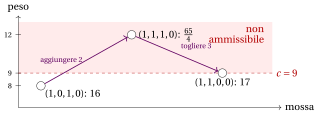

# 31.10 KP: ammissibilità e penalità { #sez-sec-kp }

**Parte 4 · Algoritmi euristici · Capitolo 31** · [:material-book-open-variant: Capitolo 31: Ricerca locale](index.md) · [:material-file-pdf-box: Dispensa, volume 4 (PDF)](../../pdf/dispensa-4-algoritmi-euristici.pdf) · [:material-presentation: Slide (1/2)](../../pdf/slide-local-search-1.pdf) · [:material-presentation: Slide (2/2)](../../pdf/slide-local-search-2.pdf) · [:material-pencil: Esercizi: Ricerca locale](../../esercizi/local-search.md) · [:material-gesture-tap: App: TSP: nearest neighbour e 2-opt](../../laboratorio/tsp-nn-2opt.md)

- La rappresentazione del KP con un vettore binario $x$ descrive anche oggetti non ammissibili, il cui peso supera la capacità. Ci sono due modi di trattarli:

    1. <strong>restare ammissibili</strong>: l'intorno contiene solo i vicini ammissibili, come fatto finora;

    2. <strong>penalizzare</strong>: i vettori non ammissibili sono ammessi, e la ricerca massimizza una funzione che sottrae dal profitto una penalità proporzionale al peso in eccesso.

- Restare ammissibili può rendere la ricerca miope. Nel capitolo [«Algoritmi euristici: definizioni»](../heuristics.md), $x=(1,0,1,0)$ è un ottimo locale per flip: per raggiungere la soluzione ottima $(1,1,0,0)$ con i flip occorre aggiungere l'oggetto $2$ e togliere l'oggetto $3$, e il vettore intermedio è o $(1,1,1,0)$, non ammissibile, o $(1,0,0,0)$, di profitto $10<16$. L'intorno swap risolve questo caso eseguendo i due flip insieme; le penalità lo risolvono lasciando che la ricerca passi attraverso il vettore non ammissibile.

- Con le penalità, lo spazio di ricerca è l'intero insieme $\{0,1\}^n$, e la funzione da massimizzare è

!!! chiave ""

    $$
    g_\alpha(x) \;=\; \sum_{j\in\mathscr{I}} p_j x_j \;-\; \alpha\cdot\max\Big\{0,\ \sum_{j\in\mathscr{I}} w_jx_j-c\Big\},
    $$

    dove $\alpha>0$ è la <strong>penalità</strong> per ogni unità di peso in eccesso. Per un $x$ ammissibile, $g_\alpha(x)$ è il profitto di $x$.

## 31.10.1 Restare ammissibili

!!! chiave ""

    La ricerca locale <em>flip+swap</em> per il KP esamina i flip e poi gli swap della soluzione corrente, scarta quelli che superano la capacità, ne applica uno migliorante scelto con la regola first improvement o best improvement, e si ferma quando nessun vicino ammissibile ha un profitto maggiore.

!!! algoritmo "Algoritmo: Passo flip+swap per il KP"

    

<strong>Input:</strong> \(n\) oggetti, profitti \(p[1..n]\), pesi \(w[1..n]\), capacità \(c\), soluzione ammissibile \(x[1..n]\), regola

<strong>Output:</strong> <em>true</em> se a \(x\) è stata applicata una mossa migliorante, <em>false</em> altrimenti

1<strong>Function</strong> KPFlipSwapStep(\(n, p, w, c, x, \textit{rule}\))

2\(W := \sum_{j=1}^n w[j]\,x[j]\)
    \(\bar\Delta := 0\); \((\bar\jmath,\bar k) := (0,0)\) ▹ peso della soluzione corrente miglior mossa trovata finora (\(\bar k=0\): flip)

3<strong>for</strong> \(j := 1\) <strong>to</strong> \(n\) <strong>do</strong> ▹ flip dell'oggetto \(j\)

4\(\Delta p := (1-2x[j])\,p[j]\); \(\Delta w := (1-2x[j])\,w[j]\) ▹ togliere, o aggiungere, l'oggetto \(j\)

5<strong>if</strong> \(W+\Delta w \le c\) <strong>and</strong> \(\Delta p > \bar\Delta\) <strong>then</strong>

6\(\bar\Delta \leftarrow \Delta p\); \((\bar\jmath,\bar k) \leftarrow (j,0)\)

7<strong>if</strong> \(\textit{rule}=\textit{first}\) <strong>then</strong>

8<strong>uscire</strong> da tutti i cicli

9<strong>end</strong>

10<strong>end</strong>

11<strong>end</strong>

12<strong>for</strong> \(j := 1\) <strong>to</strong> \(n\) con \(x[j]=1\) <strong>do</strong> ▹ swap: \(j\) fuori, \(k\) dentro

13<strong>for</strong> \(k := 1\) <strong>to</strong> \(n\) con \(x[k]=0\) <strong>do</strong>

14\(\Delta p := p[k]-p[j]\); \(\Delta w := w[k]-w[j]\)

15<strong>if</strong> \(W+\Delta w \le c\) <strong>and</strong> \(\Delta p > \bar\Delta\) <strong>then</strong>

16\(\bar\Delta \leftarrow \Delta p\); \((\bar\jmath,\bar k) \leftarrow (j,k)\)

17<strong>if</strong> \(\textit{rule}=\textit{first}\) <strong>then</strong>

18<strong>uscire</strong> da tutti i cicli

19<strong>end</strong>

20<strong>end</strong>

21<strong>end</strong>

22<strong>end</strong>

23<strong>if</strong> \(\bar\jmath = 0\) <strong>then</strong> <strong>return</strong> <em>false</em> ▹ nessuna mossa migliorante: ottimo locale

24\(x[\bar\jmath] \leftarrow 1-x[\bar\jmath]\) ▹ flip, oppure togliere l'oggetto che esce

25<strong>if</strong> \(\bar k \ne 0\) <strong>then</strong>

26\(x[\bar k] \leftarrow 1\) ▹ aggiungere l'oggetto che entra

27<strong>end</strong>

28<strong>return</strong> <em>true</em>

Esegui in Colab:

- Con la regola first improvement, se si trova un flip migliorante gli swap non vengono esaminati. Solo i flip che <em>aggiungono</em> un oggetto possono migliorare il profitto; i flip che tolgono un oggetto restano nell'intorno per uniformità. Un'iterazione costa tempo $O(n^2)$, a causa degli swap.

## 31.10.2 Penalizzare il peso in eccesso

!!! chiave ""

    La ricerca locale <em>penalty flip</em> per il KP esamina i flip del vettore corrente, ammissibile o no, li valuta con $g_\alpha$, ne applica uno migliorante scelto con la regola first improvement o best improvement, e si ferma quando nessun flip aumenta $g_\alpha$.

!!! algoritmo "Algoritmo: Passo penalty flip per il KP"

    

<strong>Input:</strong> \(n\) oggetti, profitti \(p[1..n]\), pesi \(w[1..n]\), capacità \(c\), penalità \(\alpha\), vettore \(x[1..n]\), regola

<strong>Output:</strong> <em>true</em> se a \(x\) è stato applicato un flip migliorante, <em>false</em> altrimenti

1<strong>Function</strong> KPPenaltyFlipStep(\(n, p, w, c, \alpha, x, \textit{rule}\))

2\(P := \sum_{j=1}^n p[j]\,x[j]\); \(W := \sum_{j=1}^n w[j]\,x[j]\)
    \(g := P - \alpha \max\{0, W-c\}\)
    \(\bar\Delta := 0\); \(\bar\jmath := 0\) ▹ profitto e peso di \(x\) valore di \(x\) miglior flip trovato finora

3<strong>for</strong> \(j := 1\) <strong>to</strong> \(n\) <strong>do</strong>

4\(P' := P+(1-2x[j])\,p[j]\); \(W' := W+(1-2x[j])\,w[j]\)
    \(\Delta := P' - \alpha \max\{0, W'-c\} - g\) ▹ flip dell'oggetto \(j\) variazione di \(g_\alpha\)

5<strong>if</strong> \(\Delta > \bar\Delta\) <strong>then</strong>

6\(\bar\Delta \leftarrow \Delta\); \(\bar\jmath \leftarrow j\) ▹ flip migliorante

7<strong>if</strong> \(\textit{rule}=\textit{first}\) <strong>then</strong>

8<strong>uscire</strong> dal ciclo

9<strong>end</strong>

10<strong>end</strong>

11<strong>end</strong>

12<strong>if</strong> \(\bar\jmath = 0\) <strong>then</strong> <strong>return</strong> <em>false</em> ▹ nessun flip migliorante: ottimo locale

13\(x[\bar\jmath] \leftarrow 1-x[\bar\jmath]\) ▹ applicare il flip

14<strong>return</strong> <em>true</em>

Esegui in Colab:

- L'ottimo locale può essere non ammissibile. La ricerca deve quindi ricordare la <strong>migliore soluzione ammissibile</strong> visitata, che è la soluzione che restituisce.

!!! esempio "Esempio 31.8: Penalità sull'istanza di riferimento del KP"

    Partiamo dalla soluzione di $GR$, $x=(1,0,1,0)$, di peso $8$ e profitto $16$, che è un ottimo locale per l'intorno flip ristretto alle soluzioni ammissibili. I valori $g_\alpha$ dei suoi quattro flip sono

    
<table>
    <tr>
    <th>flip</th>
    <th>vettore</th>
    <th>peso</th>
    <th>eccesso</th>
    <th>\(\alpha=1\)</th>
    <th>\(\alpha=2\)</th>
    <th>\(\alpha=\frac94\)</th>
    <th>\(\alpha=3\)</th>
    </tr>
    <tr>
    <td>\(1\)</td>
    <td>\((0,0,1,0)\)</td>
    <td>\(3\)</td>
    <td>\(0\)</td>
    <td>\(6\)</td>
    <td>\(6\)</td>
    <td>\(6\)</td>
    <td>\(6\)</td>
    </tr>
    <tr>
    <td>\(2\)</td>
    <td>\((1,1,1,0)\)</td>
    <td>\(12\)</td>
    <td>\(3\)</td>
    <td>\(20\)</td>
    <td>\(17\)</td>
    <td>\(\frac{65}{4}\)</td>
    <td>\(14\)</td>
    </tr>
    <tr>
    <td>\(3\)</td>
    <td>\((1,0,0,0)\)</td>
    <td>\(5\)</td>
    <td>\(0\)</td>
    <td>\(10\)</td>
    <td>\(10\)</td>
    <td>\(10\)</td>
    <td>\(10\)</td>
    </tr>
    <tr>
    <td>\(4\)</td>
    <td>\((1,0,1,1)\)</td>
    <td>\(11\)</td>
    <td>\(2\)</td>
    <td>\(18\)</td>
    <td>\(16\)</td>
    <td>\(\frac{31}{2}\)</td>
    <td>\(14\)</td>
    </tr>
    </table>

    Le due regole eseguono le stesse mosse:

    - $\alpha=1$: la ricerca aggiunge l'oggetto $2$ ($g_1=20$), poi l'oggetto $4$ ($g_1=27-6=21$), e si ferma in $(1,1,1,1)$, di peso $15$: ogni suo flip toglie un oggetto e dà $16$, $18$, $18$ o $20$. La penalità è troppo piccola: l'ottimo locale non è ammissibile, e la migliore soluzione ammissibile visitata è quella di partenza, di profitto $16$.

    - $\alpha=2$: la ricerca aggiunge l'oggetto $2$ ($g_2=17>16$) e si ferma in $(1,1,1,0)$, non ammissibile: togliere l'oggetto $3$ dà $(1,1,0,0)$ con $g_2=17$, non strettamente migliore.

    - $\alpha=\frac94$: la ricerca aggiunge l'oggetto $2$ ($g=\frac{65}{4}=16.25>16$) e poi toglie l'oggetto $3$, raggiungendo $(1,1,0,0)$, di profitto $17$: la soluzione <strong>ottima</strong>, attraverso un vettore non ammissibile (si veda la figura).

    - $\alpha=3$: nessun flip migliora, e la ricerca si ferma subito in $(1,0,1,0)$, come la ricerca ammissibile.

    { .fig loading=lazy  }

!!! teorema "Proposizione 31.7"

    Siano i dati interi e sia $\alpha>\max_{j\in\mathscr{I}} p_j$. Allora:

    1. da un vettore ammissibile, nessun flip che produce un vettore non ammissibile aumenta $g_\alpha$;

    2. ogni vettore non ammissibile ha un flip che aumenta $g_\alpha$.

??? dimostrazione "Dimostrazione"

    (1) Se aggiungere l'oggetto $k$ a un vettore ammissibile produce un eccesso $e\ge1$, allora $g_\alpha$ varia di $p_k-\alpha e\le p_k-\alpha<0$. (2) Sia $x$ non ammissibile, con eccesso $e\ge 1$, e sia $j$ un oggetto selezionato. Togliere $j$ diminuisce l'eccesso di $\min\{w_j,e\}\ge 1$, quindi $g_\alpha$ varia di $-p_j+\alpha\min\{w_j,e\}\ge -p_j+\alpha>0$. □

- Con una penalità <strong>grande</strong> gli ottimi locali sono ammissibili, ma la ricerca non lascia mai la regione ammissibile; con una penalità <strong>piccola</strong> attraversa la regione non ammissibile, ma può fermarsi lì. I valori utili dipendono dall'istanza (qui $\frac94$ funziona, $1$, $2$ e $3$ no), quindi in pratica $\alpha$ si regola durante la ricerca: si aumenta finché la ricerca resta fra vettori non ammissibili, si diminuisce finché resta fra vettori ammissibili.

---

**Avanti:** [31.11 Variable neighbourhood descent](variable-neighbourhood-descent.md)
