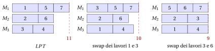

# 31.8 $P\,||\,C_{\max}$: move e swap { #sez-sec-pcmax }

**Parte 4 · Algoritmi euristici · Capitolo 31** · [:material-book-open-variant: Capitolo 31: Ricerca locale](index.md) · [:material-file-pdf-box: Dispensa, volume 4 (PDF)](../../pdf/dispensa-4-algoritmi-euristici.pdf) · [:material-pencil: Esercizi: Ricerca locale](../../esercizi/local-search.md) · [:material-gesture-tap: App: TSP: nearest neighbour e 2-opt](../../laboratorio/tsp-nn-2opt.md)

- Le mosse di $P\,||\,C_{\max}$ trasferiscono tempo di lavorazione fra due macchine: una move del lavoro $j$ dalla macchina $a$ alla macchina $b$ trasferisce $\delta=t_j$ da $a$ a $b$; uno swap dei lavori $j$ (su $a$) e $k$ (su $b$) trasferisce $\delta=t_j-t_k$, che può essere negativo. In entrambi i casi i nuovi carichi sono $L_a-\delta$ e $L_b+\delta$, e $F(L,a,b,\delta)$ indica la variazione risultante dell'obiettivo.

## 31.8.1 La ricerca locale move

!!! chiave ""

    La ricerca locale <em>move</em> per $P\,||\,C_{\max}$ esamina le riassegnazioni di un lavoro a un'altra macchina, ne applica una migliorante scelta con la regola first improvement o best improvement, aggiorna i due carichi coinvolti, e si ferma quando nessuna riassegnazione diminuisce l'obiettivo.

!!! algoritmo "Algoritmo: Passo move per $P\,||\,C_{\max}$"

    

<strong>Input:</strong> \(n\) lavori, \(m\) macchine, tempi \(t[1..n]\), assegnazione \(mach[1..n]\), carichi \(L[1..m]\), regola

<strong>Output:</strong> <em>true</em> se è stata applicata una mossa migliorante, <em>false</em> altrimenti

1<strong>Function</strong> PCmaxMoveStep(\(n, m, t, mach, L, \textit{rule}\))

2\(\bar\Delta := 0\); \((\bar\jmath,\bar h) := (0,0)\) ▹ miglior mossa trovata finora

3<strong>for</strong> \(j := 1\) <strong>to</strong> \(n\) <strong>do</strong>

4\(a := mach[j]\) ▹ macchina del lavoro \(j\)

5<strong>for</strong> \(h := 1\) <strong>to</strong> \(m\) <strong>do</strong>

6<strong>if</strong> \(h = a\) <strong>then</strong>

7<strong>continue</strong>

8<strong>end</strong>

9\(\Delta := F(L, a, h, t[j])\) ▹ variazione dell'obiettivo

10<strong>if</strong> \(\Delta < \bar\Delta\) <strong>then</strong>

11\(\bar\Delta \leftarrow \Delta\); \((\bar\jmath,\bar h) \leftarrow (j,h)\) ▹ mossa migliorante

12<strong>if</strong> \(\textit{rule}=\textit{first}\) <strong>then</strong>

13<strong>uscire</strong> da entrambi i cicli

14<strong>end</strong>

15<strong>end</strong>

16<strong>end</strong>

17<strong>end</strong>

18<strong>if</strong> \(\bar\jmath = 0\) <strong>then</strong> <strong>return</strong> <em>false</em> ▹ nessuna mossa migliorante: ottimo locale

19\(L[mach[\bar\jmath]] \leftarrow L[mach[\bar\jmath]]-t[\bar\jmath]\); \(L[\bar h] \leftarrow L[\bar h]+t[\bar\jmath]\)
    \(mach[\bar\jmath] \leftarrow \bar h\) ▹ aggiornare i carichi applicare la mossa

20<strong>return</strong> <em>true</em>

Esegui in Colab:

## 31.8.2 La ricerca locale swap

!!! chiave ""

    La ricerca locale <em>swap</em> per $P\,||\,C_{\max}$ esamina gli scambi di due lavori su macchine diverse, ne applica uno migliorante scelto con la regola first improvement o best improvement, aggiorna i due carichi coinvolti, e si ferma quando nessuno scambio diminuisce l'obiettivo.

!!! algoritmo "Algoritmo: Passo swap per $P\,||\,C_{\max}$"

    

<strong>Input:</strong> \(n\) lavori, \(m\) macchine, tempi \(t[1..n]\), assegnazione \(mach[1..n]\), carichi \(L[1..m]\), regola

<strong>Output:</strong> <em>true</em> se è stato applicato uno swap migliorante, <em>false</em> altrimenti

1<strong>Function</strong> PCmaxSwapStep(\(n, m, t, mach, L, \textit{rule}\))

2\(\bar\Delta := 0\); \((\bar\jmath,\bar k) := (0,0)\) ▹ miglior swap trovato finora

3<strong>for</strong> \(j := 1\) <strong>to</strong> \(n\) <strong>do</strong>

4<strong>for</strong> \(k := j+1\) <strong>to</strong> \(n\) <strong>do</strong>

5\(a := mach[j]\); \(b := mach[k]\)

6<strong>if</strong> \(a = b\) <strong>or</strong> \(t[j]=t[k]\) <strong>then</strong> <strong>continue</strong> ▹ i carichi non cambierebbero

7\(\Delta := F(L, a, b, t[j]-t[k])\) ▹ variazione dell'obiettivo

8<strong>if</strong> \(\Delta < \bar\Delta\) <strong>then</strong>

9\(\bar\Delta \leftarrow \Delta\); \((\bar\jmath,\bar k) \leftarrow (j,k)\) ▹ swap migliorante

10<strong>if</strong> \(\textit{rule}=\textit{first}\) <strong>then</strong>

11<strong>uscire</strong> da entrambi i cicli

12<strong>end</strong>

13<strong>end</strong>

14<strong>end</strong>

15<strong>end</strong>

16<strong>if</strong> \(\bar\jmath = 0\) <strong>then</strong> <strong>return</strong> <em>false</em> ▹ nessuno swap migliorante: ottimo locale

17\(a := mach[\bar\jmath]\); \(b := mach[\bar k]\); \(\delta := t[\bar\jmath]-t[\bar k]\)

18\(L[a] \leftarrow L[a]-\delta\); \(L[b] \leftarrow L[b]+\delta\)
    \(mach[\bar\jmath] \leftarrow b\); \(mach[\bar k] \leftarrow a\) ▹ aggiornare i carichi applicare lo swap

19<strong>return</strong> <em>true</em>

Esegui in Colab:

- Per il makespan, la variazione dell'obiettivo è

!!! chiave ""

    $$
    F(L,a,b,\delta) \;=\; \max\Big\{\,L_a-\delta,\; L_b+\delta,\; \max_{q\ne a,b} L_q\Big\} \;-\; \max_{q} L_q ,
    $$

    calcolata in tempo $O(m)$ dai carichi $L_1,\dots,L_m$ della soluzione corrente.

- Una move o uno swap è migliorante se e solo se $F(L,a,b,\delta)<0$. Poiché cambiano solo $L_a$ e $L_b$, il makespan può diminuire solo se $a$ è l'<strong>unica</strong> macchina critica: se un'altra macchina ha carico $C_{\max}$, nessuna mossa fra due macchine può abbassare il makespan.

- Un'iterazione costa tempo $O(nm^2)$ per move e $O(n^2m)$ per swap, a causa della valutazione in $O(m)$ di $F$; tenere i carichi ordinati lo riduce, ma qui basta la versione semplice.

- Una move cambia il numero di lavori su due macchine, uno swap mantiene il numero di lavori su ogni macchina: se una macchina ha troppi lavori, solo una move può correggerlo, e i due intorni si completano a vicenda.

!!! esempio "Esempio 31.5: La soluzione di $LPT$ è un ottimo locale per move, ma non per swap"

    La soluzione di $LPT$ sull'istanza di riferimento di $P\,||\,C_{\max}$ ha $J_1=\{1,5,7\}$, $J_2=\{2,6\}$, $J_3=\{3,4\}$, carichi $(11,8,8)$ e $C_{\max}=11$. La macchina $1$ è l'unica macchina critica.

    <strong>Move.</strong> Le $14$ mosse danno i carichi

    
<table>
    <tr>
    <th>mossa</th>
    <th>carichi</th>
    <th>\(C_{\max}\)</th>
    <th>mossa</th>
    <th>carichi</th>
    <th>\(C_{\max}\)</th>
    </tr>
    <tr>
    <td>lavoro \(1\): \(M_1\to M_2\)</td>
    <td>\((6,13,8)\)</td>
    <td>\(13\)</td>
    <td>lavoro \(4\): \(M_3\to M_2\)</td>
    <td>\((11,12,4)\)</td>
    <td>\(12\)</td>
    </tr>
    <tr>
    <td>lavoro \(1\): \(M_1\to M_3\)</td>
    <td>\((6,8,13)\)</td>
    <td>\(13\)</td>
    <td>lavoro \(5\): \(M_1\to M_2\)</td>
    <td>\((8,11,8)\)</td>
    <td>\(11\)</td>
    </tr>
    <tr>
    <td>lavoro \(2\): \(M_2\to M_1\)</td>
    <td>\((16,3,8)\)</td>
    <td>\(16\)</td>
    <td>lavoro \(5\): \(M_1\to M_3\)</td>
    <td>\((8,8,11)\)</td>
    <td>\(11\)</td>
    </tr>
    <tr>
    <td>lavoro \(2\): \(M_2\to M_3\)</td>
    <td>\((11,3,13)\)</td>
    <td>\(13\)</td>
    <td>lavoro \(6\): \(M_2\to M_1\)</td>
    <td>\((14,5,8)\)</td>
    <td>\(14\)</td>
    </tr>
    <tr>
    <td>lavoro \(3\): \(M_3\to M_1\)</td>
    <td>\((15,8,4)\)</td>
    <td>\(15\)</td>
    <td>lavoro \(6\): \(M_2\to M_3\)</td>
    <td>\((11,5,11)\)</td>
    <td>\(11\)</td>
    </tr>
    <tr>
    <td>lavoro \(3\): \(M_3\to M_2\)</td>
    <td>\((11,12,4)\)</td>
    <td>\(12\)</td>
    <td>lavoro \(7\): \(M_1\to M_2\)</td>
    <td>\((8,11,8)\)</td>
    <td>\(11\)</td>
    </tr>
    <tr>
    <td>lavoro \(4\): \(M_3\to M_1\)</td>
    <td>\((15,8,4)\)</td>
    <td>\(15\)</td>
    <td>lavoro \(7\): \(M_1\to M_3\)</td>
    <td>\((8,8,11)\)</td>
    <td>\(11\)</td>
    </tr>
    </table>

    Nessuna mossa diminuisce il makespan: spostare il lavoro $1$ via dalla macchina $1$ porta la macchina ricevente a $8+5=13$, e spostare il lavoro $5$ o $7$ abbassa la macchina $1$ a $8$ ma alza la macchina ricevente a $8+3=11$. La soluzione di $LPT$ è un <strong>ottimo locale per move</strong>, con $C_{\max}=11$.

    <strong>Swap.</strong> Il primo swap esaminato scambia il lavoro $1$ (su $M_1$, $t_1=5$) e il lavoro $3$ (su $M_3$, $t_3=4$): $\delta=1$, i carichi diventano $(10,8,9)$ e $C_{\max}=10$. È migliorante, e first improvement lo accetta subito; best improvement esamina tutti i $13$ swap e ne trova altri due con $C_{\max}=10$ (lavori $1$ e $4$, lavori $1$ e $6$), quindi accetta lo stesso swap, il primo trovato. Ora $J_1=\{3,5,7\}$, $J_2=\{2,6\}$, $J_3=\{1,4\}$.

    Nella seconda iterazione, lo swap del lavoro $3$ (su $M_1$, $t_3=4$) e del lavoro $6$ (su $M_2$, $t_6=3$) ha $\delta=1$ e dà i carichi $(9,9,9)$: si trova dopo $9$ valutazioni, ed è l'unico swap con $C_{\max}<10$, quindi entrambe le regole lo accettano. La nuova soluzione $J_1=\{5,6,7\}$, $J_2=\{2,3\}$, $J_3=\{1,4\}$ ha $C_{\max}=9=\left\lceil 27/3\right\rceil$: è <strong>ottima</strong>.

    { .fig loading=lazy  }

- In questo esempio l'intorno move si ferma a $11$, e l'intorno swap raggiunge l'ottimo $9$. Come osservato per il KP nel capitolo [«Algoritmi euristici: definizioni»](../heuristics.md), <strong>l'ottimo locale dipende dall'intorno</strong>.

- Un intorno più grande non sempre aiuta. Sull'istanza con $m=4$ macchine e $12$ lavori con tempi $t=(11,10,9,8,7,7,6,5,4,4,3,2)$, il cui makespan ottimo è $z(I)=19=\lceil 76/4\rceil$, $LPT$ dà $J_1=\{1,8,10\}$, $J_2=\{2,7,11\}$, $J_3=\{3,6,12\}$, $J_4=\{4,5,9\}$, con carichi $(20,19,18,19)$: questa soluzione è un ottimo locale sia per move sia per swap.

---

**Avanti:** [31.9 Paesaggi piatti e obiettivi ausiliari](paesaggi-piatti-e-obiettivi-ausiliari.md)
