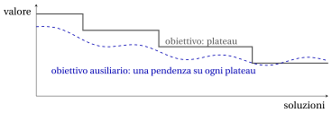
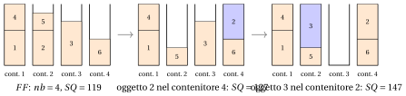

# 31.9 Paesaggi piatti e obiettivi ausiliari { #sez-sec-flat }

**Parte 4 · Algoritmi euristici · Capitolo 31** · [:material-book-open-variant: Capitolo 31: Ricerca locale](index.md) · [:material-file-pdf-box: Dispensa, volume 4 (PDF)](../../pdf/dispensa-4-algoritmi-euristici.pdf) · [:material-presentation: Slide (1/2)](../../pdf/slide-local-search-1.pdf) · [:material-presentation: Slide (2/2)](../../pdf/slide-local-search-2.pdf) · [:material-pencil: Esercizi: Ricerca locale](../../esercizi/local-search.md) · [:material-gesture-tap: App: TSP: nearest neighbour e 2-opt](../../laboratorio/tsp-nn-2opt.md)

## 31.9.1 Plateau

- Gli obiettivi del BPP e di $P\,||\,C_{\max}$ sono molto “grossolani”: il numero di contenitori assume pochi valori, e il makespan dipende solo dalle macchine critiche. Molte soluzioni hanno lo stesso valore, e la maggior parte delle mosse non lo cambia: il paesaggio è fatto di ampi <strong>plateau</strong>.

- Su un plateau una ricerca locale che accetta solo mosse strettamente miglioranti si ferma, anche se una sequenza di mosse di valore zero porterebbe a una soluzione migliore. La ricerca è <strong>cieca</strong>: l'obiettivo non dice quali vicini sono più vicini a un miglioramento.

{ .fig loading=lazy  }

- Quanto piatto? Sull'istanza di $P\,||\,C_{\max}$ con $m=4$ e $12$ lavori della sezione precedente, generiamo $100$ assegnazioni casuali (seme $1$) ed esaminiamo i loro $100\cdot 12\cdot 3=3600$ vicini move: $1290$ di essi ($35.8\%$) hanno lo <em>stesso</em> makespan della soluzione corrente. Per il BPP la situazione è estrema: sull'istanza con $c=10$ e pesi $w=(7,6,6,5,5,4,4,4,3,3,2,1)$, per cui $z(I)=5=\lceil 50/10\rceil$, le $100$ soluzioni calcolate da $FF$ su ordini casuali degli oggetti (seme $1$) hanno $2374$ vicini move e swap, e <strong>tutti</strong> hanno lo stesso numero di contenitori della soluzione corrente.

## 31.9.2 L'obiettivo ausiliario

- Il rimedio è guidare la ricerca con un <strong>obiettivo ausiliario</strong>, che distingue le soluzioni con lo stesso valore e premia quelle “più vicine” a un miglioramento. Per entrambi i problemi è una funzione dei carichi:

!!! chiave ""

    $$
    \text{BPP:}\quad \max\ \sum_{b} L_b^2 = \sum_b\Big(\sum_{j\in P_b} w_j\Big)^2,
    \qquad\qquad
    P\,||\,C_{\max}:\quad \min\ \sum_{h=1}^{m} L_h^2 .
    $$

- Entrambi i problemi ridistribuiscono un totale <em>fissato</em>, $\sum_j w_j$ o $\sum_j t_j$, fra i contenitori o le macchine. A totale fissato, la somma dei quadrati è piccola quando i carichi sono <em>bilanciati</em> e grande quando sono <em>sbilanciati</em>. Per $P\,||\,C_{\max}$ i carichi bilanciati sono esattamente ciò che vogliamo; per il BPP vogliamo il contrario: pochi contenitori pieni e gli altri vuoti.

!!! teorema "Proposizione 31.4"

    Se la quantità $\delta$ è trasferita dal carico $L_a$ al carico $L_b$ ($a\ne b$), la somma dei carichi al quadrato varia di

    $$
    \big(L_a-\delta\big)^2+\big(L_b+\delta\big)^2-L_a^2-L_b^2 \;=\; 2\,\delta\,\big(L_b-L_a+\delta\big).
    $$

??? dimostrazione "Dimostrazione"

    Sviluppando i quadrati, $(L_a-\delta)^2-L_a^2=-2\delta L_a+\delta^2$ e $(L_b+\delta)^2-L_b^2=2\delta L_b+\delta^2$; la somma è $2\delta(L_b-L_a+\delta)$. Gli altri carichi non cambiano. □

- La variazione si calcola in tempo $O(1)$: l'obiettivo ausiliario è anche meno costoso da valutare del makespan. Per una move, $\delta>0$ è il peso (o il tempo) dell'elemento spostato, e la somma dei quadrati <strong>aumenta</strong> se e solo se $L_b+\delta>L_a$: l'elemento va in un carico che, dopo la mossa, è più grande del carico che ha lasciato.

## 31.9.3 La ricerca locale move per il BPP

!!! chiave ""

    La ricerca locale <em>move</em> per il BPP esamina gli spostamenti di un oggetto in un altro contenitore non vuoto in cui entra, ne applica uno migliorante scelto con la regola first improvement o best improvement, e si ferma quando nessuna mossa migliora. L'obiettivo è o il numero di contenitori, $f=nb$, o l'obiettivo ausiliario $f=SQ=\sum_bL_b^2$; il <strong>guadagno</strong> $G$ di una mossa è il miglioramento di $f$.

!!! algoritmo "Algoritmo: Passo move per il BPP"

    

<strong>Input:</strong> \(n\) oggetti, pesi \(w[1..n]\), capacità \(c\), contenitori \(bin[1..n]\), carichi \(L\), \(f\in\{nb, SQ\}\), regola

<strong>Output:</strong> <em>true</em> se è stata applicata una mossa migliorante, <em>false</em> altrimenti

1<strong>Function</strong> BPPMoveStep(\(n, w, c, bin, L, f, \textit{rule}\))

2\(\bar G := 0\); \((\bar\jmath,\bar b) := (0,0)\) ▹ miglior mossa trovata finora

3<strong>for</strong> \(j := 1\) <strong>to</strong> \(n\) <strong>do</strong>

4\(a := bin[j]\) ▹ contenitore dell'oggetto \(j\)

5<strong>for</strong> ogni contenitore \(b\), in ordine crescente <strong>do</strong>

6<strong>if</strong> \(b = a\) <strong>or</strong> \(L[b]=0\) <strong>or</strong> \(L[b]+w[j] > c\) <strong>then</strong> <strong>continue</strong> ▹ stesso, vuoto o troppo pieno

7<strong>if</strong> \(f = SQ\) <strong>then</strong>

8\(G := 2\,w[j]\,(L[b]-L[a]+w[j])\) ▹ [Proposizione 31.4](#box-9-prop-transfer)

9<strong>else</strong>

10\(G := 1\) <strong>if</strong> \(L[a]=w[j]\) <strong>else</strong> \(0\) ▹ il contenitore \(a\) si svuota

11<strong>end</strong>

12<strong>if</strong> \(G > \bar G\) <strong>then</strong>

13\(\bar G \leftarrow G\); \((\bar\jmath,\bar b) \leftarrow (j,b)\) ▹ mossa migliorante

14<strong>if</strong> \(\textit{rule}=\textit{first}\) <strong>then</strong>

15<strong>uscire</strong> da entrambi i cicli

16<strong>end</strong>

17<strong>end</strong>

18<strong>end</strong>

19<strong>end</strong>

20<strong>if</strong> \(\bar\jmath = 0\) <strong>then</strong> <strong>return</strong> <em>false</em> ▹ nessuna mossa migliorante: ottimo locale

21\(L[bin[\bar\jmath]] \leftarrow L[bin[\bar\jmath]]-w[\bar\jmath]\); \(L[\bar b] \leftarrow L[\bar b]+w[\bar\jmath]\)
    \(bin[\bar\jmath] \leftarrow \bar b\) ▹ aggiornare i carichi applicare la mossa

22<strong>return</strong> <em>true</em>

Esegui in Colab:

## 31.9.4 La ricerca locale swap per il BPP

!!! chiave ""

    La ricerca locale <em>swap</em> per il BPP esamina gli scambi di due oggetti di peso diverso in contenitori diversi che mantengono ammissibili entrambi i contenitori, ne applica uno migliorante scelto con la regola first improvement o best improvement, e si ferma quando nessuno scambio migliora. Uno swap non cambia mai il numero di contenitori, quindi si usa solo con l'obiettivo ausiliario $SQ$.

!!! algoritmo "Algoritmo: Passo swap per il BPP"

    

<strong>Input:</strong> \(n\) oggetti, pesi \(w[1..n]\), capacità \(c\), contenitori \(bin[1..n]\), carichi \(L\), regola

<strong>Output:</strong> <em>true</em> se è stato applicato uno swap migliorante, <em>false</em> altrimenti

1<strong>Function</strong> BPPSwapStep(\(n, w, c, bin, L, \textit{rule}\))

2\(\bar G := 0\); \((\bar\jmath,\bar k) := (0,0)\) ▹ miglior swap trovato finora

3<strong>for</strong> \(j := 1\) <strong>to</strong> \(n\) <strong>do</strong>

4<strong>for</strong> \(k := j+1\) <strong>to</strong> \(n\) <strong>do</strong>

5\(a := bin[j]\); \(b := bin[k]\)

6<strong>if</strong> \(a = b\) <strong>or</strong> \(w[j]=w[k]\) <strong>then</strong> <strong>continue</strong> ▹ i carichi non cambierebbero

7\(\delta := w[j]-w[k]\) ▹ peso trasferito da \(a\) a \(b\)

8<strong>if</strong> \(L[b]+\delta > c\) <strong>or</strong> \(L[a]-\delta > c\) <strong>then</strong> <strong>continue</strong> ▹ un contenitore sarebbe troppo pieno

9\(G := 2\,\delta\,(L[b]-L[a]+\delta)\) ▹ [Proposizione 31.4](#box-9-prop-transfer)

10<strong>if</strong> \(G > \bar G\) <strong>then</strong>

11\(\bar G \leftarrow G\); \((\bar\jmath,\bar k) \leftarrow (j,k)\) ▹ swap migliorante

12<strong>if</strong> \(\textit{rule}=\textit{first}\) <strong>then</strong>

13<strong>uscire</strong> da entrambi i cicli

14<strong>end</strong>

15<strong>end</strong>

16<strong>end</strong>

17<strong>end</strong>

18<strong>if</strong> \(\bar\jmath = 0\) <strong>then</strong> <strong>return</strong> <em>false</em> ▹ nessuno swap migliorante: ottimo locale

19\(a := bin[\bar\jmath]\); \(b := bin[\bar k]\); \(\delta := w[\bar\jmath]-w[\bar k]\)

20\(L[a] \leftarrow L[a]-\delta\); \(L[b] \leftarrow L[b]+\delta\)
    \(bin[\bar\jmath] \leftarrow b\); \(bin[\bar k] \leftarrow a\) ▹ aggiornare i carichi applicare lo swap

21<strong>return</strong> <em>true</em>

Esegui in Colab:

## 31.9.5 Proprietà dell'obiettivo ausiliario

!!! teorema "Proposizione 31.5"

    Per il BPP, con gli intorni move e swap:

    1. una move che svuota un contenitore aumenta $\sum_b L_b^2$;

    2. uno swap non cambia il numero di contenitori.

    Quindi ogni move o swap che diminuisce il numero di contenitori aumenta anche $\sum_b L_b^2$.

??? dimostrazione "Dimostrazione"

    Se la move dell'oggetto $j$ dal contenitore $a$ al contenitore $b$ svuota il contenitore $a$, allora $L_a=w_j$, e il contenitore $b$ non è vuoto, quindi $L_b>0$. Per la [Proposizione 31.4](#box-9-prop-transfer) con $\delta=w_j$ la variazione è $2w_j(L_b-w_j+w_j)=2w_jL_b>0$. Uno swap scambia un oggetto del contenitore $a$ con un oggetto del contenitore $b$, quindi entrambi i contenitori restano non vuoti e non si crea nessun contenitore. □

!!! teorema "Proposizione 31.6"

    Per $P\,||\,C_{\max}$, con gli intorni move e swap:

    1. una move o uno swap che diminuisce $\sum_h L_h^2$ non aumenta il makespan;

    2. una move o uno swap che diminuisce il makespan diminuisce $\sum_h L_h^2$.

??? dimostrazione "Dimostrazione"

    Sia $\delta$ trasferito dalla macchina $a$ alla macchina $b$; scambiando se necessario i nomi di $a$ e $b$, $\delta>0$. Cambiano solo $L_a$ e $L_b$. (1) Per la [Proposizione 31.4](#box-9-prop-transfer), $\sum_hL_h^2$ diminuisce se e solo se $L_b+\delta<L_a$; allora entrambi i nuovi carichi $L_a-\delta$ e $L_b+\delta$ sono minori di $L_a\le C_{\max}$, e il makespan non aumenta. (2) Se il makespan diminuisce, la macchina $b$, il cui carico aumenta, non è critica dopo la mossa, quindi $L_b+\delta<C_{\max}$; la macchina $a$ doveva essere l'unica macchina critica, $L_a=C_{\max}$. Quindi $L_b+\delta<L_a$, e $\sum_hL_h^2$ diminuisce. □

- Le due proposizioni dicono che, per l'obiettivo ausiliario, ogni mossa che migliora l'obiettivo originale è migliorante, e lo sono anche alcune mosse che l'obiettivo originale vede come neutre; per $P\,||\,C_{\max}$, nessuna mossa che peggiora il makespan è migliorante. Per il BPP una move che aumenta $\sum_bL_b^2$ non aumenta mai il numero di contenitori, perché non si crea nessun contenitore.

- L'obiettivo ausiliario è una guida, non l'obiettivo: una soluzione con più contenitori può avere un $\sum_bL_b^2$ più grande. Con $c=7$, i carichi $(5,5)$ usano $2$ contenitori e danno $25+25=50$, mentre i carichi $(7,2,1)$ usano $3$ contenitori e danno $49+4+1=54$. La qualità della soluzione restituita si misura sempre con l'obiettivo originale.

## 31.9.6 Esempi

!!! esempio "Esempio 31.6: Il numero di contenitori è cieco, l'obiettivo ausiliario no"

    La soluzione di $FF$ sull'istanza di riferimento del BPP ($c=7$) ha gli schemi di carico $P_1=\{1,4\}$, $P_2=\{2,5\}$, $P_3=\{3\}$, $P_4=\{6\}$, con carichi $(7,6,5,3)$, $nb=4$ e $SQ=49+36+25+9=119$. Le sue mosse ammissibili sono

    
<table>
    <tr>
    <th>mossa</th>
    <th>carichi</th>
    <th>\(nb\)</th>
    <th>guadagno \(2w_j(L_b-L_a+w_j)\)</th>
    <th>\(SQ\)</th>
    </tr>
    <tr>
    <td>oggetto \(1\) (\(w_1=4\)): contenitore \(1\to 4\)</td>
    <td>\((3,6,5,7)\)</td>
    <td>\(4\)</td>
    <td>\(2\cdot4\cdot(3-7+4)=0\)</td>
    <td>\(119\)</td>
    </tr>
    <tr>
    <td>oggetto \(2\) (\(w_2=4\)): contenitore \(2\to 4\)</td>
    <td>\((7,2,5,7)\)</td>
    <td>\(4\)</td>
    <td>\(2\cdot4\cdot(3-6+4)=8\)</td>
    <td>\(127\)</td>
    </tr>
    <tr>
    <td>oggetto \(4\) (\(w_4=3\)): contenitore \(1\to 4\)</td>
    <td>\((4,6,5,6)\)</td>
    <td>\(4\)</td>
    <td>\(2\cdot3\cdot(3-7+3)=-6\)</td>
    <td>\(113\)</td>
    </tr>
    <tr>
    <td>oggetto \(5\) (\(w_5=2\)): contenitore \(2\to 3\)</td>
    <td>\((7,4,7,3)\)</td>
    <td>\(4\)</td>
    <td>\(2\cdot2\cdot(5-6+2)=4\)</td>
    <td>\(123\)</td>
    </tr>
    <tr>
    <td>oggetto \(5\) (\(w_5=2\)): contenitore \(2\to 4\)</td>
    <td>\((7,4,5,5)\)</td>
    <td>\(4\)</td>
    <td>\(2\cdot2\cdot(3-6+2)=-4\)</td>
    <td>\(115\)</td>
    </tr>
    </table>

    <strong>Con $f=nb$</strong>, nessuna mossa svuota un contenitore: gli oggetti $3$ e $6$, soli nei loro contenitori, non entrano da nessun'altra parte. La soluzione di $FF$ è un ottimo locale con $4$ contenitori, e lo è anche per l'intorno swap, per la [Proposizione 31.5](#box-10-prop-bppsq).

    <strong>Con $f=SQ$</strong>, entrambe le regole accettano la mossa dell'oggetto $2$ nel contenitore $4$ (guadagno $8$, $SQ=127$), che lascia l'oggetto $5$ da solo nel contenitore $2$. Nell'iterazione successiva, due mosse hanno il guadagno massimo, $20$: l'oggetto $3$ nel contenitore $2$, con guadagno $2\cdot5\cdot(2-5+5)=20$, e l'oggetto $5$ nel contenitore $3$, con guadagno $2\cdot2\cdot(5-2+2)=20$. L'oggetto $3$ è esaminato per primo, quindi entrambe le regole lo scelgono. Svuota il contenitore $3$: i carichi diventano $(7,7,7)$, $SQ=147$, e gli schemi di carico $\{1,4\}$, $\{3,5\}$, $\{2,6\}$ usano $3$ contenitori, che è <strong>ottimo</strong>. La prima mossa non ha cambiato il numero di contenitori: ha preparato la seconda.

    { .fig loading=lazy  }

!!! esempio "Esempio 31.7: Partendo da $NF$"

    La soluzione di $NF$ sull'istanza di riferimento del BPP ha gli schemi di carico $\{1\}$, $\{2\}$, $\{3\}$, $\{4,5\}$, $\{6\}$ (contenitori $1,\dots,5$), carichi $(4,4,5,5,3)$, $nb=5$ e $SQ=91$.

    <strong>Con $f=nb$</strong>, la prima mossa esaminata, l'oggetto $1$ nel contenitore $5$ ($3+4=7$), svuota il contenitore $1$: la soluzione ha $4$ contenitori, $\{2\},\{3\},\{4,5\},\{1,6\}$. È un ottimo locale: gli oggetti $2$ e $3$ non entrano in nessun altro contenitore, e i contenitori $4$ e $5$ contengono due oggetti ciascuno. Entrambe le regole si fermano con $4$ contenitori.

    <strong>Con $f=SQ$</strong>, best improvement esegue tre mosse:

    
<table>
    <tr>
    <th>mossa</th>
    <th>schemi di carico</th>
    <th>guadagno</th>
    <th>\(SQ\)</th>
    </tr>
    <tr>
    <td>oggetto \(1\) nel contenitore \(5\)</td>
    <td>\(\{2\},\{3\},\{4,5\},\{1,6\}\)</td>
    <td>\(2\cdot4\cdot(3-4+4)=24\)</td>
    <td>\(115\)</td>
    </tr>
    <tr>
    <td>oggetto \(4\) nel contenitore \(2\)</td>
    <td>\(\{2,4\},\{3\},\{5\},\{1,6\}\)</td>
    <td>\(2\cdot3\cdot(4-5+3)=12\)</td>
    <td>\(127\)</td>
    </tr>
    <tr>
    <td>oggetto \(3\) nel contenitore \(4\)</td>
    <td>\(\{2,4\},\{3,5\},\{1,6\}\)</td>
    <td>\(2\cdot5\cdot(2-5+5)=20\)</td>
    <td>\(147\)</td>
    </tr>
    </table>

    e raggiunge una soluzione ottima con $3$ contenitori, attraverso una mossa (la seconda) che non cambia il numero di contenitori. First improvement esegue le stesse tre mosse.

## 31.9.7 Esperimenti su due istanze medie

- Su una sola istanza piccola può succedere di tutto; gli esperimenti seguenti ripetono le ricerche locali da $100$ soluzioni di partenza casuali (seme $1$), con best improvement.

- $P\,||\,C_{\max}$ con $m=4$ e $t=(11,10,9,8,7,7,6,5,4,4,3,2)$, $z(I)=19$. Le $100$ assegnazioni casuali hanno un makespan medio di $33.32$. La tabella riporta il makespan medio degli ottimi locali, e il numero di esecuzioni che terminano in una soluzione ottima:

<table>
<tr>
<th></th>
<th colspan="2">\(f=C_{\max}\)</th>
<th colspan="2">\(f=\sum_h L_h^2\)</th>
</tr>
<tr>
<td>intorno</td>
<td>media</td>
<td>ottime</td>
<td>media</td>
<td>ottime</td>
</tr>
<tr>
<td>move</td>
<td>\(20.94\)</td>
<td>\(3\)</td>
<td>\(20.39\)</td>
<td>\(4\)</td>
</tr>
<tr>
<td>swap</td>
<td>\(24.31\)</td>
<td>\(7\)</td>
<td>\(23.09\)</td>
<td>\(20\)</td>
</tr>
</table>

- L'obiettivo ausiliario migliora entrambi gli intorni. Il solo swap è scarso perché non può cambiare il numero di lavori sulle macchine, che in un'assegnazione casuale è spesso lontano dall'equilibrio.

- BPP con $c=10$ e $w=(7,6,6,5,5,4,4,4,3,3,2,1)$, $z(I)=5$. Le $100$ soluzioni di $FF$ su ordini casuali degli oggetti usano $5$ contenitori in $14$ casi, $6$ contenitori in $85$ casi e $7$ contenitori in $1$ caso. La tabella riporta il numero di esecuzioni che terminano con $5$ contenitori:

<table>
<tr>
<th>intorno</th>
<th>\(f=nb\)</th>
<th>\(f=\sum_b L_b^2\)</th>
</tr>
<tr>
<td>nessuno (le soluzioni di \(FF\))</td>
<td>\(14\)</td>
<td>\(14\)</td>
</tr>
<tr>
<td>move</td>
<td>\(14\)</td>
<td>\(76\)</td>
</tr>
<tr>
<td>swap</td>
<td>—</td>
<td>\(14\)</td>
</tr>
</table>

- Con $f=nb$ la ricerca locale move non migliora nessuna delle $100$ soluzioni: sono tutte su un plateau. Con l'obiettivo ausiliario, altre $62$ esecuzioni raggiungono l'ottimo. Il solo swap non può cambiare il numero di contenitori, ma può preparare le mosse che lo cambiano.

---

**Avanti:** [31.10 KP: ammissibilità e penalità](kp-ammissibilita-e-penalita.md)
