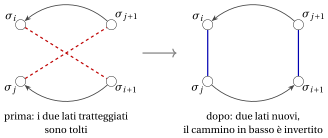
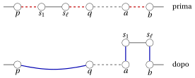

# Ricerca locale: lo schema · Intorni per i quattro problemi

**Parte 4 · Algoritmi euristici · Capitolo 31** · [:material-book-open-variant: Capitolo 31: Ricerca locale](index.md) · [:material-file-pdf-box: Dispensa, volume 4 (PDF)](../../pdf/dispensa-4-algoritmi-euristici.pdf) · [:material-pencil: Esercizi: Ricerca locale](../../esercizi/local-search.md) · [:material-gesture-tap: App: TSP: nearest neighbour e 2-opt](../../laboratorio/tsp-nn-2opt.md)

## 31.3 Ricerca locale: lo schema { #sez-sec-scheme }

- Lo pseudocodice di $LS$ è il seguente. La funzione $\textit{Improve}$ esplora l'intorno e restituisce un vicino migliorante di $x$, oppure $\textit{NULL}$ se non ne esiste nessuno.

!!! algoritmo "Algoritmo: Ricerca locale"

    

<strong>Input:</strong> una soluzione ammissibile \(x^0\), un intorno \(N\), una regola \(\in\{\textit{first},\textit{best}\}\)

<strong>Output:</strong> un ottimo locale \(x\) rispetto a \(N\)

1<strong>Function</strong> LocalSearch(\(x^0, N, \textit{rule}\))

2\(x := x^0\) ▹ soluzione corrente

3<strong>while</strong> true <strong>do</strong>

4\(y := \textit{Improve}(x, N, \textit{rule})\) ▹ vicino migliorante, oppure NULL

5<strong>if</strong> \(y = \textit{NULL}\) <strong>then</strong>

6<strong>return</strong> \(x\) ▹ nessun vicino migliorante: ottimo locale

7<strong>end</strong>

8\(x \leftarrow y\) ▹ spostarsi sul vicino migliorante

9<strong>end</strong>

Esegui in Colab:

- Una ricerca locale è definita da quattro ingredienti:

    1. la <strong>soluzione di partenza</strong> $x^0$, calcolata da un'euristica costruttiva o a caso;

    2. l'<strong>intorno</strong> $N$, cioè la famiglia delle mosse, che dipende dalla rappresentazione delle soluzioni;

    3. il <strong>criterio di accettazione</strong>: qui un vicino è accettato solo se è strettamente migliore della soluzione corrente;

    4. il <strong>criterio di arresto</strong>: qui la ricerca si ferma nel primo ottimo locale; in pratica si aggiunge spesso un limite di tempo.

- La funzione $f$ che decide se un vicino è “migliore” è di solito l'obiettivo del problema, ma non è obbligatorio: la ricerca può essere guidata da una funzione diversa, purché la soluzione restituita sia ammissibile.

!!! teorema "Proposizione 31.2"

    Per ogni soluzione di partenza, $LS$ si ferma dopo un numero finito di mosse, in un ottimo locale rispetto a $N$. Se la funzione obiettivo assume valori interi e il problema è di minimizzazione, il numero di mosse è al più $f(x^0)-z(I)$; per un problema di massimizzazione, al più $z(I)-f(x^0)$.

??? dimostrazione "Dimostrazione"

    Ogni mossa migliora strettamente l'obiettivo, quindi la sequenza delle soluzioni visitate non visita mai due volte la stessa soluzione. L'insieme delle soluzioni ammissibili è finito, quindi la sequenza è finita. Quando si ferma, $\textit{Improve}$ ha restituito $\textit{NULL}$, cioè nessun vicino è migliore: l'ultima soluzione è un ottimo locale. Se $f$ assume valori interi, ogni mossa migliora $f$ di almeno $1$, e $f$ non può mai andare oltre $z(I)$: da qui i limiti sul numero di mosse. □

- Sull'istanza di riferimento del TSP, una ricerca locale che parte dal giro di $NN$ (lunghezza $25$) esegue al più $25-18=7$ mosse. Sulle istanze grandi questo limite è debole, e per alcuni intorni esistono istanze su cui il numero di mosse cresce esponenzialmente con $n$ (per l'intorno 2-opt del TSP, si veda Englert, Röglin, Vöcking, <em>Algorithmica</em> 68, 2014). In pratica il numero di mosse è piccolo, e il tempo di esecuzione è dominato dall'esplorazione degli intorni.

- La ricerca locale <strong>intensifica</strong>: scende finché non raggiunge il fondo della valle in cui è partita. Quale valle, e quindi quale ottimo locale, dipende dalla soluzione di partenza, dall'intorno e dalla regola usata per scegliere la mossa.

## 31.4 Intorni per i quattro problemi { #sez-sec-neigh }

- Gli intorni sono definiti da piccole modifiche della rappresentazione delle soluzioni. All'intorno appartengono solo i vicini <strong>ammissibili</strong>: una modifica che produce un oggetto non ammissibile non è una mossa. Per ogni intorno fissiamo l'<strong>ordine</strong> in cui le mosse sono esaminate, che conta quando la ricerca accetta il primo vicino migliorante che trova.

### 31.4.1 KP: flip e swap

- L'intorno <strong>flip</strong>, definito nel capitolo [«Algoritmi euristici: definizioni»](../heuristics.md), cambia una componente di $x$, cioè aggiunge o toglie un oggetto; ha $n$ elementi prima del test di ammissibilità. I flip sono esaminati per $j=1,2,\dots,n$.

- L'intorno <strong>swap</strong> toglie un oggetto selezionato $j$ e aggiunge un oggetto non selezionato $k$. Se $S$ è l'insieme degli oggetti selezionati, ha $|S|\,(n-|S|)\le n^2/4$ elementi; gli swap sono esaminati per $j\in S$ in ordine crescente e, per ogni $j$, per $k\notin S$ in ordine crescente.

- I due intorni sono complementari: un flip cambia il numero di oggetti selezionati, uno swap lo mantiene. L'intorno <strong>flip+swap</strong> è la loro unione, con i flip esaminati per primi.

### 31.4.2 BPP: move e swap

- L'intorno <strong>move</strong> sposta un oggetto $j$ dal suo contenitore $a=bin_j$ a un altro contenitore non vuoto $b$ con $L_b+w_j\le c$. Ha al più $n\,(nb-1)$ elementi; le mosse sono esaminate per $j=1,2,\dots,n$ e, per ogni $j$, per i contenitori in ordine crescente di etichetta.

- Spostare un oggetto in un contenitore vuoto non è mai utile: non può diminuire il numero di contenitori. I contenitori mantengono le etichette della soluzione di partenza; un contenitore svuotato da una mossa semplicemente scompare.

- L'intorno <strong>swap</strong> scambia due oggetti $j<k$ in contenitori diversi, purché entrambi i contenitori restino ammissibili: $L_{bin_j}-w_j+w_k\le c$ e $L_{bin_k}-w_k+w_j\le c$. Scambiare due oggetti di peso uguale non cambia nessun carico, e non si considera. Ha al più $\frac{n(n-1)}{2}$ elementi, esaminati per $j=1,\dots,n$ e $k=j+1,\dots,n$.

### 31.4.3 TSP: 2-opt e Or-opt

- Un giro è una permutazione $\sigma=(\sigma_1,\sigma_2,\dots,\sigma_n)$ delle città, con $\sigma_{n+1}=\sigma_1$. Teniamo la città $1$ in prima posizione, $\sigma_1=1$.

- La mossa <strong>2-opt</strong> con posizioni $i<j$ toglie i due lati $\{\sigma_i,\sigma_{i+1}\}$ e $\{\sigma_j,\sigma_{j+1}\}$, e richiude il giro nell'unico altro modo possibile: con i lati $\{\sigma_i,\sigma_j\}$ e $\{\sigma_{i+1},\sigma_{j+1}\}$, percorrendo il cammino $\sigma_{i+1},\dots,\sigma_j$ nel verso opposto (Croes, <em>Operations Research</em> 6, 1958):

    $$
    \begin{gathered}
    (\sigma_1,\dots,\sigma_i,\ \underbrace{\sigma_{i+1},\sigma_{i+2},\dots,\sigma_j}_{\text{cammino}},\ \sigma_{j+1},\dots,\sigma_n)\\
    \downarrow\\
    (\sigma_1,\dots,\sigma_i,\ \underbrace{\sigma_j,\dots,\sigma_{i+2},\sigma_{i+1}}_{\text{cammino invertito}},\ \sigma_{j+1},\dots,\sigma_n).
    \end{gathered}
    $$

{ .fig loading=lazy  }

- Le mosse sono esaminate per $i=1,\dots,n-2$ e $j=i+2,\dots,n$, escluso $i=1$, $j=n$ (i due lati avrebbero in comune la città $\sigma_1$). L'intorno 2-opt ha $\frac{n(n-3)}{2}$ elementi: $5$ per l'istanza di riferimento.

- La mossa <strong>Or-opt</strong> (Or, tesi di dottorato, Northwestern University, 1976) prende un <strong>segmento</strong> di $\ell\in\{1,2,3\}$ città consecutive $\sigma_i,\dots,\sigma_{i+\ell-1}$ ($2\le i$, $i+\ell-1\le n$) e lo inserisce, con lo stesso orientamento, fra due città consecutive $\sigma_k$ e $\sigma_{k+1}$ esterne al segmento ($k\notin\{i-1,\dots,i+\ell-1\}$). Siano $p=\sigma_{i-1}$ e $q=\sigma_{i+\ell}$ le città prima e dopo il segmento, $s_1=\sigma_i$ e $s_\ell=\sigma_{i+\ell-1}$ la sua prima e la sua ultima città, $a=\sigma_k$ e $b=\sigma_{k+1}$:

{ .fig loading=lazy  }

- Le mosse sono esaminate per $\ell=1,2,3$, poi per $i=2,\dots,n-\ell+1$, poi per $k=1,\dots,n$. Per ogni $\ell$ ci sono $n-\ell$ segmenti e $n-\ell-1$ punti di inserimento, quindi l'intorno ha $\sum_{\ell=1}^{3}(n-\ell)(n-\ell-1)$ elementi, cioè $O(n^2)$: $170$ per $n=10$. Alcune di queste mosse danno lo stesso giro (spostare una sola città in avanti di una posizione equivale a spostare il suo successore indietro di una posizione).

- Una mossa Or-opt toglie <em>tre</em> lati, $\{p,s_1\}$, $\{s_\ell,q\}$ e $\{a,b\}$. L'intorno <strong>3-opt</strong> (Lin, <em>Bell System Technical Journal</em> 44, 1965) contiene tutti i modi di togliere tre lati e ricollegare i tre cammini: ha $O(n^3)$ elementi, e Or-opt ne è la parte che si può esplorare in tempo $O(n^2)$.

### 31.4.4 $P\,||\,C_{\max}$: move e swap

- L'intorno <strong>move</strong> sposta un lavoro $j$ dalla sua macchina $a=mach_j$ a un'altra macchina $h\ne a$. Ogni mossa è ammissibile, e l'intorno ha $n\,(m-1)$ elementi, esaminati per $j=1,\dots,n$ e, per ogni $j$, per $h=1,\dots,m$.

- L'intorno <strong>swap</strong> scambia le macchine di due lavori $j<k$ su macchine diverse con $t_j\ne t_k$ (altrimenti nessun carico cambia). Ha al più $\frac{n(n-1)}{2}$ elementi, esaminati per $j=1,\dots,n$ e $k=j+1,\dots,n$. Uno swap non cambia mai il numero di lavori su una macchina.

### 31.4.5 Riepilogo

<table>
<tr>
<th>problema</th>
<th>intorno</th>
<th>mossa</th>
<th>dimensione</th>
</tr>
<tr>
<td>KP</td>
<td>flip</td>
<td>aggiungere o togliere l'oggetto \(j\)</td>
<td>\(n\)</td>
</tr>
<tr>
<td>KP</td>
<td>swap</td>
<td>oggetto \(j\) fuori, oggetto \(k\) dentro</td>
<td>\(|S|(n-|S|)\le \frac{n^2}{4}\)</td>
</tr>
<tr>
<td>BPP</td>
<td>move</td>
<td>oggetto \(j\) in un altro contenitore</td>
<td>\(\le n\,(nb-1)\)</td>
</tr>
<tr>
<td>BPP</td>
<td>swap</td>
<td>scambiare gli oggetti \(j\) e \(k\)</td>
<td>\(\le \frac{n(n-1)}{2}\)</td>
</tr>
<tr>
<td>TSP</td>
<td>2-opt</td>
<td>togliere \(2\) lati, invertire un cammino</td>
<td>\(\frac{n(n-3)}{2}\)</td>
</tr>
<tr>
<td>TSP</td>
<td>Or-opt</td>
<td>spostare un segmento di \(1\), \(2\) o \(3\) città</td>
<td>\(\sum_{\ell=1}^{3}(n-\ell)(n-\ell-1)\)</td>
</tr>
<tr>
<td>TSP</td>
<td>3-opt</td>
<td>togliere \(3\) lati, ricollegare</td>
<td>\(O(n^3)\)</td>
</tr>
<tr>
<td>\(P\,||\,C_{\max}\)</td>
<td>move</td>
<td>lavoro \(j\) su un'altra macchina</td>
<td>\(n\,(m-1)\)</td>
</tr>
<tr>
<td>\(P\,||\,C_{\max}\)</td>
<td>swap</td>
<td>scambiare i lavori \(j\) e \(k\)</td>
<td>\(\le\frac{n(n-1)}{2}\)</td>
</tr>
</table>

- Le dimensioni sono quelle <em>prima</em> del test di ammissibilità (KP, BPP) e comprendono mosse che non cambiano l'obiettivo. La dimensione di un intorno è il numero di vicini da valutare a ogni iterazione, quindi determina il costo di un'iterazione.

---

**Avanti:** [31.5 First improvement e best improvement](first-improvement-e-best-improvement.md)
