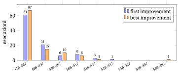

# 31.12 Ricerca locale multi-start { #sez-sec-multistart }

**Parte 4 · Algoritmi euristici · Capitolo 31** · [:material-book-open-variant: Capitolo 31: Ricerca locale](index.md) · [:material-file-pdf-box: Dispensa, volume 4 (PDF)](../../pdf/dispensa-4-algoritmi-euristici.pdf) · [:material-pencil: Esercizi: Ricerca locale](../../esercizi/local-search.md) · [:material-gesture-tap: App: TSP: nearest neighbour e 2-opt](../../laboratorio/tsp-nn-2opt.md)

- La ricerca locale si ferma nell'ottimo locale della valle in cui parte. Il modo più semplice di esplorare altre valli è <strong>ripartire</strong> da una soluzione diversa, e tenere il miglior ottimo locale.

!!! chiave ""

    La <em>ricerca locale multi-start</em> (indicata con $MSLS$) genera $M$ soluzioni di partenza, a caso o con un'euristica costruttiva randomizzata, esegue una ricerca locale da ciascuna di esse, in modo indipendente, e restituisce il miglior ottimo locale trovato.

!!! algoritmo "Algoritmo: 2-opt multi-start"

    

<strong>Input:</strong> \(n\) città, distanze \(d\), numero di partenze \(M\), seme \(s\) del generatore, regola

<strong>Output:</strong> il miglior ottimo locale 2-opt \(\bar\sigma\) trovato, e la sua lunghezza \(\bar L\)

1<strong>Function</strong> MultiStartTwoOpt(\(n, d, M, s, \textit{rule}\))

2\(\bar L := +\infty\) ▹ lunghezza del miglior giro trovato finora

3<strong>for</strong> \(r := 1\) <strong>to</strong> \(M\) <strong>do</strong>

4\(\sigma := \textit{RandomTour}(n, s)\) ▹ giro di partenza casuale; aggiorna il seme

5<strong>while</strong> \(\textit{TwoOptStep}(n, d, \sigma, \textit{rule})\) <strong>do</strong> ▹ ripetere finché \(\sigma\) non è un ottimo locale 2-opt

6<strong>end</strong>

7<strong>if</strong> \(L(\sigma) < \bar L\) <strong>then</strong>

8\(\bar L \leftarrow L(\sigma)\); \(\bar\sigma \leftarrow \sigma\) ▹ nuovo miglior ottimo locale

9<strong>end</strong>

10<strong>end</strong>

11<strong>return</strong> \((\bar\sigma, \bar L)\)

Esegui in Colab:

- Le $M$ ricerche locali sono <strong>indipendenti</strong>: possono essere eseguite in parallelo, e il risultato non dipende dal loro ordine. Il multi-start è la forma più semplice di <strong>diversificazione</strong>.

!!! esempio "Esempio 31.11: $MSLS$ sul TSP con $10$ città"

    Sull'istanza dell'[Esempio 31.3](tsp-2-opt-e-or-opt.md#box-6-ex-tsp10), $100$ giri casuali (seme $1$), ciascuno migliorato da una ricerca locale, terminano nei seguenti ottimi locali:

    
<table>
    <tr>
    <th>intorno</th>
    <th>regola</th>
    <th>esecuzioni nell'ottimo \(39\)</th>
    <th>altri ottimi locali (esecuzioni)</th>
    </tr>
    <tr>
    <td>2-opt</td>
    <td>first</td>
    <td>\(46\)</td>
    <td>\(41\) (\(54\))</td>
    </tr>
    <tr>
    <td>2-opt</td>
    <td>best</td>
    <td>\(87\)</td>
    <td>\(41\) (\(8\)), \(43\) (\(5\))</td>
    </tr>
    <tr>
    <td>Or-opt</td>
    <td>first</td>
    <td>\(72\)</td>
    <td>\(43\) (\(26\)), \(44\) (\(2\))</td>
    </tr>
    <tr>
    <td>Or-opt</td>
    <td>best</td>
    <td>\(77\)</td>
    <td>\(43\) (\(22\)), \(44\) (\(1\))</td>
    </tr>
    <tr>
    <td>\(VND\) (2-opt, Or-opt)</td>
    <td>first</td>
    <td>\(100\)</td>
    <td>—</td>
    </tr>
    <tr>
    <td>\(VND\) (2-opt, Or-opt)</td>
    <td>best</td>
    <td>\(100\)</td>
    <td>—</td>
    </tr>
    </table>

    Con 2-opt e first improvement, il primo giro casuale termina nell'ottimo locale di lunghezza $41$ e il terzo nell'ottimo. Su questa istanza best improvement è molto migliore di first improvement, e $VND$ trova sempre l'ottimo, l'unico giro che è un ottimo locale per entrambi gli intorni.

!!! esempio "Esempio 31.12: $MSLS$ sul TSP con $30$ città"

    Le $30$ città hanno coordinate $(\lfloor 101u_{2k-1}\rfloor,\lfloor 101u_{2k}\rfloor)$, $k=1,\dots,30$, dove $u_1,u_2,\dots$ sono generati con seme $12345$, e $d_{ij}$ è la distanza euclidea arrotondata all'intero più vicino. Il giro ottimo, calcolato con un solutore MIP, ha lunghezza $z(I)=478$. Il migliore dei $30$ giri di $NN$ (uno per ogni città di partenza) ha lunghezza $537$.

    I $100$ giri casuali (seme $1$) hanno una lunghezza media di $1768.73$ (fra $1364$ e $2080$). Dopo la ricerca locale 2-opt:

    
<table>
    <tr>
    <th></th>
    <th>first improvement</th>
    <th>best improvement</th>
    </tr>
    <tr>
    <td>ottimi locali distinti</td>
    <td>\(59\)</td>
    <td>\(54\)</td>
    </tr>
    <tr>
    <td>esecuzioni che terminano nell'ottimo</td>
    <td>\(14\)</td>
    <td>\(12\)</td>
    </tr>
    <tr>
    <td>lunghezza media (errore relativo)</td>
    <td>\(488.45\) (\(2.2\%\))</td>
    <td>\(487.24\) (\(1.9\%\))</td>
    </tr>
    <tr>
    <td>lunghezza peggiore (errore relativo)</td>
    <td>\(537\) (\(12.3\%\))</td>
    <td>\(567\) (\(18.6\%\))</td>
    </tr>
    <tr>
    <td>prima esecuzione che trova l'ottimo</td>
    <td>\(2\)</td>
    <td>\(9\)</td>
    </tr>
    </table>

    Gli ottimi locali si distribuiscono come segue (numero di esecuzioni per classe di lunghezza):

    { .fig loading=lazy  }

    La ricerca locale trasforma giri di lunghezza circa $1769$ in giri entro il $2\%$ dall'ottimo in media; ma ogni esecuzione termina nella sua valle, e solo circa un'esecuzione su otto raggiunge l'ottimo.

## 31.12.1 I limiti del multi-start

- <strong>Nessuna memoria.</strong> Ogni esecuzione riparte da zero e ignora ciò che hanno trovato le precedenti. Se un'esecuzione raggiunge l'ottimo con probabilità $q$, indipendentemente dalle altre, $M$ esecuzioni lo mancano tutte con probabilità $(1-q)^M$. Con $q=0.12$, come nell'ultimo esempio con best improvement, $10$ esecuzioni mancano l'ottimo con probabilità $0.88^{10}\approx 0.28$, e servono $37$ esecuzioni per portare questa probabilità sotto l'$1\%$.

- <strong>La probabilità $q$ si riduce.</strong> Il numero di ottimi locali cresce molto rapidamente con $n$: con $10$ città solo $3$ giri sono ottimi locali 2-opt, con $30$ città $100$ esecuzioni ne trovano più di $50$ distinti. Sulle istanze grandi una partenza casuale non raggiunge quasi mai l'ottimo, e $(1-q)^M$ è vicino a $1$ per ogni $M$ ragionevole.

- <strong>La maggior parte del tempo si spende a scendere.</strong> Una partenza casuale è lontana dalle buone soluzioni, e la ricerca locale spende la maggior parte delle sue mosse nella discesa; una buona euristica costruttiva dà soluzioni di partenza migliori, ma poche e poco diverse fra loro.

- Una strategia migliore <strong>userebbe gli ottimi locali già trovati</strong>: ripartire <em>vicino</em> a un buon ottimo locale invece che da un punto qualsiasi, oppure continuare la ricerca da esso accettando alcune mosse peggioranti. Sono le idee delle metaeuristiche.

## 31.12.2 Che cosa dà la ricerca locale, e che cosa non dà

- La ricerca locale migliora una soluzione ammissibile fino a raggiungere un ottimo locale: un <strong>bound primale</strong> migliore, spesso molto migliore di quello di partenza.

- Non dà un bound duale, e il fatto che si sia fermata non significa che sia arrivata. Sull'istanza con $30$ città sappiamo che $478$ è ottimo solo perché lo ha dimostrato un solutore MIP; la sola ricerca locale non saprebbe distinguere dall'ottimo l'ottimo locale di lunghezza $479$, trovato in molte esecuzioni.

!!! chiave ""

    Un ottimo locale non è un bound migliore: è una soluzione ammissibile, cioè un lato del gap. La sua qualità si può valutare solo rispetto a un bound duale calcolato in un altro modo.

---

**Avanti:** [Errori tipici · In sintesi](errori-tipici.md)
