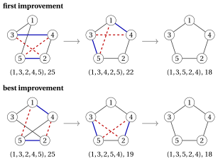
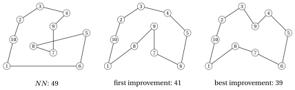

# 31.7 TSP: 2-opt e Or-opt { #sez-sec-tsp }

**Parte 4 · Algoritmi euristici · Capitolo 31** · [:material-book-open-variant: Capitolo 31: Ricerca locale](index.md) · [:material-file-pdf-box: Dispensa, volume 4 (PDF)](../../pdf/dispensa-4-algoritmi-euristici.pdf) · [:material-presentation: Slide (1/2)](../../pdf/slide-local-search-1.pdf) · [:material-presentation: Slide (2/2)](../../pdf/slide-local-search-2.pdf) · [:material-pencil: Esercizi: Ricerca locale](../../esercizi/local-search.md) · [:material-gesture-tap: App: TSP: nearest neighbour e 2-opt](../../laboratorio/tsp-nn-2opt.md)

## 31.7.1 La ricerca locale 2-opt

!!! chiave ""

    La ricerca locale <em>2-opt</em> (indicata con $2OPT$) è una ricerca locale per il TSP con l'intorno 2-opt. A ogni iterazione valuta le mosse 2-opt del giro corrente con la formula incrementale, applica una mossa migliorante scelta con la regola first improvement o best improvement, e si ferma quando nessuna mossa accorcia il giro.

!!! algoritmo "Algoritmo: Passo 2-opt"

    

<strong>Input:</strong> \(n\) città, distanze \(d[1..n][1..n]\), giro \(\sigma[1..n]\) con \(\sigma[1]=1\), regola \(\in\{\textit{first},\textit{best}\}\)

<strong>Output:</strong> <em>true</em> se a \(\sigma\) è stata applicata una mossa 2-opt migliorante, <em>false</em> altrimenti

1<strong>Function</strong> TwoOptStep(\(n, d, \sigma, \textit{rule}\))

2\(\bar\Delta := 0\)
    \((\bar\imath, \bar\jmath) := (0,0)\) ▹ miglior variazione di lunghezza trovata finora miglior mossa trovata finora

3<strong>for</strong> \(i := 1\) <strong>to</strong> \(n-2\) <strong>do</strong>

4<strong>for</strong> \(j := i+2\) <strong>to</strong> \(n\) <strong>do</strong>

5<strong>if</strong> \(i=1\) <strong>and</strong> \(j=n\) <strong>then</strong> <strong>continue</strong> ▹ i due lati sono adiacenti

6\(u_1 := \sigma[i]\); \(v_1 := \sigma[i+1]\)
    \(u_2 := \sigma[j]\); \(v_2 := \sigma[j \bmod n+1]\)
    \(\Delta := d[u_1][u_2]+d[v_1][v_2]-d[u_1][v_1]-d[u_2][v_2]\) ▹ primo lato tolto secondo lato tolto

7<strong>if</strong> \(\Delta < \bar\Delta\) <strong>then</strong>

8\(\bar\Delta \leftarrow \Delta\); \((\bar\imath,\bar\jmath) \leftarrow (i,j)\) ▹ mossa migliorante

9<strong>if</strong> \(\textit{rule}=\textit{first}\) <strong>then</strong>

10<strong>uscire</strong> da entrambi i cicli

11<strong>end</strong>

12<strong>end</strong>

13<strong>end</strong>

14<strong>end</strong>

15<strong>if</strong> \(\bar\imath = 0\) <strong>then</strong> <strong>return</strong> <em>false</em> ▹ nessuna mossa migliorante: ottimo locale

16invertire il cammino \(\sigma[\bar\imath+1], \dots, \sigma[\bar\jmath]\) ▹ applicare la mossa

17<strong>return</strong> <em>true</em>

Esegui in Colab:

- Nell'implementazione, $\textit{Improve}$ e lo spostamento sul vicino migliorante sono riuniti in un'unica funzione $\textit{Step}$, che esplora l'intorno con la valutazione incrementale e, se trova una mossa migliorante, la applica alla soluzione corrente e restituisce <em>true</em>; altrimenti restituisce <em>false</em>. $LS$ chiama $\textit{Step}$ finché non restituisce <em>false</em>.

- $2OPT$ è $\textit{LocalSearch}$ con $\textit{TwoOptStep}$; non cambia mai $\sigma[1]=1$, perché $i\ge 1$ e il cammino invertito parte dalla posizione $i+1\ge 2$.

- Un'iterazione costa tempo $O(n^2)$; l'inversione del cammino costa $O(n)$.

- Quando le distanze sono euclidee, un ottimo locale 2-opt non ha lati che si incrociano: se i lati $\{u_1,v_1\}$ e $\{u_2,v_2\}$ si incrociano in un punto $X$, la disuguaglianza triangolare dà $d_{u_1u_2}\le d_{u_1X}+d_{Xu_2}$ e $d_{v_1v_2}\le d_{v_1X}+d_{Xv_2}$, quindi $\Delta\le 0$, con $\Delta<0$ a meno che le quattro città non siano allineate. La mossa 2-opt “scioglie” l'incrocio dei due lati.

!!! esempio "Esempio 31.2: $2OPT$ sull'istanza di riferimento del TSP"

    Partiamo dal giro di $NN$ dalla città $1$, $\sigma=(1,3,2,4,5)$, di lunghezza $25$. Le sue $5$ mosse sono

    
<table>
    <tr>
    <th>\((i,j)\)</th>
    <th>lati tolti</th>
    <th>lati aggiunti</th>
    <th>\(\Delta\)</th>
    <th>nuovo giro, lunghezza</th>
    </tr>
    <tr>
    <td>\((1,3)\)</td>
    <td>\(\{1,3\},\{2,4\}\)</td>
    <td>\(\{1,2\},\{3,4\}\)</td>
    <td>\(5+4-2-3=+4\)</td>
    <td>\((1,2,3,4,5)\), \(29\)</td>
    </tr>
    <tr>
    <td>\((1,4)\)</td>
    <td>\(\{1,3\},\{4,5\}\)</td>
    <td>\(\{1,4\},\{3,5\}\)</td>
    <td>\(2+7-2-7=0\)</td>
    <td>\((1,4,2,3,5)\), \(25\)</td>
    </tr>
    <tr>
    <td>\((2,4)\)</td>
    <td>\(\{3,2\},\{4,5\}\)</td>
    <td>\(\{3,4\},\{2,5\}\)</td>
    <td>\(4+4-4-7=-3\)</td>
    <td>\((1,3,4,2,5)\), \(22\)</td>
    </tr>
    <tr>
    <td>\((2,5)\)</td>
    <td>\(\{3,2\},\{5,1\}\)</td>
    <td>\(\{3,5\},\{2,1\}\)</td>
    <td>\(7+5-4-9=-1\)</td>
    <td>\((1,3,5,4,2)\), \(24\)</td>
    </tr>
    <tr>
    <td>\((3,5)\)</td>
    <td>\(\{2,4\},\{5,1\}\)</td>
    <td>\(\{2,5\},\{4,1\}\)</td>
    <td>\(4+2-3-9=-6\)</td>
    <td>\((1,3,2,5,4)\), \(19\)</td>
    </tr>
    </table>

    <strong>First improvement</strong> accetta la mossa $(2,4)$, la prima con $\Delta<0$, dopo $3$ valutazioni: $\sigma=(1,3,4,2,5)$, di lunghezza $22$. Le sue mosse hanno $\Delta=+1,+6,+3,-4,0$; la mossa $(2,5)$, che toglie $\{3,4\}$ e $\{5,1\}$ e aggiunge $\{3,5\}$ e $\{4,1\}$, è accettata dopo $4$ valutazioni: $\sigma=(1,3,5,2,4)$, di lunghezza $18$. Tutte le sue $5$ mosse hanno $\Delta>0$ ($+7,+4,+1,+4,+6$): la ricerca si ferma dopo $3+4+5=12$ valutazioni.

    <strong>Best improvement</strong> accetta la mossa $(3,5)$, con $\Delta=-6$: $\sigma=(1,3,2,5,4)$, di lunghezza $19$. Le sue mosse hanno $\Delta=+6,+4,-1,+3,+6$, e la mossa $(2,4)$, che toglie $\{3,2\}$ e $\{5,4\}$ e aggiunge $\{3,5\}$ e $\{2,4\}$, dà $\sigma=(1,3,5,2,4)$, di lunghezza $18$. La ricerca si ferma dopo $5+5+5=15$ valutazioni.

    Entrambe le regole raggiungono il giro ottimo, con $2$ mosse ciascuna. La figura mostra i due percorsi; le città sono disposte nell'ordine del giro ottimo, quindi il giro ottimo è il bordo del pentagono (l'istanza non è euclidea: il disegno è solo uno schema). I lati rossi tratteggiati sono tolti, quelli blu sono aggiunti.

    { .fig loading=lazy  }

## 31.7.2 La ricerca locale Or-opt

!!! chiave ""

    La ricerca locale <em>Or-opt</em> (indicata con $OROPT$) è una ricerca locale per il TSP con l'intorno Or-opt. A ogni iterazione valuta, con la formula incrementale, l'inserimento di ogni segmento di $1$, $2$ o $3$ città consecutive fra altre due città consecutive, applica una mossa migliorante scelta con la regola first improvement o best improvement, e si ferma quando nessuna mossa accorcia il giro.

!!! algoritmo "Algoritmo: Passo Or-opt"

    

<strong>Input:</strong> \(n\) città, distanze \(d[1..n][1..n]\), giro \(\sigma[1..n]\) con \(\sigma[1]=1\), regola \(\in\{\textit{first},\textit{best}\}\)

<strong>Output:</strong> <em>true</em> se a \(\sigma\) è stata applicata una mossa Or-opt migliorante, <em>false</em> altrimenti

1<strong>Function</strong> OrOptStep(\(n, d, \sigma, \textit{rule}\))

2\(\bar\Delta := 0\); \((\bar\ell,\bar\imath,\bar k) := (0,0,0)\) ▹ miglior mossa trovata finora

3<strong>for</strong> \(\ell := 1\) <strong>to</strong> \(3\) <strong>do</strong>

4<strong>for</strong> \(i := 2\) <strong>to</strong> \(n-\ell+1\) <strong>do</strong>

5\(p := \sigma[i-1]\); \(s_1 := \sigma[i]\)
    \(s_\ell := \sigma[i+\ell-1]\); \(q := \sigma[(i+\ell-1) \bmod n+1]\) ▹ predecessore, prima città del segmento ultima città, successore

6<strong>for</strong> \(k := 1\) <strong>to</strong> \(n\) <strong>do</strong>

7<strong>if</strong> \(i-1 \le k \le i+\ell-1\) <strong>then</strong> <strong>continue</strong> ▹ stesso posto, o dentro il segmento

8\(a := \sigma[k]\); \(b := \sigma[k \bmod n+1]\)
    \(\Delta := d[p][q]+d[a][s_1]+d[s_\ell][b]-d[p][s_1]-d[s_\ell][q]-d[a][b]\) ▹ lato in cui va il segmento

9<strong>if</strong> \(\Delta < \bar\Delta\) <strong>then</strong>

10\(\bar\Delta \leftarrow \Delta\); \((\bar\ell,\bar\imath,\bar k) \leftarrow (\ell,i,k)\) ▹ mossa migliorante

11<strong>if</strong> \(\textit{rule}=\textit{first}\) <strong>then</strong>

12<strong>uscire</strong> dai tre cicli

13<strong>end</strong>

14<strong>end</strong>

15<strong>end</strong>

16<strong>end</strong>

17<strong>end</strong>

18<strong>if</strong> \(\bar\ell = 0\) <strong>then</strong> <strong>return</strong> <em>false</em> ▹ nessuna mossa migliorante: ottimo locale

19spostare \(\sigma[\bar\imath],\dots,\sigma[\bar\imath+\bar\ell-1]\) fra \(\sigma[\bar k]\) e \(\sigma[\bar k \bmod n+1]\) ▹ applicare

20<strong>return</strong> <em>true</em>

Esegui in Colab:

- Or-opt sposta un breve tratto del giro in un posto migliore, senza invertire nulla: è l'intorno naturale quando alcune città sono state “lasciate indietro” dalla costruzione. Un'iterazione costa tempo $O(n^2)$.

- Un ottimo locale 2-opt non è necessariamente un ottimo locale Or-opt, e viceversa: i due intorni contengono mosse diverse.

## 31.7.3 First e best improvement su un'istanza media

- Con $5$ città l'intorno 2-opt è piccolo ed entrambe le regole raggiungono l'ottimo. Per vedere la differenza fra le due regole, e il ruolo di Or-opt, usiamo un'istanza media con $10$ città. Questa istanza non è metrica: $d_{68}=8>d_{67}+d_{78}=4+3$ e $d_{6,10}=11>d_{67}+d_{7,10}=4+6$.

!!! esempio "Esempio 31.3: Un'istanza del TSP con $10$ città"

    Le città hanno coordinate intere, e $d_{ij}$ è la distanza euclidea arrotondata all'intero più vicino:

    
<table>
    <tr>
    <th>città</th>
    <th>\(1\)</th>
    <th>\(2\)</th>
    <th>\(3\)</th>
    <th>\(4\)</th>
    <th>\(5\)</th>
    <th>\(6\)</th>
    <th>\(7\)</th>
    <th>\(8\)</th>
    <th>\(9\)</th>
    <th>\(10\)</th>
    </tr>
    <tr>
    <td>coordinate</td>
    <td>\((1,1)\)</td>
    <td>\((3,8)\)</td>
    <td>\((6,10)\)</td>
    <td>\((10,9)\)</td>
    <td>\((13,6)\)</td>
    <td>\((12,1)\)</td>
    <td>\((8,3)\)</td>
    <td>\((5,4)\)</td>
    <td>\((8,7)\)</td>
    <td>\((2,5)\)</td>
    </tr>
    </table>

    $$
    \begin{array}{c|cccccccccc}
    \hline {d_{ij}} & {1} & {2} & {3} & {4} & {5} & {6} & {7} & {8} & {9} & {10} \\
    \hline {1} & --- & {7} & {10} & {12} & {13} & {11} & {7} & {5} & {9} & {4} \\
    {2} & {7} & --- & {4} & {7} & {10} & {11} & {7} & {4} & {5} & {3} \\
    {3} & {10} & {4} & --- & {4} & {8} & {11} & {7} & {6} & {4} & {6} \\
    {4} & {12} & {7} & {4} & --- & {4} & {8} & {6} & {7} & {3} & {9} \\
    {5} & {13} & {10} & {8} & {4} & --- & {5} & {6} & {8} & {5} & {11} \\
    {6} & {11} & {11} & {11} & {8} & {5} & --- & {4} & {8} & {7} & {11} \\
    {7} & {7} & {7} & {7} & {6} & {6} & {4} & --- & {3} & {4} & {6} \\
    {8} & {5} & {4} & {6} & {7} & {8} & {8} & {3} & --- & {4} & {3} \\
    {9} & {9} & {5} & {4} & {3} & {5} & {7} & {4} & {4} & --- & {6} \\
    {10} & {4} & {3} & {6} & {9} & {11} & {11} & {6} & {3} & {6} & --- \\
    \hline
    \end{array}
    $$

    Fra i suoi $181\,440$ giri distinti, l'unico ottimo è $(1,10,2,3,9,4,5,6,7,8)$, di lunghezza $z(I)=39$. Il giro di $NN$ dalla città $1$ è $(1,10,2,3,4,9,7,8,5,6)$, di lunghezza $49$, e l'intorno 2-opt ha $\frac{10\cdot 7}{2}=35$ mosse.

    <strong>First improvement</strong> esegue $4$ mosse:

    
<table>
    <tr>
    <th>lati tolti</th>
    <th>nuovo giro</th>
    <th>\(\Delta\)</th>
    <th>lunghezza</th>
    <th>valutazioni</th>
    </tr>
    <tr>
    <td>\(\{3,4\},\{8,5\}\)</td>
    <td>\((1,10,2,3,8,7,9,4,5,6)\)</td>
    <td>\(-2\)</td>
    <td>\(47\)</td>
    <td>\(23\)</td>
    </tr>
    <tr>
    <td>\(\{3,8\},\{6,1\}\)</td>
    <td>\((1,10,2,3,6,5,4,9,7,8)\)</td>
    <td>\(-1\)</td>
    <td>\(46\)</td>
    <td>\(25\)</td>
    </tr>
    <tr>
    <td>\(\{3,6\},\{4,9\}\)</td>
    <td>\((1,10,2,3,4,5,6,9,7,8)\)</td>
    <td>\(-3\)</td>
    <td>\(43\)</td>
    <td>\(22\)</td>
    </tr>
    <tr>
    <td>\(\{6,9\},\{7,8\}\)</td>
    <td>\((1,10,2,3,4,5,6,7,9,8)\)</td>
    <td>\(-2\)</td>
    <td>\(41\)</td>
    <td>\(33\)</td>
    </tr>
    </table>

    e si ferma nell'ottimo locale $(1,10,2,3,4,5,6,7,9,8)$, di lunghezza $41$, dopo $138$ valutazioni in totale (le ultime $35$ per certificare l'ottimo locale).

    <strong>Best improvement</strong> esegue $3$ mosse:

    
<table>
    <tr>
    <th>lati tolti</th>
    <th>nuovo giro</th>
    <th>\(\Delta\)</th>
    <th>lunghezza</th>
    </tr>
    <tr>
    <td>\(\{7,8\},\{6,1\}\)</td>
    <td>\((1,10,2,3,4,9,7,6,5,8)\)</td>
    <td>\(-5\)</td>
    <td>\(44\)</td>
    </tr>
    <tr>
    <td>\(\{9,7\},\{5,8\}\)</td>
    <td>\((1,10,2,3,4,9,5,6,7,8)\)</td>
    <td>\(-4\)</td>
    <td>\(40\)</td>
    </tr>
    <tr>
    <td>\(\{3,4\},\{9,5\}\)</td>
    <td>\((1,10,2,3,9,4,5,6,7,8)\)</td>
    <td>\(-1\)</td>
    <td>\(39\)</td>
    </tr>
    </table>

    e si ferma nel giro ottimo dopo $4\cdot 35=140$ valutazioni.

    Dallo stesso giro di partenza, le due regole si fermano in <strong>ottimi locali diversi</strong>, dopo quasi lo stesso numero di valutazioni. Fra tutti i $181\,440$ giri, solo $3$ sono ottimi locali 2-opt, di lunghezza $39$, $41$ e $43$.

    { .fig loading=lazy  }

!!! esempio "Esempio 31.4: $OROPT$ da un ottimo locale 2-opt"

    Sull'istanza dell'[Esempio 31.3](#box-6-ex-tsp10), first improvement si è fermato nell'ottimo locale 2-opt $\sigma=(1,10,2,3,4,5,6,7,9,8)$, di lunghezza $41$. La mossa Or-opt che prende il segmento $(9)$, con $\ell=1$, fra $p=7$ e $q=8$, e lo inserisce fra $a=3$ e $b=4$ ha

    $$
    \Delta = d_{78}+d_{39}+d_{94}-d_{79}-d_{98}-d_{34} = 3+4+3-4-4-4 = -2 .
    $$

    È la prima mossa migliorante trovata, dopo $60$ valutazioni, e anche la migliore delle $170$ mosse. Il nuovo giro $(1,10,2,3,9,4,5,6,7,8)$, di lunghezza $39$, è ottimo. Fra tutti i $181\,440$ giri, solo $3$ sono ottimi locali Or-opt, di lunghezza $39$, $43$ e $44$, e solo il giro ottimo è un ottimo locale sia per 2-opt sia per Or-opt.

## 31.7.4 3-opt e Lin–Kernighan

- L'intorno <strong>3-opt</strong> toglie tre lati e ricollega i tre cammini in tutti i modi possibili (Lin, 1965). I suoi ottimi locali sono migliori di quelli di 2-opt, ma un'iterazione costa tempo $O(n^3)$, e in pratica l'intorno si esplora solo in parte.

- L'euristica di <strong>Lin–Kernighan</strong> (Lin, Kernighan, <em>Operations Research</em> 21, 1973) costruisce un numero <em>variabile</em> $k$ di scambi di lati, uno alla volta, scegliendo ogni scambio in modo greedy e fermandosi quando il guadagno totale non può più diventare positivo. Esplora parte dell'intorno $k$-opt per ogni $k$, in un tempo vicino a quello di 2-opt, e le sue implementazioni sono fra le migliori euristiche per il TSP.

- La sequenza 2-opt, 3-opt, $k$-opt mostra il compromesso del capitolo [«Algoritmi euristici: definizioni»](../heuristics.md): un intorno più grande ha ottimi locali migliori, e costa di più da esplorare.

---

**Avanti:** [31.8 $P\,||\,C_{\max}$: move e swap](p-cmax-move-e-swap.md)
