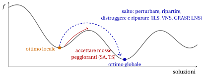
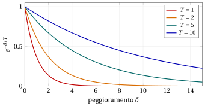
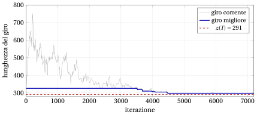

# Come uscire da un ottimo locale · Simulated annealing

**Parte 4 · Algoritmi euristici · Capitolo 32** · [:material-book-open-variant: Capitolo 32: Metaeuristiche](index.md) · [:material-file-pdf-box: Dispensa, volume 4 (PDF)](../../pdf/dispensa-4-algoritmi-euristici.pdf) · [:material-pencil: Esercizi: Metaeuristiche](../../esercizi/metaheuristics.md) · [:material-gesture-tap: App: TSP: simulated annealing e tabu search](../../laboratorio/simulated-annealing-tabu-search.md)

## 32.3 Come uscire da un ottimo locale { #sez-sec-escape }

- Una ricerca locale passa da una soluzione a un vicino migliore, e si ferma nel primo <strong>ottimo locale</strong>: una soluzione senza vicini migliori. Nel paesaggio della funzione obiettivo, scende fino al fondo della valle da cui parte, e lì rimane. È pura <strong>intensificazione</strong>.

- Ripetere la ricerca locale da molte soluzioni di partenza (multi-start) esplora molte valli, ma ogni partenza ignora tutto ciò che è stato appreso prima, e le valli buone si trovano di solito vicino ad altre valli buone.

- La tabella qui sotto elenca i modi per uscire da un ottimo locale; è la mappa del capitolo.

{ .fig loading=lazy  }

<table>
<tr>
<th>come uscire</th>
<th>idea</th>
<th>metaeuristica</th>
</tr>
<tr>
<td>accettare mosse peggioranti <em>a caso</em></td>
<td>un vicino peggiore è accettato con una probabilità che diminuisce con il peggioramento e con il tempo</td>
<td>simulated annealing (Sezione <a href="#sez-sec-sa">32.4</a>)</td>
</tr>
<tr>
<td>accettare mosse peggioranti <em>in modo deterministico, con memoria</em></td>
<td>passare al miglior vicino anche se è peggiore, e vietare il ritorno alle soluzioni appena visitate</td>
<td>tabu search (Sezione <a href="../tabu-search/#sez-sec-ts">32.5</a>)</td>
</tr>
<tr>
<td><em>perturbare</em> l'ottimo locale e ripartire</td>
<td>applicare una modifica casuale che la ricerca locale non può annullare, e scendere di nuovo</td>
<td>iterated local search (Sezione <a href="../iterated-local-search/#sez-sec-ils">32.6</a>)</td>
</tr>
<tr>
<td><em>cambiare l'intorno</em></td>
<td>quando la ricerca è bloccata, usare un intorno più grande, di cui l'ottimo locale non è più un ottimo locale</td>
<td>variable neighbourhood search (Sezione <a href="../variable-neighbourhood-search/#sez-sec-vns">32.7</a>)</td>
</tr>
<tr>
<td><em>ripartire</em> da una costruzione randomizzata</td>
<td>costruire una soluzione buona diversa a ogni ripartenza, e migliorarla</td>
<td>GRASP (Sezione <a href="../grasp/#sez-sec-grasp">32.8</a>)</td>
</tr>
<tr>
<td><em>distruggere e riparare</em></td>
<td>togliere una parte grande della soluzione e ricostruirla con un'euristica o un algoritmo esatto</td>
<td>large neighbourhood search (Sezione <a href="../large-neighbourhood-search/#sez-sec-lns">32.9</a>)</td>
</tr>
<tr>
<td>lavorare con una <em>popolazione</em></td>
<td>combinare le parti di più soluzioni buone in soluzioni nuove</td>
<td>algoritmi genetici e memetici (Sezione <a href="../metodi-basati-su-popolazioni-algoritmi-genetici-e-memetici/#sez-sec-ga">32.10</a>)</td>
</tr>
</table>

- I primi due modi mantengono <strong>una sola soluzione corrente</strong> e cambiano la <strong>regola di accettazione</strong> della ricerca locale: escono dalla valle passando per soluzioni peggiori. I quattro successivi <strong>saltano</strong>: generano un nuovo punto di partenza, abbastanza lontano da lasciare la valle ma abbastanza vicino da conservare ciò che è buono. L'ultimo mantiene <strong>molte soluzioni</strong> contemporaneamente.

- Ogni metaeuristica deve bilanciare <strong>intensificazione</strong> (scendere fino al fondo della valle corrente) e <strong>diversificazione</strong> (lasciarla per un'altra). Per ciascun metodo indichiamo quale componente fa che cosa.

- Una metaeuristica è uno <em>schema</em>, non un algoritmo: per ottenere un algoritmo occorre scegliere la rappresentazione, gli intorni, la ricerca locale e i parametri, e queste scelte contano almeno quanto lo schema. Presentiamo ogni metaeuristica sui problemi in cui la sua idea è più naturale, non su tutti e quattro.

## 32.4 Simulated annealing { #sez-sec-sa }

!!! chiave ""

    Il <em>simulated annealing</em> (indicato con $SA$) è una ricerca locale che sceglie un vicino <em>casuale</em> della soluzione corrente e vi si sposta se è migliore; se è peggiore, vi si sposta comunque con una probabilità che diminuisce con il peggioramento e con un parametro $T$, la <em>temperatura</em>. La temperatura parte alta, così che all'inizio quasi ogni mossa è accettata, e viene abbassata gradualmente, così che alla fine sono accettate solo mosse miglioranti. Si restituisce la migliore soluzione visitata.

- Lo pseudocodice di $SA$, per un problema di minimo con obiettivo $f$ e intorno $N$, è il seguente:

!!! algoritmo "Algoritmo: Simulated annealing"

    

<strong>Input:</strong> soluzione di partenza \(S\), temperatura iniziale \(T_0\), fattore di raffreddamento \(\alpha\in(0,1)\), numero \(L\) di mosse
    per temperatura, temperatura finale \(T_{\min}\)

<strong>Output:</strong> migliore soluzione trovata

1<strong>Function</strong> SimulatedAnnealing(\(S, T_0, \alpha, L, T_{\min}\))

2\(cur := S\);  \(fcur := f(cur)\)
    \(best := cur\);  \(fbest := fcur\)
    \(T := T_0\) ▹ soluzione corrente migliore soluzione trovata temperatura

3<strong>while</strong> \(T > T_{\min}\) <strong>do</strong>

4<strong>for</strong> \(l := 1\) <strong>to</strong> \(L\) <strong>do</strong>

5\(S' :=\) vicino casuale in \(N(cur)\)

6\(\delta := f(S') - fcur\)

7\(v := \textsc{Rand}()\)

8<strong>if</strong> \(\delta \le 0\) <strong>or</strong> \(v < e^{-\delta/T}\) <strong>then</strong>

9\(cur := S'\);  \(fcur := fcur + \delta\) ▹ mossa accettata

10<strong>if</strong> \(fcur < fbest\) <strong>then</strong>

11\(best := cur\);  \(fbest := fcur\)

12<strong>end</strong>

13<strong>end</strong>

14<strong>end</strong>

15\(T := \alpha\cdot T\) ▹ raffreddamento

16<strong>end</strong>

17<strong>return</strong> \(best\)

Esegui in Colab:

- Il nome viene dalla metallurgia: l'<em>annealing</em> (ricottura) è il processo che scalda un metallo e lo raffredda lentamente, così che i suoi atomi si dispongano in uno stato di energia minima; raffreddato troppo in fretta, il metallo si blocca in uno stato disordinato di energia più alta. Kirkpatrick, Gelatt e Vecchi (1983) e, indipendentemente, Černy (1985) hanno proposto di simulare questo processo su un problema di ottimizzazione, con l'obiettivo $f$ nel ruolo dell'energia. La regola di accettazione è quella usata da Metropolis et al. (1953) per simulare gli atomi.

!!! chiave ""

    <strong>Regola di accettazione di Metropolis.</strong> Alla temperatura $T$, un vicino $S'$ della soluzione corrente, con $\delta=f(S')-f(cur)$, è accettato con probabilità

    $$
    P(\text{accettare } S') \;=\;
    \begin{cases}
    1 & \text{se } \delta\le 0,\\[1ex]
    e^{-\delta/T} & \text{se } \delta>0.
    \end{cases}
    $$

- La probabilità si realizza estraendo $v=\textsc{Rand}()$, uniforme in $(0,1)$, e accettando se $v<e^{-\delta/T}$, il che accade con probabilità $e^{-\delta/T}$.

- Una mossa peggiorante è accettata più facilmente se il peggioramento $\delta$ è <strong>piccolo</strong>, e se la temperatura $T$ è <strong>alta</strong>. Per $T\to\infty$ ogni mossa è accettata, e $SA$ diventa una passeggiata casuale (pura diversificazione); per $T\to 0$ sono accettate solo le mosse con $\delta\le 0$, e $SA$ diventa una ricerca locale con scelta casuale del vicino (pura intensificazione). Abbassare la temperatura porta gradualmente dal primo comportamento al secondo.

- Le mosse con $\delta=0$ sono sempre accettate: $SA$ si muove liberamente sui plateau degli obiettivi piatti.

- $SA$ non si ferma mai in un ottimo locale: un ottimo locale viene lasciato appena una mossa peggiorante è estratta e accettata. Per questo la soluzione <strong>migliore</strong> visitata va memorizzata a parte: la soluzione corrente alla fine non è necessariamente la migliore.

- A ogni iterazione si valuta <strong>un solo vicino casuale</strong>, non l'intero intorno: un'iterazione di $SA$ costa pochissimo, e $SA$ esegue molte più iterazioni di una ricerca locale. Per il TSP, una mossa 2-opt casuale si estrae numerando le $M=\frac{n(n-3)}{2}$ mosse $(i,j)$ in ordine lessicografico e scegliendo quella in posizione $1+\lfloor \textsc{Rand}()\cdot M\rfloor$; il suo $\delta$ si calcola in $O(1)$.

{ .fig loading=lazy  }

- La figura mostra la probabilità di accettazione in funzione del peggioramento, per quattro temperature. A $T=10$ un peggioramento di $5$ è accettato con probabilità $e^{-0.5}\approx 0.61$; a $T=1$ con probabilità $e^{-5}\approx 0.007$. La temperatura ha la stessa unità di misura dell'obiettivo: $T$ è «grande» o «piccola» solo rispetto ai valori tipici di $\delta$.

### 32.4.1 Lo schema di raffreddamento e i parametri { #sez-sec-sa-param }

- Lo <strong>schema di raffreddamento</strong> è la successione delle temperature. Lo pseudocodice usa lo schema <strong>geometrico</strong> $T\leftarrow\alpha T$, il più comune in pratica, con $\alpha$ fra $0.8$ e $0.99$, e $L$ mosse a ogni temperatura. Altri schemi sono quello <em>lineare</em>, $T_k=T_0-k\beta$, e quello <em>logaritmico</em>, $T_k=\frac{\Gamma}{\ln(k+1)}$, che conta nella teoria di $SA$ ma è decisamente troppo lento in pratica.

- <strong>Temperatura iniziale $T_0$.</strong> Deve essere abbastanza alta da accettare all'inizio la maggior parte delle mosse peggioranti. Una regola comune fissa un tasso di accettazione iniziale obiettivo $\chi_0$ (per esempio $\chi_0=0.8$), stima il peggioramento medio $\bar\delta$ di un campione di mosse casuali, e pone $T_0=-\bar\delta/\ln\chi_0$, così che $e^{-\bar\delta/T_0}=\chi_0$.

- <strong>Mosse per temperatura $L$.</strong> Bisogna dare alla ricerca il tempo di adattarsi a ogni temperatura; $L$ si prende spesso proporzionale alla dimensione dell'intorno.

- <strong>Criterio di arresto.</strong> Lo pseudocodice si ferma quando $T\le T_{\min}$. Con lo schema geometrico il numero di temperature è il più piccolo intero $K$ con $T_0\alpha^K\le T_{\min}$, cioè $K=\big\lceil \ln(T_{\min}/T_0)/\ln\alpha\big\rceil$ quando il rapporto non è intero, e il numero di iterazioni è $K\cdot L$. Altri criteri comuni si fermano dopo un certo numero di temperature senza mosse accettate, o a un limite di tempo.

- Un raffreddamento lento ($\alpha$ vicino a $1$) dà soluzioni migliori ma più iterazioni: i parametri scambiano qualità con tempo, come in ogni euristica.

### 32.4.2 Esempi

!!! esempio "Esempio 32.3: $SA$ con l'intorno 2-opt sull'istanza di riferimento del TSP"

    Partiamo dal giro calcolato dall'euristica nearest neighbour dalla città $1$ nel capitolo [«Euristiche costruttive»](../constructive-heuristics/index.md), $\sigma=(1,3,2,4,5)$ di lunghezza $25$, con $T_0=5$, $\alpha=0.8$, $L=2$ e $T_{\min}=3$: le temperature sono $5$, $4$ e $3.2$ (poi $2.56\le 3$ ferma la ricerca), per un totale di $6$ iterazioni. Le $M=5$ mosse 2-opt su $5$ città sono numerate

    $$
    1:(1,3),\quad 2:(1,4),\quad 3:(2,4),\quad 4:(2,5),\quad 5:(3,5),
    $$

    e i numeri casuali, con $seed=1$, sono quelli della Sezione [32.2.2](i-problemi-e-le-ipotesi.md#sez-sec-random): il primo numero di ogni iterazione ($u$) sceglie la mossa $1+\lfloor 5u\rfloor$, il secondo ($v$) serve nel test di accettazione.

    
<table>
    <tr>
    <th>it</th>
    <th>\(T\)</th>
    <th>\(u\)</th>
    <th>mossa</th>
    <th>\(\delta\)</th>
    <th>\(v\)</th>
    <th>\(e^{-\delta/T}\)</th>
    <th>decisione</th>
    <th>giro corrente</th>
    <th>\(L\)</th>
    </tr>
    <tr>
    <td>\(1\)</td>
    <td>\(5\)</td>
    <td>\(0.0000\)</td>
    <td>\(1:(1,3)\)</td>
    <td>\(4\)</td>
    <td>\(0.1315\)</td>
    <td>\(0.4493\)</td>
    <td>accetta</td>
    <td>\((1,2,3,4,5)\)</td>
    <td>\(29\)</td>
    </tr>
    <tr>
    <td>\(2\)</td>
    <td>\(5\)</td>
    <td>\(0.7556\)</td>
    <td>\(4:(2,5)\)</td>
    <td>\(-7\)</td>
    <td>—</td>
    <td>—</td>
    <td>accetta</td>
    <td>\((1,2,5,4,3)\)</td>
    <td>\(22\)</td>
    </tr>
    <tr>
    <td>\(3\)</td>
    <td>\(4\)</td>
    <td>\(0.5328\)</td>
    <td>\(3:(2,4)\)</td>
    <td>\(2\)</td>
    <td>\(0.2190\)</td>
    <td>\(0.6065\)</td>
    <td>accetta</td>
    <td>\((1,2,4,5,3)\)</td>
    <td>\(24\)</td>
    </tr>
    <tr>
    <td>\(4\)</td>
    <td>\(4\)</td>
    <td>\(0.0470\)</td>
    <td>\(1:(1,3)\)</td>
    <td>\(-6\)</td>
    <td>—</td>
    <td>—</td>
    <td>accetta</td>
    <td>\((1,4,2,5,3)\)</td>
    <td>\(18\)</td>
    </tr>
    <tr>
    <td>\(5\)</td>
    <td>\(3.2\)</td>
    <td>\(0.6793\)</td>
    <td>\(4:(2,5)\)</td>
    <td>\(4\)</td>
    <td>\(0.9347\)</td>
    <td>\(0.2865\)</td>
    <td>rifiuta</td>
    <td>\((1,4,2,5,3)\)</td>
    <td>\(18\)</td>
    </tr>
    <tr>
    <td>\(6\)</td>
    <td>\(3.2\)</td>
    <td>\(0.3835\)</td>
    <td>\(2:(1,4)\)</td>
    <td>\(4\)</td>
    <td>\(0.5194\)</td>
    <td>\(0.2865\)</td>
    <td>rifiuta</td>
    <td>\((1,4,2,5,3)\)</td>
    <td>\(18\)</td>
    </tr>
    </table>

    Alle iterazioni $1$ e $3$ viene accettato un giro <strong>peggiore</strong> ($25\to 29$ e $22\to 24$), perché $v$ è minore della probabilità di accettazione; alle iterazioni $5$ e $6$ la temperatura è più bassa, le mosse peggioranti hanno meno probabilità di essere accettate, ed entrambe sono rifiutate. Il giro migliore, $(1,4,2,5,3)$, è il giro ottimo $(1,3,5,2,4)$ percorso nel verso opposto: $SA(I)=18=z(I)$.

- Su questa istanza piccola il giro ottimo è l'unico ottimo locale 2-opt fra i $12$ giri, quindi anche una ricerca locale 2-opt lo raggiungerebbe: l'esempio mostra il meccanismo di $SA$; la sua capacità di uscire dagli ottimi locali si vede su istanze con ottimi locali cattivi.

### 32.4.3 Soluzioni inammissibili: simulated annealing con penalità { #sez-sec-sa-kp }

- Per il KP, l'intorno flip di una soluzione vicina alla capacità contiene molte soluzioni inammissibili. Invece di scartarle, $SA$ può <strong>visitarle</strong>, con una penalità sul peso in eccesso che le rende meno attraenti:

!!! chiave ""

    $$
    f_\beta(x) \;=\; \sum_{j\in\mathscr{I}} p_j x_j \;-\; \beta\cdot \max\Big\{0,\ \sum_{j\in\mathscr{I}} w_j x_j - c\Big\},
    \qquad \beta>0 .
    $$

    $SA$ massimizza $f_\beta$ su tutti gli $x\in\{0,1\}^n$; il peggioramento di una mossa da $x$ a $y$ è $\delta=f_\beta(x)-f_\beta(y)$, e la soluzione migliore si aggiorna solo con soluzioni <strong>ammissibili</strong>.

- Su una soluzione ammissibile $f_\beta$ è il profitto. Passando per una soluzione inammissibile, $SA$ può raggiungere soluzioni ammissibili che non sono raggiungibili con soli flip ammissibili: la regione inammissibile fa da <strong>ponte</strong> fra le valli.

- Il <strong>coefficiente di penalità</strong> $\beta$ è un parametro: se è troppo piccolo la ricerca vaga nella regione inammissibile, dove il profitto è maggiore; se è troppo grande le soluzioni inammissibili non sono mai accettate, e il ponte è chiuso.

!!! esempio "Esempio 32.4: $SA$ con penalità sull'istanza di riferimento del KP"

    Partiamo da $x=(1,0,1,0)$, la soluzione $\{1,3\}$ dell'algoritmo greedy per efficienza, di profitto $16$. È un ottimo locale per l'intorno flip (capitolo [«Algoritmi euristici: definizioni»](../heuristics.md)): i suoi vicini ammissibili hanno profitto $6$ e $10$. Usiamo $\beta=3$, $T_0=4$, $\alpha=0.8$, $L=2$, $T_{\min}=2.5$ (temperature $4$, $3.2$, $2.56$: $6$ iterazioni) e $seed=3$. A ogni iterazione $u$ sceglie l'oggetto $k=1+\lfloor 4u\rfloor$ da invertire, e $v$ serve nel test di accettazione.

    
<table>
    <tr>
    <th>it</th>
    <th>\(T\)</th>
    <th>\(u\)</th>
    <th>\(k\)</th>
    <th>\(y\)</th>
    <th>\(\sum w_jy_j\)</th>
    <th>\(f_3(y)\)</th>
    <th>\(\delta\)</th>
    <th>\(v\) vs \(e^{-\delta/T}\)</th>
    <th>decisione</th>
    </tr>
    <tr>
    <td>\(1\)</td>
    <td>\(4\)</td>
    <td>\(0.0000\)</td>
    <td>\(1\)</td>
    <td>\((0,0,1,0)\)</td>
    <td>\(3\)</td>
    <td>\(6\)</td>
    <td>\(10\)</td>
    <td>\(0.3946\ge 0.0821\)</td>
    <td>rifiuta</td>
    </tr>
    <tr>
    <td>\(2\)</td>
    <td>\(4\)</td>
    <td>\(0.2668\)</td>
    <td>\(2\)</td>
    <td>\((1,1,1,0)\)</td>
    <td>\(12\)</td>
    <td>\(14\)</td>
    <td>\(2\)</td>
    <td>\(0.3760<0.6065\)</td>
    <td>accetta</td>
    </tr>
    <tr>
    <td>\(3\)</td>
    <td>\(3.2\)</td>
    <td>\(0.5983\)</td>
    <td>\(3\)</td>
    <td>\((1,1,0,0)\)</td>
    <td>\(9\)</td>
    <td>\(17\)</td>
    <td>\(-3\)</td>
    <td>—</td>
    <td>accetta</td>
    </tr>
    <tr>
    <td>\(4\)</td>
    <td>\(3.2\)</td>
    <td>\(0.1411\)</td>
    <td>\(1\)</td>
    <td>\((0,1,0,0)\)</td>
    <td>\(4\)</td>
    <td>\(7\)</td>
    <td>\(10\)</td>
    <td>\(0.0366<0.0439\)</td>
    <td>accetta</td>
    </tr>
    <tr>
    <td>\(5\)</td>
    <td>\(2.56\)</td>
    <td>\(0.0379\)</td>
    <td>\(1\)</td>
    <td>\((1,1,0,0)\)</td>
    <td>\(9\)</td>
    <td>\(17\)</td>
    <td>\(-10\)</td>
    <td>—</td>
    <td>accetta</td>
    </tr>
    <tr>
    <td>\(6\)</td>
    <td>\(2.56\)</td>
    <td>\(0.1505\)</td>
    <td>\(1\)</td>
    <td>\((0,1,0,0)\)</td>
    <td>\(4\)</td>
    <td>\(7\)</td>
    <td>\(10\)</td>
    <td>\(0.5582\ge 0.0201\)</td>
    <td>rifiuta</td>
    </tr>
    </table>

    All'iterazione $2$ la ricerca passa alla soluzione <strong>inammissibile</strong> $(1,1,1,0)$, di peso $12>9$: il suo profitto è $23$ e il suo valore penalizzato $23-3\cdot 3=14$, un peggioramento di $2$ accettato con probabilità $0.6065$. Da lì, togliendo l'oggetto $3$ si ottiene la soluzione ammissibile $(1,1,0,0)$ di profitto $17$: l'ottimo, $SA(I)=17=z(I)$. L'iterazione $4$ mostra che a questa temperatura anche un peggioramento di $10$ può essere accettato, con una probabilità piccola; l'iterazione $5$ torna all'ottimo.

### 32.4.4 Un esperimento sull'istanza media del TSP { #sez-sec-sa-exp }

- Eseguiamo $SA$ con l'intorno 2-opt su TSP20 ([Esempio 32.1](i-problemi-e-le-ipotesi.md#box-2-ex-tsp20)), dal giro nearest neighbour di lunghezza $326$, con $L=100$ e $T_{\min}=0.5$. La figura mostra un'esecuzione, con $T_0=20$, $\alpha=0.95$ e $seed=1$: la lunghezza del giro corrente (grigio) e del giro migliore (blu) lungo le $7200$ iterazioni, ogni $10$ iterazioni. I dati sono prodotti dal codice <code>C++</code> del capitolo, nel suo notebook Colab.

{ .fig loading=lazy  }

- All'inizio la temperatura è alta rispetto al peggioramento tipico di una mossa 2-opt, e il giro corrente diventa molto <strong>peggiore</strong> di quello di partenza (fino a lunghezza $765$): la ricerca è quasi una passeggiata casuale. Al diminuire di $T$, sono accettate meno mosse peggioranti e il giro corrente scende in una valle; alla fine la ricerca è una ricerca locale. Il giro migliore, di lunghezza $298$, è trovato all'iterazione $4479$: è migliore dell'ottimo locale 2-opt ($319$), ma non è ottimo.

- La tabella riporta, per $10$ esecuzioni con $seed=1,\dots,10$ e diversi parametri, il numero di iterazioni, la lunghezza minima, media e massima del giro migliore, e il numero di esecuzioni che raggiungono l'ottimo $291$.

<table>
<tr>
<th>\(\alpha\)</th>
<th>\(T_0\)</th>
<th>iterazioni</th>
<th>min</th>
<th>media</th>
<th>max</th>
<th>esecuzioni ottime</th>
</tr>
<tr>
<td>\(0.9\)</td>
<td>\(1\)</td>
<td>\(700\)</td>
<td>\(291\)</td>
<td>\(310.3\)</td>
<td>\(322\)</td>
<td>\(1\)</td>
</tr>
<tr>
<td>\(0.9\)</td>
<td>\(5\)</td>
<td>\(2200\)</td>
<td>\(291\)</td>
<td>\(297.3\)</td>
<td>\(305\)</td>
<td>\(4\)</td>
</tr>
<tr>
<td>\(0.9\)</td>
<td>\(20\)</td>
<td>\(3600\)</td>
<td>\(291\)</td>
<td>\(300.3\)</td>
<td>\(323\)</td>
<td>\(4\)</td>
</tr>
<tr>
<td>\(0.9\)</td>
<td>\(100\)</td>
<td>\(5100\)</td>
<td>\(291\)</td>
<td>\(297.8\)</td>
<td>\(311\)</td>
<td>\(3\)</td>
</tr>
<tr>
<td>\(0.95\)</td>
<td>\(1\)</td>
<td>\(1400\)</td>
<td>\(291\)</td>
<td>\(302.3\)</td>
<td>\(319\)</td>
<td>\(3\)</td>
</tr>
<tr>
<td>\(0.95\)</td>
<td>\(5\)</td>
<td>\(4500\)</td>
<td>\(291\)</td>
<td>\(294.3\)</td>
<td>\(298\)</td>
<td>\(5\)</td>
</tr>
<tr>
<td>\(0.95\)</td>
<td>\(20\)</td>
<td>\(7200\)</td>
<td>\(291\)</td>
<td>\(294.3\)</td>
<td>\(298\)</td>
<td>\(5\)</td>
</tr>
<tr>
<td>\(0.95\)</td>
<td>\(100\)</td>
<td>\(10400\)</td>
<td>\(291\)</td>
<td>\(293.2\)</td>
<td>\(299\)</td>
<td>\(7\)</td>
</tr>
<tr>
<td>\(0.99\)</td>
<td>\(1\)</td>
<td>\(6900\)</td>
<td>\(291\)</td>
<td>\(298.8\)</td>
<td>\(305\)</td>
<td>\(4\)</td>
</tr>
<tr>
<td>\(0.99\)</td>
<td>\(5\)</td>
<td>\(23000\)</td>
<td>\(291\)</td>
<td>\(291.7\)</td>
<td>\(298\)</td>
<td>\(9\)</td>
</tr>
<tr>
<td>\(0.99\)</td>
<td>\(20\)</td>
<td>\(36800\)</td>
<td>\(291\)</td>
<td>\(291.0\)</td>
<td>\(291\)</td>
<td>\(10\)</td>
</tr>
<tr>
<td>\(0.99\)</td>
<td>\(100\)</td>
<td>\(52800\)</td>
<td>\(291\)</td>
<td>\(291.0\)</td>
<td>\(291\)</td>
<td>\(10\)</td>
</tr>
</table>

- Con $T_0=1$ la temperatura è troppo bassa fin dall'inizio: sono accettate poche mosse peggioranti, e $SA$ si comporta come una ricerca locale randomizzata. Un raffreddamento più lento ($\alpha=0.99$) passa più iterazioni in ogni intervallo di temperatura e raggiunge l'ottimo in quasi tutte le esecuzioni, al prezzo di molte più iterazioni. Una singola esecuzione dice poco: il confronto deve guardare la distribuzione su più semi, come ricordato nel capitolo [«Algoritmi euristici: definizioni»](../heuristics.md).

### 32.4.5 Proprietà { #sez-sec-sa-prop }

- A temperatura fissata $T$, la successione delle soluzioni correnti di $SA$ è una catena di Markov: la soluzione successiva dipende solo da quella corrente. Se l'intorno è simmetrico ($S'\in N(S)$ se e solo se $S\in N(S')$, con tutti gli intorni della stessa dimensione) e connesso (ogni soluzione può raggiungere ogni altra attraverso mosse), la catena ha un'unica distribuzione stazionaria, la <strong>distribuzione di Boltzmann</strong>:

!!! chiave ""

    $$
    \pi_T(S) \;=\; \frac{e^{-f(S)/T}}{\sum_{S'} e^{-f(S')/T}} \qquad \text{per ogni soluzione } S.
    $$

- Per due soluzioni $S_1$ e $S_2$, $\frac{\pi_T(S_1)}{\pi_T(S_2)}=e^{(f(S_2)-f(S_1))/T}$: le soluzioni migliori sono più probabili, e tanto più quanto più bassa è la temperatura. Per $T\to 0$, $\pi_T$ si concentra sulle soluzioni ottime.

- Hajek (1988) ha dimostrato che con lo schema logaritmico $T_k=\frac{\Gamma}{\ln(k+1)}$, con $\Gamma$ almeno pari alla profondità della valle più profonda che non contiene una soluzione ottima, la probabilità che la soluzione corrente sia ottima tende a $1$. Il risultato è una garanzia <em>al limite</em>: il numero di iterazioni necessarie può superare il numero di soluzioni, e in pratica si usa lo schema geometrico, più veloce, senza garanzie.

---

**Avanti:** [32.5 Tabu search](tabu-search.md)
