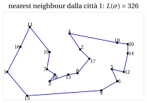
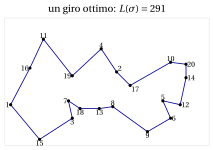

# 32.2 I problemi e le ipotesi { #sez-sec-problems }

**Parte 4 · Algoritmi euristici · Capitolo 32** · [:material-book-open-variant: Capitolo 32: Metaeuristiche](index.md) · [:material-file-pdf-box: Dispensa, volume 4 (PDF)](../../pdf/dispensa-4-algoritmi-euristici.pdf) · [:material-presentation: Slide (1/2)](../../pdf/slide-metaheuristics-1.pdf) · [:material-presentation: Slide (2/2)](../../pdf/slide-metaheuristics-2.pdf) · [:material-pencil: Esercizi: Metaeuristiche](../../esercizi/metaheuristics.md) · [:material-gesture-tap: App: TSP: simulated annealing e tabu search](../../laboratorio/simulated-annealing-tabu-search.md)

- Le metaeuristiche sono illustrate sui quattro problemi del capitolo [«Algoritmi euristici: definizioni»](../heuristics.md): il [problema dello zaino 0/1 (KP)](../../problemi-di-ottimizzazione-combinatoria/knapsack/il-problema-dello-zaino-0-1.md), il [problema del bin packing (BPP)](../../problemi-di-ottimizzazione-combinatoria/bin-packing/il-problema-del-bin-packing.md), il [problema del commesso viaggiatore (TSP)](../../problemi-di-ottimizzazione-combinatoria/tsp/il-problema-del-commesso-viaggiatore.md) e [$P\,||\,C_{\max}$](../../problemi-di-ottimizzazione-combinatoria/pcmax/scheduling-su-macchine-parallele-identiche.md). Le loro definizioni e ipotesi sono nelle rispettive pagine; ne richiamiamo la notazione.

<table>
<tr>
<th>problema</th>
<th>dati</th>
<th>soluzione</th>
<th>obiettivo</th>
</tr>
<tr>
<td>KP</td>
<td>oggetti \(\mathscr{I}\), profitti \(p_j\), pesi \(w_j\), capacità \(c\)</td>
<td>sottoinsieme</td>
<td>max profitto totale</td>
</tr>
<tr>
<td>BPP</td>
<td>oggetti \(\mathscr{I}\), pesi \(w_j\), capacità \(c\)</td>
<td>pattern \(P_b\)</td>
<td>min contenitori</td>
</tr>
<tr>
<td>TSP</td>
<td>città \(\mathscr{V}\), distanze \(d_{ij}\)</td>
<td>giro \(\sigma\)</td>
<td>min lunghezza \(L(\sigma)\)</td>
</tr>
<tr>
<td>\(P\,||\,C_{\max}\)</td>
<td>lavori \(\mathscr{J}\), tempi \(t_j\), macchine \(m\)</td>
<td>insiemi \(J_1,\dots,J_m\)</td>
<td>min makespan</td>
</tr>
</table>

- Ogni istanza soddisfa le ipotesi del suo problema: $w_j\le c$ per tutti gli oggetti e $\sum_j w_j > c$ per il KP e il BPP; $n\ge 3$ e distanze simmetriche per il TSP; $n>m$ per $P\,||\,C_{\max}$. Per $P\,||\,C_{\max}$, $L_h=\sum_{j\in J_h}t_j$ è il <strong>carico</strong> della macchina $h$ e $C_{\max}=\max_h L_h$.

- Come nel capitolo [«Algoritmi euristici: definizioni»](../heuristics.md), $\mathscr{A}(I)$ è il valore della soluzione calcolata dall'algoritmo $\mathscr{A}$ sull'istanza $I$, e $z(I)$ è il valore ottimo. Scriviamo $f(S)$ per il valore di una soluzione $S$, e descriviamo gli algoritmi per un problema di <strong>minimo</strong>; per il KP, problema di massimo, le disuguaglianze si invertono.

## 32.2.1 Gli intorni { #sez-sec-neigh }

- Tutte le metaeuristiche di questo capitolo sono costruite sugli intorni del capitolo [«Ricerca locale»](../local-search/index.md). Li richiamiamo per nome, con le mosse che li definiscono; $n$ è il numero di oggetti, di città o di lavori.

<table>
<tr>
<th>problema</th>
<th>nome</th>
<th>mossa</th>
<th>dimensione</th>
</tr>
<tr>
<td>KP</td>
<td>flip</td>
<td>aggiungere un oggetto allo zaino, o toglierne uno</td>
<td>\(n\)</td>
</tr>
<tr>
<td></td>
<td>swap</td>
<td>togliere un oggetto selezionato e aggiungere un oggetto non selezionato</td>
<td>\(\le \frac{n^2}{4}\)</td>
</tr>
<tr>
<td>BPP</td>
<td>move</td>
<td>spostare un oggetto in un altro contenitore</td>
<td>\(\le n\cdot nb\)</td>
</tr>
<tr>
<td></td>
<td>swap</td>
<td>scambiare due oggetti posti in contenitori diversi</td>
<td>\(\le \frac{n(n-1)}{2}\)</td>
</tr>
<tr>
<td>TSP</td>
<td>2-opt</td>
<td>togliere due lati non adiacenti del giro e richiuderlo con gli altri due lati, invertendo il segmento compreso fra loro</td>
<td>\(\frac{n(n-3)}{2}\)</td>
</tr>
<tr>
<td></td>
<td>Or-opt</td>
<td>spostare un segmento di \(1\), \(2\) o \(3\) città consecutive in un'altra posizione</td>
<td>\(O(n^2)\)</td>
</tr>
<tr>
<td>\(P\,||\,C_{\max}\)</td>
<td>move</td>
<td>spostare un lavoro su un'altra macchina</td>
<td>\(n(m-1)\)</td>
</tr>
<tr>
<td></td>
<td>swap</td>
<td>scambiare due lavori assegnati a macchine diverse</td>
<td>\(\le \frac{n(n-1)}{2}\)</td>
</tr>
</table>

- Un giro del TSP è memorizzato come una permutazione $\sigma=(\sigma_1,\dots,\sigma_n)$ con $\sigma_1=1$. La <strong>mossa 2-opt</strong> $(i,j)$, con $1\le i$, $i+2\le j\le n$ e $(i,j)\neq(1,n)$, toglie i lati $(\sigma_i,\sigma_{i+1})$ e $(\sigma_j,\sigma_{j+1})$ (con $\sigma_{n+1}=\sigma_1$), aggiunge i lati $(\sigma_i,\sigma_j)$ e $(\sigma_{i+1},\sigma_{j+1})$, e inverte il segmento $\sigma_{i+1},\dots,\sigma_j$. Il suo effetto sulla lunghezza si calcola in $O(1)$:

    $$
    \delta(i,j) \;=\; d_{\sigma_i\sigma_j} + d_{\sigma_{i+1}\sigma_{j+1}} - d_{\sigma_i\sigma_{i+1}} - d_{\sigma_j\sigma_{j+1}} .
    $$

- Gli obiettivi del BPP e di $P\,||\,C_{\max}$ sono <strong>piatti</strong>: la maggior parte delle mosse non cambia il numero di contenitori, né il makespan. Due soluzioni con lo stesso valore si confrontano allora con un <strong>obiettivo ausiliario</strong>:

    - BPP: la somma dei quadrati dei carichi $\sum_b \big(\sum_{j\in P_b} w_j\big)^2$, da <em>massimizzare</em>: cresce quando gli oggetti si concentrano in meno contenitori, più pieni;

    - $P\,||\,C_{\max}$: la somma dei quadrati dei carichi $\sum_h L_h^2$, da <em>minimizzare</em>: diminuisce quando i carichi si bilanciano.

    Per $P\,||\,C_{\max}$ confrontiamo due soluzioni in modo <strong>lessicografico</strong>: prima per $C_{\max}$, e a parità di makespan per $\sum_h L_h^2$. Per move e swap questo seleziona le stesse mosse miglioranti dell'obiettivo ausiliario $\sum_h L_h^2$ del capitolo [«Ricerca locale»](../local-search/index.md): un trasferimento che diminuisce $\sum_h L_h^2$ non aumenta mai $C_{\max}$, e un trasferimento che diminuisce $C_{\max}$ diminuisce anche $\sum_h L_h^2$.

- Per il KP l'intorno flip contiene soluzioni inammissibili (aggiungere un oggetto può superare la capacità). Una ricerca locale le scarta oppure le accetta con una <strong>penalità</strong> sul peso in eccesso; in questo capitolo compaiono entrambe le opzioni.

- Le <strong>ricerche locali</strong> usate dentro le metaeuristiche sono le discese del capitolo [«Ricerca locale»](../local-search/index.md): TWOOPTLS (2-opt, best improvement) per il TSP, MOVEDESCENT (move, best improvement, confronto lessicografico) per $P\,||\,C_{\max}$, e KPLOCALSEARCH (flip e swap ammissibili, best improvement) per il KP. In ogni discesa best improvement, i pareggi fra mosse ugualmente buone si risolvono a favore della prima mossa trovata, scorrendo gli indici in ordine crescente.

## 32.2.2 Numeri casuali { #sez-sec-random }

- La maggior parte delle metaeuristiche fa <strong>scelte casuali</strong>. Per rendere riproducibili ogni esempio e ogni esercizio, tutti i numeri casuali di questo capitolo, e del codice nei notebook Colab del capitolo, sono prodotti dal <strong>minimal standard generator</strong> di Park e Miller (1988):

!!! chiave ""

    $$
    seed \;\leftarrow\; 16807\cdot seed \bmod (2^{31}-1), \qquad\qquad u \;=\; \frac{seed}{2^{31}-1}\in(0,1).
    $$

    Una chiamata $\textsc{Rand}()$ aggiorna $seed$ e restituisce $u$. Un intero casuale in $\{0,1,\dots,K-1\}$ è $\lfloor u\cdot K\rfloor$, e un elemento casuale di una lista di $K$ elementi è l'elemento in posizione $1+\lfloor u\cdot K\rfloor$.

- Il valore iniziale di $seed$, il <strong>seme</strong>, è un intero in $\{1,\dots,2^{31}-2\}$. Lo stesso seme dà sempre la stessa sequenza di numeri; semi diversi danno esecuzioni diverse dello stesso algoritmo. Con $seed=1$ i primi numeri sono, arrotondati a quattro decimali,

    $$
    0.0000,\ 0.1315,\ 0.7556,\ 0.4587,\ 0.5328,\ 0.2190,\ 0.0470,\ 0.6789,\ \dots
    $$

    Il primo numero prodotto da un seme piccolo è sempre molto vicino a $0$; è una proprietà del generatore, non un errore.

- Negli esempi svolti i numeri casuali sono scritti nel testo, arrotondati a quattro decimali, così che ogni passo si possa verificare a mano; l'arrotondamento non cambia mai una decisione.

## 32.2.3 Le istanze { #sez-sec-instances }

- Gli esempi svolti usano le quattro <strong>istanze di riferimento</strong> del capitolo [«Algoritmi euristici: definizioni»](../heuristics.md), di cui sono noti i valori ottimi:

<table>
<tr>
<th>problema</th>
<th>istanza di riferimento</th>
<th>valore ottimo e soluzione</th>
</tr>
<tr>
<td>KP</td>
<td>\(p=(10,7,6,4)\), \(w=(5,4,3,3)\), \(c=9\)</td>
<td>\(z(I)=17\), oggetti \(\{1,2\}\)</td>
</tr>
<tr>
<td>BPP</td>
<td>\(w=(4,4,5,3,2,3)\), \(c=7\)</td>
<td>\(z(I)=3\), pattern \(\{1,4\},\{2,6\},\{3,5\}\)</td>
</tr>
<tr>
<td>TSP</td>
<td>\(5\) città, distanze \(d_{ij}\) qui sotto</td>
<td>\(z(I)=18\), giro \((1,3,5,2,4)\)</td>
</tr>
<tr>
<td>\(P\,||\,C_{\max}\)</td>
<td>\(t=(5,5,4,4,3,3,3)\), \(m=3\)</td>
<td>\(z(I)=9\), insiemi \(\{1,3\},\{2,4\},\{5,6,7\}\)</td>
</tr>
</table>

$$
\begin{array}{c|ccccc}
\hline {d_{ij}} & {1} & {2} & {3} & {4} & {5} \\
\hline {1} & --- & {5} & {2} & {2} & {9} \\
{2} & {5} & --- & {4} & {3} & {4} \\
{3} & {2} & {4} & --- & {4} & {7} \\
{4} & {2} & {3} & {4} & --- & {7} \\
{5} & {9} & {4} & {7} & {7} & --- \\
\hline
\end{array}
$$

- Le istanze di riferimento sono abbastanza piccole da seguire a mano ogni iterazione, ma troppo piccole per mostrare il comportamento di una metaeuristica su migliaia di iterazioni. Per gli esperimenti usiamo un'<strong>istanza media</strong> per problema, generata una volta con il generatore di numeri casuali della Sezione [32.2.2](#sez-sec-random) e fissata qui sotto. I loro valori ottimi sono stati calcolati con un algoritmo esatto, e servono solo a misurare la qualità delle soluzioni euristiche.

!!! esempio "Esempio 32.1: L'istanza media del TSP (TSP20)"

    $20$ città nel piano, con coordinate intere $(x_i,y_i)$, e distanze $d_{ij}=\big\lfloor \sqrt{(x_i-x_j)^2+(y_i-y_j)^2} + \frac{1}{2}\big\rfloor$ (la distanza euclidea arrotondata all'intero più vicino):

    $$
    \begin{array}{c|cccccccccc}
    \hline {i} & {1} & {2} & {3} & {4} & {5} & {6} & {7} & {8} & {9} & {10} \\
    \hline {x_i} & {0} & {55} & {32} & {47} & {79} & {83} & {30} & {53} & {71} & {83} \\
    {y_i} & {18} & {35} & {11} & {47} & {20} & {11} & {20} & {17} & {4} & {40} \\
    \hline \hline {i} & {11} & {12} & {13} & {14} & {15} & {16} & {17} & {18} & {19} & {20} \\
    \hline {x_i} & {17} & {88} & {46} & {91} & {15} & {10} & {62} & {36} & {32} & {91} \\
    {y_i} & {52} & {18} & {16} & {32} & {0} & {37} & {28} & {16} & {33} & {39} \\
    \hline
    \end{array}
    $$

    { .fig loading=lazy  }

    { .fig loading=lazy  }

    Il giro nearest neighbour dalla città $1$ ha lunghezza $326$; la ricerca locale 2-opt avviata da esso si ferma in un ottimo locale di lunghezza $319$, dopo due mosse miglioranti. Il valore ottimo è $z(I)=291$: l'ottimo locale è superiore del $9.6\%$.

!!! esempio "Esempio 32.2: Le istanze medie del KP, del BPP e di $P\,||\,C_{\max}$"

    <strong>KP20</strong>: $n=20$ oggetti, capacità $c=389$ (metà del peso totale, arrotondata per difetto),

    $$
    \begin{array}{l|cccccccccc}
    \hline {j} & {1} & {2} & {3} & {4} & {5} & {6} & {7} & {8} & {9} & {10} \\
    \hline {p_j} & {54} & {55} & {55} & {52} & {58} & {42} & {53} & {53} & {22} & {64} \\
    {w_j} & {39} & {43} & {49} & {47} & {44} & {35} & {43} & {44} & {16} & {50} \\
    \hline \hline {j} & {11} & {12} & {13} & {14} & {15} & {16} & {17} & {18} & {19} & {20} \\
    \hline {p_j} & {54} & {51} & {39} & {49} & {53} & {46} & {28} & {64} & {58} & {34} \\
    {w_j} & {40} & {42} & {28} & {38} & {46} & {39} & {14} & {50} & {45} & {27} \\
    \hline
    \end{array}
    $$

    L'algoritmo greedy per efficienza trova profitto $490$, e la ricerca locale con flip e swap avviata da esso arriva a $514$; il valore ottimo è $z(I)=521$.

    <strong>PCM15</strong>: $m=4$ macchine e $n=15$ lavori con tempi di esecuzione

    $$
    t=(10,23,26,16,23,11,14,18,18,24,29,22,13,13,15).
    $$

    Il tempo totale è $275$, quindi $z(I)\ge\lceil 275/4\rceil=69$, ed esiste un assegnamento di makespan $69$: $z(I)=69$. LPT trova makespan $73$.

    <strong>BPP24</strong>: contenitori di capacità $c=100$ e $n=24$ oggetti con pesi

    $$
    w=(30,40,57,22,37,23,34,34,55,51,21,47,22,24,22,34,20,51,25,54,35,27,55,48).
    $$

    Il peso totale è $868$, quindi servono almeno $\lceil 868/100\rceil=9$ contenitori, ed esiste un impacchettamento in $9$ contenitori: $z(I)=9$. FF e FFD usano entrambi $10$ contenitori.

---

**Avanti:** [Come uscire da un ottimo locale · Simulated annealing](come-uscire-da-un-ottimo-locale.md)
