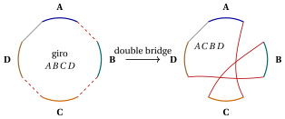
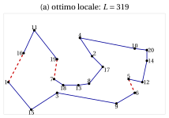
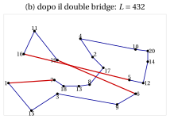
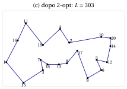
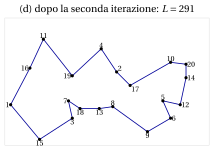

# 32.6 Iterated local search { #sez-sec-ils }

**Parte 4 · Algoritmi euristici · Capitolo 32** · [:material-book-open-variant: Capitolo 32: Metaeuristiche](index.md) · [:material-file-pdf-box: Dispensa, volume 4 (PDF)](../../pdf/dispensa-4-algoritmi-euristici.pdf) · [:material-presentation: Slide (1/2)](../../pdf/slide-metaheuristics-1.pdf) · [:material-presentation: Slide (2/2)](../../pdf/slide-metaheuristics-2.pdf) · [:material-pencil: Esercizi: Metaeuristiche](../../esercizi/metaheuristics.md) · [:material-gesture-tap: App: TSP: simulated annealing e tabu search](../../laboratorio/simulated-annealing-tabu-search.md)

!!! chiave ""

    L'<em>iterated local search</em> (indicata con $ILS$) applica una ricerca locale, e poi ripete: <em>perturba</em> l'ottimo locale corrente con una modifica casuale (un <em>kick</em>) che la ricerca locale non può annullare facilmente, applica la ricerca locale alla soluzione perturbata, e decide con un <em>criterio di accettazione</em> se il nuovo ottimo locale sostituisce quello corrente. È una passeggiata fra gli ottimi locali.

- Lo pseudocodice di $ILS$ per il TSP, con la ricerca locale 2-opt e il kick double bridge, è il seguente:

!!! algoritmo "Algoritmo: Iterated local search per il TSP"

    

<strong>Input:</strong> distanze \(d\), giro di partenza \(\sigma[1..n]\), numero di iterazioni \(maxIter\)

<strong>Output:</strong> l'ultimo ottimo locale accettato

1<strong>Function</strong> IteratedLocalSearch(\(d, \sigma, maxIter\))

2\(cur := \textsc{TwoOptLS}(\sigma)\);  \(lcur := L(cur)\) ▹ primo ottimo locale

3<strong>for</strong> \(it := 1\) <strong>to</strong> \(maxIter\) <strong>do</strong>

4\(nw := \textsc{DoubleBridge}(cur)\)
    \(nw := \textsc{TwoOptLS}(nw)\);  \(lnew := L(nw)\) ▹ perturbazione ricerca locale

5<strong>if</strong> \(lnew < lcur\) <strong>then</strong>

6\(cur := nw\);  \(lcur := lnew\) ▹ accettazione

7<strong>end</strong>

8<strong>end</strong>

9<strong>return</strong> \(cur\)

10<strong>Function</strong> DoubleBridge(\(\sigma\))

11\(p_1 := 1+\lfloor\textsc{Rand}()\cdot(n-3)\rfloor\)

12\(p_2 := p_1+1+\lfloor\textsc{Rand}()\cdot(n-2-p_1)\rfloor\)

13\(p_3 := p_2+1+\lfloor\textsc{Rand}()\cdot(n-1-p_2)\rfloor\)

14\(A := \sigma[1..p_1]\);  \(B := \sigma[p_1{+}1..p_2]\);  \(C := \sigma[p_2{+}1..p_3]\);  \(D := \sigma[p_3{+}1..n]\)

15<strong>return</strong> \((A,C,B,D)\)

Esegui in Colab:

- Lo schema è stato descritto nella sua forma generale da Lourenço, Martin e Stützle (2003), nello <em>Handbook of Metaheuristics</em>; per il TSP risale alle «large-step Markov chains» di Martin, Otto e Felten (1991), che hanno introdotto il kick double bridge.

- $ILS$ ha tre componenti, e ciascuna ha un ruolo:

    - la <strong>ricerca locale</strong> intensifica: porta ogni soluzione perturbata al fondo della sua valle;

    - la <strong>perturbazione</strong> diversifica: sposta la ricerca in un'altra valle;

    - il <strong>criterio di accettazione</strong> bilancia le due: accettare solo ottimi locali migliori (come nello pseudocodice) intensifica, accettare ogni nuovo ottimo locale diversifica; regole intermedie accettano un ottimo locale peggiore con una certa probabilità, come in $SA$.

- L'<strong>intensità</strong> della perturbazione è il parametro chiave. Se è troppo debole, la ricerca locale la annulla e torna allo stesso ottimo locale; se è troppo forte, la soluzione perturbata non ha niente in comune con l'ottimo locale, e $ILS$ diventa un multi-start casuale. Un buon kick cambia la soluzione in un modo che la ricerca locale <em>non può</em> annullare, ma ne conserva la maggior parte.

{ .fig loading=lazy  }

- Il <strong>double bridge</strong> taglia il giro in quattro segmenti $A$, $B$, $C$, $D$ e li ricollega come $A\,C\,B\,D$: toglie tre lati (tratteggiati) e ne aggiunge tre nuovi (rossi), mentre il lato fra la fine di $D$ e l'inizio di $A$ si conserva. Nessun segmento viene invertito, mentre ogni mossa 2-opt inverte un segmento: quando $B$ e $C$ hanno almeno due città ciascuno, una singola mossa 2-opt non può annullare il kick, e la ricerca locale 2-opt, che accetta solo mosse miglioranti, torna raramente allo stesso ottimo locale. (Se $B$ e $C$ sono città singole, il kick cambia solo due lati ed è esso stesso una mossa 2-opt: l'esercizio «Iterated local search e VNS 2» usa questo caso.)

## 32.6.1 Esempio

!!! esempio "Esempio 32.6: $ILS$ sull'istanza media del TSP"

    Su TSP20, la ricerca locale 2-opt dal giro nearest neighbour (lunghezza $326$) si ferma nell'ottimo locale

    $$
    cur=(1,16,11,19,7,18,13,8,17,2,4,10,20,14,12,5,6,9,3,15),\qquad L(cur)=319.
    $$

    Con $seed=1$, i tre numeri casuali del primo kick sono $0.0000$, $0.1315$, $0.7556$, quindi

    $$
    p_1=1+\lfloor 0.0000\cdot 17\rfloor=1,\quad
    p_2=1+1+\lfloor 0.1315\cdot 17\rfloor=4,\quad
    p_3=4+1+\lfloor 0.7556\cdot 15\rfloor=16,
    $$

    e i segmenti sono $A=(1)$, $B=(16,11,19)$, $C=(7,18,13,8,17,2,4,10,20,14,12,5)$, $D=(6,9,3,15)$. Il kick toglie i lati $(1,16)$, $(19,7)$, $(5,6)$ e aggiunge $(1,7)$, $(5,16)$, $(19,6)$: il giro perturbato $A\,C\,B\,D$ ha lunghezza $432$, molto peggiore. La ricerca locale 2-opt lo porta a un nuovo ottimo locale di lunghezza $303<319$, che viene accettato. Il secondo kick ($p=(8,14,16)$) dà, dopo 2-opt, un giro di lunghezza $291=z(I)$; il terzo dà di nuovo un giro di lunghezza $291$, non migliore, e viene rifiutato.

{ .fig loading=lazy  }

{ .fig loading=lazy  }

{ .fig loading=lazy  }

{ .fig loading=lazy  }

- Il riquadro (a) mostra l'ottimo locale con i tre lati tolti dal kick (tratteggiati), il riquadro (b) il giro perturbato con i tre lati nuovi, i riquadri (c) e (d) gli ottimi locali dopo la prima e la seconda iterazione. Il kick sposta il segmento $C$ prima di $B$; la ricerca locale 2-opt ripara poi i lati lunghi che esso ha creato, conservando le parti buone del vecchio giro.

- Con $100$ iterazioni e $seed=1,\dots,10$, $ILS$ raggiunge l'ottimo $291$ in ogni esecuzione; l'iterazione in cui l'ottimo viene raggiunto è

    $$
    2,\ 3,\ 1,\ 7,\ 8,\ 11,\ 15,\ 6,\ 2,\ 3
    $$

    per i dieci semi. Ogni iterazione costa un kick e una ricerca locale 2-opt, che parte da una soluzione vicina a un ottimo locale e richiede poche mosse.

---

**Avanti:** [32.7 Variable neighbourhood search](variable-neighbourhood-search.md)
