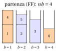
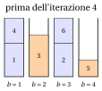
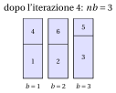

# 32.9 Large neighbourhood search { #sez-sec-lns }

**Parte 4 · Algoritmi euristici · Capitolo 32** · [:material-book-open-variant: Capitolo 32: Metaeuristiche](index.md) · [:material-file-pdf-box: Dispensa, volume 4 (PDF)](../../pdf/dispensa-4-algoritmi-euristici.pdf) · [:material-presentation: Slide (1/2)](../../pdf/slide-metaheuristics-1.pdf) · [:material-presentation: Slide (2/2)](../../pdf/slide-metaheuristics-2.pdf) · [:material-pencil: Esercizi: Metaeuristiche](../../esercizi/metaheuristics.md) · [:material-gesture-tap: App: TSP: simulated annealing e tabu search](../../laboratorio/simulated-annealing-tabu-search.md)

!!! chiave ""

    La <em>large neighbourhood search</em> (indicata con $LNS$) migliora una soluzione <em>distruggendone</em> una parte e <em>riparandola</em>: un metodo di distruzione toglie alcuni elementi (oggetti, città, lavori) dalla soluzione corrente, un metodo di riparazione li reinserisce, e la nuova soluzione sostituisce quella corrente se è soddisfatto un criterio di accettazione. L'intorno di una soluzione è l'insieme di tutte le soluzioni che distruzione e riparazione possono produrre, ed è <em>grande</em>.

- Lo pseudocodice di $LNS$ per il TSP, che toglie $q$ città casuali e le reinserisce con l'inserimento più economico (cheapest insertion), è il seguente:

!!! algoritmo "Algoritmo: Large neighbourhood search per il TSP"

    

<strong>Input:</strong> distanze \(d\), giro di partenza \(\sigma\), numero \(q\) di città da togliere, numero di iterazioni \(maxIter\)

<strong>Output:</strong> il giro corrente alla fine

1<strong>Function</strong> LNS(\(d, \sigma, q, maxIter\))

2\(cur := \sigma\);  \(lcur := L(cur)\)

3<strong>for</strong> \(it := 1\) <strong>to</strong> \(maxIter\) <strong>do</strong>

4\(nw := cur\)

5\(removed := \textsc{RandomRemoval}(nw, q)\)
    \(\textsc{CheapestInsertionRepair}(nw, removed)\) ▹ distruzione riparazione

6<strong>if</strong> \(L(nw) < lcur\) <strong>then</strong> \(cur := nw\);  \(lcur := L(nw)\) ▹ accettazione

7<strong>end</strong>

8<strong>return</strong> \(cur\)

9<strong>Function</strong> RandomRemoval(\(\sigma, q\))

10<strong>for</strong> \(s := 1\) <strong>to</strong> \(q\) <strong>do</strong>

11\(k := 2+\lfloor\textsc{Rand}()\cdot(|\sigma|-1)\rfloor\)
    aggiungere \(\sigma[k]\) in coda a \(removed\), e cancellarla da \(\sigma\) ▹ la città \(1\) non viene mai tolta

12<strong>end</strong>

13<strong>return</strong> \(removed\)

14<strong>Function</strong> CheapestInsertionRepair(\(\sigma, removed\))

15<strong>for each</strong> città \(v\) di \(removed\), nell'ordine di rimozione <strong>do</strong>

16inserire \(v\) fra le città consecutive \(a\), \(b\) di \(\sigma\) di minimo \(d_{av}+d_{vb}-d_{ab}\)

17<strong>end</strong>

Esegui in Colab:

- La $LNS$ è stata introdotta da Shaw (1998) per problemi di vehicle routing, in cui la riparazione era fatta con la constraint programming. La <strong>dimensione</strong> dell'intorno cresce molto rapidamente con il numero $q$ di elementi tolti: per il TSP ci sono $\binom{n-1}{q}$ modi di scegliere le città tolte, e molti modi di reinserirle. Un intorno del genere non si può elencare e valutare mossa per mossa, come in una ricerca locale: viene esplorato <strong>implicitamente</strong>, dal metodo di riparazione.

- Il metodo di riparazione è un <strong>sotto-algoritmo</strong>: un'euristica costruttiva (cheapest insertion, FFD), o un algoritmo <em>esatto</em> per il sottoproblema lasciato dal metodo di distruzione. Più forte è la riparazione, migliore è il miglior vicino trovato; più grande è $q$, più grande è l'intorno, e più costosa la sua esplorazione.

- Il metodo di distruzione diversifica (di solito è casuale, e $q$ controlla quanto lontano va la ricerca); il metodo di riparazione intensifica (ricostruisce la parte distrutta nel modo migliore possibile). Togliere elementi <em>correlati</em> (città vicine fra loro, oggetti degli stessi contenitori) rende la riparazione più efficace che togliere elementi non correlati, che possono solo essere rimessi dov'erano.

!!! esempio "Esempio 32.9: $LNS$ sull'istanza di riferimento del TSP"

    Dal giro nearest neighbour $(1,3,2,4,5)$ di lunghezza $25$, con $q=2$ e $seed=1$. Il primo numero casuale $0.0000$ toglie la città in posizione $2+\lfloor 4\cdot 0.0000\rfloor=2$, la città $3$; il giro parziale è $(1,2,4,5)$, e $0.1315$ toglie la città in posizione $2+\lfloor 3\cdot 0.1315\rfloor=2$, la città $2$. Il giro parziale $(1,4,5)$ ha lunghezza $2+7+9=18$. Cheapest insertion della città $3$:

    $$
    (1,4):\ d_{13}+d_{34}-d_{14}=2+4-2=4,\qquad
    (4,5):\ 4+7-7=4,\qquad
    (5,1):\ 7+2-9=0,
    $$

    quindi la città $3$ va fra $5$ e $1$: $(1,4,5,3)$. Cheapest insertion della città $2$:

    $$
    \begin{gathered}
    (1,4):\ 5+3-2=6,\qquad (4,5):\ 3+4-7=0,\qquad (5,3):\ 4+4-7=1,\\
    (3,1):\ 4+5-2=7,
    \end{gathered}
    $$

    quindi la città $2$ va fra $4$ e $5$: $(1,4,2,5,3)$, di lunghezza $18$, accettato. È il giro ottimo, percorso nel verso opposto: un solo passo di distruzione e riparazione ha cambiato quattro lati del giro.

## 32.9.1 Large neighbourhood search per il BPP: riparazione euristica ed esatta { #sez-sec-lns-bpp }

- Per il BPP il metodo di distruzione naturale <strong>svuota contenitori</strong>: il contenitore meno carico, che è quello di cui vorremmo liberarci, e $q-1$ altri contenitori scelti a caso. Il metodo di riparazione reimpacchetta gli oggetti tolti in contenitori nuovi, mentre gli altri contenitori restano come sono. Il nuovo impacchettamento è accettato se usa meno contenitori, o lo stesso numero di contenitori e un valore dell'obiettivo ausiliario $\sum_b(\sum_{j\in P_b}w_j)^2$ non minore: sui plateau dell'obiettivo piatto, la ricerca si muove verso contenitori più pieni.

- La riparazione risolve un <strong>sottoproblema di BPP</strong>, sui soli oggetti tolti, e può farlo in due modi: con FFD, oppure in modo <strong>esatto</strong>, con un branch-and-bound che prova ogni contenitore per ogni oggetto e conserva l'impacchettamento con il minor numero di contenitori. Il sottoproblema ha solo gli oggetti di $q$ contenitori, quindi una riparazione esatta è sostenibile.

!!! algoritmo "Algoritmo: Large neighbourhood search per il BPP"

    

<strong>Input:</strong> pesi \(w[1..n]\), capacità \(c\), impacchettamento \(bin[1..n]\) con \(nb\) contenitori, \(q\), \(exact\), \(maxIter\)

<strong>Output:</strong> un impacchettamento \(bin\) e il suo numero di contenitori \(nb\)

1<strong>Function</strong> LNS-BPP(\(w, c, bin, nb, q, exact, maxIter\))

2\(\LB := \lceil \sum_j w[j]/c\rceil\);  \(it := 0\)

3<strong>while</strong> \(it < maxIter\) <strong>and</strong> \(nb > \LB\) <strong>do</strong>

4\(it := it+1\)

5\(empty :=\) il contenitore meno carico e \(q-1\) altri contenitori a caso
    \(items :=\) gli oggetti posti nei contenitori di \(empty\) ▹ distruzione

6\(newbin :=\) gli altri contenitori, rinumerati \(1,\dots,nb-q\)

7<strong>if</strong> \(exact\) <strong>then</strong> impacchettare \(items\) in modo ottimo in \(k\) contenitori nuovi <strong>else</strong> impacchettare \(items\) con FFD in \(k\) contenitori nuovi

8\(nb' := nb-q+k\)

9<strong>if</strong> \(nb' < nb\) <strong>or</strong> (\(nb'=nb\) <strong>and</strong> \(\sum_b (\text{carico di } b \text{ in } newbin)^2 \ge \sum_b (\text{carico di } b \text{ in } bin)^2\)) <strong>then</strong>

10\(bin := newbin\);  \(nb := nb'\) ▹ accettazione

11<strong>end</strong>

12<strong>end</strong>

13<strong>return</strong> \(bin\), \(nb\)

Esegui in Colab:

!!! esempio "Esempio 32.10: $LNS$ sull'istanza di riferimento del BPP"

    Partiamo dall'impacchettamento calcolato da First Fit, $P_1=\{1,4\}$, $P_2=\{2,5\}$, $P_3=\{3\}$, $P_4=\{6\}$, con carichi $(7,6,5,3)$, e usiamo $q=2$, riparazione con FFD e $seed=3$ (numeri casuali $0.0000$, $0.3946$, $0.2668$, $0.3760$). A ogni iterazione si svuota il contenitore meno carico, insieme al contenitore in posizione $1+\lfloor 3u\rfloor$ fra gli altri tre.

    
<table>
    <tr>
    <th>it</th>
    <th>carichi</th>
    <th>svuotati</th>
    <th>oggetti</th>
    <th>FFD</th>
    <th>\(nb'\)</th>
    <th>\(\sum_b(\cdot)^2\)</th>
    </tr>
    <tr>
    <td>\(1\)</td>
    <td>\((7,6,5,3)\)</td>
    <td>\(P_4,P_1\)</td>
    <td>\(\{1,4,6\}\)</td>
    <td>\(\{1,4\}, \{6\}\)</td>
    <td>\(4\)</td>
    <td>\(119\to 119\)</td>
    </tr>
    <tr>
    <td>\(2\)</td>
    <td>\((6,5,7,3)\)</td>
    <td>\(P_4,P_2\)</td>
    <td>\(\{3,6\}\)</td>
    <td>\(\{3\}, \{6\}\)</td>
    <td>\(4\)</td>
    <td>\(119\to 119\)</td>
    </tr>
    <tr>
    <td>\(3\)</td>
    <td>\((6,7,5,3)\)</td>
    <td>\(P_4,P_1\)</td>
    <td>\(\{2,5,6\}\)</td>
    <td>\(\{2,6\}, \{5\}\)</td>
    <td>\(4\)</td>
    <td>\(119\to 127\)</td>
    </tr>
    <tr>
    <td>\(4\)</td>
    <td>\((7,5,7,2)\)</td>
    <td>\(P_4,P_2\)</td>
    <td>\(\{3,5\}\)</td>
    <td>\(\{3,5\}\)</td>
    <td>\(3\)</td>
    <td>\(127\to 147\)</td>
    </tr>
    </table>

    Le iterazioni $1$ e $2$ si limitano a rimescolare gli oggetti e mantengono gli stessi carichi (l'obiettivo ausiliario resta $119$, e il nuovo impacchettamento è accettato perché non è peggiore); l'iterazione $3$ costruisce il contenitore pieno $\{2,6\}$, portando l'obiettivo ausiliario a $127$; l'iterazione $4$ svuota i contenitori $\{5\}$ e $\{3\}$, e FFD mette insieme gli oggetti $3$ e $5$: $3$ contenitori, l'ottimo, e la ricerca si ferma poiché $nb=\LB$.

{ .fig loading=lazy  }

{ .fig loading=lazy  }

{ .fig loading=lazy  }

- Su BPP24, partendo dall'impacchettamento FFD ($10$ contenitori), con $200$ iterazioni e $seed=1,\dots,10$, il risultato dipende dalla riparazione:

<table>
<tr>
<th>\(q\)</th>
<th>riparazione</th>
<th>contenitori alla fine (10 semi)</th>
<th>iterazioni per arrivare a \(9\)</th>
</tr>
<tr>
<td>\(2\)</td>
<td>FFD</td>
<td>\(10,10,10,10,10,10,10,10,10,10\)</td>
<td>mai</td>
</tr>
<tr>
<td>\(2\)</td>
<td>esatta</td>
<td>\(10,10,10,10,10,10,10,10,10,10\)</td>
<td>mai</td>
</tr>
<tr>
<td>\(3\)</td>
<td>FFD</td>
<td>\(10,10,10,10,10,10,10,10,10,10\)</td>
<td>mai</td>
</tr>
<tr>
<td>\(3\)</td>
<td>esatta</td>
<td>\(9,9,9,9,9,9,9,9,9,9\)</td>
<td>\(4,4,12,38,3,20,5,2,7,5\)</td>
</tr>
<tr>
<td>\(4\)</td>
<td>FFD</td>
<td>\(10,10,10,10,10,10,10,10,10,10\)</td>
<td>mai</td>
</tr>
<tr>
<td>\(4\)</td>
<td>esatta</td>
<td>\(9,9,9,9,9,9,9,9,9,9\)</td>
<td>\(2,3,9,12,4,5,1,3,10,2\)</td>
</tr>
</table>

- Con la riparazione FFD, la $LNS$ non migliora <strong>mai</strong> l'impacchettamento FFD: gli oggetti tolti da un impacchettamento FFD vengono reimpacchettati da FFD nello stesso modo. Con la riparazione esatta e $q\ge 3$ raggiunge l'ottimo in ogni esecuzione, in poche iterazioni: trova tre contenitori i cui oggetti entrano in due, ed è ciò che FFD non vede. Con $q=2$ anche la riparazione esatta fallisce, perché gli oggetti di due contenitori di un impacchettamento FFD non entrano mai in uno solo.

!!! chiave ""

    Un intorno grande si esplora risolvendo un <strong>sottoproblema</strong>: la parte della soluzione lasciata libera dal metodo di distruzione viene riottimizzata, mentre il resto è fissato. Più potente è il metodo che risolve il sottoproblema, più potente è l'intorno.

## 32.9.2 Adaptive large neighbourhood search { #sez-sec-alns }

- Quale metodo di distruzione funzioni meglio dipende dall'istanza, e dalla fase della ricerca. La LNS <strong>adattiva</strong> (ALNS), introdotta da Ropke e Pisinger (2006), usa più metodi di distruzione (e di riparazione), ne sceglie uno a caso a ogni iterazione, e <strong>impara</strong> quali funzionano, assegnando a ogni metodo $o$ un peso $w_o$:

!!! chiave ""

    $$
    P(\text{scegliere } o) \;=\; \frac{w_o}{\sum_{o'} w_{o'}},
    \qquad\qquad
    w_o \;\leftarrow\; (1-\rho)\,w_o + \rho\,\psi ,
    $$

    dove $\rho\in[0,1]$ è il <em>fattore di reazione</em> e il punteggio $\psi$ premia l'esito dell'iterazione in cui $o$ è stato usato: $\psi=3$ se la nuova soluzione è la migliore trovata finora, $2$ se è migliore di quella corrente, $1$ se è altrettanto buona, $0$ se è peggiore.

!!! algoritmo "Algoritmo: Adaptive large neighbourhood search per il TSP"

    

<strong>Input:</strong> distanze \(d\), giro di partenza \(\sigma\), \(q\), \(maxIter\), fattore di reazione \(\rho\)

<strong>Output:</strong> migliore giro trovato

1<strong>Function</strong> ALNS(\(d, \sigma, q, maxIter, \rho\))

2\(cur := \sigma\);  \(best := \sigma\);  \(w_1 := 1\);  \(w_2 := 1\)

3<strong>for</strong> \(it := 1\) <strong>to</strong> \(maxIter\) <strong>do</strong>

4<strong>if</strong> \(\textsc{Rand}()\cdot(w_1+w_2) < w_1\) <strong>then</strong> \(o := 1\) <strong>else</strong> \(o := 2\)

5\(nw := cur\)

6<strong>if</strong> \(o=1\) <strong>then</strong> \(removed := \textsc{RandomRemoval}(nw, q)\) <strong>else</strong> \(removed := \textsc{WorstRemoval}(nw, q)\)

7\(\textsc{CheapestInsertionRepair}(nw, removed)\)

8\(\psi := 3\), \(2\), \(1\) o \(0\) se \(L(nw)<L(best)\), \(L(nw)<L(cur)\), \(L(nw)=L(cur)\), \(L(nw)>L(cur)\)

9<strong>if</strong> \(L(nw)\le L(cur)\) <strong>then</strong> \(cur := nw\)

10<strong>if</strong> \(L(cur) < L(best)\) <strong>then</strong> \(best := cur\)

11\(w_o := (1-\rho)\,w_o + \rho\,\psi\) ▹ pesi adattivi

12<strong>end</strong>

13<strong>return</strong> \(best\)

Esegui in Colab:

- WORSTREMOVAL toglie, $q$ volte, la città la cui rimozione accorcia di più il giro: la città $v$, fra $a$ e $b$, di massimo $d_{av}+d_{vb}-d_{ab}$. È un metodo di distruzione deterministico e greedy: toglie le città che sembrano mal posizionate.

- Su TSP20, dal giro nearest neighbour, con $q=5$, $200$ iterazioni e $\rho=0.1$, la ALNS raggiunge l'ottimo in $7$ esecuzioni su $10$ (media $299.4$).

- Alla fine il peso della rimozione casuale è fra $0.77$ e $0.98$, il peso della worst removal fra $0.03$ e $0.08$: il metodo ha imparato che, da un giro buono, togliere le città peggio posizionate e reinserirle con cheapest insertion ricostruisce quasi sempre un giro non migliore, e ha quasi smesso di usarla.

- In queste esecuzioni la $LNS$ semplice con rimozione casuale ($q=5$) fa leggermente meglio: l'adattività ripaga quando ci sono molti metodi, di qualità ignota, ed esecuzioni lunghe.

---

**Avanti:** [32.10 Metodi basati su popolazioni: algoritmi genetici e memetici](metodi-basati-su-popolazioni-algoritmi-genetici-e-memetici.md)
