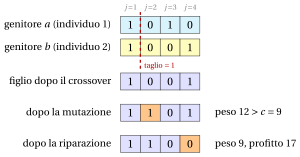

# 32.10 Metodi basati su popolazioni: algoritmi genetici e memetici { #sez-sec-ga }

**Parte 4 · Algoritmi euristici · Capitolo 32** · [:material-book-open-variant: Capitolo 32: Metaeuristiche](index.md) · [:material-file-pdf-box: Dispensa, volume 4 (PDF)](../../pdf/dispensa-4-algoritmi-euristici.pdf) · [:material-pencil: Esercizi: Metaeuristiche](../../esercizi/metaheuristics.md) · [:material-gesture-tap: App: TSP: simulated annealing e tabu search](../../laboratorio/simulated-annealing-tabu-search.md)

!!! chiave ""

    Un <em>algoritmo genetico</em> (indicato con $GA$) mantiene una <em>popolazione</em> di soluzioni, codificate come stringhe (<em>cromosomi</em>). A ogni iterazione <em>seleziona</em> due genitori, preferendo i più adatti, li <em>ricombina</em> in un figlio (<em>crossover</em>), cambia alcuni geni casuali del figlio (<em>mutazione</em>), lo <em>ripara</em> se è inammissibile, e lo inserisce nella popolazione al posto di un individuo peggiore. Un <em>algoritmo memetico</em> applica inoltre una ricerca locale a ogni figlio.

- Lo pseudocodice di un $GA$ steady-state per il KP con codifica binaria è il seguente; con $memetic=\mathrm{true}$ è un algoritmo memetico.

!!! algoritmo "Algoritmo: Algoritmo genetico e memetico per il KP"

    

<strong>Input:</strong> istanza del KP \(p[1..n]\), \(w[1..n]\), \(c\); dimensione della popolazione \(P\); probabilità di mutazione \(p_m\);
    \(maxIter\); \(memetic\)

<strong>Output:</strong> miglior individuo della popolazione finale

1<strong>Function</strong> GeneticKP(\(p, w, c, P, p_m, maxIter, memetic\))

2<strong>for</strong> \(s := 1\) <strong>to</strong> \(P\) <strong>do</strong> ▹ popolazione iniziale casuale

3<strong>for</strong> \(j := 1\) <strong>to</strong> \(n\) <strong>do</strong> \(pop[s][j] := 1\) se \(\textsc{Rand}()<0.5\), altrimenti \(0\)

4\(\textsc{RepairKP}(pop[s])\); 

5<strong>if</strong> \(memetic\) <strong>then</strong> \(\textsc{KPLocalSearch}(pop[s])\)

6\(fit[s] := \sum_j p[j]\,pop[s][j]\)

7<strong>end</strong>

8<strong>for</strong> \(it := 1\) <strong>to</strong> \(maxIter\) <strong>do</strong>

9\(a := \textsc{Tournament}()\);  \(b := \textsc{Tournament}()\)
    \(cut := 1+\lfloor\textsc{Rand}()\cdot(n-1)\rfloor\)
    \(child := (pop[a][1..cut],\ pop[b][cut{+}1..n])\) ▹ selezione crossover a un punto

10<strong>for</strong> \(j := 1\) <strong>to</strong> \(n\) <strong>do</strong> \(\textsc{Rand}()<p_m\)\(child[j] := 1-child[j]\)

11\(\textsc{RepairKP}(child)\); 

12<strong>if</strong> \(memetic\) <strong>then</strong> \(\textsc{KPLocalSearch}(child)\)

13\(worst :=\) l'ultimo indice \(s\) di minimo \(fit[s]\)

14<strong>if</strong> \(child\notin pop\) <strong>and</strong> \(\sum_jp[j]\,child[j] > fit[worst]\) <strong>then</strong> ▹ sostituzione

15\(pop[worst] := child\);  \(fit[worst] := \sum_jp[j]\,child[j]\)

16<strong>end</strong>

17<strong>end</strong>

18<strong>return</strong> l'individuo di massimo \(fit\)

19<strong>Function</strong> Tournament()

20\(a := 1+\lfloor\textsc{Rand}()\cdot P\rfloor\);  \(b := 1+\lfloor\textsc{Rand}()\cdot P\rfloor\)

21<strong>if</strong> \(fit[a]\ge fit[b]\) <strong>then</strong> <strong>return</strong> \(a\) <strong>else</strong> <strong>return</strong> \(b\)

Esegui in Colab:

- Gli algoritmi genetici sono stati introdotti da Holland (1975) come modello dell'evoluzione naturale, e resi popolari come metodi di ottimizzazione da Goldberg (1989). Gli algoritmi memetici, in cui ogni individuo è migliorato da una ricerca locale, sono stati proposti da Moscato (1989).

- <strong>Codifica.</strong> Per il KP il vettore binario $x$ è un cromosoma naturale: il gene $j$ dice se l'oggetto $j$ è selezionato. La <strong>fitness</strong> di un individuo è il suo profitto.

- <strong>Selezione.</strong> Un torneo binario estrae due individui a caso e tiene il più adatto: gli individui buoni hanno più probabilità di diventare genitori, ma ogni individuo ha una possibilità.

- <strong>Crossover.</strong> Il crossover a un punto prende i geni $1,\dots,cut$ dal primo genitore e i geni $cut+1,\dots,n$ dal secondo. L'idea è che le soluzioni buone condividano dei <em>blocchi costitutivi</em> buoni, e che ricombinare due genitori buoni possa mettere i blocchi buoni di entrambi in un solo figlio.

- <strong>Mutazione.</strong> Ogni gene viene invertito con una probabilità piccola $p_m$, tipicamente $\frac1n$: riporta nella popolazione geni che la selezione può aver perso.

- <strong>Riparazione.</strong> Il figlio può essere inammissibile. REPAIRKP toglie l'oggetto selezionato di efficienza minima finché la capacità non è rispettata (pareggi: l'oggetto di indice massimo). Le alternative sono le penalità, come nella Sezione [32.4.3](come-uscire-da-un-ottimo-locale.md#sez-sec-sa-kp), o codifiche in cui ogni cromosoma è ammissibile.

- <strong>Sostituzione.</strong> Nella versione steady-state dello pseudocodice, il figlio sostituisce l'individuo peggiore se è migliore e non è già nella popolazione; i duplicati farebbero perdere alla popolazione la sua diversità.

- Selezione e sostituzione <strong>intensificano</strong> (la popolazione si concentra sulle soluzioni buone); crossover e mutazione <strong>diversificano</strong>. Senza ricerca locale, un $GA$ è bravo a trovare regioni promettenti ma lento a raggiungerne gli ottimi locali: l'algoritmo memetico aggiunge l'intensificazione mancante.

!!! esempio "Esempio 32.11: $GA$ sull'istanza di riferimento del KP"

    Con $P=4$, $p_m=\frac14$ e $seed=36$. I primi $16$ numeri casuali costruiscono la popolazione iniziale (gene $1$ se il numero è minore di $0.5$):

    $$
    \begin{array}{lll}pop[1]: & 0.0003,\ 0.7354,\ 0.2018,\ 0.5114 & \to (1,0,1,0) \\ pop[2]: & 0.1796,\ 0.8825,\ 0.6936,\ 0.4391 & \to (1,0,0,1) \\ pop[3]: & 0.4547,\ 0.6489,\ 0.8061,\ 0.6990 & \to (1,0,0,0) \\ pop[4]: & 0.9148,\ 0.2446,\ 0.9246,\ 0.0692 & \to (0,1,0,1)\end{array}
    $$

    Tutti e quattro gli individui sono ammissibili: $pop[1]=(1,0,1,0)$, $pop[2]=(1,0,0,1)$, $pop[3]=(1,0,0,0)$, $pop[4]=(0,1,0,1)$, con fitness $(16,14,10,11)$.

    <strong>Iterazione 1</strong> (numeri casuali $0.1614$, $0.2771$, $0.8030$, $0.4063$, $0.0295$, $0.7238$, $0.2032$, $0.4957$, $0.4620$). Il primo torneo estrae gli individui $1+\lfloor 4\cdot 0.1614\rfloor=1$ e $1+\lfloor 4\cdot 0.2771\rfloor=2$, e seleziona $a=1$ (fitness $16>14$); il secondo estrae $4$ e $2$ e seleziona $b=2$ (fitness $14>11$). Il taglio è $1+\lfloor 3\cdot 0.0295\rfloor=1$: il figlio prende il gene $1$ da $pop[1]$ e i geni $2$, $3$, $4$ da $pop[2]$, $child=(1,0,0,1)$. Solo il secondo numero di mutazione, $0.2032$, è minore di $p_m=0.25$: il gene $2$ si inverte, $child=(1,1,0,1)$, di peso $12>9$. La riparazione toglie l'oggetto $4$, l'oggetto selezionato di efficienza minima: $child=(1,1,0,0)$, di peso $9$ e profitto $17$. Sostituisce l'individuo peggiore, $pop[3]$ di fitness $10$.

    L'<strong>iterazione 2</strong> seleziona $a=2$ e $b=3$, taglia dopo il gene $1$ e costruisce $(1,1,0,0)$, senza mutazione: è già nella popolazione, e viene scartato. L'<strong>iterazione 3</strong> seleziona $a=2$ e $b=1$, taglia dopo il gene $3$, costruisce $(1,0,0,0)$, e la mutazione inverte i geni $1$ e $4$: $(0,0,0,1)$, di profitto $4$, peggiore di ogni individuo, scartato.

    Il miglior individuo è $(1,1,0,0)$: $GA(I)=17=z(I)$, trovato da crossover, mutazione e riparazione insieme.

{ .fig loading=lazy  }

- Su KP20, con $P=10$, $p_m=0.05$ e $300$ iterazioni, per $seed=1,\dots,10$:

<table>
<tr>
<th></th>
<th>min</th>
<th>media</th>
<th>max</th>
<th>ottime</th>
<th>profitto migliore per seme</th>
</tr>
<tr>
<td>\(GA\)</td>
<td>\(508\)</td>
<td>\(516.9\)</td>
<td>\(521\)</td>
<td>\(4\)</td>
<td>\(521,519,521,508,514,521,510,519,521,515\)</td>
</tr>
<tr>
<td>memetico</td>
<td>\(521\)</td>
<td>\(521.0\)</td>
<td>\(521\)</td>
<td>\(10\)</td>
<td>\(521,521,521,521,521,521,521,521,521,521\)</td>
</tr>
</table>

- Il $GA$ semplice raggiunge l'ottimo $521$ in $4$ esecuzioni su $10$; l'algoritmo memetico in ogni esecuzione. La ricerca locale rende ogni individuo un ottimo locale, e il crossover ricombina allora ottimi locali invece di soluzioni arbitrarie.

---

**Avanti:** [32.11 Confronto e conclusioni](confronto-e-conclusioni.md)
