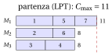
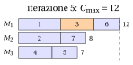
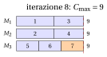

# 32.5 Tabu search { #sez-sec-ts }

**Parte 4 · Algoritmi euristici · Capitolo 32** · [:material-book-open-variant: Capitolo 32: Metaeuristiche](index.md) · [:material-file-pdf-box: Dispensa, volume 4 (PDF)](../../pdf/dispensa-4-algoritmi-euristici.pdf) · [:material-pencil: Esercizi: Metaeuristiche](../../esercizi/metaheuristics.md) · [:material-gesture-tap: App: TSP: simulated annealing e tabu search](../../laboratorio/simulated-annealing-tabu-search.md)

!!! chiave ""

    La <em>tabu search</em> (indicata con $TS$) esplora completamente l'intorno della soluzione corrente e si sposta sul <em>miglior</em> vicino, anche se è peggiore della soluzione corrente. Per evitare di tornare alle soluzioni appena visitate, mantiene una memoria a breve termine, la <em>lista tabu</em>: le mosse che annullerebbero le mosse recenti sono vietate (<em>tabu</em>) per un certo numero di iterazioni, la <em>durata tabu</em> (tenure), a meno che non portino a una soluzione migliore della migliore trovata (<em>criterio di aspirazione</em>).

- Lo pseudocodice di $TS$ per $P\,||\,C_{\max}$, con l'intorno move e il confronto lessicografico della Sezione [32.2.1](i-problemi-e-le-ipotesi.md#sez-sec-neigh), è il seguente; l'attributo $(j,h)$ vieta di riportare il lavoro $j$ sulla macchina $h$.

!!! algoritmo "Algoritmo: Tabu search per $P\,||\,C_{\max}$"

    

<strong>Input:</strong> tempi \(t[1..n]\), \(m\) macchine, assegnamento di partenza \(mach[1..n]\), \(tenure\), \(maxIter\)

<strong>Output:</strong> migliore assegnamento trovato

1<strong>Function</strong> TabuSearch(\(t, m, mach, tenure, maxIter\))

2\(L :=\) carichi di \(mach\);  \(tabu[j][h] := 0\) per ogni \(j\), \(h\)

3\(best := mach\);  \(bestC := \max_h L[h]\)

4\(\LB := \max\{\max_j t[j],\ \lceil \sum_j t[j]/m\rceil\}\)
    \(it := 0\) ▹ arresto se raggiunto

5<strong>while</strong> \(it < maxIter\) <strong>and</strong> \(bestC > \LB\) <strong>do</strong>

6\(it := it+1\);  \(bj := 0\) ▹ migliore mossa non tabu \((bj,bh)\)

7<strong>for</strong> \(j := 1\) <strong>to</strong> \(n\) <strong>do</strong>

8<strong>for</strong> \(h := 1\) <strong>to</strong> \(m\), \(h\ne mach[j]\) <strong>do</strong>

9\(L' :=\) i carichi dopo lo spostamento del lavoro \(j\) da \(mach[j]\) a \(h\)

10<strong>if</strong> \(tabu[j][h]\ge it\) <strong>and not</strong> \(\max_k L'[k] < bestC\) <strong>then</strong> <strong>continue</strong> ▹ tabu

11<strong>if</strong> \(bj=0\) <strong>or</strong> \(L'\) è lessicograficamente migliore di \(bL\) <strong>then</strong> \((bj,bh,bL) := (j,h,L')\)

12<strong>end</strong>

13<strong>end</strong>

14<strong>if</strong> \(bj=0\) <strong>then</strong> <strong>break</strong>

15\(tabu[bj][mach[bj]] := it+tenure\)
    \(mach[bj] := bh\);  \(L := bL\) ▹ vietare il ritorno anche se peggiore

16<strong>if</strong> \(\max_k L[k] < bestC\) <strong>then</strong>

17\(bestC := \max_k L[k]\);  \(best := mach\)

18<strong>end</strong>

19<strong>end</strong>

20<strong>return</strong> \(best\)

Esegui in Colab:

- La tabu search è stata proposta da Glover (1986); il libro di riferimento è Glover e Laguna, <em>Tabu Search</em>, Kluwer, 1997. A differenza di $SA$, è <strong>deterministica</strong>: esce da un ottimo locale perché si sposta sempre, sul vicino meno cattivo se nessun vicino è migliore.

- Senza memoria, questa regola <strong>cicla</strong>: da un ottimo locale $S$ la ricerca passa al miglior vicino $S'$, che è peggiore, e da $S'$ il miglior vicino è tipicamente di nuovo $S$. La lista tabu spezza il ciclo vietando la mossa inversa.

- <strong>Attributi.</strong> Memorizzare le soluzioni visitate e confrontare con esse ogni vicino sarebbe troppo costoso. La lista tabu memorizza invece <strong>attributi</strong> delle mosse recenti: qui la coppia $(j,h)$ «il lavoro $j$ ha lasciato la macchina $h$»; per il TSP, i lati appena tolti dal giro.

- Un attributo vieta più della sola soluzione appena lasciata: ogni soluzione con il lavoro $j$ sulla macchina $h$ è tabu, anche quelle mai visitate. Il <strong>criterio di aspirazione</strong> rimedia a questo eccesso di prudenza: una mossa tabu è ammessa se porta a una soluzione migliore della migliore trovata, che certamente non è stata visitata.

- <strong>Durata tabu.</strong> Se è troppo breve, la ricerca può ancora ciclare su cicli più lunghi; se è troppo lunga, sono vietate troppe mosse e la ricerca viene spinta lontano dalle regioni buone. Valori tipici sono fra $5$ e $20$, o proporzionali a $\sqrt{n}$; estrarre la durata a caso in un intervallo a ogni iterazione (robust tabu search, Taillard 1991) rende improbabili i cicli.

- <strong>Criterio di arresto.</strong> Un numero massimo di iterazioni, o di iterazioni senza miglioramento della soluzione migliore. Per $P\,||\,C_{\max}$ possiamo anche fermarci quando il makespan raggiunge il lower bound $\LB$: allora la soluzione è ottima, e la ricerca può solo perdere tempo.

- <strong>Memoria a lungo termine.</strong> Oltre alla lista tabu (memoria a breve termine), $TS$ può registrare quanto spesso ogni attributo compare nelle soluzioni visitate. La <em>diversificazione</em> penalizza gli attributi frequenti, per spingere la ricerca verso regioni inesplorate; l'<em>intensificazione</em> riparte dalle migliori soluzioni trovate, e fissa gli attributi che hanno in comune.

## 32.5.1 Esempio

!!! esempio "Esempio 32.5: $TS$ sull'istanza di riferimento di $P\,||\,C_{\max}$"

    Partiamo dalla soluzione calcolata da LPT nel capitolo [«Euristiche costruttive»](../constructive-heuristics/index.md), $J_1=\{1,5,7\}$, $J_2=\{2,6\}$, $J_3=\{3,4\}$, con carichi $(11,8,8)$, $C_{\max}=11$ e $\sum_h L_h^2=249$. È un ottimo locale per l'intorno move: alla prima iterazione i $14$ vicini sono

    
<table>
    <tr>
    <th>mossa</th>
    <th>\(1\to M_2\)</th>
    <th>\(1\to M_3\)</th>
    <th>\(2\to M_1\)</th>
    <th>\(2\to M_3\)</th>
    <th>\(3\to M_1\)</th>
    <th>\(3\to M_2\)</th>
    <th>\(4\to M_1\)</th>
    </tr>
    <tr>
    <td>\((C_{\max},\sum_hL_h^2)\)</td>
    <td>\((13,269)\)</td>
    <td>\((13,269)\)</td>
    <td>\((16,329)\)</td>
    <td>\((13,299)\)</td>
    <td>\((15,305)\)</td>
    <td>\((12,281)\)</td>
    <td>\((15,305)\)</td>
    </tr>
    <tr>
    <td>mossa</td>
    <td>\(4\to M_2\)</td>
    <td>\(5\to M_2\)</td>
    <td>\(5\to M_3\)</td>
    <td>\(6\to M_1\)</td>
    <td>\(6\to M_3\)</td>
    <td>\(7\to M_2\)</td>
    <td>\(7\to M_3\)</td>
    </tr>
    <tr>
    <td>\((C_{\max},\sum_hL_h^2)\)</td>
    <td>\((12,281)\)</td>
    <td>\((11,249)\)</td>
    <td>\((11,249)\)</td>
    <td>\((14,285)\)</td>
    <td>\((11,267)\)</td>
    <td>\((11,249)\)</td>
    <td>\((11,249)\)</td>
    </tr>
    </table>

    Nessun vicino ha $C_{\max}<11$, e i quattro migliori hanno $C_{\max}=11$ e $\sum_hL_h^2=249$, come la soluzione corrente: una ricerca locale si ferma qui. $TS$, con $tenure=6$, si sposta invece sul miglior vicino non tabu (il primo dei quattro, il lavoro $5$ su $M_2$), e prosegue:

    
<table>
    <tr>
    <th>it</th>
    <th>mossa</th>
    <th>carichi</th>
    <th>\(C_{\max}\)</th>
    <th>\(\sum_h L_h^2\)</th>
    <th>\(bestC\)</th>
    <th>nuovo attributo tabu</th>
    </tr>
    <tr>
    <td>\(1\)</td>
    <td>lavoro \(5\): \(M_1\to M_2\)</td>
    <td>\((8,11,8)\)</td>
    <td>\(11\)</td>
    <td>\(249\)</td>
    <td>\(11\)</td>
    <td>\((5,M_1)\) fino all'it. \(7\)</td>
    </tr>
    <tr>
    <td>\(2\)</td>
    <td>lavoro \(5\): \(M_2\to M_3\)</td>
    <td>\((8,8,11)\)</td>
    <td>\(11\)</td>
    <td>\(249\)</td>
    <td>\(11\)</td>
    <td>\((5,M_2)\) fino all'it. \(8\)</td>
    </tr>
    <tr>
    <td>\(3\)</td>
    <td>lavoro \(6\): \(M_2\to M_1\)</td>
    <td>\((11,5,11)\)</td>
    <td>\(11\)</td>
    <td>\(267\)</td>
    <td>\(11\)</td>
    <td>\((6,M_2)\) fino all'it. \(9\)</td>
    </tr>
    <tr>
    <td>\(4\)</td>
    <td>lavoro \(7\): \(M_1\to M_2\)</td>
    <td>\((8,8,11)\)</td>
    <td>\(11\)</td>
    <td>\(249\)</td>
    <td>\(11\)</td>
    <td>\((7,M_1)\) fino all'it. \(10\)</td>
    </tr>
    <tr>
    <td>\(5\)</td>
    <td>lavoro \(3\): \(M_3\to M_1\)</td>
    <td>\((12,8,7)\)</td>
    <td>\(12\)</td>
    <td>\(257\)</td>
    <td>\(11\)</td>
    <td>\((3,M_3)\) fino all'it. \(11\)</td>
    </tr>
    <tr>
    <td>\(6\)</td>
    <td>lavoro \(6\): \(M_1\to M_3\)</td>
    <td>\((9,8,10)\)</td>
    <td>\(10\)</td>
    <td>\(245\)</td>
    <td>\(10\)</td>
    <td>\((6,M_1)\) fino all'it. \(12\)</td>
    </tr>
    <tr>
    <td>\(7\)</td>
    <td>lavoro \(4\): \(M_3\to M_2\)</td>
    <td>\((9,12,6)\)</td>
    <td>\(12\)</td>
    <td>\(261\)</td>
    <td>\(10\)</td>
    <td>\((4,M_3)\) fino all'it. \(13\)</td>
    </tr>
    <tr>
    <td>\(8\)</td>
    <td>lavoro \(7\): \(M_2\to M_3\)</td>
    <td>\((9,9,9)\)</td>
    <td>\(9\)</td>
    <td>\(243\)</td>
    <td>\(9\)</td>
    <td>\((7,M_2)\) fino all'it. \(14\)</td>
    </tr>
    </table>

    - All'iterazione $2$ il miglior vicino riporterebbe il lavoro $5$ su $M_1$, tornando alla soluzione di partenza: la mossa è tabu (attributo $(5,M_1)$ fino all'iterazione $7$), e la ricerca sposta il lavoro $5$ su $M_3$.

    - All'iterazione $5$ i quattro vicini con $C_{\max}=11$ sono tutti tabu, e nessuno soddisfa il criterio di aspirazione ($C_{\max}<bestC=11$): la migliore mossa non tabu <strong>peggiora</strong> il makespan a $12$. È così che $TS$ lascia il plateau.

    - All'iterazione $6$ il makespan scende a $10$, e all'iterazione $8$ a $9$: $C_{\max}=\LB=9$, quindi la soluzione $J_1=\{1,3\}$, $J_2=\{2,4\}$, $J_3=\{5,6,7\}$ è ottima e la ricerca si ferma: $TS(I)=9=z(I)$.

{ .fig loading=lazy  }

{ .fig loading=lazy  }

{ .fig loading=lazy  }

- La figura mostra i diagrammi di Gantt della soluzione di partenza, della soluzione dopo la mossa peggiorante dell'iterazione $5$ (il lavoro spostato in arancione), e della soluzione ottima raggiunta all'iterazione $8$.

- Con $tenure\le 5$, $TS$ non raggiunge l'ottimo su questa istanza entro $50$ iterazioni: la lista tabu è troppo corta per impedire alla ricerca di tornare sul plateau di makespan $11$.

## 32.5.2 Tabu search per il TSP, e l'effetto della durata tabu { #sez-sec-ts-tsp }

- Per il TSP con l'intorno 2-opt, gli attributi naturali sono i <strong>lati</strong>: quando una mossa toglie i lati $(\sigma_i,\sigma_{i+1})$ e $(\sigma_j,\sigma_{j+1})$, questi due lati non possono essere rimessi nel giro per $tenure$ iterazioni, a meno che la mossa non dia un giro più corto del migliore. Tutto il resto è come nello pseudocodice della Sezione [32.5](#sez-sec-ts): a ogni iterazione tutte le $\frac{n(n-3)}{2}$ mosse sono valutate in $O(1)$ ciascuna, e si esegue la migliore non tabu.

- Le tabelle riportano il risultato di $TS$ sulle istanze medie, dal giro nearest neighbour ($326$) per TSP20 con $200$ iterazioni, e dalla soluzione LPT ($73$) per PCM15 con $300$ iterazioni, per diversi valori della durata tabu; per PCM15 la tabella dà anche il numero di iterazioni eseguite ($300$ salvo che si raggiunga il lower bound).

<table>
<tr>
<th colspan="7">TSP20: \(TS\) con 2-opt, \(200\) iterazioni (\(z(I)=291\))</th>
</tr>
<tr>
<td>\(tenure\)</td>
<td>\(0\)</td>
<td>\(1\)</td>
<td>\(2\)</td>
<td>\(5\)</td>
<td>\(10\)</td>
<td>\(20\)</td>
</tr>
<tr>
<td>lunghezza migliore</td>
<td>\(319\)</td>
<td>\(291\)</td>
<td>\(291\)</td>
<td>\(291\)</td>
<td>\(291\)</td>
<td>\(291\)</td>
</tr>
</table>

<table>
<tr>
<th colspan="11">PCM15: \(TS\) con l'intorno move, al più \(300\) iterazioni (\(z(I)=69\))</th>
</tr>
<tr>
<td>\(tenure\)</td>
<td>\(0\)</td>
<td>\(1\)</td>
<td>\(2\)</td>
<td>\(3\)</td>
<td>\(5\)</td>
<td>\(7\)</td>
<td>\(10\)</td>
<td>\(15\)</td>
<td>\(20\)</td>
<td>\(30\)</td>
</tr>
<tr>
<td>\(C_{\max}\) migliore</td>
<td>\(73\)</td>
<td>\(73\)</td>
<td>\(73\)</td>
<td>\(73\)</td>
<td>\(73\)</td>
<td>\(72\)</td>
<td>\(71\)</td>
<td>\(69\)</td>
<td>\(70\)</td>
<td>\(70\)</td>
</tr>
<tr>
<td>iterazioni</td>
<td>\(300\)</td>
<td>\(300\)</td>
<td>\(300\)</td>
<td>\(300\)</td>
<td>\(300\)</td>
<td>\(300\)</td>
<td>\(300\)</td>
<td>\(231\)</td>
<td>\(300\)</td>
<td>\(300\)</td>
</tr>
</table>

- Con $tenure=0$ non c'è memoria, e $TS$ cicla: su TSP20 non lascia mai il primo ottimo locale 2-opt. Su PCM15 l'intorno move ha un ampio plateau, e $TS$ ha bisogno di una lista tabu lunga per attraversarlo; ma una lista tabu troppo lunga vieta troppo, e con $tenure\ge 20$ l'ottimo si perde di nuovo. La durata tabu va calibrata, e il suo valore migliore dipende dal problema e dall'istanza.

---

**Avanti:** [32.6 Iterated local search](iterated-local-search.md)
