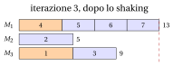
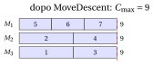

# 32.7 Variable neighbourhood search { #sez-sec-vns }

**Parte 4 · Algoritmi euristici · Capitolo 32** · [:material-book-open-variant: Capitolo 32: Metaeuristiche](index.md) · [:material-file-pdf-box: Dispensa, volume 4 (PDF)](../../pdf/dispensa-4-algoritmi-euristici.pdf) · [:material-presentation: Slide (1/2)](../../pdf/slide-metaheuristics-1.pdf) · [:material-presentation: Slide (2/2)](../../pdf/slide-metaheuristics-2.pdf) · [:material-pencil: Esercizi: Metaeuristiche](../../esercizi/metaheuristics.md) · [:material-gesture-tap: App: TSP: simulated annealing e tabu search](../../laboratorio/simulated-annealing-tabu-search.md)

!!! chiave ""

    La <em>variable neighbourhood search</em> (indicata con $VNS$) usa una successione di intorni $N_1,N_2,\dots,N_{k_{\max}}$ di dimensione crescente. Dall'ottimo locale corrente estrae una soluzione casuale in $N_k$ (<em>shaking</em>), le applica una ricerca locale, e si sposta sul nuovo ottimo locale se è migliore, ripartendo da $k=1$; altrimenti prova l'intorno successivo, più grande, $N_{k+1}$.

- Lo pseudocodice di $VNS$ per $P\,||\,C_{\max}$, dove $N_k$ contiene gli assegnamenti ottenuti con $k$ mosse e la ricerca locale è MOVEDESCENT, è il seguente:

!!! algoritmo "Algoritmo: Variable neighbourhood search per $P\,||\,C_{\max}$"

    

<strong>Input:</strong> tempi \(t[1..n]\), \(m\) macchine, assegnamento di partenza \(mach[1..n]\), \(k_{\max}\), \(maxIter\)

<strong>Output:</strong> un assegnamento \(mach\) e il suo makespan \(C\)

1<strong>Function</strong> VNS(\(t, m, mach, k_{\max}, maxIter\))

2\(\LB := \max\{\max_j t[j],\ \lceil \sum_j t[j]/m\rceil\}\)

3\(mach := \textsc{MoveDescent}(mach)\);  \(L :=\) carichi di \(mach\);  \(C := \max_h L[h]\)

4\(it := 0\);  \(k := 1\)

5<strong>while</strong> \(it < maxIter\) <strong>and</strong> \(C > \LB\) <strong>do</strong>

6\(it := it+1\)

7\(nw := \textsc{Shake}(mach, k)\)
    \(nw := \textsc{MoveDescent}(nw)\);  \(Lnew :=\) carichi di \(nw\) ▹ soluzione casuale in \(N_k\) ricerca locale

8<strong>if</strong> \(Lnew\) è lessicograficamente migliore di \(L\) <strong>then</strong>

9\(mach := nw\);  \(L := Lnew\);  \(k := 1\);  \(C := \max_h L[h]\) ▹ spostamento

10<strong>else</strong>

11<strong>if</strong> \(k < k_{\max}\) <strong>then</strong> \(k := k+1\) <strong>else</strong> \(k := 1\)

12<strong>end</strong>

13<strong>end</strong>

14<strong>return</strong> \(mach\), \(C\)

15<strong>Function</strong> Shake(\(mach, k\))

16<strong>for</strong> \(s := 1\) <strong>to</strong> \(k\) <strong>do</strong>

17\(j := 1+\lfloor \textsc{Rand}()\cdot n\rfloor\);  \(g := 1+\lfloor\textsc{Rand}()\cdot(m-1)\rfloor\)

18\(mach[j] :=\) la \(g\)-esima macchina diversa da \(mach[j]\)

19<strong>end</strong>

20<strong>return</strong> \(mach\)

Esegui in Colab:

- La $VNS$ è stata proposta da Mladenovic e Hansen (1997). Si basa su tre osservazioni: un ottimo locale per un intorno non è necessariamente un ottimo locale per un altro; un ottimo globale è un ottimo locale per ogni intorno; e gli ottimi locali di intorni diversi sono spesso vicini fra loro.

- Lo <strong>shaking</strong> diversifica, e la dimensione $k$ controlla quanto: un $k$ piccolo esplora le soluzioni vicine all'ottimo locale corrente, un $k$ più grande va più lontano solo quando quelle più vicine hanno fallito. La <strong>ricerca locale</strong> intensifica. Tornare a $k=1$ dopo ogni miglioramento concentra la ricerca vicino alla nuova soluzione, migliore.

- Anche la variable neighbourhood descent ($VND$) del capitolo [«Ricerca locale»](../local-search/index.md) usa più intorni, ma in modo <em>deterministico</em>: li esplora completamente, uno dopo l'altro, e si ferma in una soluzione che è un ottimo locale per tutti. La $VNS$ esplora gli intorni grandi solo per <em>campioni casuali</em>, ed è questo che rende utilizzabili intorni molto grandi; la ricerca locale dentro la $VNS$ può essere essa stessa una $VND$.

- Qui $N_k$ contiene gli assegnamenti ottenuti spostando $k$ lavori (o meno, se lo stesso lavoro è estratto due volte). Poiché uno swap di due lavori è la combinazione di due spostamenti, $N_2$ contiene l'intorno swap: lo shaking con $k=2$ può riprodurre gli swap che l'intorno move non vede.

## 32.7.1 Esempio

!!! esempio "Esempio 32.7: $VNS$ sull'istanza di riferimento di $P\,||\,C_{\max}$"

    Partiamo dalla soluzione LPT, con carichi $(11,8,8)$, e usiamo $k_{\max}=3$ e $seed=1$ (numeri casuali $0.0000$, $0.1315$, $0.7556$, $0.4587$, $0.5328$, $0.2190$, $0.0470$, $0.6789$). MOVEDESCENT non cambia la soluzione LPT, che è un ottimo locale per l'intorno move ([Esempio 32.5](tabu-search.md#box-6-ex-tsPCM)). Ogni spostamento casuale usa due numeri: $j=1+\lfloor 7u\rfloor$ e $g=1+\lfloor 2u\rfloor$.

    - <strong>Iterazione 1</strong>, $k=1$: il lavoro $j=1+\lfloor 7\cdot 0.0000\rfloor=1$ passa da $M_1$ alla prima altra macchina ($g=1+\lfloor 2\cdot 0.1315\rfloor=1$), $M_2$: carichi $(6,13,8)$. MOVEDESCENT sposta il lavoro $6$ da $M_2$ a $M_1$: carichi $(9,10,8)$, $C_{\max}=10$, migliore di $11$. La nuova soluzione $J_1=\{5,6,7\}$, $J_2=\{1,2\}$, $J_3=\{3,4\}$ viene accettata, e $k=1$.

    - <strong>Iterazione 2</strong>, $k=1$: il lavoro $j=1+\lfloor 7\cdot 0.7556\rfloor=6$ passa da $M_1$ a $M_2$ ($g=1+\lfloor 2\cdot 0.4587\rfloor=1$): carichi $(6,13,8)$. MOVEDESCENT riporta il lavoro $6$ su $M_1$ e restituisce la soluzione corrente, che non è migliore: $k=2$.

    - <strong>Iterazione 3</strong>, $k=2$: il lavoro $j=1+\lfloor 7\cdot 0.5328\rfloor=4$ passa da $M_3$ alla prima altra macchina $M_1$ ($g=1+\lfloor 2\cdot 0.2190\rfloor=1$); poi il lavoro $j=1+\lfloor 7\cdot 0.0470\rfloor=1$ passa da $M_2$ alla seconda altra macchina $M_3$ ($g=1+\lfloor 2\cdot 0.6789\rfloor=2$): carichi $(13,5,9)$. MOVEDESCENT sposta il lavoro $4$ da $M_1$ a $M_2$: carichi $(9,9,9)$. La soluzione viene accettata, e poiché $C_{\max}=9=\LB$ la ricerca si ferma: $VNS(I)=9=z(I)$.

    Rispetto alla soluzione corrente dell'iterazione $3$, i due spostamenti casuali e la discesa hanno scambiato i lavori $1$ e $4$: uno swap, che l'intorno move di MOVEDESCENT non può eseguire.

{ .fig loading=lazy  }

{ .fig loading=lazy  }

- Su PCM15, dalla soluzione LPT ($73$) e con al più $300$ iterazioni, la $VNS$ dà i seguenti makespan per $seed=1,\dots,10$, e il numero di iterazioni eseguite:

<table>
<tr>
<th>\(seed\)</th>
<th>\(1\)</th>
<th>\(2\)</th>
<th>\(3\)</th>
<th>\(4\)</th>
<th>\(5\)</th>
<th>\(6\)</th>
<th>\(7\)</th>
<th>\(8\)</th>
<th>\(9\)</th>
<th>\(10\)</th>
</tr>
<tr>
<td>\(k_{\max}=1\): \(C_{\max}\)</td>
<td>\(69\)</td>
<td>\(70\)</td>
<td>\(70\)</td>
<td>\(70\)</td>
<td>\(69\)</td>
<td>\(69\)</td>
<td>\(69\)</td>
<td>\(69\)</td>
<td>\(70\)</td>
<td>\(69\)</td>
</tr>
<tr>
<td>iterazioni</td>
<td>\(27\)</td>
<td>\(300\)</td>
<td>\(300\)</td>
<td>\(300\)</td>
<td>\(48\)</td>
<td>\(59\)</td>
<td>\(20\)</td>
<td>\(43\)</td>
<td>\(300\)</td>
<td>\(13\)</td>
</tr>
<tr>
<td>\(k_{\max}=2\): \(C_{\max}\)</td>
<td>\(70\)</td>
<td>\(69\)</td>
<td>\(69\)</td>
<td>\(69\)</td>
<td>\(69\)</td>
<td>\(70\)</td>
<td>\(69\)</td>
<td>\(70\)</td>
<td>\(70\)</td>
<td>\(69\)</td>
</tr>
<tr>
<td>iterazioni</td>
<td>\(300\)</td>
<td>\(41\)</td>
<td>\(126\)</td>
<td>\(285\)</td>
<td>\(33\)</td>
<td>\(300\)</td>
<td>\(31\)</td>
<td>\(300\)</td>
<td>\(300\)</td>
<td>\(26\)</td>
</tr>
<tr>
<td>\(k_{\max}=3\): \(C_{\max}\)</td>
<td>\(70\)</td>
<td>\(69\)</td>
<td>\(69\)</td>
<td>\(69\)</td>
<td>\(69\)</td>
<td>\(69\)</td>
<td>\(69\)</td>
<td>\(70\)</td>
<td>\(70\)</td>
<td>\(69\)</td>
</tr>
<tr>
<td>iterazioni</td>
<td>\(300\)</td>
<td>\(32\)</td>
<td>\(38\)</td>
<td>\(29\)</td>
<td>\(26\)</td>
<td>\(11\)</td>
<td>\(25\)</td>
<td>\(300\)</td>
<td>\(300\)</td>
<td>\(25\)</td>
</tr>
</table>

- Con $k_{\max}=3$, la $VNS$ raggiunge l'ottimo $69$ in $7$ esecuzioni su $10$, di solito in poche decine di iterazioni; la migliore tabu search della Sezione [32.5.2](tabu-search.md#sez-sec-ts-tsp) richiedeva una durata tabu calibrata con cura. Quando la $VNS$ fallisce, la ricerca è bloccata a $70$: lo shaking esplora al più tre mosse di distanza, e l'ottimo è più lontano. Si possono aggiungere un $k_{\max}$ più grande, o delle ripartenze, al prezzo di più iterazioni.

---

**Avanti:** [32.8 GRASP](grasp.md)
