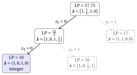
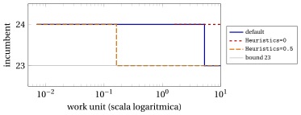

# Euristiche MIP per i problemi classici

**Parte 4 · Algoritmi euristici · Capitolo 33** · [:material-file-pdf-box: Dispensa, volume 4 (PDF)](../pdf/dispensa-4-algoritmi-euristici.pdf) · [:material-pencil: Esercizi: Euristiche MIP](../esercizi/mip-heuristics-classical.md)

!!! nota "Prerequisiti"

    - Dal modulo <em>Programmazione lineare intera</em>, [Capitolo 10 «Euristiche MIP»](https://fabiofurini.github.io/programmazione-lineare-intera/mip-heuristics/mip-heuristics/): i metodi di questo capitolo (arrotondamento, diving, feasibility pump, RINS, local branching, proximity search, relax-and-fix e fix-and-optimize), i loro pseudocodici e le condizioni in cui funzionano.

    - Da questo modulo, i capitoli sulle formulazioni dei problemi classici (parte «Formulazioni e loro proprietà»): i modelli del problema dello zaino 0/1, del problema del bin packing, del problema del commesso viaggiatore, di $P\,||\,C_{\max}$ e del lot sizing.

    - Da questo modulo, i capitoli sugli algoritmi euristici, da «Algoritmi euristici: definizioni» a «Metaeuristiche»: le euristiche costruttive ($GR$, $FF$, $NN$, $LPT$), la ricerca locale e le metaeuristiche, le cui soluzioni sono i punti di partenza di questo capitolo.

!!! chiave "Obiettivi"

    Alla fine di questo capitolo saremo in grado di:

    - scrivere i modelli MIP dei problemi classici nella forma richiesta dalle euristiche basate sulla PLI e calcolarne i rilassamenti lineari;

    - eseguire a mano arrotondamento, diving, feasibility pump, RINS, local branching e proximity search sul problema dello zaino 0/1, sul bin packing e su $P\,||\,C_{\max}$;

    - eseguire relax-and-fix e fix-and-optimize su un'istanza di lot sizing;

    - spiegare perché ciascun metodo riesce o fallisce su ciascun problema;

    - calcolare il gap di una soluzione euristica quando è disponibile un bound duale.

## 33.1 Euristiche basate sulla PLI { #sez-sec-intro }

!!! definizione "Definizione 33.1: Euristica basata sulla PLI"

    Un algoritmo euristico per un problema con un modello MIP è <strong>basato sulla PLI</strong> (una <strong>matheuristica</strong>) se usa il rilassamento lineare del modello e un solver MIP per cercare una soluzione ammissibile.

- Le euristiche basate sulla PLI sono definite nel modulo <em>Programmazione lineare intera</em>, [Capitolo 10 «Euristiche MIP»](https://fabiofurini.github.io/programmazione-lineare-intera/mip-heuristics/mip-heuristics/). In questo capitolo le applichiamo ai problemi classici, con le istanze di riferimento dei capitoli precedenti.

- La notazione è quella di quel capitolo: un MIP con variabili intere $\mathscr{D}$, $\tilde{\vet x}$ è una soluzione ottima del rilassamento lineare, $\bar{\vet x}$ una soluzione ammissibile (la soluzione incumbent), $\rnd{v}=\lfloor v+\frac12\rfloor$ l'arrotondamento all'intero più vicino, $\Delta(\vet x,\bar{\vet x})=\sum_{j\in\mathscr{D}}|x_j-\bar x_j|$ la distanza da un punto intero. Un problema di massimo, come il KP, si tratta scambiando $\min$ e $\max$, $\le$ e $\ge$ nei confronti fra valori obiettivo.

- Gli esempi sono risolti con il solver MIP Gurobi, usato da Python tramite <code>gurobipy</code>. Quando un LP ha più soluzioni ottime, il testo riporta quella restituita dal solver; i codici sono nell'ultima sezione.

!!! chiave ""

    Le euristiche costruttive, la ricerca locale e le metaeuristiche lavorano su una rappresentazione delle soluzioni; un'euristica basata sulla PLI lavora sul modello del problema, attraverso il suo rilassamento lineare e un solver MIP.

## 33.2 I problemi e i loro modelli MIP { #sez-sec-models }

- Le euristiche sono illustrate sui quattro problemi dei capitoli precedenti: il [problema dello zaino 0/1 (KP)](../problemi-di-ottimizzazione-combinatoria/knapsack/il-problema-dello-zaino-0-1.md), il [problema del bin packing (BPP)](../problemi-di-ottimizzazione-combinatoria/bin-packing/il-problema-del-bin-packing.md), il [problema del commesso viaggiatore (TSP)](../problemi-di-ottimizzazione-combinatoria/tsp/il-problema-del-commesso-viaggiatore.md) e [$P\,||\,C_{\max}$](../problemi-di-ottimizzazione-combinatoria/pcmax/scheduling-su-macchine-parallele-identiche.md). Le loro definizioni e ipotesi sono nelle rispettive pagine.

- Le istanze di riferimento sono richiamate nella tabella seguente, con i valori calcolati nei capitoli precedenti sugli algoritmi euristici.

<table>
<tr>
<th>problema</th>
<th>istanza di riferimento</th>
<th>valori</th>
</tr>
<tr>
<td>KP</td>
<td>\(p=(10,7,6,4)\), \(w=(5,4,3,3)\), \(c=9\)</td>
<td>\(GR\): \(\{1,3\}\), profitto \(16\); \(z(I)=17\), \(\{1,2\}\)</td>
</tr>
<tr>
<td>BPP</td>
<td>\(w=(4,4,5,3,2,3)\), \(c=7\)</td>
<td>\(FF\): \(4\) contenitori; \(z(I)=3\)</td>
</tr>
<tr>
<td>TSP</td>
<td>\(5\) città, le distanze di riferimento</td>
<td>\(NN\) dalla città \(1\): \(25\); \(z(I)=18\)</td>
</tr>
<tr>
<td>\(P\,||\,C_{\max}\)</td>
<td>\(t=(5,5,4,4,3,3,3)\), \(m=3\)</td>
<td>\(LPT\): \(J_1=\{1,5,7\}\), \(J_2=\{2,6\}\), \(J_3=\{3,4\}\), \(11\); \(z(I)=9\)</td>
</tr>
</table>

- I modelli MIP sono quelli della parte «Formulazioni e loro proprietà»: il modello $\mathrm{ILP}_{\mathrm{KP}}$ del capitolo [«Formulazioni dei problemi di zaino»](../formulazioni/knapsack-formulations/index.md), il modello $\mathrm{ILP}_{\mathrm{BPP}}$ del capitolo [«Formulazioni dei problemi di packing»](../formulazioni/bin-packing-formulations/index.md), il modello $\mathrm{ILP}_{\mathrm{TSP}}^{\mathrm{DFJ}}$ del capitolo [«Formulazioni dei problemi di routing»](../formulazioni/tsp-formulations/index.md) e il modello $\mathrm{ILP}_{P\|C_{\max}}$ del capitolo [«Formulazioni dei problemi di scheduling»](../formulazioni/pcmax-formulations/index.md). Richiamiamo i tre modelli usati negli esempi, con le variabili e la notazione di quei capitoli.

### 33.2.1 Il problema dello zaino 0/1

- La variabile binaria $x_j$ vale $1$ se l'oggetto $j$ è selezionato nello zaino, e $0$ altrimenti, per ogni $j \in \mathscr{I}$.

!!! chiave ""

    Usando queste variabili, un modello PLI per il problema dello zaino 0/1 (KP) è il seguente:

    

    \begin{align*}
    && \max ~~ \sum_{j\in\mathscr{I}} p_j\, x_j \label{eq:kp-obj} \tag{33.1a}\\[1ex]
    && \text{soggetto a} \quad \sum_{j\in\mathscr{I}} w_j\, x_j &\le c, & \label{eq:kp-cap} \tag{33.1b}\\[1ex]
    && x_j &\in \{0,1\}, & \forall j\in\mathscr{I}. \label{eq:kp-dom} \tag{33.1c}
    \end{align*}

    Questo modello PLI si chiama modello $\mathrm{ILP}_{\mathrm{KP}}$.

### 33.2.2 Il problema del bin packing

- Dato un upper bound $m$ sul numero di contenitori usati in una soluzione ottima, e l'insieme $\mathscr{B}=\{1,2,\dots,m\}$ dei contenitori disponibili, la variabile binaria $x_{jb}$ vale $1$ se l'oggetto $j$ è inserito nel contenitore $b$, e la variabile binaria $y_b$ vale $1$ se il contenitore $b$ è usato, per ogni $j\in\mathscr{I}$ e $b\in\mathscr{B}$.

!!! chiave ""

    Usando queste variabili, un modello PLI per il problema del bin packing (BPP) è il seguente:

    

    \begin{align*}
    && \min ~~ \sum_{b\in\mathscr{B}} y_b \label{eq:bpp-obj} \tag{33.2a}\\[1ex]
    && \text{soggetto a} \quad \sum_{b\in\mathscr{B}} x_{jb} &= 1, & \forall j\in\mathscr{I}, \label{eq:bpp-assign} \tag{33.2b}\\[1ex]
    && -\sum_{j\in\mathscr{I}} w_j\, x_{jb} + c\, y_b &\ge 0, & \forall b\in\mathscr{B}, \label{eq:bpp-cap} \tag{33.2c}\\[1ex]
    && x_{jb} &\in \{0,1\}, & \forall j\in\mathscr{I},~\forall b\in\mathscr{B}, \label{eq:bpp-domx} \tag{33.2d}\\[1ex]
    && y_b &\in \{0,1\}, & \forall b\in\mathscr{B}. \label{eq:bpp-domy} \tag{33.2e}
    \end{align*}

    Questo modello PLI si chiama modello $\mathrm{ILP}_{\mathrm{BPP}}$.

- Il contenuto del contenitore $b$ è lo schema di riempimento $P_b=\{j\in\mathscr{I}: x_{jb}=1\}$. Il numero $n$ di oggetti è sempre un upper bound $m$ valido; sull'istanza di riferimento usiamo $m=n=6$.

### 33.2.3 Il problema del commesso viaggiatore

- Il modello $\mathrm{ILP}_{\mathrm{TSP}}^{\mathrm{DFJ}}$ ha una variabile binaria $x_{ij}$ per ogni arco $(i,j)\in A$, i vincoli sugli archi uscenti da ogni città ed entranti in ogni città, e i vincoli di eliminazione dei sottogiri sui sottoinsiemi $S\subseteq\mathscr{V}\setminus\{1\}$ con $|S|\ge2$. Sull'istanza di riferimento, con $n=5$ città, ha $20$ variabili e $5+5+11=21$ vincoli.

### 33.2.4 Il problema di scheduling $P\,||\,C_{\max}$

- Dato l'insieme $\mathscr{H}=\{1,2,\dots,m\}$ delle macchine, la variabile binaria $x_{jh}$ vale $1$ se il lavoro $j$ è assegnato alla macchina $h$, per ogni $j\in\mathscr{J}$ e $h\in\mathscr{H}$, e la variabile continua non negativa $C_{\max}$ è il makespan.

!!! chiave ""

    Usando queste variabili, un modello PLI per $P\|C_{\max}$ è il seguente:

    

    \begin{align*}
    && \min ~~ C_{\max} \label{eq:pcm-obj} \tag{33.3a}\\[1ex]
    && \text{soggetto a} \quad \sum_{h\in\mathscr{H}} x_{jh} &= 1, & \forall j\in\mathscr{J}, \label{eq:pcm-assign} \tag{33.3b}\\[1ex]
    && -\sum_{j\in\mathscr{J}} t_j\, x_{jh} + C_{\max} &\ge 0, & \forall h\in\mathscr{H}, \label{eq:pcm-load} \tag{33.3c}\\[1ex]
    && x_{jh} &\in \{0,1\}, & \forall j\in\mathscr{J},~\forall h\in\mathscr{H}, \label{eq:pcm-domx} \tag{33.3d}\\[1ex]
    && C_{\max} &\ge 0. & \label{eq:pcm-domc} \tag{33.3e}
    \end{align*}

    Questo modello PLI si chiama modello $\mathrm{ILP}_{P\|C_{\max}}$.

- $C_{\max}$ è l'unica variabile continua dei quattro modelli: dato l'assegnamento, il completamento la pone uguale al carico massimo $L_h=\sum_{j\in\mathscr{J}} t_j\,x_{jh}$.

### 33.2.5 I rilassamenti lineari sulle istanze di riferimento

- La tabella seguente riporta la dimensione dei quattro modelli sulle istanze di riferimento, il valore $z(\mathrm{LP})$ dei loro rilassamenti lineari, calcolato con Gurobi, e il valore ottimo $z(I)$.

<table>
<tr>
<th>problema</th>
<th>variabili</th>
<th>vincoli</th>
<th>\(z(\mathrm{LP})\)</th>
<th>\(z(I)\)</th>
<th>soluzione LP intera?</th>
</tr>
<tr>
<td>KP</td>
<td>\(4\)</td>
<td>\(1\)</td>
<td>\(17.75\)</td>
<td>\(17\)</td>
<td>no</td>
</tr>
<tr>
<td>BPP</td>
<td>\(42\)</td>
<td>\(12\)</td>
<td>\(3\)</td>
<td>\(3\)</td>
<td>no</td>
</tr>
<tr>
<td>TSP</td>
<td>\(20\)</td>
<td>\(21\)</td>
<td>\(18\)</td>
<td>\(18\)</td>
<td>sì</td>
</tr>
<tr>
<td>\(P\,||\,C_{\max}\)</td>
<td>\(22\)</td>
<td>\(10\)</td>
<td>\(9\)</td>
<td>\(9\)</td>
<td>no</td>
</tr>
</table>

- Su tutte e quattro le istanze il valore LP, arrotondato nel verso del bound (per difetto per il KP, per eccesso per i tre problemi di minimo), è già il valore ottimo. Su queste istanze i rilassamenti sono <em>forti</em>: la difficoltà è trovare una soluzione che raggiunga il bound, non dimostrarlo.

- È la situazione tipica in cui le euristiche basate sulla PLI sono utili.

- Sull'istanza di riferimento del TSP la soluzione LP del modello $\mathrm{ILP}_{\mathrm{TSP}}^{\mathrm{DFJ}}$ è essa stessa il giro ottimo $(1,3,5,2,4)$, con $\tilde x_{13}=\tilde x_{35}=\tilde x_{52}=\tilde x_{24}=\tilde x_{41}=1$: ogni metodo di questo capitolo lo trova subito. Il rilassamento lineare del modello $\mathrm{ILP}_{\mathrm{TSP}}^{\mathrm{MTZ}}$ è più debole: il suo valore è $17$. Per questo il TSP non è usato negli altri esempi di questo capitolo.

!!! esempio "Esempio 33.1: Le soluzioni LP delle istanze di riferimento"

    <strong>KP.</strong> La soluzione LP è $\tilde{\vet x}=\big(1,\frac14,1,0\big)$: gli oggetti sono presi per efficienza non crescente, e l'oggetto critico $2$ è preso per la frazione $\frac{9-8}{4}=\frac14$ del suo peso, quindi $z(\mathrm{LP})=10+\frac74+6=17.75$.

    <strong>$P\,||\,C_{\max}$.</strong> La soluzione LP restituita dal solver è (zeri omessi)

    $$
    \begin{array}{l|ccccccc}
    \hline  & {j=1} & {j=2} & {j=3} & {j=4} & {j=5} & {j=6} & {j=7} \\
    \hline {\tilde x_{j1}} &  & {\frac35} &  &  &  & {1} & {1} \\[0.5ex]
    {\tilde x_{j2}} &  &  & {\frac12} & {1} & {1} &  &  \\[0.5ex]
    {\tilde x_{j3}} & {1} & {\frac25} & {\frac12} &  &  &  &  \\
    \hline
    \end{array}
    $$

    con carichi $L_1=3+5\cdot\frac35+3=9$, $L_2=4\cdot\frac12+4+3=9$, $L_3=5+5\cdot\frac25+4\cdot\frac12=9$ e $\tilde C_{\max}=9=\frac{27}{3}$. Il LP ha infinite soluzioni ottime: ogni assegnamento frazionario con tre carichi uguali a $9$ è ottimo.

    <strong>BPP.</strong> La soluzione LP restituita dal solver mette l'oggetto $1$ nel contenitore $6$, l'oggetto $2$ nel contenitore $4$, l'oggetto $3$ per $\frac45$ nel contenitore $3$ e per $\frac15$ nel contenitore $4$, l'oggetto $4$ nel contenitore $6$, l'oggetto $5$ nel contenitore $1$, l'oggetto $6$ nel contenitore $3$, e apre i contenitori per le frazioni

    $$
    \tilde{\vet y} = \Big(\frac27,\, 0,\, 1,\, \frac57,\, 0,\, 1\Big),
    $$

    appena sufficienti a contenerne i carichi: $2$, $0$, $7$, $5$, $0$, $7$. Il suo valore è $\frac{21}{7}=3$.

## 33.3 Arrotondamento { #sez-sec-rounding }

- L'<em>arrotondamento</em> arrotonda la soluzione LP al punto intero più vicino e completa le variabili continue; fallisce se il punto arrotondato viola un vincolo. L'arrotondamento per difetto è sempre ammissibile quando tutti i coefficienti di $A$ sono non negativi e $b\ge0$ (l'osservazione sull'arrotondamento per difetto del [Capitolo 10 «Euristiche MIP»](https://fabiofurini.github.io/programmazione-lineare-intera/mip-heuristics/mip-heuristics/) del modulo <em>Programmazione lineare intera</em>); un vincolo di uguaglianza, come i vincoli di assegnamento del BPP e di $P\,||\,C_{\max}$, è quasi sempre violato da arrotondamenti indipendenti.

!!! esempio "Esempio 33.2: Arrotondamento sulle istanze di riferimento"

    <strong>KP.</strong> La soluzione LP $\tilde{\vet x}=\big(1,\frac14,1,0\big)$ è arrotondata a $\bar{\vet x}=(1,0,1,0)$: peso $8\le9$, profitto $16$. È la soluzione di $GR$ del capitolo «Euristiche costruttive». Arrotondare invece $\tilde x_2=\frac14$ per eccesso darebbe $(1,1,1,0)$, di peso $12>9$: inammissibile.

    <strong>$P\,||\,C_{\max}$.</strong> Nella soluzione LP dell'[Esempio 33.1](#box-2-ex-lpsol), $\rnd{\frac35}=1$ e $\rnd{\frac25}=0$ mandano il lavoro $2$ sulla macchina $1$, ma $\rnd{\frac12}=1$ assegna il lavoro $3$ a <em>entrambe</em> le macchine $2$ e $3$:

    $$
    \bar x_{31}+\bar x_{32}+\bar x_{33}=0+1+1=2\neq 1 .
    $$

    Il vincolo di assegnamento $\eqref{eq:pcm-assign}$ del lavoro $3$ è violato: <strong>l'arrotondamento fallisce</strong>.

    <strong>BPP.</strong> Arrotondando la soluzione LP dell'[Esempio 33.1](#box-2-ex-lpsol) otteniamo $\bar{\vet y}=(0,0,1,1,0,1)$ e mettiamo l'oggetto $3$ nel contenitore $3$. Due vincoli di capacità $\eqref{eq:bpp-cap}$ sono violati: il contenitore $1$ contiene l'oggetto $5$ ma $\bar y_1=0$ ($-2+7\cdot 0\ge 0$ è falso), e il contenitore $3$ contiene gli oggetti $3$ e $6$ ($-(5+3)+7\cdot 1\ge 0$ è falso). <strong>L'arrotondamento fallisce</strong>.

- I tre esiti riassumono il metodo: sul KP, con un solo vincolo di packing, l'arrotondamento è sicuro (l'osservazione sull'arrotondamento per difetto del [Capitolo 10 «Euristiche MIP»](https://fabiofurini.github.io/programmazione-lineare-intera/mip-heuristics/mip-heuristics/) del modulo <em>Programmazione lineare intera</em>); sui problemi con vincoli di assegnamento fallisce, perché il LP distribuisce un lavoro o un oggetto su più macchine o contenitori, e l'arrotondamento non può decidere dove vada.

## 33.4 Diving { #sez-sec-diving }

- Il <em>diving</em> fissa una variabile frazionaria alla volta e risolve di nuovo il LP: il fractional diving fissa la variabile meno frazionaria al suo intero più vicino, il guided diving fissa la variabile più vicina alla soluzione incumbent al valore dell'incumbent; fallisce quando il LP diventa inammissibile. I pareggi si risolvono a favore della variabile che viene prima nell'ordine delle variabili ($x_{11},x_{12},\dots$ per i modelli di assegnamento, poi $C_{\max}$ o $y_1,y_2,\dots$).

!!! esempio "Esempio 33.3: Fractional diving sul KP"

    <strong>Passo 1.</strong> La soluzione LP è $\tilde{\vet x}=\big(1,\frac14,1,0\big)$, di valore $17.75$. L'unica variabile frazionaria è $x_2$, arrotondata a $\rnd{\frac14}=0$: fissare $x_2:=0$.

    <strong>Passo 2.</strong> Senza l'oggetto $2$, il LP prende gli oggetti $1$ e $3$ (peso $8$) e la frazione $\frac13$ dell'oggetto $4$: $\tilde{\vet x}=\big(1,0,1,\frac13\big)$, di valore $10+6+\frac43=\frac{52}{3}\approx 17.33$. Fissare $x_4:=\rnd{\frac13}=0$.

    <strong>Passo 3.</strong> La soluzione LP $\tilde{\vet x}=(1,0,1,0)$, di valore $16$, è intera: il diving restituisce $\{1,3\}$, di profitto $16$.

    Il diving è il cammino disegnato a linee continue nell'albero di branch-and-bound qui sotto; i nodi tratteggiati sono i rami che non visita mai, con il valore dei loro rilassamenti lineari.

    { .fig loading=lazy  }

    Il ramo $x_2=1$, abbandonato al primo passo, contiene la soluzione ottima $\{1,2\}$ di profitto $17$, che è una soluzione ottima del suo rilassamento lineare. La prima decisione del diving, $\rnd{\frac14}=0$, era quella sbagliata.

!!! esempio "Esempio 33.4: Fractional diving su $P\,||\,C_{\max}$"

    Il diving parte dalla soluzione LP dell'[Esempio 33.1](#box-2-ex-lpsol). La tabella riporta, per ogni passo, il valore del LP, le sue variabili frazionarie e il fissaggio; a parità di frazionarietà $|\tilde x_j-\rnd{\tilde x_j}|$ fra due variabili decide l'ordine $x_{11},x_{12},x_{13},x_{21},\dots$

    
<table>
    <tr>
    <th>passo</th>
    <th>valore LP</th>
    <th>variabili frazionarie</th>
    <th>fissaggio</th>
    </tr>
    <tr>
    <td>\(1\)</td>
    <td>\(9\)</td>
    <td>\(x_{21}=\frac35\), \(x_{23}=\frac25\), \(x_{32}=\frac12\), \(x_{33}=\frac12\)</td>
    <td>\(x_{21}:=1\)</td>
    </tr>
    <tr>
    <td>\(2\)</td>
    <td>\(9\)</td>
    <td>\(x_{11}=\frac15\), \(x_{13}=\frac45\), \(x_{32}=\frac34\), \(x_{33}=\frac14\)</td>
    <td>\(x_{11}:=0\)</td>
    </tr>
    <tr>
    <td>\(3\)</td>
    <td>\(9\)</td>
    <td>\(x_{32}=\frac34\), \(x_{33}=\frac14\), \(x_{41}=\frac14\), \(x_{43}=\frac34\)</td>
    <td>\(x_{32}:=1\)</td>
    </tr>
    <tr>
    <td>\(4\)</td>
    <td>\(9\)</td>
    <td>\(x_{41}=\frac14\), \(x_{43}=\frac34\), \(x_{52}=\frac23\), \(x_{53}=\frac13\)</td>
    <td>\(x_{41}:=0\)</td>
    </tr>
    <tr>
    <td>\(5\)</td>
    <td>\(9\)</td>
    <td>\(x_{61}=\frac13\), \(x_{62}=\frac23\)</td>
    <td>\(x_{61}:=0\)</td>
    </tr>
    <tr>
    <td>\(6\)</td>
    <td>\(9\)</td>
    <td>\(x_{12}=\frac35\), \(x_{13}=\frac25\), \(x_{71}=\frac13\), \(x_{72}=\frac23\)</td>
    <td>\(x_{71}:=0\)</td>
    </tr>
    <tr>
    <td>\(7\)</td>
    <td>\(9.5\)</td>
    <td>\(x_{42}=\frac18\), \(x_{43}=\frac78\)</td>
    <td>\(x_{42}:=0\)</td>
    </tr>
    <tr>
    <td>\(8\)</td>
    <td>\(9.5\)</td>
    <td>\(x_{62}=\frac16\), \(x_{63}=\frac56\)</td>
    <td>\(x_{62}:=0\)</td>
    </tr>
    <tr>
    <td>\(9\)</td>
    <td>\(9.5\)</td>
    <td>\(x_{12}=\frac12\), \(x_{13}=\frac12\)</td>
    <td>\(x_{12}:=1\)</td>
    </tr>
    <tr>
    <td>\(10\)</td>
    <td>\(9.5\)</td>
    <td>\(x_{72}=\frac16\), \(x_{73}=\frac56\)</td>
    <td>\(x_{72}:=0\)</td>
    </tr>
    <tr>
    <td>\(11\)</td>
    <td>\(10\)</td>
    <td>nessuna</td>
    <td>—</td>
    </tr>
    </table>

    L'ultima soluzione LP è intera: $J_1=\{2,5\}$, $J_2=\{1,3\}$, $J_3=\{4,6,7\}$, con carichi $8$, $9$, $10$ e makespan $10$. Il diving migliora l'arrotondamento, che era fallito, e $LPT$ ($11$), ma non raggiunge l'ottimo $9$.

- Per sei passi il valore LP resta $9$: il LP di $P\,||\,C_{\max}$ ha un insieme enorme di soluzioni ottime, e fissare una variabile sposta solo il LP su un'altra di esse. Il valore LP non dice nulla sulla qualità delle decisioni finché il carico di una macchina non è forzato sopra $9$, al passo $7$, e allora è troppo tardi per annullare le decisioni che lo hanno causato. Gli obiettivi min-max sono piatti per il LP quanto lo sono per la ricerca locale.

!!! esempio "Esempio 33.5: Guided diving su $P\,||\,C_{\max}$"

    La soluzione incumbent è la soluzione di $LPT$, $J_1=\{1,5,7\}$, $J_2=\{2,6\}$, $J_3=\{3,4\}$, di makespan $11$, ossia $\bar x_{11}=\bar x_{51}=\bar x_{71}=\bar x_{22}=\bar x_{62}=\bar x_{33}=\bar x_{43}=1$ e tutte le altre $\bar x_{jh}=0$.

    <strong>Passo 1.</strong> Nella soluzione LP dell'[Esempio 33.1](#box-2-ex-lpsol) le variabili frazionarie e le loro distanze dall'incumbent sono

    $$
    |\tilde x_{21}-\bar x_{21}|=\tfrac35,\quad |\tilde x_{23}-\bar x_{23}|=\tfrac25,\quad |\tilde x_{32}-\bar x_{32}|=\tfrac12,\quad
    |\tilde x_{33}-\bar x_{33}|=\tfrac12 .
    $$

    La più vicina è $x_{23}$: fissare $x_{23}:=\bar x_{23}=0$.

    <strong>Passo 2.</strong> La nuova soluzione LP, di valore $9$, ha le variabili frazionarie $x_{12}=\frac25$, $x_{13}=\frac35$, $x_{31}=\frac12$, $x_{32}=\frac12$, a distanze $\frac25$, $\frac35$, $\frac12$, $\frac12$ dall'incumbent. Fissare $x_{12}:=\bar x_{12}=0$.

    <strong>Passo 3.</strong> La soluzione LP è intera, di valore $9$: $J_1=\{5,6,7\}$, $J_2=\{2,4\}$, $J_3=\{1,3\}$, tutti i carichi uguali a $9$. Il guided diving trova una soluzione <strong>ottima</strong> dopo due LP.

- Guidato da una soluzione di makespan $11$, il diving termina in una soluzione di makespan $9$: l'incumbent decide solo i <em>valori</em> delle due variabili fissate, entrambi uguali a $0$, mentre il LP ricostruisce il resto dell'assegnamento.

- Sull'istanza di riferimento del BPP, il fractional diving esegue $8$ fissaggi, tutti con valore LP $3$; il nono, $x_{12}:=1$, mette l'oggetto $1$ nel contenitore $2$, che contiene già l'oggetto $2$ per un fissaggio precedente, e $4+4>7$ rende il LP inammissibile: <strong>il diving fallisce</strong>. I fissaggi $x_{jb}=1$ assegnano gli oggetti ai contenitori uno alla volta, e il LP del BPP è così debole ($3$ a ogni passo) da non dare alcun segnale prima del vicolo cieco.

## 33.5 La feasibility pump { #sez-sec-fp }

- La <em>feasibility pump</em> alterna la proiezione di un punto intero sulla regione ammissibile del LP (un LP che minimizza $\Delta$) e l'arrotondamento della proiezione, con un flip quando l'arrotondamento restituisce lo stesso punto intero e un riavvio casuale quando la pump cicla, finché la distanza è $0$. I numeri casuali sono quelli del generatore <em>minimal standard</em> di Park e Miller con i semi $1,2,\dots$, come nel capitolo [«Metaeuristiche»](metaheuristics/index.md).

!!! esempio "Esempio 33.6: La feasibility pump su $P\,||\,C_{\max}$"

    <strong>Iterazione 0.</strong> La soluzione LP dell'[Esempio 33.1](#box-2-ex-lpsol) è arrotondata come nell'[Esempio 33.2](#box-3-ex-rounding): il lavoro $3$ è assegnato alle macchine $2$ e $3$, e $\bar{\vet x}^0$ è inammissibile.

    <strong>Iterazione 1.</strong> La proiezione minimizza $\Delta(\vet x,\bar{\vet x}^0)$, che è lineare perché tutte le variabili intere sono binarie. Il solver restituisce il punto di $\mathcal{L}$ che mantiene tutti gli assegnamenti di $\bar{\vet x}^0$ e toglie il lavoro $3$ dalla macchina $2$, ossia porta $x_{32}$ da $1$ a $0$: $\Delta=1$ (togliere il lavoro $3$ dalla macchina $3$ sarebbe altrettanto vicino). Il risultato è intero:

    $$
    J_1=\{2,6,7\},\qquad J_2=\{4,5\},\qquad J_3=\{1,3\},
    $$

    con carichi $11$, $7$, $9$, e il suo arrotondamento è il nuovo punto intero $\bar{\vet x}^1$.

    <strong>Iterazione 2.</strong> $\bar{\vet x}^1\in\mathcal{L}$, la distanza è $0$, e la pump restituisce una soluzione di makespan $11$, dopo due proiezioni.

- La soluzione ha lo stesso makespan di $LPT$: la proiezione si occupa dei vincoli di assegnamento e ignora i carichi, poiché $C_{\max}$ è continua e non entra in $\Delta$. La pump risponde alla domanda «esiste una soluzione ammissibile?», che per $P\,||\,C_{\max}$ non era una domanda difficile.

!!! esempio "Esempio 33.7: La feasibility pump sul BPP"

    Sull'istanza di riferimento del BPP, dove l'arrotondamento e il diving falliscono, la pump è eseguita con i semi $1,2,\dots,10$ dei numeri casuali. La tabella riporta il numero di proiezioni, di flip e di riavvii, il numero di contenitori aperti dalla soluzione trovata ($\sum_b \bar y_b$, il valore della soluzione) e il numero di contenitori non vuoti.

    
<table>
    <tr>
    <th>seme</th>
    <th>\(1\)</th>
    <th>\(2\)</th>
    <th>\(3\)</th>
    <th>\(4\)</th>
    <th>\(5\)</th>
    <th>\(6\)</th>
    <th>\(7\)</th>
    <th>\(8\)</th>
    <th>\(9\)</th>
    <th>\(10\)</th>
    </tr>
    <tr>
    <td>proiezioni</td>
    <td>\(15\)</td>
    <td>\(12\)</td>
    <td>\(9\)</td>
    <td>\(9\)</td>
    <td>\(6\)</td>
    <td>\(6\)</td>
    <td>\(19\)</td>
    <td>\(5\)</td>
    <td>\(10\)</td>
    <td>\(20\)</td>
    </tr>
    <tr>
    <td>flip</td>
    <td>\(8\)</td>
    <td>\(5\)</td>
    <td>\(3\)</td>
    <td>\(4\)</td>
    <td>\(3\)</td>
    <td>\(3\)</td>
    <td>\(8\)</td>
    <td>\(2\)</td>
    <td>\(5\)</td>
    <td>\(8\)</td>
    </tr>
    <tr>
    <td>riavvii</td>
    <td>\(4\)</td>
    <td>\(3\)</td>
    <td>\(3\)</td>
    <td>\(2\)</td>
    <td>\(1\)</td>
    <td>\(1\)</td>
    <td>\(5\)</td>
    <td>\(1\)</td>
    <td>\(2\)</td>
    <td>\(4\)</td>
    </tr>
    <tr>
    <td>contenitori aperti</td>
    <td>\(4\)</td>
    <td>\(4\)</td>
    <td>\(4\)</td>
    <td>\(5\)</td>
    <td>\(5\)</td>
    <td>\(4\)</td>
    <td>\(3\)</td>
    <td>\(4\)</td>
    <td>\(4\)</td>
    <td>\(5\)</td>
    </tr>
    <tr>
    <td>contenitori non vuoti</td>
    <td>\(4\)</td>
    <td>\(4\)</td>
    <td>\(4\)</td>
    <td>\(3\)</td>
    <td>\(5\)</td>
    <td>\(4\)</td>
    <td>\(3\)</td>
    <td>\(4\)</td>
    <td>\(4\)</td>
    <td>\(4\)</td>
    </tr>
    </table>

    La pump trova una soluzione ammissibile con ogni seme, ma sempre dopo qualche riavvio: senza di essi ciclerebbe. Solo con il seme $7$ la soluzione è ottima: $\{3,5\}$, $\{2,4\}$, $\{1,6\}$, di valore $3$. Con il seme $4$ la pump apre $5$ contenitori, due dei quali restano vuoti: il riempimento $\{3,5\}$, $\{1,6\}$, $\{2,4\}$ è ottimo, ma la soluzione ha valore $5$, perché nulla nella funzione distanza chiede di chiudere i contenitori vuoti.

- La pump è un metodo per trovare una <em>prima</em> soluzione ammissibile, e lo fa bene. La qualità della soluzione è compito dei metodi di miglioramento, che partono da una soluzione incumbent.

## 33.6 RINS, local branching e proximity search { #sez-sec-submip }

- I tre metodi partono da una soluzione incumbent $\bar{\vet x}$ e risolvono un sotto-MIP con il vincolo di cutoff $f(\vet x)\le f(\bar{\vet x})-\theta$, che qui ha $\theta=1$ poiché i valori obiettivo sono interi: RINS fissa le variabili intere su cui la soluzione LP e l'incumbent concordano; il local branching aggiunge $\Delta(\vet x,\bar{\vet x})\le k$ e aumenta $k$ quando non trova nulla; la proximity search minimizza $\Delta(\vet x,\bar{\vet x})$.

### 33.6.1 RINS

!!! esempio "Esempio 33.8: RINS sul KP"

    La soluzione incumbent è la soluzione $\bar{\vet x}=(1,0,1,0)$ di $GR$, di profitto $16$, e la soluzione LP è $\tilde{\vet x}=\big(1,\frac14,1,0\big)$. Concordano su $x_1=1$, $x_3=1$, $x_4=0$, che vengono fissate. Il sotto-MIP, con il vincolo di capacità $\eqref{eq:kp-cap}$ e il vincolo di cutoff, è

    $$
    \begin{array}{rrrrr}
    {\max} & {16} & {+~7\,x_2} &  &  \\[0.5ex]
    \text{soggetto a} & {8} & {+~4\,x_2} & {\le} & {9} \\[0.5ex]
    & {16} & {+~7\,x_2} & {\ge} & {17} \\[0.5ex]
    &  & {x_2} & {\in} & {\{0,1\}}
    \end{array}
    $$

    ed è inammissibile: la capacità richiede $x_2=0$, il cutoff $x_2=1$. RINS restituisce l'incumbent. La soluzione ottima $\{1,2\}$ ha $x_3=0$, ma $x_3$ è fissata a $1$ perché il LP e l'incumbent concordano su di essa.

!!! esempio "Esempio 33.9: RINS su $P\,||\,C_{\max}$"

    La soluzione incumbent è la soluzione di $LPT$ ($J_1=\{1,5,7\}$, $J_2=\{2,6\}$, $J_3=\{3,4\}$, makespan $11$), e $\tilde{\vet x}$ è la soluzione LP dell'[Esempio 33.1](#box-2-ex-lpsol). La tabella confronta, per ogni lavoro, la macchina dell'incumbent con la soluzione LP.

    
<table>
    <tr>
    <th></th>
    <th>\(j=1\)</th>
    <th>\(j=2\)</th>
    <th>\(j=3\)</th>
    <th>\(j=4\)</th>
    <th>\(j=5\)</th>
    <th>\(j=6\)</th>
    <th>\(j=7\)</th>
    </tr>
    <tr>
    <td>macchina in \(\bar{\vet x}\)</td>
    <td>\(1\)</td>
    <td>\(2\)</td>
    <td>\(3\)</td>
    <td>\(3\)</td>
    <td>\(1\)</td>
    <td>\(2\)</td>
    <td>\(1\)</td>
    </tr>
    <tr>
    <td>macchine in \(\tilde{\vet x}\)</td>
    <td>\(3\)</td>
    <td>\(1\) (\(\frac35\)), \(3\) (\(\frac25\))</td>
    <td>\(2\) (\(\frac12\)), \(3\) (\(\frac12\))</td>
    <td>\(2\)</td>
    <td>\(2\)</td>
    <td>\(1\)</td>
    <td>\(1\)</td>
    </tr>
    <tr>
    <td>variabili fissate</td>
    <td>\(x_{12}=0\)</td>
    <td>—</td>
    <td>\(x_{31}=0\)</td>
    <td>\(x_{41}=0\)</td>
    <td>\(x_{53}=0\)</td>
    <td>\(x_{63}=0\)</td>
    <td>\(x_{71}=1\), \(x_{72}=x_{73}=0\)</td>
    </tr>
    </table>

    Solo il lavoro $7$ è sulla stessa macchina in entrambe le soluzioni; per gli altri lavori, le due soluzioni concordano solo su alcune macchine che il lavoro <em>non</em> usa. Otto delle $21$ variabili binarie sono fissate. Il sotto-MIP con il cutoff $C_{\max}\le 10$ è risolto da Gurobi, che restituisce

    $$
    J_1=\{5,6,7\},\qquad J_2=\{2,3\},\qquad J_3=\{1,4\},
    $$

    con tutti i carichi uguali a $9$: <strong>RINS trova una soluzione ottima</strong>.

- Sul KP la soluzione incumbent e la soluzione LP sono troppo simili, e l'intorno di RINS ha una sola variabile libera; su $P\,||\,C_{\max}$ sono molto diverse, e l'intorno è abbastanza grande da contenere l'ottimo.

### 33.6.2 Local branching

- <strong>Local branching e ricerca locale.</strong> Con $k=1$ l'intorno è l'intorno flip del KP del capitolo [«Algoritmi euristici: definizioni»](heuristics.md); con $k=2$ contiene anche l'intorno swap. Per le variabili di assegnamento del BPP e di $P\,||\,C_{\max}$ la distanza ha un significato semplice.

!!! teorema "Osservazione 33.2"

    Siano $\vet x$ e $\bar{\vet x}$ due assegnamenti ammissibili di $P\,||\,C_{\max}$. Allora $\Delta(\vet x,\bar{\vet x})=2\,r$, dove $r$ è il numero di lavori assegnati a macchine diverse in $\vet x$ e in $\bar{\vet x}$.

??? dimostrazione "Dimostrazione"

    Un lavoro sulla stessa macchina in $\vet x$ e $\bar{\vet x}$ contribuisce $0$ a $\Delta$. Un lavoro sulla macchina $h$ in $\bar{\vet x}$ e sulla macchina $h'\neq h$ in $\vet x$ contribuisce $1-x_{jh}=1$ e $x_{jh'}=1$, e $0$ per le altre macchine. □

- Quindi, per $P\,||\,C_{\max}$, l'intorno $\Delta(\vet x,\bar{\vet x})\le 2$ è l'intorno <strong>move</strong> del capitolo [«Ricerca locale»](local-search/index.md) (un lavoro cambia macchina), e $\Delta(\vet x,\bar{\vet x})\le 4$ contiene l'intorno <strong>swap</strong> (due lavori cambiano macchina). Lo stesso vale per le variabili $x_{jb}$ del BPP.

!!! esempio "Esempio 33.10: Local branching sul KP"

    Partiamo da $\bar{\vet x}^1=(1,0,1,0)$, di profitto $16$, con $k=1$, $k_{\max}=3$, $k_{step}=1$ e $\theta=1$.

    <strong>$k=1$.</strong> I vicini a distanza $1$ sono i flip di $\bar{\vet x}^1$; con il cutoff $\sum_j p_j x_j\ge 17$ nessuno è ammissibile. Aggiungere $\Delta(\vet x,\bar{\vet x}^1)\ge 2$ e porre $k=2$.

    <strong>$k=2$.</strong> Il sotto-MIP con $2\le\Delta(\vet x,\bar{\vet x}^1)\le 2$ trova lo swap $(1,1,0,0)$, di profitto $17$: la nuova soluzione incumbent $\bar{\vet x}^2$. Aggiungere $\Delta(\vet x,\bar{\vet x}^1)\ge 3$.

    <strong>$k=2$, attorno a $\bar{\vet x}^2$.</strong> Nessuna soluzione di profitto almeno $18$: aggiungere $\Delta(\vet x,\bar{\vet x}^2)\ge 3$ e porre $k=3$.  <strong>$k=3$.</strong> Nemmeno ora c'è una soluzione di profitto almeno $18$; $k$ diventa $4>k_{\max}$ e il metodo termina con $\{1,2\}$, di profitto $17$: l'ottimo.

!!! esempio "Esempio 33.11: Local branching su $P\,||\,C_{\max}$"

    Partiamo dalla soluzione $\bar{\vet x}^1$ di $LPT$, di makespan $11$, con $k=2$, $k_{\max}=6$, $k_{step}=2$ e $\theta=1$, in modo che il cutoff sia $C_{\max}\le 10$, poi $9$, e così via.

    <strong>$k=2$.</strong> Per l'[Osservazione 33.2](#box-11-obs-assign) l'intorno è l'intorno move, e $LPT$ è un ottimo locale per esso (capitolo «Ricerca locale»): il sotto-MIP è inammissibile. Aggiungere $\Delta(\vet x,\bar{\vet x}^1)\ge 3$ e porre $k=4$.

    <strong>$k=4$.</strong> La soluzione migliore con due lavori riassegnati ha makespan $10$; il solver restituisce lo swap dei lavori $1$ e $4$, $\bar{\vet x}^2$ qui sotto. Aggiungere $\Delta(\vet x,\bar{\vet x}^1)\ge 5$.

    <strong>$k=4$, attorno a $\bar{\vet x}^2$.</strong> Il solver restituisce lo swap dei lavori $4$ e $6$, di makespan $9$: $\bar{\vet x}^3$. Aggiungere $\Delta(\vet x,\bar{\vet x}^2)\ge 5$.

    <strong>$k=4$ e $k=6$, attorno a $\bar{\vet x}^3$.</strong> Nessuna soluzione di makespan $8$: $k$ diventa $8>k_{\max}$, e il metodo termina con makespan $9$, l'ottimo.

    { .fig loading=lazy  }

    La linea tratteggiata è il lower bound $9$; i lavori scambiati per ottenere la soluzione successiva sono colorati.

- Nel linguaggio del capitolo [«Ricerca locale»](local-search/index.md), il local branching esegue una ricerca locale con un intorno la cui dimensione è controllata da $k$, esplorato in modo esatto dal solver, e allarga l'intorno quando si blocca: è esattamente l'idea della variable neighbourhood search, con il solver che esegue l'esplorazione.

### 33.6.3 Proximity search

- Un sotto-MIP di proximity inammissibile con $\theta=1$ dimostra che la soluzione incumbent è ottima, quando l'obiettivo assume valori interi (la proposizione del [Capitolo 10 «Euristiche MIP»](https://fabiofurini.github.io/programmazione-lineare-intera/mip-heuristics/mip-heuristics/) del modulo <em>Programmazione lineare intera</em>).

!!! esempio "Esempio 33.12: Proximity search sul KP"

    Da $\bar{\vet x}=(1,0,1,0)$, di profitto $16$: la soluzione più vicina di profitto almeno $17$ è $(1,1,0,0)$, a distanza $2$ (esce l'oggetto $3$, entra l'oggetto $2$), di profitto $17$. Attorno a essa nessuna soluzione ha profitto almeno $18$: per la condizione di ottimalità della proximity search ([Capitolo 10 «Euristiche MIP»](https://fabiofurini.github.io/programmazione-lineare-intera/mip-heuristics/mip-heuristics/) del modulo <em>Programmazione lineare intera</em>), $\{1,2\}$ è <strong>ottima</strong>.

!!! esempio "Esempio 33.13: Proximity search su $P\,||\,C_{\max}$"

    Dalla soluzione di $LPT$, di makespan $11$:

    
<table>
    <tr>
    <th>iterazione</th>
    <th>cutoff</th>
    <th>\(\min\Delta\)</th>
    <th>soluzione restituita</th>
    <th>\(C_{\max}\)</th>
    </tr>
    <tr>
    <td>\(1\)</td>
    <td>\(C_{\max}\le 10\)</td>
    <td>\(4\)</td>
    <td>\(J_1=\{5,6,7\}\), \(J_2=\{1,2\}\), \(J_3=\{3,4\}\)</td>
    <td>\(10\)</td>
    </tr>
    <tr>
    <td>\(2\)</td>
    <td>\(C_{\max}\le 9\)</td>
    <td>\(4\)</td>
    <td>\(J_1=\{5,6,7\}\), \(J_2=\{1,4\}\), \(J_3=\{2,3\}\)</td>
    <td>\(9\)</td>
    </tr>
    <tr>
    <td>\(3\)</td>
    <td>\(C_{\max}\le 8\)</td>
    <td>—</td>
    <td>inammissibile</td>
    <td>—</td>
    </tr>
    </table>

    Per l'[Osservazione 33.2](#box-11-obs-assign), distanza $4$ significa due lavori riassegnati: i lavori $1$ e $6$ alla prima iterazione, i lavori $2$ e $4$ alla seconda. Nessuna soluzione a distanza $2$ migliora il makespan, come per il local branching con $k=2$. Alla terza iterazione il sotto-MIP è inammissibile, e la condizione di ottimalità della proximity search ([Capitolo 10 «Euristiche MIP»](https://fabiofurini.github.io/programmazione-lineare-intera/mip-heuristics/mip-heuristics/) del modulo <em>Programmazione lineare intera</em>) dimostra che il makespan $9$ è ottimo.

- La dimostrazione di ottimalità viene dal solver, che dimostra l'inammissibilità dell'ultimo sotto-MIP con i propri bound duali: la proximity search, usata con $\theta=1$, è un metodo esatto che migliora la soluzione incumbent strada facendo.

## 33.7 Relax-and-fix e fix-and-optimize sul lot sizing { #sez-sec-rf }

- Relax-and-fix e fix-and-optimize decompongono il MIP in blocchi di variabili intere. Il lot sizing è un'applicazione naturale, perché le sue variabili sono indicizzate dai periodi $t\in T=\{1,2,\dots,m\}$ di un orizzonte di pianificazione, e le decisioni di un periodo interagiscono soprattutto con quelle dei periodi vicini. I blocchi sono le variabili di setup di periodi consecutivi.

- Il modello è il modello $\mathrm{ILP}_{\mathrm{CLSP}}$ del capitolo [«Formulazioni dei problemi di lot sizing»](../formulazioni/lot-sizing-formulations/index.md), con il valore forte di big-M $M_t=\min\{cap_t,\,D_{t,m}\}$, dove $D_{t,m}=\sum_{k=t}^{m} d_k$; per un'istanza senza capacità, $cap_t=D_{t,m}$. Le sue variabili sono la produzione $x_t$, la scorta $s_t$ alla fine del periodo $t$ e il setup $y_t$, per ogni periodo $t\in T$.

!!! chiave ""

    Usando queste variabili, un modello PLI per il [problema di lot sizing capacitato (CLS)](../problemi-di-ottimizzazione-combinatoria/lot-sizing/il-problema-del-lot-sizing-capacitato.md) è il seguente:

    

    \begin{align*}
    && \min ~~ \sum_{t\in T} \left(sc_t\,y_t + vc_t\,x_t + hc_t\,s_t\right) \label{eq:ls-obj} \tag{33.4a}\\[1ex]
    && \text{soggetto a} \quad s_{t-1}+x_t &= d_t+s_t, & \forall t\in T, \label{eq:ls-bal} \tag{33.4b}\\[1ex]
    && x_t &\le M_t\, y_t, & \forall t\in T, \label{eq:ls-setup} \tag{33.4c}\\[1ex]
    && x_t &\le cap_t, & \forall t\in T, \label{eq:ls-cap} \tag{33.4d}\\[1ex]
    && s_0 = s_m &= 0, & \label{eq:ls-end} \tag{33.4e}\\[1ex]
    && x_t &\in \Z_{\ge 0}, & \forall t\in T, \label{eq:ls-domx} \tag{33.4f}\\[1ex]
    && s_t &\in \Z_{\ge 0}, & \forall t\in T, \label{eq:ls-doms} \tag{33.4g}\\[1ex]
    && y_t &\in\{0,1\}, & \forall t\in T. \label{eq:ls-domy} \tag{33.4h}
    \end{align*}

    Questo modello PLI si chiama modello $\mathrm{ILP}_{\mathrm{CLSP}}$.

- Fissati i setup $y$, resta un LP con dati interi e una matrice di rete, che ha una soluzione ottima intera. Le decisioni difficili sono le $m$ variabili binarie: come nei codici, le euristiche trattano $x_t$ e $s_t$ come variabili continue, con $x_t\ge 0$ e $s_t\ge 0$ al posto di $\eqref{eq:ls-domx}$ e $\eqref{eq:ls-doms}$.

- Il rilassamento lineare è debole, perché una frazione $y_t=x_t/M_t$ di setup basta per produrre $x_t$.

!!! esempio "Esempio 33.14: Relax-and-fix su un'istanza di lot sizing senza capacità"

    L'istanza del modulo <em>Modellazione MIP</em>, [Capitolo 4 «Euristiche costruttive»](https://fabiofurini.github.io/modellazione-mip/modellazione-4/), ha $m=5$ periodi, $d=(20,10,30,40,10)$, $sc_t=50$, $vc_t=0$ e $hc_t=1$ per ogni $t\in T$, e nessuna capacità. Il suo rilassamento lineare ha valore $\frac{36985}{396}\approx 93.40$, l'euristica costruttiva del costo unitario minimo di quel capitolo dà $200$, e il valore ottimo è $170$. Relax-and-fix con un periodo per blocco, $B_t=\{y_t\}$, trova una soluzione di valore $170$: <strong>ottima</strong>.

!!! esempio "Esempio 33.15: Relax-and-fix su un'istanza capacitata"

    Consideriamo $m=6$ periodi, $d=(50,30,10,10,40,10)$, $sc_t=40$, $vc_t=0$, $hc_t=1$ e $cap_t=80$ per ogni $t\in T$. Il rilassamento lineare ha valore $\frac{2150}{21}\approx 102.38$ e il valore ottimo è $160$, con setup nei periodi $1$, $2$, $5$. Relax-and-fix con $B_t=\{y_t\}$:

    
<table>
    <tr>
    <th>passo \(r\)</th>
    <th>valore del MIP del passo \(r\)</th>
    <th>\(y\) della soluzione</th>
    <th>fissaggio</th>
    </tr>
    <tr>
    <td>\(1\)</td>
    <td>\(\frac{2465}{21}\approx 117.38\)</td>
    <td>\(\big(1,\,0.375,\,0.143,\,0.167,\,1,\,0\big)\)</td>
    <td>\(y_1:=1\)</td>
    </tr>
    <tr>
    <td>\(2\)</td>
    <td>\(\frac{2780}{21}\approx 132.38\)</td>
    <td>\(\big(1,\,0,\,0.143,\,0.167,\,1,\,0\big)\)</td>
    <td>\(y_2:=0\)</td>
    </tr>
    <tr>
    <td>\(3\)</td>
    <td>\(\frac{500}{3}\approx 166.67\)</td>
    <td>\(\big(1,\,0,\,1,\,0.167,\,1,\,0\big)\)</td>
    <td>\(y_3:=1\)</td>
    </tr>
    <tr>
    <td>\(4\)</td>
    <td>\(170\)</td>
    <td>\((1,0,1,0,1,0)\)</td>
    <td>\(y_4:=0\)</td>
    </tr>
    <tr>
    <td>\(5\)</td>
    <td>\(170\)</td>
    <td>\((1,0,1,0,1,0)\)</td>
    <td>\(y_5:=1\)</td>
    </tr>
    <tr>
    <td>\(6\)</td>
    <td>\(170\)</td>
    <td>\((1,0,1,0,1,0)\)</td>
    <td>\(y_6:=0\)</td>
    </tr>
    </table>

    (i valori frazionari sono arrotondati a tre decimali). Il risultato ha setup nei periodi $1$, $3$, $5$: produzione $80$, $20$, $50$, scorte $30$, $10$, $10$ alla fine dei periodi $1$, $3$, $5$, costo $3\cdot 40+50=170$. La decisione sbagliata è presa al passo $2$: con il futuro rilassato, $y_2=0$ dà $132.38$ e $y_2=1$ dà $142.38$, quindi relax-and-fix risparmia il setup del periodo $2$; ma poi la capacità impone un setup nel periodo $3$, che il rilassamento aveva pagato solo per una frazione $0.143$.

!!! esempio "Esempio 33.16: Fix-and-optimize sull'istanza capacitata"

    Partiamo dalla soluzione di relax-and-fix dell'[Esempio 33.15](#box-17-ex-rfcap), $\bar{\vet y}=(1,0,1,0,1,0)$ di costo $170$, con le finestre di due periodi consecutivi $W_t=\{y_t,y_{t+1}\}$, $t=1,2,\dots,5$.

    
<table>
    <tr>
    <th>finestra</th>
    <th>incumbent dopo la finestra</th>
    <th></th>
    </tr>
    <tr>
    <td>\(\{y_1,y_2\}\)</td>
    <td>\(170\)</td>
    <td>nessun miglioramento</td>
    </tr>
    <tr>
    <td>\(\{y_2,y_3\}\)</td>
    <td>\(160\)</td>
    <td>\(\bar{\vet y}=(1,1,0,0,1,0)\)</td>
    </tr>
    <tr>
    <td>\(\{y_3,y_4\}\), \(\{y_4,y_5\}\), \(\{y_5,y_6\}\)</td>
    <td>\(160\)</td>
    <td>nessun miglioramento</td>
    </tr>
    <tr>
    <td>secondo passaggio, tutte le finestre</td>
    <td>\(160\)</td>
    <td>nessun miglioramento: stop</td>
    </tr>
    </table>

    La finestra $\{y_2,y_3\}$ corregge la decisione sbagliata di relax-and-fix: il setup passa dal periodo $3$ al periodo $2$. Il piano produce $50$, $50$, $50$ nei periodi $1$, $2$, $5$, con scorte $20$ e $10$ alla fine dei periodi $2$, $3$ e $10$ alla fine del periodo $5$: costo $3\cdot 40+40=160$, l'<strong>ottimo</strong>.

## 33.8 Le euristiche dentro il solver { #sez-sec-gurobi }

- Le euristiche di Gurobi, i loro parametri e il MIP start sono descritti nel [Capitolo 10 «Euristiche MIP»](https://fabiofurini.github.io/programmazione-lineare-intera/mip-heuristics/mip-heuristics/) e nel [Capitolo 9 «I solver MIP: che cosa fanno»](https://fabiofurini.github.io/programmazione-lineare-intera/solvers/mip-solvers/) del modulo <em>Programmazione lineare intera</em>. Una soluzione euristica calcolata fuori dal solver (con $FFD$, $LPT$, una ricerca locale) si può passare al solver come MIP start (l'attributo <code>Start</code> delle variabili).

!!! esempio "Esempio 33.17: L'effetto delle euristiche di Gurobi su un'istanza media del BPP"

    L'istanza ha $n=60$ oggetti, con pesi $w_j=20+(s_j \bmod 41)$, dove $s_1,s_2,\dots$ è la sequenza di Park–Miller dal seme $1$, e capacità $c=100$:

    $$
    \begin{array}{cccccccccc}
    {58} & {29} & {22} & {22} & {55} & {45} & {38} & {40} & {34} & {32} \\
    {43} & {57} & {20} & {57} & {53} & {32} & {40} & {57} & {50} & {33} \\
    {29} & {49} & {37} & {20} & {27} & {22} & {55} & {40} & {48} & {40} \\
    {52} & {24} & {21} & {48} & {31} & {36} & {38} & {46} & {30} & {20} \\
    {31} & {58} & {40} & {28} & {54} & {50} & {26} & {31} & {27} & {54} \\
    {26} & {26} & {22} & {30} & {33} & {55} & {27} & {50} & {47} & {26}
    \end{array}
    $$

    Il peso totale è $2271$, quindi $LB=\lceil 2271/100\rceil=23$; $FFD$ usa $24$ contenitori, e il modello $\mathrm{ILP}_{\mathrm{BPP}}$ è costruito con $m=24$ contenitori. Gurobi 13.0.3 è eseguito su un thread con un limite di $10$ <em>work unit</em> (una misura deterministica dello sforzo di calcolo, all'incirca un secondo ciascuna), con parametri diversi.

    
<table>
    <tr>
    <th>parametri</th>
    <th>incumbent</th>
    <th>bound</th>
    <th>nodi</th>
    <th>work</th>
    <th>incumbent trovate (work: valore)</th>
    </tr>
    <tr>
    <td>default</td>
    <td>\(23\)</td>
    <td>\(23\)</td>
    <td>\(2533\)</td>
    <td>\(5.27\)</td>
    <td>\(0.007\): \(24\); \(5.273\): \(23\)</td>
    </tr>
    <tr>
    <td><code>Heuristics=0</code></td>
    <td>\(24\)</td>
    <td>\(23\)</td>
    <td>\(4809\)</td>
    <td>\(10.00\)</td>
    <td>\(1.610\): \(24\)</td>
    </tr>
    <tr>
    <td><code>Heuristics=0.5</code></td>
    <td>\(23\)</td>
    <td>\(23\)</td>
    <td>\(1\)</td>
    <td>\(0.16\)</td>
    <td>\(0.007\): \(24\); \(0.163\): \(23\)</td>
    </tr>
    <tr>
    <td><code>MIPFocus=1</code></td>
    <td>\(23\)</td>
    <td>\(23\)</td>
    <td>\(1\)</td>
    <td>\(0.16\)</td>
    <td>\(0.007\): \(24\); \(0.160\): \(23\)</td>
    </tr>
    <tr>
    <td><code>NoRelHeurWork=1</code></td>
    <td>\(23\)</td>
    <td>\(23\)</td>
    <td>\(2533\)</td>
    <td>\(6.48\)</td>
    <td>\(0.007\): \(24\); \(6.477\): \(23\)</td>
    </tr>
    <tr>
    <td><code>RINS=0</code></td>
    <td>\(23\)</td>
    <td>\(23\)</td>
    <td>\(2959\)</td>
    <td>\(5.86\)</td>
    <td>\(0.007\): \(24\); \(5.861\): \(23\)</td>
    </tr>
    </table>

    { .fig loading=lazy  }

    Con i parametri di default, una soluzione con $24$ contenitori è trovata subito, e quella ottima solo dopo $2533$ nodi. Dedicando più sforzo alle euristiche (<code>Heuristics=0.5</code> o <code>MIPFocus=1</code>) si trova $23$ alla radice, circa $30$ volte più velocemente; senza euristiche la prima soluzione arriva dopo $1.61$ work unit, e l'ottimo non è trovato entro il limite. Poiché il bound vale $23$ già alla radice, tutta la difficoltà di questa istanza è primale: trovare la soluzione, non dimostrarne l'ottimalità.

- I numeri dipendono dall'istanza, dalla versione del solver e dalla macchina; una sola istanza non dimostra nulla (capitolo [«Algoritmi euristici: definizioni»](heuristics.md)). La lezione è qualitativa: sulle istanze il cui bound è forte, come il BPP con $LB=z(I)$, il tempo di soluzione è il tempo per trovare una buona soluzione, e lo decidono le euristiche del solver, o un buon MIP start.

## 33.9 Che cosa danno le euristiche basate sulla PLI { #sez-sec-give }

- Il capitolo [«Algoritmi euristici: definizioni»](heuristics.md) si chiudeva con un avvertimento: un'euristica dà solo un lato del gap, e senza un bound duale non si può dire nulla sulla qualità della sua soluzione. Le euristiche dei capitoli precedenti danno <em>solo</em> bound primali.

- Un'euristica basata sulla PLI lavora con un modello MIP, e il modello porta con sé il suo rilassamento lineare; eseguita dentro un solver MIP, porta con sé anche il bound duale del branch-and-bound. Per la prima volta, l'euristica <strong>sa quanto è lontana dall'ottimo</strong> mentre è in esecuzione: il gap del capitolo [«Algoritmi euristici: definizioni»](heuristics.md) si calcola in ogni momento, e quando vale $0$ la soluzione è <em>dimostrata</em> ottima.

<table>
<tr>
<th></th>
<th colspan="3">euristiche dei capitoli precedenti</th>
<th colspan="3">euristiche basate sulla PLI</th>
</tr>
<tr>
<td>istanza</td>
<td>soluzione</td>
<td>bound duale</td>
<td>gap</td>
<td>soluzione</td>
<td>bound duale</td>
<td>gap</td>
</tr>
<tr>
<td>KP</td>
<td>\(GR\): \(16\)</td>
<td>LP: \(17\)</td>
<td>\(6.25\%\)</td>
<td>LB, PS: \(17\)</td>
<td>PS: \(17\)</td>
<td>\(0\%\)</td>
</tr>
<tr>
<td>BPP</td>
<td>\(FF\): \(4\)</td>
<td>\(\lceil 21/7\rceil=3\)</td>
<td>\(33.3\%\)</td>
<td>pump (seme \(7\)): \(3\)</td>
<td>LP: \(3\)</td>
<td>\(0\%\)</td>
</tr>
<tr>
<td>TSP</td>
<td>\(NN\): \(25\)</td>
<td>due lati: \(17\)</td>
<td>\(47.1\%\)</td>
<td>arrotondamento: \(18\)</td>
<td>LP: \(18\)</td>
<td>\(0\%\)</td>
</tr>
<tr>
<td>\(P\,||\,C_{\max}\)</td>
<td>\(LPT\): \(11\)</td>
<td>\(9\)</td>
<td>\(22.2\%\)</td>
<td>RINS, LB, PS: \(9\)</td>
<td>LP: \(9\)</td>
<td>\(0\%\)</td>
</tr>
<tr>
<td>lot sizing, capacitato</td>
<td>RF: \(170\)</td>
<td>LP: \(102.38\)</td>
<td>\(66.0\%\)</td>
<td>FO: \(160\)</td>
<td>solver: \(160\)</td>
<td>\(0\%\)</td>
</tr>
<tr>
<td>BPP medio</td>
<td>\(FFD\): \(24\)</td>
<td>\(23\)</td>
<td>\(4.3\%\)</td>
<td>Gurobi: \(23\)</td>
<td>\(23\)</td>
<td>\(0\%\)</td>
</tr>
</table>

- Sul KP l'arrotondamento intero del valore LP è $\lfloor 17.75\rfloor=17$, e la proximity search dimostra da sola l'ottimalità di $17$, per la condizione di ottimalità della proximity search ([Capitolo 10 «Euristiche MIP»](https://fabiofurini.github.io/programmazione-lineare-intera/mip-heuristics/mip-heuristics/) del modulo <em>Programmazione lineare intera</em>). Sull'istanza di lot sizing capacitato il bound LP è debole, e il gap è chiuso dal branch-and-bound del solver, che dimostra che $160$ è ottimo.

!!! chiave ""

    Un'euristica basata sulla PLI non si limita a trovare soluzioni: dentro un solver MIP lavora con un bound duale, quindi il gap della sua soluzione è sempre noto, e un gap uguale a $0$ certifica l'ottimalità.

## 33.10 Errori tipici { #sez-sec-mistakes }

!!! attenzione "Attenzione"

    - <strong>Arrotondare un problema con vincoli di uguaglianza.</strong> Gli arrotondamenti indipendenti di un vincolo di assegnamento non sommano quasi mai a $1$: sul BPP e su $P\,||\,C_{\max}$ l'arrotondamento fallisce.

    - <strong>Credere che un diving possa annullare una decisione.</strong> Un diving è un solo cammino dell'albero, senza backtracking: il primo fissaggio sbagliato (sul KP, $x_2:=0$) non viene mai rivisto.

    - <strong>Usare la feasibility pump per ottenere una buona soluzione.</strong> Dopo il primo LP la pump ignora l'obiettivo: restituisce una soluzione ammissibile, eventualmente con contenitori vuoti lasciati aperti.

    - <strong>Fidarsi del fissaggio rigido.</strong> RINS fissa le variabili su cui il LP e l'incumbent concordano, quindi non può trovare una soluzione migliore che ne cambi una.

    - <strong>Dimenticare il vincolo di cutoff.</strong> Senza $f(\vet x)\le f(\bar{\vet x})-\theta$ il sotto-MIP restituisce di nuovo la soluzione incumbent; con esso, un sotto-MIP inammissibile dimostra un ottimo locale.

    - <strong>Dichiarare l'ottimalità senza le condizioni.</strong> La condizione di ottimalità della proximity search ([Capitolo 10 «Euristiche MIP»](https://fabiofurini.github.io/programmazione-lineare-intera/mip-heuristics/mip-heuristics/) del modulo <em>Programmazione lineare intera</em>) richiede $\theta=1$ e valori obiettivo interi su tutte le soluzioni ammissibili.

    - <strong>Ignorare la miopia di relax-and-fix.</strong> Il futuro rilassato è ottimistico: una decisione che sembra economica può imporre un setup più avanti.

    - <strong>Generalizzare da una sola istanza o da una sola esecuzione del solver.</strong> Cammini e tempi dipendono dalla versione del solver e dalle regole di pareggio, quindi le lezioni sono qualitative.

## 33.11 In sintesi { #sez-sec-summary }

!!! chiave "In sintesi"

    - Le euristiche basate sulla PLI del [Capitolo 10 «Euristiche MIP»](https://fabiofurini.github.io/programmazione-lineare-intera/mip-heuristics/mip-heuristics/) del modulo <em>Programmazione lineare intera</em> si applicano ai problemi classici attraverso i loro modelli MIP.

    - L'arrotondamento e il diving costruiscono una soluzione a partire dal LP; la feasibility pump cerca solo l'ammissibilità; RINS, local branching e proximity search migliorano una soluzione incumbent con un sotto-MIP.

    - Relax-and-fix costruisce una soluzione lungo il tempo, fix-and-optimize la migliora finestra per finestra.

    - Dentro un solver MIP il bound duale è disponibile: il gap della soluzione euristica è noto, e un gap uguale a $0$ certifica l'ottimalità.

    <strong>Quadro riassuntivo delle istanze di riferimento.</strong> Migliore soluzione trovata dai metodi di questo capitolo contro il bound duale ($\max$ per il KP, $\min$ per gli altri):

    
<table>
    <tr>
    <th>istanza</th>
    <th>soluzione</th>
    <th>bound duale</th>
    <th>gap</th>
    </tr>
    <tr>
    <td>KP</td>
    <td>\(17\)</td>
    <td>\(17\)</td>
    <td>\(0\%\)</td>
    </tr>
    <tr>
    <td>BPP</td>
    <td>\(3\)</td>
    <td>\(3\)</td>
    <td>\(0\%\)</td>
    </tr>
    <tr>
    <td>\(P\,||\,C_{\max}\)</td>
    <td>\(9\)</td>
    <td>\(9\)</td>
    <td>\(0\%\)</td>
    </tr>
    <tr>
    <td>lot sizing, capacitato</td>
    <td>\(160\)</td>
    <td>\(160\)</td>
    <td>\(0\%\)</td>
    </tr>
    <tr>
    <td>BPP medio</td>
    <td>\(23\)</td>
    <td>\(23\)</td>
    <td>\(0\%\)</td>
    </tr>
    </table>

Il codice del capitolo, in Python con <code>gurobipy</code> (i modelli dei quattro problemi, le euristiche e l'esperimento con i parametri di Gurobi), esegue tutti gli esempi del capitolo e tutte le istanze degli esercizi nel notebook Colab del capitolo.

Esegui in Colab:

---

**Esercizi su questo capitolo:** [:material-pencil: Euristiche MIP](../esercizi/mip-heuristics-classical.md)
