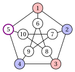
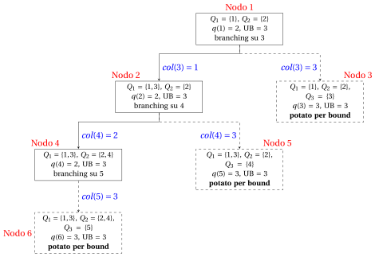

# Colorazione dei vertici: il branch-and-bound DSATUR

**Parte 6 · Algoritmi ad hoc · Capitolo 42** · [:material-file-pdf-box: Dispensa, volume 6 (PDF)](../pdf/dispensa-6-algoritmi-specializzati.pdf) · [:material-pencil: Esercizi: Colorazione dei vertici (VCP)](../esercizi/dsatur-branch-and-bound.md) · [:material-gesture-tap: App: Colorazione: il branch-and-bound DSATUR](../laboratorio/branch-and-bound-dsatur.md)

!!! nota "Prerequisiti"

    - Dal modulo <em>Programmazione lineare intera</em>, [Capitolo 7 «Branch-and-bound»](https://fabiofurini.github.io/programmazione-lineare-intera/exact-methods/bb/): operazioni di branching e di bounding, lista dei problemi, criteri di potatura, bound $\LB$ e $\UB$.

    - Da questo modulo, [Capitolo 4 «Problemi di colorazione»](../problemi-di-ottimizzazione-combinatoria/coloring/index.md): il problema della colorazione dei vertici, clique, insiemi stabili e il bound della clique $\omega(G)\le\chi(G)$.

    - Da questo modulo, [Capitolo 30 «Euristiche costruttive»](../algoritmi-euristici/constructive-heuristics/colorazione-dei-vertici-greedy-e-dsatur.md): il grado di saturazione e l'euristica $DSATUR$.

!!! chiave "Obiettivi"

    Al termine di questo capitolo saremo in grado di:

    - descrivere un nodo dell'albero come colorazione parziale, con i suoi colori usati e i suoi gradi di saturazione;

    - fare branching sul vertice di grado di saturazione massimo, con un figlio per ogni colore ammissibile e uno per un colore nuovo;

    - calcolare l'upper bound con $DSATUR$ e il lower bound con una clique greedy, e potare un nodo;

    - eseguire a mano l'algoritmo di branch-and-bound DSATUR e dimostrare che è esatto.

Il problema di questo capitolo è il [problema della colorazione dei vertici (VCP)](../problemi-di-ottimizzazione-combinatoria/coloring/il-problema-della-colorazione-dei-vertici.md): la sua definizione e le sue ipotesi sono nella sua pagina. Su un grafo $G=(V,E)$, il suo valore ottimo è il numero cromatico $\chi(G)$.

## 42.1 L'algoritmo per il VCP { #sez-sec-DSATURBB }

!!! definizione "Definizione 42.1: Nodo di branching e colorazione parziale"

    Nell'algoritmo di branch-and-bound DSATUR i colori sono gli interi $1,2,3,\dots$, e un nodo di branching $k$ dell'albero è una <strong>colorazione parziale</strong>:

    1. un sottoinsieme di <strong>vertici colorati</strong> $\rightsquigarrow$ indicato con $V^k \subseteq V$;

    2. un colore $\mathit{col}^k(v)$ per ogni $v \in V^k$, con $\mathit{col}^k(u)\neq\mathit{col}^k(v)$ per ogni $\{u,v\}\in E$, $u,v\in V^k$;

    3. un sottoinsieme di <strong>vertici non colorati</strong> $\rightsquigarrow$ indicato con $U^k := V \setminus V^k$.

    I colori usati nel nodo $k$ sono $1,2,\dots,q(k)$, dove $q(k)$ è il <strong>numero di colori usati</strong>, e le classi di colore sono $Q^k_c := \{\, v\in V^k : \mathit{col}^k(v)=c \,\}$, $c=1,\dots,q(k)$. Per un vertice non colorato $v \in U^k$:

    \begin{align*}
    \mathit{sat}_k(v) &:= \big|\{\, \mathit{col}^k(u) : u \in N(v)\cap V^k \,\}\big| && \text{(\textbf{grado di saturazione})},\\[1ex]
    \mathit{du}_k(v) &:= |N(v)\cap U^k| && \text{(grado fra i vertici non colorati)},\\[1ex]
    F_k(v) &:= \{\, c\in\{1,\dots,q(k)\} : Q^k_c\cap N(v)=\emptyset \,\} && \text{(\textbf{colori ammissibili})}.
    \end{align*}

- Il grado di saturazione conta i colori <em>diversi</em> fra i vicini colorati di $v$, e $|F_k(v)| = q(k)-\mathit{sat}_k(v)$.

- Un nodo con $U^k=\emptyset$ è una <strong>colorazione completa</strong>: una soluzione ammissibile del VCP con $q(k)$ colori.

!!! chiave ""

    Un nodo dell'albero è una colorazione parziale; ogni figlio colora un vertice in più. Non si risolve alcun problema LP: i bound di un nodo vengono dal conteggio dei colori.

### 42.1.1 Branching { #sez-sec-DSATURBBbranch }

- <strong>Vertice di branching.</strong> Nel nodo $k$ facciamo branching sul vertice non colorato $v$ di <strong>grado di saturazione massimo</strong> $\mathit{sat}_k(v)$; i pareggi si risolvono con il $\mathit{du}_k(v)$ massimo, e poi con l'indice minimo. È la regola dell'euristica $DSATUR$ (Brélaz, 1979).

- <strong>Figli.</strong> I figli del nodo $k$ danno un colore a $v$:

    1. un figlio per ogni colore ammissibile $c\in F_k(v)$, in ordine crescente di $c$;

    2. un figlio con il <strong>colore nuovo</strong> $q(k)+1$.

- I colori $q(k)+2, q(k)+3,\dots$ non si usano: un figlio con colore $q(k)+2$ differirebbe dal figlio con colore $q(k)+1$ solo per il nome di un colore vuoto. I figli <strong>non sono copie simmetriche</strong> l'uno dell'altro.

- Il vertice più saturo ha meno figli: $|F_k(v)|+1$. Se $F_k(v)=\emptyset$, il nodo ha solo il figlio con il colore nuovo.

!!! chiave ""

    Il vertice di branching è il più vincolato; i suoi figli sono i suoi colori ammissibili più un colore nuovo, quindi due figli non descrivono mai la stessa colorazione con i colori rinominati.

### 42.1.2 Bound e potatura { #sez-sec-DSATURBBbounds }

- Il VCP è un problema di minimo: la soluzione incumbent dà l'<strong>upper bound</strong> $\UB$, e un lower bound viene da una clique.

- <strong>Upper bound.</strong> Prima del branching, l'euristica $DSATUR$ del [Capitolo 30 «Euristiche costruttive»](../algoritmi-euristici/constructive-heuristics/colorazione-dei-vertici-greedy-e-dsatur.md) dà la prima soluzione incumbent, e $\UB$ è il suo numero di colori.

- <strong>Clique greedy.</strong> I vertici si scorrono per grado non crescente (pareggi: indice minimo), e un vertice entra in $K$ se è adiacente a tutti i vertici già in $K$. L'insieme $K=\{k_1,\dots,k_r\}$ è una clique massimale, e $\LB := r \le \omega(G)\le\chi(G)$.

- <strong>Pre-colorazione.</strong> I vertici di $K$ richiedono $r$ colori diversi in ogni colorazione, e i nomi dei colori sono arbitrari: il nodo radice colora $k_i$ con il colore $i$, $i=1,\dots,r$. Questo rompe la simmetria dei primi $r$ colori.

- <strong>Lower bound di un nodo.</strong> I colori di un nodo non vengono mai tolti nel suo sottoalbero, quindi ogni colorazione completa sotto il nodo $k$ usa almeno $q(k)$ colori:

    $$
    \LB(k) \;:=\; \max\{\, q(k),\; |K| \,\} \;=\; q(k),
    $$

    dove l'uguaglianza vale perché la clique è pre-colorata.

- <strong>Potatura.</strong> Il numero di colori è un intero, quindi un nodo può portare a una soluzione migliore solo se usa meno di $\UB$ colori. Il nodo $k$ è <strong>potato per bound</strong> se

    $$
    q(k) \;\ge\; \UB .
    $$

- <strong>Colorazione completa.</strong> Un nodo con $U^k=\emptyset$ e $q(k)<\UB$ è una nuova soluzione incumbent: $\UB \leftarrow q(k)$, e i nodi della lista con $q \ge \UB$ vengono rimossi. Se $\UB=|K|$, la soluzione incumbent è ottima e l'algoritmo si ferma.

!!! chiave ""

    $DSATUR$ dà $\UB$, una clique greedy dà $\LB$; un nodo è potato appena usa $\UB$ colori, perché il suo sottoalbero non può contenere una colorazione con meno colori.

### 42.1.3 Scelta del nodo e pseudocodice { #sez-sec-DSATURBBalg }

- L'albero si esplora <strong>in profondità</strong>: la lista $L$ è una pila, i figli di un nodo si valutano in ordine crescente di colore, e il figlio con il colore minimo si estrae per primo.

- I nodi sono numerati nell'ordine di valutazione. Un figlio si valuta appena viene creato: la valutazione calcola solo $q$ e controlla se la colorazione è completa.

!!! algoritmo "Algoritmo"

    - <strong>Input:</strong> un'istanza del VCP, cioè un grafo $G=(V,E)$.

    - <strong>Output:</strong> una colorazione ottima e il numero cromatico $\chi(G)$.

    - **Passo 0:** <strong>Inizializzazione</strong>

        1. Eseguire $DSATUR$: porre la soluzione incumbent uguale alla sua colorazione e $\UB$ uguale al suo numero di colori.

        2. Trovare la clique greedy $K=\{k_1,\dots,k_r\}$ e porre $\LB \leftarrow r$. Se $\LB=\UB$, la soluzione incumbent è ottima. <code>STOP</code>.

        3. Creare il nodo $1$ con $\mathit{col}^1(k_i)=i$, $i=1,\dots,r$, e $q(1)=r$. Inserire il nodo $1$ nella lista $L$ e porre il contatore dei nodi $c\leftarrow 1$.

    - **Passo 1:** <strong>Test di ottimalità</strong>

        Se $L$ è vuota, $\UB$ è il valore ottimo e la soluzione incumbent è ottima. <code>STOP</code>.

    - **Passo 2:** <strong>Scelta del nodo di branching</strong>

        Togliere da $L$ il nodo $k$ inserito per ultimo.

    - **Passo 3:** <strong>Branching</strong>

        Scegliere $v\in U^k$ con $\mathit{sat}_k(v)$ massimo, poi $\mathit{du}_k(v)$ massimo, poi indice minimo. Per ogni colore $a\in F_k(v)\cup\{q(k)+1\}$, in ordine crescente, creare il nodo $c+1$ come il nodo $k$ con $\mathit{col}(v)=a$, valutarlo con la <strong>sotto-procedura del nodo</strong> e porre $c\leftarrow c+1$. Inserire i figli sopravvissuti in $L$ in ordine decrescente di colore e andare al Passo 1.

- Nel Passo 3, il contatore $c$ dei nodi dà il prossimo indice libero, e $a$ è il colore dato a $v$ nel figlio.

- Questo è lo pseudocodice della <strong>sotto-procedura del nodo</strong>.

!!! algoritmo "Algoritmo"

    - <strong>Input:</strong> un nodo $h$, cioè una colorazione parziale con $q(h)$ colori.

    - **Passo 1:** <strong>Operazioni di bounding</strong>

        1. Se $q(h)\ge\UB$, il nodo è potato per bound. <code>STOP</code>.

        2. Se $U^h=\emptyset$, aggiornare l'upper bound e la soluzione incumbent: $\UB\leftarrow q(h)$. Togliere da $L$ tutti i nodi con $q\ge\UB$. Se $\UB=\LB$, la soluzione incumbent è ottima: <code>STOP</code> dell'algoritmo. Altrimenti <code>STOP</code>.

    - **Passo 2:** <strong>Sopravvivenza</strong>

        Il nodo sopravvive: viene inserito in $L$ nel Passo 3. <code>STOP</code>.

### 42.1.4 Correttezza { #sez-sec-DSATURBBcorr }

!!! teorema "Proposizione 42.2: Branching senza simmetrie"

    Consideriamo l'albero dell'algoritmo di branch-and-bound DSATUR senza potatura. Le sue foglie sono colorazioni complete, e ogni partizione di $V$ in insiemi stabili, cioè ogni soluzione ammissibile del VCP, è l'insieme delle classi di colore di <strong>esattamente una</strong> foglia.

??? dimostrazione "Dimostrazione"

    Sia $\mathcal{Q}$ una partizione di $V$ in insiemi stabili. I vertici della clique $K$ sono adiacenti a due a due, quindi stanno in $r$ classi diverse; diamo il nome $i$ alla classe di $k_i$.

    1. <strong>Esistenza.</strong> Seguiamo un cammino dalla radice mantenendo questo invariante: le classi del nodo sono le classi di $\mathcal{Q}$ ristrette a $V^k$, ciascuna con il suo nome. La radice lo soddisfa. Nel nodo $k$, siano $v$ il vertice di branching e $Q\in\mathcal{Q}$ la sua classe.

        - Se $Q$ ha già un vertice colorato, con nome $c$, allora nessun vicino di $v$ ha colore $c$, perché $Q$ è stabile. Quindi $c\in F_k(v)$, e il figlio con colore $c$ mantiene l'invariante.

        - Altrimenti $Q$ non ha ancora vertici colorati: il figlio con il colore nuovo $q(k)+1$ mantiene l'invariante, e $Q$ prende il nome $q(k)+1$.

        Ogni passo colora un vertice, quindi dopo $|U^1|$ passi raggiungiamo una foglia le cui classi sono $\mathcal{Q}$.

    2. <strong>Unicità.</strong> Due figli diversi di un nodo mettono $v$ in classi diverse: con i vertici colorati di due colori diversi, oppure con uno di essi e da solo. La partizione ristretta a $V^k\cup\{v\}$ è diversa, quindi le foglie sotto due figli diversi danno partizioni diverse. □

- <strong>L'algoritmo è esatto.</strong> Un nodo è potato solo se $q(k)\ge\UB$, e ogni foglia sotto di esso usa almeno $q(k)$ colori: non si perde alcuna colorazione con meno di $\UB$ colori. Quando la lista è vuota, $\UB=\chi(G)$.

- Senza la regola del colore nuovo, ogni partizione con $q$ classi comparirebbe una volta per ogni modo di dare nomi alle sue classi con i colori $1,\dots,\UB-1$: l'albero conterrebbe molte copie simmetriche della stessa soluzione.

!!! chiave ""

    Senza potatura, l'albero enumera ogni soluzione ammissibile del VCP esattamente una volta, a meno di una ridenominazione dei colori. La potatura per bound elimina solo sottoalberi con almeno $\UB$ colori: l'algoritmo è esatto.

## 42.2 Un esempio svolto { #sez-sec-DSATURBBex }

!!! esempio "Esempio 42.1: Branch-and-bound DSATUR sul grafo di Petersen"

    Consideriamo il grafo di Petersen, l'istanza di riferimento del [Capitolo 4 «Problemi di colorazione»](../problemi-di-ottimizzazione-combinatoria/coloring/il-problema-della-colorazione-dei-vertici.md#box-5-ex-vcp2), con $n=10$ vertici, $m=15$ spigoli e tutti i gradi uguali a $3$:

    $$
    \begin{aligned}
    E = \big\{~ & \{1,2\},~ \{1,5\},~ \{1,6\},~ \{2,3\},~ \{2,7\},~ \{3,4\},~ \{3,8\},~ \{4,5\},\\
    & \{4,9\},~ \{5,10\},~ \{6,8\},~ \{6,9\},~ \{7,9\},~ \{7,10\},~ \{8,10\} ~\big\}.
    \end{aligned}
    $$

    L'algoritmo di branch-and-bound DSATUR usa le regole della Sezione [42.1](#sez-sec-DSATURBB): branching sul vertice più saturo, visita in profondità, figli in ordine crescente di colore.

    - <strong>Inizializzazione</strong>

        1. L'euristica $DSATUR$ (Esempio «$DSATUR$ sul grafo di Petersen» del [Capitolo 30](../algoritmi-euristici/constructive-heuristics/colorazione-dei-vertici-greedy-e-dsatur.md#box-17-ex-dsatur)) colora i vertici nell'ordine $1,2,3,4,5,6,8,7,9,10$ e dà la soluzione incumbent

            $$
            \bar{\mathcal{Q}} = \big\{\, \{1,3,7\},~ \{2,4,6,10\},~ \{5,8,9\} \,\big\}, \qquad \UB = 3 .
            $$

        2. Tutti i gradi sono uguali, quindi la clique greedy scorre i vertici $1,2,\dots,10$. Il vertice $1$ entra, il vertice $2$ è adiacente a $1$ ed entra, e nessun altro vertice è adiacente a entrambi. Quindi $K=\{1,2\}$ e $\LB=2$. Il grafo di Petersen non ha triangoli, quindi $\omega(G)=2$.

        3. Il nodo $1$ colora $\mathit{col}^1(1)=1$ e $\mathit{col}^1(2)=2$, con $q(1)=2$. Poiché $\LB=2<3=\UB$, il nodo $1$ viene inserito nella lista $L$:

            $$
            2 ~~\le~~ \chi(G) ~~\le~~ 3 .
            $$

    - <strong>Iterazione 1</strong>

        Il nodo $1$ viene estratto da $L$. I vertici $3,5,6,7$ hanno un vicino colorato ciascuno, quindi $\mathit{sat}_1=1$; gli altri hanno $\mathit{sat}_1=0$. I quattro vertici in pareggio hanno $\mathit{du}_1=2$, quindi vince l'indice minimo: il vertice di branching è $3$. Il suo vicino $2$ ha colore $2$, quindi $F_1(3)=\{1\}$.

        1. Nodo $2$: $\mathit{col}(3)=1$, con $q(2)=2<\UB$. Il nodo sopravvive.

        2. Nodo $3$: $\mathit{col}(3)=3$, il colore nuovo, con $q(3)=3\ge\UB$. Il nodo è <u>potato per bound</u>.

    - <strong>Iterazione 2</strong>

        Il nodo $2$ viene estratto da $L$, con $Q_1=\{1,3\}$ e $Q_2=\{2\}$. I vertici $4,5,6,7,8$ hanno $\mathit{sat}_2=1$ e $\mathit{du}_2=2$, e $9,10$ hanno $\mathit{sat}_2=0$: il vertice di branching è $4$. Il suo vicino $3$ ha colore $1$, quindi $F_2(4)=\{2\}$.

        1. Nodo $4$: $\mathit{col}(4)=2$, con $q(4)=2<\UB$. Il nodo sopravvive.

        2. Nodo $5$: $\mathit{col}(4)=3$, con $q(5)=3\ge\UB$. Il nodo è <u>potato per bound</u>.

    - <strong>Iterazione 3</strong>

        Il nodo $4$ viene estratto da $L$, con $Q_1=\{1,3\}$ e $Q_2=\{2,4\}$. Il vertice $5$ ha i vicini $1$ (colore $1$) e $4$ (colore $2$): $\mathit{sat}_4(5)=2$, è l'unico vertice con grado di saturazione $2$ e quindi è il vertice di branching. I suoi colori ammissibili sono $F_4(5)=\emptyset$.

        1. Nodo $6$: $\mathit{col}(5)=3$, l'unico figlio, con $q(6)=3\ge\UB$. Il nodo è <u>potato per bound</u>.

        La colorazione parziale del nodo $4$ è disegnata qui sotto: il ciclo $1,2,3,4,5$ ha cinque vertici, e due colori non bastano per chiuderlo.

        { .fig loading=lazy  }

    - <strong>Terminazione</strong>

        La lista $L$ è vuota: la soluzione incumbent $\bar{\mathcal{Q}}$ è ottima e $\chi(G)=\UB=3$. L'albero ha $6$ nodi.

    Questo è l'albero di branch-and-bound, che riporta per ogni nodo le sue classi di colore, il numero di colori $q$, l'upper bound $\UB$ al momento della valutazione, e il vertice di branching o il criterio di potatura. I nodi potati sono tratteggiati.

    { .fig loading=lazy  }

    I nodi nell'ordine di valutazione:

    
<table>
    <tr>
    <th>Nodo</th>
    <th>Padre</th>
    <th>Figlio</th>
    <th>\(q\)</th>
    <th>\(\UB\)</th>
    <th>Vertice di branching</th>
    <th>Esito</th>
    </tr>
    <tr>
    <td>\(1\)</td>
    <td>–</td>
    <td>radice, \(K=\{1,2\}\)</td>
    <td>\(2\)</td>
    <td>\(3\)</td>
    <td>\(3\) (\(\mathit{sat}=1\), \(\mathit{du}=2\))</td>
    <td>branching</td>
    </tr>
    <tr>
    <td>\(2\)</td>
    <td>\(1\)</td>
    <td>\(\mathit{col}(3)=1\)</td>
    <td>\(2\)</td>
    <td>\(3\)</td>
    <td>\(4\) (\(\mathit{sat}=1\), \(\mathit{du}=2\))</td>
    <td>branching</td>
    </tr>
    <tr>
    <td>\(3\)</td>
    <td>\(1\)</td>
    <td>\(\mathit{col}(3)=3\)</td>
    <td>\(3\)</td>
    <td>\(3\)</td>
    <td>–</td>
    <td>potato per bound</td>
    </tr>
    <tr>
    <td>\(4\)</td>
    <td>\(2\)</td>
    <td>\(\mathit{col}(4)=2\)</td>
    <td>\(2\)</td>
    <td>\(3\)</td>
    <td>\(5\) (\(\mathit{sat}=2\), \(\mathit{du}=1\))</td>
    <td>branching</td>
    </tr>
    <tr>
    <td>\(5\)</td>
    <td>\(2\)</td>
    <td>\(\mathit{col}(4)=3\)</td>
    <td>\(3\)</td>
    <td>\(3\)</td>
    <td>–</td>
    <td>potato per bound</td>
    </tr>
    <tr>
    <td>\(6\)</td>
    <td>\(4\)</td>
    <td>\(\mathit{col}(5)=3\)</td>
    <td>\(3\)</td>
    <td>\(3\)</td>
    <td>–</td>
    <td>potato per bound</td>
    </tr>
    </table>

- L'algoritmo non migliora la soluzione incumbent: dimostra che $\UB=3$ è ottimo. La dimostrazione è il ciclo dispari $1,2,3,4,5$, trovato dalla ricerca in tre livelli.

- Senza la potatura, l'albero del grafo di Petersen ha $9\,776$ nodi e $7\,430$ foglie, una per ogni partizione ammissibile contata nel [Capitolo 4](../problemi-di-ottimizzazione-combinatoria/coloring/il-problema-della-colorazione-dei-vertici.md), come prevede la [Proposizione 42.2](#box-2-prop-nosym).

## 42.3 Osservazioni { #sez-sec-DSATURBBrem }

- <strong>Origine.</strong> Il grado di saturazione e l'algoritmo esatto che fa branching su di esso sono dovuti a Brélaz (1979). Pre-colorare una clique è il modo usuale di eliminare la simmetria dei primi colori.

- <strong>Regola di pareggio di Sewell (1996).</strong> Fra i vertici di grado di saturazione massimo, Sewell sceglie il vertice $v$ che massimizza il numero di colori ammissibili in comune con i suoi vicini non colorati, $\sum_{u\in N(v)\cap U^k} |F_k(v)\cap F_k(u)|$. Colorare quel vertice toglie più opzioni al resto del grafo.

- <strong>PASS (San Segundo, 2012).</strong> PASS applica la regola di Sewell solo a vertici selezionati, calcolando il conteggio sui vertici in pareggio per il grado di saturazione massimo, che costa meno. Entrambe le regole cambiano solo la gestione dei pareggi: i figli, i bound e la [Proposizione 42.2](#box-2-prop-nosym) restano gli stessi.

- Riferimenti: D. Brélaz, «New methods to color the vertices of a graph», <em>Communications of the ACM</em> 22(4), 251–256, 1979; E. C. Sewell, «An improved algorithm for exact graph coloring», in D. S. Johnson, M. A. Trick (a cura di), <em>Cliques, Coloring, and Satisfiability</em>, DIMACS Series in Discrete Mathematics and Theoretical Computer Science 26, 1996; P. San Segundo, «A new DSATUR-based algorithm for exact vertex coloring», <em>Computers &amp; Operations Research</em> 39(7), 1724–1733, 2012.

## 42.4 Errori tipici

!!! attenzione "Attenzione"

    - <strong>Contare i vicini colorati invece dei colori.</strong> Il grado di saturazione conta i colori <em>diversi</em> attorno a $v$: due vicini con lo stesso colore contano una volta sola.

    - <strong>Un figlio per ogni colore $1,\dots,\UB-1$.</strong> I colori non usati sono tutti equivalenti: solo il primo colore nuovo $q(k)+1$ dà un figlio, altrimenti l'albero contiene copie simmetriche della stessa colorazione.

    - <strong>Dimenticare il colore nuovo.</strong> Il figlio con colore $q(k)+1$ si crea sempre, anche quando $F_k(v)\neq\emptyset$; senza di esso alcune colorazioni non si raggiungono mai.

    - <strong>Potare con $q(k)>\UB$.</strong> Un nodo con $q(k)=\UB$ non può portare a una colorazione migliore, perché il numero di colori è un intero: la regola è $q(k)\ge\UB$.

    - <strong>Pre-colorare un insieme che non è una clique.</strong> Solo i vertici di una clique richiedono colori diversi a due a due in ogni colorazione; pre-colorare con colori diversi due vertici non adiacenti può escludere tutte le colorazioni ottime.

    - <strong>Continuare dopo $\UB=|K|$.</strong> Quando una colorazione completa raggiunge il bound della clique, è ottima: i nodi ancora nella lista non si esplorano.

## 42.5 In sintesi

!!! chiave "In sintesi"

    - Un nodo del branch-and-bound DSATUR è una colorazione parziale; l'algoritmo fa branching sul vertice più saturo, con un figlio per ogni colore ammissibile e uno per un colore nuovo.

    - $DSATUR$ dà il primo upper bound, una clique greedy dà il lower bound ed è pre-colorata; un nodo è potato quando $q(k)\ge\UB$.

    - Senza potatura l'albero enumera ogni colorazione ammissibile una volta, a meno di una ridenominazione dei colori: l'algoritmo è esatto.

    <strong>Quadro riassuntivo del grafo di Petersen</strong> ($n=10$, $m=15$). I bound su $\chi(G)$ trovati finora:

    
<table>
    <tr>
    <th>Fonte</th>
    <th>Lower bound</th>
    <th>Upper bound</th>
    <th>Da</th>
    </tr>
    <tr>
    <td>Bound della clique (Capitolo 4)</td>
    <td>\(2\)</td>
    <td>–</td>
    <td>\(\omega(G)=2\)</td>
    </tr>
    <tr>
    <td>\(DSATUR\) (Capitolo 30)</td>
    <td>–</td>
    <td>\(3\)</td>
    <td>\(\{1,3,7\}\), \(\{2,4,6,10\}\), \(\{5,8,9\}\)</td>
    </tr>
    <tr>
    <td>Questo capitolo, inizializzazione</td>
    <td>\(2\)</td>
    <td>\(3\)</td>
    <td>clique greedy \(K=\{1,2\}\)</td>
    </tr>
    <tr>
    <td>Questo capitolo, terminazione</td>
    <td>\(3\)</td>
    <td>\(3\)</td>
    <td>lista vuota, \(6\) nodi</td>
    </tr>
    </table>

---

**Esercizi su questo capitolo:** [:material-pencil: Colorazione dei vertici (VCP)](../esercizi/dsatur-branch-and-bound.md)

<!-- laboratorio-interattivo: sezione generata da interattivi.py -->

:material-flask-outline: **Nel laboratorio interattivo:** [Colorazione: il branch-and-bound DSATUR](../laboratorio/branch-and-bound-dsatur.md).