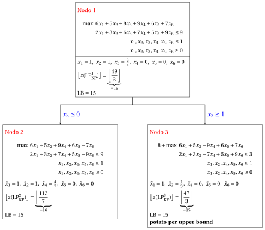
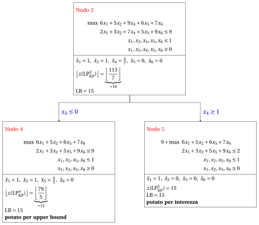
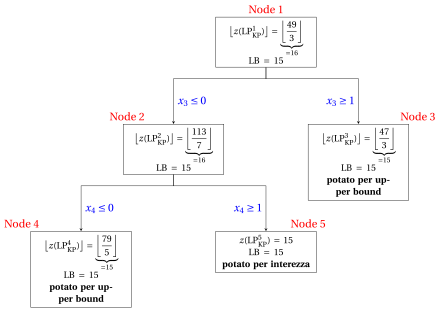

# Zaino: branch-and-bound sull'elemento critico

**Parte 6 · Algoritmi ad hoc · Capitolo 41** · [:material-file-pdf-box: Dispensa, volume 6 (PDF)](../pdf/dispensa-6-algoritmi-specializzati.pdf) · [:material-presentation: Slide](../pdf/slide-knapsack-branch-and-bound.pdf) · [:material-pencil: Esercizi: Zaino 0/1 (KP)](../esercizi/knapsack-branch-and-bound.md) · [:material-gesture-tap: App: Branch-and-bound per lo zaino](../laboratorio/branch-and-bound-zaino.md)

!!! nota "Prerequisiti"

    - Dal modulo <em>Programmazione lineare intera</em>, [Capitolo 7 «Branch-and-bound»](https://fabiofurini.github.io/programmazione-lineare-intera/metodi-esatti/bb/): operazioni di branching e di bounding, lista dei problemi, criteri di potatura, lower bound $\LB$ e upper bound $\UB$. Qui l'algoritmo generale si applica al problema dello zaino 0/1.

    - Da questo modulo, [Capitolo 9 «Formulazioni dei problemi di zaino»](../formulazioni/knapsack-formulations/un-modello-pli-per-il-problema-dello-zaino-0-1.md): i modelli $\mathrm{ILP}_{\mathrm{KP}}$ e $\mathrm{LP}_{\mathrm{KP}}$, l'efficienza di un oggetto, l'oggetto critico $s$, la capacità residua $\mathit{rc}$ e il bound di Dantzig.

!!! chiave "Obiettivi"

    Alla fine di questo capitolo saremo in grado di:

    - scrivere il problema $\mathrm{LP}_{\mathrm{KP}}^k$ di un nodo e risolverlo con le formule di Dantzig, senza l'algoritmo del simplesso;

    - fare branching sulla variabile dell'oggetto critico, escludendo o selezionando quell'oggetto;

    - eseguire a mano l'algoritmo di branch-and-bound per il KP, con la regola FIFO o LIFO;

    - spiegare perché l'algoritmo è più semplice di quello generale, e che cosa resta uguale.

Il problema di questo capitolo è il [problema dello zaino 0/1 (KP)](../problemi-di-ottimizzazione-combinatoria/knapsack/il-problema-dello-zaino-0-1.md): la sua definizione e le sue ipotesi sono nella sua pagina.

## 41.1 L'algoritmo per il KP

!!! definizione "Definizione 41.1: Nodo di branching e problema $\mathrm{LP}_{\mathrm{KP}}^k$"

    Nell'algoritmo di branch-and-bound per il modello $\mathrm{ILP}_{\mathrm{KP}}$, i vincoli di branching su una variabile $x_j$, $j \in \mathscr{I}$, sono $x_j \le 0$ e $x_j \ge 1$. In un nodo di branching $k$ dell'albero di branch-and-bound abbiamo:

    1. un sottoinsieme di <strong>oggetti esclusi</strong> $\rightsquigarrow$  indicato con $\mathscr{I}_\text{out}^k$

    2. un sottoinsieme di <strong>oggetti selezionati</strong> $\rightsquigarrow$  indicato con $\mathscr{I}_\text{in}^k$

    3. un sottoinsieme di <strong>oggetti rimanenti</strong> $\rightsquigarrow$  indicato con  $\mathscr{I}^k := \mathscr{I} \setminus \left\{\mathscr{I}^k_\text{out} \cup \mathscr{I}^k_\text{in} \right\}$

    Il problema $\mathrm{LP}_{\mathrm{KP}}$ associato al nodo $k$, detto problema $\mathrm{LP}_{\mathrm{KP}}^k$, è il seguente:

    \begin{align*}
    &&    \max \;\;{\sum_{j \in \mathscr{I}} p_j \, x_j}                                \\[1.5ex]
    && \text{soggetto a} \quad  {\sum_{j \in \mathscr{I}} w_j \, x_j}  &\leq c,                        \\[1.5ex]
    && x_j                        &\ge  1, & \forall j \in \mathscr{I}^k_\text{in},\\[1.5ex]
    && x_j                        &\le  0, & \forall j \in \mathscr{I}^k_\text{out},\\[1.5ex]
    && x_j                        &\le  1, & \forall j \in \mathscr{I},\\[1.5ex]
    &&x_j                        &\ge  0, & \forall j \in \mathscr{I}.
    \end{align*}

- I vincoli di branching $x_j \le 0$ e $x_j \ge 1$ hanno l'effetto di <strong>escludere</strong> o <strong>selezionare</strong> un oggetto.

!!! chiave ""

    Il problema $\mathrm{LP}_{\mathrm{KP}}^k$ di un nodo di branching $k$ si può riscrivere in modo equivalente come:

    \begin{align*}
    &&   \underbrace{ \sum_{j \in \mathscr{I}^k_\text{in} } p_j}_{=p(k)}  +  \max \;\;{\sum_{j \in  \mathscr{I}^k } p_j \, x_j}                              \label{eq:KP-obj_LP}  \tag{41.1a}\\[2ex]
    && \text{soggetto a} \quad  {\sum_{j \in  \mathscr{I}^k} w_j \, x_j}  &\leq \underbrace{c - \sum_{j \in \mathscr{I}^k_\text{in} } w_j}_{=c(k)},                       \label{eq:KP-cap_LP}  \tag{41.1b}\\[2ex]
    &&  x_j                        &\le  1, & \forall j \in  \mathscr{I}^k, \tag{41.1c}\\[2ex]
    && x_j                        &\ge  0, & \forall j \in  \mathscr{I}^k. \label{eq:KP-bin_LP} \tag{41.1d}
    \end{align*}

- Il problema $\mathrm{LP}^k_{\mathrm{KP}}$ di un nodo di branching $k$ è <strong>strutturalmente equivalente</strong> al problema $\mathrm{LP}_{\mathrm{KP}}$, ma:

    1. l'insieme degli oggetti è $\mathscr{I}^k$ invece di $\mathscr{I}$

    2. la capacità si riduce a $c(k):=c - \sum_{j \in \mathscr{I}^k_\text{in} } w_j$

    3. c'è una costante nella funzione obiettivo  $p(k):=\sum_{j \in \mathscr{I}^k_\text{in} } p_j$

### 41.1.1 Risoluzione del problema $\mathrm{LP}_{\mathrm{KP}}^k$ di un nodo

- Il problema $\mathrm{LP}_{\mathrm{KP}}^k$ è un problema LP di zaino sugli oggetti di $\mathscr{I}^k$, con capacità $c(k)$: si risolve con le formule di Dantzig, senza alcuna iterazione del simplesso. Gli oggetti di $\mathscr{I}^k$ restano ordinati per efficienza non crescente.

- Se $c(k)<0$ il problema è <strong>inammissibile</strong>. Se $\sum_{j\in\mathscr{I}^k} w_j \le c(k)$ tutti gli oggetti di $\mathscr{I}^k$ entrano, e la soluzione ottima è $\tilde{x}_j=1$ per ogni $j\in\mathscr{I}^k$: è intera.

- Altrimenti l'<strong>oggetto critico</strong> $s$ del nodo (in inglese <strong>split item</strong> o <strong>critical item</strong>) è il primo oggetto di $\mathscr{I}^k$ che non entra per intero, e la <strong>capacità residua</strong> è la capacità lasciata dagli oggetti che lo precedono:

    $$
    \sum_{j\in\mathscr{I}^k,\,j<s} w_j \le c(k) < \sum_{j\in\mathscr{I}^k,\,j\le s} w_j,
    \qquad
    \mathit{rc}=c(k)-\sum_{j\in\mathscr{I}^k,\,j<s} w_j .
    $$

- La soluzione ottima è $\tilde{x}_j=1$ per gli oggetti di $\mathscr{I}^k$ prima di $s$, $\tilde{x}_s=\frac{\mathit{rc}}{w_s}$ e $\tilde{x}_j=0$ per gli oggetti dopo $s$, e il valore ottimo è

    $$
    z(\mathrm{LP}_{\mathrm{KP}}^k) \;=\; p(k)+\sum_{j\in\mathscr{I}^k,\,j<s} p_j + p_s\,\frac{\mathit{rc}}{w_s}.
    $$

!!! chiave ""

    In ogni nodo al più una variabile è frazionaria, quella dell'oggetto critico, e il valore del nodo è il bound di Dantzig di uno zaino più piccolo: il nodo si risolve con una scansione degli oggetti.

### 41.1.2 Strategia di scelta della variabile di branching

- La soluzione ottima di un problema $\mathrm{LP}_{\mathrm{KP}}^k$ data dalle formule della sottosezione precedente ha al più una variabile frazionaria, quella associata all'oggetto critico. <strong>Il branching si può fare sulla variabile associata all'oggetto critico</strong>: questa strategia di scelta della variabile di branching si chiama strategia dell'oggetto critico.

- La soluzione ottima di un problema $\mathrm{LP}_{\mathrm{KP}}$ non è unica quando alcuni oggetti hanno la stessa efficienza: le altre soluzioni ottime possono avere più variabili frazionarie, per esempio $x=(\frac12,\frac12)$ per $p=(2,2)$, $w=(2,2)$, $c=2$. Qui, come nell'algoritmo generale, usiamo sempre la soluzione data dalle formule.

### 41.1.3 Che cosa cambia rispetto all'algoritmo generale

- L'algoritmo è il branch-and-bound basato sulla PL del modulo <em>Programmazione lineare intera</em> ([Capitolo 7 «Branch-and-bound»](https://fabiofurini.github.io/programmazione-lineare-intera/metodi-esatti/bb/)), con la sua lista dei problemi, i suoi criteri di potatura e il suo gap di ottimalità.

- <strong>Bounding.</strong> Il problema di un nodo si risolve con le formule precedenti. Tutti i profitti sono interi, quindi il bound di un nodo è $\lfloor z(\mathrm{LP}_{\mathrm{KP}}^k)\rfloor$: il nodo è potato per bound se $\lfloor z(\mathrm{LP}_{\mathrm{KP}}^k)\rfloor \le \LB$, per inammissibilità se $c(k)<0$, per interezza se la sua soluzione è intera (e allora $\LB$ si aggiorna quando il valore è maggiore). Un nodo intero è potato per interezza anche quando il suo valore non supera $\LB$.

- <strong>Branching.</strong> La variabile di branching è quella dell'oggetto critico $s$: i figli sono $x_s\le 0$ (down, oggetto escluso) e $x_s\ge 1$ (up, oggetto selezionato), e il nodo non si risolve con un tableau del simplesso ma si descrive con gli insiemi $\mathscr{I}^k_\text{in}$, $\mathscr{I}^k_\text{out}$ e $\mathscr{I}^k$.

- <strong>Scelta del nodo.</strong> Il nodo della lista dei problemi si estrae con la regola FIFO o LIFO, e il nodo di down-branching si risolve prima del nodo di up-branching; i nodi sono numerati nell'ordine di risoluzione. Il lower bound scritto in un nodo è il valore al momento della sua risoluzione.

## 41.2 Un esempio svolto

!!! esempio "Esempio 41.1: Il modello $\mathrm{ILP}_{\mathrm{KP}}$"

    Consideriamo uno zaino di capacità $c = 9$ e un insieme $\mathscr{I} = \{1,2,3,4,5,6\}$ di $6$ oggetti ($n = 6$), con i seguenti profitti e pesi:

    $$
    \begin{array}{l|rrrrrrr}
    \hline  & {j = 1} & {j = 2} & {j = 3} & {j = 4} & {j = 5} & {j = 6} \\
    \hline {p_j} & {6} & {5} & {8} & {9} & {6} & {7} \\
    {w_j} & {2} & {3} & {6} & {7} & {5} & {9} \\
    \hline
    \end{array}
    $$

    Chiamiamo questa istanza del KP [Esempio 41.1](#box-2-texexpbox1). Il modello $\mathrm{ILP}_{\mathrm{KP}}$ per questa istanza del KP è:

    $$
    \begin{array}{rrrrrrrrrrrrr}
    {\max} & 6 \, {x_1} & + 5 \, {x_2} & + 8 \, {x_3} & + 9 \, {x_4} & + 6 \, {x_5} & + 7 \, {x_6} \\[0.5ex]
    \text{soggetto a} & 2 \, {x_1} & + 3 \, {x_2} & + 6 \, {x_3} & + 7 \, {x_4} & + 5 \, {x_5} & + 9 \, {x_6} & {\le} & 9 \\[0.5ex]
    & {x_1}, & {x_2}, & {x_3}, & {x_4}, & {x_5}, & {x_6} & { \in} & { \{0,1\}}
    \end{array}
    $$

    Una soluzione ottima $~{\tilde{\vet x}}(\,\mathrm{ILP}_{\mathrm{KP}}\,)$  è:

    $$
    \tilde x_1=1,~~\tilde x_2=0,~~\tilde  x_3=0,~~\tilde  x_4=1,~~\tilde  x_5=0,~~\tilde  x_6=0
    $$

    Il valore ottimo $z(\mathrm{ILP}_{\mathrm{KP}})$  è $15$. La soluzione ottima associata del KP è $\tilde{S} =\{1,4\}$. 

    Gli oggetti sono ordinati per efficienza non crescente, poiché:

    $$
    \frac{6}{2} ~~\ge~~ \frac{5}{3} ~~\ge~~ \frac{8}{6} ~~\ge~~ \frac{9}{7} ~~\ge~~ \frac{6}{5} ~~\ge~~ \frac{7}{9}
    $$

!!! esempio "Esempio 41.2: Algoritmo di branch-and-bound per il modello $\mathrm{ILP}_{\mathrm{KP}}$"

    Un algoritmo di branch-and-bound per il modello $\mathrm{ILP}_{\mathrm{KP}}$ e l'istanza del KP dell'[Esempio 41.1](#box-2-texexpbox1) che usa:

    1. la strategia dell'oggetto critico come strategia di scelta della variabile di branching;

    2. la regola FIFO come strategia di scelta del nodo di branching;

    3. risolvere prima il nodo di down-branching e poi il nodo di up-branching;

    4. porre la soluzione incumbent $\bar{\vet x}(\mathrm{ILP}_{\mathrm{KP}})$ uguale alla seguente soluzione euristica:

        $$
        \bar{x}_1=1, ~~~ \bar{x}_2=0,~~~ \bar{x}_3= 0,~~\bar{x}_4=1,~~\bar{x}_5=0,~~\bar{x}_6=0
        $$

        e porre di conseguenza il lower bound $\LB$.

    - <strong>Inizializzazione</strong>

        Per il problema $\mathrm{LP}^1_{\mathrm{KP}}$, l'oggetto critico è $s=3$ e la capacità residua è $\mathit{rc} = 4$. Una soluzione ottima $\tilde{\vet x}(\,\mathrm{LP}^1_{\mathrm{KP}}\,)$ è:

        $$
        \tilde{x}_1=1,~~\tilde{x}_2=1,~~\tilde{x}_3=\frac{2}{3},~~\tilde{x}_4=0,~~\tilde{x}_5=0,~~\tilde{x}_6=0
        $$

        il valore ottimo è:

        $$
        z(~\mathrm{LP}^1_{\mathrm{KP}}~) = 6 \cdot 1 + 5 \cdot 1 +  8 \cdot \frac{2}{3} =\frac{49}{3}
        $$

        La soluzione ottima $\tilde{\vet x}(\,\mathrm{LP}^1_{\mathrm{KP}}\,)$ è <strong>frazionaria</strong> e il problema $\mathrm{LP}^1_{\mathrm{KP}}$ è <strong>ammissibile</strong>, quindi il problema $\mathrm{LP}^1_{\mathrm{KP}}$ viene inserito nella lista dei problemi $L$ e il lower bound $\LB$ viene posto a $15$ ($\LB(\bar{\vet x})= 15$).

        Dati il lower bound $\LB$ e l'upper bound $\UB$ correnti, abbiamo:

        $$
        15 ~~\le~~ z(\mathrm{ILP}_{\mathrm{KP}}) ~~\le~~  \underbrace{\left\lfloor \dfrac{49}{3} \right\rfloor}_{=16}
        $$

    - <strong>Iterazione  1</strong>

        Il problema $\mathrm{LP}^1_{\mathrm{KP}}$ viene estratto e cancellato dalla lista dei problemi $L$.

        La variabile di branching è $x_3$. I problemi $\mathrm{LP}^2_{\mathrm{KP}}$ e $\mathrm{LP}^3_{\mathrm{KP}}$ vengono creati escludendo ($x_3 \le 0$) e selezionando ($x_3 \ge 1$) l'oggetto $3$.

        1. Soluzione del problema $\mathrm{LP}^2_{\mathrm{KP}}$

            Abbiamo

            $$
            \mathscr{I}^2 = \{1,2,4,5,6\},~~~\mathscr{I}^2_\text{out} = \{3\}, ~~~\mathscr{I}^2_\text{in} = \emptyset
            $$

            La capacità è $c(2)=9$ e la costante nella funzione obiettivo è $p(2)=0$. L'oggetto critico è $s=4$ e la capacità residua è $\mathit{rc} = 4$. Una soluzione ottima $\tilde{\vet x}(\,\mathrm{LP}^2_{\mathrm{KP}}\,)$ è:

            $$
            \tilde{x}_1=1,~~\tilde{x}_2=1,~~\tilde{x}_4=\frac{4}{7},~~\tilde{x}_5=0,~~\tilde{x}_6=0
            $$

            e

            $$
            z(~\mathrm{LP}^2_{\mathrm{KP}}~) =   6 \cdot 1 + 5 \cdot 1 + 9 \cdot \frac{4}{7} = \frac{113}{7}
            $$

            Il problema $\mathrm{LP}^2_{\mathrm{KP}}$ è <strong>ammissibile</strong> e abbiamo:

            $$
            \left\lfloor z(\mathrm{LP}^2_{\mathrm{KP}}) \right\rfloor > \LB
            \qquad \text{poiché} \qquad
            \underbrace{\left\lfloor\frac{113}{7} \right\rfloor}_{ = 16} >15
            $$

            La soluzione ottima $\tilde{\vet x}(\,\mathrm{LP}^2_{\mathrm{KP}}\,)$ è <strong>frazionaria</strong>, quindi il problema $\mathrm{LP}^2_{\mathrm{KP}}$ viene <strong>inserito nella lista dei problemi</strong> $L$.

        2. Soluzione del problema $\mathrm{LP}^3_{\mathrm{KP}}$

            Abbiamo

            $$
            \mathscr{I}^3 = \{1,2,4,5,6\},~~~\mathscr{I}^3_\text{out} = \emptyset, ~~~\mathscr{I}^3_\text{in} = \{3\}
            $$

            La capacità è $c(3)=3$ e la costante nella funzione obiettivo è $p(3)=8$. L'oggetto critico è $s=2$ e la capacità residua è $\mathit{rc} = 1$. Una soluzione ottima $\tilde{\vet x}(\,\mathrm{LP}^3_{\mathrm{KP}}\,)$ è:

            $$
            \tilde{x}_1=1,~~\tilde{x}_2=\frac{1}{3},~~\tilde{x}_4=0,~~\tilde{x}_5=0,~~\tilde{x}_6=0 {\rm ~~~e~~~}  z(~\mathrm{LP}^3_{\mathrm{KP}}~) =  8 + 6 \cdot 1 + 5 \cdot \frac{1}{3} = \frac{47}{3}
            $$

            Il problema $\mathrm{LP}^3_{\mathrm{KP}}$ è <strong>ammissibile</strong> e abbiamo:

            $$
            \left\lfloor z(\mathrm{LP}^3_{\mathrm{KP}}) \right\rfloor \le \LB
            \qquad \text{poiché} \qquad
            \underbrace{\left\lfloor\frac{47}{3} \right\rfloor}_{ = 15} \le 15
            $$

            quindi il nodo di branching è <u>potato per upper bound</u>.

        Alla fine della prima iterazione, il Nodo 2 è inserito nella lista dei problemi $L$, mentre il Nodo 3 è potato per upper bound. L'albero di branch-and-bound corrispondente è:

        { .fig loading=lazy  }

        Dati il lower bound $\LB$ e l'upper bound $\UB$ correnti, abbiamo:

        $$
        15 ~~\le~~ z(\mathrm{ILP}_{\mathrm{KP}}) ~~\le~~  \underbrace{\left\lfloor \dfrac{113}{7} \right\rfloor}_{=16}
        $$

    - <strong>Iterazione  2</strong>

        Il problema $\mathrm{LP}^2_{\mathrm{KP}}$ viene estratto e cancellato dalla lista dei problemi $L$.

        La variabile di branching è $x_4$. I problemi $\mathrm{LP}^4_{\mathrm{KP}}$ e $\mathrm{LP}^5_{\mathrm{KP}}$ vengono creati escludendo ($x_4 \le 0$) e selezionando ($x_4 \ge 1$) l'oggetto $4$.

        1. Soluzione del problema $\mathrm{LP}^4_{\mathrm{KP}}$

            Abbiamo

            $$
            \mathscr{I}^4 =  \{1,2,5,6\},~~~\mathscr{I}^4_\text{out} = \{3,4\}, ~~~\mathscr{I}^4_\text{in} = \emptyset
            $$

            La capacità è $c(4)=9$ e la costante nella funzione obiettivo è $p(4)=0$. L'oggetto critico è $s=5$ e la capacità residua è $\mathit{rc} = 4$. Una soluzione ottima $\tilde{\vet x}(\,\mathrm{LP}^4_{\mathrm{KP}}\,)$ è:

            $$
            \tilde{x}_1=1,~~\tilde{x}_2=1,~~\tilde{x}_5=\frac{4}{5},~~\tilde{x}_6=0 {\rm ~~~e~~~}  z(~\mathrm{LP}^4_{\mathrm{KP}}~) = 6 \cdot 1 + 5 \cdot 1 + 6 \cdot \frac{4}{5} = \frac{79}{5}
            $$

            Il problema $\mathrm{LP}^4_{\mathrm{KP}}$ è <strong>ammissibile</strong> e abbiamo:

            $$
            \left\lfloor z(\mathrm{LP}^4_{\mathrm{KP}}) \right\rfloor \le  \LB
            \qquad \text{poiché} \qquad
            \underbrace{\left\lfloor\frac{79}{5} \right\rfloor}_{ = 15} \le 15
            $$

            quindi il nodo di branching è <u>potato per upper bound</u>.

        2. Soluzione del problema $\mathrm{LP}^5_{\mathrm{KP}}$

            Abbiamo

            $$
            \mathscr{I}^5 = \{1,2,5,6\},~~~\mathscr{I}^5_\text{out} = \{3\}, ~~~\mathscr{I}^5_\text{in}= \{4\}
            $$

            La capacità è $c(5)=2$ e la costante nella funzione obiettivo è $p(5)=9$. L'oggetto critico è $s=2$ e la capacità residua è $\mathit{rc} = 0$. Una soluzione ottima $\tilde{\vet x}(\,\mathrm{LP}^5_{\mathrm{KP}}\,)$ è:

            $$
            \tilde{x}_1=1,~~\tilde{x}_2=0,~~\tilde{x}_5=0,~~\tilde{x}_6=0 {\rm ~~~e~~~}  z(~\mathrm{LP}^5_{\mathrm{KP}}~) = 9 + 6 \cdot 1  =  15
            $$

            Il problema $\mathrm{LP}^5_{\mathrm{KP}}$ è <strong>ammissibile</strong> e la sua soluzione ottima $\tilde{\vet x}(\,\mathrm{LP}^5_{\mathrm{KP}}\,)$ è <strong>intera</strong>. Il suo valore non migliora la soluzione incumbent, perché $z(\mathrm{LP}^5_{\mathrm{KP}})=15 \le 15=\LB$, quindi il lower bound $\LB$ resta $15$. Di conseguenza, il nodo di branching è <u>potato per interezza</u>: quando un nodo si potrebbe potare sia per interezza sia per bound, lo si pota per interezza.

        Alla fine della seconda iterazione, il Nodo 4 è potato per upper bound e il Nodo 5 è potato per interezza. L'albero di branch-and-bound corrispondente è:

        { .fig loading=lazy  }

    - <strong>Terminazione</strong>

        Poiché la lista dei problemi $L$ è vuota, il problema $\mathrm{ILP}_{\mathrm{KP}}$ è risolto all'ottimo.

        Il valore ottimo è $z(\mathrm{ILP}_{\mathrm{KP}})=15$ (il valore del lower bound $\LB$) e una soluzione ottima $\tilde{\vet x}(\,\mathrm{ILP}_{\mathrm{KP}}\,)$  è $\tilde  x_1=1,\tilde  x_2=0,\tilde  x_3=0,\tilde  x_4=1,\tilde  x_5=0,\tilde  x_6=0$ (la soluzione incumbent $\bar{\vet x}(\mathrm{ILP}_{\mathrm{KP}})$).

    Questo è l'albero di branch-and-bound della precedente esecuzione dell'algoritmo di branch-and-bound, che riporta per ogni nodo di branching il valore ottimo del problema $\mathrm{LP}_{\mathrm{KP}}$ associato, il lower bound $\LB$ e i criteri di potatura.

    { .fig loading=lazy  }

## 41.3 Errori tipici

!!! attenzione "Attenzione"

    - <strong>Dimenticare i vincoli $x_j\le 1$.</strong> Senza di essi il problema LP di un nodo metterebbe tutta la capacità sull'oggetto di efficienza migliore: i box dei nodi devono contenere $x_j\le 1$.

    - <strong>Calcolare l'oggetto critico sull'istanza originale.</strong> In un nodo, l'oggetto critico e la capacità residua si calcolano sugli oggetti di $\mathscr{I}^k$ con la capacità $c(k)$, dopo aver fissato gli oggetti di $\mathscr{I}^k_\text{in}$ e $\mathscr{I}^k_\text{out}$.

    - <strong>Dimenticare la costante $p(k)$.</strong> Il valore del nodo è $p(k)$ più il valore degli oggetti di $\mathscr{I}^k$: il profitto degli oggetti selezionati conta.

    - <strong>Usare il lower bound vecchio.</strong> Il lower bound si aggiorna appena un nodo ha una soluzione intera di valore maggiore; i nodi della lista che diventano dominati si scartano.

    - <strong>Numerare i figli saltati.</strong> Un figlio che non viene risolto non riceve un indice di nodo, esattamente come nell'algoritmo generale.

## 41.4 In sintesi

!!! chiave "In sintesi"

    - L'algoritmo di branch-and-bound per il KP è l'algoritmo basato sulla PL con due semplificazioni: il problema di ogni nodo si risolve con le formule di Dantzig, e la variabile di branching è quella dell'oggetto critico.

    - Un nodo è descritto dagli insiemi $\mathscr{I}^k_\text{in}$, $\mathscr{I}^k_\text{out}$ e $\mathscr{I}^k$, dalla capacità $c(k)$ e dalla costante $p(k)$.

    - Il bound di un nodo è $\lfloor z(\mathrm{LP}_{\mathrm{KP}}^k)\rfloor$; quando la lista dei problemi è vuota il lower bound e l'upper bound coincidono e la soluzione incumbent è ottima.

    <strong>Quadro riassuntivo dell'istanza del KP dell'[Esempio 41.1](#box-2-texexpbox1)</strong> ($c=9$, $p=(6,5,8,9,6,7)$, $w=(2,3,6,7,5,9)$). I bound su $z(\mathrm{ILP}_{\mathrm{KP}})$ trovati finora:

    
<table>
    <tr>
    <th>Fonte</th>
    <th>Lower bound</th>
    <th>Upper bound</th>
    <th>Da</th>
    </tr>
    <tr>
    <td>Bound di Dantzig</td>
    <td>–</td>
    <td>\(16\)</td>
    <td>\(\left\lfloor \frac{49}{3} \right\rfloor\)</td>
    </tr>
    <tr>
    <td>Questo capitolo, inizializzazione</td>
    <td>\(15\)</td>
    <td>\(16\)</td>
    <td>soluzione euristica \(\{1,4\}\)</td>
    </tr>
    <tr>
    <td>Questo capitolo, iterazione \(1\)</td>
    <td>\(15\)</td>
    <td>\(16\)</td>
    <td>nodo \(2\) nella lista, \(\left\lfloor \frac{113}{7} \right\rfloor\)</td>
    </tr>
    <tr>
    <td>Questo capitolo, terminazione</td>
    <td>\(15\)</td>
    <td>\(15\)</td>
    <td>lista vuota, \(5\) nodi</td>
    </tr>
    </table>

---

**Esercizi su questo capitolo:** [:material-pencil: Zaino 0/1 (KP)](../esercizi/knapsack-branch-and-bound.md)

<!-- laboratorio-interattivo: sezione generata da interattivi.py -->

:material-flask-outline: **Nel laboratorio interattivo:** [Branch-and-bound per lo zaino](../laboratorio/branch-and-bound-zaino.md).