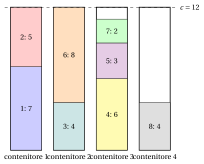
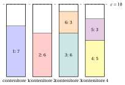
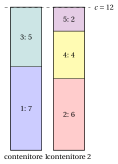
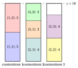
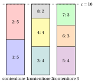
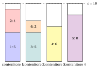
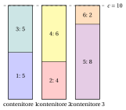

# Esercizi · Problemi di packing

**Esercizi · Capitolo 3** · ogni soluzione si apre con un clic · [:material-book-open-variant: Capitolo 3: Problemi di packing](../problemi-di-ottimizzazione-combinatoria/bin-packing/index.md) · [:material-file-pdf-box: Eserciziario, volume 1 (PDF)](../pdf/esercizi-1-problemi-di-ottimizzazione-combinatoria.pdf)

!!! esercizio "Esercizio 3.1: Verificare un riempimento (BPP)"

    Consideriamo l'istanza di bin packing con capacità $c=12$ e $n=8$ oggetti di pesi

    $$
    \begin{array}{l|cccccccc}
    \hline  & {j=1} & {j=2} & {j=3} & {j=4} & {j=5} & {j=6} & {j=7} & {j=8} \\[1ex]
    \hline {w_j} & {7} & {5} & {4} & {6} & {3} & {8} & {2} & {4} \\
    \hline
    \end{array}
    $$

    e le tre soluzioni proposte

    \begin{align*}
    \mathcal{P}_a&=\{\{1,2\},\{3,6\},\{4,5,7\},\{8\}\},\\
    \mathcal{P}_b&=\{\{1,4\},\{2,3,5\},\{6,8\},\{7\}\},\\
    \mathcal{P}_c&=\{\{1,2\},\{3,6\},\{4,5\},\{8\}\}.
    \end{align*}

    **Domande**

    1. Verificare le ipotesi del BPP.

    2. Per ogni soluzione proposta, calcolare il peso di ogni contenitore e stabilire se è ammissibile.

    3. Calcolare il bound sul peso. Stabilire se una delle soluzioni proposte è ottima.

    4. Disegnare la soluzione ammissibile.

??? soluzione "Soluzione"

    1. Il peso totale è $39>12$ e l'oggetto più pesante pesa $8\le 12$: entrambe le ipotesi valgono.

    2. - $\mathcal{P}_a$: i contenitori pesano $7+5=12$, $4+8=12$, $6+3+2=11$, $4=4$. È una partizione e ogni contenitore pesa al più $12$: ammissibile, con $4$ contenitori.

        - $\mathcal{P}_b$: i contenitori pesano $7+6=13$, $5+4+3=12$, $8+4=12$, $2=2$. È una partizione, ma il contenitore $\{1,4\}$ pesa $13>12$. Non ammissibile.

        - $\mathcal{P}_c$: i contenitori pesano $7+5=12$, $4+8=12$, $6+3=9$, $4=4$. Non è una partizione di $\mathscr{I}$: l'oggetto $7$ non è in alcun contenitore. Non ammissibile.

    3. $\mathrm{LB}=\lceil 39/12\rceil=4$. La soluzione ammissibile $\mathcal{P}_a$ usa $4$ contenitori, quindi raggiunge il bound: è ottima e $z(I)=4$.

    4. I quattro contenitori di $\mathcal{P}_a$, con la linea tratteggiata alla capacità:

        { .fig loading=lazy  }

    !!! chiave ""

        Solo $\mathcal{P}_a$ è ammissibile; usa $4=\lceil 39/12\rceil$ contenitori ed è quindi ottima.

!!! esercizio "Esercizio 3.2: Quando il bound sul peso non è stretto (BPP)"

    Consideriamo l'istanza di bin packing con capacità $c=10$ e $n=6$ oggetti di pesi

    $$
    \begin{array}{l|cccccc}
    \hline  & {j=1} & {j=2} & {j=3} & {j=4} & {j=5} & {j=6} \\[1ex]
    \hline {w_j} & {7} & {6} & {6} & {5} & {3} & {3} \\
    \hline
    \end{array}
    $$

    **Domande**

    1. Calcolare il bound sul peso.

    2. Mostrare che due qualunque degli oggetti $1,2,3,4$ non entrano insieme in un contenitore. Ricavarne un lower bound su $z(I)$.

    3. Trovare una soluzione ottima e stabilire se è unica.

    4. Calcolare il gap fra il bound sul peso e $z(I)$.

??? soluzione "Soluzione"

    1. $\sum_j w_j=7+6+6+5+3+3=30$, quindi $\lceil 30/10\rceil=3$.

    2. Le coppie danno $w_1+w_2=13$, $w_1+w_3=13$, $w_1+w_4=12$, $w_2+w_3=12$, $w_2+w_4=11$, $w_3+w_4=11$, tutte maggiori di $10$. Quindi gli oggetti $1,2,3,4$ stanno in quattro contenitori diversi in ogni soluzione ammissibile, e $z(I)\ge 4$.

    3. La soluzione $\{\{1\},\{2\},\{3,6\},\{4,5\}\}$ ha contenitori di peso $7, 6, 9, 8$, tutti al più $10$: usa $4$ contenitori e raggiunge il bound della Domanda 2, quindi è ottima, $z(I)=4$.

        { .fig loading=lazy  }

        Non è unica: l'enumerazione dà $12$ partizioni ottime, poiché gli oggetti $5$ e $6$ possono andare con uno qualunque dei quattro oggetti grandi che ha spazio per essi.

    4. Il bound sul peso dà $3$ e $z(I)=4$: un gap assoluto di $1$. Il bound sul peso non vede che gli oggetti grandi non possono condividere un contenitore.

    !!! chiave ""

        $z(I)=4$, mentre il bound sul peso dà solo $3$: i quattro oggetti di peso maggiore di $c/2$ sono a due a due in conflitto e richiedono quattro contenitori.

!!! esercizio "Esercizio 3.3: Contare i riempimenti (BPP)"

    Consideriamo l'istanza di bin packing con capacità $c=12$ e $n=5$ oggetti di pesi

    $$
    \begin{array}{l|ccccc}
    \hline  & {j=1} & {j=2} & {j=3} & {j=4} & {j=5} \\[1ex]
    \hline {w_j} & {7} & {6} & {5} & {4} & {2} \\
    \hline
    \end{array}
    $$

    **Domande**

    1. Calcolare quante soluzioni candidate ha l'istanza.

    2. Determinare quali coppie di oggetti entrano insieme in un contenitore, e quali terne.

    3. Contare le soluzioni ammissibili, raggruppate per numero di contenitori.

    4. Calcolare il bound sul peso ed elencare tutte le soluzioni ottime.

??? soluzione "Soluzione"

    1. Le candidate sono le partizioni dei $5$ oggetti: $B(5)=52$.

    2. Le coppie che entrano sono $\{1,3\}$ ($12$), $\{1,4\}$ ($11$), $\{1,5\}$ ($9$), $\{2,3\}$ ($11$), $\{2,4\}$ ($10$), $\{2,5\}$ ($8$), $\{3,4\}$ ($9$), $\{3,5\}$ ($7$), $\{4,5\}$ ($6$); le terne che entrano sono $\{2,4,5\}$ ($12$), $\{3,4,5\}$ ($11$). Quattro oggetti non entrano mai insieme, poiché i quattro più leggeri pesano $17>12$.

    3. Una partizione ammissibile usa solo singoletti e le coppie e terne precedenti. L'enumerazione dà:

        
<table>
        <tr>
        <th>contenitori</th>
        <th>partizioni ammissibili</th>
        </tr>
        <tr>
        <td>\(2\)</td>
        <td>\(1\)</td>
        </tr>
        <tr>
        <td>\(3\)</td>
        <td>\(14\)</td>
        </tr>
        <tr>
        <td>\(4\)</td>
        <td>\(9\)</td>
        </tr>
        <tr>
        <td>\(5\)</td>
        <td>\(1\)</td>
        </tr>
        <tr>
        <td>totale</td>
        <td>\(25\)</td>
        </tr>
        </table>

    4. $\mathrm{LB}=\lceil 24/12\rceil=2$, e ci sono partizioni con $2$ contenitori: $z(I)=2$. La soluzione ottima è unica, $\{\{1,3\},\{2,4,5\}\}$: entrambi i contenitori sono riempiti esattamente.

        { .fig loading=lazy  }

    !!! chiave ""

        Delle $52$ partizioni, $25$ sono ammissibili e una sola è ottima, con $z(I)=2=\lceil 24/12\rceil$.

!!! esercizio "Esercizio 3.4: Copie degli oggetti (CSP)"

    Consideriamo l'istanza di cutting stock con capacità $c=10$ e $n=3$ oggetti, con i seguenti pesi e copie richieste:

    $$
    \begin{array}{l|ccc}
    \hline  & {j=1} & {j=2} & {j=3} \\[1ex]
    \hline {w_j} & {5} & {4} & {3} \\[1ex]
    {d_j} & {2} & {3} & {2} \\
    \hline
    \end{array}
    $$

    **Domande**

    1. Scrivere l'insieme esteso degli oggetti $\hat{\mathscr{I}}$ e verificare le ipotesi.

    2. Stabilire se la famiglia $\{\{(1,1),(2,1)\},\{(1,2),(2,2)\},\{(3,1),(3,2)\}\}$ è una soluzione ammissibile e quanti contenitori usa.

    3. Calcolare il bound sul peso, con i pesi di tutte le copie.

    4. Trovare una soluzione ottima.

??? soluzione "Soluzione"

    1. L'insieme esteso ha $\sum_j d_j=7$ copie:

        $$
        \hat{\mathscr{I}}=\{(1,1),(1,2),(2,1),(2,2),(2,3),(3,1),(3,2)\}.
        $$

        Il peso totale è $\sum_j d_jw_j=2\cdot 5+3\cdot 4+2\cdot 3=28>10$ e ogni oggetto entra in un contenitore, $w_j\le 10$: entrambe le ipotesi valgono.

    2. I contenitori pesano $9$, $9$, $6$, tutti al più $10$, ma la copia $(2,3)$ non è in alcun contenitore: la famiglia non è una partizione di $\hat{\mathscr{I}}$ e non è ammissibile.

    3. $\mathrm{LB}=\left\lceil \sum_j d_jw_j/c\right\rceil=\lceil 28/10\rceil=3$.

    4. Le due copie dell'oggetto $1$ riempiono un contenitore ($10$); una copia dell'oggetto $2$ e le due copie dell'oggetto $3$ ne riempiono un altro ($4+3+3=10$); le ultime due copie dell'oggetto $2$ pesano $8$. La soluzione

        $$
        \mathcal{P}=\{\{(1,1),(1,2)\},\{(2,1),(3,1),(3,2)\},\{(2,2),(2,3)\}\}
        $$

        usa $3$ contenitori e raggiunge il bound: è ottima, $z(I)=3$.

        { .fig loading=lazy  }

    !!! chiave ""

        Con i pesi delle $7$ copie il bound sul peso è $3$, e il riempimento trovato accoppiando le copie lo raggiunge: $z(I)=3$.

!!! esercizio "Esercizio 3.5: Riempire esattamente ogni contenitore (BPP)"

    Consideriamo l'istanza di bin packing con capacità $c=10$ e $n=8$ oggetti di pesi

    $$
    \begin{array}{l|cccccccc}
    \hline  & {j=1} & {j=2} & {j=3} & {j=4} & {j=5} & {j=6} & {j=7} & {j=8} \\[1ex]
    \hline {w_j} & {5} & {5} & {4} & {4} & {4} & {3} & {3} & {2} \\
    \hline
    \end{array}
    $$

    **Domande**

    1. Calcolare il bound sul peso.

    2. Mostrare che una soluzione con $3$ contenitori deve riempire esattamente ogni contenitore.

    3. Elencare i modi di ottenere un peso totale esattamente uguale a $10$ con i pesi dell'istanza, e usarli per trovare una soluzione con $3$ contenitori.

    4. Determinare quanti contenitori servirebbero se l'oggetto $8$ pesasse $3$ invece di $2$.

??? soluzione "Soluzione"

    1. $\sum_j w_j=30$, quindi $\mathrm{LB}=\lceil 30/10\rceil=3$.

    2. $3$ contenitori contengono al più $3\cdot 10=30$, e gli oggetti pesano esattamente $30$: se un contenitore pesasse meno di $10$, gli altri non potrebbero contenere il resto.

    3. Come multinsiemi di pesi, un totale esattamente uguale a $10$ si ottiene con

        $$
        \{5,5\},\quad \{5,3,2\},\quad \{4,4,2\},\quad \{4,3,3\}.
        $$

        Ogni oggetto di peso $5$ deve stare in un contenitore pieno, e i soli multinsiemi con un $5$ sono $\{5,5\}$, $\{5,3,2\}$. C'è un solo oggetto di peso $2$, quindi i due oggetti di peso $5$ non possono stare entrambi in un contenitore $\{5,3,2\}$: condividono il contenitore $\{5,5\}$. Allora i pesi restanti $4,4,4,3,3,2$ devono formare due contenitori pieni: $\{4,4,2\}$ e $\{4,3,3\}$. La soluzione è $\{\{1,2\},\{3,4,8\},\{5,6,7\}\}$:

        { .fig loading=lazy  }

        Raggiunge il bound, quindi $z(I)=3$.

    4. Il peso totale sarebbe $31$, e $\lceil 31/10\rceil=4$: almeno $4$ contenitori. Una soluzione con $4$ contenitori si ottiene dalla precedente spostando l'oggetto $8$ in un contenitore a sé, quindi $z(I)=4$.

    !!! chiave ""

        Quando $\sum_j w_j=\mathrm{LB}\cdot c$, una soluzione con $\mathrm{LB}$ contenitori riempie esattamente ogni contenitore; qui i contenitori $\{5,5\}$, $\{4,4,2\}$, $\{4,3,3\}$ danno $z(I)=3$.

!!! esercizio "Esercizio 3.6: Una scelta greedy non ottima (BPP)"

    Consideriamo l'istanza di bin packing con capacità $c=10$ e $n=6$ oggetti, di pesi

    $$
    \begin{array}{l|cccccc}
    \hline  & {j=1} & {j=2} & {j=3} & {j=4} & {j=5} & {j=6} \\[1ex]
    \hline {w_j} & {5} & {4} & {5} & {6} & {8} & {2} \\
    \hline
    \end{array}
    $$

    **Domande**

    1. Applicare First Fit: prendere gli oggetti nell'ordine $1,2,\dots,n$ e mettere ciascuno nel primo contenitore aperto in cui entra, aprendo un nuovo contenitore quando non entra in nessuno. Calcolare quanti contenitori usa.

    2. Calcolare il bound sul peso $\left\lceil \sum_j w_j / c \right\rceil$.

    3. Trovare una soluzione che raggiunge il bound. Stabilire che cosa si può concludere sulla soluzione di First Fit.

    4. Calcolare il gap assoluto e il gap relativo fra la soluzione di First Fit e il bound duale.

??? soluzione "Soluzione"

    1. I carichi dei contenitori aperti dopo ogni oggetto sono:

        
<table>
        <tr>
        <th>oggetto \(j\)</th>
        <th>\(w_j\)</th>
        <th>sistemato in</th>
        <th>carichi</th>
        </tr>
        <tr>
        <td>\(1\)</td>
        <td>\(5\)</td>
        <td>nuovo contenitore 1</td>
        <td>\((5)\)</td>
        </tr>
        <tr>
        <td>\(2\)</td>
        <td>\(4\)</td>
        <td>contenitore 1</td>
        <td>\((9)\)</td>
        </tr>
        <tr>
        <td>\(3\)</td>
        <td>\(5\)</td>
        <td>nuovo contenitore 2</td>
        <td>\((9,5)\)</td>
        </tr>
        <tr>
        <td>\(4\)</td>
        <td>\(6\)</td>
        <td>nuovo contenitore 3</td>
        <td>\((9,5,6)\)</td>
        </tr>
        <tr>
        <td>\(5\)</td>
        <td>\(8\)</td>
        <td>nuovo contenitore 4</td>
        <td>\((9,5,6,8)\)</td>
        </tr>
        <tr>
        <td>\(6\)</td>
        <td>\(2\)</td>
        <td>contenitore 2</td>
        <td>\((9,7,6,8)\)</td>
        </tr>
        </table>

        First Fit restituisce $\{\{1,2\},\{3,6\},\{4\},\{5\}\}$, con $4$ contenitori: un bound primale $\mathrm{UB}=4$.

        { .fig loading=lazy  }

    2. $\sum_j w_j=5+4+5+6+8+2=30$, quindi $\mathrm{LB}=\lceil 30/10\rceil=3$.

    3. La partizione $\{\{1,3\},\{2,4\},\{5,6\}\}$ ha contenitori di peso $10, 10, 10$, tutti al più $10$: è ammissibile e usa $3$ contenitori.

        { .fig loading=lazy  }

        Raggiunge il bound duale, quindi è ottima e $z(I)=3$; la soluzione di First Fit non è ottima. First Fit mette l'oggetto $2$ (peso $4$) con l'oggetto $1$ (carico $9$) e spreca la capacità residua $1$; il riempimento ottimo mette l'oggetto $1$ con l'oggetto $3$ e l'oggetto $2$ con l'oggetto $4$, due contenitori riempiti esattamente.

    4. Il gap assoluto è $4-3=1$ e il gap relativo è $\frac{1}{3}\approx 33.3\%$.

    !!! chiave ""

        First Fit, una scelta greedy, usa $4$ contenitori, mentre il bound sul peso dà $3$ e la partizione $\{\{1,3\},\{2,4\},\{5,6\}\}$ lo raggiunge: $z(I)=3$.
