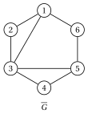
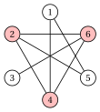
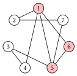
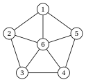
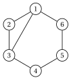
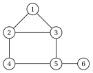
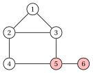

# Esercizi · Formulazioni dei problemi di clique

**Esercizi · Capitolo 12** · ogni soluzione si apre con un clic · [:material-book-open-variant: Capitolo 12: Problemi di clique](../formulazioni/clique-formulations/index.md) · [:material-file-pdf-box: Eserciziario, volume 2 (PDF)](../pdf/esercizi-2-formulazioni.pdf)

!!! chiave ""

    <strong>Formulazioni usate in questi esercizi.</strong> I modelli del capitolo [Formulazioni dei problemi di clique](../formulazioni/clique-formulations/index.md), dove $\overline{E}$ è l'insieme dei non-spigoli di $G$ e $\mathcal{Q}$ l'insieme degli insiemi stabili massimali di $G$ (le clique massimali del grafo complementare). La formulazione sugli spigoli $\mathrm{ILP}_{\mathrm{MCP}}$:

    \begin{align*}
    && \max ~~ \sum_{v\in V} x_v \tag{M0}\\
    && \text{soggetto a} \quad x_u+x_v &\le 1, & \forall\{u,v\}\in\overline{E}, \tag{M1}\\
    && x_v &\in\{0,1\}, & \forall v\in V. \tag{M2}
    \end{align*}

    La formulazione a clique $\mathrm{ILP}^{\mathrm{CL}}_{\mathrm{MCP}}$:

    \begin{align*}
    && \max ~~ \sum_{v\in V} x_v \tag{M3}\\
    && \text{soggetto a} \quad \sum_{v\in Q} x_v &\le 1, & \forall Q\in\mathcal{Q}, \tag{M4}\\
    && x_v &\in\{0,1\}, & \forall v\in V. \tag{M5}
    \end{align*}

    Il rilassamento $\mathrm{LP}_{\mathrm{MCP}}$ rilassa (M2) in $0\le x_v\le 1$; il rilassamento $\mathrm{LP}^{\mathrm{CL}}_{\mathrm{MCP}}$ rilassa (M5) in $x_v\ge 0$, perché (M4) dà $x_v\le 1$. I modelli $\mathrm{ILP}_{\mathrm{MSSP}}$ e $\mathrm{ILP}^{\mathrm{CL}}_{\mathrm{MSSP}}$ del MSSP sono (M0)–(M2) con (M1) scritto sugli spigoli di $G$, e (M3)–(M5) con (M4) scritto sulle clique massimali di $G$. Il modello $\mathrm{ILP}^{\mathrm{VW}}_{\mathrm{MCP}}$ del VWMCP è (M0)–(M2) con la funzione obiettivo $\max \sum_{v\in V} w_v\,x_v$. Il modello $\mathrm{ILP}^{\mathrm{EW}}_{\mathrm{MCP}}$ dell'EWMCP aggiunge una variabile binaria $y_{uv}$ per ogni spigolo $\{u,v\}\in E$:

    \begin{align*}
    && \max ~~ \sum_{\{u,v\}\in E} r_{uv}\,y_{uv} \tag{M6}\\
    && \text{soggetto a} \quad y_{uv} &\le x_u, & \forall\{u,v\}\in E, \tag{M7}\\
    && y_{uv} &\le x_v, & \forall\{u,v\}\in E, \tag{M8}\\
    && x_u+x_v &\le 1, & \forall\{u,v\}\in\overline{E}, \tag{M9}\\
    && x_v &\in\{0,1\}, & \forall v\in V, \tag{M10}\\
    && y_{uv} &\in\{0,1\}, & \forall\{u,v\}\in E. \tag{M11}
    \end{align*}

!!! esercizio "Esercizio 12.1: Modello PLI del problema della clique massima (MCP)"

    Consideriamo il grafo $G=(V,E)$ con $V=\{1,\dots,6\}$ e i $7$ spigoli

    $$
    E=\{\{1,2\},~\{1,3\},~\{2,3\},~\{2,4\},~\{3,5\},~\{4,5\},~\{5,6\}\}.
    $$

    { .fig loading=lazy  }

    **Domande**

    1. Scrivere i non-spigoli di $G$. Quante variabili e quanti vincoli ha il modello $\mathrm{ILP}_{\mathrm{MCP}}$?

    2. Scrivere il modello $\mathrm{ILP}_{\mathrm{MCP}}$ di $G$.

    3. Risolvere il modello con Gurobi: dare $z(\mathrm{ILP}_{\mathrm{MCP}})$ e la soluzione ottima. È unica?

    4. Quale modello PLI del problema dell'insieme stabile massimo su $\overline{G}$ si ottiene? Motivare la risposta.

??? soluzione "Soluzione"

    1. $G$ ha $\binom{6}{2}-7=8$ non-spigoli:

        $$
        \overline{E}=\{\{1,4\},~\{1,5\},~\{1,6\},~\{2,5\},~\{2,6\},~\{3,4\},~\{3,6\},~\{4,6\}\}.
        $$

        Il modello ha $n=6$ variabili binarie e un vincolo per ogni non-spigolo: $8$ vincoli lineari.

    2. Il modello $\mathrm{ILP}_{\mathrm{MCP}}$ è:

        $$
        \begin{array}{rrrrrrrcl}
        {\max} & {x_1} & {+\,x_2} & {+\,x_3} & {+\,x_4} & {+\,x_5} & {+\,x_6} \\[1ex]
        \text{soggetto a} & {x_1} &  &  & {+\,x_4} &  &  & {\le} & {1} \\
        & {x_1} &  &  &  & {+\,x_5} &  & {\le} & {1} \\
        & {x_1} &  &  &  &  & {+\,x_6} & {\le} & {1} \\
        &  & {x_2} &  &  & {+\,x_5} &  & {\le} & {1} \\
        &  & {x_2} &  &  &  & {+\,x_6} & {\le} & {1} \\
        &  &  & {x_3} & {+\,x_4} &  &  & {\le} & {1} \\
        &  &  & {x_3} &  &  & {+\,x_6} & {\le} & {1} \\
        &  &  &  & {x_4} &  & {+\,x_6} & {\le} & {1} \\[1ex]
        & {x_1}, & {x_2}, & {x_3}, & {x_4}, & {x_5}, & {x_6} & {\in} & {\{0,1\}}
        \end{array}
        $$

    3. Gurobi restituisce $z(\mathrm{ILP}_{\mathrm{MCP}})=3$ con $\tilde x_1=\tilde x_2=\tilde x_3=1$ e $\tilde x_4=\tilde x_5=\tilde x_6=0$: la clique $\{1,2,3\}$. L'enumerazione delle clique mostra che è l'unico triangolo, e nessuna clique ha $4$ vertici (solo i vertici $2$, $3$ e $5$ hanno grado $3$). La soluzione ottima è unica.

        { .fig loading=lazy  }

    4. Lo stesso modello: i suoi vincoli sono scritti sugli spigoli di $\overline{G}$, il cui insieme degli spigoli è $\overline{E}$, e $x_u+x_v\le 1$ dice che di ogni spigolo di $\overline{G}$ si seleziona al più un estremo. È la formulazione sugli spigoli del MSSP su $\overline{G}$, e $\alpha(\overline{G})=\omega(G)=3$.

!!! esercizio "Esercizio 12.2: Il grafo complementare e la formulazione a clique (MCP)"

    Consideriamo il grafo $G=(V,E)$ con $V=\{1,\dots,6\}$ e i $7$ spigoli

    $$
    E=\{\{1,4\},~\{1,5\},~\{2,4\},~\{2,5\},~\{2,6\},~\{3,6\},~\{4,6\}\}.
    $$

    { .fig loading=lazy  }

    **Domande**

    1. Scrivere gli spigoli del grafo complementare $\overline{G}$ e disegnarlo accanto a $G$.

    2. Elencare le clique massimali di $\overline{G}$.

    3. Scrivere la formulazione a clique $\mathrm{ILP}^{\mathrm{CL}}_{\mathrm{MCP}}$ e confrontare il suo numero di vincoli con quello del modello $\mathrm{ILP}_{\mathrm{MCP}}$.

    4. Mostrare che ogni vincolo di $\mathrm{ILP}_{\mathrm{MCP}}$ è implicato da un vincolo di $\mathrm{ILP}^{\mathrm{CL}}_{\mathrm{MCP}}$.

    5. Risolvere entrambi i modelli con Gurobi e dare una clique massima di $G$.

??? soluzione "Soluzione"

    1. $\overline{G}$ ha gli $\binom{6}{2}-7=8$ non-spigoli di $G$:

        $$
        \overline{E}=\{\{1,2\},~\{1,3\},~\{1,6\},~\{2,3\},~\{3,4\},~\{3,5\},~\{4,5\},~\{5,6\}\}.
        $$

        { .fig loading=lazy  }

        { .fig loading=lazy  }

    2. Le clique massimali di $\overline{G}$ sono i due triangoli $\{1,2,3\}$ e $\{3,4,5\}$, che hanno in comune il vertice $3$, e i due spigoli $\{1,6\}$ e $\{5,6\}$: il vertice $6$ è adiacente in $\overline{G}$ solo a $1$ e $5$, che lì non sono adiacenti.

    3. La formulazione a clique ha un vincolo per ogni clique massimale di $\overline{G}$:

        $$
        \begin{array}{rrrrrrrcl}
        {\max} & {x_1} & {+\,x_2} & {+\,x_3} & {+\,x_4} & {+\,x_5} & {+\,x_6} \\[1ex]
        \text{soggetto a} & {x_1} & {+\,x_2} & {+\,x_3} &  &  &  & {\le} & {1} \\
        &  &  & {x_3} & {+\,x_4} & {+\,x_5} &  & {\le} & {1} \\
        & {x_1} &  &  &  &  & {+\,x_6} & {\le} & {1} \\
        &  &  &  &  & {x_5} & {+\,x_6} & {\le} & {1} \\[1ex]
        & {x_1}, & {x_2}, & {x_3}, & {x_4}, & {x_5}, & {x_6} & {\in} & {\{0,1\}}
        \end{array}
        $$

        Ha $4$ vincoli, contro gli $8$ vincoli di $\mathrm{ILP}_{\mathrm{MCP}}$ (uno per ogni spigolo di $\overline{G}$).

    4. Ogni spigolo di $\overline{G}$ sta in una clique massimale, e le variabili sono non negative:

        
<table>
        <tr>
        <th>vincolo di \(\mathrm{ILP}_{\mathrm{MCP}}\)</th>
        <th>implicato da</th>
        </tr>
        <tr>
        <td>\(x_1+x_2\le 1\)</td>
        <td>\(x_1+x_2+x_3\le 1\)</td>
        </tr>
        <tr>
        <td>\(x_1+x_3\le 1\)</td>
        <td>\(x_1+x_2+x_3\le 1\)</td>
        </tr>
        <tr>
        <td>\(x_1+x_6\le 1\)</td>
        <td>\(x_1+x_6\le 1\)</td>
        </tr>
        <tr>
        <td>\(x_2+x_3\le 1\)</td>
        <td>\(x_1+x_2+x_3\le 1\)</td>
        </tr>
        <tr>
        <td>\(x_3+x_4\le 1\)</td>
        <td>\(x_3+x_4+x_5\le 1\)</td>
        </tr>
        <tr>
        <td>\(x_3+x_5\le 1\)</td>
        <td>\(x_3+x_4+x_5\le 1\)</td>
        </tr>
        <tr>
        <td>\(x_4+x_5\le 1\)</td>
        <td>\(x_3+x_4+x_5\le 1\)</td>
        </tr>
        <tr>
        <td>\(x_5+x_6\le 1\)</td>
        <td>\(x_5+x_6\le 1\)</td>
        </tr>
        </table>

    5. Entrambi i modelli danno il valore ottimo $3$, con la clique $\{2,4,6\}$ di $G$: è un insieme stabile di $\overline{G}$, ed è l'unica clique massima (enumerazione).

        { .fig loading=lazy  }

!!! esercizio "Esercizio 12.3: Bound LP: formulazione sugli spigoli e formulazione a clique (MCP)"

    Consideriamo il grafo $G=(V,E)$ con $V=\{1,\dots,7\}$ e i $9$ spigoli

    \begin{align*}
    E=\{ & \{1,2\},~\{1,4\},~\{1,5\},~\{1,6\},~\{2,7\},\\
    & \{3,4\},~\{3,5\},~\{5,6\},~\{5,7\}\}.
    \end{align*}

    { .fig loading=lazy  }

    **Domande**

    1. Scrivere il modello $\mathrm{LP}_{\mathrm{MCP}}$ (formulazione sugli spigoli con $0\le x_v\le 1$). Mostrare che $\bar x_v=\frac{1}{2}$ per ogni vertice è ammissibile, e calcolare $z(\mathrm{LP}_{\mathrm{MCP}})$ con Gurobi.

    2. Elencare le clique massimali di $\overline{G}$ e scrivere il modello $\mathrm{LP}^{\mathrm{CL}}_{\mathrm{MCP}}$.

    3. Il punto $\bar x_v=\frac{1}{2}$ è ammissibile per $\mathrm{LP}^{\mathrm{CL}}_{\mathrm{MCP}}$? Calcolare $z(\mathrm{LP}^{\mathrm{CL}}_{\mathrm{MCP}})$ con Gurobi, e dimostrare il valore sommando alcuni vincoli.

    4. Trovare $\omega(G)$ e confrontare i due bound LP.

??? soluzione "Soluzione"

    1. I $12$ non-spigoli danno il modello

        $$
        \begin{array}{rrrrrrrrcl}
        {\max} & {x_1} & {+\,x_2} & {+\,x_3} & {+\,x_4} & {+\,x_5} & {+\,x_6} & {+\,x_7} \\[1ex]
        \text{soggetto a} & {x_1} &  & {+\,x_3} &  &  &  &  & {\le} & {1} \\
        & {x_1} &  &  &  &  &  & {+\,x_7} & {\le} & {1} \\
        &  & {x_2} & {+\,x_3} &  &  &  &  & {\le} & {1} \\
        &  & {x_2} &  & {+\,x_4} &  &  &  & {\le} & {1} \\
        &  & {x_2} &  &  & {+\,x_5} &  &  & {\le} & {1} \\
        &  & {x_2} &  &  &  & {+\,x_6} &  & {\le} & {1} \\
        &  &  & {x_3} &  &  & {+\,x_6} &  & {\le} & {1} \\
        &  &  & {x_3} &  &  &  & {+\,x_7} & {\le} & {1} \\
        &  &  &  & {x_4} & {+\,x_5} &  &  & {\le} & {1} \\
        &  &  &  & {x_4} &  & {+\,x_6} &  & {\le} & {1} \\
        &  &  &  & {x_4} &  &  & {+\,x_7} & {\le} & {1} \\
        &  &  &  &  &  & {x_6} & {+\,x_7} & {\le} & {1} \\
        & {x_1} &  &  &  &  &  &  & {\le} & {1} \\
        &  & {x_2} &  &  &  &  &  & {\le} & {1} \\
        &  &  & {x_3} &  &  &  &  & {\le} & {1} \\
        &  &  &  & {x_4} &  &  &  & {\le} & {1} \\
        &  &  &  &  & {x_5} &  &  & {\le} & {1} \\
        &  &  &  &  &  & {x_6} &  & {\le} & {1} \\
        &  &  &  &  &  &  & {x_7} & {\le} & {1} \\[1ex]
        & {x_1}, & {x_2}, & {x_3}, & {x_4}, & {x_5}, & {x_6}, & {x_7} & {\ge} & {0}
        \end{array}
        $$

        Con $\bar x_v=\frac{1}{2}$ ogni vincolo diventa $\frac{1}{2}+\frac{1}{2}=1\le 1$, e il valore è $\frac{7}{2}$. Gurobi restituisce $z(\mathrm{LP}_{\mathrm{MCP}})=\frac{7}{2}$: il punto è ottimo.

    2. Le $6$ clique massimali di $\overline{G}$ (insiemi stabili massimali di $G$) sono $\{1,3,7\}$, $\{2,3,6\}$, $\{2,4,5\}$, $\{2,4,6\}$, $\{3,6,7\}$, $\{4,6,7\}$, e il modello è

        $$
        \begin{array}{rrrrrrrrcl}
        {\max} & {x_1} & {+\,x_2} & {+\,x_3} & {+\,x_4} & {+\,x_5} & {+\,x_6} & {+\,x_7} \\[1ex]
        \text{soggetto a} & {x_1} &  & {+\,x_3} &  &  &  & {+\,x_7} & {\le} & {1} \\
        &  & {x_2} & {+\,x_3} &  &  & {+\,x_6} &  & {\le} & {1} \\
        &  & {x_2} &  & {+\,x_4} & {+\,x_5} &  &  & {\le} & {1} \\
        &  & {x_2} &  & {+\,x_4} &  & {+\,x_6} &  & {\le} & {1} \\
        &  &  & {x_3} &  &  & {+\,x_6} & {+\,x_7} & {\le} & {1} \\
        &  &  &  & {x_4} &  & {+\,x_6} & {+\,x_7} & {\le} & {1} \\[1ex]
        & {x_1}, & {x_2}, & {x_3}, & {x_4}, & {x_5}, & {x_6}, & {x_7} & {\ge} & {0}
        \end{array}
        $$

    3. No: $\bar x_1+\bar x_3+\bar x_7=\frac{3}{2}>1$. Gurobi restituisce $z(\mathrm{LP}^{\mathrm{CL}}_{\mathrm{MCP}})=3$. I tre vincoli di $\{1,3,7\}$, $\{2,3,6\}$, $\{2,4,5\}$ coprono ogni vertice almeno una volta; sommandoli, ogni variabile compare con coefficiente almeno $1$, quindi $\sum_{v=1}^{7}x_v\le 3$ per ogni punto ammissibile.

    4. Il triangolo $\{1,5,6\}$ è l'unica clique massima (enumerazione), quindi $\omega(G)=3$.

        { .fig loading=lazy  }

        La formulazione sugli spigoli dà $\frac{7}{2}$ (e $\lfloor\frac{7}{2}\rfloor=3$ arrotondando per difetto, perché $\omega(G)$ è intero); la formulazione a clique dà direttamente $3$, senza gap.

!!! esercizio "Esercizio 12.4: Numero di clique, bound LP e numero cromatico (MCP)"

    La ruota $W_5$ ha i vertici $V=\{1,\dots,6\}$: i vertici $1,\dots,5$ formano un ciclo, e il vertice $6$ è adiacente a tutti loro.

    { .fig loading=lazy  }

    **Domande**

    1. Elencare gli insiemi stabili massimali di $W_5$, cioè le clique massimali di $\overline{W_5}$.

    2. Scrivere il modello $\mathrm{LP}^{\mathrm{CL}}_{\mathrm{MCP}}$ e il suo duale $D(\mathrm{LP}^{\mathrm{CL}}_{\mathrm{MCP}})$, e dire quale formulazione di colorazione rilassa il duale.

    3. Trovare una soluzione primale e una soluzione duale di valore $\frac{7}{2}$. Che cosa si può concludere?

    4. Dedurre $\omega(W_5)$ e $\chi(W_5)$ dall'integralità dei due numeri, e scrivere la catena del capitolo.

??? soluzione "Soluzione"

    1. Un insieme stabile contiene al più $2$ vertici del ciclo, mai due consecutivi, e il vertice $6$ è adiacente a tutti gli altri. Gli insiemi stabili massimali sono $\{1,3\}$, $\{1,4\}$, $\{2,4\}$, $\{2,5\}$, $\{3,5\}$, $\{6\}$.

    2. Con un vincolo per ogni insieme stabile massimale:

        $$
        \begin{array}{rrrrrrrcl}
        {\max} & {x_1} & {+\,x_2} & {+\,x_3} & {+\,x_4} & {+\,x_5} & {+\,x_6} \\[1ex]
        \text{soggetto a} & {x_1} &  & {+\,x_3} &  &  &  & {\le} & {1} \\
        & {x_1} &  &  & {+\,x_4} &  &  & {\le} & {1} \\
        &  & {x_2} &  & {+\,x_4} &  &  & {\le} & {1} \\
        &  & {x_2} &  &  & {+\,x_5} &  & {\le} & {1} \\
        &  &  & {x_3} &  & {+\,x_5} &  & {\le} & {1} \\
        &  &  &  &  &  & {x_6} & {\le} & {1} \\[1ex]
        & {x_1}, & {x_2}, & {x_3}, & {x_4}, & {x_5}, & {x_6} & {\ge} & {0}
        \end{array}
        $$

        Con una variabile duale non negativa $\pi_Q$ per vincolo (l'indice $Q$ scritto con i suoi vertici), il duale $D(\mathrm{LP}^{\mathrm{CL}}_{\mathrm{MCP}})$ è

        $$
        \begin{array}{rrrrrrrcl}
        {\min} & {\pi_{13}} & {+\,\pi_{14}} & {+\,\pi_{24}} & {+\,\pi_{25}} & {+\,\pi_{35}} & {+\,\pi_{6}} \\[1ex]
        \text{soggetto a} & {\pi_{13}} & {+\,\pi_{14}} &  &  &  &  & {\ge} & {1} \\
        &  &  & {\pi_{24}} & {+\,\pi_{25}} &  &  & {\ge} & {1} \\
        & {\pi_{13}} &  &  &  & {+\,\pi_{35}} &  & {\ge} & {1} \\
        &  & {\pi_{14}} & {+\,\pi_{24}} &  &  &  & {\ge} & {1} \\
        &  &  &  & {\pi_{25}} & {+\,\pi_{35}} &  & {\ge} & {1} \\
        &  &  &  &  &  & {\pi_{6}} & {\ge} & {1} \\[1ex]
        & {\pi_{13}}, & {\pi_{14}}, & {\pi_{24}}, & {\pi_{25}}, & {\pi_{35}}, & {\pi_{6}} & {\ge} & {0}
        \end{array}
        $$

        È il rilassamento lineare della formulazione a insiemi stabili $\mathrm{ILP}^{\mathrm{ST}}_{\mathrm{VCP}}$ del VCP, con gli insiemi stabili massimali: ogni vertice deve essere coperto da un insieme stabile scelto.

    3. Il punto primale $\bar x_1=\dots=\bar x_5=\frac{1}{2}$, $\bar x_6=1$ soddisfa tutti i vincoli e ha valore $\frac{5}{2}+1=\frac{7}{2}$. Il punto duale $\bar\pi_Q=\frac{1}{2}$ per le cinque coppie e $\bar\pi_{6}=1$ copre ogni vertice del ciclo con $\frac{1}{2}+\frac{1}{2}=1$ e il vertice $6$ con $1$, e ha valore $\frac{7}{2}$. Valori uguali: per la dualità debole entrambi sono ottimi, e $z(\mathrm{LP}^{\mathrm{CL}}_{\mathrm{MCP}})=\frac{7}{2}$ (Gurobi conferma).

    4. $\omega(W_5)\le\frac{7}{2}$ e $\omega(W_5)$ è intero, quindi $\omega(W_5)\le 3$; il triangolo $\{1,2,6\}$ dà $\omega(W_5)=3$. $\chi(W_5)\ge\frac{7}{2}$, quindi $\chi(W_5)\ge 4$; la colorazione $\{1,3\},\{2,4\},\{5\},\{6\}$ dà $\chi(W_5)=4$. La catena diventa

        $$
        \omega(W_5)=3\;<\;z(\mathrm{LP}^{\mathrm{CL}}_{\mathrm{MCP}})=\frac{7}{2}\;<\;\chi(W_5)=4 .
        $$

!!! esercizio "Esercizio 12.5: Ammissibilità nelle due formulazioni (MCP)"

    Consideriamo il ciclo $C_6$ con i vertici $V=\{1,\dots,6\}$ e gli spigoli $\{1,2\},\{2,3\},\{3,4\},\{4,5\},\{5,6\},\{1,6\}$,

    { .fig loading=lazy  }

    e i cinque punti $\vet{x}=(x_1,\dots,x_6)$:

    $$
    \bar{\vet x}^{a}=(\frac{1}{2},\frac{1}{2},\frac{1}{2},\frac{1}{2},\frac{1}{2},\frac{1}{2}),\quad \bar{\vet x}^{b}=(1,1,0,0,0,0),\quad \bar{\vet x}^{c}=(1,0,1,0,0,0),
    $$

    $$
    \bar{\vet x}^{d}=(\frac{1}{2},\frac{1}{2},\frac{1}{2},0,0,0),\quad \bar{\vet x}^{e}=(\frac{1}{3},\frac{1}{3},\frac{1}{3},\frac{1}{3},\frac{1}{3},\frac{1}{3}).
    $$

    **Domande**

    1. Scrivere i vincoli di $\mathrm{LP}_{\mathrm{MCP}}$ e di $\mathrm{LP}^{\mathrm{CL}}_{\mathrm{MCP}}$ per $C_6$.

    2. Per ogni punto, stabilire se è ammissibile per $\mathrm{LP}_{\mathrm{MCP}}$, per $\mathrm{LP}^{\mathrm{CL}}_{\mathrm{MCP}}$ e per $\mathrm{ILP}_{\mathrm{MCP}}$.

    3. Che cosa dicono i valori dei punti ammissibili sui due bound LP?

    4. Calcolare i due bound LP con Gurobi e confrontarli con $\omega(C_6)$.

??? soluzione "Soluzione"

    1. Con i $9$ vincoli sui non-spigoli, il modello $\mathrm{LP}_{\mathrm{MCP}}$ è

        $$
        \begin{array}{rrrrrrrcl}
        {\max} & {x_1} & {+\,x_2} & {+\,x_3} & {+\,x_4} & {+\,x_5} & {+\,x_6} \\[1ex]
        \text{soggetto a} & {x_1} &  & {+\,x_3} &  &  &  & {\le} & {1} \\
        & {x_1} &  &  & {+\,x_4} &  &  & {\le} & {1} \\
        & {x_1} &  &  &  & {+\,x_5} &  & {\le} & {1} \\
        &  & {x_2} &  & {+\,x_4} &  &  & {\le} & {1} \\
        &  & {x_2} &  &  & {+\,x_5} &  & {\le} & {1} \\
        &  & {x_2} &  &  &  & {+\,x_6} & {\le} & {1} \\
        &  &  & {x_3} &  & {+\,x_5} &  & {\le} & {1} \\
        &  &  & {x_3} &  &  & {+\,x_6} & {\le} & {1} \\
        &  &  &  & {x_4} &  & {+\,x_6} & {\le} & {1} \\
        & {x_1} &  &  &  &  &  & {\le} & {1} \\
        &  & {x_2} &  &  &  &  & {\le} & {1} \\
        &  &  & {x_3} &  &  &  & {\le} & {1} \\
        &  &  &  & {x_4} &  &  & {\le} & {1} \\
        &  &  &  &  & {x_5} &  & {\le} & {1} \\
        &  &  &  &  &  & {x_6} & {\le} & {1} \\[1ex]
        & {x_1}, & {x_2}, & {x_3}, & {x_4}, & {x_5}, & {x_6} & {\ge} & {0}
        \end{array}
        $$

        Con un vincolo per ogni insieme stabile massimale di $C_6$, il modello $\mathrm{LP}^{\mathrm{CL}}_{\mathrm{MCP}}$ è

        $$
        \begin{array}{rrrrrrrcl}
        {\max} & {x_1} & {+\,x_2} & {+\,x_3} & {+\,x_4} & {+\,x_5} & {+\,x_6} \\[1ex]
        \text{soggetto a} & {x_1} &  & {+\,x_3} &  & {+\,x_5} &  & {\le} & {1} \\
        &  & {x_2} &  & {+\,x_4} &  & {+\,x_6} & {\le} & {1} \\
        & {x_1} &  &  & {+\,x_4} &  &  & {\le} & {1} \\
        &  & {x_2} &  &  & {+\,x_5} &  & {\le} & {1} \\
        &  &  & {x_3} &  &  & {+\,x_6} & {\le} & {1} \\[1ex]
        & {x_1}, & {x_2}, & {x_3}, & {x_4}, & {x_5}, & {x_6} & {\ge} & {0}
        \end{array}
        $$

    2. - $\bar{\vet x}^{a}$: ammissibile per $\mathrm{LP}_{\mathrm{MCP}}$; la disuguaglianza di clique di $\{1,3,5\}$ dà $\frac{3}{2}>1$, quindi inammissibile per $\mathrm{LP}^{\mathrm{CL}}_{\mathrm{MCP}}$ e $\mathrm{ILP}_{\mathrm{MCP}}$.

        - $\bar{\vet x}^{b}$: ammissibile per tutti e tre i modelli: è la clique $\{1,2\}$.

        - $\bar{\vet x}^{c}$: $x_1+x_3=2>1$ viola un vincolo su un non-spigolo: inammissibile per tutti e tre i modelli (ogni vincolo di $\mathrm{LP}_{\mathrm{MCP}}$ è implicato da $\mathrm{LP}^{\mathrm{CL}}_{\mathrm{MCP}}$).

        - $\bar{\vet x}^{d}$: ammissibile per $\mathrm{LP}_{\mathrm{MCP}}$ e $\mathrm{LP}^{\mathrm{CL}}_{\mathrm{MCP}}$, non per $\mathrm{ILP}_{\mathrm{MCP}}$ (frazionario).

        - $\bar{\vet x}^{e}$: ammissibile per $\mathrm{LP}_{\mathrm{MCP}}$ e $\mathrm{LP}^{\mathrm{CL}}_{\mathrm{MCP}}$, non per $\mathrm{ILP}_{\mathrm{MCP}}$ (frazionario).

    3. $\bar{\vet x}^{a}$ ha valore $3$, quindi $z(\mathrm{LP}_{\mathrm{MCP}})\ge 3$. In $\mathrm{LP}^{\mathrm{CL}}_{\mathrm{MCP}}$ il miglior punto ammissibile fra i cinque è $\bar{\vet x}^{e}$, di valore $2$; $\bar{\vet x}^{d}$ ha valore $\frac{3}{2}$ e $\bar{\vet x}^{b}$ ha valore $2$.

    4. Gurobi restituisce $z(\mathrm{LP}_{\mathrm{MCP}})=3$ e $z(\mathrm{LP}^{\mathrm{CL}}_{\mathrm{MCP}})=2$. Il secondo valore si dimostra sommando i vincoli di $\{1,3,5\}$ e $\{2,4,6\}$, che danno $\sum_{v=1}^{6}x_v\le 2$. $C_6$ non ha triangoli, quindi $\omega(C_6)=2$: la formulazione a clique chiude il gap, la formulazione sugli spigoli lascia $3$ contro $2$.

!!! esercizio "Esercizio 12.6: Modelli PLI del problema dell'insieme stabile massimo (MSSP)"

    Consideriamo il grafo $G=(V,E)$ con $V=\{1,\dots,6\}$ e i $7$ spigoli

    $$
    E=\{\{1,2\},~\{1,3\},~\{1,6\},~\{2,3\},~\{3,4\},~\{4,5\},~\{5,6\}\}.
    $$

    { .fig loading=lazy  }

    Cerchiamo un insieme stabile massimo di $G$.

    **Domande**

    1. Quante variabili e quanti vincoli ha la formulazione sugli spigoli $\mathrm{ILP}_{\mathrm{MSSP}}$ di $G$? Scriverla.

    2. Risolvere il modello con Gurobi: dare $z(\mathrm{ILP}_{\mathrm{MSSP}})$ e una soluzione ottima. È unica?

    3. Scrivere le clique massimali di $G$ e la formulazione a clique $\mathrm{ILP}^{\mathrm{CL}}_{\mathrm{MSSP}}$.

    4. Confrontare i valori ottimi dei rilassamenti lineari delle due formulazioni (Gurobi).

??? soluzione "Soluzione"

    1. Ci sono $n=6$ variabili binarie e un vincolo $x_u+x_v\le 1$ per ogni spigolo di $G$: $7$ vincoli lineari. Il modello $\mathrm{ILP}_{\mathrm{MSSP}}$ è:

        $$
        \begin{array}{rrrrrrrcl}
        {\max} & {x_1} & {+\,x_2} & {+\,x_3} & {+\,x_4} & {+\,x_5} & {+\,x_6} \\[1ex]
        \text{soggetto a} & {x_1} & {+\,x_2} &  &  &  &  & {\le} & {1} \\
        & {x_1} &  & {+\,x_3} &  &  &  & {\le} & {1} \\
        & {x_1} &  &  &  &  & {+\,x_6} & {\le} & {1} \\
        &  & {x_2} & {+\,x_3} &  &  &  & {\le} & {1} \\
        &  &  & {x_3} & {+\,x_4} &  &  & {\le} & {1} \\
        &  &  &  & {x_4} & {+\,x_5} &  & {\le} & {1} \\
        &  &  &  &  & {x_5} & {+\,x_6} & {\le} & {1} \\[1ex]
        & {x_1}, & {x_2}, & {x_3}, & {x_4}, & {x_5}, & {x_6} & {\in} & {\{0,1\}}
        \end{array}
        $$

    2. Gurobi restituisce $z(\mathrm{ILP}_{\mathrm{MSSP}})=3$ con l'insieme stabile $\{2,4,6\}$. La soluzione ottima è unica.

        { .fig loading=lazy  }

    3. Le clique massimali di $G$ sono il triangolo $\{1,2,3\}$ e gli spigoli $\{1,6\}$, $\{3,4\}$, $\{4,5\}$, $\{5,6\}$: $5$ clique invece di $7$ spigoli, perché i tre spigoli del triangolo sono sostituiti da $x_1+x_2+x_3\le 1$. Il modello $\mathrm{ILP}^{\mathrm{CL}}_{\mathrm{MSSP}}$ è:

        $$
        \begin{array}{rrrrrrrcl}
        {\max} & {x_1} & {+\,x_2} & {+\,x_3} & {+\,x_4} & {+\,x_5} & {+\,x_6} \\[1ex]
        \text{soggetto a} & {x_1} & {+\,x_2} & {+\,x_3} &  &  &  & {\le} & {1} \\
        & {x_1} &  &  &  &  & {+\,x_6} & {\le} & {1} \\
        &  &  & {x_3} & {+\,x_4} &  &  & {\le} & {1} \\
        &  &  &  & {x_4} & {+\,x_5} &  & {\le} & {1} \\
        &  &  &  &  & {x_5} & {+\,x_6} & {\le} & {1} \\[1ex]
        & {x_1}, & {x_2}, & {x_3}, & {x_4}, & {x_5}, & {x_6} & {\in} & {\{0,1\}}
        \end{array}
        $$

        Il suo valore ottimo è ancora $3$.

    4. Il rilassamento lineare della formulazione sugli spigoli, con $0\le x_v\le 1$, ha valore ottimo $3$; il rilassamento lineare della formulazione a clique ha valore ottimo $3$. Su questo grafo entrambi i bound sono pari ad $\alpha(G)=3$: il punto $x_v=\frac{1}{2}$, di valore $3$, è ammissibile per la formulazione sugli spigoli ma viola $x_1+x_2+x_3\le 1$, e il bound non cambia perché anche l'ottimo intero ha valore $3$.

!!! esercizio "Esercizio 12.7: Modello PLI del problema della clique massima pesata sui vertici"

    Consideriamo il grafo $G=(V,E)$ con $V=\{1,\dots,6\}$ e i $7$ spigoli

    $$
    E=\{\{1,2\},~\{1,3\},~\{2,3\},~\{2,4\},~\{3,5\},~\{4,5\},~\{5,6\}\}.
    $$

    { .fig loading=lazy  }

    e i pesi dei vertici

    $$
    \begin{array}{l|cccccc}
    \hline  & {v=1} & {v=2} & {v=3} & {v=4} & {v=5} & {v=6} \\
    \hline {w_v} & {2} & {3} & {4} & {6} & {5} & {7} \\
    \hline
    \end{array}
    $$

    **Domande**

    1. Scrivere il modello $\mathrm{ILP}^{\mathrm{VW}}_{\mathrm{MCP}}$ del problema della clique massima pesata sui vertici su questa istanza.

    2. Risolvere il modello con Gurobi: dare il valore ottimo e la clique ottima. È unica?

    3. Confrontare la clique ottima con la clique massima di $G$, e spiegare la differenza.

??? soluzione "Soluzione"

    1. $G$ ha $\binom{6}{2}-7=8$ non-spigoli, con un vincolo ciascuno:

        $$
        \begin{array}{rrrrrrrcl}
        {\max} & {2\,x_1} & {+\,3\,x_2} & {+\,4\,x_3} & {+\,6\,x_4} & {+\,5\,x_5} & {+\,7\,x_6} \\[1ex]
        \text{soggetto a} & {x_1} &  &  & {+\,x_4} &  &  & {\le} & {1} \\
        & {x_1} &  &  &  & {+\,x_5} &  & {\le} & {1} \\
        & {x_1} &  &  &  &  & {+\,x_6} & {\le} & {1} \\
        &  & {x_2} &  &  & {+\,x_5} &  & {\le} & {1} \\
        &  & {x_2} &  &  &  & {+\,x_6} & {\le} & {1} \\
        &  &  & {x_3} & {+\,x_4} &  &  & {\le} & {1} \\
        &  &  & {x_3} &  &  & {+\,x_6} & {\le} & {1} \\
        &  &  &  & {x_4} &  & {+\,x_6} & {\le} & {1} \\[1ex]
        & {x_1}, & {x_2}, & {x_3}, & {x_4}, & {x_5}, & {x_6} & {\in} & {\{0,1\}}
        \end{array}
        $$

    2. Gurobi restituisce il valore ottimo $12$ con $\tilde x_5=\tilde x_6=1$: la clique $\{5,6\}$, di peso $5+7=12$. L'enumerazione delle clique dà come secondo miglior valore $11$ (clique $\{4,5\}$): la soluzione ottima è unica.

        { .fig loading=lazy  }

    3. La clique massima di $G$ è il triangolo $\{1,2,3\}$, con $3$ vertici ma peso solo $2+3+4=9$. I due modelli hanno gli stessi vincoli, quindi le stesse soluzioni ammissibili (le clique di $G$); cambia solo la funzione obiettivo, e i vertici leggeri del triangolo perdono contro lo spigolo pesante $\{5,6\}$.

!!! esercizio "Esercizio 12.8: Modello PLI del problema della clique massima pesata sugli spigoli"

    Consideriamo il grafo $G=(V,E)$ con $V=\{1,\dots,5\}$ e i $7$ spigoli

    $$
    E=\{\{1,2\},~\{1,3\},~\{2,3\},~\{2,4\},~\{3,4\},~\{3,5\},~\{4,5\}\}.
    $$

    { .fig loading=lazy  }

    e i pesi degli spigoli

    
<table>
    <tr>
    <th>spigolo</th>
    <th>\(\{1,2\}\)</th>
    <th>\(\{1,3\}\)</th>
    <th>\(\{2,3\}\)</th>
    <th>\(\{2,4\}\)</th>
    <th>\(\{3,4\}\)</th>
    <th>\(\{3,5\}\)</th>
    <th>\(\{4,5\}\)</th>
    </tr>
    <tr>
    <td>\(r_{uv}\)</td>
    <td>\(2\)</td>
    <td>\(3\)</td>
    <td>\(1\)</td>
    <td>\(4\)</td>
    <td>\(2\)</td>
    <td>\(5\)</td>
    <td>\(6\)</td>
    </tr>
    </table>

    **Domande**

    1. Contare le variabili e i vincoli del modello $\mathrm{ILP}^{\mathrm{EW}}_{\mathrm{MCP}}$ del problema della clique massima pesata sugli spigoli su questa istanza, e scriverlo.

    2. Risolvere il modello con Gurobi: dare il valore ottimo, la clique ottima e le variabili $y_{uv}$ pari a $1$.

    3. Verificare il risultato elencando le clique massimali di $G$ con il peso totale dei loro spigoli.

    4. Spiegare perché i vincoli $y_{uv}\ge x_u+x_v-1$ non servono nel modello.

??? soluzione "Soluzione"

    1. Ci sono $n=5$ variabili $x_v$ e $m=7$ variabili $y_{uv}$, quindi $12$ variabili binarie. Ci sono $2m=14$ vincoli $y_{uv}\le x_u$, $y_{uv}\le x_v$ e un vincolo per ogni non-spigolo, $3$ in tutto: $17$ vincoli lineari. Il modello è:

        $$
        \begin{array}{rlcl}
        {\max} & {2\,y_{12}+3\,y_{13}+y_{23}+4\,y_{24}+2\,y_{34}+5\,y_{35}+6\,y_{45}} &  &  \\[1ex]
        \text{soggetto a} & {y_{12}-x_1} & {\le} & {0} \\
        & {y_{12}-x_2} & {\le} & {0} \\
        & {y_{13}-x_1} & {\le} & {0} \\
        & {y_{13}-x_3} & {\le} & {0} \\
        & {y_{23}-x_2} & {\le} & {0} \\
        & {y_{23}-x_3} & {\le} & {0} \\
        & {y_{24}-x_2} & {\le} & {0} \\
        & {y_{24}-x_4} & {\le} & {0} \\
        & {y_{34}-x_3} & {\le} & {0} \\
        & {y_{34}-x_4} & {\le} & {0} \\
        & {y_{35}-x_3} & {\le} & {0} \\
        & {y_{35}-x_5} & {\le} & {0} \\
        & {y_{45}-x_4} & {\le} & {0} \\
        & {y_{45}-x_5} & {\le} & {0} \\
        & {x_1+x_4} & {\le} & {1} \\
        & {x_1+x_5} & {\le} & {1} \\
        & {x_2+x_5} & {\le} & {1} \\[1ex]
        & {x_1,~x_2,~x_3,~x_4,~x_5} & {\in} & {\{0,1\}} \\
        & {y_{12},~y_{13},~y_{23},~y_{24},~y_{34},~y_{35},~y_{45}} & {\in} & {\{0,1\}}
        \end{array}
        $$

    2. Gurobi restituisce il valore ottimo $13$ con $\tilde x_3=\tilde x_4=\tilde x_5=1$ e $\tilde y_{34}=\tilde y_{35}=\tilde y_{45}=1$, con tutte le altre variabili pari a $0$: la clique $\{3,4,5\}$, di peso $2+5+6=13$.

        { .fig loading=lazy  }

    3. Le clique massimali di $G$ e i loro pesi sono:

        - $\{1,2,3\}$: $2+3+1=6$;

        - $\{2,3,4\}$: $1+4+2=7$;

        - $\{3,4,5\}$: $2+5+6=13$;

        Ogni clique è contenuta in una di esse e i pesi sono positivi, quindi il valore ottimo è $13$, raggiunto solo da $\{3,4,5\}$.

    4. Se entrambi gli estremi di $\{u,v\}$ sono selezionati, i vincoli permettono $y_{uv}=1$, e poiché $r_{uv}>0$ la funzione obiettivo preferisce $y_{uv}=1$ a $y_{uv}=0$: ogni soluzione ottima ha $y_{uv}=\min\{x_u,x_v\}$. Il vincolo $y_{uv}\ge x_u+x_v-1$ servirebbe solo con pesi negativi.
