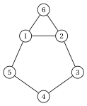
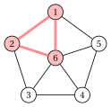
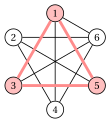
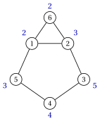

# Esercizi · Problemi di cricca

**Esercizi · Capitolo 5** · ogni soluzione si apre con un clic · [:material-book-open-variant: Capitolo 5: Problemi di cricca](../problemi-di-ottimizzazione-combinatoria/clique/index.md) · [:material-file-pdf-box: Eserciziario, volume 1 (PDF)](../pdf/esercizi-1-problemi-di-ottimizzazione-combinatoria.pdf)

!!! esercizio "Esercizio 5.1: Cricche, insiemi stabili e grafo complementare (MCP)"

    Consideriamo il grafo $G=(V,E)$ con $V=\{1,\dots,6\}$ e i lati

    $$
    E=\{\{1,2\},\{1,5\},\{1,6\},\{2,3\},\{2,6\},\{3,4\},\{4,5\}\}.
    $$

    disegnato qui sotto:

    { .fig loading=lazy  }

    e i quattro sottoinsiemi di vertici

    $$
    A=\{1,2,6\},\qquad B=\{1,3\},\qquad C=\{2,4,5\},\qquad D=\{3,5,6\}.
    $$

    **Domande**

    1. Per ogni sottoinsieme, stabilire se è una cricca di $G$, un insieme stabile di $G$, o nessuno dei due.

    2. Elencare tutte le cricche massimali di $G$ (cricche alle quali non si può aggiungere alcun vertice).

    3. Scrivere i lati del grafo complementare $\overline{G}$ e disegnarlo accanto a $G$.

    4. Determinare $\omega(G)$ e $\alpha(G)$, e verificare che $\omega(G)=\alpha(\overline{G})$ e $\alpha(G)=\omega(\overline{G})$.

??? soluzione "Soluzione"

    1. - $A$: tutte le coppie sono lati, quindi $A$ è una cricca (un triangolo).

        - $B$: nessuna coppia è un lato, quindi $B$ è un insieme stabile.

        - $C$: la coppia $\{4,5\}$ è un lato e la coppia $\{2,4\}$ no, quindi $C$ non è né una cricca né un insieme stabile.

        - $D$: nessuna coppia è un lato, quindi $D$ è un insieme stabile.

    2. Le cricche massimali sono $\{1,2,6\}$ e i lati $\{1,5\}$, $\{2,3\}$, $\{3,4\}$, $\{4,5\}$: ogni altro lato sta nel triangolo $\{1,2,6\}$, e nessun vertice è adiacente a entrambi gli estremi dei quattro lati elencati.

    3. $\overline{G}$ ha $\binom{6}{2}-7=8$ lati:

        $$
        \overline{E}=\{\{1,3\},\{1,4\},\{2,4\},\{2,5\},\{3,5\},\{3,6\},\{4,6\},\{5,6\}\}.
        $$

        { .fig loading=lazy  }

        { .fig loading=lazy  }

        I vertici rossi sono una cricca di $G$ e un insieme stabile di $\overline{G}$.

    4. $\omega(G)=3$: l'unico triangolo è $\{1,2,6\}$, e una cricca con $4$ vertici conterrebbe $4$ triangoli. $\alpha(G)=3$ con l'unico insieme stabile massimo $D=\{3,5,6\}$: un insieme stabile prende al più $2$ vertici del ciclo $1,2,3,4,5$, e con il vertice $6$ non può usare $1$ o $2$. In $\overline{G}$ l'insieme $\{1,2,6\}$ è un insieme stabile massimo e $D$ è una cricca massima (un triangolo di $\overline{G}$): $\alpha(\overline{G})=3=\omega(G)$ e $\omega(\overline{G})=3=\alpha(G)$.

    !!! chiave ""

        $A$ è l'unica cricca massima, $\omega(G)=3$; $D$ è l'unico insieme stabile massimo, $\alpha(G)=3$. In $\overline{G}$ i due ruoli si scambiano.

!!! esercizio "Esercizio 5.2: Contare le soluzioni candidate (MCP)"

    Consideriamo il grafo $G=(V,E)$ con $V=\{1,\dots,6\}$ in cui ogni vertice è adiacente a tutti gli altri tranne quello opposto sulla circonferenza: le coppie non adiacenti sono $\{1,4\}$, $\{2,5\}$ e $\{3,6\}$.

    { .fig loading=lazy  }

    **Domande**

    1. Determinare il numero di lati di $G$. Disegnare il grafo complementare $\overline{G}$.

    2. Determinare il numero di soluzioni candidate del MCP su $G$.

    3. Contare le cricche di $G$ con $0,1,2,3$ vertici, ragionando sulle tre coppie $\{1,4\}$, $\{2,5\}$ e $\{3,6\}$. Stabilire se esiste una cricca con $4$ vertici.

    4. Determinare $\omega(G)$ e il numero di cricche massime.

??? soluzione "Soluzione"

    1. $G$ ha $\binom{6}{2}-3=12$ lati. $\overline{G}$ ha solo i $3$ lati $\{1,4\},\{2,5\},\{3,6\}$: tre lati disgiunti.

        { .fig loading=lazy  }

    2. Le soluzioni candidate sono i sottoinsiemi di $V$: $2^6=64$.

    3. Un sottoinsieme è una cricca se e solo se contiene al più un vertice di ciascuna coppia. Per ogni coppia ci sono $3$ scelte (nessun vertice, il primo, il secondo), quindi ci sono $3^3=27$ cricche:

        
<table>
        <tr>
        <th>numero di vertici</th>
        <th>\(0\)</th>
        <th>\(1\)</th>
        <th>\(2\)</th>
        <th>\(3\)</th>
        <th>totale</th>
        </tr>
        <tr>
        <td>cricche</td>
        <td>\(1\)</td>
        <td>\(6\)</td>
        <td>\(12\)</td>
        <td>\(8\)</td>
        <td>\(27\)</td>
        </tr>
        </table>

        Con $2$ vertici: $\binom{3}{2}=3$ coppie di coppie, per $2\cdot 2$ scelte, dà $12$; con $3$ vertici: $2^3=8$. Una cricca con $4$ vertici prenderebbe due vertici della stessa coppia: non ne esistono.

    4. $\omega(G)=3$, e ci sono $8$ cricche massime, per esempio $\{1,2,3\}$ e $\{4,5,6\}$. Solo $27$ delle $64$ soluzioni candidate sono ammissibili.

    !!! chiave ""

        $27$ cricche su $64$ sottoinsiemi; $\omega(G)=3$ con $8$ cricche massime, un vertice da ciascuna coppia non adiacente.

!!! esercizio "Esercizio 5.3: Una cricca a mano e i bound semplici (MCP)"

    La ruota $W_5$ è il grafo con i vertici $V=\{1,\dots,6\}$: i vertici $1,\dots,5$ formano un ciclo e il vertice $6$, il mozzo, è adiacente a tutti.

    { .fig loading=lazy  }

    **Domande**

    1. Costruire a mano una cricca: partire da un vertice di grado massimo e aggiungere, ogni volta, il vertice di indice minimo adiacente a tutti i vertici già scelti. Determinare il lower bound che si ottiene.

    2. Calcolare il bound sul grado e il bound sui lati.

    3. Calcolare il bound sul conteggio dei gradi $k^{\max}$.

    4. Trovare una colorazione di $W_5$ con $4$ colori e indicare l'upper bound che fornisce.

    5. Determinare $\omega(W_5)$ e stabilire quale bound è stretto.

??? soluzione "Soluzione"

    1. Il vertice $6$ ha grado $5$, il massimo. I vertici adiacenti a $6$ sono $1,\dots,5$: aggiungiamo $1$. I vertici adiacenti sia a $6$ sia a $1$ sono $2$ e $5$: aggiungiamo $2$. Nessun vertice è adiacente a $6$, $1$ e $2$, quindi ci fermiamo con $K=\{1,2,6\}$ e $\mathrm{LB}=3$.

    2. I gradi sono:

        $$
        \begin{array}{c|cccccc}
        \hline {v} & {1} & {2} & {3} & {4} & {5} & {6} \\
        \hline {\deg(v)} & {3} & {3} & {3} & {3} & {3} & {5} \\
        \hline
        \end{array}
        $$

        Il bound sul grado dà $\Delta+1=6$. Il grafo ha $m=10$ lati; poiché $5\cdot 4/2=10\le 10<15=6\cdot 5/2$, il bound sui lati dà $5$.

    3. Per $k=4$ servono $4$ vertici di grado almeno $3$: tutti i $6$ vertici vanno bene. Per $k=5$ servono $5$ vertici di grado almeno $4$: va bene solo il vertice $6$. Quindi $k^{\max}=4$.

    4. Le classi $\{\{1,3\},\{2,4\},\{5\},\{6\}\}$ sono insiemi stabili: $1,3$ e $2,4$ non sono consecutivi sul ciclo. La colorazione usa $4$ colori, quindi $\omega(W_5)\le 4$.

        { .fig loading=lazy  }

    5. Una cricca con $4$ vertici conterrebbe almeno $3$ vertici del ciclo, a due a due adiacenti, e il ciclo con $5$ vertici non ha triangoli. Quindi $\omega(W_5)=3$, raggiunto dalla cricca della Domanda 1 (disegnata in rosso qui sopra). Nessuno degli upper bound è stretto: i migliori danno $4$, e il gap $(4-3)/3$ si chiude solo con l'argomento sul ciclo.

    !!! chiave ""

        $\mathrm{LB}=3$ dalla cricca $\{1,2,6\}$; upper bound $6$ (grado), $5$ (lati), $4$ (conteggio dei gradi) e $4$ (colorazione); $\omega(W_5)=3$.

!!! esercizio "Esercizio 5.4: Lavorare sul grafo complementare (MCP)"

    Consideriamo il grafo $G=(V,E)$ con $V=\{1,\dots,6\}$ e i $10$ lati

    \begin{align*}
    E=\{ & \{1,3\},\{1,4\},\{1,5\},\{1,6\},\{2,4\},\\
    & \{2,5\},\{2,6\},\{3,5\},\{3,6\},\{4,6\}\}.
    \end{align*}

    { .fig loading=lazy  }

    **Domande**

    1. Scrivere i lati di $\overline{G}$, disegnarlo e riconoscere di che grafo si tratta.

    2. Calcolare $\alpha(\overline{G})$ ed elencare tutti gli insiemi stabili massimi di $\overline{G}$.

    3. Dedurre $\omega(G)$ e le cricche massime di $G$.

    4. Calcolare $\alpha(G)$.

??? soluzione "Soluzione"

    1. $\overline{G}$ ha $\binom{6}{2}-10=5$ lati, $\{1,2\}$, $\{2,3\}$, $\{3,4\}$, $\{4,5\}$, $\{5,6\}$: è il cammino $1,2,3,4,5,6$.

        { .fig loading=lazy  }

        Su un grafo denso è più facile lavorare sul complementare.

    2. Un insieme stabile del cammino non contiene due vertici consecutivi. Con $4$ vertici su $6$, due di essi sarebbero consecutivi, quindi $\alpha(\overline{G})\le 3$. Gli insiemi stabili con $3$ vertici sono $\{1,3,5\}$, $\{1,3,6\}$, $\{1,4,6\}$, $\{2,4,6\}$: $\alpha(\overline{G})=3$, con $4$ insiemi stabili massimi.

    3. Per la proposizione del capitolo, le cricche di $G$ sono gli insiemi stabili di $\overline{G}$: $\omega(G)=\alpha(\overline{G})=3$, e le cricche massime di $G$ sono i quattro insiemi trovati sopra. La soluzione ottima non è unica.

        { .fig loading=lazy  }

    4. $\alpha(G)=\omega(\overline{G})$: il cammino non ha triangoli e ha lati, quindi $\omega(\overline{G})=2$ e $\alpha(G)=2$. Per esempio, $\{1,2\}$ è un insieme stabile massimo di $G$.

    !!! chiave ""

        $\overline{G}$ è un cammino: $\omega(G)=\alpha(\overline{G})=3$ con $4$ cricche massime, e $\alpha(G)=\omega(\overline{G})=2$.

!!! esercizio "Esercizio 5.5: Cricca massima pesata sui vertici (MCP)"

    Consideriamo il grafo $G=(V,E)$ della figura, con i pesi dei vertici in blu:

    { .fig loading=lazy  }

    $$
    \vet{w}=(2,3,5,4,3,2).
    $$

    **Domande**

    1. Elencare le cricche massimali di $G$ con il loro peso totale $w(K)$.

    2. Spiegare perché basta guardare le cricche massimali. Trovare la cricca massima pesata sui vertici.

    3. Confrontarla con la soluzione ottima del MCP sullo stesso grafo.

??? soluzione "Soluzione"

    1. Le cricche massimali sono il triangolo $\{1,2,6\}$ e quattro lati del ciclo:

        
<table>
        <tr>
        <th>cricca massimale \(K\)</th>
        <th>\(w(K)\)</th>
        </tr>
        <tr>
        <td>\(\{1,2,6\}\)</td>
        <td>\(2+3+2=7\)</td>
        </tr>
        <tr>
        <td>\(\{1,5\}\)</td>
        <td>\(2+3=5\)</td>
        </tr>
        <tr>
        <td>\(\{2,3\}\)</td>
        <td>\(3+5=8\)</td>
        </tr>
        <tr>
        <td>\(\{3,4\}\)</td>
        <td>\(5+4=9\)</td>
        </tr>
        <tr>
        <td>\(\{4,5\}\)</td>
        <td>\(4+3=7\)</td>
        </tr>
        </table>

    2. Tutti i pesi sono positivi, e ogni cricca è contenuta in una cricca massimale: aggiungere vertici a una cricca ne aumenta il peso. La cricca massimale più pesante è $\{3,4\}$, con peso $9$: è l'unica soluzione ottima (Gurobi sul modello con i pesi lo conferma).

        { .fig loading=lazy  }

    3. Il MCP sceglie il triangolo $\{1,2,6\}$, con $3$ vertici ma peso $7$. Il problema pesato sui vertici preferisce i due vertici pesanti $3$ e $4$: non conta il numero di vertici, conta solo il loro peso.

    !!! chiave ""

        La cricca massima pesata sui vertici è $\{3,4\}$, di peso $9$; la cricca massima $\{1,2,6\}$ pesa $7$.
