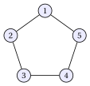
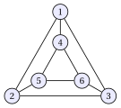
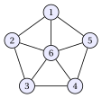

# Esercizi · Formulazioni dei problemi di colorazione

**Esercizi · Capitolo 11** · ogni soluzione si apre con un clic · [:material-book-open-variant: Capitolo 11: Problemi di colorazione](../formulazioni/coloring-formulations/index.md) · [:material-file-pdf-box: Eserciziario, volume 2 (PDF)](../pdf/esercizi-2-formulazioni.pdf)

!!! chiave ""

    <strong>Formulazioni usate in questi esercizi.</strong> Il modello $\mathrm{ILP}_{\mathrm{VCP}}$ del capitolo [Formulazioni dei problemi di colorazione](../formulazioni/coloring-formulations/index.md), con l'insieme dei colori $\mathscr{C}=\{1,\dots,k\}$:

    \begin{align*}
    && \min ~~ \sum_{c\in\mathscr{C}} y_c \tag{C0}\\
    && \text{soggetto a} \quad \sum_{c\in\mathscr{C}} x_{vc} &= 1, & \forall v\in V, \tag{C1}\\
    && -x_{uc}-x_{vc}+y_c &\ge 0, & \forall c\in\mathscr{C},~\forall\{u,v\}\in E, \tag{C2}\\
    && x_{vc} &\in\{0,1\}, & \forall v\in V,~\forall c\in\mathscr{C}, \tag{C3}\\
    && y_c &\in\{0,1\}, & \forall c\in\mathscr{C}. \tag{C4}
    \end{align*}

    I rilassamenti $\mathrm{LP}\text{-}0_{\mathrm{VCP}}$ e $\mathrm{LP}_{\mathrm{VCP}}$ del capitolo rilassano (C3) e (C4) in $x_{vc}\ge 0$ e $y_c\ge 0$, con anche $y_c\le 1$ in $\mathrm{LP}_{\mathrm{VCP}}$. Per ogni grafo con almeno uno spigolo e ogni $k$ valido, una soluzione ottima di entrambi i rilassamenti è

    \begin{equation*}
    \tilde x_{v1}=\tilde x_{v2}=\frac{1}{2}~~(v\in V),\qquad \tilde y_1=\tilde y_2=1, \tag{C5}
    \end{equation*}

    con tutte le altre variabili pari a $0$, e $z(\mathrm{LP}\text{-}0_{\mathrm{VCP}})=z(\mathrm{LP}_{\mathrm{VCP}})=2$. Una soluzione duale ottima sceglie uno spigolo $\{u,v\}\in E$ e pone $\tilde\mu_u=\tilde\mu_v=1$, $\tilde\pi_{c\{u,v\}}=1$ per ogni colore $c$, e tutte le altre variabili duali pari a $0$.

!!! esercizio "Esercizio 11.1: Modello PLI del problema della colorazione dei vertici (1)"

    Consideriamo il seguente grafo $G=(V,E)$ con $5$ vertici ($n=5$) e $5$ spigoli ($m=5$):

    { .fig loading=lazy  }

    $$
    V=\{1,\dots,5\},
    $$

    $$
    E=\{\{1,2\},~\{2,3\},~\{3,4\},~\{4,5\},~\{1,5\}\}.
    $$

    Le classi di colore $\{1,3\}$, $\{2,4\}$ e $\{5\}$ formano una colorazione ammissibile.

    **Domande**

    1. Spiegare perché $k=3$ è un upper bound valido sul numero di colori di una soluzione ottima.

    2. Contare le variabili e i vincoli (oltre ai domini) del modello $\mathrm{ILP}_{\mathrm{VCP}}$ con $k=3$.

    3. Scrivere il modello $\mathrm{ILP}_{\mathrm{VCP}}$ con $k=3$ per questo grafo (scrivere i vincoli sugli spigoli per tutti i colori $c$ insieme).

    4. Risolvere il modello con Gurobi. Dare il valore ottimo e una colorazione ottima, e contare le partizioni ottime dei vertici in classi di colore.

??? soluzione "Soluzione"

    1. Le classi date non contengono spigoli: formano una colorazione ammissibile con $3$ colori. Quindi $z(\mathrm{ILP}_{\mathrm{VCP}})\le 3$ e $k=3$ è valido.

    2. Ci sono $k\,n=3\cdot5=15$ variabili $x_{vc}$ e $k=3$ variabili $y_c$, quindi $18$ variabili binarie. Ci sono $n=5$ vincoli di assegnamento e $k\,m=3\cdot5=15$ vincoli sugli spigoli, quindi $20$ vincoli lineari.

    3. Con $\mathscr{C}=\{1,2,3\}$ il modello $\mathrm{ILP}_{\mathrm{VCP}}$ è:

        $$
        \begin{array}{rlcl}
        {\min} & {y_1+y_2+y_3} &  &  \\[1ex]
        \text{soggetto a} & {x_{11}+x_{12}+x_{13}} & {=} & {1} \\
        & {x_{21}+x_{22}+x_{23}} & {=} & {1} \\
        & {x_{31}+x_{32}+x_{33}} & {=} & {1} \\
        & {x_{41}+x_{42}+x_{43}} & {=} & {1} \\
        & {x_{51}+x_{52}+x_{53}} & {=} & {1} \\
        & {-x_{11}-x_{21}+y_1} & {\ge} & {0} \\
        & {-x_{21}-x_{31}+y_1} & {\ge} & {0} \\
        & {-x_{31}-x_{41}+y_1} & {\ge} & {0} \\
        & {-x_{41}-x_{51}+y_1} & {\ge} & {0} \\
        & {-x_{11}-x_{51}+y_1} & {\ge} & {0} \\
        & {-x_{12}-x_{22}+y_2} & {\ge} & {0} \\
        & {-x_{22}-x_{32}+y_2} & {\ge} & {0} \\
        & {-x_{32}-x_{42}+y_2} & {\ge} & {0} \\
        & {-x_{42}-x_{52}+y_2} & {\ge} & {0} \\
        & {-x_{12}-x_{52}+y_2} & {\ge} & {0} \\
        & {-x_{13}-x_{23}+y_3} & {\ge} & {0} \\
        & {-x_{23}-x_{33}+y_3} & {\ge} & {0} \\
        & {-x_{33}-x_{43}+y_3} & {\ge} & {0} \\
        & {-x_{43}-x_{53}+y_3} & {\ge} & {0} \\
        & {-x_{13}-x_{53}+y_3} & {\ge} & {0} \\[1ex]
        & {x_{11},~x_{12},~x_{13},~\dots,~x_{53}} & {\in} & {\{0,1\}} \\
        & {y_1,~y_2,~y_3} & {\in} & {\{0,1\}}
        \end{array}
        $$

    4. Gurobi restituisce $z(\mathrm{ILP}_{\mathrm{VCP}})=3$. Due colori non bastano: il ciclo ha un numero dispari di vertici, e colori alternati lungo il ciclo darebbero lo stesso colore ai vertici $1$ e $5$. Una colorazione ottima è $\tilde Q_1=\{1,3\}$, $\tilde Q_2=\{2,4\}$, $\tilde Q_3=\{5\}$, cioè

        $$
        \tilde x_{11}=1,~~\tilde x_{31}=1,~~\tilde x_{22}=1,~~\tilde x_{42}=1,~~\tilde x_{53}=1,~~\tilde y_1=\tilde y_2=\tilde y_3=1 .
        $$

        Per enumerazione ci sono $5$ partizioni ottime: una classe è un solo vertice, e gli altri quattro vertici formano in modo unico due coppie di vertici non adiacenti. Con le $3!=6$ permutazioni dei colori, il modello ha $30$ soluzioni ottime.

!!! esercizio "Esercizio 11.2: Rilassamenti lineari del modello del VCP (1)"

    Consideriamo il seguente grafo $G=(V,E)$ con $4$ vertici ($n=4$) e $6$ spigoli ($m=6$):

    { .fig loading=lazy  }

    $$
    V=\{1,\dots,4\},
    $$

    $$
    E=\{\{1,2\},~\{1,3\},~\{1,4\},~\{2,3\},~\{2,4\},~\{3,4\}\}.
    $$

    Il grafo è completo, e usiamo $k=4$ colori.

    **Domande**

    1. Risolvere $\mathrm{LP}\text{-}0_{\mathrm{VCP}}$, $\mathrm{LP}_{\mathrm{VCP}}$ e $\mathrm{ILP}_{\mathrm{VCP}}$ con Gurobi.

    2. Scrivere la soluzione primale (C5) per questo grafo e verificare che è ammissibile per $\mathrm{LP}_{\mathrm{VCP}}$.

    3. Scrivere la soluzione duale del capitolo costruita sullo spigolo $\{1,2\}$ e verificare che è ammissibile per $D(\mathrm{LP}\text{-}0_{\mathrm{VCP}})$, con lo stesso valore obiettivo.

    4. Calcolare il gap assoluto e il rapporto fra il bound del rilassamento e il valore ottimo. Descrivere che cosa succede sul grafo completo con $n$ vertici.

??? soluzione "Soluzione"

    Usiamo la soluzione primale (C5) e la soluzione duale costruita su uno spigolo, date nel box all'inizio del capitolo.

    1. Gurobi dà $z(\mathrm{LP}\text{-}0_{\mathrm{VCP}})=z(\mathrm{LP}_{\mathrm{VCP}})=2$ e $z(\mathrm{ILP}_{\mathrm{VCP}})=4$: tutti i vertici sono a due a due adiacenti, quindi richiedono $4$ colori diversi.

    2. La soluzione è $\tilde x_{v1}=\tilde x_{v2}=\frac{1}{2}$ per $v=1,\dots,4$, $\tilde x_{v3}=\tilde x_{v4}=0$, $\tilde y_1=\tilde y_2=1$ e $\tilde y_3=\tilde y_4=0$.

        - Assegnamento: $\frac{1}{2}+\frac{1}{2}=1$ per ogni vertice.

        - Spigoli, colori $1$ e $2$: $\tilde y_c-\tilde x_{uc}-\tilde x_{vc}=1-\frac{1}{2}-\frac{1}{2}=0$. Colori $3$ e $4$: $0-0-0=0$.

        - Limiti: $0\le\tilde y_c\le 1$ per ogni colore.

        Il suo valore è $\tilde y_1+\tilde y_2=2$.

    3. La soluzione duale è $\tilde\mu_1=\tilde\mu_2=1$, $\tilde\mu_3=\tilde\mu_4=0$, $\tilde\pi_{c\{1,2\}}=1$ per $c=1,\dots,4$, e tutti gli altri $\tilde\pi_{ce}=0$.

        - Vertici $1$ e $2$: lo spigolo $\{1,2\}$ è incidente in entrambi, quindi $\tilde\mu_v-\sum_{e\in\delta(v)}\tilde\pi_{ce}=1-1=0$ per ogni colore.

        - Vertici $3$ e $4$: $0-0=0$, poiché nessuno spigolo incidente in essi ha valore diverso da zero.

        - Colori: $\sum_{e\in E}\tilde\pi_{ce}=1\le 1$ per ogni colore.

        Il suo valore è $\tilde\mu_1+\tilde\mu_2=2$, pari al valore primale: per la dualità debole della PL entrambe le soluzioni sono ottime.

    4. Il gap assoluto è $4-2=2$ e il rapporto è $\frac{z(\mathrm{LP}_{\mathrm{VCP}})}{z(\mathrm{ILP}_{\mathrm{VCP}})}=\frac{1}{2}$. Sul grafo completo con $n$ vertici il valore ottimo è $n$ e il bound del rilassamento è ancora $2$: il gap $n-2$ cresce senza limite e il rapporto $\frac{2}{n}$ tende a $0$.

!!! esercizio "Esercizio 11.3: Soluzioni ammissibili del modello del VCP (1)"

    Consideriamo il seguente grafo $G=(V,E)$ con $5$ vertici ($n=5$) e $5$ spigoli ($m=5$):

    { .fig loading=lazy  }

    $$
    V=\{1,\dots,5\},
    $$

    $$
    E=\{\{1,2\},~\{2,3\},~\{3,4\},~\{4,5\},~\{1,5\}\}.
    $$

    Usiamo il modello $\mathrm{ILP}_{\mathrm{VCP}}$ con $k=3$ colori. Le soluzioni candidate sono (le variabili non elencate valgono $0$):

    - **(a)** colore $1$: $\{1,3\}$, colore $2$: $\{2,4\}$, colore $3$: $\{5\}$, e $y_1=y_2=y_3=1$;

    - **(b)** colore $1$: $\{1,3\}$, colore $2$: $\{2,4,5\}$, e $y_1=y_2=1$, $y_3=0$;

    - **(c)** colore $1$: $\{1,3\}$, colore $2$: $\{2,4\}$, colore $3$: $\{5\}$, e $y_1=y_2=1$, $y_3=0$;

    - **(d)** $x_{v1}=x_{v2}=\frac{1}{2}$ per ogni vertice $v$, e $y_1=y_2=1$, $y_3=0$;

    - **(e)** $x_{vc}=\frac{1}{3}$ per ogni vertice $v$ e colore $c$, e $y_1=y_2=y_3=\frac{2}{3}$.

    **Domande**

    1. Per ogni candidata, verificare i vincoli di assegnamento e i vincoli sugli spigoli, e indicare un vincolo violato quando c'è.

    2. Stabilire quali candidate sono ammissibili per $\mathrm{ILP}_{\mathrm{VCP}}$ e quali per $\mathrm{LP}_{\mathrm{VCP}}$, e dare il valore di quelle ammissibili.

    3. Stabilire quali candidate sono ottime per $\mathrm{LP}_{\mathrm{VCP}}$. Usare Gurobi per confermare il valore ottimo del rilassamento.

??? soluzione "Soluzione"

    1. - **(a)** Ogni vertice ha un colore, e nessuno spigolo ha entrambi gli estremi nella stessa classe: tutti i vincoli valgono.

        - **(b)** Lo spigolo $\{4,5\}$ ha entrambi gli estremi con il colore $2$: il vincolo $-x_{42}-x_{52}+y_2\ge 0$ diventa $-1-1+1=-1<0$.

        - **(c)** Il vertice $5$ prende il colore $3$ ma $y_3=0$: il vincolo $-x_{43}-x_{53}+y_3\ge 0$ diventa $0-1+0=-1<0$.

        - **(d)** Ogni vertice ha $\frac{1}{2}+\frac{1}{2}=1$; per i colori $1$ e $2$ ogni spigolo dà $1-\frac{1}{2}-\frac{1}{2}=0$, per il colore $3$ dà $0$: tutti i vincoli valgono.

        - **(e)** Ogni vertice ha $3\cdot\frac{1}{3}=1$; ogni spigolo e colore danno $\frac{2}{3}-\frac{1}{3}-\frac{1}{3}=0$: tutti i vincoli valgono.

    2. - **(a)** Ammissibile per $\mathrm{ILP}_{\mathrm{VCP}}$ e per $\mathrm{LP}_{\mathrm{VCP}}$, di valore $3$.

        - **(b)** Inammissibile per entrambi i modelli.

        - **(c)** Inammissibile per entrambi i modelli.

        - **(d)** Ammissibile solo per $\mathrm{LP}_{\mathrm{VCP}}$ (variabili frazionarie), di valore $2$.

        - **(e)** Ammissibile solo per $\mathrm{LP}_{\mathrm{VCP}}$, di valore $3\cdot\frac{2}{3}=2$.

    3. Il valore di ogni soluzione ammissibile di $\mathrm{LP}_{\mathrm{VCP}}$ è almeno $2$, e Gurobi dà $z(\mathrm{LP}_{\mathrm{VCP}})=2$: le candidate (d) ed (e) sono entrambe ottime per il rilassamento. La candidata (d) è la soluzione del capitolo; la (e) mostra che la soluzione ottima del rilassamento non è unica. La candidata (a) è ottima per $\mathrm{ILP}_{\mathrm{VCP}}$, il cui valore è $3$.

!!! esercizio "Esercizio 11.4: Soluzioni duali dei rilassamenti del VCP (1)"

    Consideriamo il seguente grafo $G=(V,E)$ con $6$ vertici ($n=6$) e $9$ spigoli ($m=9$):

    { .fig loading=lazy  }

    $$
    V=\{1,\dots,6\},
    $$

    \begin{align*}
    E=\{ & \{1,2\},~\{1,3\},~\{2,3\},~\{4,5\},~\{4,6\},\\
    & \{5,6\},~\{1,4\},~\{2,5\},~\{3,6\}\}.
    \end{align*}

    Usiamo $k=3$ colori. Ogni vertice ha grado $3$.

    **Domande**

    1. Scrivere i vincoli del duale $D(\mathrm{LP}\text{-}0_{\mathrm{VCP}})$ associati alla variabile $x_{1c}$ e alla variabile $y_c$, per un colore $c$.

    2. Verificare che le soluzioni duali del capitolo costruite sullo spigolo $\{1,4\}$ e sullo spigolo $\{2,3\}$ sono ammissibili, e darne il valore.

    3. Verificare che anche $\tilde\mu_v=\frac{1}{3}=\frac{\deg(v)}{|E|}$ per ogni vertice e $\tilde\pi_{ce}=\frac{1}{9}$ per ogni colore e spigolo è una soluzione duale ottima.

    4. Aggiungere i limiti $y_c\le 1$, con variabili duali $\lambda_c\le 0$. Dare una soluzione ottima di $D(\mathrm{LP}_{\mathrm{VCP}})$, e confrontare i due rilassamenti con il valore ottimo (usare Gurobi).

??? soluzione "Soluzione"

    Usiamo la soluzione primale (C5) e la soluzione duale costruita su uno spigolo, date nel box all'inizio del capitolo.

    1. Gli spigoli incidenti nel vertice $1$ sono $\{1,2\}$, $\{1,3\}$ e $\{1,4\}$. Il vincolo di $x_{1c}$ e il vincolo di $y_c$ sono

        $$
        \mu_1-\pi_{c\{1,2\}}-\pi_{c\{1,3\}}-\pi_{c\{1,4\}}\le 0,\qquad \sum_{e\in E}\pi_{ce}\le 1 .
        $$

    2. Per lo spigolo $\{1,4\}$: $\tilde\mu_1=\tilde\mu_4=1$ e $\tilde\pi_{c\{1,4\}}=1$ per $c=1,2,3$. I vertici $1$ e $4$ danno $1-1=0$, gli altri vertici danno $0-0=0$, e ogni colore dà $\sum_e\tilde\pi_{ce}=1$. Il valore è $2$.

        Per lo spigolo $\{2,3\}$ la verifica è la stessa con i vertici $2$ e $3$: anche questa soluzione è ammissibile, di valore $2$. Entrambe sono ottime, poiché $z(\mathrm{LP}\text{-}0_{\mathrm{VCP}})=2$.

    3. Ogni vertice ha $3$ spigoli incidenti, quindi $\tilde\mu_v-\sum_{e\in\delta(v)}\tilde\pi_{ce}=\frac{1}{3}-3\cdot\frac{1}{9}=0$. Ogni colore dà $\sum_{e\in E}\tilde\pi_{ce}=9\cdot\frac{1}{9}=1$. Il valore è

        $$
        \sum_{v\in V}\tilde\mu_v=6\cdot\frac{1}{3}=2,
        $$

        il valore ottimo: questa soluzione duale distribuisce il peso su tutti gli spigoli, invece di sceglierne uno.

    4. Le soluzioni duali precedenti con $\tilde\lambda_c=0$ per ogni colore soddisfano $\sum_e\tilde\pi_{ce}+\tilde\lambda_c\le 1$ e hanno valore $2$. Gurobi dà $z(\mathrm{LP}\text{-}0_{\mathrm{VCP}})=z(\mathrm{LP}_{\mathrm{VCP}})=2$ e $z(\mathrm{ILP}_{\mathrm{VCP}})=3$: i limiti $y_c\le 1$ non rafforzano il rilassamento, che resta a $2$ mentre il grafo richiede $3$ colori (contiene il triangolo $\{1,2,3\}$).

!!! esercizio "Esercizio 11.5: Gap di integralità del modello del VCP (1)"

    Consideriamo il seguente grafo $G=(V,E)$ con $6$ vertici ($n=6$) e $10$ spigoli ($m=10$):

    { .fig loading=lazy  }

    $$
    V=\{1,\dots,6\},
    $$

    \begin{align*}
    E=\{ & \{1,2\},~\{2,3\},~\{3,4\},~\{4,5\},~\{1,5\},\\
    & \{1,6\},~\{2,6\},~\{3,6\},~\{4,6\},~\{5,6\}\}.
    \end{align*}

    Il grafo è un ciclo sui vertici $1,\dots,5$ con il vertice $6$ adiacente a tutti. Le classi $\{1,3\}$, $\{2,4\}$, $\{5\}$, $\{6\}$ formano una colorazione ammissibile, quindi usiamo $k=4$.

    **Domande**

    1. Calcolare $z(\mathrm{LP}_{\mathrm{VCP}})$ e $z(\mathrm{ILP}_{\mathrm{VCP}})$ con Gurobi, e spiegare il valore ottimo.

    2. Calcolare il gap assoluto e il rapporto $\frac{z(\mathrm{LP}_{\mathrm{VCP}})}{z(\mathrm{ILP}_{\mathrm{VCP}})}$.

    3. Risolvere di nuovo il rilassamento con $k=6$. Stabilire se un $k$ più grande cambia il bound.

    4. Sul grafo completo con $n$ vertici, trovare il più piccolo $n$ per cui il rapporto è al più $\frac{1}{5}$.

??? soluzione "Soluzione"

    Usiamo la soluzione primale (C5) e la soluzione duale costruita su uno spigolo, date nel box all'inizio del capitolo.

    1. Gurobi dà $z(\mathrm{LP}_{\mathrm{VCP}})=2$ e $z(\mathrm{ILP}_{\mathrm{VCP}})=4$. Il ciclo $1,\dots,5$ richiede $3$ colori, e il vertice $6$, adiacente a tutti i suoi vertici, ne richiede un quarto.

    2. Il gap assoluto è $4-2=2$ e il rapporto è $\frac{z(\mathrm{LP}_{\mathrm{VCP}})}{z(\mathrm{ILP}_{\mathrm{VCP}})}=\frac{1}{2}$.

    3. Con $k=6$ Gurobi dà di nuovo $z(\mathrm{LP}_{\mathrm{VCP}})=2$. Il valore $2$ non dipende da $k$: la soluzione del capitolo usa solo i colori $1$ e $2$, qualunque sia il numero di colori.

    4. Sul grafo completo il rapporto è $\frac{2}{n}$, e $\frac{2}{n}\le\frac{1}{5}$ significa $n\ge 10$. Il valore più piccolo è $n=10$.
