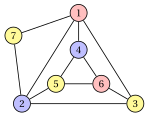
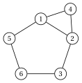
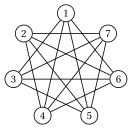
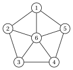
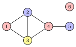

# Esercizi · Problemi di colorazione

**Esercizi · Capitolo 4** · ogni soluzione si apre con un clic · [:material-book-open-variant: Capitolo 4: Problemi di colorazione](../problemi-di-ottimizzazione-combinatoria/coloring/index.md) · [:material-file-pdf-box: Eserciziario, volume 1 (PDF)](../pdf/esercizi-1-problemi-di-ottimizzazione-combinatoria.pdf)

!!! esercizio "Esercizio 4.1: Verificare una colorazione (VCP)"

    Consideriamo il grafo $G=(V,E)$ con $V=\{1,\dots,7\}$ e i lati

    $$
    E=\{\{1,2\},\{1,3\},\{1,4\},\{1,7\},\{2,3\},\{2,5\},\{2,7\},\{3,6\},\{4,5\},\{4,6\},\{5,6\}\},
    $$

    disegnato qui sotto:

    { .fig loading=lazy  }

    e le tre soluzioni proposte

    \begin{align*}
    \mathcal{Q}_a&=\{\{1,6\},\{2,4\},\{3,5,7\}\},\\
    \mathcal{Q}_b&=\{\{1,5,6\},\{2,4\},\{3,7\}\},\\
    \mathcal{Q}_c&=\{\{1,6\},\{2,4\},\{3,5\}\}.
    \end{align*}

    **Domande**

    1. Per ogni soluzione proposta, stabilire se è una soluzione ammissibile del VCP.

    2. Trovare una clique con $3$ vertici. Quale bound duale fornisce?

    3. Stabilire se la soluzione ammissibile della Domanda 1 è ottima, e disegnarla.

??? soluzione "Soluzione"

    1. - $\mathcal{Q}_a$ è una partizione di $V$ e nessun lato unisce due vertici della stessa classe: ammissibile, con $3$ colori.

        - $\mathcal{Q}_b$ è una partizione di $V$, ma la classe $\{1,5,6\}$ contiene il lato $\{5,6\}$: non è un insieme stabile. Non ammissibile.

        - $\mathcal{Q}_c$ non è una partizione di $V$: il vertice $7$ non ha colore. Non ammissibile.

    2. I vertici $\{1,2,3\}$ sono a due a due adiacenti, quindi formano una clique; $G$ ha $3$ clique con $3$ vertici, $\{1,2,3\}$, $\{1,2,7\}$, $\{4,5,6\}$. Per il bound di clique, $\chi(G)\ge \omega(G)\ge 3$.

    3. $\mathcal{Q}_a$ usa $3$ colori e raggiunge il bound di clique: è ottima e $\chi(G)=3$.

        { .fig loading=lazy  }

    !!! chiave ""

        Solo $\mathcal{Q}_a$ è ammissibile; usa $3$ colori, tanti quanti i vertici di una clique: $\chi(G)=3$.

!!! esercizio "Esercizio 4.2: Intorni, clique e insiemi stabili (VCP)"

    Consideriamo il grafo $G=(V,E)$ con $V=\{1,\dots,6\}$ e i lati

    $$
    E=\{\{1,2\},\{1,4\},\{1,5\},\{2,3\},\{2,4\},\{3,6\},\{5,6\}\}.
    $$

    **Domande**

    1. Disegnare il grafo e calcolare l'intorno $N(v)$ e il grado di ogni vertice.

    2. Verificare le due ipotesi del VCP.

    3. Scrivere i lati del grafo complementare $\overline{G}$.

    4. Determinare $\omega(G)$ e $\alpha(G)$, con una clique massima e un insieme stabile massimo, e calcolare il bound di clique e il bound degli insiemi stabili.

    5. Trovare una colorazione ottima.

??? soluzione "Soluzione"

    1. Il grafo, e gli intorni e i gradi dei suoi vertici:

        { .fig loading=lazy  }

        $$
        \begin{array}{c|cccccc}
        \hline {v} & {1} & {2} & {3} & {4} & {5} & {6} \\
        \hline {N(v)} & {\{2,4,5\}} & {\{1,3,4\}} & {\{2,6\}} & {\{1,2\}} & {\{1,6\}} & {\{3,5\}} \\
        {\deg(v)} & {3} & {3} & {2} & {2} & {2} & {2} \\
        \hline
        \end{array}
        $$

        La somma dei gradi è $14=2|E|$, poiché ogni lato è contato in entrambi i suoi estremi.

    2. Ogni vertice ha grado almeno $1$, quindi non ci sono vertici isolati. Nessun intorno è contenuto in un altro: per ogni coppia $u\neq v$ la tabella mostra un vertice di $N(u)$ che non è in $N(v)$. Per esempio, $N(4)=\{1,2\}$ non è contenuto in nessun altro intorno, poiché nessun altro vertice è adiacente sia a $1$ sia a $2$. Entrambe le ipotesi sono soddisfatte.

    3. $\overline{G}$ ha come lati le $8$ coppie di vertici non adiacenti di $G$:

        $$
        \overline{E}=\{\{1,3\},\{1,6\},\{2,5\},\{2,6\},\{3,4\},\{3,5\},\{4,5\},\{4,6\}\}.
        $$

    4. I vertici $\{1,2,4\}$ formano un triangolo, quindi $\omega(G)\ge 3$. Una clique con $4$ vertici richiederebbe $4$ vertici di grado almeno $3$, e solo i vertici $1$ e $2$ hanno grado $3$: quindi $\omega(G)=3$. L'insieme $\{3,4,5\}$ è stabile; un insieme stabile con $4$ vertici sarebbe una clique con $4$ vertici di $\overline{G}$, e l'enumerazione mostra che non ne esistono: $\alpha(G)=3$. Il bound di clique dà $3$, il bound degli insiemi stabili $\lceil 6/3\rceil=2$.

    5. La colorazione $\{\{3,4,5\},\{1,6\},\{2\}\}$ ha classi stabili e usa $3$ colori, tanti quanti il bound di clique: è ottima e $\chi(G)=3$.

        { .fig loading=lazy  }

    !!! chiave ""

        $\omega(G)=3$ con la clique $\{1,2,4\}$, $\alpha(G)=3$ con l'insieme stabile $\{3,4,5\}$; il bound di clique è stretto e $\chi(G)=3$, mentre il bound degli insiemi stabili dà solo $2$.

!!! esercizio "Esercizio 4.3: Il bound degli insiemi stabili su un grafo complementare (VCP)"

    Il grafo $G=(V,E)$ ha i vertici $V=\{1,\dots,7\}$, e due vertici distinti sono adiacenti se e solo se <em>non</em> sono consecutivi sul ciclo $1,2,\dots,7,1$. In altre parole, $G$ è il complementare del ciclo $C_7$ con $7$ vertici:

    { .fig loading=lazy  }

    **Domande**

    1. Determinare il numero di lati di $G$ e il grado di ogni vertice.

    2. Calcolare $\alpha(G)$, usando il grafo complementare.

    3. Calcolare $\omega(G)$ e il bound di clique.

    4. Calcolare il bound degli insiemi stabili e trovare una colorazione ottima.

??? soluzione "Soluzione"

    1. $C_7$ ha $7$ lati sulle $\binom{7}{2}=21$ coppie, quindi $G$ ha $21-7=14$ lati. Ogni vertice è adiacente a tutti i vertici tranne se stesso e i suoi due vicini sul ciclo: grado $6-2=4$.

    2. Un insieme stabile di $G$ è una clique di $\overline{G}=C_7$. Le clique più grandi di un ciclo con $7$ vertici sono i suoi lati, poiché non ha triangoli: $\alpha(G)=2$, per esempio l'insieme stabile $\{1,2\}$.

    3. Una clique di $G$ è un insieme stabile di $C_7$: un insieme di vertici senza due vertici consecutivi sul ciclo. $\{1,3,5\}$ è un insieme di questo tipo; con $4$ vertici su $7$, due di essi sarebbero consecutivi. Quindi $\omega(G)=3$ e il bound di clique dà $\chi(G)\ge 3$.

    4. $\lceil n/\alpha(G)\rceil=\lceil 7/2\rceil=4$: ogni classe di colore ha al più $2$ vertici, e $7$ vertici richiedono almeno $4$ classi. La colorazione $\{\{1,2\},\{3,4\},\{5,6\},\{7\}\}$ usa coppie di vertici consecutivi, che non sono adiacenti in $G$: è ammissibile, usa $4$ colori e raggiunge il bound, quindi $\chi(G)=4$.

        { .fig loading=lazy  }

    !!! chiave ""

        Sul complementare di $C_7$ il bound di clique dà $3$, il bound degli insiemi stabili dà $\lceil 7/2\rceil=4$ e una colorazione con $4$ colori chiude il gap: $\chi(G)=4$.

!!! esercizio "Esercizio 4.4: Quando nessuno dei due bound è stretto (VCP)"

    La ruota $W_5$ è il grafo con i vertici $V=\{1,\dots,6\}$: i vertici $1,\dots,5$ formano un ciclo e il vertice $6$, il mozzo, è adiacente a tutti.

    { .fig loading=lazy  }

    **Domande**

    1. Calcolare $\omega(W_5)$, $\alpha(W_5)$ e i due bound duali del capitolo.

    2. Dimostrare che il ciclo $1,2,3,4,5$ non si può colorare con $2$ colori.

    3. Dimostrare che $\chi(W_5)=4$ e disegnare una colorazione ottima.

??? soluzione "Soluzione"

    1. Ogni triangolo usa il mozzo e un lato del ciclo, per esempio $\{1,2,6\}$; $4$ vertici a due a due adiacenti richiederebbero $3$ vertici a due a due adiacenti sul ciclo, che non ha triangoli. Quindi $\omega(W_5)=3$. Un insieme stabile contiene al più $2$ vertici del ciclo con $5$ vertici, e il mozzo è adiacente a tutti: $\alpha(W_5)=2$, per esempio $\{1,3\}$. Il bound di clique dà $3$ e il bound degli insiemi stabili $\lceil 6/2\rceil=3$.

    2. Con $2$ colori i colori devono alternarsi lungo il ciclo: $1$ riceve il colore A, $2$ il colore B, $3$ il colore A, $4$ il colore B, $5$ il colore A. Allora $5$ e $1$, che sono adiacenti, hanno lo stesso colore. Un ciclo con un numero dispari di vertici richiede $3$ colori.

    3. Il ciclo richiede almeno $3$ colori, e il mozzo è adiacente a tutti i vertici del ciclo, quindi richiede un colore tutto suo: $\chi(W_5)\ge 4$. La colorazione $\{\{1,3\},\{2,4\},\{5\},\{6\}\}$ è ammissibile e usa $4$ colori, quindi $\chi(W_5)=4$.

        { .fig loading=lazy  }

        Entrambi i bound del capitolo danno $3$: il gap si chiude con l'argomento sul ciclo dispari.

    !!! chiave ""

        $\omega(W_5)=3$ e $\lceil 6/\alpha(W_5)\rceil=3$, ma $\chi(W_5)=4$: il ciclo dispari richiede $3$ colori e il mozzo un quarto. Nessuno dei due bound è stretto.

!!! esercizio "Esercizio 4.5: Le ipotesi e la riduzione del grafo (VCP)"

    Consideriamo il grafo $G=(V,E)$ con $V=\{1,\dots,6\}$ e i lati

    $$
    E=\{\{1,2\},\{1,3\},\{2,3\},\{2,4\},\{3,4\},\{4,5\}\},
    $$

    disegnato qui sotto:

    { .fig loading=lazy  }

    **Domande**

    1. Calcolare gli intorni dei vertici. Stabilire quali ipotesi del VCP sono violate, e da quali vertici.

    2. Eliminare i vertici consentiti dalle ipotesi, uno alla volta, e calcolare il numero cromatico del grafo che resta.

    3. Estendere una colorazione del grafo ridotto a una colorazione ottima di $G$.

    4. Contare le soluzioni candidate di $G$, e quelle ammissibili per numero di colori.

??? soluzione "Soluzione"

    1. Gli intorni sono $N(1)=\{2,3\}$, $N(2)=\{1,3,4\}$, $N(3)=\{1,2,4\}$, $N(4)=\{2,3,5\}$, $N(5)=\{4\}$, $N(6)=\emptyset$.

        - Il vertice $6$ è isolato: la prima ipotesi è violata.

        - $N(1)=\{2,3\}\subseteq N(4)=\{2,3,5\}$ e $N(5)=\{4\}\subseteq N(2)=\{1,3,4\}$: la seconda ipotesi è violata dalle coppie $(1,4)$ e $(5,2)$.

    2. Eliminiamo il vertice isolato $6$, il vertice $1$ (dominato da $4$) e il vertice $5$ (dominato da $2$). Restano i vertici $2,3,4$, con i lati $\{2,3\},\{2,4\},\{3,4\}$: un triangolo, il cui numero cromatico è $3$. L'eliminazione di un vertice non cambia $\chi$, quindi $\chi(G)=3$.

    3. Coloriamo il triangolo con $\{2\},\{3\},\{4\}$ e reinseriamo ogni vertice eliminato: $1$ prende il colore di $4$, $5$ il colore di $2$, e $6$ un colore qualunque, per esempio quello di $4$. La colorazione è $\{\{1,4,6\},\{2,5\},\{3\}\}$:

        { .fig loading=lazy  }

    4. Le soluzioni candidate sono le partizioni dei $6$ vertici: $B(6)=203$. Quelle ammissibili, per enumerazione, sono:

        
<table>
        <tr>
        <th>colori</th>
        <th>partizioni ammissibili</th>
        </tr>
        <tr>
        <td>\(3\)</td>
        <td>\(6\)</td>
        </tr>
        <tr>
        <td>\(4\)</td>
        <td>\(18\)</td>
        </tr>
        <tr>
        <td>\(5\)</td>
        <td>\(9\)</td>
        </tr>
        <tr>
        <td>\(6\)</td>
        <td>\(1\)</td>
        </tr>
        <tr>
        <td>totale</td>
        <td>\(34\)</td>
        </tr>
        </table>

        Ci sono $6$ colorazioni ottime con $3$ colori.

    !!! chiave ""

        Il vertice isolato e i due vertici dominati si possono eliminare: resta il triangolo $\{2,3,4\}$, e $\chi(G)=3$.
