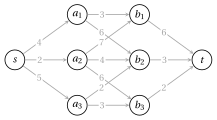
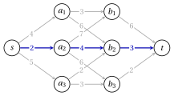

# Esercizi · Principi della programmazione dinamica

**Esercizi · Capitolo 16** · ogni soluzione si apre con un clic · [:material-book-open-variant: Capitolo 16: Principi](../programmazione-dinamica/dp-principles.md) · [:material-file-pdf-box: Eserciziario, volume 3 (PDF)](../pdf/esercizi-3-programmazione-dinamica.pdf)

!!! esercizio "Esercizio 16.1: Sottostruttura ottima e sottoproblemi sovrapposti: il problema dello zaino 0/1"

    Consideriamo il problema dello zaino 0/1 con $n=4$ oggetti e capacità $c=8$:

    $$
    \max\Big\{\sum_{j=1}^n p_jx_j:\ \sum_{j=1}^n w_jx_j\le c,\ x_j\in\{0,1\},\ j=1,\dots,n\Big\},
    $$

    con i dati

    $$
    \begin{array}{l|cccc}
    \hline  & {j=1} & {j=2} & {j=3} & {j=4} \\[1ex]
    \hline {p_j} & {3} & {5} & {4} & {5} \\[1ex]
    {w_j} & {2} & {4} & {3} & {3} \\
    \hline
    \end{array}
    $$

    Per $j\in\{0,\dots,n\}$ e $k\in\{0,\dots,c\}$, sia $v(j,k)$ il valore ottimo con i soli oggetti $1,\dots,j$ e capacità $k$.

    **Domande**

    1. Verificare la sottostruttura ottima: se una soluzione ottima del sottoproblema $(j,k)$ prende l'oggetto $j$, che cosa si può dire della sua restrizione agli oggetti $1,\dots,j-1$? Scrivere la ricorrenza per $v(j,k)$ e i casi base.

    2. Calcolare $v(4,8)$ dall'alto verso il basso (top-down) ed elencare, per ogni $j$, i sottoproblemi $(j,k)$ che la ricorsione genera. Quali sono generati più di una volta? Quale proprietà mostra questo fatto?

    3. Riempire riga per riga la tabella di memorizzazione di $v(j,k)$, memorizzando in $s(j,k)$ se l'oggetto $j$ è preso ($1$) oppure no ($0$); un pareggio si risolve a favore del non prenderlo.

    4. Ricostruire una soluzione ottima dalla tabella $s$.

??? soluzione "Soluzione"

    1. La sua restrizione è una soluzione del sottoproblema $(j-1,k-w_j)$, e deve essere ottima: una migliore, più l'oggetto $j$, batterebbe la soluzione ottima di $(j,k)$. Se l'oggetto $j$ non è preso, la restrizione è ottima per $(j-1,k)$. Quindi:

        !!! nota ""

            $$
            v(j,k)=\left\{\begin{array}{ll}
            \max\{v(j-1,k),\;p_j+v(j-1,k-w_j)\} & \textrm{se } j\ge 1,\ w_j\le k,\\[1ex]
            v(j-1,k) & \textrm{se } j\ge 1,\ w_j>k,\\[1ex]
            0 & \textrm{se } j=0.
            \end{array}\right.
            $$

    2. Ogni chiamata $(j,k)$ genera $(j-1,k)$ e, se $w_j\le k$, $(j-1,k-w_j)$:

        - $j=4$: $(4,8)$;

        - $j=3$: $(3,8)$, $(3,5)$;

        - $j=2$: $(2,8)$, $(2,5)$, $(2,5)$, $(2,2)$ (ripetuti: $(2,5)$);

        - $j=1$: $(1,8)$, $(1,4)$, $(1,5)$, $(1,1)$, $(1,5)$, $(1,1)$, $(1,2)$ (ripetuti: $(1,1)$, $(1,5)$);

        - $j=0$: $(0,8)$, $(0,6)$, $(0,4)$, $(0,2)$, $(0,5)$, $(0,3)$, $(0,1)$, $(0,5)$, $(0,3)$, $(0,1)$, $(0,2)$, $(0,0)$ (ripetuti: $(0,1)$, $(0,2)$, $(0,3)$, $(0,5)$);

        La ricorsione esegue $26$ chiamate per $19$ sottoproblemi distinti: i sottoproblemi si <strong>sovrappongono</strong> (gli oggetti $3$ e $4$ hanno lo stesso peso). Una tabella di memorizzazione calcola ogni valore una sola volta.

    3. Le tabelle $v$ e $s$ sono:

        $$
        \begin{array}{c|ccccccccc}
        \hline {v(j,k)} & {k=0} & {1} & {2} & {3} & {4} & {5} & {6} & {7} & {8} \\
        \hline {j=0} & {0} & {0} & {0} & {0} & {0} & {0} & {0} & {0} & {0} \\
        {j=1} & {0} & {0} & {3} & {3} & {3} & {3} & {3} & {3} & {3} \\
        {j=2} & {0} & {0} & {3} & {3} & {5} & {5} & {8} & {8} & {8} \\
        {j=3} & {0} & {0} & {3} & {4} & {5} & {7} & {8} & {9} & {9} \\
        {j=4} & {0} & {0} & {3} & {5} & {5} & {8} & {9} & {10} & {12} \\
        \hline
        \end{array}
        $$

        $$
        \begin{array}{c|ccccccccc}
        \hline {s(j,k)} & {k=0} & {1} & {2} & {3} & {4} & {5} & {6} & {7} & {8} \\
        \hline {j=0} & -- & -- & -- & -- & -- & -- & -- & -- & -- \\
        {j=1} & {0} & {0} & {1} & {1} & {1} & {1} & {1} & {1} & {1} \\
        {j=2} & {0} & {0} & {0} & {0} & {1} & {1} & {1} & {1} & {1} \\
        {j=3} & {0} & {0} & {0} & {1} & {0} & {1} & {0} & {1} & {1} \\
        {j=4} & {0} & {0} & {0} & {1} & {0} & {1} & {1} & {1} & {1} \\
        \hline
        \end{array}
        $$

        Per esempio $v(3,7)=\max\{v(2,7),\,4+v(2,4)\}=\max\{8,9\}=9$.

    4. Partendo da $(4,8)$:

        - $s(4,8)=1$: l'oggetto $4$ è preso, andare a $(3,8-3)=(3,5)$;

        - $s(3,5)=1$: l'oggetto $3$ è preso, andare a $(2,5-3)=(2,2)$;

        - $s(2,2)=0$: l'oggetto $2$ non è preso, andare a $(1,2)$;

        - $s(1,2)=1$: l'oggetto $1$ è preso, andare a $(0,2-2)=(0,0)$;

        La soluzione ottima è $\{1,3,4\}$, di peso $2+3+3=8\le 8$ e profitto $3+4+5=12=v(4,8)$. Le celle visitate:

        $$
        \begin{array}{c|ccccccccc}
        \hline {v(j,k)} & {k=0} & {1} & {2} & {3} & {4} & {5} & {6} & {7} & {8} \\
        \hline {j=0} & \bbox[#9999ff]{{0}} & {0} & {0} & {0} & {0} & {0} & {0} & {0} & {0} \\
        {j=1} & {0} & {0} & \bbox[#9999ff]{{3}} & {3} & {3} & {3} & {3} & {3} & {3} \\
        {j=2} & {0} & {0} & \bbox[#9999ff]{{3}} & {3} & {5} & {5} & {8} & {8} & {8} \\
        {j=3} & {0} & {0} & {3} & {4} & {5} & \bbox[#9999ff]{{7}} & {8} & {9} & {9} \\
        {j=4} & {0} & {0} & {3} & {5} & {5} & {8} & {9} & {10} & \bbox[#9999ff]{{12}} \\
        \hline
        \end{array}
        $$

    !!! chiave ""

        $v(4,8)=12$ con gli oggetti $\{1,3,4\}$; la ricorsione top-down esegue $26$ chiamate per $19$ sottoproblemi distinti, la tabella di memorizzazione ha $(n+1)(c+1)=45$ celle.

!!! esercizio "Esercizio 16.2: Scrivere una ricorrenza: il subset sum tramite le somme raggiungibili"

    Dati $n=5$ oggetti con pesi interi $w_j$ e una capacità $c=30$, la versione di ottimizzazione del <strong>problema del subset sum</strong> chiede un sottoinsieme di oggetti di peso totale massimo che non superi $c$:

    $$
    \max\Big\{\sum_{j=1}^n w_jx_j:\ \sum_{j=1}^n w_jx_j\le c,\ x_j\in\{0,1\},\ j=1,\dots,n\Big\}.
    $$

    The data are

    $$
    \begin{array}{l|ccccc}
    \hline  & {j=1} & {j=2} & {j=3} & {j=4} & {j=5} \\[1ex]
    \hline {w_j} & {6} & {9} & {11} & {14} & {17} \\
    \hline
    \end{array}
    $$

    Per $j\in\{0,\dots,n\}$, sia $R_j$ l'insieme delle <strong>somme raggiungibili</strong>: i totali $k\le c$ dei sottoinsiemi di $\{1,\dots,j\}$.

    **Domande**

    1. Scrivere una ricorrenza per $R_j$, distinguendo se l'oggetto $j$ è usato, con il caso base. Come si legge il valore ottimo $z$ da $R_n$?

    2. Calcolare $R_1,\dots,R_n$. Per ogni somma raggiungibile, memorizzare il primo indice $j$ tale che essa appartiene a $R_j$.

    3. Ricostruire una soluzione ottima.

    4. Prendere gli oggetti in modo greedy per peso non crescente, finché entrano. Il risultato è ottimo?

??? soluzione "Soluzione"

    1. Un sottoinsieme di $\{1,\dots,j\}$ o non contiene l'oggetto $j$, e allora il suo totale è in $R_{j-1}$, o lo usa, e allora il suo totale è $k+w_j$ con $k\in R_{j-1}$. Quindi:

        !!! nota ""

            $$
            R_j=\left\{\begin{array}{ll}
            R_{j-1}\,\cup\,\{k+w_j:\ k\in R_{j-1},\ k+w_j\le c\} & \textrm{se } 1\le j\le n,\\[1ex]
            \{0\} & \textrm{se } j=0,
            \end{array}\right.
            $$

            $$
            z=\max\{k:\ k\in R_n\}.
            $$

        È il KP con $p_j=w_j$, scritto con insiemi di valori raggiungibili.

    2. La riga $j$ elenca solo le somme nuove; una somma appartiene a $R_j$ se compare in una riga $\le j$:

        
<table>
        <tr>
        <th>\(j\)</th>
        <th>\(w_j\)</th>
        <th>somme di \(R_j\) che non sono in \(R_{j-1}\)</th>
        </tr>
        <tr>
        <td>\(0\)</td>
        <td>—</td>
        <td>\(0\)</td>
        </tr>
        <tr>
        <td>\(1\)</td>
        <td>\(6\)</td>
        <td>\(6\)</td>
        </tr>
        <tr>
        <td>\(2\)</td>
        <td>\(9\)</td>
        <td>\(9, 15\)</td>
        </tr>
        <tr>
        <td>\(3\)</td>
        <td>\(11\)</td>
        <td>\(11, 17, 20, 26\)</td>
        </tr>
        <tr>
        <td>\(4\)</td>
        <td>\(14\)</td>
        <td>\(14, 23, 25, 29\)</td>
        </tr>
        <tr>
        <td>\(5\)</td>
        <td>\(17\)</td>
        <td>\(28\)</td>
        </tr>
        </table>

        Quindi $|R_5|=13$ e $z=\max R_5=29$.

    3. Una somma $k$ che compare per la prima volta in $R_j$ usa l'oggetto $j$, e $k-w_j$ sta in $R_{j-1}$:

        - $29$ compare per la prima volta in $R_{4}$: l'oggetto $4$ è preso, andare a $29-14=15$;

        - $15$ compare per la prima volta in $R_{2}$: l'oggetto $2$ è preso, andare a $15-9=6$;

        - $6$ compare per la prima volta in $R_{1}$: l'oggetto $1$ è preso, andare a $6-6=0$;

        La soluzione ottima è $\{1,2,4\}$, di totale $6+9+14=29\le 30$.

    4. La scelta greedy prende gli oggetti $5, 3$, di totale $11+17=28<29$: non è ottima.

    !!! chiave ""

        $z=29$ con gli oggetti $\{1,2,4\}$; le somme raggiungibili sono $13$, mentre i sottoinsiemi sono $2^5=32$. La scelta greedy per peso dà solo $28$.

!!! esercizio "Esercizio 16.3: Riusare una ricorrenza: due macchine parallele tramite il subset sum"

    Nel problema $P2\|C_{\max}$, $n=6$ lavori con tempi di processamento interi $p_j$ sono assegnati a $2$ macchine identiche, e si minimizza il <strong>makespan</strong> $C_{\max}$, il carico massimo di una macchina:

    $$
    \begin{array}{l|cccccc}
    \hline  & {j=1} & {j=2} & {j=3} & {j=4} & {j=5} & {j=6} \\[1ex]
    \hline {p_j} & {13} & {11} & {10} & {5} & {4} & {3} \\
    \hline
    \end{array}
    $$

    Siano $P=\sum_j p_j=46$ e $L$ il carico della macchina $1$.

    **Domande**

    1. Esprimere $C_{\max}$ in funzione di $L$. Mostrare che minimizzare $C_{\max}$ equivale alla versione di ottimizzazione del problema del subset sum, con capacità $\lfloor P/2\rfloor$, e scrivere la ricorrenza delle sue somme raggiungibili.

    2. Calcolare le somme raggiungibili $R_1,\dots,R_n$.

    3. Ricostruire un assegnamento ottimo e il suo makespan.

    4. Confrontare con la regola LPT: lavori per $p_j$ non crescente, ciascuno sulla macchina meno carica.

??? soluzione "Soluzione"

    1. La macchina $2$ riceve $P-L$, quindi $C_{\max}=\max\{L,\,P-L\}\ge P/2$. A meno di scambiare le macchine possiamo supporre $L\le P/2$, e allora $C_{\max}=P-L$ è minimo quando $L$ è massimo: un problema del subset sum con capacità $c=\lfloor 46/2\rfloor=23$ e pesi $p_j$:

        !!! nota ""

            $$
            R_j=\left\{\begin{array}{ll}
            R_{j-1}\,\cup\,\{k+p_j:\ k\in R_{j-1},\ k+p_j\le c\} & \textrm{se } 1\le j\le n,\\[1ex]
            \{0\} & \textrm{se } j=0,
            \end{array}\right.
            $$

            $$
            z=P-\max\{k:\ k\in R_n\}.
            $$

    2. La riga $j$ elenca solo le somme nuove:

        
<table>
        <tr>
        <th>\(j\)</th>
        <th>\(p_j\)</th>
        <th>somme di \(R_j\) che non sono in \(R_{j-1}\)</th>
        </tr>
        <tr>
        <td>\(0\)</td>
        <td>—</td>
        <td>\(0\)</td>
        </tr>
        <tr>
        <td>\(1\)</td>
        <td>\(13\)</td>
        <td>\(13\)</td>
        </tr>
        <tr>
        <td>\(2\)</td>
        <td>\(11\)</td>
        <td>\(11\)</td>
        </tr>
        <tr>
        <td>\(3\)</td>
        <td>\(10\)</td>
        <td>\(10, 21, 23\)</td>
        </tr>
        <tr>
        <td>\(4\)</td>
        <td>\(5\)</td>
        <td>\(5, 15, 16, 18\)</td>
        </tr>
        <tr>
        <td>\(5\)</td>
        <td>\(4\)</td>
        <td>\(4, 9, 14, 17, 19, 20, 22\)</td>
        </tr>
        <tr>
        <td>\(6\)</td>
        <td>\(3\)</td>
        <td>\(3, 7, 8, 12\)</td>
        </tr>
        </table>

        La somma raggiungibile massima è $L=23$, e il makespan ottimo è $z=46-23=23$, uguale al lower bound $\lceil P/2\rceil=23$.

    3. - $23$ compare per la prima volta in $R_{3}$: l'oggetto $3$ è preso, andare a $23-10=13$;

        - $13$ compare per la prima volta in $R_{1}$: l'oggetto $1$ è preso, andare a $13-13=0$;

        La macchina $1$ riceve i lavori $\{1,3\}$ (carico $13+10=23$), la macchina $2$ i lavori $\{2,4,5,6\}$ (carico $11+5+4+3=23$).

    4. LPT assegna alle macchine i lavori $\{1,4,5\}$ e $\{2,3,6\}$, con carichi $22$ e $24$: makespan $24>23$, non ottimo.

    !!! chiave ""

        Il makespan ottimo è $z=23$, con i lavori $\{1,3\}$ sulla macchina $1$ e $\{2,4,5,6\}$ sulla macchina $2$; LPT dà $24$.

!!! esercizio "Esercizio 16.4: Cammino minimo in una rete a livelli"

    Cerchiamo un cammino minimo da $s$ a $t$ nella rete orientata $G=(N,A)$ qui sotto, in cui ogni arco $(i,j)\in A$ ha un costo $c_{ij}$:

    { .fig loading=lazy  }

    Per ogni nodo $i$, sia $v(i)$ il costo di un cammino minimo da $i$ a $t$.

    **Domande**

    1. Verificare la sottostruttura ottima: se un cammino minimo da $s$ a $t$ passa per il nodo $i$, che cosa si può dire della sua parte da $i$ a $t$? Scrivere la ricorrenza per $v(i)$ e il caso base.

    2. Quali valori $v(i)$ servono a più di un nodo? Quale proprietà della PD mostra questo fatto?

    3. Calcolare i valori $v(i)$ a ritroso, da $t$ a $s$, memorizzando in $s(i)$ il successore di $i$ sul cammino migliore (i pareggi si risolvono a favore del nodo elencato per primo).

    4. Ricostruire il cammino minimo e confrontarne il costo con l'enumerazione di tutti i cammini.

??? soluzione "Soluzione"

    1. La parte da $i$ a $t$ deve essere un cammino minimo da $i$ a $t$: uno più corto darebbe un cammino più corto da $s$ a $t$. Il primo arco uscente da $i$ va in un successore $j$, quindi:

        !!! nota ""

            $$
            v(i)=\left\{\begin{array}{ll}
            \min\{c_{ij}+v(j):(i,j)\in A\} & \textrm{se } i\neq t,\\[1ex]
            0 & \textrm{se } i=t.
            \end{array}\right.
            $$

    2. I valori $v(b_1)$, $v(b_2)$, $v(b_3)$ servono ai nodi $a_1,a_2,a_3$ che puntano a essi: $v(b_1)$ a $2$ nodi, $v(b_2)$ a $3$ e $v(b_3)$ a $2$. I sottoproblemi si sovrappongono: con una tabella di memorizzazione ogni valore si calcola una sola volta.

    3. I valori, a ritroso da $t$:

        
<table>
        <tr>
        <th>nodo \(i\)</th>
        <th>\(c_{ij}+v(j)\) per \((i,j)\in A\)</th>
        <th>\(v(i)\)</th>
        <th>\(s(i)\)</th>
        </tr>
        <tr>
        <td>\(t\)</td>
        <td>—</td>
        <td>\(0\)</td>
        <td>—</td>
        </tr>
        <tr>
        <td>\(b_3\)</td>
        <td>\(2+0=2\)</td>
        <td>\(2\)</td>
        <td>\(t\)</td>
        </tr>
        <tr>
        <td>\(b_2\)</td>
        <td>\(3+0=3\)</td>
        <td>\(3\)</td>
        <td>\(t\)</td>
        </tr>
        <tr>
        <td>\(b_1\)</td>
        <td>\(6+0=6\)</td>
        <td>\(6\)</td>
        <td>\(t\)</td>
        </tr>
        <tr>
        <td>\(a_3\)</td>
        <td>\(2+3=5\), \(3+2=5\)</td>
        <td>\(5\)</td>
        <td>\(b_2\)</td>
        </tr>
        <tr>
        <td>\(a_2\)</td>
        <td>\(7+6=13\), \(4+3=7\), \(6+2=8\)</td>
        <td>\(7\)</td>
        <td>\(b_2\)</td>
        </tr>
        <tr>
        <td>\(a_1\)</td>
        <td>\(3+6=9\), \(6+3=9\)</td>
        <td>\(9\)</td>
        <td>\(b_1\)</td>
        </tr>
        <tr>
        <td>\(s\)</td>
        <td>\(4+9=13\), \(2+7=9\), \(5+5=10\)</td>
        <td>\(9\)</td>
        <td>\(a_2\)</td>
        </tr>
        </table>

    4. Seguendo la tabella $s$ a partire da $s$: $s\to a_2\to b_2\to t$, di costo $2+4+3=9=v(s)$:

        { .fig loading=lazy  }

        La rete ha $7$ cammini da $s$ a $t$; la loro enumerazione dà lo stesso cammino ottimo, l'unico di costo $9$.

    !!! chiave ""

        $v(s)=9$, con il cammino minimo $s\to a_2\to b_2\to t$; i valori dei nodi $b_k$ si calcolano una volta e si usano più volte.

!!! esercizio "Esercizio 16.5: Una tabella a due indici: il problema dello zaino a scelta multipla"

    Nel <strong>problema dello zaino a scelta multipla</strong> gli oggetti sono partizionati in classi $\mathscr J_1,\dots,\mathscr J_q$, e si sceglie <strong>esattamente un</strong> oggetto per classe, con peso totale al più $c$ e profitto totale massimo:

    $$
    \max\Big\{\sum_{h=1}^q\sum_{j\in \mathscr J_h} p_jx_j:\ \sum_{h=1}^q\sum_{j\in \mathscr J_h} w_jx_j\le c,\ \sum_{j\in \mathscr J_h}x_j=1,\ h=1,\dots,q,\ x_j\in\{0,1\}\Big\}.
    $$

    Qui $q=3$, $c=10$ e

    
<table>
    <tr>
    <th>classe</th>
    <th colspan="3">\(\mathscr J_1\)</th>
    <th colspan="3">\(\mathscr J_2\)</th>
    <th colspan="3">\(\mathscr J_3\)</th>
    </tr>
    <tr>
    <td>\(j\)</td>
    <td>\(1\)</td>
    <td>\(2\)</td>
    <td>\(3\)</td>
    <td>\(4\)</td>
    <td>\(5\)</td>
    <td>\(6\)</td>
    <td>\(7\)</td>
    <td>\(8\)</td>
    <td>\(9\)</td>
    </tr>
    <tr>
    <td>\(w_j\)</td>
    <td>\(2\)</td>
    <td>\(3\)</td>
    <td>\(5\)</td>
    <td>\(1\)</td>
    <td>\(4\)</td>
    <td>\(6\)</td>
    <td>\(2\)</td>
    <td>\(3\)</td>
    <td>\(4\)</td>
    </tr>
    <tr>
    <td>\(p_j\)</td>
    <td>\(3\)</td>
    <td>\(5\)</td>
    <td>\(8\)</td>
    <td>\(2\)</td>
    <td>\(6\)</td>
    <td>\(9\)</td>
    <td>\(4\)</td>
    <td>\(5\)</td>
    <td>\(7\)</td>
    </tr>
    </table>

    Per $h\in\{0,\dots,q\}$ e $k\in\{0,\dots,c\}$, sia $v(h,k)$ il valore ottimo con le sole classi $\mathscr J_1,\dots,\mathscr J_h$ e capacità $k$ ($v(h,k)=-\infty$ se non esiste una scelta ammissibile).

    **Domande**

    1. Scrivere la ricorrenza per $v(h,k)$, decidendo quale oggetto della classe $\mathscr J_h$ si sceglie, e i casi base. Perché vale la sottostruttura ottima?

    2. Riempire riga per riga la tabella di $v(h,k)$, memorizzando in $s(h,k)$ l'oggetto scelto nella classe $\mathscr J_h$.

    3. Ricostruire una soluzione ottima.

    4. Senza nuovi calcoli, indicare il valore ottimo per ogni capacità $k\le 10$. Qual è la capacità più piccola con una soluzione ammissibile?

??? soluzione "Soluzione"

    1. Se l'oggetto $j\in \mathscr J_h$ è scelto in una soluzione ottima di $(h,k)$, gli oggetti di $\mathscr J_1,\dots,\mathscr J_{h-1}$ formano una soluzione ottima di $(h-1,k-w_j)$: una migliore migliorerebbe l'intera soluzione. Quindi:

        !!! nota ""

            $$
            v(h,k)=\left\{\begin{array}{ll}
            \max\{p_j+v(h-1,k-w_j):\ j\in \mathscr J_h,\ w_j\le k\} & \textrm{se } h\ge 1,\\[1ex]
            0 & \textrm{se } h=0,
            \end{array}\right.
            $$

        dove il massimo di un insieme vuoto è $-\infty$.

    2. Le tabelle $v$ e $s$ sono:

        $$
        \begin{array}{c|ccccccccccc}
        \hline {v(h,k)} & {k=0} & {1} & {2} & {3} & {4} & {5} & {6} & {7} & {8} & {9} & {10} \\
        \hline {h=0} & {0} & {0} & {0} & {0} & {0} & {0} & {0} & {0} & {0} & {0} & {0} \\
        {h=1} & {-\infty} & {-\infty} & {3} & {5} & {5} & {8} & {8} & {8} & {8} & {8} & {8} \\
        {h=2} & {-\infty} & {-\infty} & {-\infty} & {5} & {7} & {7} & {10} & {11} & {12} & {14} & {14} \\
        {h=3} & {-\infty} & {-\infty} & {-\infty} & {-\infty} & {-\infty} & {9} & {11} & {12} & {14} & {15} & {17} \\
        \hline
        \end{array}
        $$

        $$
        \begin{array}{c|ccccccccccc}
        \hline {s(h,k)} & {k=0} & {1} & {2} & {3} & {4} & {5} & {6} & {7} & {8} & {9} & {10} \\
        \hline {h=0} & -- & -- & -- & -- & -- & -- & -- & -- & -- & -- & -- \\
        {h=1} & -- & -- & {1} & {2} & {2} & {3} & {3} & {3} & {3} & {3} & {3} \\
        {h=2} & -- & -- & -- & {4} & {4} & {4} & {4} & {5} & {6} & {5} & {5} \\
        {h=3} & -- & -- & -- & -- & -- & {7} & {7} & {8} & {7} & {7} & {9} \\
        \hline
        \end{array}
        $$

        Per esempio $v(2,7)=\max\{2+v(1,6),\,6+v(1,3),\,9+v(1,1)\}=11$.

    3. Partendo da $(3,10)$:

        - $s(3,10)=9$: oggetto $9$ della classe $\mathscr J_3$, andare a $(2,10-4)=(2,6)$;

        - $s(2,6)=4$: oggetto $4$ della classe $\mathscr J_2$, andare a $(1,6-1)=(1,5)$;

        - $s(1,5)=3$: oggetto $3$ della classe $\mathscr J_1$, andare a $(0,5-5)=(0,0)$;

        La soluzione ottima è $\{3,4,9\}$, di peso $5+1+4=10\le 10$ e profitto $8+2+7=17=v(3,10)$. Le celle visitate:

        $$
        \begin{array}{c|ccccccccccc}
        \hline {v(h,k)} & {k=0} & {1} & {2} & {3} & {4} & {5} & {6} & {7} & {8} & {9} & {10} \\
        \hline {h=0} & \bbox[#9999ff]{{0}} & {0} & {0} & {0} & {0} & {0} & {0} & {0} & {0} & {0} & {0} \\
        {h=1} & {-\infty} & {-\infty} & {3} & {5} & {5} & \bbox[#9999ff]{{8}} & {8} & {8} & {8} & {8} & {8} \\
        {h=2} & {-\infty} & {-\infty} & {-\infty} & {5} & {7} & {7} & \bbox[#9999ff]{{10}} & {11} & {12} & {14} & {14} \\
        {h=3} & {-\infty} & {-\infty} & {-\infty} & {-\infty} & {-\infty} & {9} & {11} & {12} & {14} & {15} & \bbox[#9999ff]{{17}} \\
        \hline
        \end{array}
        $$

    4. La riga $h=3$ dà il valore ottimo per ogni capacità $k\le 10$: vale $-\infty$ per $k<5$, e la capacità ammissibile più piccola è $5$, la somma dei pesi minimi delle classi.

    !!! chiave ""

        $v(3,10)=17$ con gli oggetti $\{3,4,9\}$, uno per classe; la tabella ha $(q+1)(c+1)=44$ celle, mentre le scelte sono $27$.
