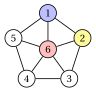
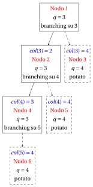
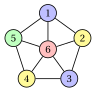
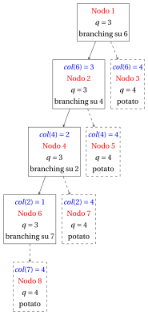
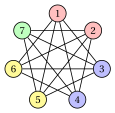
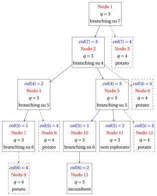
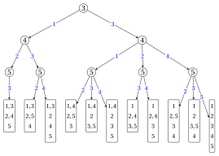

# Esercizi · Colorazione dei vertici: il branch-and-bound DSATUR

**Esercizi · Capitolo 42** · ogni soluzione si apre con un clic · [:material-book-open-variant: Capitolo 42: Colorazione dei vertici (VCP)](../algoritmi-specializzati/dsatur-branch-and-bound.md) · [:material-file-pdf-box: Eserciziario, volume 6 (PDF)](../pdf/esercizi-6-algoritmi-specializzati.pdf)

!!! formula "Regole usate in questi esercizi"

    L'algoritmo di branch-and-bound DSATUR del capitolo [«Colorazione dei vertici: il branch-and-bound DSATUR»](../algoritmi-specializzati/dsatur-branch-and-bound.md). In un nodo $k$, con $q(k)$ colori usati, vertici colorati $V^k$ e vertici non colorati $U^k$:

    \begin{equation*}
    \begin{gathered}
    \mathit{sat}_k(v)=\big|\{\mathit{col}^k(u): u\in N(v)\cap V^k\}\big|, \qquad \mathit{du}_k(v)=|N(v)\cap U^k|,\\
    F_k(v)=\{\, c\le q(k): \text{nessun vicino di $v$ ha colore $c$} \,\}.
    \end{gathered} \tag{D1}
    \end{equation*}

    - **(D2)** <strong>Bound.</strong> $\UB$ = colori dell'euristica $DSATUR$; $K$ = cricca greedy (vertici per grado non crescente, pareggi con l'indice minimo; un vertice entra se è adiacente a tutti i vertici di $K$), $\LB=|K|$, e il vertice di $K$ in posizione $i$ è pre-colorato con il colore $i$.

    - **(D3)** <strong>Branching.</strong> Il vertice $v\in U^k$ con $\mathit{sat}_k(v)$ massimo, poi $\mathit{du}_k(v)$ massimo, poi indice minimo; un figlio per ogni $c\in F_k(v)$ e uno per il colore nuovo $q(k)+1$, in ordine crescente di colore.

    - **(D4)** <strong>Potatura.</strong> Un nodo con $q\ge\UB$ è potato per bound. Una colorazione completa con $q<\UB$ è una nuova soluzione incumbent: $\UB\leftarrow q$, i nodi della lista con $q\ge\UB$ vengono rimossi, e l'algoritmo si ferma se $\UB=\LB$.

    - **(D5)** <strong>Visita.</strong> In profondità: la lista è una pila e il figlio con il colore minimo si estrae per primo; i nodi sono numerati nell'ordine di valutazione.

!!! esercizio "Esercizio 42.1: Il nodo radice del branch-and-bound DSATUR (P1)"

    Consideriamo due grafi. Il grafo $G_a$ di un calendario d'esami, con $V=\{1,\dots,6\}$ e gli spigoli

    $$
    E_a=\{\{1,2\},\{1,3\},\{2,3\},\{2,4\},\{3,5\},\{4,5\},\{4,6\},\{5,6\}\},
    $$

    e il ciclo $G_b=C_5$, con $V=\{1,\dots,5\}$ e gli spigoli

    $$
    E_b=\{\{1,2\},\{1,5\},\{2,3\},\{3,4\},\{4,5\}\}.
    $$

    { .fig loading=lazy  }

    **Domande**

    1. Eseguire l'euristica $DSATUR$ su $G_a$ e dare l'upper bound $\UB$.

    2. Trovare la cricca greedy di $G_a$ e il lower bound $\LB$, e stabilire se l'algoritmo di branch-and-bound DSATUR fa branching.

    3. Rispondere alle stesse due domande per $G_b$.

    4. Per $G_b$, scrivere il nodo radice ed eseguire la prima iterazione dell'algoritmo: il vertice di branching, i suoi colori ammissibili e i figli.

??? soluzione "Soluzione"

    Usiamo le regole (D1)–(D5) del riquadro all'inizio del capitolo.

    1. I passi di $DSATUR$ su $G_a$ sono:

        
<table>
        <tr>
        <th>passo</th>
        <th>\(1\)</th>
        <th>\(2\)</th>
        <th>\(3\)</th>
        <th>\(4\)</th>
        <th>\(5\)</th>
        <th>\(6\)</th>
        </tr>
        <tr>
        <td>\(v\)</td>
        <td>\(2\)</td>
        <td>\(3\)</td>
        <td>\(1\)</td>
        <td>\(4\)</td>
        <td>\(5\)</td>
        <td>\(6\)</td>
        </tr>
        <tr>
        <td>\(\mathit{sat}(v)\)</td>
        <td>\(0\)</td>
        <td>\(1\)</td>
        <td>\(2\)</td>
        <td>\(1\)</td>
        <td>\(1\)</td>
        <td>\(2\)</td>
        </tr>
        <tr>
        <td>\(\mathit{du}(v)\)</td>
        <td>\(3\)</td>
        <td>\(2\)</td>
        <td>\(0\)</td>
        <td>\(2\)</td>
        <td>\(1\)</td>
        <td>\(0\)</td>
        </tr>
        <tr>
        <td>\(\mathit{col}(v)\)</td>
        <td>\(1\)</td>
        <td>\(2\)</td>
        <td>\(3\)</td>
        <td>\(2\)</td>
        <td>\(1\)</td>
        <td>\(3\)</td>
        </tr>
        </table>

        Al passo $3$ il vertice $1$ vede i colori $1$ e $2$, quindi è scelto prima dei vertici con $\mathit{sat}=1$. $DSATUR$ dà $\big\{\{2,5\},~\{3,4\},~\{1,6\}\big\}$, quindi $\UB=3$.

    2. I gradi sono $\deg(1)=2$, $\deg(2)=3$, $\deg(3)=3$, $\deg(4)=3$, $\deg(5)=3$, $\deg(6)=2$, quindi i vertici si scorrono nell'ordine $2,3,4,5,1,6$. Entrano i vertici $2,3,1$, in quest'ordine; a ogni altro vertice manca uno spigolo verso un vertice già in $K$. Quindi $K=\{1,2,3\}$ (nell'ordine di ingresso: $k_1=2$, $k_2=3$, $k_3=1$) e $\LB=3$. Poiché $\LB=\UB=3$, la colorazione di $DSATUR$ è ottima e l'algoritmo si ferma al Passo 0, senza branching: $\chi(G_a)=3$.

    3. I passi di $DSATUR$ su $G_b$ sono:

        
<table>
        <tr>
        <th>passo</th>
        <th>\(1\)</th>
        <th>\(2\)</th>
        <th>\(3\)</th>
        <th>\(4\)</th>
        <th>\(5\)</th>
        </tr>
        <tr>
        <td>\(v\)</td>
        <td>\(1\)</td>
        <td>\(2\)</td>
        <td>\(3\)</td>
        <td>\(4\)</td>
        <td>\(5\)</td>
        </tr>
        <tr>
        <td>\(\mathit{sat}(v)\)</td>
        <td>\(0\)</td>
        <td>\(1\)</td>
        <td>\(1\)</td>
        <td>\(1\)</td>
        <td>\(2\)</td>
        </tr>
        <tr>
        <td>\(\mathit{du}(v)\)</td>
        <td>\(2\)</td>
        <td>\(1\)</td>
        <td>\(1\)</td>
        <td>\(1\)</td>
        <td>\(0\)</td>
        </tr>
        <tr>
        <td>\(\mathit{col}(v)\)</td>
        <td>\(1\)</td>
        <td>\(2\)</td>
        <td>\(1\)</td>
        <td>\(2\)</td>
        <td>\(3\)</td>
        </tr>
        </table>

        $DSATUR$ dà $\big\{\{1,3\},~\{2,4\},~\{5\}\big\}$, quindi $\UB=3$. Tutti i gradi sono uguali, quindi i vertici si scorrono nell'ordine $1,2,3,4,5$. Entrano i vertici $1,2$, in quest'ordine; a ogni altro vertice manca uno spigolo verso un vertice già in $K$. Quindi $K=\{1,2\}$ (nell'ordine di ingresso: $k_1=1$, $k_2=2$) e $\LB=2$. Ora $\LB=2<3=\UB$: l'algoritmo fa branching.

    4. Il nodo $1$ colora $\mathit{col}^1(1)=1$, $\mathit{col}^1(2)=2$, con $q(1)=2$. I vertici $3,5$ hanno $\mathit{sat}=1$ e lo stesso $\mathit{du}=1$: vince l'indice minimo, e il vertice di branching è $3$. Il suo vicino $2$ ha colore $2$, quindi $F_1(3)=\{1\}$.

        - Nodo $2$: $\mathit{col}(3)=1$, con $q(2)=2<\UB=3$: il nodo sopravvive.

        - Nodo $3$: $\mathit{col}(3)=3$, il colore nuovo, con $q(3)=3\ge\UB=3$: <u>potato per bound</u>.

        La ricerca continua dal nodo $2$: è la stessa ricerca fatta sul ciclo esterno del grafo di Petersen, e termina con $6$ nodi e $\chi(G_b)=3$.

    !!! chiave ""

        Su $G_a$ la cricca $\{2,3,1\}$ raggiunge il bound di $DSATUR$: niente branching. Su $G_b$ il bound della cricca è $2$ e l'albero serve per dimostrare $\chi(C_5)=3$.

!!! esercizio "Esercizio 42.2: Dimostrare un lower bound: la ruota $W_5$ (P2)"

    Consideriamo la ruota $W_5$ (un ciclo su $1,\dots,5$ e il mozzo $6$), il grafo $G=(V,E)$ con $V=\{1,\dots,6\}$ e gli spigoli

    $$
    E=\{\{1,2\},\{1,5\},\{1,6\},\{2,3\},\{2,6\},\{3,4\},\{3,6\},\{4,5\},\{4,6\},\{5,6\}\},
    $$

    disegnato qui sotto:

    { .fig loading=lazy  }

    **Domande**

    1. Eseguire l'euristica $DSATUR$: dare l'ordine dei vertici, la colorazione e l'upper bound $\UB$.

    2. Trovare la cricca greedy $K$, il lower bound $\LB$ e il nodo radice dell'algoritmo di branch-and-bound DSATUR.

    3. Eseguire l'algoritmo di branch-and-bound DSATUR, iterazione per iterazione.

    4. Disegnare l'albero di branch-and-bound e dare il numero cromatico di $G$ con una colorazione ottima.

??? soluzione "Soluzione"

    Usiamo le regole (D1)–(D5) del riquadro all'inizio del capitolo.

    1. Il vertice scelto a ogni passo, il suo grado di saturazione, il suo grado fra i vertici non colorati e il suo colore sono:

        
<table>
        <tr>
        <th>passo</th>
        <th>\(1\)</th>
        <th>\(2\)</th>
        <th>\(3\)</th>
        <th>\(4\)</th>
        <th>\(5\)</th>
        <th>\(6\)</th>
        </tr>
        <tr>
        <td>\(v\)</td>
        <td>\(6\)</td>
        <td>\(1\)</td>
        <td>\(2\)</td>
        <td>\(3\)</td>
        <td>\(4\)</td>
        <td>\(5\)</td>
        </tr>
        <tr>
        <td>\(\mathit{sat}(v)\)</td>
        <td>\(0\)</td>
        <td>\(1\)</td>
        <td>\(2\)</td>
        <td>\(2\)</td>
        <td>\(2\)</td>
        <td>\(3\)</td>
        </tr>
        <tr>
        <td>\(\mathit{du}(v)\)</td>
        <td>\(5\)</td>
        <td>\(2\)</td>
        <td>\(1\)</td>
        <td>\(1\)</td>
        <td>\(1\)</td>
        <td>\(0\)</td>
        </tr>
        <tr>
        <td>\(\mathit{col}(v)\)</td>
        <td>\(1\)</td>
        <td>\(2\)</td>
        <td>\(3\)</td>
        <td>\(2\)</td>
        <td>\(3\)</td>
        <td>\(4\)</td>
        </tr>
        </table>

        $DSATUR$ dà $\big\{\{6\},~\{1,3\},~\{2,4\},~\{5\}\big\}$, quindi $\UB=4$.

    2. I gradi sono $\deg(1)=3$, $\deg(2)=3$, $\deg(3)=3$, $\deg(4)=3$, $\deg(5)=3$, $\deg(6)=5$, quindi i vertici si scorrono nell'ordine $6,1,2,3,4,5$. Entrano i vertici $6,1,2$, in quest'ordine; a ogni altro vertice manca uno spigolo verso un vertice già in $K$. Quindi $K=\{1,2,6\}$ (nell'ordine di ingresso: $k_1=6$, $k_2=1$, $k_3=2$) e $\LB=3$. Poiché $\LB=3<4=\UB$, l'algoritmo fa branching. Il nodo $1$ colora $\mathit{col}^1(6)=1$, $\mathit{col}^1(1)=2$, $\mathit{col}^1(2)=3$, con $q(1)=3$:

        { .fig loading=lazy  }

    3. \*\*Iterazione 1\*\*  Il nodo $1$ viene estratto dalla lista, con $Q_1=\{6\}$, $Q_2=\{1\}$, $Q_3=\{2\}$ e $q(1)=3$. I vertici $3,5$ hanno $\mathit{sat}=2$ e lo stesso $\mathit{du}=1$: vince l'indice minimo, e il vertice di branching è $3$. I suoi colori ammissibili sono $F_{1}(3)=\{2\}$.

        - Nodo $2$: $\mathit{col}(3)=2$, con $q(2)=3<\UB=4$: il nodo sopravvive.

        - Nodo $3$: $\mathit{col}(3)=4$, il colore nuovo, con $q(3)=4\ge\UB=4$: <u>potato per bound</u>.

        \*\*Iterazione 2\*\*  Il nodo $2$ viene estratto dalla lista, con $Q_1=\{6\}$, $Q_2=\{1,3\}$, $Q_3=\{2\}$ e $q(2)=3$. I vertici $4,5$ hanno $\mathit{sat}=2$ e lo stesso $\mathit{du}=1$: vince l'indice minimo, e il vertice di branching è $4$. I suoi colori ammissibili sono $F_{2}(4)=\{3\}$.

        - Nodo $4$: $\mathit{col}(4)=3$, con $q(4)=3<\UB=4$: il nodo sopravvive.

        - Nodo $5$: $\mathit{col}(4)=4$, il colore nuovo, con $q(5)=4\ge\UB=4$: <u>potato per bound</u>.

        \*\*Iterazione 3\*\*  Il nodo $4$ viene estratto dalla lista, con $Q_1=\{6\}$, $Q_2=\{1,3\}$, $Q_3=\{2,4\}$ e $q(4)=3$. Il vertice $5$ è l'unico con $\mathit{sat}=3$: è il vertice di branching. I suoi colori ammissibili sono $F_{4}(5)=\emptyset$.

        - Nodo $6$: $\mathit{col}(5)=4$, il colore nuovo, con $q(6)=4\ge\UB=4$: <u>potato per bound</u>.

        <strong>Terminazione</strong> La lista è vuota: la soluzione incumbent di $DSATUR$ è ottima.

    4. L'albero ha $6$ nodi; i nodi potati sono tratteggiati.

        { .fig loading=lazy  }

        
<table>
        <tr>
        <th>Nodo</th>
        <th>Padre</th>
        <th>Figlio</th>
        <th>\(q\)</th>
        <th>\(\UB\)</th>
        <th>Vertice di branching</th>
        <th>Esito</th>
        </tr>
        <tr>
        <td>\(1\)</td>
        <td>–</td>
        <td>radice</td>
        <td>\(3\)</td>
        <td>\(4\)</td>
        <td>\(3\)</td>
        <td>branching</td>
        </tr>
        <tr>
        <td>\(2\)</td>
        <td>\(1\)</td>
        <td>\(\mathit{col}(3)=2\)</td>
        <td>\(3\)</td>
        <td>\(4\)</td>
        <td>\(4\)</td>
        <td>branching</td>
        </tr>
        <tr>
        <td>\(3\)</td>
        <td>\(1\)</td>
        <td>\(\mathit{col}(3)=4\)</td>
        <td>\(4\)</td>
        <td>\(4\)</td>
        <td>–</td>
        <td>potato per bound</td>
        </tr>
        <tr>
        <td>\(4\)</td>
        <td>\(2\)</td>
        <td>\(\mathit{col}(4)=3\)</td>
        <td>\(3\)</td>
        <td>\(4\)</td>
        <td>\(5\)</td>
        <td>branching</td>
        </tr>
        <tr>
        <td>\(5\)</td>
        <td>\(2\)</td>
        <td>\(\mathit{col}(4)=4\)</td>
        <td>\(4\)</td>
        <td>\(4\)</td>
        <td>–</td>
        <td>potato per bound</td>
        </tr>
        <tr>
        <td>\(6\)</td>
        <td>\(4\)</td>
        <td>\(\mathit{col}(5)=4\)</td>
        <td>\(4\)</td>
        <td>\(4\)</td>
        <td>–</td>
        <td>potato per bound</td>
        </tr>
        </table>

        Quindi $\chi(G)=4$, con la colorazione ottima $\big\{\{6\},~\{1,3\},~\{2,4\},~\{5\}\big\}$:

        { .fig loading=lazy  }

        Il bound della cricca dà solo $3$: l'albero dimostra che il ciclo dispari e il mozzo richiedono un quarto colore.

!!! esercizio "Esercizio 42.3: Il complemento del ciclo $C_7$ (P3)"

    Consideriamo il complemento del ciclo $C_7$ (due vertici sono adiacenti se non sono consecutivi sul ciclo $1,2,\dots,7$), il grafo $G=(V,E)$ con $V=\{1,\dots,7\}$ e gli spigoli

    $$
    \begin{aligned}
    E=\{&\{1,3\},\{1,4\},\{1,5\},\{1,6\},\{2,4\},\{2,5\},\{2,6\},\\
    &\{2,7\},\{3,5\},\{3,6\},\{3,7\},\{4,6\},\{4,7\},\{5,7\}\},
    \end{aligned}
    $$

    disegnato qui sotto:

    { .fig loading=lazy  }

    **Domande**

    1. Eseguire l'euristica $DSATUR$: dare l'ordine dei vertici, la colorazione e l'upper bound $\UB$.

    2. Trovare la cricca greedy $K$, il lower bound $\LB$ e il nodo radice dell'algoritmo di branch-and-bound DSATUR.

    3. Eseguire l'algoritmo di branch-and-bound DSATUR, iterazione per iterazione.

    4. Disegnare l'albero di branch-and-bound e dare il numero cromatico di $G$ con una colorazione ottima.

??? soluzione "Soluzione"

    Usiamo le regole (D1)–(D5) del riquadro all'inizio del capitolo.

    1. Il vertice scelto a ogni passo, il suo grado di saturazione, il suo grado fra i vertici non colorati e il suo colore sono:

        
<table>
        <tr>
        <th>passo</th>
        <th>\(1\)</th>
        <th>\(2\)</th>
        <th>\(3\)</th>
        <th>\(4\)</th>
        <th>\(5\)</th>
        <th>\(6\)</th>
        <th>\(7\)</th>
        </tr>
        <tr>
        <td>\(v\)</td>
        <td>\(1\)</td>
        <td>\(3\)</td>
        <td>\(5\)</td>
        <td>\(6\)</td>
        <td>\(4\)</td>
        <td>\(2\)</td>
        <td>\(7\)</td>
        </tr>
        <tr>
        <td>\(\mathit{sat}(v)\)</td>
        <td>\(0\)</td>
        <td>\(1\)</td>
        <td>\(2\)</td>
        <td>\(2\)</td>
        <td>\(2\)</td>
        <td>\(2\)</td>
        <td>\(3\)</td>
        </tr>
        <tr>
        <td>\(\mathit{du}(v)\)</td>
        <td>\(4\)</td>
        <td>\(3\)</td>
        <td>\(2\)</td>
        <td>\(2\)</td>
        <td>\(2\)</td>
        <td>\(1\)</td>
        <td>\(0\)</td>
        </tr>
        <tr>
        <td>\(\mathit{col}(v)\)</td>
        <td>\(1\)</td>
        <td>\(2\)</td>
        <td>\(3\)</td>
        <td>\(3\)</td>
        <td>\(2\)</td>
        <td>\(1\)</td>
        <td>\(4\)</td>
        </tr>
        </table>

        $DSATUR$ dà $\big\{\{1,2\},~\{3,4\},~\{5,6\},~\{7\}\big\}$, quindi $\UB=4$.

    2. Tutti i gradi sono uguali, quindi i vertici si scorrono nell'ordine $1,2,3,4,5,6,7$. Entrano i vertici $1,3,5$, in quest'ordine; a ogni altro vertice manca uno spigolo verso un vertice già in $K$. Quindi $K=\{1,3,5\}$ (nell'ordine di ingresso: $k_1=1$, $k_2=3$, $k_3=5$) e $\LB=3$. Poiché $\LB=3<4=\UB$, l'algoritmo fa branching. Il nodo $1$ colora $\mathit{col}^1(1)=1$, $\mathit{col}^1(3)=2$, $\mathit{col}^1(5)=3$, con $q(1)=3$:

        { .fig loading=lazy  }

    3. \*\*Iterazione 1\*\*  Il nodo $1$ viene estratto dalla lista, con $Q_1=\{1\}$, $Q_2=\{3\}$, $Q_3=\{5\}$ e $q(1)=3$. I vertici $6,7$ hanno $\mathit{sat}=2$ e lo stesso $\mathit{du}=2$: vince l'indice minimo, e il vertice di branching è $6$. I suoi colori ammissibili sono $F_{1}(6)=\{3\}$.

        - Nodo $2$: $\mathit{col}(6)=3$, con $q(2)=3<\UB=4$: il nodo sopravvive.

        - Nodo $3$: $\mathit{col}(6)=4$, il colore nuovo, con $q(3)=4\ge\UB=4$: <u>potato per bound</u>.

        \*\*Iterazione 2\*\*  Il nodo $2$ viene estratto dalla lista, con $Q_1=\{1\}$, $Q_2=\{3\}$, $Q_3=\{5,6\}$ e $q(2)=3$. I vertici $4,7$ hanno $\mathit{sat}=2$ e lo stesso $\mathit{du}=2$: vince l'indice minimo, e il vertice di branching è $4$. I suoi colori ammissibili sono $F_{2}(4)=\{2\}$.

        - Nodo $4$: $\mathit{col}(4)=2$, con $q(4)=3<\UB=4$: il nodo sopravvive.

        - Nodo $5$: $\mathit{col}(4)=4$, il colore nuovo, con $q(5)=4\ge\UB=4$: <u>potato per bound</u>.

        \*\*Iterazione 3\*\*  Il nodo $4$ viene estratto dalla lista, con $Q_1=\{1\}$, $Q_2=\{3,4\}$, $Q_3=\{5,6\}$ e $q(4)=3$. I vertici $2,7$ hanno $\mathit{sat}=2$ e lo stesso $\mathit{du}=1$: vince l'indice minimo, e il vertice di branching è $2$. I suoi colori ammissibili sono $F_{4}(2)=\{1\}$.

        - Nodo $6$: $\mathit{col}(2)=1$, con $q(6)=3<\UB=4$: il nodo sopravvive.

        - Nodo $7$: $\mathit{col}(2)=4$, il colore nuovo, con $q(7)=4\ge\UB=4$: <u>potato per bound</u>.

        \*\*Iterazione 4\*\*  Il nodo $6$ viene estratto dalla lista, con $Q_1=\{1,2\}$, $Q_2=\{3,4\}$, $Q_3=\{5,6\}$ e $q(6)=3$. Il vertice $7$ è l'unico con $\mathit{sat}=3$: è il vertice di branching. I suoi colori ammissibili sono $F_{6}(7)=\emptyset$.

        - Nodo $8$: $\mathit{col}(7)=4$, il colore nuovo, con $q(8)=4\ge\UB=4$: <u>potato per bound</u>.

        <strong>Terminazione</strong> La lista è vuota: la soluzione incumbent di $DSATUR$ è ottima.

    4. L'albero ha $8$ nodi; i nodi potati sono tratteggiati.

        { .fig loading=lazy  }

        
<table>
        <tr>
        <th>Nodo</th>
        <th>Padre</th>
        <th>Figlio</th>
        <th>\(q\)</th>
        <th>\(\UB\)</th>
        <th>Vertice di branching</th>
        <th>Esito</th>
        </tr>
        <tr>
        <td>\(1\)</td>
        <td>–</td>
        <td>radice</td>
        <td>\(3\)</td>
        <td>\(4\)</td>
        <td>\(6\)</td>
        <td>branching</td>
        </tr>
        <tr>
        <td>\(2\)</td>
        <td>\(1\)</td>
        <td>\(\mathit{col}(6)=3\)</td>
        <td>\(3\)</td>
        <td>\(4\)</td>
        <td>\(4\)</td>
        <td>branching</td>
        </tr>
        <tr>
        <td>\(3\)</td>
        <td>\(1\)</td>
        <td>\(\mathit{col}(6)=4\)</td>
        <td>\(4\)</td>
        <td>\(4\)</td>
        <td>–</td>
        <td>potato per bound</td>
        </tr>
        <tr>
        <td>\(4\)</td>
        <td>\(2\)</td>
        <td>\(\mathit{col}(4)=2\)</td>
        <td>\(3\)</td>
        <td>\(4\)</td>
        <td>\(2\)</td>
        <td>branching</td>
        </tr>
        <tr>
        <td>\(5\)</td>
        <td>\(2\)</td>
        <td>\(\mathit{col}(4)=4\)</td>
        <td>\(4\)</td>
        <td>\(4\)</td>
        <td>–</td>
        <td>potato per bound</td>
        </tr>
        <tr>
        <td>\(6\)</td>
        <td>\(4\)</td>
        <td>\(\mathit{col}(2)=1\)</td>
        <td>\(3\)</td>
        <td>\(4\)</td>
        <td>\(7\)</td>
        <td>branching</td>
        </tr>
        <tr>
        <td>\(7\)</td>
        <td>\(4\)</td>
        <td>\(\mathit{col}(2)=4\)</td>
        <td>\(4\)</td>
        <td>\(4\)</td>
        <td>–</td>
        <td>potato per bound</td>
        </tr>
        <tr>
        <td>\(8\)</td>
        <td>\(6\)</td>
        <td>\(\mathit{col}(7)=4\)</td>
        <td>\(4\)</td>
        <td>\(4\)</td>
        <td>–</td>
        <td>potato per bound</td>
        </tr>
        </table>

        Quindi $\chi(G)=4$, con la colorazione ottima $\big\{\{1,2\},~\{3,4\},~\{5,6\},~\{7\}\big\}$:

        { .fig loading=lazy  }

        Ogni insieme stabile di $G$ ha al più $2$ vertici, quindi il bound degli insiemi stabili $\lceil 7/2\rceil=4$ del [Capitolo 4](../problemi-di-ottimizzazione-combinatoria/coloring/il-problema-della-colorazione-dei-vertici.md) conferma il risultato.

!!! esercizio "Esercizio 42.4: Migliorare la soluzione incumbent (P4)"

    Consideriamo un grafo con $7$ vertici e $11$ spigoli, il grafo $G=(V,E)$ con $V=\{1,\dots,7\}$ e gli spigoli

    $$
    \begin{aligned}
    E=\{&\{1,2\},\{1,3\},\{1,4\},\{1,7\},\{2,3\},\{2,7\},\\
    &\{3,6\},\{4,5\},\{4,6\},\{5,6\},\{5,7\}\},
    \end{aligned}
    $$

    disegnato qui sotto:

    { .fig loading=lazy  }

    **Domande**

    1. Eseguire l'euristica $DSATUR$: dare l'ordine dei vertici, la colorazione e l'upper bound $\UB$.

    2. Trovare la cricca greedy $K$, il lower bound $\LB$ e il nodo radice dell'algoritmo di branch-and-bound DSATUR.

    3. Eseguire l'algoritmo di branch-and-bound DSATUR, iterazione per iterazione.

    4. Disegnare l'albero di branch-and-bound e dare il numero cromatico di $G$ con una colorazione ottima.

??? soluzione "Soluzione"

    Usiamo le regole (D1)–(D5) del riquadro all'inizio del capitolo.

    1. Il vertice scelto a ogni passo, il suo grado di saturazione, il suo grado fra i vertici non colorati e il suo colore sono:

        
<table>
        <tr>
        <th>passo</th>
        <th>\(1\)</th>
        <th>\(2\)</th>
        <th>\(3\)</th>
        <th>\(4\)</th>
        <th>\(5\)</th>
        <th>\(6\)</th>
        <th>\(7\)</th>
        </tr>
        <tr>
        <td>\(v\)</td>
        <td>\(1\)</td>
        <td>\(2\)</td>
        <td>\(3\)</td>
        <td>\(7\)</td>
        <td>\(4\)</td>
        <td>\(5\)</td>
        <td>\(6\)</td>
        </tr>
        <tr>
        <td>\(\mathit{sat}(v)\)</td>
        <td>\(0\)</td>
        <td>\(1\)</td>
        <td>\(2\)</td>
        <td>\(2\)</td>
        <td>\(1\)</td>
        <td>\(2\)</td>
        <td>\(3\)</td>
        </tr>
        <tr>
        <td>\(\mathit{du}(v)\)</td>
        <td>\(4\)</td>
        <td>\(2\)</td>
        <td>\(1\)</td>
        <td>\(1\)</td>
        <td>\(2\)</td>
        <td>\(1\)</td>
        <td>\(0\)</td>
        </tr>
        <tr>
        <td>\(\mathit{col}(v)\)</td>
        <td>\(1\)</td>
        <td>\(2\)</td>
        <td>\(3\)</td>
        <td>\(3\)</td>
        <td>\(2\)</td>
        <td>\(1\)</td>
        <td>\(4\)</td>
        </tr>
        </table>

        $DSATUR$ dà $\big\{\{1,5\},~\{2,4\},~\{3,7\},~\{6\}\big\}$, quindi $\UB=4$.

    2. I gradi sono $\deg(1)=4$, $\deg(2)=3$, $\deg(3)=3$, $\deg(4)=3$, $\deg(5)=3$, $\deg(6)=3$, $\deg(7)=3$, quindi i vertici si scorrono nell'ordine $1,2,3,4,5,6,7$. Entrano i vertici $1,2,3$, in quest'ordine; a ogni altro vertice manca uno spigolo verso un vertice già in $K$. Quindi $K=\{1,2,3\}$ (nell'ordine di ingresso: $k_1=1$, $k_2=2$, $k_3=3$) e $\LB=3$. Poiché $\LB=3<4=\UB$, l'algoritmo fa branching. Il nodo $1$ colora $\mathit{col}^1(1)=1$, $\mathit{col}^1(2)=2$, $\mathit{col}^1(3)=3$, con $q(1)=3$:

        { .fig loading=lazy  }

    3. \*\*Iterazione 1\*\*  Il nodo $1$ viene estratto dalla lista, con $Q_1=\{1\}$, $Q_2=\{2\}$, $Q_3=\{3\}$ e $q(1)=3$. Il vertice $7$ è l'unico con $\mathit{sat}=2$: è il vertice di branching. I suoi colori ammissibili sono $F_{1}(7)=\{3\}$.

        - Nodo $2$: $\mathit{col}(7)=3$, con $q(2)=3<\UB=4$: il nodo sopravvive.

        - Nodo $3$: $\mathit{col}(7)=4$, il colore nuovo, con $q(3)=4\ge\UB=4$: <u>potato per bound</u>.

        \*\*Iterazione 2\*\*  Il nodo $2$ viene estratto dalla lista, con $Q_1=\{1\}$, $Q_2=\{2\}$, $Q_3=\{3,7\}$ e $q(2)=3$. I vertici $4,5,6$ hanno $\mathit{sat}=1$ e lo stesso $\mathit{du}=2$: vince l'indice minimo, e il vertice di branching è $4$. I suoi colori ammissibili sono $F_{2}(4)=\{2,3\}$.

        - Nodo $4$: $\mathit{col}(4)=2$, con $q(4)=3<\UB=4$: il nodo sopravvive.

        - Nodo $5$: $\mathit{col}(4)=3$, con $q(5)=3<\UB=4$: il nodo sopravvive.

        - Nodo $6$: $\mathit{col}(4)=4$, il colore nuovo, con $q(6)=4\ge\UB=4$: <u>potato per bound</u>.

        \*\*Iterazione 3\*\*  Il nodo $4$ viene estratto dalla lista, con $Q_1=\{1\}$, $Q_2=\{2,4\}$, $Q_3=\{3,7\}$ e $q(4)=3$. I vertici $5,6$ hanno $\mathit{sat}=2$ e lo stesso $\mathit{du}=1$: vince l'indice minimo, e il vertice di branching è $5$. I suoi colori ammissibili sono $F_{4}(5)=\{1\}$.

        - Nodo $7$: $\mathit{col}(5)=1$, con $q(7)=3<\UB=4$: il nodo sopravvive.

        - Nodo $8$: $\mathit{col}(5)=4$, il colore nuovo, con $q(8)=4\ge\UB=4$: <u>potato per bound</u>.

        \*\*Iterazione 4\*\*  Il nodo $7$ viene estratto dalla lista, con $Q_1=\{1,5\}$, $Q_2=\{2,4\}$, $Q_3=\{3,7\}$ e $q(7)=3$. Il vertice $6$ è l'unico con $\mathit{sat}=3$: è il vertice di branching. I suoi colori ammissibili sono $F_{7}(6)=\emptyset$.

        - Nodo $9$: $\mathit{col}(6)=4$, il colore nuovo, con $q(9)=4\ge\UB=4$: <u>potato per bound</u>.

        \*\*Iterazione 5\*\*  Il nodo $5$ viene estratto dalla lista, con $Q_1=\{1\}$, $Q_2=\{2\}$, $Q_3=\{3,4,7\}$ e $q(5)=3$. I vertici $5,6$ hanno $\mathit{sat}=1$ e lo stesso $\mathit{du}=1$: vince l'indice minimo, e il vertice di branching è $5$. I suoi colori ammissibili sono $F_{5}(5)=\{1,2\}$.

        - Nodo $10$: $\mathit{col}(5)=1$, con $q(10)=3<\UB=4$: il nodo sopravvive.

        - Nodo $11$: $\mathit{col}(5)=2$, con $q(11)=3<\UB=4$: il nodo sopravvive.

        - Nodo $12$: $\mathit{col}(5)=4$, il colore nuovo, con $q(12)=4\ge\UB=4$: <u>potato per bound</u>.

        \*\*Iterazione 6\*\*  Il nodo $10$ viene estratto dalla lista, con $Q_1=\{1,5\}$, $Q_2=\{2\}$, $Q_3=\{3,4,7\}$ e $q(10)=3$. Il vertice $6$ è l'unico con $\mathit{sat}=2$: è il vertice di branching. I suoi colori ammissibili sono $F_{10}(6)=\{2\}$.

        - Nodo $13$: $\mathit{col}(6)=2$, con $q(13)=3<\UB=4$: una colorazione completa con meno colori: <u>nuova soluzione incumbent</u>, con $\big\{\{1,5\},~\{2,6\},~\{3,4,7\}\big\}$ e $\UB=3$.

        <strong>Terminazione</strong> La nuova soluzione incumbent dà $\UB=3$. I nodi della lista con $q\ge\UB$ vengono rimossi: il nodo $11$. Poiché $\UB=\LB=3$, la soluzione incumbent è ottima: <code>STOP</code>.

    4. L'albero ha $13$ nodi; i nodi potati sono tratteggiati.

        { .fig loading=lazy  }

        
<table>
        <tr>
        <th>Nodo</th>
        <th>Padre</th>
        <th>Figlio</th>
        <th>\(q\)</th>
        <th>\(\UB\)</th>
        <th>Vertice di branching</th>
        <th>Esito</th>
        </tr>
        <tr>
        <td>\(1\)</td>
        <td>–</td>
        <td>radice</td>
        <td>\(3\)</td>
        <td>\(4\)</td>
        <td>\(7\)</td>
        <td>branching</td>
        </tr>
        <tr>
        <td>\(2\)</td>
        <td>\(1\)</td>
        <td>\(\mathit{col}(7)=3\)</td>
        <td>\(3\)</td>
        <td>\(4\)</td>
        <td>\(4\)</td>
        <td>branching</td>
        </tr>
        <tr>
        <td>\(3\)</td>
        <td>\(1\)</td>
        <td>\(\mathit{col}(7)=4\)</td>
        <td>\(4\)</td>
        <td>\(4\)</td>
        <td>–</td>
        <td>potato per bound</td>
        </tr>
        <tr>
        <td>\(4\)</td>
        <td>\(2\)</td>
        <td>\(\mathit{col}(4)=2\)</td>
        <td>\(3\)</td>
        <td>\(4\)</td>
        <td>\(5\)</td>
        <td>branching</td>
        </tr>
        <tr>
        <td>\(5\)</td>
        <td>\(2\)</td>
        <td>\(\mathit{col}(4)=3\)</td>
        <td>\(3\)</td>
        <td>\(4\)</td>
        <td>\(5\)</td>
        <td>branching</td>
        </tr>
        <tr>
        <td>\(6\)</td>
        <td>\(2\)</td>
        <td>\(\mathit{col}(4)=4\)</td>
        <td>\(4\)</td>
        <td>\(4\)</td>
        <td>–</td>
        <td>potato per bound</td>
        </tr>
        <tr>
        <td>\(7\)</td>
        <td>\(4\)</td>
        <td>\(\mathit{col}(5)=1\)</td>
        <td>\(3\)</td>
        <td>\(4\)</td>
        <td>\(6\)</td>
        <td>branching</td>
        </tr>
        <tr>
        <td>\(8\)</td>
        <td>\(4\)</td>
        <td>\(\mathit{col}(5)=4\)</td>
        <td>\(4\)</td>
        <td>\(4\)</td>
        <td>–</td>
        <td>potato per bound</td>
        </tr>
        <tr>
        <td>\(9\)</td>
        <td>\(7\)</td>
        <td>\(\mathit{col}(6)=4\)</td>
        <td>\(4\)</td>
        <td>\(4\)</td>
        <td>–</td>
        <td>potato per bound</td>
        </tr>
        <tr>
        <td>\(10\)</td>
        <td>\(5\)</td>
        <td>\(\mathit{col}(5)=1\)</td>
        <td>\(3\)</td>
        <td>\(4\)</td>
        <td>\(6\)</td>
        <td>branching</td>
        </tr>
        <tr>
        <td>\(11\)</td>
        <td>\(5\)</td>
        <td>\(\mathit{col}(5)=2\)</td>
        <td>\(3\)</td>
        <td>\(4\)</td>
        <td>–</td>
        <td>non esplorato</td>
        </tr>
        <tr>
        <td>\(12\)</td>
        <td>\(5\)</td>
        <td>\(\mathit{col}(5)=4\)</td>
        <td>\(4\)</td>
        <td>\(4\)</td>
        <td>–</td>
        <td>potato per bound</td>
        </tr>
        <tr>
        <td>\(13\)</td>
        <td>\(10\)</td>
        <td>\(\mathit{col}(6)=2\)</td>
        <td>\(3\)</td>
        <td>\(3\)</td>
        <td>–</td>
        <td>nuova incumbent</td>
        </tr>
        </table>

        Quindi $\chi(G)=3$, con la colorazione ottima $\big\{\{1,5\},~\{2,6\},~\{3,4,7\}\big\}$:

        { .fig loading=lazy  }

        Qui $DSATUR$ non è ottima: l'algoritmo di branch-and-bound migliora la soluzione incumbent da $4$ a $3$ colori e si ferma appena $\UB$ raggiunge il bound della cricca.

!!! esercizio "Esercizio 42.5: Il branching senza simmetrie (P5)"

    Consideriamo il ciclo $C_5$, con $V=\{1,\dots,5\}$ e gli spigoli

    $$
    E=\{\{1,2\},\{1,5\},\{2,3\},\{3,4\},\{4,5\}\},
    $$

    disegnato qui sotto. La sua cricca greedy è $K=\{1,2\}$, quindi il nodo radice colora $\mathit{col}^1(1)=1$ e $\mathit{col}^1(2)=2$.

    { .fig loading=lazy  }

    **Domande**

    1. Disegnare l'albero dell'algoritmo di branch-and-bound DSATUR <em>senza potatura</em> (nessun upper bound): in ogni nodo, il vertice di branching e un figlio per ogni colore ammissibile e per il colore nuovo. Contarne i nodi e le foglie.

    2. Elencare le partizioni di $V$ date dalle foglie, per numero di colori, e stabilire se sono tutte le partizioni di $V$ in insiemi stabili.

    3. Contare gli assegnamenti dei cinque colori $1,\dots,5$ ai vertici senza spigoli con colori uguali, e spiegare la differenza con il numero di foglie.

    4. Con l'upper bound $\UB=3$ di $DSATUR$ e la regola di potatura, contare i nodi dell'albero.

??? soluzione "Soluzione"

    Usiamo le regole (D1)–(D5) del riquadro all'inizio del capitolo.

    1. Ogni nodo interno mostra il suo vertice di branching, ogni arco il colore assegnato a quel vertice (in blu), ogni foglia le sue classi di colore, una per riga:

        { .fig loading=lazy  }

        L'albero ha $19$ nodi e $11$ foglie.

    2. Le foglie, per numero di colori:

        
<table>
        <tr>
        <th>colori</th>
        <th>foglie</th>
        <th>partizioni</th>
        </tr>
        <tr>
        <td>\(3\)</td>
        <td>\(5\)</td>
        <td>\(\{\{1\},\{2,4\},\{3,5\}\}\)</td>
        </tr>
        <tr>
        <td></td>
        <td></td>
        <td>\(\{\{1,3\},\{2,4\},\{5\}\}\)</td>
        </tr>
        <tr>
        <td></td>
        <td></td>
        <td>\(\{\{1,3\},\{2,5\},\{4\}\}\)</td>
        </tr>
        <tr>
        <td></td>
        <td></td>
        <td>\(\{\{1,4\},\{2\},\{3,5\}\}\)</td>
        </tr>
        <tr>
        <td></td>
        <td></td>
        <td>\(\{\{1,4\},\{2,5\},\{3\}\}\)</td>
        </tr>
        <tr>
        <td>\(4\)</td>
        <td>\(5\)</td>
        <td>\(\{\{1\},\{2\},\{3,5\},\{4\}\}\)</td>
        </tr>
        <tr>
        <td></td>
        <td></td>
        <td>\(\{\{1\},\{2,4\},\{3\},\{5\}\}\)</td>
        </tr>
        <tr>
        <td></td>
        <td></td>
        <td>\(\{\{1\},\{2,5\},\{3\},\{4\}\}\)</td>
        </tr>
        <tr>
        <td></td>
        <td></td>
        <td>\(\{\{1,3\},\{2\},\{4\},\{5\}\}\)</td>
        </tr>
        <tr>
        <td></td>
        <td></td>
        <td>\(\{\{1,4\},\{2\},\{3\},\{5\}\}\)</td>
        </tr>
        <tr>
        <td>\(5\)</td>
        <td>\(1\)</td>
        <td>\(\{\{1\},\{2\},\{3\},\{4\},\{5\}\}\)</td>
        </tr>
        </table>

        Le $11$ foglie danno $11$ partizioni diverse, e l'enumerazione di tutte le partizioni di $V$ in insiemi stabili dà le stesse $11$: ogni soluzione ammissibile compare esattamente una volta, come afferma la proposizione sul branching senza simmetrie.

    3. Per enumerazione, $1020$ assegnamenti. Una partizione con $q$ classi si può etichettare con $5\cdot4\cdots(5-q+1)$ scelte ordinate di colori, quindi

        $$
        5\cdot60+5\cdot120+1\cdot120=1020.
        $$

        Le colorazioni etichettate contengono ogni partizione molte volte, con i colori rinominati; l'albero contiene ciascuna una volta sola.

    4. Con la potatura restano $6$ nodi invece di $19$: ogni nodo con $q=3$ è potato, e la ricerca dimostra $\chi(C_5)=3$ lungo un solo cammino, come nel primo esercizio di questo capitolo.

    !!! chiave ""

        Senza potatura, l'albero di $C_5$ ha $11$ foglie, una per ogni partizione in insiemi stabili, contro $1020$ colorazioni etichettate; con $\UB=3$ restano solo $6$ nodi.
