# Esercizi · Zaino: branch-and-bound sull'elemento critico

**Esercizi · Capitolo 41** · ogni soluzione si apre con un clic · [:material-book-open-variant: Capitolo 41: Zaino 0/1 (KP)](../algoritmi-specializzati/knapsack-branch-and-bound.md) · [:material-file-pdf-box: Eserciziario, volume 6 (PDF)](../pdf/esercizi-6-algoritmi-specializzati.pdf)

!!! esercizio "Esercizio 41.1: Algoritmo di branch-and-bound per il problema dello zaino 0/1 (P1)"

    Consideriamo uno zaino di capacità $c=11$ e un insieme $\mathscr{I}=\{1,2,3,4,5\}$ di $5$ oggetti ($n=5$) con i seguenti profitti e pesi:

    $$
    \begin{array}{l|rrrrrrrrrr}
    \hline  & {j=1} & {j=2} & {j=3} & {j=4} & {j=5} \\[0.7ex]
    \hline {p_j} & {8} & {6} & {14} & {6} & {2} \\[0.7ex]
    {w_j} & {3} & {3} & {9} & {5} & {2} \\[0.7ex]
    \hline
    \end{array}
    $$

    **Domande**

    1. Verificare se gli oggetti sono ordinati per efficienza non crescente, altrimenti ordinarli in questo modo.  Scrivere il modello $\mathrm{ILP}_{\mathrm{KP}}$ e il modello $\mathrm{LP}_{\mathrm{KP}}$ per l'istanza del KP.

    2. Eseguire l'algoritmo di branch-and-bound per risolvere il modello $\mathrm{ILP}_{\mathrm{KP}}$ del problema dello zaino 0/1 (KP) usando:

        1. la regola dell'oggetto critico come strategia di scelta della variabile di branching;

        2. la regola LIFO come strategia di scelta del nodo di branching;

        3. risolvere prima il nodo di down-branching e poi il nodo di up-branching;

        4. porre la soluzione incumbent ${\bar{\boldsymbol x}}(\,\mathrm{ILP}_{\mathrm{KP}}\,)$ uguale alla seguente soluzione euristica:

            $$
            \bar{x}_1=1, ~~~ \bar{x}_2=1,~~~ \bar{x}_3= 0,~~\bar{x}_4=1,~~\bar{x}_5=0
            $$

            e porre di conseguenza il lower bound $\LB$.

    3. Determinare e commentare l'albero di branch-and-bound corrispondente, indicando il motivo per cui i nodi di branching si possono potare.

??? soluzione "Soluzione"

    1. Gli oggetti sono ordinati per efficienza non crescente, poiché abbiamo:

        $$
        \frac{8}{3} ~~\ge~~ \frac{6}{3} ~~\ge~~ \frac{14}{9} ~~\ge~~ \frac{6}{5} ~~\ge~~  \frac{2}{2}
        $$

        Questo è il modello $\mathrm{ILP}_{\mathrm{KP}}$  per l'istanza del KP:

        $$
        \begin{array}{rrrrrrrrrrrrr}
        {\max} & 8 \, {x_1} & + 6 \, {x_2} & + 14 \, {x_3} & + 6 \, {x_4} & + 2 \, {x_5} \\[2ex]
        & 3 \, {x_1} & + 3 \, {x_2} & + 9 \, {x_3} & + 5 \, {x_4} & + 2 \, {x_5} & {\le} & 11 \\[2ex]
        & {x_1}, & {x_2}, & {x_3}, & {x_4}, & {x_5} & { \in} & { \{0,1\}}
        \end{array}
        $$

        Questo è il modello $\mathrm{LP}_{\mathrm{KP}}$ per l'istanza del KP:

        $$
        \begin{array}{rrrrrrrrrrrrr}
        {\max} & 8 \, {x_1} & + 6 \, {x_2} & + 14 \, {x_3} & + 6 \, {x_4} & + 2 \, {x_5} \\[2ex]
        & 3 \, {x_1} & + 3 \, {x_2} & + 9 \, {x_3} & + 5 \, {x_4} & + 2 \, {x_5} & {\le} & 11 \\[2ex]
        & {x_1} &  &  &  &  & {\le} & 1 \\[1ex]
        &  & {x_2} &  &  &  & {\le} & 1 \\[1ex]
        &  &  & {x_3} &  &  & {\le} & 1 \\[1ex]
        &  &  &  & {x_4} &  & {\le} & 1 \\[1ex]
        &  &  &  &  & {x_5} & {\le} & 1 \\[1ex]
        & {x_1}, & {x_2}, & {x_3}, & {x_4}, & {x_5} & { \ge} & { 0}
        \end{array}
        $$

    2. Esecuzione dell'algoritmo di branch-and-bound per risolvere il modello $\mathrm{ILP}_{\mathrm{KP}}$.

        - <strong>Inizializzazione</strong>

            Per il problema $\mathrm{LP}^1_{\mathrm{KP}}$, l'oggetto critico è $s=3$ e la capacità residua è $\mathit{rc} = 5$. Una soluzione ottima ${ \tilde{ \boldsymbol x}}(\,\mathrm{LP}^1_{\mathrm{KP}}\,)$ è:

            $$
            \tilde{x}_1=1,~~\tilde{x}_2=1,~~\tilde{x}_3=\frac{5}{9},~~\tilde{x}_4=0,~~\tilde{x}_5=0
            $$

            il valore ottimo è:

            $$
            z(~\mathrm{LP}^1_{\mathrm{KP}}~) = 8 \cdot 1 + 6 \cdot 1 +  14 \cdot \frac{5}{9} =  \frac{196}{9}
            $$

            La soluzione ottima ${ \tilde{ \boldsymbol x}}(\,\mathrm{LP}^1_{\mathrm{KP}}\,)$ è <strong>frazionaria</strong> e il problema $\mathrm{LP}^1_{\mathrm{KP}}$ è <strong>ammissibile</strong>, quindi il problema $\mathrm{LP}^1_{\mathrm{KP}}$ viene inserito nella lista dei problemi $L$ e il lower bound $\LB$ viene posto a $20$ ($\LB(\bar{\boldsymbol x})= 20$).

            Dati il lower bound $\LB$ e l'upper bound $\UB$ correnti, abbiamo:

            $$
            20 ~~\le~~ z(\mathrm{ILP}_{\mathrm{KP}}) ~~\le~~  \underbrace{\left\lfloor \dfrac{196}{9} \right\rfloor}_{=21}
            $$

        - <strong>Iterazione  1</strong>

            Il problema $\mathrm{LP}^1_{\mathrm{KP}}$ viene estratto e cancellato dalla lista dei problemi $L$.

            La variabile di branching è $x_3$. I problemi $\mathrm{LP}^2_{\mathrm{KP}}$ e $\mathrm{LP}^3_{\mathrm{KP}}$ vengono creati escludendo ($x_3 \le 0$) e selezionando ($x_3 \ge 1$) l'oggetto $3$.

            1. Soluzione del problema $\mathrm{LP}^2_{\mathrm{KP}}$

                Abbiamo

                $$
                \mathscr{I}^2 = \{1,2,4,5\},~~~\mathscr{I}^2_\text{out} = \{3\}, ~~~\mathscr{I}^2_\text{in} = \emptyset
                $$

                La capacità è $c(2)=11$ e la costante nella funzione obiettivo è $p(2)=0$. L'oggetto critico è $s=5$ e la capacità residua è $\mathit{rc} = 0$. Una soluzione ottima ${ \tilde{ \boldsymbol x}}(\,\mathrm{LP}^2_{\mathrm{KP}}\,)$ è:

                $$
                \tilde{x}_1=1,~~\tilde{x}_2=1,~~\tilde{x}_4=1,~~\tilde{x}_5=0, {\rm ~~~e~~~}  z(~\mathrm{LP}^2_{\mathrm{KP}}~)=   20
                $$

                Il problema $\mathrm{LP}^2_{\mathrm{KP}}$ è <strong>ammissibile</strong> e la sua soluzione ottima ${ \tilde{ \boldsymbol x}}(\,\mathrm{LP}^2_{\mathrm{KP}}\,)$ è <strong>intera</strong>. Non migliora la soluzione incumbent, perché $z(\mathrm{LP}^2_{\mathrm{KP}})=20 \le 20=\LB$, quindi il nodo di branching è <u>potato per interezza</u> (quando valgono entrambi i criteri, prevale l'interezza).

            2. Soluzione del problema $\mathrm{LP}^3_{\mathrm{KP}}$

                Abbiamo

                $$
                \mathscr{I}^3 = \{1,2,4,5\},~~~\mathscr{I}^3_\text{out} = \emptyset, ~~~\mathscr{I}^3_\text{in} = \{3\}
                $$

                La capacità è $c(3)=2$ e la costante nella funzione obiettivo è $p(3)=14$. L'oggetto critico è $s=1$ e la capacità residua è $\mathit{rc} = 2$. Una soluzione ottima ${ \tilde{ \boldsymbol x}}(\,\mathrm{LP}^3_{\mathrm{KP}}\,)$ è:

                $$
                \tilde{x}_1=\frac{2}{3},~~\tilde{x}_2=0,~~\tilde{x}_4=0,~~\tilde{x}_5=0, {\rm ~~~e~~~}  z(~\mathrm{LP}^3_{\mathrm{KP}}~)= 14 + 8 \cdot \frac{2}{3}=   \frac{58}{3}
                $$

                Il problema $\mathrm{LP}^3_{\mathrm{KP}}$ è <strong>ammissibile</strong> e abbiamo:

                $$
                \left\lfloor z(\mathrm{LP}^3_{\mathrm{KP}}) \right\rfloor \le \LB
                \qquad \text{poiché} \qquad
                \underbrace{\left\lfloor\frac{58}{3} \right\rfloor}_{ = 19} \le 20
                $$

                quindi il nodo di branching è <u>potato per upper bound</u>.

            Alla fine della prima iterazione, il Nodo 2 è potato per interezza e il Nodo 3 è potato per upper bound. L'albero di branch-and-bound corrispondente è:

            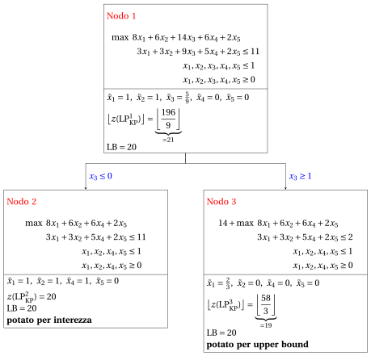{ .fig loading=lazy  }

        - <strong>Terminazione</strong>

            Poiché la lista dei problemi $L$ è vuota, il problema $\mathrm{ILP}_{\mathrm{KP}}$ è risolto all'ottimo.

            Il valore ottimo è $z(~\mathrm{ILP}_{\mathrm{KP}}~)=20$ (il valore del lower bound $\LB$) e una soluzione ottima ${\tilde {\boldsymbol x}}(\,\mathrm{ILP}_{\mathrm{KP}}\,)$  è $\tilde  x_1=1,\tilde  x_2=1,\tilde  x_3=0,\tilde  x_4=1,\tilde  x_5=0$ (la soluzione incumbent ${\bar{\boldsymbol x}}(\mathrm{ILP}_{\mathrm{KP}})$).

    3. Questo è l'<strong>albero di branch-and-bound</strong> della precedente esecuzione dell'<strong>algoritmo di branch-and-bound</strong>, che riporta per ogni nodo di branching risolto il valore ottimo del problema $\mathrm{LP}_{\mathrm{KP}}$ associato, il lower bound corrente $\LB$ e i criteri di potatura.

        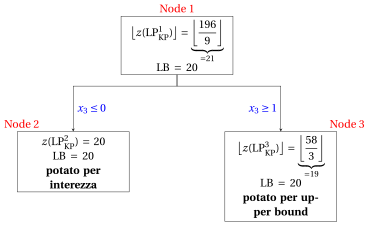{ .fig loading=lazy  }

!!! esercizio "Esercizio 41.2: Algoritmo di branch-and-bound per il problema dello zaino 0/1 (P2)"

    Consideriamo uno zaino di capacità $c=8$ e un insieme $\mathscr{I}=\{1,2,3,4\}$ di $4$ oggetti ($n=4$) con i seguenti profitti e pesi:

    $$
    \begin{array}{l|rrrrrrrrrrrr}
    \hline  & {j=1} & {j=2} & {j=3} & {j=4} \\[0.7ex]
    \hline {p_j} & {40} & {42} & {25} & {12} \\[0.7ex]
    {w_j} & {4} & {7} & {5} & {3} \\[0.7ex]
    \hline
    \end{array}
    $$

    **Domande**

    1. Verificare se gli oggetti sono ordinati per efficienza non crescente, altrimenti ordinarli in questo modo.  Scrivere il modello $\mathrm{ILP}_{\mathrm{KP}}$ e il modello $\mathrm{LP}_{\mathrm{KP}}$ per l'istanza del KP.

    2. Eseguire l'algoritmo di branch-and-bound per risolvere il modello $\mathrm{ILP}_{\mathrm{KP}}$ del problema dello zaino 0/1 (KP) usando:

        1. la regola dell'oggetto critico come strategia di scelta della variabile di branching;

        2. la regola LIFO come strategia di scelta del nodo di branching;

        3. risolvere prima il nodo di down-branching e poi il nodo di up-branching;

        4. porre la soluzione incumbent ${\bar{\boldsymbol x}}(\,\mathrm{ILP}_{\mathrm{KP}}\,)$ uguale alla seguente soluzione euristica:

            $$
            \bar{x}_1=1, ~~~ \bar{x}_2=0,~~~ \bar{x}_3= 0,~~\bar{x}_4=1
            $$

            e porre di conseguenza il lower bound $\LB$.

    3. Determinare e commentare l'albero di branch-and-bound corrispondente, indicando il motivo per cui i nodi di branching si possono potare.

??? soluzione "Soluzione"

    1. Gli oggetti sono ordinati per efficienza non crescente, poiché abbiamo:

        $$
        \frac{40}{4} ~~\ge~~ \frac{42}{7} ~~\ge~~ \frac{25}{5} ~~\ge~~ \frac{12}{3}
        $$

        Questo è il modello $\mathrm{ILP}_{\mathrm{KP}}$  per l'istanza del KP:

        $$
        \begin{array}{rrrrrrrrrrrrr}
        {\max} & 40 \, {x_1} & + 42 \, {x_2} & + 25 \, {x_3} & + 12 \, {x_4} \\[1ex]
        & 4 \, {x_1} & + 7 \, {x_2} & + 5 \, {x_3} & + 3 \, {x_4} & {\le} & 8 \\[1ex]
        & {x_1}, & {x_2}, & {x_3}, & {x_4} & { \in} & { \{0,1\}}
        \end{array}
        $$

        Questo è il modello $\mathrm{LP}_{\mathrm{KP}}$  per l'istanza del KP:

        $$
        \begin{array}{rrrrrrrrrrrrr}
        {\max} & 40 \, {x_1} & + 42 \, {x_2} & + 25 \, {x_3} & + 12 \, {x_4} \\[1ex]
        & 4 \, {x_1} & + 7 \, {x_2} & + 5 \, {x_3} & + 3 \, {x_4} & {\le} & 8 \\[1ex]
        & {x_1} &  &  &  & {\le} & 1 \\[1ex]
        &  & {x_2} &  &  & {\le} & 1 \\[1ex]
        &  &  & {x_3} &  & {\le} & 1 \\[1ex]
        &  &  &  & {x_4} & {\le} & 1 \\[1ex]
        & {x_1}, & {x_2}, & {x_3}, & {x_4} & { \ge} & { 0}
        \end{array}
        $$

    2. Esecuzione dell'algoritmo di branch-and-bound per risolvere il modello $\mathrm{ILP}_{\mathrm{KP}}$.

        - <strong>Inizializzazione</strong>

            Per il problema $\mathrm{LP}^1_{\mathrm{KP}}$, l'oggetto critico è $s=2$ e la capacità residua è $\mathit{rc} = 4$. Una soluzione ottima ${ \tilde{ \boldsymbol x}}(\,\mathrm{LP}^1_{\mathrm{KP}}\,)$ è:

            $$
            \tilde{x}_1=1,~~\tilde{x}_2=\frac{4}{7},~~\tilde{x}_3=0,~~\tilde{x}_4=0
            $$

            il valore ottimo è:

            $$
            z(~\mathrm{LP}^1_{\mathrm{KP}}~) = 40 \cdot 1 + 42 \cdot \frac{4}{7} =64
            $$

            La soluzione ottima ${ \tilde{ \boldsymbol x}}(\,\mathrm{LP}^1_{\mathrm{KP}}\,)$ è <strong>frazionaria</strong> e il problema $\mathrm{LP}^1_{\mathrm{KP}}$ è <strong>ammissibile</strong>, quindi il problema $\mathrm{LP}^1_{\mathrm{KP}}$ viene inserito nella lista dei problemi $L$ e il lower bound $\LB$ viene posto a $52$ ($\LB(\bar{\boldsymbol x})= 52$).

            Dati il lower bound $\LB$ e l'upper bound $\UB$ correnti, abbiamo:

            $$
            52 ~~\le~~ z(\mathrm{ILP}_{\mathrm{KP}}) ~~\le~~  64
            $$

        - <strong>Iterazione  1</strong>

            Il problema $\mathrm{LP}^1_{\mathrm{KP}}$ viene estratto e cancellato dalla lista dei problemi $L$.

            La variabile di branching è $x_2$. I problemi $\mathrm{LP}^2_{\mathrm{KP}}$ e $\mathrm{LP}^3_{\mathrm{KP}}$ vengono creati escludendo ($x_2 \le 0$) e selezionando ($x_2 \ge 1$) l'oggetto $2$.

            1. Soluzione del problema $\mathrm{LP}^2_{\mathrm{KP}}$

                Abbiamo

                $$
                \mathscr{I}^2 = \{1,3,4\},~~~\mathscr{I}^2_\text{out} = \{2\}, ~~~\mathscr{I}^2_\text{in} = \emptyset
                $$

                La capacità è $c(2)=8$ e la costante nella funzione obiettivo è $p(2)=0$. L'oggetto critico è $s=3$ e la capacità residua è $\mathit{rc} = 4$. Una soluzione ottima ${ \tilde{ \boldsymbol x}}(\,\mathrm{LP}^2_{\mathrm{KP}}\,)$ è:

                $$
                \tilde{x}_1=1,~~\tilde{x}_3=\frac{4}{5},~~\tilde{x}_4=0 {\rm ~~~e~~~}  z(~\mathrm{LP}^2_{\mathrm{KP}}~)=  40\cdot 1 + 25 \cdot \frac{4}{5}= 60
                $$

                Il problema $\mathrm{LP}^2_{\mathrm{KP}}$ è <strong>ammissibile</strong> e abbiamo:

                $$
                \left\lfloor z(\mathrm{LP}^2_{\mathrm{KP}}) \right\rfloor > \LB
                \qquad \text{poiché} \qquad
                60 > 52
                $$

                La soluzione ottima ${ \tilde{ \boldsymbol x}}(\,\mathrm{LP}^2_{\mathrm{KP}}\,)$ è <strong>frazionaria</strong>, quindi il problema $\mathrm{LP}^2_{\mathrm{KP}}$ viene <strong>inserito nella lista dei problemi</strong> $L$.

            2. Soluzione del problema $\mathrm{LP}^3_{\mathrm{KP}}$

                Abbiamo

                $$
                \mathscr{I}^3 = \{1,3,4\},~~~\mathscr{I}^3_\text{out} = \emptyset, ~~~\mathscr{I}^3_\text{in} = \{2\}
                $$

                La capacità è $c(3)=1$ e la costante nella funzione obiettivo è $p(3)=42$. L'oggetto critico è $s=1$ e la capacità residua è $\mathit{rc} = 1$. Una soluzione ottima ${ \tilde{ \boldsymbol x}}(\,\mathrm{LP}^3_{\mathrm{KP}}\,)$ è:

                $$
                \tilde{x}_1=\frac{1}{4},~~\tilde{x}_3=0,~~\tilde{x}_4=0 {\rm ~~~e~~~}  z(~\mathrm{LP}^3_{\mathrm{KP}}~)= 42 + 40 \cdot \frac{1}{4}= 52
                $$

                Il problema $\mathrm{LP}^3_{\mathrm{KP}}$ è <strong>ammissibile</strong> e abbiamo:

                $$
                \left\lfloor z(\mathrm{LP}^3_{\mathrm{KP}}) \right\rfloor \le \LB
                \qquad \text{poiché} \qquad
                52 \le 52
                $$

                quindi il nodo di branching è <u>potato per upper bound</u>.

            Alla fine della prima iterazione, il Nodo 2 è inserito nella lista dei problemi $L$, mentre il Nodo 3 è potato per upper bound. L'albero di branch-and-bound corrispondente è:

            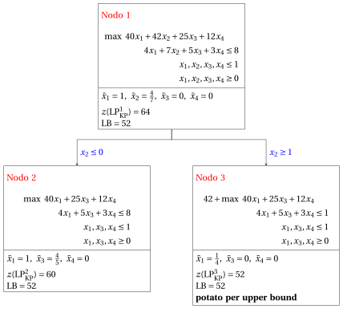{ .fig loading=lazy  }

            Dati il lower bound $\LB$ e l'upper bound $\UB$ correnti, abbiamo:

            $$
            52 ~~\le~~ z(\mathrm{ILP}_{\mathrm{KP}}) ~~\le~~ 60
            $$

        - <strong>Iterazione  2</strong>

            Il problema $\mathrm{LP}^2_{\mathrm{KP}}$ viene estratto e cancellato dalla lista dei problemi $L$.

            La variabile di branching è $x_3$. I problemi $\mathrm{LP}^4_{\mathrm{KP}}$ e $\mathrm{LP}^5_{\mathrm{KP}}$ vengono creati escludendo ($x_3 \le 0$) e selezionando ($x_3 \ge 1$) l'oggetto $3$.

            1. Soluzione del problema $\mathrm{LP}^4_{\mathrm{KP}}$

                Abbiamo

                $$
                \mathscr{I}^4 =  \{1,4\},~~~\mathscr{I}^4_\text{out} = \{2,3\}, ~~~\mathscr{I}^4_\text{in} = \emptyset
                $$

                La capacità è $c(4)=8$ e la costante nella funzione obiettivo è $p(4)=0$. Tutti gli oggetti entrano nello zaino. Una soluzione ottima ${ \tilde{ \boldsymbol x}}(\,\mathrm{LP}^4_{\mathrm{KP}}\,)$ è:

                $$
                \tilde{x}_1=1,~~\tilde{x}_4=1 {\rm ~~~e~~~}  z(~\mathrm{LP}^4_{\mathrm{KP}}~) = 40 \cdot 1 + 12 \cdot 1  = 52
                $$

                Il problema $\mathrm{LP}^4_{\mathrm{KP}}$ è <strong>ammissibile</strong> e la sua soluzione ottima ${ \tilde{ \boldsymbol x}}(\,\mathrm{LP}^4_{\mathrm{KP}}\,)$ è <strong>intera</strong>. Non migliora la soluzione incumbent, perché $z(\mathrm{LP}^4_{\mathrm{KP}})=52 \le 52=\LB$, quindi il nodo di branching è <u>potato per interezza</u> (quando valgono entrambi i criteri, prevale l'interezza).

            2. Soluzione del problema $\mathrm{LP}^5_{\mathrm{KP}}$

                Abbiamo

                $$
                \mathscr{I}^5 = \{1,4\},~~~\mathscr{I}^5_\text{out} = \{2\}, ~~~\mathscr{I}^5_\text{in}= \{3\}
                $$

                La capacità è $c(5)=3$ e la costante nella funzione obiettivo è $p(5)=25$. L'oggetto critico è $s=1$ e la capacità residua è $\mathit{rc} = 3$. Una soluzione ottima ${ \tilde{ \boldsymbol x}}(\,\mathrm{LP}^5_{\mathrm{KP}}\,)$ è:

                $$
                \tilde{x}_1=\frac{3}{4},~~\tilde{x}_2=0,~~\tilde{x}_3=1,~~\tilde{x}_4=0 {\rm ~~~e~~~}  z(~\mathrm{LP}^5_{\mathrm{KP}}~)= 25 + 40 \cdot \frac{3}{4} = 55
                $$

                Il problema $\mathrm{LP}^5_{\mathrm{KP}}$ è <strong>ammissibile</strong> e abbiamo:

                $$
                \left\lfloor z(\mathrm{LP}^5_{\mathrm{KP}}) \right\rfloor > \LB
                \qquad \text{poiché} \qquad
                55 > 52
                $$

                La soluzione ottima ${ \tilde{ \boldsymbol x}}(\,\mathrm{LP}^5_{\mathrm{KP}}\,)$ è <strong>frazionaria</strong>, quindi il problema $\mathrm{LP}^5_{\mathrm{KP}}$ viene <strong>inserito nella lista dei problemi</strong> $L$.

            Alla fine della seconda iterazione, il Nodo 5 è inserito nella lista dei problemi $L$, mentre il Nodo 4 è potato per interezza. L'albero di branch-and-bound corrispondente è:

            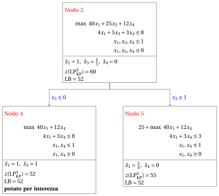{ .fig loading=lazy  }

            Dati il lower bound $\LB$ e l'upper bound $\UB$ correnti, abbiamo:

            $$
            52 ~~\le~~ z(\mathrm{ILP}_{\mathrm{KP}}) ~~\le~~ 55
            $$

        - <strong>Iterazione  3</strong>

            Il problema $\mathrm{LP}^5_{\mathrm{KP}}$ viene estratto e cancellato dalla lista dei problemi $L$.

            La variabile di branching è $x_1$. I problemi $\mathrm{LP}^6_{\mathrm{KP}}$ e $\mathrm{LP}^7_{\mathrm{KP}}$ vengono creati escludendo ($x_1 \le 0$) e selezionando ($x_1 \ge 1$) l'oggetto $1$.

            1. Soluzione del problema $\mathrm{LP}^6_{\mathrm{KP}}$

                Abbiamo

                $$
                \mathscr{I}^6 =  \{4\},~~~\mathscr{I}^6_\text{out} = \{1,2\}, ~~~\mathscr{I}^6_\text{in} = \{3\}
                $$

                La capacità è $c(6)=3$ e la costante nella funzione obiettivo è $p(6)=25$. Tutti gli oggetti entrano nello zaino. Una soluzione ottima ${ \tilde{ \boldsymbol x}}(\,\mathrm{LP}^6_{\mathrm{KP}}\,)$ è:

                $$
                \tilde{x}_4=1 {\rm ~~~e~~~}  z(~\mathrm{LP}^6_{\mathrm{KP}}~)= 25+12 \cdot 1=37
                $$

                Il problema $\mathrm{LP}^6_{\mathrm{KP}}$ è <strong>ammissibile</strong> e la sua soluzione ottima ${ \tilde{ \boldsymbol x}}(\,\mathrm{LP}^6_{\mathrm{KP}}\,)$ è <strong>intera</strong>. Non migliora la soluzione incumbent, perché $z(\mathrm{LP}^6_{\mathrm{KP}})=37 < 52=\LB$, quindi il nodo di branching è <u>potato per interezza</u> (quando valgono entrambi i criteri, prevale l'interezza).

            2. Soluzione del problema $\mathrm{LP}^7_{\mathrm{KP}}$

                Il problema $\mathrm{LP}^7_{\mathrm{KP}}$ è <strong>inammissibile</strong>, quindi il nodo di branching è <u>potato per inammissibilità</u>.

            Alla fine della terza iterazione, il Nodo 6 è potato per interezza e il Nodo 7 è potato per inammissibilità. L'albero di branch-and-bound corrispondente è:

            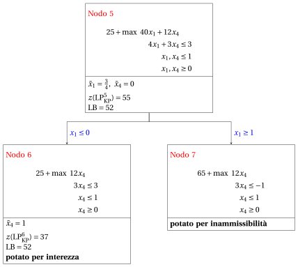{ .fig loading=lazy  }

        - <strong>Terminazione</strong>

            Poiché la lista dei problemi $L$ è vuota, il problema $\mathrm{ILP}_{\mathrm{KP}}$ è risolto all'ottimo.

            Il valore ottimo è $z(~\mathrm{ILP}_{\mathrm{KP}}~)=52$ (il valore del lower bound $\LB$) e una soluzione ottima ${\tilde {\boldsymbol x}}(\,\mathrm{ILP}_{\mathrm{KP}}\,)$  è $\tilde  x_1=1,\tilde  x_2=0,\tilde  x_3=0,\tilde  x_4=1$ (la soluzione incumbent ${\bar{\boldsymbol x}}(\mathrm{ILP}_{\mathrm{KP}})$).

    3. Questo è l'<strong>albero di branch-and-bound</strong> della precedente esecuzione dell'<strong>algoritmo di branch-and-bound</strong>, che riporta per ogni nodo di branching risolto il valore ottimo del problema $\mathrm{LP}_{\mathrm{KP}}$ associato, il lower bound corrente $\LB$ e i criteri di potatura.

        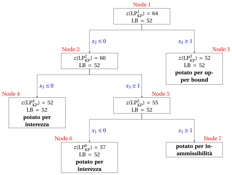{ .fig loading=lazy  }

!!! esercizio "Esercizio 41.3: Algoritmo di branch-and-bound per il problema dello zaino 0/1 (P3)"

    Consideriamo uno zaino di capacità $c=15$ e un insieme $\mathscr{I}=\{1,2,3,4\}$ di $4$ oggetti ($n=4$) con i seguenti profitti e pesi:

    $$
    \begin{array}{l|rrrrrrrrrrrr}
    \hline  & {j=1} & {j=2} & {j=3} & {j=4} \\[0.7ex]
    \hline {p_j} & {24} & {17} & {12} & {6} \\[0.7ex]
    {w_j} & {10} & {8} & {6} & {5} \\[0.7ex]
    \hline
    \end{array}
    $$

    **Domande**

    1. Verificare se gli oggetti sono ordinati per efficienza non crescente, altrimenti ordinarli in questo modo.  Scrivere il modello $\mathrm{ILP}_{\mathrm{KP}}$ e il modello $\mathrm{LP}_{\mathrm{KP}}$ per l'istanza del KP.

    2. Eseguire l'algoritmo di branch-and-bound per risolvere il modello $\mathrm{ILP}_{\mathrm{KP}}$ del problema dello zaino 0/1 (KP) usando:

        1. la regola dell'oggetto critico come strategia di scelta della variabile di branching;

        2. la regola LIFO come strategia di scelta del nodo di branching;

        3. risolvere prima il nodo di down-branching e poi il nodo di up-branching;

        4. porre la soluzione incumbent ${\bar{\boldsymbol x}}(\,\mathrm{ILP}_{\mathrm{KP}}\,)$ uguale alla seguente soluzione euristica:

            $$
            \bar{x}_1=1, ~~~ \bar{x}_2=0,~~~ \bar{x}_3= 0,~~\bar{x}_4=1
            $$

            e porre di conseguenza il lower bound $\LB$.

    3. Determinare e commentare l'albero di branch-and-bound corrispondente, indicando il motivo per cui i nodi di branching si possono potare.

??? soluzione "Soluzione"

    1. Gli oggetti sono ordinati per efficienza non crescente, poiché abbiamo:

        $$
        \frac{24}{10} ~~\ge~~\frac{17}{8} ~~\ge~~\frac{12}{6} ~~\ge~~\frac{6}{5}
        $$

        Questo è il modello $\mathrm{ILP}_{\mathrm{KP}}$ per l'istanza del KP:

        $$
        \begin{array}{rrrrrrrrrrrrr}
        {\max} & 24 \, {x_1} & + 17 \, {x_2} & + 12 \, {x_3} & + 6 \, {x_4} \\[1ex]
        & 10 \, {x_1} & + 8 \, {x_2} & + 6 \, {x_3} & + 5 \, {x_4} & {\le} & 15 \\[1ex]
        & {x_1}, & {x_2}, & {x_3}, & {x_4} & { \in} & { \{0,1\}}
        \end{array}
        $$

        Questo è il modello $\mathrm{LP}_{\mathrm{KP}}$  per l'istanza del KP:

        $$
        \begin{array}{rrrrrrrrrrrrr}
        {\max} & 24 \, {x_1} & + 17 \, {x_2} & + 12 \, {x_3} & + 6 \, {x_4} \\[1ex]
        & 10 \, {x_1} & + 8 \, {x_2} & + 6 \, {x_3} & + 5 \, {x_4} & {\le} & 15 \\[1ex]
        & {x_1} &  &  &  & {\le} & 1 \\[1ex]
        &  & {x_2} &  &  & {\le} & 1 \\[1ex]
        &  &  & {x_3} &  & {\le} & 1 \\[1ex]
        &  &  &  & {x_4} & {\le} & 1 \\[1ex]
        & {x_1}, & {x_2}, & {x_3}, & {x_4} & { \ge} & { 0}
        \end{array}
        $$

    2. Esecuzione dell'algoritmo di branch-and-bound per risolvere il modello $\mathrm{ILP}_{\mathrm{KP}}$.

        - <strong>Inizializzazione</strong>

            Per il problema $\mathrm{LP}^1_{\mathrm{KP}}$, l'oggetto critico è $s=2$ e la capacità residua è $\mathit{rc} = 5$. Una soluzione ottima ${ \tilde{ \boldsymbol x}}(\,\mathrm{LP}^1_{\mathrm{KP}}\,)$ è:

            $$
            \tilde{x}_1=1,~~\tilde{x}_2=\frac{5}{8},~~\tilde{x}_3=0,~~\tilde{x}_4=0
            $$

            il valore ottimo è:

            $$
            z(~\mathrm{LP}^1_{\mathrm{KP}}~) = 24 \cdot 1 + 17 \cdot \frac{5}{8} =\frac{277}{8}
            $$

            La soluzione ottima ${ \tilde{ \boldsymbol x}}(\,\mathrm{LP}^1_{\mathrm{KP}}\,)$ è <strong>frazionaria</strong> e il problema $\mathrm{LP}^1_{\mathrm{KP}}$ è <strong>ammissibile</strong>, quindi il problema $\mathrm{LP}^1_{\mathrm{KP}}$ viene inserito nella lista dei problemi $L$ e il lower bound $\LB$ viene posto a $30$ ($\LB(\bar{\boldsymbol x})= 30$).

            Dati il lower bound $\LB$ e l'upper bound $\UB$ correnti, abbiamo:

            $$
            30 ~~\le~~ z(\mathrm{ILP}_{\mathrm{KP}}) ~~\le~~  \underbrace{\left\lfloor \dfrac{277}{8} \right\rfloor}_{=34}
            $$

        - <strong>Iterazione  1</strong>

            Il problema $\mathrm{LP}^1_{\mathrm{KP}}$ viene estratto e cancellato dalla lista dei problemi $L$.

            La variabile di branching è $x_2$. I problemi $\mathrm{LP}^2_{\mathrm{KP}}$ e $\mathrm{LP}^3_{\mathrm{KP}}$ vengono creati escludendo ($x_2 \le 0$) e selezionando ($x_2 \ge 1$) l'oggetto $2$.

            1. Soluzione del problema $\mathrm{LP}^2_{\mathrm{KP}}$

                Abbiamo

                $$
                \mathscr{I}^2 = \{1,3,4\},~~~\mathscr{I}^2_\text{out} = \{2\}, ~~~\mathscr{I}^2_\text{in} = \emptyset
                $$

                La capacità è $c(2)=15$ e la costante nella funzione obiettivo è $p(2)=0$. L'oggetto critico è $s=3$ e la capacità residua è $\mathit{rc} = 5$. Una soluzione ottima ${ \tilde{ \boldsymbol x}}(\,\mathrm{LP}^2_{\mathrm{KP}}\,)$ è:

                $$
                \tilde{x}_1=1,~~\tilde{x}_3=\frac{5}{6},~~\tilde{x}_4=0 {\rm ~~~e~~~}  z(~\mathrm{LP}^2_{\mathrm{KP}}~)=  24\cdot 1 + 12 \cdot \frac{5}{6}= 34
                $$

                Il problema $\mathrm{LP}^2_{\mathrm{KP}}$ è <strong>ammissibile</strong> e abbiamo:

                $$
                \left\lfloor z(\mathrm{LP}^2_{\mathrm{KP}}) \right\rfloor > \LB
                \qquad \text{poiché} \qquad
                34 > 30
                $$

                La soluzione ottima ${ \tilde{ \boldsymbol x}}(\,\mathrm{LP}^2_{\mathrm{KP}}\,)$ è <strong>frazionaria</strong>, quindi il problema $\mathrm{LP}^2_{\mathrm{KP}}$ viene <strong>inserito nella lista dei problemi</strong> $L$.

            2. Soluzione del problema $\mathrm{LP}^3_{\mathrm{KP}}$

                Abbiamo

                $$
                \mathscr{I}^3 = \{1,3,4\},~~~\mathscr{I}^3_\text{out} = \emptyset, ~~~\mathscr{I}^3_\text{in} = \{2\}
                $$

                La capacità è $c(3)=7$ e la costante nella funzione obiettivo è $p(3)=17$. L'oggetto critico è $s=1$ e la capacità residua è $\mathit{rc} = 7$. Una soluzione ottima ${ \tilde{ \boldsymbol x}}(\,\mathrm{LP}^3_{\mathrm{KP}}\,)$ è:

                $$
                \tilde{x}_1=\frac{7}{10},~~\tilde{x}_3=0,~~\tilde{x}_4=0 {\rm ~~~e~~~}  z(~\mathrm{LP}^3_{\mathrm{KP}}~)= 17 + 24 \cdot \frac{7}{10}= \frac{169}{5}
                $$

                Il problema $\mathrm{LP}^3_{\mathrm{KP}}$ è <strong>ammissibile</strong> e abbiamo:

                $$
                \left\lfloor z(\mathrm{LP}^3_{\mathrm{KP}}) \right\rfloor > \LB
                \qquad \text{poiché} \qquad
                \underbrace{\left\lfloor \frac{169}{5} \right\rfloor}_{=33} > 30
                $$

                La soluzione ottima ${ \tilde{ \boldsymbol x}}(\,\mathrm{LP}^3_{\mathrm{KP}}\,)$ è <strong>frazionaria</strong>, quindi il problema $\mathrm{LP}^3_{\mathrm{KP}}$ viene <strong>inserito nella lista dei problemi</strong> $L$.

            Alla fine della prima iterazione, il Nodo 2 e il Nodo 3 sono entrambi inseriti nella lista dei problemi $L$. L'albero di branch-and-bound corrispondente è:

            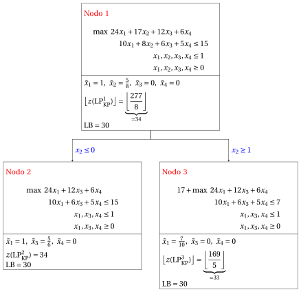{ .fig loading=lazy  }

            Dati il lower bound $\LB$ e l'upper bound $\UB$ correnti, abbiamo:

            $$
            30 ~~\le~~ z(\mathrm{ILP}_{\mathrm{KP}}) ~~\le~~ \underbrace{\max \left\{ 34,~~  \underbrace{\left\lfloor \frac{169}{5} \right\rfloor}_{=33} \right\}}_{=34}
            $$

        - <strong>Iterazione  2</strong>

            Il problema $\mathrm{LP}^3_{\mathrm{KP}}$ viene estratto e cancellato dalla lista dei problemi $L$.

            La variabile di branching è $x_1$. I problemi $\mathrm{LP}^4_{\mathrm{KP}}$ e $\mathrm{LP}^5_{\mathrm{KP}}$ vengono creati escludendo ($x_1 \le 0$) e selezionando ($x_1 \ge 1$) l'oggetto $1$.

            1. Soluzione del problema $\mathrm{LP}^4_{\mathrm{KP}}$

                Abbiamo

                $$
                \mathscr{I}^4 =  \{3,4\},~~~\mathscr{I}^4_\text{out} = \{1\}, ~~~\mathscr{I}^4_\text{in} = \{2\}
                $$

                La capacità è $c(4)=7$ e la costante nella funzione obiettivo è $p(4)=17$. L'oggetto critico è $s=4$ e la capacità residua è $\mathit{rc} = 1$. Una soluzione ottima ${ \tilde{ \boldsymbol x}}(\,\mathrm{LP}^4_{\mathrm{KP}}\,)$ è:

                $$
                \tilde{x}_3=1,~~\tilde{x}_4=\frac{1}{5} {\rm ~~~e~~~}  z(~\mathrm{LP}^4_{\mathrm{KP}}~) = 17+ 12 \cdot 1 + 6 \cdot \frac{1}{5}  = \frac{151}{5}
                $$

                Il problema $\mathrm{LP}^4_{\mathrm{KP}}$ è <strong>ammissibile</strong> e abbiamo:

                $$
                \left\lfloor z(\mathrm{LP}^4_{\mathrm{KP}}) \right\rfloor \le  \LB
                \qquad \text{poiché} \qquad
                \underbrace{\left\lfloor \frac{151}{5} \right\rfloor}_{=30} \le 30
                $$

                quindi il nodo di branching è <u>potato per upper bound</u>.

            2. Soluzione del problema $\mathrm{LP}^5_{\mathrm{KP}}$

                Il problema $\mathrm{LP}^5_{\mathrm{KP}}$ è <strong>inammissibile</strong>, quindi il nodo di branching è <u>potato per inammissibilità</u>.

            Alla fine della seconda iterazione, il Nodo 4 è potato per upper bound e il Nodo 5 è potato per inammissibilità. L'albero di branch-and-bound corrispondente è:

            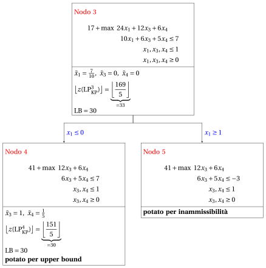{ .fig loading=lazy  }

            Dati il lower bound $\LB$ e l'upper bound $\UB$ correnti, abbiamo:

            $$
            30 ~~\le~~ z(\mathrm{ILP}_{\mathrm{KP}}) ~~\le~~ 34
            $$

        - <strong>Iterazione  3</strong>

            Il problema $\mathrm{LP}^2_{\mathrm{KP}}$ viene estratto e cancellato dalla lista dei problemi $L$.

            La variabile di branching è $x_3$. I problemi $\mathrm{LP}^6_{\mathrm{KP}}$ e $\mathrm{LP}^7_{\mathrm{KP}}$ vengono creati escludendo ($x_3 \le 0$) e selezionando ($x_3 \ge 1$) l'oggetto $3$.

            1. Soluzione del problema $\mathrm{LP}^6_{\mathrm{KP}}$

                Abbiamo

                $$
                \mathscr{I}^6 =  \{1,4\},~~~\mathscr{I}^6_\text{out} = \{2,3\}, ~~~\mathscr{I}^6_\text{in} = \emptyset
                $$

                La capacità è $c(6)=15$ e la costante nella funzione obiettivo è $p(6)=0$. Tutti gli oggetti entrano nello zaino. Una soluzione ottima ${ \tilde{ \boldsymbol x}}(\,\mathrm{LP}^6_{\mathrm{KP}}\,)$ è:

                $$
                \tilde{x}_1=1,\tilde{x}_4=1 {\rm ~~~e~~~}  z(~\mathrm{LP}^6_{\mathrm{KP}}~)= 24 \cdot 1+6 \cdot 1=30
                $$

                Il problema $\mathrm{LP}^6_{\mathrm{KP}}$ è <strong>ammissibile</strong> e la sua soluzione ottima ${ \tilde{ \boldsymbol x}}(\,\mathrm{LP}^6_{\mathrm{KP}}\,)$ è <strong>intera</strong>. Non migliora la soluzione incumbent, perché $z(\mathrm{LP}^6_{\mathrm{KP}})=30 \le 30=\LB$, quindi il nodo di branching è <u>potato per interezza</u> (quando valgono entrambi i criteri, prevale l'interezza).

            2. Soluzione del problema $\mathrm{LP}^7_{\mathrm{KP}}$

                Abbiamo

                $$
                \mathscr{I}^7 = \{1,4\},~~~\mathscr{I}^7_\text{out} = \{2\}, ~~~\mathscr{I}^7_\text{in} = \{3\}
                $$

                La capacità è $c(7)=9$ e la costante nella funzione obiettivo è $p(7)=12$. L'oggetto critico è $s=1$ e la capacità residua è $\mathit{rc} = 9$. Una soluzione ottima ${ \tilde{ \boldsymbol x}}(\,\mathrm{LP}^7_{\mathrm{KP}}\,)$ è:

                $$
                \tilde{x}_1=\frac{9}{10},~~\tilde{x}_4=0 {\rm ~~~e~~~}  z(~\mathrm{LP}^7_{\mathrm{KP}}~)=  12 + 24 \cdot \frac{9}{10}= \frac{168}{5}
                $$

                Il problema $\mathrm{LP}^7_{\mathrm{KP}}$ è <strong>ammissibile</strong> e abbiamo:

                $$
                \left\lfloor z(\mathrm{LP}^7_{\mathrm{KP}}) \right\rfloor >  \LB
                \qquad \text{poiché} \qquad
                \underbrace{\left\lfloor  \frac{168}{5} \right\rfloor}_{=33} > 30
                $$

                La soluzione ottima ${ \tilde{ \boldsymbol x}}(\,\mathrm{LP}^7_{\mathrm{KP}}\,)$ è <strong>frazionaria</strong>, quindi il problema $\mathrm{LP}^7_{\mathrm{KP}}$ viene <strong>inserito nella lista dei problemi</strong> $L$.

            Alla fine della terza iterazione, il Nodo 6 è potato per interezza e il Nodo 7 è inserito nella lista dei problemi $L$. L'albero di branch-and-bound corrispondente è:

            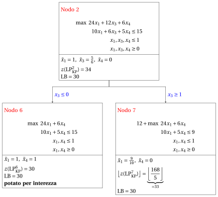{ .fig loading=lazy  }

        - <strong>Iterazione  4</strong>

            Il problema $\mathrm{LP}^7_{\mathrm{KP}}$ viene estratto e cancellato dalla lista dei problemi $L$.

            La variabile di branching è $x_1$. I problemi $\mathrm{LP}^8_{\mathrm{KP}}$ e $\mathrm{LP}^9_{\mathrm{KP}}$ vengono creati escludendo ($x_1 \le 0$) e selezionando ($x_1 \ge 1$) l'oggetto $1$.

            1. Soluzione del problema $\mathrm{LP}^8_{\mathrm{KP}}$

                Abbiamo

                $$
                \mathscr{I}^8 =  \{4\},~~~\mathscr{I}^8_\text{out} = \{1,2\}, ~~~\mathscr{I}^8_\text{in} = \{3\}
                $$

                La capacità è $c(8)=9$ e la costante nella funzione obiettivo è $p(8)=12$. Tutti gli oggetti entrano nello zaino. Una soluzione ottima ${ \tilde{ \boldsymbol x}}(\,\mathrm{LP}^8_{\mathrm{KP}}\,)$ è:

                $$
                \tilde{x}_4=1 {\rm ~~~e~~~}  z(~\mathrm{LP}^8_{\mathrm{KP}}~)= 12+6 \cdot 1=18
                $$

                Il problema $\mathrm{LP}^8_{\mathrm{KP}}$ è <strong>ammissibile</strong> e la sua soluzione ottima ${ \tilde{ \boldsymbol x}}(\,\mathrm{LP}^8_{\mathrm{KP}}\,)$ è <strong>intera</strong>. Non migliora la soluzione incumbent, perché $z(\mathrm{LP}^8_{\mathrm{KP}})=18 < 30=\LB$, quindi il nodo di branching è <u>potato per interezza</u> (quando valgono entrambi i criteri, prevale l'interezza).

            2. Soluzione del problema $\mathrm{LP}^9_{\mathrm{KP}}$

                Il problema $\mathrm{LP}^9_{\mathrm{KP}}$ è <strong>inammissibile</strong>, quindi il nodo di branching è <u>potato per inammissibilità</u>.

            Alla fine della quarta iterazione, il Nodo 8 è potato per interezza e il Nodo 9 è potato per inammissibilità. L'albero di branch-and-bound corrispondente è:

            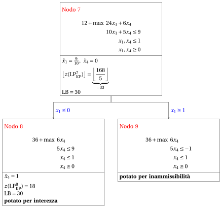{ .fig loading=lazy  }

        - <strong>Terminazione</strong>

            Poiché la lista dei problemi $L$ è vuota, il problema $\mathrm{ILP}_{\mathrm{KP}}$ è risolto all'ottimo.

            Il valore ottimo è $z(~\mathrm{ILP}_{\mathrm{KP}}~)=30$ (il valore del lower bound $\LB$) e una soluzione ottima ${\tilde {\boldsymbol x}}(\,\mathrm{ILP}_{\mathrm{KP}}\,)$  è $\tilde  x_1=1,\tilde  x_2=0,\tilde  x_3=0,\tilde  x_4=1$ (la soluzione incumbent ${\bar{\boldsymbol x}}(\mathrm{ILP}_{\mathrm{KP}})$).

    3. Questo è l'<strong>albero di branch-and-bound</strong> della precedente esecuzione dell'<strong>algoritmo di branch-and-bound</strong>, che riporta per ogni nodo di branching risolto il valore ottimo del problema $\mathrm{LP}_{\mathrm{KP}}$ associato, il lower bound corrente $\LB$ e i criteri di potatura.

        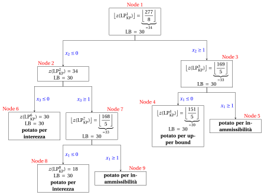{ .fig loading=lazy  }

!!! esercizio "Esercizio 41.4: Algoritmo di branch-and-bound per il problema dello zaino 0/1 (P4)"

    Consideriamo uno zaino di capacità $c=9$ e un insieme $\mathscr{I}=\{1,2,3,4,5,6\}$ di $6$ oggetti ($n=6$) con i seguenti profitti e pesi:

    $$
    \begin{array}{l|rrrrrrr}
    \hline  & {j = 1} & {j = 2} & {j = 3} & {j = 4} & {j = 5} & {j = 6} \\[1ex]
    \hline {p_j} & {6} & {5} & {8} & {9} & {6} & {7} \\[1ex]
    {w_j} & {2} & {3} & {6} & {7} & {5} & {9} \\[1ex]
    \hline
    \end{array}
    $$

    **Domande**

    1. Verificare se gli oggetti sono ordinati per efficienza non crescente, altrimenti ordinarli in questo modo.  Scrivere il modello $\mathrm{ILP}_{\mathrm{KP}}$ e il modello $\mathrm{LP}_{\mathrm{KP}}$ per l'istanza del KP.

    2. Eseguire l'algoritmo di branch-and-bound per risolvere il modello $\mathrm{ILP}_{\mathrm{KP}}$ del problema dello zaino 0/1 (KP) usando:

        1. la regola dell'oggetto critico come strategia di scelta della variabile di branching;

        2. la regola FIFO come strategia di scelta del nodo di branching;

        3. risolvere prima il nodo di down-branching e poi il nodo di up-branching;

        4. porre la soluzione incumbent ${\bar{\boldsymbol x}}(\,\mathrm{ILP}_{\mathrm{KP}}\,)$ uguale alla seguente soluzione euristica:

            $$
            \bar{x}_1=1, ~~~ \bar{x}_2=1,~~~ \bar{x}_3= 0,~~\bar{x}_4=0,~~\bar{x}_5=0,~~\bar{x}_6=0
            $$

            e porre di conseguenza il lower bound $\LB$.

    3. Determinare e commentare l'albero di branch-and-bound corrispondente, indicando il motivo per cui i nodi di branching si possono potare.

??? soluzione "Soluzione"

    1. Gli oggetti sono ordinati per efficienza non crescente, poiché abbiamo:

        $$
        \frac{6}{2} ~~\ge~~ \frac{5}{3} ~~\ge~~ \frac{8}{6} ~~\ge~~ \frac{9}{7} ~~\ge~~ \frac{6}{5} ~~\ge~~ \frac{7}{9}
        $$

        Questo è il modello $\mathrm{ILP}_{\mathrm{KP}}$  per l'istanza del KP:

        $$
        \begin{array}{rrrrrrrrrrrrr}
        {\max} & 6 \, {x_1} & + 5 \, {x_2} & + 8 \, {x_3} & + 9 \, {x_4} & + 6 \, {x_5} & + 7 \, {x_6} \\[1.5ex]
        & 2 \, {x_1} & + 3 \, {x_2} & + 6 \, {x_3} & + 7 \, {x_4} & + 5 \, {x_5} & + 9 \, {x_6} & {\le} & 9 \\[1.5ex]
        & {x_1}, & {x_2}, & {x_3}, & {x_4}, & {x_5}, & {x_6} & { \in} & { \{0,1\}}
        \end{array}
        $$

        Questo è il modello $\mathrm{LP}_{\mathrm{KP}}$ per l'istanza del KP:

        $$
        \begin{array}{rrrrrrrrrrrrr}
        {\max} & 6 \, {x_1} & + 5 \, {x_2} & + 8 \, {x_3} & + 9 \, {x_4} & + 6 \, {x_5} & + 7 \, {x_6} \\[1ex]
        & 2 \, {x_1} & + 3 \, {x_2} & + 6 \, {x_3} & + 7 \, {x_4} & + 5 \, {x_5} & + 9 \, {x_6} & {\le} & 9 \\[1ex]
        & {x_1} &  &  &  &  &  & {\le} & 1 \\
        &  & {x_2} &  &  &  &  & {\le} & 1 \\
        &  &  & {x_3} &  &  &  & {\le} & 1 \\
        &  &  &  & {x_4} &  &  & {\le} & 1 \\
        &  &  &  &  & {x_5} &  & {\le} & 1 \\
        &  &  &  &  &  & {x_6} & {\le} & 1 \\[1ex]
        & {x_1}, & {x_2}, & {x_3}, & {x_4}, & {x_5}, & {x_6} & { \ge} & { 0}
        \end{array}
        $$

    2. Esecuzione dell'algoritmo di branch-and-bound per risolvere il modello $\mathrm{ILP}_{\mathrm{KP}}$.

        - <strong>Inizializzazione</strong>

            Per il problema $\mathrm{LP}^1_{\mathrm{KP}}$, l'oggetto critico è $s=3$ e la capacità residua è $\mathit{rc} = 4$. Una soluzione ottima ${ \tilde{ \boldsymbol x}}(\,\mathrm{LP}^1_{\mathrm{KP}}\,)$ è:

            $$
            \tilde{x}_1=1,~~\tilde{x}_2=1,~~\tilde{x}_3=\frac{2}{3},~~\tilde{x}_4=0,~~\tilde{x}_5=0,~~\tilde{x}_6=0
            $$

            il valore ottimo è:

            $$
            z(~\mathrm{LP}^1_{\mathrm{KP}}~) = 6 \cdot 1 + 5 \cdot 1 +  8 \cdot \frac{2}{3} =\frac{49}{3}
            $$

            La soluzione ottima ${ \tilde{ \boldsymbol x}}(\,\mathrm{LP}^1_{\mathrm{KP}}\,)$ è <strong>frazionaria</strong> e il problema $\mathrm{LP}^1_{\mathrm{KP}}$ è <strong>ammissibile</strong>, quindi il problema $\mathrm{LP}^1_{\mathrm{KP}}$ viene inserito nella lista dei problemi $L$ e il lower bound $\LB$ viene posto a $11$ ($\LB(\bar{\boldsymbol x})= 11$).

            Dati il lower bound $\LB$ e l'upper bound $\UB$ correnti, abbiamo:

            $$
            11 ~~\le~~ z(\mathrm{ILP}_{\mathrm{KP}}) ~~\le~~  \underbrace{\left\lfloor \dfrac{49}{3} \right\rfloor}_{=16}
            $$

        - <strong>Iterazione  1</strong>

            Il problema $\mathrm{LP}^1_{\mathrm{KP}}$ viene estratto e cancellato dalla lista dei problemi $L$.

            La variabile di branching è $x_3$. I problemi $\mathrm{LP}^2_{\mathrm{KP}}$ e $\mathrm{LP}^3_{\mathrm{KP}}$ vengono creati escludendo ($x_3 \le 0$) e selezionando ($x_3 \ge 1$) l'oggetto $3$.

            1. Soluzione del problema $\mathrm{LP}^2_{\mathrm{KP}}$

                Abbiamo

                $$
                \mathscr{I}^2 = \{1,2,4,5,6\},~~~\mathscr{I}^2_\text{out} = \{3\}, ~~~\mathscr{I}^2_\text{in} = \emptyset
                $$

                La capacità è $c(2)=9$ e la costante nella funzione obiettivo è $p(2)=0$. L'oggetto critico è $s=4$ e la capacità residua è $\mathit{rc} = 4$. Una soluzione ottima ${ \tilde{ \boldsymbol x}}(\,\mathrm{LP}^2_{\mathrm{KP}}\,)$ è:

                $$
                \begin{gathered}\tilde{x}_1=1,~~\tilde{x}_2=1,~~\tilde{x}_4=\frac{4}{7},~~\tilde{x}_5=0,~~\tilde{x}_6=0
                \qquad \text{e} \\
                z(~\mathrm{LP}^2_{\mathrm{KP}}~) =   6 \cdot 1 + 5 \cdot 1 + 9 \cdot \frac{4}{7} = \frac{113}{7}\end{gathered}
                $$

                Il problema $\mathrm{LP}^2_{\mathrm{KP}}$ è <strong>ammissibile</strong> e abbiamo:

                $$
                \left\lfloor z(\mathrm{LP}^2_{\mathrm{KP}}) \right\rfloor > \LB
                \qquad \text{poiché} \qquad
                \underbrace{\left\lfloor\frac{113}{7} \right\rfloor}_{ = 16} >11
                $$

                La soluzione ottima ${ \tilde{ \boldsymbol x}}(\,\mathrm{LP}^2_{\mathrm{KP}}\,)$ è <strong>frazionaria</strong>, quindi il problema $\mathrm{LP}^2_{\mathrm{KP}}$ viene <strong>inserito nella lista dei problemi</strong> $L$.

            2. Soluzione del problema $\mathrm{LP}^3_{\mathrm{KP}}$

                Abbiamo

                $$
                \mathscr{I}^3 = \{1,2,4,5,6\},~~~\mathscr{I}^3_\text{out} = \emptyset, ~~~\mathscr{I}^3_\text{in} = \{3\}
                $$

                La capacità è $c(3)=3$ e la costante nella funzione obiettivo è $p(3)=8$. L'oggetto critico è $s=2$ e la capacità residua è $\mathit{rc} = 1$. Una soluzione ottima ${ \tilde{ \boldsymbol x}}(\,\mathrm{LP}^3_{\mathrm{KP}}\,)$ è:

                $$
                \begin{gathered} \tilde{x}_1=1,~~\tilde{x}_2=\frac{1}{3},~~\tilde{x}_4=0,~~\tilde{x}_5=0,~~\tilde{x}_6=0 \qquad \text{e} \\  z(~\mathrm{LP}^3_{\mathrm{KP}}~) =  8 + 6 \cdot 1 + 5 \cdot \frac{1}{3} = \frac{47}{3}\end{gathered}
                $$

                Il problema $\mathrm{LP}^3_{\mathrm{KP}}$ è <strong>ammissibile</strong> e abbiamo:

                $$
                \left\lfloor z(\mathrm{LP}^3_{\mathrm{KP}}) \right\rfloor > \LB
                \qquad \text{poiché} \qquad
                \underbrace{\left\lfloor\frac{47}{3} \right\rfloor}_{ = 15} > 11
                $$

                La soluzione ottima ${ \tilde{ \boldsymbol x}}(\,\mathrm{LP}^3_{\mathrm{KP}}\,)$ è <strong>frazionaria</strong>, quindi il problema $\mathrm{LP}^3_{\mathrm{KP}}$ viene <strong>inserito nella lista dei problemi</strong> $L$.

            Alla fine della prima iterazione, il Nodo 2 e il Nodo 3 sono entrambi inseriti nella lista dei problemi $L$. L'albero di branch-and-bound corrispondente è:

            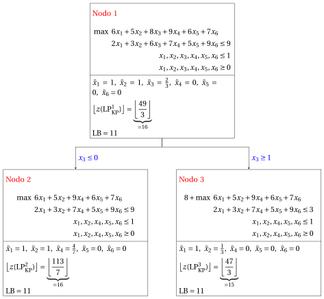{ .fig loading=lazy  }

            Dati il lower bound $\LB$ e l'upper bound $\UB$ correnti, abbiamo:

            $$
            11 ~~\le~~ z(\mathrm{ILP}_{\mathrm{KP}}) ~~\le~~ \underbrace{\max \left\{ \underbrace{\left\lfloor \frac{113}{7} \right\rfloor}_{=16},~~  \underbrace{\left\lfloor \frac{47}{3} \right\rfloor}_{=15} \right\}}_{=16}
            $$

        - <strong>Iterazione  2</strong>

            Il problema $\mathrm{LP}^2_{\mathrm{KP}}$ viene estratto e cancellato dalla lista dei problemi $L$.

            La variabile di branching è $x_4$. I problemi $\mathrm{LP}^4_{\mathrm{KP}}$ e $\mathrm{LP}^5_{\mathrm{KP}}$ vengono creati escludendo ($x_4 \le 0$) e selezionando ($x_4 \ge 1$) l'oggetto $4$.

            1. Soluzione del problema $\mathrm{LP}^4_{\mathrm{KP}}$

                Abbiamo

                $$
                \mathscr{I}^4 =  \{1,2,5,6\},~~~\mathscr{I}^4_\text{out} = \{3,4\}, ~~~\mathscr{I}^4_\text{in} = \emptyset
                $$

                La capacità è $c(4)=9$ e la costante nella funzione obiettivo è $p(4)=0$. L'oggetto critico è $s=5$ e la capacità residua è $\mathit{rc} = 4$. Una soluzione ottima ${ \tilde{ \boldsymbol x}}(\,\mathrm{LP}^4_{\mathrm{KP}}\,)$ è:

                $$
                \tilde{x}_1=1,~~\tilde{x}_2=1,~~\tilde{x}_5=\frac{4}{5},~~\tilde{x}_6=0 {\rm ~~~e~~~}  z(~\mathrm{LP}^4_{\mathrm{KP}}~) = 6 \cdot 1 + 5 \cdot 1 + 6 \cdot \frac{4}{5} = \frac{79}{5}
                $$

                Il problema $\mathrm{LP}^4_{\mathrm{KP}}$ è <strong>ammissibile</strong> e abbiamo:

                $$
                \left\lfloor z(\mathrm{LP}^4_{\mathrm{KP}}) \right\rfloor >  \LB
                \qquad \text{poiché} \qquad
                \underbrace{\left\lfloor\frac{79}{5} \right\rfloor}_{ = 15} > 11
                $$

                La soluzione ottima ${ \tilde{ \boldsymbol x}}(\,\mathrm{LP}^4_{\mathrm{KP}}\,)$ è <strong>frazionaria</strong>, quindi il problema $\mathrm{LP}^4_{\mathrm{KP}}$ viene <strong>inserito nella lista dei problemi</strong> $L$.

            2. Soluzione del problema $\mathrm{LP}^5_{\mathrm{KP}}$

                Abbiamo

                $$
                \mathscr{I}^5 = \{1,2,5,6\},~~~\mathscr{I}^5_\text{out} = \{3\}, ~~~ \mathscr{I}^5_\text{in}= \{4\}
                $$

                La capacità è $c(5)=2$ e la costante nella funzione obiettivo è $p(5)=9$. L'oggetto critico è $s=2$ e la capacità residua è $\mathit{rc} = 0$. Una soluzione ottima ${ \tilde{ \boldsymbol x}}(\,\mathrm{LP}^5_{\mathrm{KP}}\,)$ è:

                $$
                \tilde{x}_1=1,~~\tilde{x}_2=0,~~\tilde{x}_5=0,~~\tilde{x}_6=0 {\rm ~~~e~~~}  z(~\mathrm{LP}^5_{\mathrm{KP}}~) = 9 + 6 \cdot 1  =  15
                $$

                Il problema $\mathrm{LP}^5_{\mathrm{KP}}$ è <strong>ammissibile</strong> e abbiamo:

                $$
                \left\lfloor z(\mathrm{LP}^5_{\mathrm{KP}}) \right\rfloor > \LB
                \qquad \text{poiché} \qquad
                15 > 11
                $$

                La soluzione ottima ${ \tilde{ \boldsymbol x}}(\,\mathrm{LP}^5_{\mathrm{KP}}\,)$ è <strong>intera</strong>, quindi il lower bound $\LB$ diventa $15$ e la soluzione incumbent ${\bar{\boldsymbol x}}(\mathrm{ILP}_{\mathrm{KP}})$ diventa $\bar  x_1=1,\bar  x_2=0,\bar  x_3=0,\bar  x_4=1,\bar  x_5=0,\bar  x_6=0$.

                Di conseguenza, il nodo di branching è <u>potato per interezza</u>.

                Poiché il lower bound è migliorato, il problema $\mathrm{LP}^3_{\mathrm{KP}}$ e il problema $\mathrm{LP}^4_{\mathrm{KP}}$ sono <u>potati per upper bound</u> e rimossi dalla lista dei problemi $L$.  Abbiamo:

                $$
                \left\lfloor z(\mathrm{LP}^3_{\mathrm{KP}}) \right\rfloor \le \LB
                \qquad \text{poiché} \qquad
                \underbrace{\left\lfloor\frac{47}{3} \right\rfloor}_{ = 15} \le  15
                $$

                $$
                \left\lfloor z(\mathrm{LP}^4_{\mathrm{KP}}) \right\rfloor \le \LB
                \qquad \text{poiché} \qquad
                \underbrace{\left\lfloor\frac{79}{5} \right\rfloor}_{ = 15} \le  15
                $$

            Alla fine della seconda iterazione, il Nodo 5 migliora il lower bound a $\LB=15$ ed è potato per interezza; il Nodo 3 e il Nodo 4 sono poi potati per upper bound. L'albero di branch-and-bound corrispondente è:

            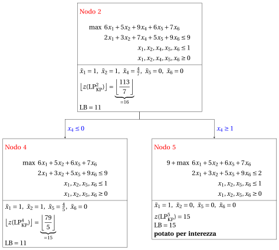{ .fig loading=lazy  }

        - <strong>Terminazione</strong>

            Poiché la lista dei problemi $L$ è vuota, il problema $\mathrm{ILP}_{\mathrm{KP}}$ è risolto all'ottimo.

            Il valore ottimo è $z(~\mathrm{ILP}_{\mathrm{KP}}~)=15$ (il valore del lower bound $\LB$) e una soluzione ottima ${\tilde {\boldsymbol x}}(\,\mathrm{ILP}_{\mathrm{KP}}\,)$  è $\tilde  x_1=1,\tilde  x_2=0,\tilde  x_3=0,\tilde  x_4=1,\tilde  x_5=0,\tilde  x_6=0$ (la soluzione incumbent ${\bar{\boldsymbol x}}(\mathrm{ILP}_{\mathrm{KP}})$).

    3. Questo è l'<strong>albero di branch-and-bound</strong> della precedente esecuzione dell'<strong>algoritmo di branch-and-bound</strong>, che riporta per ogni nodo di branching risolto il valore ottimo del problema $\mathrm{LP}_{\mathrm{KP}}$ associato, il lower bound corrente $\LB$ e i criteri di potatura.

        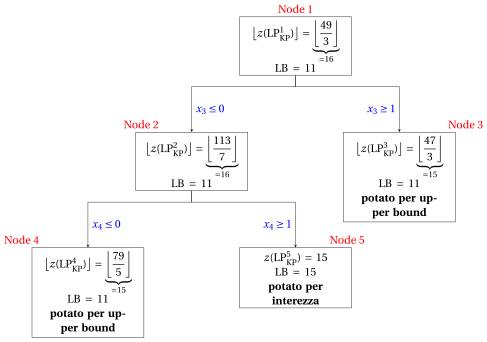{ .fig loading=lazy  }
