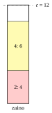
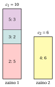

# Esercizi · Problemi di zaino

**Esercizi · Capitolo 2** · ogni soluzione si apre con un clic · [:material-book-open-variant: Capitolo 2: Problemi di zaino](../problemi-di-ottimizzazione-combinatoria/knapsack/index.md) · [:material-file-pdf-box: Eserciziario, volume 1 (PDF)](../pdf/esercizi-1-problemi-di-ottimizzazione-combinatoria.pdf)

!!! esercizio "Esercizio 2.1: Ammissibilità, valore e bound (KP)"

    Consideriamo l'istanza di zaino con capacità $c=12$ e $n=5$ oggetti, $\mathscr{I}=\{1,\dots,5\}$, con i seguenti profitti e pesi:

    $$
    \begin{array}{l|ccccc}
    \hline  & {j=1} & {j=2} & {j=3} & {j=4} & {j=5} \\[1ex]
    \hline {p_j} & {6} & {12} & {5} & {13} & {8} \\[1ex]
    {w_j} & {3} & {4} & {5} & {6} & {8} \\
    \hline
    \end{array}
    $$

    **Domande**

    1. Verificare le due ipotesi sui dati del KP.

    2. Per ciascuno dei sottoinsiemi $S_1=\{1,2,5\}$, $S_2=\{2,4\}$, $S_3=\{1,2,3\}$, calcolare il peso totale, stabilire se è ammissibile e, in caso affermativo, darne il profitto.

    3. Calcolare il bound di cardinalità $\bar k$ e il bound duale che ne deriva.

    4. Calcolare il bound duale del rilassamento continuo (gli oggetti si possono prendere in modo frazionario, in ordine di efficienza non crescente) e arrotondarlo.

    5. Trovare una soluzione ottima elencando i sottoinsiemi ammissibili, e calcolare il gap fra il miglior bound duale e $z(I)$.

??? soluzione "Soluzione"

    1. Il peso totale è $3+4+5+6+8=26>12$, quindi non tutti gli oggetti entrano; l'oggetto più pesante pesa $8\le 12$, quindi ogni oggetto entra da solo. Entrambe le ipotesi valgono.

    2. - $S_1$: peso $3+4+8=15>12$, non ammissibile;

        - $S_2$: peso $4+6=10\le 12$, ammissibile, profitto $12+13=25$;

        - $S_3$: peso $3+4+5=12\le 12$, ammissibile, profitto $6+12+5=23$;

    3. I pesi in ordine non decrescente sono $3, 4, 5, 6, 8$: i $3$ oggetti più leggeri pesano $3+4+5=12\le 12$, i $4$ più leggeri pesano $18>12$. Quindi $\bar k=3$: un sottoinsieme ammissibile ha al più $3$ oggetti, e i $3$ profitti più grandi danno

        $$
        \mathrm{UB}=13+12+8=33.
        $$

    4. Le efficienze sono $\frac{6}{3}=2,\ \frac{12}{4}=3,\ \frac{5}{5}=1,\ \frac{13}{6},\ \frac{8}{8}=1$, quindi l'ordine è $2,4,1,3,5$. Gli oggetti $2, 4$ pesano $10$, e la frazione $\frac{2}{3}$ dell'oggetto $1$ riempie la capacità residua $2$:

        $$
        \mathrm{UB}=12+13+\frac{2}{3}\cdot 6=29.
        $$

        I profitti sono interi, quindi $\mathrm{UB}=\lfloor 29\rfloor=29$; è più forte del bound di cardinalità.

    5. I sottoinsiemi ammissibili sono $15$:

        
<table>
        <tr>
        <th>\(S\)</th>
        <th>peso</th>
        <th>profitto</th>
        <th>\(S\)</th>
        <th>peso</th>
        <th>profitto</th>
        </tr>
        <tr>
        <td>\(\emptyset\)</td>
        <td>\(0\)</td>
        <td>\(0\)</td>
        <td>\(\{1,4\}\)</td>
        <td>\(9\)</td>
        <td>\(19\)</td>
        </tr>
        <tr>
        <td>\(\{1\}\)</td>
        <td>\(3\)</td>
        <td>\(6\)</td>
        <td>\(\{1,5\}\)</td>
        <td>\(11\)</td>
        <td>\(14\)</td>
        </tr>
        <tr>
        <td>\(\{2\}\)</td>
        <td>\(4\)</td>
        <td>\(12\)</td>
        <td>\(\{2,3\}\)</td>
        <td>\(9\)</td>
        <td>\(17\)</td>
        </tr>
        <tr>
        <td>\(\{3\}\)</td>
        <td>\(5\)</td>
        <td>\(5\)</td>
        <td>\(\{2,4\}\)</td>
        <td>\(10\)</td>
        <td>\(\mathbf{25}\)</td>
        </tr>
        <tr>
        <td>\(\{4\}\)</td>
        <td>\(6\)</td>
        <td>\(13\)</td>
        <td>\(\{2,5\}\)</td>
        <td>\(12\)</td>
        <td>\(20\)</td>
        </tr>
        <tr>
        <td>\(\{5\}\)</td>
        <td>\(8\)</td>
        <td>\(8\)</td>
        <td>\(\{3,4\}\)</td>
        <td>\(11\)</td>
        <td>\(18\)</td>
        </tr>
        <tr>
        <td>\(\{1,2\}\)</td>
        <td>\(7\)</td>
        <td>\(18\)</td>
        <td>\(\{1,2,3\}\)</td>
        <td>\(12\)</td>
        <td>\(23\)</td>
        </tr>
        <tr>
        <td>\(\{1,3\}\)</td>
        <td>\(8\)</td>
        <td>\(11\)</td>
        <td></td>
        <td></td>
        <td></td>
        </tr>
        </table>

        La soluzione ottima è $\tilde S=\{2,4\}$, l'unica con profitto $z(I)=25$:

        { .fig loading=lazy  }

        Il gap fra il bound continuo e l'ottimo è $29-25=4$: il bound da solo non certifica l'ottimo, l'enumerazione sì.

    !!! chiave ""

        La soluzione ottima è $\tilde S=\{2,4\}$ con $z(I)=25$; i bound duali sono $33$ (cardinalità) e $29$ (rilassamento continuo).

!!! esercizio "Esercizio 2.2: Il subset sum e la sua soluzione come KP (SSP)"

    Consideriamo l'istanza di subset sum con $n=6$ oggetti e i pesi

    $$
    \begin{array}{l|cccccc}
    \hline  & {j=1} & {j=2} & {j=3} & {j=4} & {j=5} & {j=6} \\[1ex]
    \hline {w_j} & {5} & {14} & {3} & {6} & {15} & {4} \\
    \hline
    \end{array}
    $$

    con il valore obiettivo $c=15$.

    **Domande**

    1. Verificare le due ipotesi del SSP.

    2. Stabilire se il sottoinsieme $\{1,4,6\}$ è ammissibile, e se lo è il sottoinsieme $\{3,4,6\}$.

    3. Trovare tutti i sottoinsiemi ammissibili per il valore obiettivo $c=15$, con una breve giustificazione.

    4. Ora il valore obiettivo è $c=16$. Risolvere l'istanza come un KP con $p_j=w_j$ e dare la risposta al SSP.

??? soluzione "Soluzione"

    1. Il peso totale è $47\ge 15$ e l'oggetto più pesante pesa $15\le 15$: entrambe le ipotesi valgono.

    2. $w_1+w_4+w_6=5+6+4=15=15$: ammissibile. $w_3+w_4+w_6=3+6+4=13\neq 15$: non ammissibile.

    3. Esaminiamo i sottoinsiemi in base al loro oggetto più pesante, nell'ordine $5, 2, 4, 1, 6, 3$ di peso non crescente.

        - L'oggetto $5$ (peso $15$) raggiunge da solo il valore obiettivo: $\{5\}$.

        - L'oggetto $2$ (peso $14$) lascia $1$, e nessun oggetto pesa $1$.

        - Senza gli oggetti $5$ e $2$ i pesi restanti $6, 5, 4, 3$ sommano a $18$: un loro sottoinsieme pesa $15$ esattamente quando gli oggetti esclusi pesano $3$, e l'unica scelta di questo tipo è escludere l'oggetto $3$. Si ottiene $\{1,4,6\}$: $5+6+4=15$.

        I sottoinsiemi ammissibili sono $\{5\}$ e $\{1,4,6\}$: la risposta è sì.

    4. Con $p_j=w_j$ il KP massimizza il peso totale di un sottoinsieme di peso al più $16$. Nessun sottoinsieme pesa $16$:

        - con l'oggetto $5$ o l'oggetto $2$ servono ancora $1$ o $2$, e nessun oggetto ha questo peso;

        - senza di essi, gli oggetti esclusi dovrebbero pesare $18-16=2$, meno del peso minimo $3$.

        I sottoinsiemi migliori pesano $z=15$, per esempio $\{5\}$. Poiché $z=15<16$, la risposta al SSP con valore obiettivo $16$ è no.

    !!! chiave ""

        Valore obiettivo $15$: sì, con $\{5\}$ e $\{1,4,6\}$. Valore obiettivo $16$: no, il KP con $p_j=w_j$ raggiunge al più $15$.

!!! esercizio "Esercizio 2.3: Copie degli oggetti (BKP e UKP)"

    Consideriamo $n=3$ oggetti con i seguenti profitti, pesi e copie disponibili, e uno zaino di capacità $c=10$:

    $$
    \begin{array}{l|ccc}
    \hline  & {j=1} & {j=2} & {j=3} \\[1ex]
    \hline {p_j} & {4} & {13} & {13} \\[1ex]
    {w_j} & {3} & {5} & {2} \\[1ex]
    {b_j} & {1} & {2} & {2} \\
    \hline
    \end{array}
    $$

    **Domande**

    1. Verificare le ipotesi del BKP e scrivere l'insieme esteso degli oggetti $\hat{\mathscr{I}}$.

    2. Una soluzione del BKP è il vettore $(x_1,x_2,x_3)$ dei numeri di copie, con $0\le x_j\le b_j$. Calcolare quanti sono questi vettori. Stabilire se $(1,1,1)$ è ammissibile, e se lo è $(0,2,1)$.

    3. Trovare una soluzione ottima del BKP per enumerazione, con una breve giustificazione.

    4. Ora gli oggetti sono disponibili in un numero illimitato di copie (UKP). Calcolare i massimi numeri ammissibili di copie $\hat b_j$, il numero di vettori candidati e una soluzione ottima.

??? soluzione "Soluzione"

    1. $\sum_j b_j w_j=1\cdot 3+2\cdot 5+2\cdot 2=17>10$; ogni oggetto entra ($w_j\le 10$) e così tutte le sue copie: $b_jw_j=3, 10, 4\le 10$. L'insieme esteso ha $\sum_j b_j=5$ copie:

        $$
        \hat{\mathscr{I}}=\{(1,1),(2,1),(2,2),(3,1),(3,2)\}.
        $$

    2. I vettori sono $\prod_j (b_j+1)=2\cdot 3\cdot 3=18$, di cui $12$ ammissibili. Il vettore $(1,1,1)$ pesa $10\le 10$, ammissibile, profitto $30$; il vettore $(0,2,1)$ pesa $12$, non ammissibile.

    3. L'oggetto $3$ ha l'efficienza massima, $\frac{13}{2}$, e l'oggetto $2$ la seconda, $\frac{13}{5}$. Prendere tutte le copie degli oggetti $3$ e $2$ peserebbe $14>10$. Con $x_3=2$ (peso $4$) la capacità residua $6$ contiene una copia dell'oggetto $2$, e l'ultima $1$ unità non contiene nulla. L'enumerazione dei $12$ vettori ammissibili conferma che $\tilde x=(0,1,2)$, di peso $9$, è l'unica soluzione ottima, con $z(I)=39$.

    4. $\hat b_j=\lfloor c/w_j\rfloor$ dà $\hat b=(3,2,5)$, e i vettori candidati sono $\prod_j(\hat b_j+1)=4\cdot 3\cdot 6=72$, di cui $20$ ammissibili. L'oggetto $3$ è il più efficiente e il suo peso $2$ divide $c=10$: la soluzione $\tilde x=(0,0,5)$ riempie lo zaino con l'oggetto più efficiente, quindi nessuna soluzione ha un profitto maggiore di $\frac{13}{2}\cdot 10=65$. È l'unica soluzione ottima, $z(I)=65$.

    !!! chiave ""

        BKP: $\tilde x=(0,1,2)$, $z(I)=39$. UKP: $\tilde x=(0,0,5)$, $z(I)=65$. Più copie possono solo aumentare il valore ottimo.

!!! esercizio "Esercizio 2.4: Due zaini (MKP)"

    Consideriamo l'istanza di zaini multipli con $m=2$ zaini di capacità $c_1=10$ e $c_2=6$, e $n=5$ oggetti con i seguenti profitti e pesi:

    $$
    \begin{array}{l|ccccc}
    \hline  & {j=1} & {j=2} & {j=3} & {j=4} & {j=5} \\[1ex]
    \hline {p_j} & {4} & {8} & {9} & {10} & {13} \\[1ex]
    {w_j} & {2} & {5} & {2} & {6} & {3} \\
    \hline
    \end{array}
    $$

    **Domande**

    1. Stabilire se si possono inserire tutti gli oggetti. Calcolare quante sono le soluzioni candidate, se ogni oggetto va in uno degli zaini o in nessuno.

    2. Stabilire se la soluzione $S_1=\{1,2,3\}$, $S_2=\{4,5\}$ è ammissibile e calcolarne il profitto.

    3. Ogni soluzione ammissibile dell'MKP è anche una soluzione ammissibile di un KP con capacità $c_1+c_2=16$. Usare questo fatto per calcolare un bound duale.

    4. Trovare una soluzione ottima dell'MKP.

??? soluzione "Soluzione"

    1. Il peso totale è $18>c_1+c_2=16$: non si possono inserire tutti gli oggetti. Ogni oggetto ha $m+1=3$ scelte, quindi le soluzioni candidate sono $3^5=243$; $100$ di esse sono ammissibili.

    2. $S_1$ pesa $2+5+2=9\le 10$ e $S_2$ pesa $6+3=9>6$: la soluzione non è ammissibile.

    3. Se $S_1,S_2$ è ammissibile per l'MKP, l'unione $S_1\cup S_2$ pesa al più $c_1+c_2=16$, quindi il suo profitto è al più il valore ottimo del KP con capacità $16$. Il KP ha la soluzione ottima $\{2,3,4,5\}$, di peso $16$ e profitto $40$: $\mathrm{UB}=40$.

    4. Gli oggetti $\{2,3,4,5\}$ della soluzione del KP si possono dividere fra i due zaini: $S_1=\{2,3,5\}$ pesa $10\le 10$ e $S_2=\{4\}$ pesa $6\le 6$. Il suo profitto $40$ raggiunge il bound duale, quindi è ottima: $z(I)=40$. L'enumerazione delle $100$ soluzioni ammissibili mostra che è l'unica ottima.

        { .fig loading=lazy  }

    !!! chiave ""

        La soluzione ottima mette $\{2,3,5\}$ nello zaino $1$ e $\{4\}$ nello zaino $2$, con $z(I)=40$, uguale al bound duale del KP con capacità $c_1+c_2$.

!!! esercizio "Esercizio 2.5: Un oggetto per classe (MCKP)"

    Consideriamo l'istanza di zaino a scelta multipla con capacità $c=16$ e $n=7$ oggetti, partizionati nelle classi $\mathscr{J}_1=\{1,2\}$, $\mathscr{J}_2=\{3,4,5\}$, $\mathscr{J}_3=\{6,7\}$, con i seguenti profitti e pesi:

    $$
    \begin{array}{l|ccccccc}
    \hline  & {j=1} & {j=2} & {j=3} & {j=4} & {j=5} & {j=6} & {j=7} \\[1ex]
    \hline {p_j} & {5} & {8} & {14} & {13} & {11} & {12} & {6} \\[1ex]
    {w_j} & {6} & {9} & {4} & {6} & {7} & {8} & {2} \\
    \hline
    \end{array}
    $$

    **Domande**

    1. Verificare la condizione di ammissibilità $\sum_h \min_{j\in\mathscr{J}_h} w_j\le c$ delle ipotesi.

    2. Calcolare quante sono le soluzioni candidate. Stabilire se la scelta dell'oggetto più redditizio di ogni classe è ammissibile.

    3. Trovare la soluzione ottima per enumerazione.

??? soluzione "Soluzione"

    1. Gli oggetti più leggeri delle classi pesano $6, 4, 2$, e $6+4+2=12\le 16$: l'istanza ha una soluzione ammissibile.

    2. Una soluzione candidata prende un oggetto per classe: $2\cdot 3\cdot 2=12$ candidate. Gli oggetti più redditizi sono $2, 3, 6$, di peso totale $9+4+8=21>16$: questa scelta non è ammissibile.

    3. Le candidate sono:

        
<table>
        <tr>
        <th>\(S\)</th>
        <th>peso</th>
        <th>profitto</th>
        <th>ammissibile</th>
        <th>\(S\)</th>
        <th>peso</th>
        <th>profitto</th>
        <th>ammissibile</th>
        </tr>
        <tr>
        <td>\(\{1,3,6\}\)</td>
        <td>\(18\)</td>
        <td>\(31\)</td>
        <td>no</td>
        <td>\(\{2,3,6\}\)</td>
        <td>\(21\)</td>
        <td>\(34\)</td>
        <td>no</td>
        </tr>
        <tr>
        <td>\(\{1,3,7\}\)</td>
        <td>\(12\)</td>
        <td>\(25\)</td>
        <td>sì</td>
        <td>\(\{2,3,7\}\)</td>
        <td>\(15\)</td>
        <td>\(\mathbf{28}\)</td>
        <td>sì</td>
        </tr>
        <tr>
        <td>\(\{1,4,6\}\)</td>
        <td>\(20\)</td>
        <td>\(30\)</td>
        <td>no</td>
        <td>\(\{2,4,6\}\)</td>
        <td>\(23\)</td>
        <td>\(33\)</td>
        <td>no</td>
        </tr>
        <tr>
        <td>\(\{1,4,7\}\)</td>
        <td>\(14\)</td>
        <td>\(24\)</td>
        <td>sì</td>
        <td>\(\{2,4,7\}\)</td>
        <td>\(17\)</td>
        <td>\(27\)</td>
        <td>no</td>
        </tr>
        <tr>
        <td>\(\{1,5,6\}\)</td>
        <td>\(21\)</td>
        <td>\(28\)</td>
        <td>no</td>
        <td>\(\{2,5,6\}\)</td>
        <td>\(24\)</td>
        <td>\(31\)</td>
        <td>no</td>
        </tr>
        <tr>
        <td>\(\{1,5,7\}\)</td>
        <td>\(15\)</td>
        <td>\(22\)</td>
        <td>sì</td>
        <td>\(\{2,5,7\}\)</td>
        <td>\(18\)</td>
        <td>\(25\)</td>
        <td>no</td>
        </tr>
        </table>

        Solo $4$ candidate sono ammissibili, e la migliore è $\tilde S=\{2,3,7\}$, di peso $15$, con $z(I)=28$; è l'unica soluzione ottima.

    !!! chiave ""

        La soluzione ottima prende gli oggetti $2, 3, 7$, uno per classe, con $z(I)=28$: scegliere l'oggetto più redditizio di ogni classe non è ammissibile.

!!! esercizio "Esercizio 2.6: Una scelta greedy non ottima (KP)"

    Un fondo ha un budget $c=14$ e $n=5$ progetti candidati, gli oggetti $\mathscr{I}=\{1,\dots,5\}$ di un'istanza di zaino, con i seguenti profitti e costi (pesi):

    $$
    \begin{array}{l|ccccc}
    \hline  & {j=1} & {j=2} & {j=3} & {j=4} & {j=5} \\[1ex]
    \hline {p_j} & {14} & {9} & {15} & {13} & {11} \\[1ex]
    {w_j} & {7} & {2} & {9} & {6} & {8} \\
    \hline
    \end{array}
    $$

    **Domande**

    1. Scrivere l'istanza come problema di ottimizzazione combinatoria: insieme base, soluzioni ammissibili e funzione obiettivo. Calcolare quante sono le soluzioni candidate.

    2. Elencare i sottoinsiemi ammissibili, con peso e profitto, e trovare la soluzione ottima per forza bruta.

    3. Applicare l'algoritmo greedy per efficienza: ordinare gli oggetti per efficienza $p_j/w_j$ non crescente (a parità, per indice minimo) e inserire ogni oggetto che entra. Stabilire se la soluzione greedy è ottima.

    4. Calcolare il bound duale del rilassamento continuo, in cui gli oggetti si possono prendere in modo frazionario, e arrotondarlo. Calcolare i gap relativi della soluzione greedy rispetto a questo bound e rispetto a $z(I)$.

??? soluzione "Soluzione"

    1. L'insieme base è $\mathscr{U}=\mathscr{I}=\{1,2,3,4,5\}$. Un sottoinsieme $S\subseteq\mathscr{U}$ è ammissibile se $\sum_{j\in S} w_j\le 14$, e l'obiettivo è $f(S)=\sum_{j\in S} p_j$, da massimizzare. Le soluzioni candidate sono i $2^5=32$ sottoinsiemi.

    2. I tre oggetti più leggeri pesano $2+6+7=15>14$, quindi un sottoinsieme ammissibile ha al più $2$ oggetti. I $12$ sottoinsiemi ammissibili sono:

        
<table>
        <tr>
        <th>\(S\)</th>
        <th>peso</th>
        <th>profitto</th>
        <th>\(S\)</th>
        <th>peso</th>
        <th>profitto</th>
        </tr>
        <tr>
        <td>\(\emptyset\)</td>
        <td>\(0\)</td>
        <td>\(0\)</td>
        <td>\(\{1,2\}\)</td>
        <td>\(9\)</td>
        <td>\(23\)</td>
        </tr>
        <tr>
        <td>\(\{1\}\)</td>
        <td>\(7\)</td>
        <td>\(14\)</td>
        <td>\(\{1,4\}\)</td>
        <td>\(13\)</td>
        <td>\(\mathbf{27}\)</td>
        </tr>
        <tr>
        <td>\(\{2\}\)</td>
        <td>\(2\)</td>
        <td>\(9\)</td>
        <td>\(\{2,3\}\)</td>
        <td>\(11\)</td>
        <td>\(24\)</td>
        </tr>
        <tr>
        <td>\(\{3\}\)</td>
        <td>\(9\)</td>
        <td>\(15\)</td>
        <td>\(\{2,4\}\)</td>
        <td>\(8\)</td>
        <td>\(22\)</td>
        </tr>
        <tr>
        <td>\(\{4\}\)</td>
        <td>\(6\)</td>
        <td>\(13\)</td>
        <td>\(\{2,5\}\)</td>
        <td>\(10\)</td>
        <td>\(20\)</td>
        </tr>
        <tr>
        <td>\(\{5\}\)</td>
        <td>\(8\)</td>
        <td>\(11\)</td>
        <td>\(\{4,5\}\)</td>
        <td>\(14\)</td>
        <td>\(24\)</td>
        </tr>
        </table>

        La soluzione ottima è $\tilde S=\{1,4\}$, di peso $13$, con $z(I)=27$; è l'unico sottoinsieme con questo profitto.

    3. Le efficienze sono

        $$
        \frac{p_1}{w_1}=\frac{14}{7}=2,\quad \frac{p_2}{w_2}=\frac{9}{2},\quad \frac{p_3}{w_3}=\frac{15}{9}=\frac{5}{3},\quad \frac{p_4}{w_4}=\frac{13}{6},\quad \frac{p_5}{w_5}=\frac{11}{8},
        $$

        quindi l'ordine è $2,4,1,3,5$. L'algoritmo greedy esamina gli oggetti in questo ordine:

        - l'oggetto $2$ entra (peso $2$): capacità residua $12$;

        - l'oggetto $4$ entra (peso $6$): capacità residua $6$;

        - l'oggetto $1$ non entra (peso $7 > 6$);

        - l'oggetto $3$ non entra (peso $9 > 6$);

        - l'oggetto $5$ non entra (peso $8 > 6$);

        Restituisce $\bar S=\{2,4\}$, di profitto $22$: un bound primale $\mathrm{LB}=22$. Non è ottima, poiché $z(I)=27$. I due oggetti efficienti occupano $8$ unità del budget, e la capacità residua $6$ è troppo piccola per qualunque altro oggetto; la soluzione ottima rinuncia all'oggetto $2$, il più efficiente, e usa $13$ delle $14$ unità del budget con gli oggetti $1$ e $4$.

    4. Nel rilassamento continuo gli oggetti si prendono nello stesso ordine: gli oggetti $2, 4$ occupano $8$ unità, e la frazione $\frac{6}{7}$ dell'oggetto $1$ riempie la capacità residua $6$:

        $$
        \mathrm{UB}=9+13+\frac{6}{7}\cdot 14=34.
        $$

        Il bound è intero, non serve arrotondare. Rispetto al bound, il gap relativo della soluzione greedy è $\frac{34-22}{22}=\frac{6}{11}\approx 54.5\%$; rispetto all'ottimo è $\frac{27-22}{22}=\frac{5}{22}\approx 22.7\%$. Senza l'enumerazione, il bound da solo non può certificare l'ottimo.

    !!! chiave ""

        La scelta greedy per efficienza dà profitto $22$, mentre l'ottimo, trovato per forza bruta sui $12$ sottoinsiemi ammissibili, è $z(I)=27$ con $\tilde S=\{1,4\}$: $22\le z(I)=27\le 34$.
