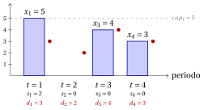
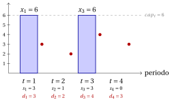
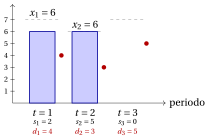

# Esercizi · Problemi di lot sizing

**Esercizi · Capitolo 8** · ogni soluzione si apre con un clic · [:material-book-open-variant: Capitolo 8: Problemi di lot sizing](../problemi-di-ottimizzazione-combinatoria/lot-sizing/index.md) · [:material-file-pdf-box: Eserciziario, volume 1 (PDF)](../pdf/esercizi-1-problemi-di-ottimizzazione-combinatoria.pdf)

!!! esercizio "Esercizio 8.1: Ammissibilità e costo di un piano (CLS)"

    Consideriamo l'istanza del lot sizing capacitato con $m=4$ periodi e i seguenti dati:

    
<table>
    <tr>
    <th>periodo \(t\)</th>
    <th>\(1\)</th>
    <th>\(2\)</th>
    <th>\(3\)</th>
    <th>\(4\)</th>
    </tr>
    <tr>
    <td>domanda \(d_t\)</td>
    <td>\(3\)</td>
    <td>\(2\)</td>
    <td>\(4\)</td>
    <td>\(3\)</td>
    </tr>
    <tr>
    <td>capacità \(cap_t\)</td>
    <td>\(5\)</td>
    <td>\(5\)</td>
    <td>\(5\)</td>
    <td>\(5\)</td>
    </tr>
    <tr>
    <td>costo di setup \(sc_t\)</td>
    <td>\(30\)</td>
    <td>\(40\)</td>
    <td>\(30\)</td>
    <td>\(40\)</td>
    </tr>
    <tr>
    <td>costo di produzione \(vc_t\)</td>
    <td>\(2\)</td>
    <td>\(2\)</td>
    <td>\(2\)</td>
    <td>\(2\)</td>
    </tr>
    <tr>
    <td>costo di mantenimento \(hc_t\)</td>
    <td>\(4\)</td>
    <td>\(4\)</td>
    <td>\(4\)</td>
    <td>\(4\)</td>
    </tr>
    </table>

    e i quattro piani di produzione

    $$
    \vet{x}^1=(5,0,4,3),\quad \vet{x}^2=(3,6,0,3),\quad \vet{x}^3=(2,3,4,3),\quad \vet{x}^4=(5,0,5,2).
    $$

    **Domande**

    1. Per ogni piano, calcolare le scorte $s_t(\vet{x})$ e stabilire se il piano è ammissibile.

    2. Calcolare il costo dei piani ammissibili, suddiviso in costi di setup, di produzione e di mantenimento a scorta.

    3. Disegnare il piano ammissibile più economico.

??? soluzione "Soluzione"

    1. La scorta è $s_t=s_{t-1}+x_t-d_t$, a partire da $s_0=0$:

        - $\vet{x}^1$: scorte $(2,0,0,0)$, ammissibile;

        - $\vet{x}^2$: scorte $(0,4,0,0)$, non ammissibile: $x_2=6>cap_2=5$;

        - $\vet{x}^3$: scorte $(-1,0,0,0)$, non ammissibile: $s_1=-1<0$, la domanda del periodo $1$ non è coperta (la produzione non può servire un periodo precedente);

        - $\vet{x}^4$: scorte $(2,0,1,0)$, ammissibile;

    2. Si paga un setup in ogni periodo con $x_t>0$, il costo di produzione su ogni unità, il costo di mantenimento sulla scorta alla fine di ogni periodo:

        \begin{align*}
        c(\vet{x}^1)&=(30+30+40)+2\cdot 12+4\cdot 2=100+24+8=132\\
        c(\vet{x}^4)&=(30+30+40)+2\cdot 12+(4\cdot 2+4\cdot 1)=100+24+12=136.
        \end{align*}

    3. Il piano più economico è $\vet{x}^1$, di costo $132$:

        { .fig loading=lazy  }

    !!! chiave ""

        Solo $\vet{x}^1$ e $\vet{x}^4$ sono ammissibili, con costi $132$ e $136$; $\vet{x}^2$ supera una capacità e $\vet{x}^3$ produce troppo tardi.

!!! esercizio "Esercizio 8.2: Contare le scelte di setup (CLS)"

    Consideriamo di nuovo l'istanza del lot sizing capacitato

    
<table>
    <tr>
    <th>periodo \(t\)</th>
    <th>\(1\)</th>
    <th>\(2\)</th>
    <th>\(3\)</th>
    <th>\(4\)</th>
    </tr>
    <tr>
    <td>domanda \(d_t\)</td>
    <td>\(3\)</td>
    <td>\(2\)</td>
    <td>\(4\)</td>
    <td>\(3\)</td>
    </tr>
    <tr>
    <td>capacità \(cap_t\)</td>
    <td>\(5\)</td>
    <td>\(5\)</td>
    <td>\(5\)</td>
    <td>\(5\)</td>
    </tr>
    <tr>
    <td>costo di setup \(sc_t\)</td>
    <td>\(30\)</td>
    <td>\(40\)</td>
    <td>\(30\)</td>
    <td>\(40\)</td>
    </tr>
    <tr>
    <td>costo di produzione \(vc_t\)</td>
    <td>\(2\)</td>
    <td>\(2\)</td>
    <td>\(2\)</td>
    <td>\(2\)</td>
    </tr>
    <tr>
    <td>costo di mantenimento \(hc_t\)</td>
    <td>\(4\)</td>
    <td>\(4\)</td>
    <td>\(4\)</td>
    <td>\(4\)</td>
    </tr>
    </table>

    **Domande**

    1. Contare le possibili scelte dei periodi con un setup.

    2. Calcolare le domande cumulate $D_t=d_1+\dots+d_t$. Determinare la condizione che i periodi con un setup devono soddisfare perché esista un piano ammissibile.

    3. Elencare le scelte di setup ammissibili.

    4. Stabilire se il numero di piani ammissibili è uguale al numero di scelte di setup ammissibili.

??? soluzione "Soluzione"

    1. Una scelta di setup è un sottoinsieme dei $4$ periodi: $2^4=16$ scelte.

    2. $D=(3,5,9,12)$. La produzione dei periodi $1,\dots,t$ deve coprire $D_t$, e producono solo i periodi con un setup: le capacità dei periodi con un setup fra $1,\dots,t$ devono sommare almeno a $D_t$, per ogni $t$. In particolare il periodo $1$ richiede un setup, poiché $d_1>0$; con capacità $5$ in ogni periodo, i periodi $1,\dots,t$ richiedono almeno $\lceil D_t/5\rceil$ setup: $1, 1, 2, 3$.

    3. Le scelte ammissibili, con le capacità cumulate dei loro periodi di setup, sono:

        
<table>
        <tr>
        <th>setup</th>
        <th>\(t=1\)</th>
        <th>\(t=2\)</th>
        <th>\(t=3\)</th>
        <th>\(t=4\)</th>
        </tr>
        <tr>
        <td>domanda cumulata</td>
        <td>\(3\)</td>
        <td>\(5\)</td>
        <td>\(9\)</td>
        <td>\(12\)</td>
        </tr>
        <tr>
        <td>\(\{1,2,3\}\)</td>
        <td>\(5\)</td>
        <td>\(10\)</td>
        <td>\(15\)</td>
        <td>\(15\)</td>
        </tr>
        <tr>
        <td>\(\{1,2,4\}\)</td>
        <td>\(5\)</td>
        <td>\(10\)</td>
        <td>\(10\)</td>
        <td>\(15\)</td>
        </tr>
        <tr>
        <td>\(\{1,3,4\}\)</td>
        <td>\(5\)</td>
        <td>\(5\)</td>
        <td>\(10\)</td>
        <td>\(15\)</td>
        </tr>
        <tr>
        <td>\(\{1,2,3,4\}\)</td>
        <td>\(5\)</td>
        <td>\(10\)</td>
        <td>\(15\)</td>
        <td>\(20\)</td>
        </tr>
        </table>

        Sono $4$ su $16$.

    4. No: a una scelta di setup possono corrispondere più piani, poiché le quantità si possono distribuire in molti modi. L'enumerazione dei piani interi dà $50$ piani ammissibili per le $4$ scelte di setup ammissibili.

    !!! chiave ""

        Delle $16$ scelte di setup, $4$ sono ammissibili: contengono tutte il periodo $1$ e almeno $3$ periodi in totale. A esse corrispondono $50$ piani ammissibili.

!!! esercizio "Esercizio 8.3: Il piano migliore per enumerazione dei setup (CLS)"

    Consideriamo di nuovo l'istanza del lot sizing capacitato

    
<table>
    <tr>
    <th>periodo \(t\)</th>
    <th>\(1\)</th>
    <th>\(2\)</th>
    <th>\(3\)</th>
    <th>\(4\)</th>
    </tr>
    <tr>
    <td>domanda \(d_t\)</td>
    <td>\(3\)</td>
    <td>\(2\)</td>
    <td>\(4\)</td>
    <td>\(3\)</td>
    </tr>
    <tr>
    <td>capacità \(cap_t\)</td>
    <td>\(5\)</td>
    <td>\(5\)</td>
    <td>\(5\)</td>
    <td>\(5\)</td>
    </tr>
    <tr>
    <td>costo di setup \(sc_t\)</td>
    <td>\(30\)</td>
    <td>\(40\)</td>
    <td>\(30\)</td>
    <td>\(40\)</td>
    </tr>
    <tr>
    <td>costo di produzione \(vc_t\)</td>
    <td>\(2\)</td>
    <td>\(2\)</td>
    <td>\(2\)</td>
    <td>\(2\)</td>
    </tr>
    <tr>
    <td>costo di mantenimento \(hc_t\)</td>
    <td>\(4\)</td>
    <td>\(4\)</td>
    <td>\(4\)</td>
    <td>\(4\)</td>
    </tr>
    </table>

    le cui scelte di setup ammissibili sono quelle che contengono il periodo $1$ e le cui capacità coprono le domande cumulate.

    **Domande**

    1. Spiegare perché, fissati i periodi con un setup, conviene produrre ogni unità il più tardi possibile.

    2. Per ogni scelta di setup ammissibile, calcolare il piano migliore e il suo costo.

    3. Determinare il piano ottimo e disegnarlo.

??? soluzione "Soluzione"

    1. Il costo di produzione è lo stesso in ogni periodo, quindi non dipende da quando un'unità viene prodotta. Un'unità prodotta prima resta più a lungo in scorta e paga più costo di mantenimento. Quindi ogni domanda si produce nell'ultimo periodo che la precede con un setup e capacità libera, a partire dall'ultimo periodo.

    2. Per ogni scelta ammissibile dei setup, il piano costruito in questo modo è:

        
<table>
        <tr>
        <th>setup</th>
        <th>piano</th>
        <th>setup</th>
        <th>produzione</th>
        <th>mantenimento</th>
        <th>totale</th>
        </tr>
        <tr>
        <td>\(\{1,2,3\}\)</td>
        <td>\((3,4,5,0)\)</td>
        <td>\(100\)</td>
        <td>\(24\)</td>
        <td>\(20\)</td>
        <td>\(144\)</td>
        </tr>
        <tr>
        <td>\(\{1,2,4\}\)</td>
        <td>\((4,5,0,3)\)</td>
        <td>\(110\)</td>
        <td>\(24\)</td>
        <td>\(20\)</td>
        <td>\(154\)</td>
        </tr>
        <tr>
        <td>\(\{1,3,4\}\)</td>
        <td>\((5,0,4,3)\)</td>
        <td>\(100\)</td>
        <td>\(24\)</td>
        <td>\(8\)</td>
        <td>\(\mathbf{132}\)</td>
        </tr>
        <tr>
        <td>\(\{1,2,3,4\}\)</td>
        <td>\((3,2,4,3)\)</td>
        <td>\(140\)</td>
        <td>\(24\)</td>
        <td>\(0\)</td>
        <td>\(164\)</td>
        </tr>
        </table>

    3. Il piano ottimo è $\tilde{\vet{x}}=(5,0,4,3)$, con setup nei periodi $1, 3, 4$ e $z(I)=132$; è l'unico piano ottimo.

        { .fig loading=lazy  }

        I due setup più economici, $sc_1=sc_3=30$, non bastano: con capacità $5$ due setup producono al più $10<12$ unità, e il terzo setup va al periodo $4$.

    !!! chiave ""

        Enumerando le scelte di setup ammissibili, e producendo il più tardi possibile per ciascuna di esse, si ottiene il piano ottimo $(5,0,4,3)$ con $z(I)=132$.

!!! esercizio "Esercizio 8.4: L'effetto della capacità (CLS)"

    Consideriamo l'istanza di lot sizing degli esercizi precedenti, con $4$ periodi, $\vet{d}=(3,2,4,3)$, $\vet{sc}=(30,40,30,40)$, $\vet{vc}=(2,2,2,2)$, $\vet{hc}=(4,4,4,4)$, e tre valori della capacità, la stessa in ogni periodo: $cap_t=5$, $cap_t=6$, e nessun limite di capacità.

    **Domande**

    1. Per $cap_t=5$ il piano ottimo è $(5,0,4,3)$. Calcolarne il costo.

    2. Trovare il piano ottimo per $cap_t=6$, per enumerazione delle scelte di setup.

    3. Trovare il piano ottimo senza capacità, e indicare in quali periodi produce e con quale scorta.

    4. Confrontare i tre costi ottimi, e spiegare le differenze.

??? soluzione "Soluzione"

    1. $c=(30+30+40)+2\cdot 12+4\cdot 2=100+24+8=132$.

    2. Con capacità $6$ due setup possono produrre $12$ unità, l'intera domanda: i setup nei periodi $1$ e $3$, i più economici, diventano ammissibili. Producendo il più tardi possibile si ottiene $(6,0,6,0)$, di costo $(30+30)+2\cdot 12+(4\cdot 3+4\cdot 1+4\cdot 3)=60+24+28=112$. L'enumerazione di tutti i piani conferma che è l'unico piano ottimo.

        { .fig loading=lazy  }

    3. Senza capacità, un setup nel periodo $1$ e uno nel periodo $3$ danno $(5,0,7,0)$, di costo $(30+30)+2\cdot 12+(4\cdot 2+4\cdot 3)=60+24+20=104$. Il periodo $1$ produce per i periodi $1$ e $2$, il periodo $3$ per i periodi $3$ e $4$: ogni produzione parte con la scorta vuota.

    4. I costi ottimi sono $132$, $112$ e $104$: una capacità maggiore può solo abbassare il costo ottimo, poiché ogni piano ammissibile con una capacità minore resta ammissibile con una maggiore.

        - Senza capacità, il periodo $3$ produce le $7$ unità dei periodi $3$ e $4$.

        - Con $cap_t=6$ il periodo $3$ ne produce solo $6$: un'unità è prodotta nel periodo $1$ e tenuta in scorta per due periodi, $104+2\cdot 4=112$.

        - Con $cap_t=5$ due setup producono al più $10<12$ unità: serve un terzo setup, nel periodo $4$, e il costo diventa $132$.

    !!! chiave ""

        Il costo ottimo è $132$ con $cap_t=5$, $112$ con $cap_t=6$ e $104$ senza capacità: la capacità impone un terzo setup e cambia la struttura del piano ottimo.

!!! esercizio "Esercizio 8.5: Lot-for-lot, un lower bound e l'ottimo (CLS)"

    Consideriamo l'istanza del lot sizing capacitato con $m=3$ periodi e i seguenti dati:

    
<table>
    <tr>
    <th>periodo \(t\)</th>
    <th>\(1\)</th>
    <th>\(2\)</th>
    <th>\(3\)</th>
    </tr>
    <tr>
    <td>domanda \(d_t\)</td>
    <td>\(4\)</td>
    <td>\(3\)</td>
    <td>\(5\)</td>
    </tr>
    <tr>
    <td>capacità \(cap_t\)</td>
    <td>\(7\)</td>
    <td>\(6\)</td>
    <td>\(7\)</td>
    </tr>
    <tr>
    <td>costo di setup \(sc_t\)</td>
    <td>\(50\)</td>
    <td>\(20\)</td>
    <td>\(60\)</td>
    </tr>
    <tr>
    <td>costo di produzione \(vc_t\)</td>
    <td>\(0\)</td>
    <td>\(0\)</td>
    <td>\(0\)</td>
    </tr>
    <tr>
    <td>costo di mantenimento \(hc_t\)</td>
    <td>\(3\)</td>
    <td>\(3\)</td>
    <td>\(3\)</td>
    </tr>
    </table>

    **Domande**

    1. Calcolare il costo del piano lot-for-lot.

    2. Calcolare il lower bound del capitolo: il minimo numero $k$ di setup richiesto dalla domanda totale, e la somma dei $k$ costi di setup più piccoli.

    3. Trovare il piano ottimo per enumerazione delle scelte di setup. Calcolare la distanza del piano lot-for-lot e del lower bound dal costo ottimo.

??? soluzione "Soluzione"

    1. Il lot-for-lot produce $\vet{x}=(4,3,5)$: ogni domanda rientra nella capacità del suo periodo, non c'è scorta e ci sono $3$ setup, $c=50+20+60=130$.

    2. La domanda totale è $D=12$. La capacità più grande, $7$, è minore di $D$, mentre le due più grandi sommano a $14\ge 12$: $k=2$. I due costi di setup più piccoli sono $20$ e $50$, quindi $z(I)\ge \mathrm{LB}=70$.

    3. Per ogni scelta di setup ammissibile, il piano che produce il più tardi possibile è:

        
<table>
        <tr>
        <th>setup</th>
        <th>piano</th>
        <th>costo</th>
        </tr>
        <tr>
        <td>\(\{1,2\}\)</td>
        <td>\((6,6,0)\)</td>
        <td>\(\mathbf{91}\)</td>
        </tr>
        <tr>
        <td>\(\{1,3\}\)</td>
        <td>\((7,0,5)\)</td>
        <td>\(119\)</td>
        </tr>
        <tr>
        <td>\(\{1,2,3\}\)</td>
        <td>\((4,3,5)\)</td>
        <td>\(130\)</td>
        </tr>
        </table>

        Il piano ottimo è $(6,6,0)$, con $z(I)=91$:

        { .fig loading=lazy  }

        I bound danno $70\le z(I)\le 130$, un gap assoluto di $60$: il lot-for-lot è $39$ sopra l'ottimo, il lower bound $21$ sotto. Il bound paga i setup dei periodi $1$ e $2$, ma questi due periodi non possono produrre la domanda del periodo $3$ senza tenere scorta.

    !!! chiave ""

        Il lot-for-lot costa $130$, il lower bound è $70$, e l'enumerazione delle scelte di setup dà il piano ottimo $(6,6,0)$ con $z(I)=91$.
