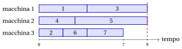
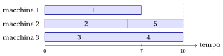

# Esercizi · Problemi di scheduling

**Esercizi · Capitolo 7** · ogni soluzione si apre con un clic · [:material-book-open-variant: Capitolo 7: Problemi di scheduling](../problemi-di-ottimizzazione-combinatoria/pcmax/index.md) · [:material-file-pdf-box: Eserciziario, volume 1 (PDF)](../pdf/esercizi-1-problemi-di-ottimizzazione-combinatoria.pdf)

!!! esercizio "Esercizio 7.1: Carichi, makespan e diagramma di Gantt ($P\|C_{\max}$)"

    Consideriamo l'istanza di $P\|C_{\max}$ con $m=3$ macchine e $n=7$ lavori, con tempi di processamento

    $$
    \begin{array}{l|ccccccc}
    \hline  & {j=1} & {j=2} & {j=3} & {j=4} & {j=5} & {j=6} & {j=7} \\[1ex]
    \hline {t_j} & {4} & {2} & {5} & {3} & {6} & {2} & {3} \\
    \hline
    \end{array}
    $$

    e i tre assegnamenti

    $$
    \mathrm{mach}^1=(1,2,3,1,2,3,1),\quad \mathrm{mach}^2=(3,1,2,3,1,2,3),\quad \mathrm{mach}^3=(1,3,1,2,2,3,3).
    $$

    **Domande**

    1. Per ogni assegnamento, scrivere gli insiemi $J_1,J_2,J_3$, i carichi e il makespan.

    2. Stabilire quali assegnamenti descrivono lo stesso schedule.

    3. Disegnare il diagramma di Gantt dell'assegnamento con il makespan minimo.

    4. Calcolare il lower bound $\max\{\max_j t_j,\lceil \sum_j t_j/m\rceil\}$ e stabilire se quello schedule è ottimo.

??? soluzione "Soluzione"

    1. - $\mathrm{mach}^1$: $J_1=\{1,4,7\},\ J_2=\{2,5\},\ J_3=\{3,6\}$, carichi $(10,8,7)$, makespan $C_{\max}=10$;

        - $\mathrm{mach}^2$: $J_1=\{2,5\},\ J_2=\{3,6\},\ J_3=\{1,4,7\}$, carichi $(8,7,10)$, makespan $C_{\max}=10$;

        - $\mathrm{mach}^3$: $J_1=\{1,3\},\ J_2=\{4,5\},\ J_3=\{2,6,7\}$, carichi $(9,9,7)$, makespan $C_{\max}=9$;

    2. $\mathrm{mach}^1$ e $\mathrm{mach}^2$ danno gli stessi tre insiemi di lavori, con i nomi delle macchine cambiati ($1\to 3$, $2\to 1$, $3\to 2$): sono lo stesso schedule. $\mathrm{mach}^3$ dà insiemi diversi.

    3. Il makespan minimo, $9$, è quello di $\mathrm{mach}^3$:

        { .fig loading=lazy  }

    4. $\sum_j t_j=25$ e $\max_j t_j=6$, quindi $\mathrm{LB}=\max\{6,\lceil 25/3\rceil\}=9$. Lo schedule di $\mathrm{mach}^3$ lo raggiunge: è ottimo, $z(I)=9$.

    !!! chiave ""

        $\mathrm{mach}^1$ e $\mathrm{mach}^2$ sono lo stesso schedule; lo schedule di $\mathrm{mach}^3$ ha makespan $9$, pari al lower bound, ed è ottimo.

!!! esercizio "Esercizio 7.2: Contare gli schedule ($P\|C_{\max}$)"

    Consideriamo un'istanza di $P\|C_{\max}$ con $n=5$ lavori. Contiamo gli assegnamenti e gli schedule distinti per $m=2$ e per $m=3$ macchine.

    **Domande**

    1. Contare gli assegnamenti $\mathrm{mach}$ con $m=2$ e con $m=3$.

    2. Calcolare il numero di Stirling $S(5,2)$, contando le partizioni dei lavori in due insiemi non vuoti.

    3. Calcolare $S(5,3)$, raggruppando le partizioni in tre insiemi non vuoti secondo le cardinalità degli insiemi.

    4. Contare gli schedule distinti con $m=2$ e con $m=3$, e spiegare perché gli schedule sono meno degli assegnamenti.

??? soluzione "Soluzione"

    1. Ogni lavoro sceglie una delle $m$ macchine: $2^5=32$ assegnamenti con $m=2$, $3^5=243$ con $m=3$.

    2. Una partizione in due insiemi è determinata dall'insieme che contiene il lavoro $1$ insieme ad alcuni degli altri $4$ lavori, ma non a tutti: $2^4-1=15$ scelte. Quindi $S(5,2)=15$.

    3. Le cardinalità di tre insiemi non vuoti con $5$ lavori sono $(3,1,1)$ oppure $(2,2,1)$.

        - Cardinalità $(3,1,1)$: scegliamo l'insieme di $3$ lavori, in $\binom{5}{3}=10$ modi.

        - Cardinalità $(2,2,1)$: scegliamo il lavoro da solo, in $5$ modi, e dividiamo gli altri $4$ in due coppie, in $\binom{4}{2}/2=3$ modi: $15$.

        Quindi $S(5,3)=10+15=25$.

    4. Con $m=2$: $S(5,1)+S(5,2)=1+15=16$ schedule. Con $m=3$: $S(5,1)+S(5,2)+S(5,3)=1+15+25=41$ schedule. Le macchine sono identiche: un assegnamento e quelli ottenuti rinominando le macchine sono lo stesso schedule. Con $m=2$ ogni schedule con due macchine non vuote è dato da $2$ assegnamenti: $\frac{32-2}{2}=15$, più lo schedule con tutti i lavori insieme.

    !!! chiave ""

        Con $5$ lavori ci sono $32$ e $243$ assegnamenti su $2$ e $3$ macchine, ma solo $16$ e $41$ schedule.

!!! esercizio "Esercizio 7.3: Un primo schedule, un lower bound e l'ottimo ($P\|C_{\max}$)"

    Consideriamo l'istanza di $P\|C_{\max}$ con $m=3$ macchine e $n=7$ lavori, con tempi di processamento

    $$
    \begin{array}{l|ccccccc}
    \hline  & {j=1} & {j=2} & {j=3} & {j=4} & {j=5} & {j=6} & {j=7} \\[1ex]
    \hline {t_j} & {3} & {5} & {2} & {6} & {4} & {4} & {3} \\
    \hline
    \end{array}
    $$

    **Domande**

    1. Costruire uno schedule prendendo i lavori nell'ordine $1,2,\dots,n$ e assegnando ciascuno alla macchina con il carico minimo (pareggi risolti con l'indice minimo). Disegnarne il diagramma di Gantt.

    2. Calcolare il lower bound del capitolo.

    3. Trovare uno schedule ottimo e stabilire se è unico.

??? soluzione "Soluzione"

    1. I carichi dopo ogni assegnamento sono:

        
<table>
        <tr>
        <th>lavoro \(j\) (\(t_j\))</th>
        <th>macchina scelta</th>
        <th>carichi \((L_1,L_2,L_3)\)</th>
        </tr>
        <tr>
        <td>\(1\) (\(3\))</td>
        <td>\(1\)</td>
        <td>\((3,0,0)\)</td>
        </tr>
        <tr>
        <td>\(2\) (\(5\))</td>
        <td>\(2\)</td>
        <td>\((3,5,0)\)</td>
        </tr>
        <tr>
        <td>\(3\) (\(2\))</td>
        <td>\(3\)</td>
        <td>\((3,5,2)\)</td>
        </tr>
        <tr>
        <td>\(4\) (\(6\))</td>
        <td>\(3\)</td>
        <td>\((3,5,8)\)</td>
        </tr>
        <tr>
        <td>\(5\) (\(4\))</td>
        <td>\(1\)</td>
        <td>\((7,5,8)\)</td>
        </tr>
        <tr>
        <td>\(6\) (\(4\))</td>
        <td>\(2\)</td>
        <td>\((7,9,8)\)</td>
        </tr>
        <tr>
        <td>\(7\) (\(3\))</td>
        <td>\(1\)</td>
        <td>\((10,9,8)\)</td>
        </tr>
        </table>

        Otteniamo $J_1=\{1,5,7\},\ J_2=\{2,6\},\ J_3=\{3,4\}$, con makespan $10$:

        { .fig loading=lazy  }

    2. $\mathrm{LB}=\max\{6,\lceil 27/3\rceil\}=9$, quindi $9\le z(I)\le 10$.

    3. Un makespan pari a $9$ richiede tre carichi pari esattamente a $9$, poiché i carichi sommano a $27=3\cdot9$. Il lavoro $4$ ($6$) ha bisogno di un compagno di durata $3$, il lavoro $2$ ($5$) di uno di durata $4$, e i lavori rimanenti riempiono la terza macchina. Lo schedule $J_1=\{4,7\},\ J_2=\{2,6\},\ J_3=\{1,3,5\}$ ha carichi $(9,9,9)$:

        { .fig loading=lazy  }

        Raggiunge il bound, quindi $z(I)=9$. Non è unico: l'enumerazione degli schedule ne dà $4$ ottimi; per esempio, i lavori $1$ e $7$, entrambi di durata $3$, si possono scambiare.

    !!! chiave ""

        Assegnare i lavori nell'ordine dei dati dà makespan $10$; lo schedule $J_1=\{4,7\},\ J_2=\{2,6\},\ J_3=\{1,3,5\}$ raggiunge il lower bound, e $z(I)=9$.

!!! esercizio "Esercizio 7.4: Quando il lower bound non è raggiunto ($P\|C_{\max}$)"

    Consideriamo l'istanza di $P\|C_{\max}$ con $m=2$ macchine e $n=4$ lavori, con tempi di processamento

    $$
    \begin{array}{l|cccc}
    \hline  & {j=1} & {j=2} & {j=3} & {j=4} \\[1ex]
    \hline {t_j} & {8} & {5} & {4} & {3} \\
    \hline
    \end{array}
    $$

    **Domande**

    1. Calcolare il lower bound del capitolo.

    2. Dimostrare che nessuno schedule ha makespan $10$.

    3. Trovare uno schedule ottimo, enumerando gli schedule distinti.

??? soluzione "Soluzione"

    1. $\mathrm{LB}=\max\{8,\lceil 20/2\rceil\}=10$.

    2. I due carichi sommano a $20$: un makespan pari a $10$ richiede entrambi i carichi pari a $10$, cioè un insieme di lavori di durata totale esattamente $10$. I totali dei sottoinsiemi di lavori sono $0$, $3$, $4$, $5$, $7$, $8$, $9$, $11$, $12$, $13$, $15$, $16$, $17$, $20$, e $10$ non è fra questi. Quindi $z(I)\ge 11$.

    3. Con $m=2$ ci sono $S(4,1)+S(4,2)=1+7=8$ schedule:

        
<table>
        <tr>
        <th>\(J_1\)</th>
        <th>\(J_2\)</th>
        <th>carichi</th>
        <th>\(C_{\max}\)</th>
        </tr>
        <tr>
        <td>\(\{1,4\}\)</td>
        <td>\(\{2,3\}\)</td>
        <td>\((11,9)\)</td>
        <td>\(11\)</td>
        </tr>
        <tr>
        <td>\(\{1\}\)</td>
        <td>\(\{2,3,4\}\)</td>
        <td>\((8,12)\)</td>
        <td>\(12\)</td>
        </tr>
        <tr>
        <td>\(\{1,3\}\)</td>
        <td>\(\{2,4\}\)</td>
        <td>\((12,8)\)</td>
        <td>\(12\)</td>
        </tr>
        <tr>
        <td>\(\{1,2\}\)</td>
        <td>\(\{3,4\}\)</td>
        <td>\((13,7)\)</td>
        <td>\(13\)</td>
        </tr>
        <tr>
        <td>\(\{1,3,4\}\)</td>
        <td>\(\{2\}\)</td>
        <td>\((15,5)\)</td>
        <td>\(15\)</td>
        </tr>
        <tr>
        <td>\(\{1,2,4\}\)</td>
        <td>\(\{3\}\)</td>
        <td>\((16,4)\)</td>
        <td>\(16\)</td>
        </tr>
        <tr>
        <td>\(\{1,2,3\}\)</td>
        <td>\(\{4\}\)</td>
        <td>\((17,3)\)</td>
        <td>\(17\)</td>
        </tr>
        <tr>
        <td>\(\{1,2,3,4\}\)</td>
        <td>\(\emptyset\)</td>
        <td>\((20,0)\)</td>
        <td>\(20\)</td>
        </tr>
        </table>

        Lo schedule ottimo è unico, $J_1=\{1,4\},\ J_2=\{2,3\}$, con $z(I)=11$:

        { .fig loading=lazy  }

    !!! chiave ""

        Il lower bound dà $10$, ma nessun insieme di lavori ha durata totale $10$: il makespan ottimo è $z(I)=11$, e il bound non è raggiunto.

!!! esercizio "Esercizio 7.5: Makespan e bin packing ($P\|C_{\max}$)"

    Consideriamo l'istanza di $P\|C_{\max}$ con $m=3$ macchine e $n=5$ lavori, con tempi di processamento

    $$
    \begin{array}{l|ccccc}
    \hline  & {j=1} & {j=2} & {j=3} & {j=4} & {j=5} \\[1ex]
    \hline {t_j} & {7} & {6} & {5} & {5} & {4} \\
    \hline
    \end{array}
    $$

    Usiamo la relazione con il problema del bin packing: esiste uno schedule con makespan al più $T$ se e solo se i lavori, visti come oggetti di peso $t_j$, entrano in $m$ contenitori di capacità $T$.

    **Domande**

    1. Calcolare il lower bound $\mathrm{LB}$ del capitolo.

    2. Stabilire se i lavori possono essere inseriti in $3$ contenitori di capacità $T=\mathrm{LB}$.

    3. Trovare il valore minimo di $T$ per cui i lavori entrano in $3$ contenitori, e lo schedule corrispondente.

    4. Stabilire se lo schedule ottimo è unico.

??? soluzione "Soluzione"

    1. $\mathrm{LB}=\max\{7,\lceil 27/3\rceil\}=\max\{7,9\}=9$.

    2. Tre contenitori di capacità $9$ contengono $27=27$, il peso totale: ogni contenitore deve essere riempito esattamente. L'oggetto di peso $7$ richiede oggetti di peso totale $2$, e ogni altro oggetto pesa almeno $4$. Quindi i lavori non entrano, e $z(I)\ge 10$.

    3. Con $T=10$ il riempimento $\{\{1\},\{2,5\},\{3,4\}\}$ ha contenitori di peso $7, 10, 10\le 10$. Lo schedule $J_1=\{1\},\ J_2=\{2,5\},\ J_3=\{3,4\}$ ha makespan $10$:

        { .fig loading=lazy  }

        Quindi $z(I)=10$.

    4. Sì: l'enumerazione dei $41$ schedule con al più $3$ macchine mostra che è l'unico schedule con makespan $10$. Il lavoro $1$ deve stare da solo, perché con un qualunque altro lavoro la sua macchina supererebbe $10$, e le coppie $\{2,5\}$ e $\{3,4\}$ sono l'unico modo di dividere gli altri lavori entro $10$.

    !!! chiave ""

        I lavori non entrano in $3$ contenitori di capacità $9$ ed entrano in $3$ contenitori di capacità $10$: $z(I)=10$, uno in più del lower bound.
