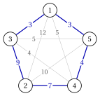

# Esercizi · Problemi di routing

**Esercizi · Capitolo 6** · ogni soluzione si apre con un clic · [:material-book-open-variant: Capitolo 6: Problemi di routing](../problemi-di-ottimizzazione-combinatoria/tsp/index.md) · [:material-file-pdf-box: Eserciziario, volume 1 (PDF)](../pdf/esercizi-1-problemi-di-ottimizzazione-combinatoria.pdf)

!!! esercizio "Esercizio 6.1: I giri e la loro lunghezza (TSP)"

    Consideriamo l'istanza del TSP con $6$ città, $\mathscr{V}=\{1,\dots,6\}$, e le distanze simmetriche

    $$
    \begin{array}{c|cccccc}
    \hline {d_{ij}} & {1} & {2} & {3} & {4} & {5} & {6} \\
    \hline {1} & --- & {4} & {7} & {6} & {3} & {5} \\
    {2} & {4} & --- & {3} & {5} & {6} & {8} \\
    {3} & {7} & {3} & --- & {4} & {7} & {6} \\
    {4} & {6} & {5} & {4} & --- & {3} & {4} \\
    {5} & {3} & {6} & {7} & {3} & --- & {5} \\
    {6} & {5} & {8} & {6} & {4} & {5} & --- \\
    \hline
    \end{array}
    $$

    e le permutazioni

    $$
    \sigma^{1}=(1,2,3,4,5,6),\quad \sigma^{2}=(4,5,6,1,2,3),\quad \sigma^{3}=(1,6,5,4,3,2),\quad \sigma^{4}=(1,5,4,3,2,6).
    $$

    **Domande**

    1. Calcolare la lunghezza di ogni permutazione, letta come un giro.

    2. Stabilire quali permutazioni descrivono lo stesso giro, motivando la risposta.

    3. Contare le permutazioni delle $6$ città e i giri distinti.

    4. I due cicli $(1,2,3)$ e $(4,5,6)$ visitano ogni città esattamente una volta. Stabilire se formano un giro e confrontare la loro lunghezza totale con la lunghezza di $\sigma^4$.

??? soluzione "Soluzione"

    1. Includendo l'arco di ritorno $d_{\sigma_n\sigma_1}$:

        \begin{align*}
        L(\sigma^{1})&=4+3+4+3+5+5=24\\
        L(\sigma^{2})&=3+5+5+4+3+4=24\\
        L(\sigma^{3})&=5+5+3+4+3+4=24\\
        L(\sigma^{4})&=3+3+4+3+8+5=26.
        \end{align*}

    2. $\sigma^2$ parte dalla città $4$ e visita le città nello stesso ordine ciclico di $\sigma^1$; $\sigma^3$ è $\sigma^1$ percorsa all'indietro. Le tre permutazioni usano gli stessi $6$ archi e descrivono lo stesso giro, di lunghezza $24$. La permutazione $\sigma^4$ usa l'arco $\{1,5\}$, che non è in $\sigma^1$: è un giro diverso.

    3. Le permutazioni sono $6!=720$; ogni giro è descritto da $6$ città di partenza per $2$ versi, quindi i giri sono $\frac{720}{12}=\frac{(6-1)!}{2}=60$.

    4. No: un giro è un unico ciclo attraverso tutte le città, e i due cicli sono disgiunti. La loro lunghezza totale è $(4+3+7)+(3+5+4)=26$, non minore di $L(\sigma^4)=26$, ma non è la lunghezza di una soluzione ammissibile.

        { .fig loading=lazy  }

    !!! chiave ""

        $\sigma^1,\sigma^2,\sigma^3$ sono lo stesso giro, di lunghezza $24$; $\sigma^4$ è un giro diverso, di lunghezza $26$. Due cicli disgiunti non sono un giro.

!!! esercizio "Esercizio 6.2: Enumerazione dei giri (TSP)"

    Consideriamo l'istanza del TSP con $5$ città e le distanze simmetriche

    $$
    \begin{array}{c|ccccc}
    \hline {d_{ij}} & {1} & {2} & {3} & {4} & {5} \\
    \hline {1} & --- & {12} & {3} & {5} & {3} \\
    {2} & {12} & --- & {9} & {7} & {10} \\
    {3} & {3} & {9} & --- & {4} & {5} \\
    {4} & {5} & {7} & {4} & --- & {4} \\
    {5} & {3} & {10} & {5} & {4} & --- \\
    \hline
    \end{array}
    $$

    **Domande**

    1. Costruire un giro con la nearest neighbour rule dalla città $1$ (pareggi risolti con l'indice minimo) e calcolarne la lunghezza.

    2. Enumerare tutti i giri, trovarne uno ottimo e stabilire se è unico.

    3. Disegnare il giro ottimo sul grafo completo dell'istanza.

??? soluzione "Soluzione"

    1. - da $1$ le città non visitate più vicine sono $3, 5$, a distanza $3$: andiamo in $3$;

        - da $3$ la città non visitata più vicina è $4$, a distanza $4$;

        - da $4$ la città non visitata più vicina è $5$, a distanza $4$;

        - da $5$ la città non visitata più vicina è $2$, a distanza $10$;

        - ritorniamo da $2$ a $1$, a distanza $12$.

        Il giro è $(1,3,4,5,2)$, di lunghezza $3+4+4+10+12=33$.

    2. I giri sono $(5-1)!/2=12$, tutti scritti a partire dalla città $1$:

        
<table>
        <tr>
        <th>giro</th>
        <th>\(L\)</th>
        <th>giro</th>
        <th>\(L\)</th>
        <th>giro</th>
        <th>\(L\)</th>
        </tr>
        <tr>
        <td>\((1,3,2,4,5)\)</td>
        <td>\(\mathbf{26}\)</td>
        <td>\((1,2,4,3,5)\)</td>
        <td>\(31\)</td>
        <td>\((1,2,3,4,5)\)</td>
        <td>\(32\)</td>
        </tr>
        <tr>
        <td>\((1,3,4,2,5)\)</td>
        <td>\(27\)</td>
        <td>\((1,2,4,5,3)\)</td>
        <td>\(31\)</td>
        <td>\((1,2,5,4,3)\)</td>
        <td>\(33\)</td>
        </tr>
        <tr>
        <td>\((1,4,2,3,5)\)</td>
        <td>\(29\)</td>
        <td>\((1,3,2,5,4)\)</td>
        <td>\(31\)</td>
        <td>\((1,2,3,5,4)\)</td>
        <td>\(35\)</td>
        </tr>
        <tr>
        <td>\((1,3,5,2,4)\)</td>
        <td>\(30\)</td>
        <td>\((1,4,3,2,5)\)</td>
        <td>\(31\)</td>
        <td>\((1,2,5,3,4)\)</td>
        <td>\(36\)</td>
        </tr>
        </table>

        Il giro $\tilde\sigma=(1,3,2,4,5)$ è l'unico ottimo, con $z(I)=26$; il giro nearest neighbour è più lungo di $7$.

    3. Il giro ottimo sul grafo completo dell'istanza:

        { .fig loading=lazy  }

        Gli archi in grassetto costano $3+9+7+4+3=26$. Il giro evita gli archi lunghi della città $2$, che è lontana da tutte le altre città, e vi entra e ne esce con i suoi due archi più corti, $7$ e $9$.

    !!! chiave ""

        Il nearest neighbour dalla città $1$ dà $33$; l'enumerazione dei $12$ giri dà l'unico giro ottimo $(1,3,2,4,5)$, con $z(I)=26$.

!!! esercizio "Esercizio 6.3: Nearest neighbour da ogni città e un lower bound (TSP)"

    Consideriamo di nuovo l'istanza del TSP con $5$ città e le distanze simmetriche

    $$
    \begin{array}{c|ccccc}
    \hline {d_{ij}} & {1} & {2} & {3} & {4} & {5} \\
    \hline {1} & --- & {12} & {3} & {5} & {3} \\
    {2} & {12} & --- & {9} & {7} & {10} \\
    {3} & {3} & {9} & --- & {4} & {5} \\
    {4} & {5} & {7} & {4} & --- & {4} \\
    {5} & {3} & {10} & {5} & {4} & --- \\
    \hline
    \end{array}
    $$

    il cui giro ottimo ha lunghezza $z(I)=26$.

    **Domande**

    1. Applicare la nearest neighbour rule da ogni città di partenza (pareggi risolti con l'indice minimo) e indicare la città di partenza che dà il giro migliore.

    2. Calcolare il bound duale $\left\lceil \frac12\sum_i(a_i+b_i)\right\rceil$ dei due archi più corti.

    3. Calcolare il gap assoluto e il gap relativo fra il miglior giro nearest neighbour e il bound duale. Stabilire se il solo bound può certificare che questo giro è ottimo.

??? soluzione "Soluzione"

    1. I giri costruiti dalle cinque città di partenza sono:

        
<table>
        <tr>
        <th>partenza</th>
        <th>giro</th>
        <th>lunghezza</th>
        </tr>
        <tr>
        <td>\(1\)</td>
        <td>\((1,3,4,5,2)\)</td>
        <td>\(3+4+4+10+12=33\)</td>
        </tr>
        <tr>
        <td>\(2\)</td>
        <td>\((2,4,3,1,5)\)</td>
        <td>\(7+4+3+3+10=27\)</td>
        </tr>
        <tr>
        <td>\(3\)</td>
        <td>\((3,1,5,4,2)\)</td>
        <td>\(3+3+4+7+9=26\)</td>
        </tr>
        <tr>
        <td>\(4\)</td>
        <td>\((4,3,1,5,2)\)</td>
        <td>\(4+3+3+10+7=27\)</td>
        </tr>
        <tr>
        <td>\(5\)</td>
        <td>\((5,1,3,4,2)\)</td>
        <td>\(3+3+4+7+10=27\)</td>
        </tr>
        </table>

        Il giro migliore parte dalla città $3$: scritto a partire dalla città $1$ è $(1,3,2,4,5)$, di lunghezza $26$, ossia il giro ottimo. La città di partenza conta: dalla città $1$ la regola lascia gli archi lunghi per la fine.

    2. Le due distanze più piccole di ogni città sono:

        
<table>
        <tr>
        <th>città \(i\)</th>
        <th>\(1\)</th>
        <th>\(2\)</th>
        <th>\(3\)</th>
        <th>\(4\)</th>
        <th>\(5\)</th>
        <th>somma</th>
        </tr>
        <tr>
        <td>\(a_i\)</td>
        <td>\(3\)</td>
        <td>\(7\)</td>
        <td>\(3\)</td>
        <td>\(4\)</td>
        <td>\(3\)</td>
        <td></td>
        </tr>
        <tr>
        <td>\(b_i\)</td>
        <td>\(3\)</td>
        <td>\(9\)</td>
        <td>\(4\)</td>
        <td>\(4\)</td>
        <td>\(4\)</td>
        <td></td>
        </tr>
        <tr>
        <td>\(a_i+b_i\)</td>
        <td>\(6\)</td>
        <td>\(16\)</td>
        <td>\(7\)</td>
        <td>\(8\)</td>
        <td>\(7\)</td>
        <td>\(44\)</td>
        </tr>
        </table>

        Quindi $\mathrm{LB}=44/2=22$.

    3. Il gap assoluto è $26-22=4$ e il gap relativo è $\frac{4}{22}=\frac{2}{11}\approx 18.2\%$. Il solo bound non può certificare l'ottimo: solo l'enumerazione dei $12$ giri mostra che nessun giro è più corto di $26$.

    !!! chiave ""

        Partendo dalla città $3$ la nearest neighbour rule trova il giro ottimo, di lunghezza $26$; i due archi più corti danno $\mathrm{LB}=22$, e il gap $4$ resta aperto senza enumerazione.

!!! esercizio "Esercizio 6.4: La disuguaglianza triangolare (TSP metrico)"

    Consideriamo l'istanza del TSP con $4$ città e le distanze simmetriche

    $$
    \begin{array}{c|cccc}
    \hline {d_{ij}} & {1} & {2} & {3} & {4} \\
    \hline {1} & --- & {4} & {10} & {3} \\
    {2} & {4} & --- & {5} & {2} \\
    {3} & {10} & {5} & --- & {6} \\
    {4} & {3} & {2} & {6} & --- \\
    \hline
    \end{array}
    $$

    **Domande**

    1. Contare le disuguaglianze triangolari $d_{ij}\le d_{ik}+d_{kj}$ da verificare e individuare quelle violate.

    2. Determinare il valore massimo di $d_{13}$ che rende l'istanza metrica, lasciando invariate tutte le altre distanze.

    3. Calcolare le lunghezze dei giri per il valore originale di $d_{13}$ e per il valore della Domanda 2. Stabilire se il giro ottimo cambia.

??? soluzione "Soluzione"

    1. Una disuguaglianza per ogni terna ordinata di città distinte: $4\cdot3\cdot2=24$. Quelle violate sono quelle con $d_{13}=d_{31}=10$ a sinistra:

        $$
        d_{13}=10>d_{12}+d_{23}=4+5=9,\qquad d_{13}=10>d_{14}+d_{43}=3+6=9,
        $$

        e le stesse due con $d_{31}$. Tutte le altre $20$ disuguaglianze valgono. Andare da $1$ a $3$ direttamente è più lungo che passare per la città $2$ o per la città $4$.

    2. $d_{13}$ deve soddisfare $d_{13}\le d_{12}+d_{23}=9$ e $d_{13}\le d_{14}+d_{43}=9$; quando $d_{13}$ è a destra, diminuirlo da $10$ non può violare una disuguaglianza che già vale. Il valore massimo è $d_{13}=9$.

    3. I tre giri sono:

        
<table>
        <tr>
        <th>giro</th>
        <th>\(d_{13}=10\)</th>
        <th>\(d_{13}=9\)</th>
        </tr>
        <tr>
        <td>\((1,2,3,4)\)</td>
        <td>\(4+5+6+3=18\)</td>
        <td>\(4+5+6+3=18\)</td>
        </tr>
        <tr>
        <td>\((1,2,4,3)\)</td>
        <td>\(4+2+6+10=22\)</td>
        <td>\(4+2+6+9=21\)</td>
        </tr>
        <tr>
        <td>\((1,3,2,4)\)</td>
        <td>\(10+5+2+3=20\)</td>
        <td>\(9+5+2+3=19\)</td>
        </tr>
        </table>

        In entrambi i casi il giro ottimo è $(1,2,3,4)$, di lunghezza $18$: non usa l'arco $\{1,3\}$, quindi non cambia. I due giri che usano l'arco $\{1,3\}$ si accorciano di $1$.

    !!! chiave ""

        L'istanza non è metrica a causa di $d_{13}=10$; con $d_{13}\le 9$ diventa metrica. Il giro ottimo $(1,2,3,4)$, di lunghezza $18$, non cambia.

!!! esercizio "Esercizio 6.5: Distanze asimmetriche (ATSP)"

    Consideriamo l'istanza dell'ATSP con $4$ città e le distanze asimmetriche ($d_{ij}$ è la distanza dalla città $i$ alla città $j$)

    $$
    \begin{array}{c|cccc}
    \hline {d_{ij}} & {1} & {2} & {3} & {4} \\
    \hline {1} & --- & {3} & {8} & {5} \\
    {2} & {6} & --- & {2} & {9} \\
    {3} & {4} & {7} & --- & {3} \\
    {4} & {2} & {6} & {5} & --- \\
    \hline
    \end{array}
    $$

    **Domande**

    1. Contare i giri distinti dell'istanza e spiegare perché sono più di quelli di un'istanza simmetrica con $4$ città.

    2. Calcolare la lunghezza di ogni giro, accoppiando ogni giro con lo stesso giro percorso all'indietro.

    3. Trovare il giro ottimo e disegnarlo.

??? soluzione "Soluzione"

    1. Ogni giro può partire dalla città $1$, e le altre $3$ città si possono ordinare in $3!=6$ modi: $(4-1)!=6$ giri. Nel caso simmetrico un giro e il suo inverso hanno la stessa lunghezza e sono un'unica soluzione, $(4-1)!/2=3$; qui il verso conta.

    2. Ogni giro, scritto a partire dalla città $1$, è accoppiato con il suo inverso:

        
<table>
        <tr>
        <th>giro</th>
        <th>lunghezza</th>
        <th>inverso</th>
        <th>lunghezza</th>
        </tr>
        <tr>
        <td>\((1,2,3,4)\)</td>
        <td>\(3+2+3+2=\mathbf{10}\)</td>
        <td>\((1,4,3,2)\)</td>
        <td>\(23\)</td>
        </tr>
        <tr>
        <td>\((1,2,4,3)\)</td>
        <td>\(3+9+5+4=21\)</td>
        <td>\((1,3,4,2)\)</td>
        <td>\(23\)</td>
        </tr>
        <tr>
        <td>\((1,3,2,4)\)</td>
        <td>\(8+7+9+2=26\)</td>
        <td>\((1,4,2,3)\)</td>
        <td>\(17\)</td>
        </tr>
        </table>

        Un giro e il suo inverso usano le stesse coppie di città, ma in versi opposti, e le loro lunghezze sono diverse.

    3. Il giro ottimo è $\tilde\sigma=(1,2,3,4)$, con $z(I)=10$; il suo inverso ha lunghezza $23$.

        { .fig loading=lazy  }

    !!! chiave ""

        L'istanza dell'ATSP ha $(4-1)!=6$ giri; quello ottimo è $(1,2,3,4)$, con $z(I)=10$, mentre lo stesso ciclo percorso all'indietro è molto più lungo.

!!! esercizio "Esercizio 6.6: Insieme base, soluzioni ammissibili e obiettivo (TSP)"

    Consideriamo l'istanza del TSP con $4$ città, $\mathscr{V}=\{1,2,3,4\}$, e le distanze simmetriche

    $$
    d_{12}=3,\quad d_{13}=6,\quad d_{14}=4,\quad d_{23}=5,\quad d_{24}=2,\quad d_{34}=7.
    $$

    L'istanza è disegnata come un grafo completo, con la distanza su ogni arco:

    { .fig loading=lazy  }

    **Domande**

    1. Il [Capitolo 1 «Problemi di ottimizzazione combinatoria»](../problemi-di-ottimizzazione-combinatoria/combinatorial-optimization/index.md) dà la definizione di problema di ottimizzazione combinatoria. Scrivere l'istanza in questa forma: prendere come insieme base $\mathscr{U}$ l'insieme degli archi, e descrivere le soluzioni ammissibili $\mathcal{F}$ e la funzione obiettivo $f$. Contare i sottoinsiemi di $\mathscr{U}$.

    2. Contare i sottoinsiemi di $\mathscr{U}$ con esattamente $4$ archi e quanti di essi sono giri. Spiegare perché gli altri non sono ammissibili.

    3. Calcolare $f$ per ogni soluzione ammissibile e trovare la soluzione ottima e $z(I)$.

    4. Confrontare il numero di soluzioni ammissibili con la formula $(n-1)!/2$ del capitolo.

??? soluzione "Soluzione"

    1. L'insieme base è l'insieme dei $6$ archi del grafo completo,

        $$
        \mathscr{U}=\{\{1,2\},\{1,3\},\{1,4\},\{2,3\},\{2,4\},\{3,4\}\}.
        $$

        Un sottoinsieme $S\subseteq\mathscr{U}$ è ammissibile, $S\in\mathcal{F}$, quando i suoi archi formano un unico ciclo attraverso tutte le città, ossia un giro. La funzione obiettivo è additiva, con le distanze come pesi:

        $$
        f(S)=\sum_{\{i,j\}\in S} d_{ij}.
        $$

        L'insieme base ha $2^{6}=64$ sottoinsiemi.

    2. Un giro di $4$ città usa esattamente $4$ archi, e ci sono $\binom{6}{4}=15$ sottoinsiemi con $4$ archi. Ognuno di essi lascia fuori $2$ archi.

        - Se i $2$ archi mancanti non hanno città in comune, ogni città conserva $2$ archi: i $4$ archi formano un ciclo attraverso tutte le città. Ci sono $3$ coppie di questo tipo, $\{\{1,2\},\{3,4\}\}$, $\{\{1,3\},\{2,4\}\}$ e $\{\{1,4\},\{2,3\}\}$: $3$ giri.

        - Se i $2$ archi mancanti si incontrano in una città $v$, la città $v$ conserva solo $1$ arco e le altre tre città formano un triangolo: non è un giro. Ci sono $4\cdot 3=12$ sottoinsiemi di questo tipo ($4$ scelte di $v$ e $\binom{3}{2}=3$ coppie di archi in $v$).

        Quindi solo $3$ dei $64$ sottoinsiemi di $\mathscr{U}$ sono ammissibili.

    3. I tre giri, scritti come sequenze a partire dalla città $1$ e come insiemi di archi, sono:

        
<table>
        <tr>
        <th>giro \(\sigma\)</th>
        <th>archi \(S\)</th>
        <th>\(f(S)=L(\sigma)\)</th>
        </tr>
        <tr>
        <td>\((1,2,3,4)\)</td>
        <td>\(\{1,2\},\{1,4\},\{2,3\},\{3,4\}\)</td>
        <td>\(3+4+5+7=19\)</td>
        </tr>
        <tr>
        <td>\((1,2,4,3)\)</td>
        <td>\(\{1,2\},\{1,3\},\{2,4\},\{3,4\}\)</td>
        <td>\(3+6+2+7=18\)</td>
        </tr>
        <tr>
        <td>\((1,3,2,4)\)</td>
        <td>\(\{1,3\},\{1,4\},\{2,3\},\{2,4\}\)</td>
        <td>\(6+4+5+2=\mathbf{17}\)</td>
        </tr>
        </table>

        La soluzione ottima è il giro $\tilde\sigma=(1,3,2,4)$, con $z(I)=17$:

        { .fig loading=lazy  }

        Un modo rapido per vederlo: le $6$ distanze sommano a $27$, e un giro lascia fuori due archi senza città in comune. Il giro migliore lascia fuori la coppia di questo tipo più costosa, $\{1,2\}$ e $\{3,4\}$, di totale $3+7=10$, e $27-10=17$.

    4. La formula dà $(4-1)!/2=3$ giri, lo stesso numero trovato nella Domanda 2. I candidati della definizione, i $64$ sottoinsiemi di archi, sono molti di più delle soluzioni ammissibili.

    !!! chiave ""

        Vista come problema di ottimizzazione combinatoria sull'insieme base degli archi, l'istanza ha $2^6=64$ sottoinsiemi candidati e solo $3$ soluzioni ammissibili, i giri. Il giro ottimo è $(1,3,2,4)$, con $z(I)=17$.

!!! esercizio "Esercizio 6.7: Bound primale, bound duale e gap (TSP)"

    Consideriamo l'istanza del TSP con $5$ città e le distanze simmetriche

    $$
    \begin{array}{c|ccccc}
    \hline {d_{ij}} & {1} & {2} & {3} & {4} & {5} \\
    \hline {1} & --- & {2} & {2} & {9} & {9} \\
    {2} & {2} & --- & {4} & {5} & {9} \\
    {3} & {2} & {4} & --- & {5} & {4} \\
    {4} & {9} & {5} & {5} & --- & {8} \\
    {5} & {9} & {9} & {4} & {8} & --- \\
    \hline
    \end{array}
    $$

    **Domande**

    1. Costruire un giro con la nearest neighbour rule dalla città $1$ (pareggi risolti con l'indice minimo), calcolarne la lunghezza e stabilire se è un bound primale o duale.

    2. Calcolare il bound duale $\left\lceil \frac12 \sum_i (a_i+b_i)\right\rceil$, dove $a_i\le b_i$ sono le due distanze più piccole dalla città $i$.

    3. Enumerare i $(5-1)!/2$ giri e trovare quello ottimo.

    4. Calcolare il gap assoluto e il gap relativo del giro nearest neighbour, rispetto al bound duale e rispetto a $z(I)$. Spiegare perché qui la scelta greedy della città più vicina non è ottima.

??? soluzione "Soluzione"

    1. La nearest neighbour rule procede come segue:

        - da $1$ le città non visitate più vicine sono $2, 3$, a distanza $2$: andiamo in $2$ (indice minimo);

        - da $2$ la città non visitata più vicina è $3$, a distanza $4$;

        - da $3$ la città non visitata più vicina è $5$, a distanza $4$;

        - da $5$ la città non visitata più vicina è $4$, a distanza $8$;

        - ritorniamo da $4$ a $1$, a distanza $d_{41}=9$.

        Il giro è $\bar\sigma=(1,2,3,5,4)$, di lunghezza $L(\bar\sigma)=2+4+4+8+9=27$. È la lunghezza di una soluzione ammissibile di un problema di minimizzazione, quindi un bound primale: $\mathrm{UB}=27$.

        { .fig loading=lazy  }

    2. Le due distanze più piccole di ogni città sono:

        
<table>
        <tr>
        <th>città \(i\)</th>
        <th>\(1\)</th>
        <th>\(2\)</th>
        <th>\(3\)</th>
        <th>\(4\)</th>
        <th>\(5\)</th>
        <th>somma</th>
        </tr>
        <tr>
        <td>\(a_i\)</td>
        <td>\(2\)</td>
        <td>\(2\)</td>
        <td>\(2\)</td>
        <td>\(5\)</td>
        <td>\(4\)</td>
        <td></td>
        </tr>
        <tr>
        <td>\(b_i\)</td>
        <td>\(2\)</td>
        <td>\(4\)</td>
        <td>\(4\)</td>
        <td>\(5\)</td>
        <td>\(8\)</td>
        <td></td>
        </tr>
        <tr>
        <td>\(a_i+b_i\)</td>
        <td>\(4\)</td>
        <td>\(6\)</td>
        <td>\(6\)</td>
        <td>\(10\)</td>
        <td>\(12\)</td>
        <td>\(38\)</td>
        </tr>
        </table>

        Quindi $\mathrm{LB}=\frac{38}{2}=19$ (la somma è pari, non serve arrotondare).

    3. I $12$ giri, tutti a partire dalla città $1$, sono:

        
<table>
        <tr>
        <th>giro</th>
        <th>\(L\)</th>
        <th>giro</th>
        <th>\(L\)</th>
        <th>giro</th>
        <th>\(L\)</th>
        </tr>
        <tr>
        <td>\((1,2,4,5,3)\)</td>
        <td>\(\mathbf{21}\)</td>
        <td>\((1,2,3,4,5)\)</td>
        <td>\(28\)</td>
        <td>\((1,3,4,2,5)\)</td>
        <td>\(30\)</td>
        </tr>
        <tr>
        <td>\((1,2,4,3,5)\)</td>
        <td>\(25\)</td>
        <td>\((1,3,2,4,5)\)</td>
        <td>\(28\)</td>
        <td>\((1,4,2,3,5)\)</td>
        <td>\(31\)</td>
        </tr>
        <tr>
        <td>\((1,2,5,4,3)\)</td>
        <td>\(26\)</td>
        <td>\((1,2,5,3,4)\)</td>
        <td>\(29\)</td>
        <td>\((1,3,2,5,4)\)</td>
        <td>\(32\)</td>
        </tr>
        <tr>
        <td>\((1,2,3,5,4)\)</td>
        <td>\(27\)</td>
        <td>\((1,3,5,2,4)\)</td>
        <td>\(29\)</td>
        <td>\((1,4,3,2,5)\)</td>
        <td>\(36\)</td>
        </tr>
        </table>

        Il giro ottimo è $\tilde\sigma=(1,2,4,5,3)$, l'unico di lunghezza $z(I)=21$:

        { .fig loading=lazy  }

    4. Rispetto al bound duale il gap assoluto è $27-19=8$ e il gap relativo è $\frac{8}{19}\approx 42.1\%$. Rispetto all'ottimo il gap assoluto è $27-21=6$ e il gap relativo è $\frac{6}{21}=\frac{2}{7}\approx 28.6\%$. La regola prende sempre l'arco disponibile più corto e lascia al caso gli ultimi archi: gli archi di chiusura $\{5,4\}$ e $\{4,1\}$ costano $8$ e $9$.

    !!! chiave ""

        Il nearest neighbour dà $\mathrm{UB}=27$, i due archi più corti danno $\mathrm{LB}=19$, e l'enumerazione dei $12$ giri dà $z(I)=21$: $19\le z(I)=21\le 27$.
