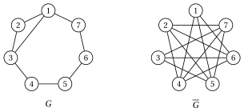

# 12.2 Un modello PLI per il problema della clique massima: la formulazione sugli spigoli { #sez-sec-mcpf-MCP }

**Parte 2 · Formulazioni dei problemi e loro proprietà · Capitolo 12** · [:material-book-open-variant: Capitolo 12: Problemi di clique](index.md) · [:material-file-pdf-box: Dispensa, volume 2 (PDF)](../../pdf/dispensa-2-formulazioni.pdf) · [:material-presentation: Slide](../../pdf/slide-clique-formulations.pdf) · [:material-pencil: Esercizi: Problemi di clique](../../esercizi/clique-formulations.md)

Il problema di questa sezione è il problema della clique massima (MCP), definito nel [Capitolo 5 «Problemi di clique», Sezione 5.2](../../problemi-di-ottimizzazione-combinatoria/clique/il-problema-della-clique-massima.md).

- Dato un grafo semplice $G=(V,E)$, con $V=\{1,2,\dots,n\}$ e $m$ spigoli, indichiamo con

    $$
    \overline{E} = \big\{\, \{u,v\} : u,v \in V,~ u \neq v,~ \{u,v\} \notin E \,\big\}
    $$

    l'insieme dei <strong>non-spigoli</strong> di $G$, cioè gli spigoli del grafo complementare $\overline{G}=(V,\overline{E})$.

- Introduciamo le seguenti $n$ <strong>variabili binarie</strong>:

    \begin{equation*}
    \label{mcpF:var}
    x_v=\begin{cases}1&\text{se il vertice $v$ è selezionato nella clique}\\[1.5ex]0&\text{altrimenti}\end{cases}
    \qquad\forall v\in V. \tag{12.1}
    \end{equation*}

!!! chiave ""

    Con queste variabili, un modello di programmazione lineare intera (PLI) per il problema della clique massima (MCP) è il seguente:

    

    \begin{align*}
    && \max \;\; \sum_{v\in V}x_v \label{mcpF:obj} \tag{12.2a}\\[1ex]
    && \text{soggetto a} \quad x_u+x_v &\le 1, & \forall\{u,v\}\in\overline{E}, \label{mcpF:nonedge} \tag{12.2b}\\[1ex]
    && x_v &\in\{0,1\}, & \forall v\in V. \label{mcpF:bin} \tag{12.2c}
    \end{align*}

    Questo modello PLI si chiama modello $\mathrm{ILP}_{\mathrm{MCP}}$, o <strong>formulazione sugli spigoli</strong>.

- Descrizione della funzione obiettivo e dei vincoli del modello $\mathrm{ILP}_{\mathrm{MCP}}$:

    - la funzione obiettivo lineare $\eqref{mcpF:obj}$ massimizza la cardinalità della clique selezionata;

    - i vincoli $\eqref{mcpF:nonedge}$ garantiscono che due vertici non adiacenti non siano selezionati entrambi ($|\overline{E}|=\binom{n}{2}-m$ vincoli lineari, uno per ogni spigolo di $\overline{G}$);

    - infine, i vincoli $\eqref{mcpF:bin}$ definiscono le variabili del modello PLI.

- Per ogni non-spigolo $\{u,v\}$, il vincolo $x_u+x_v\le1$ impone $x_u=1\Rightarrow x_v=0$. Il viceversa è falso: $x_u=x_v=0$ è ammissibile.

- Letto su $\overline{G}$, lo stesso modello è la <strong>formulazione sugli spigoli del MSSP</strong>: di ogni spigolo di $\overline{G}$ si seleziona al più un estremo.

!!! esempio "Esempio 12.1: Istanza del MCP"

    Consideriamo il grafo $G$ con $7$ vertici formato dal ciclo $1,2,\dots,7,1$ e dalla corda $\{1,3\}$ (l'istanza di riferimento del Capitolo 5 [«Problemi di clique»](../../problemi-di-ottimizzazione-combinatoria/clique/index.md)), e il suo complementare $\overline{G}$:

    { .fig loading=lazy  }

    $G$ ha $m=8$ spigoli, e $\overline{G}$ ha i $\binom{7}{2}-8=13$ non-spigoli di $G$:

    \begin{align*}
    \overline{E}=\big\{ & \{1,4\},\{1,5\},\{1,6\},\{2,4\},\{2,5\},\{2,6\},\{2,7\},\\
    & \{3,5\},\{3,6\},\{3,7\},\{4,6\},\{4,7\},\{5,7\}\big\}.
    \end{align*}

    Chiamiamo questa istanza del MCP [Esempio 12.1](#box-1-mcpF-ex1).

!!! esempio "Esempio 12.2: Modello $\mathrm{ILP}_{\mathrm{MCP}}$"

    Il modello $\mathrm{ILP}_{\mathrm{MCP}}$ per l'istanza del MCP dell'[Esempio 12.1](#box-1-mcpF-ex1) ha $7$ variabili binarie e un vincolo per ciascuno dei $13$ spigoli di $\overline{G}$:

    $$
    \begin{array}{rrrrrrrrcl}
    {\max} & {x_1} & {+\,x_2} & {+\,x_3} & {+\,x_4} & {+\,x_5} & {+\,x_6} & {+\,x_7} \\[1ex]
    \text{soggetto a} & {x_1} &  &  & {+\,x_4} &  &  &  & {\le} & {1} \\
    & {x_1} &  &  &  & {+\,x_5} &  &  & {\le} & {1} \\
    & {x_1} &  &  &  &  & {+\,x_6} &  & {\le} & {1} \\
    &  & {x_2} &  & {+\,x_4} &  &  &  & {\le} & {1} \\
    &  & {x_2} &  &  & {+\,x_5} &  &  & {\le} & {1} \\
    &  & {x_2} &  &  &  & {+\,x_6} &  & {\le} & {1} \\
    &  & {x_2} &  &  &  &  & {+\,x_7} & {\le} & {1} \\
    &  &  & {x_3} &  & {+\,x_5} &  &  & {\le} & {1} \\
    &  &  & {x_3} &  &  & {+\,x_6} &  & {\le} & {1} \\
    &  &  & {x_3} &  &  &  & {+\,x_7} & {\le} & {1} \\
    &  &  &  & {x_4} &  & {+\,x_6} &  & {\le} & {1} \\
    &  &  &  & {x_4} &  &  & {+\,x_7} & {\le} & {1} \\
    &  &  &  &  & {x_5} &  & {+\,x_7} & {\le} & {1} \\[1ex]
    & {x_1}, & {x_2}, & {x_3}, & {x_4}, & {x_5}, & {x_6}, & {x_7} & {\in} & {\{0,1\}}
    \end{array}
    $$

    Una soluzione ottima $\tilde{\vet x}(\mathrm{ILP}_{\mathrm{MCP}})$ è:

    $$
    \tilde x_1=\tilde x_2=\tilde x_3=1,~~\tilde x_4=\tilde x_5=\tilde x_6=\tilde x_7=0
    $$

    Il valore ottimo $z(\mathrm{ILP}_{\mathrm{MCP}})$ è $3=\omega(G)$. La soluzione ottima associata del MCP è la clique $\tilde K=\{1,2,3\}$, ed è l'unica soluzione ottima.

## 12.3 Un primo rilassamento lineare

!!! chiave ""

    Per ottenere un rilassamento lineare (LP) del modello $\mathrm{ILP}_{\mathrm{MCP}}$, rilassiamo i vincoli $\eqref{mcpF:bin}$ in vincoli di non negatività. Il modello PL ottenuto è il seguente:

    

    \begin{align*}
    && \max \;\; \sum_{v\in V}x_v \label{mcpF:obj-LP0} \tag{12.3a}\\[1ex]
    && \text{soggetto a} \quad x_u+x_v &\le 1, & \forall\{u,v\}\in\overline{E}, \label{mcpF:nonedge-LP0} \tag{12.3b}\\[1ex]
    && x_v &\ge 0, & \forall v\in V. \label{mcpF:nonneg-LP0} \tag{12.3c}
    \end{align*}

    Questo modello PL si chiama modello $\mathrm{LP}\text{-}0_{\mathrm{MCP}}$.

- Gli upper bound $x_v\le1$ non sono implicati in $\mathrm{LP}\text{-}0_{\mathrm{MCP}}$: se un vertice è adiacente a tutti gli altri, non compare in nessun vincolo $\eqref{mcpF:nonedge-LP0}$, e $\mathrm{LP}\text{-}0_{\mathrm{MCP}}$ è illimitato. Nell'[Esempio 12.1](#box-1-mcpF-ex1) ogni vertice ha un non-spigolo, e $\mathrm{LP}\text{-}0_{\mathrm{MCP}}$ ha una soluzione ottima.

!!! esempio "Esempio 12.3: Modello $\mathrm{LP}\text{-}0_{\mathrm{MCP}}$"

    Il modello $\mathrm{LP}\text{-}0_{\mathrm{MCP}}$ per l'istanza del MCP dell'[Esempio 12.1](#box-1-mcpF-ex1) è:

    $$
    \begin{array}{rrrrrrrrcl}
    {\max} & {x_1} & {+\,x_2} & {+\,x_3} & {+\,x_4} & {+\,x_5} & {+\,x_6} & {+\,x_7} \\[1ex]
    \text{soggetto a} & {x_1} &  &  & {+\,x_4} &  &  &  & {\le} & {1} \\
    & {x_1} &  &  &  & {+\,x_5} &  &  & {\le} & {1} \\
    & {x_1} &  &  &  &  & {+\,x_6} &  & {\le} & {1} \\
    &  & {x_2} &  & {+\,x_4} &  &  &  & {\le} & {1} \\
    &  & {x_2} &  &  & {+\,x_5} &  &  & {\le} & {1} \\
    &  & {x_2} &  &  &  & {+\,x_6} &  & {\le} & {1} \\
    &  & {x_2} &  &  &  &  & {+\,x_7} & {\le} & {1} \\
    &  &  & {x_3} &  & {+\,x_5} &  &  & {\le} & {1} \\
    &  &  & {x_3} &  &  & {+\,x_6} &  & {\le} & {1} \\
    &  &  & {x_3} &  &  &  & {+\,x_7} & {\le} & {1} \\
    &  &  &  & {x_4} &  & {+\,x_6} &  & {\le} & {1} \\
    &  &  &  & {x_4} &  &  & {+\,x_7} & {\le} & {1} \\
    &  &  &  &  & {x_5} &  & {+\,x_7} & {\le} & {1} \\[1ex]
    & {x_1}, & {x_2}, & {x_3}, & {x_4}, & {x_5}, & {x_6}, & {x_7} & {\ge} & {0}
    \end{array}
    $$

    Una soluzione ottima $\tilde{\vet x}(\mathrm{LP}\text{-}0_{\mathrm{MCP}})$ è:

    $$
    \tilde x_1=\tilde x_2=\tilde x_3=\tilde x_4=\tilde x_5=\tilde x_6=\tilde x_7=\frac{1}{2}
    $$

    Il valore ottimo $z(\mathrm{LP}\text{-}0_{\mathrm{MCP}})$ è $\frac{7}{2}$. Di conseguenza, abbiamo l'upper bound:

    $$
    z(\mathrm{ILP}_{\mathrm{MCP}}) \le \frac{7}{2}
    $$

!!! chiave ""

    Con una variabile duale non negativa $\pi_{uv}$ per ogni vincolo $\eqref{mcpF:nonedge-LP0}$, il modello duale del modello $\mathrm{LP}\text{-}0_{\mathrm{MCP}}$ è:

    

    \begin{align*}
    && \min \;\; \sum_{\{u,v\}\in\overline{E}}\pi_{uv} \label{mcpF:obj-DLP0} \tag{12.4a}\\[1ex]
    && \text{soggetto a} \quad \sum_{u:\,\{u,v\}\in\overline{E}}\pi_{uv} &\ge 1, & \forall v\in V, \label{mcpF:cov-DLP0} \tag{12.4b}\\[1ex]
    && \pi_{uv} &\ge 0, & \forall\{u,v\}\in\overline{E}. \label{mcpF:nonneg-DLP0} \tag{12.4c}
    \end{align*}

    Questo modello PL si chiama modello $D(\mathrm{LP}\text{-}0_{\mathrm{MCP}})$.

- I vincoli $\eqref{mcpF:cov-DLP0}$ chiedono che ogni vertice sia coperto da un peso totale almeno pari a uno sugli spigoli di $\overline{G}$ incidenti in esso: il modello $D(\mathrm{LP}\text{-}0_{\mathrm{MCP}})$ è una <strong>copertura frazionaria dei vertici con spigoli</strong> di $\overline{G}$.

!!! esempio "Esempio 12.4: Modello $D(\mathrm{LP}\text{-}0_{\mathrm{MCP}})$"

    Il modello duale $D(\mathrm{LP}\text{-}0_{\mathrm{MCP}})$ per l'istanza del MCP dell'[Esempio 12.1](#box-1-mcpF-ex1) ha una variabile per ogni spigolo di $\overline{G}$ e un vincolo per ogni vertice:

    $$
    \begin{array}{rlcl}
    {\min} & {\pi_{14}+\pi_{15}+\pi_{16}+\pi_{24}+\pi_{25}+\pi_{26}+\pi_{27}} &  &  \\
    & {+\pi_{35}+\pi_{36}+\pi_{37}+\pi_{46}+\pi_{47}+\pi_{57}} &  &  \\[1ex]
    \text{soggetto a} & {\pi_{14}+\pi_{15}+\pi_{16}} & {\ge} & {1} \\
    & {\pi_{24}+\pi_{25}+\pi_{26}+\pi_{27}} & {\ge} & {1} \\
    & {\pi_{35}+\pi_{36}+\pi_{37}} & {\ge} & {1} \\
    & {\pi_{14}+\pi_{24}+\pi_{46}+\pi_{47}} & {\ge} & {1} \\
    & {\pi_{15}+\pi_{25}+\pi_{35}+\pi_{57}} & {\ge} & {1} \\
    & {\pi_{16}+\pi_{26}+\pi_{36}+\pi_{46}} & {\ge} & {1} \\
    & {\pi_{27}+\pi_{37}+\pi_{47}+\pi_{57}} & {\ge} & {1} \\[1ex]
    & {\pi_{14},~\pi_{15},~\pi_{16},~\dots,~\pi_{57}} & {\ge} & {0}
    \end{array}
    $$

    Una soluzione ottima $\tilde{\vet\pi}(D(\mathrm{LP}\text{-}0_{\mathrm{MCP}}))$ dà valore $\frac{1}{2}$ ai $7$ spigoli del ciclo $1,4,7,2,5,3,6,1$ di $\overline{G}$:

    \begin{align*}
    &\tilde\pi_{14}=\tilde\pi_{47}=\tilde\pi_{27}=\tilde\pi_{25}=\tilde\pi_{35}=\tilde\pi_{36}=\tilde\pi_{16}=\frac{1}{2},\\
    &\tilde\pi_{15}=\tilde\pi_{24}=\tilde\pi_{26}=\tilde\pi_{37}=\tilde\pi_{46}=\tilde\pi_{57}=0
    \end{align*}

    Ogni vertice sta su due spigoli del ciclo e riceve $\frac{1}{2}+\frac{1}{2}=1$. Il valore ottimo $z(D(\mathrm{LP}\text{-}0_{\mathrm{MCP}}))$ è $\frac{7}{2}$.

## 12.4 Un secondo rilassamento lineare

!!! chiave ""

    Per ottenere un rilassamento lineare del modello $\mathrm{ILP}_{\mathrm{MCP}}$, rilassiamo i vincoli $\eqref{mcpF:bin}$ nei bound $0\le x_v\le 1$. Il modello PL ottenuto è il seguente:

    

    \begin{align*}
    && \max \;\; \sum_{v\in V}x_v \label{mcpF:obj-LP} \tag{12.5a}\\[1ex]
    && \text{soggetto a} \quad x_u+x_v &\le 1, & \forall\{u,v\}\in\overline{E}, \label{mcpF:nonedge-LP} \tag{12.5b}\\[1ex]
    && x_v &\le 1, & \forall v\in V, \label{mcpF:ub} \tag{12.5c}\\[1ex]
    && x_v &\ge 0, & \forall v\in V. \label{mcpF:nonneg-LP} \tag{12.5d}
    \end{align*}

    Questo modello PL si chiama modello $\mathrm{LP}_{\mathrm{MCP}}$.

!!! esempio "Esempio 12.5: Modello $\mathrm{LP}_{\mathrm{MCP}}$"

    Il modello $\mathrm{LP}_{\mathrm{MCP}}$ per l'istanza del MCP dell'[Esempio 12.1](#box-1-mcpF-ex1) è:

    $$
    \begin{array}{rrrrrrrrcl}
    {\max} & {x_1} & {+\,x_2} & {+\,x_3} & {+\,x_4} & {+\,x_5} & {+\,x_6} & {+\,x_7} \\[1ex]
    \text{soggetto a} & {x_1} &  &  & {+\,x_4} &  &  &  & {\le} & {1} \\
    & {x_1} &  &  &  & {+\,x_5} &  &  & {\le} & {1} \\
    & {x_1} &  &  &  &  & {+\,x_6} &  & {\le} & {1} \\
    &  & {x_2} &  & {+\,x_4} &  &  &  & {\le} & {1} \\
    &  & {x_2} &  &  & {+\,x_5} &  &  & {\le} & {1} \\
    &  & {x_2} &  &  &  & {+\,x_6} &  & {\le} & {1} \\
    &  & {x_2} &  &  &  &  & {+\,x_7} & {\le} & {1} \\
    &  &  & {x_3} &  & {+\,x_5} &  &  & {\le} & {1} \\
    &  &  & {x_3} &  &  & {+\,x_6} &  & {\le} & {1} \\
    &  &  & {x_3} &  &  &  & {+\,x_7} & {\le} & {1} \\
    &  &  &  & {x_4} &  & {+\,x_6} &  & {\le} & {1} \\
    &  &  &  & {x_4} &  &  & {+\,x_7} & {\le} & {1} \\
    &  &  &  &  & {x_5} &  & {+\,x_7} & {\le} & {1} \\
    & {x_1} &  &  &  &  &  &  & {\le} & {1} \\
    &  & {x_2} &  &  &  &  &  & {\le} & {1} \\
    &  &  & {x_3} &  &  &  &  & {\le} & {1} \\
    &  &  &  & {x_4} &  &  &  & {\le} & {1} \\
    &  &  &  &  & {x_5} &  &  & {\le} & {1} \\
    &  &  &  &  &  & {x_6} &  & {\le} & {1} \\
    &  &  &  &  &  &  & {x_7} & {\le} & {1} \\[1ex]
    & {x_1}, & {x_2}, & {x_3}, & {x_4}, & {x_5}, & {x_6}, & {x_7} & {\ge} & {0}
    \end{array}
    $$

    Una soluzione ottima $\tilde{\vet x}(\mathrm{LP}_{\mathrm{MCP}})$ è:

    $$
    \tilde x_1=\tilde x_2=\tilde x_3=\tilde x_4=\tilde x_5=\tilde x_6=\tilde x_7=\frac{1}{2}
    $$

    Il valore ottimo $z(\mathrm{LP}_{\mathrm{MCP}})$ è $\frac{7}{2}$. Di conseguenza, abbiamo l'upper bound:

    $$
    z(\mathrm{ILP}_{\mathrm{MCP}}) \le \frac{7}{2}
    $$

!!! chiave ""

    Con una variabile duale non negativa $\pi_{uv}$ per ogni vincolo $\eqref{mcpF:nonedge-LP}$ e una variabile duale non negativa $\lambda_v$ per ogni vincolo $\eqref{mcpF:ub}$, il modello duale del modello $\mathrm{LP}_{\mathrm{MCP}}$ è:

    

    \begin{align*}
    && \min \;\; \sum_{\{u,v\}\in\overline{E}}\pi_{uv}+\sum_{v\in V}\lambda_v \label{mcpF:obj-DLP} \tag{12.6a}\\[1ex]
    && \text{soggetto a} \quad \sum_{u:\,\{u,v\}\in\overline{E}}\pi_{uv}+\lambda_v &\ge 1, & \forall v\in V, \label{mcpF:cov-DLP} \tag{12.6b}\\[1ex]
    && \pi_{uv} &\ge 0, & \forall\{u,v\}\in\overline{E}, \label{mcpF:pi-DLP} \tag{12.6c}\\[1ex]
    && \lambda_v &\ge 0, & \forall v\in V. \label{mcpF:lambda-DLP} \tag{12.6d}
    \end{align*}

    Questo modello PL si chiama modello $D(\mathrm{LP}_{\mathrm{MCP}})$.

!!! esempio "Esempio 12.6: Modello $D(\mathrm{LP}_{\mathrm{MCP}})$"

    Il modello duale $D(\mathrm{LP}_{\mathrm{MCP}})$ per l'istanza del MCP dell'[Esempio 12.1](#box-1-mcpF-ex1) è:

    $$
    \begin{array}{rlcl}
    {\min} & {\pi_{14}+\pi_{15}+\pi_{16}+\pi_{24}+\pi_{25}+\pi_{26}+\pi_{27}} &  &  \\
    & {+\pi_{35}+\pi_{36}+\pi_{37}+\pi_{46}+\pi_{47}+\pi_{57}+\lambda_1} &  &  \\
    & {+\lambda_2+\lambda_3+\lambda_4+\lambda_5+\lambda_6+\lambda_7} &  &  \\[1ex]
    \text{soggetto a} & {\pi_{14}+\pi_{15}+\pi_{16}+\lambda_1} & {\ge} & {1} \\
    & {\pi_{24}+\pi_{25}+\pi_{26}+\pi_{27}+\lambda_2} & {\ge} & {1} \\
    & {\pi_{35}+\pi_{36}+\pi_{37}+\lambda_3} & {\ge} & {1} \\
    & {\pi_{14}+\pi_{24}+\pi_{46}+\pi_{47}+\lambda_4} & {\ge} & {1} \\
    & {\pi_{15}+\pi_{25}+\pi_{35}+\pi_{57}+\lambda_5} & {\ge} & {1} \\
    & {\pi_{16}+\pi_{26}+\pi_{36}+\pi_{46}+\lambda_6} & {\ge} & {1} \\
    & {\pi_{27}+\pi_{37}+\pi_{47}+\pi_{57}+\lambda_7} & {\ge} & {1} \\[1ex]
    & {\pi_{14},~\pi_{15},~\pi_{16},~\dots,~\pi_{57}} & {\ge} & {0} \\
    & {\lambda_1,~\lambda_2,~\lambda_3,~\lambda_4,~\lambda_5,~\lambda_6,~\lambda_7} & {\ge} & {0}
    \end{array}
    $$

    Una soluzione ottima $(\tilde{\vet\pi},\tilde{\vet\lambda})(D(\mathrm{LP}_{\mathrm{MCP}}))$ è la soluzione dell'[Esempio 12.4](#box-4-mcpF-ex-dlp0) con $\tilde\lambda_v=0$ per ogni $v\in V$:

    \begin{align*}
    &\tilde\pi_{14}=\tilde\pi_{47}=\tilde\pi_{27}=\tilde\pi_{25}=\tilde\pi_{35}=\tilde\pi_{36}=\tilde\pi_{16}=\frac{1}{2},\\
    &\text{tutti gli altri } \tilde\pi_{uv}=0,\qquad
    \tilde\lambda_1=\tilde\lambda_2=\dots=\tilde\lambda_7=0
    \end{align*}

    Il valore ottimo $z(D(\mathrm{LP}_{\mathrm{MCP}}))$ è $\frac{7}{2}$.

!!! teorema "Proposizione 12.1: Il bound LP può essere arbitrariamente debole"

    Per ogni grafo $G$ con $n$ vertici, $z(\mathrm{LP}_{\mathrm{MCP}})\ge n/2$. Di conseguenza, il rapporto $z(\mathrm{LP}_{\mathrm{MCP}})/z(\mathrm{ILP}_{\mathrm{MCP}})$ non è limitato al variare dei grafi.

??? dimostrazione "Dimostrazione"

    Poniamo $x_v=\frac{1}{2}$ per ogni vertice. Ogni vincolo $\eqref{mcpF:nonedge-LP}$ diventa $\frac{1}{2}+\frac{1}{2}=1$, e i bound $\eqref{mcpF:ub}$ e $\eqref{mcpF:nonneg-LP}$ sono soddisfatti: è una soluzione ammissibile di $\mathrm{LP}_{\mathrm{MCP}}$ di valore $n/2$. I grafi senza triangoli e con almeno uno spigolo hanno $\omega(G)=2$ per ogni $n$, e per essi il rapporto è almeno $n/4$. □

- I dati sono interi e il valore ottimo del PLI è intero, quindi anche $\lfloor z(\mathrm{LP}_{\mathrm{MCP}})\rfloor$ è un bound duale. Sull'[Esempio 12.1](#box-1-mcpF-ex1) dà $\lfloor\frac{7}{2}\rfloor=3=\omega(G)$ per caso; su un grafo senza triangoli dà $\lfloor n/2\rfloor$, contro $\omega(G)=2$.

- Sul ciclo con $5$ vertici $C_5$, dove $\omega(C_5)=2$, il punto $x_v=\frac{1}{2}$ dà $z(\mathrm{LP}_{\mathrm{MCP}})=\frac{5}{2}$.

## 12.5 Disuguaglianze di clique: una formulazione più forte { #sez-sec-mcpf-CL }

!!! teorema "Proposizione 12.2: disuguaglianze di clique"

    Sia $Q\subseteq V$ una clique di $\overline{G}$, cioè un insieme stabile di $G$. Allora

    \begin{equation*}
    \label{mcpF:cliqueineq}
    \sum_{v\in Q}x_v\le 1 \tag{12.7}
    \end{equation*}

    è una <strong>disuguaglianza valida</strong> per $\mathrm{ILP}_{\mathrm{MCP}}$.

??? dimostrazione "Dimostrazione"

    Una clique di $G$ e un insieme stabile $Q$ di $G$ hanno al più un vertice in comune: due vertici comuni sarebbero insieme adiacenti e non adiacenti. Quindi ogni soluzione ammissibile di $\mathrm{ILP}_{\mathrm{MCP}}$ seleziona al più un vertice di $Q$. □

- Le disuguaglianze $\eqref{mcpF:cliqueineq}$ si chiamano <strong>disuguaglianze di clique</strong>, dalla clique $Q$ di $\overline{G}$; lette su $G$, sono <strong>disuguaglianze di insieme stabile</strong>. I vincoli sui non-spigoli sono il caso $|Q|=2$.

- Se $Q\subseteq Q'$, la disuguaglianza di $Q'$ implica quella di $Q$, perché tutte le variabili sono non negative. Basta scrivere le disuguaglianze delle clique <strong>massimali</strong> di $\overline{G}$, la cui famiglia indichiamo con $\mathcal{Q}$.

!!! chiave ""

    Con le variabili $\eqref{mcpF:var}$, un secondo modello PLI per il problema della clique massima (MCP) è il seguente:

    

    \begin{align*}
    && \max \;\; \sum_{v\in V}x_v \label{mcpF:obj-CL} \tag{12.8a}\\[1ex]
    && \text{soggetto a} \quad \sum_{v\in Q}x_v &\le 1, & \forall Q\in\mathcal{Q}, \label{mcpF:cl} \tag{12.8b}\\[1ex]
    && x_v &\in\{0,1\}, & \forall v\in V. \label{mcpF:bin-CL} \tag{12.8c}
    \end{align*}

    Questo modello PLI si chiama modello $\mathrm{ILP}^{\mathrm{CL}}_{\mathrm{MCP}}$, o <strong>formulazione a clique</strong>.

- Descrizione della funzione obiettivo e dei vincoli del modello $\mathrm{ILP}^{\mathrm{CL}}_{\mathrm{MCP}}$:

    - la funzione obiettivo lineare $\eqref{mcpF:obj-CL}$ massimizza la cardinalità della clique selezionata;

    - i vincoli $\eqref{mcpF:cl}$ garantiscono che di ogni clique massimale di $\overline{G}$ sia selezionato al più un vertice ($|\mathcal{Q}|$ vincoli lineari);

    - infine, i vincoli $\eqref{mcpF:bin-CL}$ definiscono le variabili del modello PLI.

- Ogni spigolo di $\overline{G}$ sta in una clique massimale, quindi ogni vincolo $\eqref{mcpF:nonedge}$ è implicato da un vincolo $\eqref{mcpF:cl}$: i due modelli hanno le stesse soluzioni ammissibili.

- La famiglia $\mathcal{Q}$ può essere molto grande: Moon e Moser (1965) hanno mostrato grafi con $3^{n/3}$ clique massimali. In pratica le disuguaglianze si aggiungono solo quando sono violate, come nel [Capitolo 4 «Disuguaglianze valide»](https://fabiofurini.github.io/programmazione-lineare-intera/formulations/valid-inequalities/) del modulo <em>Programmazione lineare intera</em>.

!!! esempio "Esempio 12.7: Modello $\mathrm{ILP}^{\mathrm{CL}}_{\mathrm{MCP}}$"

    Le clique massimali di $\overline{G}$ nell'[Esempio 12.1](#box-1-mcpF-ex1) sono i $5$ triangoli e i $2$ spigoli

    $$
    \mathcal{Q}=\big\{\{1,4,6\},\{2,4,6\},\{2,4,7\},\{2,5,7\},\{3,5,7\},\{1,5\},\{3,6\}\big\},
    $$

    e danno $7$ vincoli invece di $13$. Il modello $\mathrm{ILP}^{\mathrm{CL}}_{\mathrm{MCP}}$ per questa istanza del MCP è:

    $$
    \begin{array}{rrrrrrrrcl}
    {\max} & {x_1} & {+\,x_2} & {+\,x_3} & {+\,x_4} & {+\,x_5} & {+\,x_6} & {+\,x_7} \\[1ex]
    \text{soggetto a} & {x_1} &  &  & {+\,x_4} &  & {+\,x_6} &  & {\le} & {1} \\
    &  & {x_2} &  & {+\,x_4} &  & {+\,x_6} &  & {\le} & {1} \\
    &  & {x_2} &  & {+\,x_4} &  &  & {+\,x_7} & {\le} & {1} \\
    &  & {x_2} &  &  & {+\,x_5} &  & {+\,x_7} & {\le} & {1} \\
    &  &  & {x_3} &  & {+\,x_5} &  & {+\,x_7} & {\le} & {1} \\
    & {x_1} &  &  &  & {+\,x_5} &  &  & {\le} & {1} \\
    &  &  & {x_3} &  &  & {+\,x_6} &  & {\le} & {1} \\[1ex]
    & {x_1}, & {x_2}, & {x_3}, & {x_4}, & {x_5}, & {x_6}, & {x_7} & {\in} & {\{0,1\}}
    \end{array}
    $$

    Una soluzione ottima $\tilde{\vet x}(\mathrm{ILP}^{\mathrm{CL}}_{\mathrm{MCP}})$ è:

    $$
    \tilde x_1=\tilde x_2=\tilde x_3=1,~~\tilde x_4=\tilde x_5=\tilde x_6=\tilde x_7=0
    $$

    Il valore ottimo $z(\mathrm{ILP}^{\mathrm{CL}}_{\mathrm{MCP}})$ è $3=\omega(G)$.

!!! chiave ""

    Per ottenere un rilassamento lineare del modello $\mathrm{ILP}^{\mathrm{CL}}_{\mathrm{MCP}}$, rilassiamo i vincoli $\eqref{mcpF:bin-CL}$ in vincoli di non negatività. Il modello PL ottenuto è il seguente:

    

    \begin{align*}
    && \max \;\; \sum_{v\in V}x_v \label{mcpF:obj-LPCL} \tag{12.9a}\\[1ex]
    && \text{soggetto a} \quad \sum_{v\in Q}x_v &\le 1, & \forall Q\in\mathcal{Q}, \label{mcpF:cl-LP} \tag{12.9b}\\[1ex]
    && x_v &\ge 0, & \forall v\in V. \label{mcpF:nonneg-LPCL} \tag{12.9c}
    \end{align*}

    Questo modello PL si chiama modello $\mathrm{LP}^{\mathrm{CL}}_{\mathrm{MCP}}$.

- Ogni vertice sta in qualche clique massimale di $\overline{G}$, quindi i vincoli $\eqref{mcpF:cl-LP}$ implicano $x_v\le 1$: i bound $\eqref{mcpF:ub}$ non servono.

- Ogni vincolo $\eqref{mcpF:nonedge-LP}$ è implicato da un vincolo $\eqref{mcpF:cl-LP}$. Quindi la regione ammissibile di $\mathrm{LP}^{\mathrm{CL}}_{\mathrm{MCP}}$ è contenuta in quella di $\mathrm{LP}_{\mathrm{MCP}}$, e

    $$
    \omega(G) \;\le\; z(\mathrm{LP}^{\mathrm{CL}}_{\mathrm{MCP}}) \;\le\; z(\mathrm{LP}_{\mathrm{MCP}}).
    $$

!!! esempio "Esempio 12.8: Modello $\mathrm{LP}^{\mathrm{CL}}_{\mathrm{MCP}}$"

    Il modello $\mathrm{LP}^{\mathrm{CL}}_{\mathrm{MCP}}$ per l'istanza del MCP dell'[Esempio 12.1](#box-1-mcpF-ex1) è:

    $$
    \begin{array}{rrrrrrrrcl}
    {\max} & {x_1} & {+\,x_2} & {+\,x_3} & {+\,x_4} & {+\,x_5} & {+\,x_6} & {+\,x_7} \\[1ex]
    \text{soggetto a} & {x_1} &  &  & {+\,x_4} &  & {+\,x_6} &  & {\le} & {1} \\
    &  & {x_2} &  & {+\,x_4} &  & {+\,x_6} &  & {\le} & {1} \\
    &  & {x_2} &  & {+\,x_4} &  &  & {+\,x_7} & {\le} & {1} \\
    &  & {x_2} &  &  & {+\,x_5} &  & {+\,x_7} & {\le} & {1} \\
    &  &  & {x_3} &  & {+\,x_5} &  & {+\,x_7} & {\le} & {1} \\
    & {x_1} &  &  &  & {+\,x_5} &  &  & {\le} & {1} \\
    &  &  & {x_3} &  &  & {+\,x_6} &  & {\le} & {1} \\[1ex]
    & {x_1}, & {x_2}, & {x_3}, & {x_4}, & {x_5}, & {x_6}, & {x_7} & {\ge} & {0}
    \end{array}
    $$

    Il punto $\bar x_v=\frac{1}{2}$ non è più ammissibile: $\bar x_1+\bar x_4+\bar x_6=\frac{3}{2}>1$. Sommando i tre vincoli di $\{1,4,6\}$, $\{2,5,7\}$ e $\{3,5,7\}$ otteniamo

    $$
    \sum_{v=1}^{7}x_v + x_5 + x_7 \le 3
    \quad\Longrightarrow\quad
    \sum_{v=1}^{7}x_v\le 3.
    $$

    Una soluzione ottima $\tilde{\vet x}(\mathrm{LP}^{\mathrm{CL}}_{\mathrm{MCP}})$ è:

    $$
    \tilde x_1=\tilde x_2=\tilde x_3=1,~~\tilde x_4=\tilde x_5=\tilde x_6=\tilde x_7=0
    $$

    Il valore ottimo $z(\mathrm{LP}^{\mathrm{CL}}_{\mathrm{MCP}})$ è $3=\omega(G)$: il bound LP scende da $\frac{7}{2}$ a $3$ e chiude il gap.

- Le disuguaglianze di clique non chiudono sempre il gap. Su $C_5$ il complementare è ancora un ciclo con $5$ vertici, le cui clique massimali sono i suoi spigoli: le due formulazioni coincidono e $z(\mathrm{LP}^{\mathrm{CL}}_{\mathrm{MCP}})= \frac{5}{2}>2=\omega(C_5)$.

- Se $C$ è un ciclo di $\overline{G}$ con un numero dispari di vertici e senza corde, allora $\sum_{v\in C}x_v\le(|C|-1)/2$ è una disuguaglianza valida (una <strong>disuguaglianza di ciclo dispari</strong>): un insieme stabile di $\overline{G}$ prende al più $(|C|-1)/2$ vertici di $C$. Per $C_5$ si scrive $x_1+\dots+x_5\le 2$ e chiude il gap.

## 12.6 La relazione con la colorazione dei vertici

- In una colorazione di $G$ i vertici di una clique hanno colori a due a due diversi, quindi (Capitolo 4 [«Problemi di colorazione»](../../problemi-di-ottimizzazione-combinatoria/coloring/index.md))

    $$
    \omega(G)\le\chi(G).
    $$

    Qui collochiamo il bound LP della formulazione a clique fra i due numeri.

- Le clique massimali di $\overline{G}$ sono gli <strong>insiemi stabili massimali</strong> di $G$, e una classe di colore è un insieme stabile. Introduciamo le seguenti $|\mathcal{Q}|$ <strong>variabili binarie</strong>:

    \begin{equation*}
    \label{mcpF:var-col}
    y_Q=\begin{cases}1&\text{se l'insieme stabile $Q$ è una classe di colore}\\[1.5ex]0&\text{altrimenti}\end{cases}
    \qquad\forall Q\in\mathcal{Q}. \tag{12.10}
    \end{equation*}

!!! chiave ""

    Con queste variabili, un modello PLI per il problema della colorazione dei vertici (VCP) è il seguente:

    

    \begin{align*}
    && \min \;\; \sum_{Q\in\mathcal{Q}}y_Q \label{mcpF:obj-col} \tag{12.11a}\\[1ex]
    && \text{soggetto a} \quad \sum_{Q\in\mathcal{Q}:\,v\in Q}y_Q &\ge 1, & \forall v\in V, \label{mcpF:cov-col} \tag{12.11b}\\[1ex]
    && y_Q &\in\{0,1\}, & \forall Q\in\mathcal{Q}. \label{mcpF:bin-col} \tag{12.11c}
    \end{align*}

    Questo modello PLI si chiama modello $\mathrm{ILP}^{\mathrm{ST}}_{\mathrm{VCP}}$, o <strong>formulazione a insiemi stabili</strong> del VCP.

- Descrizione della funzione obiettivo e dei vincoli del modello $\mathrm{ILP}^{\mathrm{ST}}_{\mathrm{VCP}}$:

    - la funzione obiettivo lineare $\eqref{mcpF:obj-col}$ minimizza il numero di classi di colore;

    - i vincoli $\eqref{mcpF:cov-col}$ garantiscono che ogni vertice appartenga ad almeno un insieme stabile scelto ($n$ vincoli lineari);

    - infine, i vincoli $\eqref{mcpF:bin-col}$ definiscono le variabili del modello PLI.

- Il suo valore ottimo è $\chi(G)$: un vertice coperto da due insiemi scelti si tiene in uno solo dei due, e ogni sottoinsieme di un insieme stabile è stabile, quindi gli insiemi scelti danno una colorazione con lo stesso numero di colori.

!!! chiave ""

    Con una variabile duale non negativa $\pi_Q$ per ogni vincolo $\eqref{mcpF:cl-LP}$, il modello duale del modello $\mathrm{LP}^{\mathrm{CL}}_{\mathrm{MCP}}$ è:

    

    \begin{align*}
    && \min \;\; \sum_{Q\in\mathcal{Q}}\pi_Q \label{mcpF:obj-DLPCL} \tag{12.12a}\\[1ex]
    && \text{soggetto a} \quad \sum_{Q\in\mathcal{Q}:\,v\in Q}\pi_Q &\ge 1, & \forall v\in V, \label{mcpF:cov-DLPCL} \tag{12.12b}\\[1ex]
    && \pi_Q &\ge 0, & \forall Q\in\mathcal{Q}. \label{mcpF:nonneg-DLPCL} \tag{12.12c}
    \end{align*}

    Questo modello PL si chiama modello $D(\mathrm{LP}^{\mathrm{CL}}_{\mathrm{MCP}})$.

!!! teorema "Proposizione 12.3: bound di clique dalla dualità LP"

    Il modello duale $D(\mathrm{LP}^{\mathrm{CL}}_{\mathrm{MCP}})$ è il rilassamento lineare del modello $\mathrm{ILP}^{\mathrm{ST}}_{\mathrm{VCP}}$, con le variabili $\pi_Q$ al posto di $y_Q$. Quindi

    $$
    \omega(G)\;\le\; z(\mathrm{LP}^{\mathrm{CL}}_{\mathrm{MCP}}) \;\le\; \chi(G).
    $$

??? dimostrazione "Dimostrazione"

    Rilassando i vincoli $\eqref{mcpF:bin-col}$ in $y_Q\ge 0$ si ottiene esattamente il modello [(12.12)](#eq-mcpF-DLPCL), con $y_Q$ al posto di $\pi_Q$. Per la dualità forte $z(\mathrm{LP}^{\mathrm{CL}}_{\mathrm{MCP}})=z(D(\mathrm{LP}^{\mathrm{CL}}_{\mathrm{MCP}}))$. La prima disuguaglianza vale perché $\mathrm{LP}^{\mathrm{CL}}_{\mathrm{MCP}}$ è un rilassamento del MCP. La seconda vale perché $D(\mathrm{LP}^{\mathrm{CL}}_{\mathrm{MCP}})$ è un rilassamento del modello $\mathrm{ILP}^{\mathrm{ST}}_{\mathrm{VCP}}$, un problema di minimo con valore ottimo $\chi(G)$. □

- Il valore comune $z(\mathrm{LP}^{\mathrm{CL}}_{\mathrm{MCP}})$ si chiama <strong>numero cromatico frazionario</strong> di $G$. La formulazione a clique del MCP e la formulazione a insiemi stabili del VCP sono due facce dello stesso problema LP.

!!! esempio "Esempio 12.9: Modello $D(\mathrm{LP}^{\mathrm{CL}}_{\mathrm{MCP}})$"

    Il modello duale $D(\mathrm{LP}^{\mathrm{CL}}_{\mathrm{MCP}})$ per l'istanza del MCP dell'[Esempio 12.1](#box-1-mcpF-ex1) ha una variabile per ogni insieme stabile massimale di $G$ ($\pi_{146}$ per $Q=\{1,4,6\}$, e così via):

    $$
    \begin{array}{rrrrrrrrcl}
    {\min} & {\pi_{146}} & {+\,\pi_{246}} & {+\,\pi_{247}} & {+\,\pi_{257}} & {+\,\pi_{357}} & {+\,\pi_{15}} & {+\,\pi_{36}} \\[1ex]
    \text{soggetto a} & {\pi_{146}} &  &  &  &  & {+\,\pi_{15}} &  & {\ge} & {1} \\
    &  & {\pi_{246}} & {+\,\pi_{247}} & {+\,\pi_{257}} &  &  &  & {\ge} & {1} \\
    &  &  &  &  & {\pi_{357}} &  & {+\,\pi_{36}} & {\ge} & {1} \\
    & {\pi_{146}} & {+\,\pi_{246}} & {+\,\pi_{247}} &  &  &  &  & {\ge} & {1} \\
    &  &  &  & {\pi_{257}} & {+\,\pi_{357}} & {+\,\pi_{15}} &  & {\ge} & {1} \\
    & {\pi_{146}} & {+\,\pi_{246}} &  &  &  &  & {+\,\pi_{36}} & {\ge} & {1} \\
    &  &  & {\pi_{247}} & {+\,\pi_{257}} & {+\,\pi_{357}} &  &  & {\ge} & {1} \\[1ex]
    & {\pi_{146}}, & {\pi_{246}}, & {\pi_{247}}, & {\pi_{257}}, & {\pi_{357}}, & {\pi_{15}}, & {\pi_{36}} & {\ge} & {0}
    \end{array}
    $$

    Una soluzione ottima $\tilde{\vet\pi}(D(\mathrm{LP}^{\mathrm{CL}}_{\mathrm{MCP}}))$ dà valore $1$ ai moltiplicatori usati nell'[Esempio 12.8](#box-10-mcpF-ex-lpcl):

    $$
    \tilde\pi_{146}=\tilde\pi_{257}=\tilde\pi_{357}=1,~~\tilde\pi_{246}=\tilde\pi_{247}=\tilde\pi_{15}=\tilde\pi_{36}=0
    $$

    Il valore ottimo $z(D(\mathrm{LP}^{\mathrm{CL}}_{\mathrm{MCP}}))$ è $3$.

!!! esempio "Esempio 12.10: la catena $\omega\le z(\mathrm{LP}^{\mathrm{CL}}_{\mathrm{MCP}})\le\chi$"

    - Sull'[Esempio 12.1](#box-1-mcpF-ex1), il modello $\mathrm{ILP}^{\mathrm{ST}}_{\mathrm{VCP}}$ è:

        $$
        \begin{array}{rrrrrrrrcl}
        {\min} & {y_{146}} & {+\,y_{246}} & {+\,y_{247}} & {+\,y_{257}} & {+\,y_{357}} & {+\,y_{15}} & {+\,y_{36}} \\[1ex]
        \text{soggetto a} & {y_{146}} &  &  &  &  & {+\,y_{15}} &  & {\ge} & {1} \\
        &  & {y_{246}} & {+\,y_{247}} & {+\,y_{257}} &  &  &  & {\ge} & {1} \\
        &  &  &  &  & {y_{357}} &  & {+\,y_{36}} & {\ge} & {1} \\
        & {y_{146}} & {+\,y_{246}} & {+\,y_{247}} &  &  &  &  & {\ge} & {1} \\
        &  &  &  & {y_{257}} & {+\,y_{357}} & {+\,y_{15}} &  & {\ge} & {1} \\
        & {y_{146}} & {+\,y_{246}} &  &  &  &  & {+\,y_{36}} & {\ge} & {1} \\
        &  &  & {y_{247}} & {+\,y_{257}} & {+\,y_{357}} &  &  & {\ge} & {1} \\[1ex]
        & {y_{146}}, & {y_{246}}, & {y_{247}}, & {y_{257}}, & {y_{357}}, & {y_{15}}, & {y_{36}} & {\in} & {\{0,1\}}
        \end{array}
        $$

        Il punto intero $\tilde y_{146}=\tilde y_{257}=\tilde y_{357}=1$, con tutte le altre variabili pari a $0$, è la soluzione dell'[Esempio 12.9](#box-12-mcpF-ex-dlpcl): è una colorazione con $3$ colori, le classi $\{1,4,6\}$, $\{2,5,7\}$ e $\{3\}$. Quindi $\chi(G)=3$, e la catena diventa $3\le 3\le 3$.

    - Su $C_5$, con vertici $1,\dots,5$, gli insiemi stabili massimali sono i $5$ non-spigoli. Ponendo $\pi_Q=\frac{1}{2}$ su ciascuno di essi ogni vertice riceve in totale $1$, quindi il duale ha valore $\frac{5}{2}$, come il primale. La catena diventa

        $$
        \omega(C_5)=2 \;<\; z(\mathrm{LP}^{\mathrm{CL}}_{\mathrm{MCP}})=\frac{5}{2} \;<\; \chi(C_5)=3 .
        $$

## 12.7 Insiemi stabili sul grafo complementare { #sez-sec-mcpf-MSSP }

Il problema di questa sezione è il problema dell'insieme stabile massimo (MSSP), definito nel [Capitolo 5 «Problemi di clique», Sezione 5.2](../../problemi-di-ottimizzazione-combinatoria/clique/il-problema-della-clique-massima.md).

- Dato un grafo semplice $G=(V,E)$, con $V=\{1,2,\dots,n\}$ e $m$ spigoli, introduciamo le seguenti $n$ <strong>variabili binarie</strong>:

    \begin{equation*}
    \label{mcpF:var-mssp}
    x_v=\begin{cases}1&\text{se il vertice $v$ è selezionato nell'insieme stabile}\\[1.5ex]0&\text{altrimenti}\end{cases}
    \qquad\forall v\in V. \tag{12.13}
    \end{equation*}

!!! chiave ""

    Con queste variabili, un modello di programmazione lineare intera (PLI) per il problema dell'insieme stabile massimo (MSSP) è il seguente:

    

    \begin{align*}
    && \max \;\; \sum_{v\in V}x_v \label{mcpF:obj-mssp} \tag{12.14a}\\[1ex]
    && \text{soggetto a} \quad x_u+x_v &\le 1, & \forall\{u,v\}\in E, \label{mcpF:edge-mssp} \tag{12.14b}\\[1ex]
    && x_v &\in\{0,1\}, & \forall v\in V. \label{mcpF:bin-mssp} \tag{12.14c}
    \end{align*}

    Questo modello PLI si chiama modello $\mathrm{ILP}_{\mathrm{MSSP}}$, o <strong>formulazione sugli spigoli</strong> del MSSP.

- Descrizione della funzione obiettivo e dei vincoli del modello $\mathrm{ILP}_{\mathrm{MSSP}}$:

    - la funzione obiettivo lineare $\eqref{mcpF:obj-mssp}$ massimizza la cardinalità dell'insieme stabile selezionato;

    - i vincoli $\eqref{mcpF:edge-mssp}$ garantiscono che due vertici adiacenti non siano selezionati entrambi ($m$ vincoli lineari, uno per ogni spigolo di $G$);

    - infine, i vincoli $\eqref{mcpF:bin-mssp}$ definiscono le variabili del modello PLI.

- Il modello $\mathrm{ILP}_{\mathrm{MSSP}}$ su $G$ è il modello $\mathrm{ILP}_{\mathrm{MCP}}$ su $\overline{G}$: i non-spigoli di $\overline{G}$ sono gli spigoli di $G$. È l'identità $\alpha(G)=\omega(\overline{G})$ scritta come modello.

!!! esempio "Esempio 12.11: Modello $\mathrm{ILP}_{\mathrm{MSSP}}$"

    Consideriamo il grafo $G$ dell'[Esempio 12.1](#box-1-mcpF-ex1), il ciclo $1,2,\dots,7,1$ con la corda $\{1,3\}$, e cerchiamo un insieme stabile massimo di $G$. Il modello $\mathrm{ILP}_{\mathrm{MSSP}}$ ha $7$ variabili binarie e un vincolo per ciascuno degli $8$ spigoli di $G$:

    $$
    \begin{array}{rrrrrrrrcl}
    {\max} & {x_1} & {+\,x_2} & {+\,x_3} & {+\,x_4} & {+\,x_5} & {+\,x_6} & {+\,x_7} \\[1ex]
    \text{soggetto a} & {x_1} & {+\,x_2} &  &  &  &  &  & {\le} & {1} \\
    & {x_1} &  & {+\,x_3} &  &  &  &  & {\le} & {1} \\
    & {x_1} &  &  &  &  &  & {+\,x_7} & {\le} & {1} \\
    &  & {x_2} & {+\,x_3} &  &  &  &  & {\le} & {1} \\
    &  &  & {x_3} & {+\,x_4} &  &  &  & {\le} & {1} \\
    &  &  &  & {x_4} & {+\,x_5} &  &  & {\le} & {1} \\
    &  &  &  &  & {x_5} & {+\,x_6} &  & {\le} & {1} \\
    &  &  &  &  &  & {x_6} & {+\,x_7} & {\le} & {1} \\[1ex]
    & {x_1}, & {x_2}, & {x_3}, & {x_4}, & {x_5}, & {x_6}, & {x_7} & {\in} & {\{0,1\}}
    \end{array}
    $$

    Una soluzione ottima $\tilde{\vet x}(\mathrm{ILP}_{\mathrm{MSSP}})$ è:

    $$
    \tilde x_1=\tilde x_4=\tilde x_6=1,~~\tilde x_2=\tilde x_3=\tilde x_5=\tilde x_7=0
    $$

    Il valore ottimo $z(\mathrm{ILP}_{\mathrm{MSSP}})$ è $3=\alpha(G)$. La soluzione ottima non è unica: gli insiemi stabili massimi di $G$ sono $\{1,4,6\}$, $\{2,4,6\}$, $\{2,4,7\}$, $\{2,5,7\}$ e $\{3,5,7\}$, i cinque triangoli di $\overline{G}$.

- Un insieme stabile e una clique di $G$ hanno al più un vertice in comune, quindi per ogni clique $K$ di $G$ la <strong>disuguaglianza di clique</strong> $\sum_{v\in K}x_v\le 1$ è valida, e implica i vincoli $\eqref{mcpF:edge-mssp}$ degli spigoli di $K$. Come per il MCP, basta scrivere le disuguaglianze della famiglia $\mathcal{K}$ delle clique <strong>massimali</strong> di $G$.

!!! chiave ""

    Con le variabili $\eqref{mcpF:var-mssp}$, un secondo modello PLI per il problema dell'insieme stabile massimo (MSSP) è il seguente:

    

    \begin{align*}
    && \max \;\; \sum_{v\in V}x_v \label{mcpF:obj-mssp-cl} \tag{12.15a}\\[1ex]
    && \text{soggetto a} \quad \sum_{v\in K}x_v &\le 1, & \forall K\in\mathcal{K}, \label{mcpF:cl-mssp} \tag{12.15b}\\[1ex]
    && x_v &\in\{0,1\}, & \forall v\in V. \label{mcpF:bin-mssp-cl} \tag{12.15c}
    \end{align*}

    Questo modello PLI si chiama modello $\mathrm{ILP}^{\mathrm{CL}}_{\mathrm{MSSP}}$, o <strong>formulazione a clique</strong> del MSSP.

- Descrizione della funzione obiettivo e dei vincoli del modello $\mathrm{ILP}^{\mathrm{CL}}_{\mathrm{MSSP}}$:

    - la funzione obiettivo lineare $\eqref{mcpF:obj-mssp-cl}$ massimizza la cardinalità dell'insieme stabile selezionato;

    - i vincoli $\eqref{mcpF:cl-mssp}$ garantiscono che di ogni clique massimale di $G$ sia selezionato al più un vertice ($|\mathcal{K}|$ vincoli lineari);

    - infine, i vincoli $\eqref{mcpF:bin-mssp-cl}$ definiscono le variabili del modello PLI.

- Il modello $\mathrm{ILP}^{\mathrm{CL}}_{\mathrm{MSSP}}$ su $G$ è il modello $\mathrm{ILP}^{\mathrm{CL}}_{\mathrm{MCP}}$ su $\overline{G}$, e il suo rilassamento lineare è forte almeno quanto quello del modello $\mathrm{ILP}_{\mathrm{MSSP}}$.

!!! esempio "Esempio 12.12: Modello $\mathrm{ILP}^{\mathrm{CL}}_{\mathrm{MSSP}}$"

    Le clique massimali del grafo $G$ dell'[Esempio 12.1](#box-1-mcpF-ex1) sono il triangolo $\{1,2,3\}$ e i cinque spigoli $\{3,4\},\{4,5\},\{5,6\},\{6,7\},\{1,7\}$. Il modello $\mathrm{ILP}^{\mathrm{CL}}_{\mathrm{MSSP}}$ sostituisce i tre vincoli del triangolo con un solo vincolo, e ha $6$ vincoli:

    $$
    \begin{array}{rrrrrrrrcl}
    {\max} & {x_1} & {+\,x_2} & {+\,x_3} & {+\,x_4} & {+\,x_5} & {+\,x_6} & {+\,x_7} \\[1ex]
    \text{soggetto a} & {x_1} & {+\,x_2} & {+\,x_3} &  &  &  &  & {\le} & {1} \\
    &  &  & {x_3} & {+\,x_4} &  &  &  & {\le} & {1} \\
    &  &  &  & {x_4} & {+\,x_5} &  &  & {\le} & {1} \\
    &  &  &  &  & {x_5} & {+\,x_6} &  & {\le} & {1} \\
    &  &  &  &  &  & {x_6} & {+\,x_7} & {\le} & {1} \\
    & {x_1} &  &  &  &  &  & {+\,x_7} & {\le} & {1} \\[1ex]
    & {x_1}, & {x_2}, & {x_3}, & {x_4}, & {x_5}, & {x_6}, & {x_7} & {\in} & {\{0,1\}}
    \end{array}
    $$

    La soluzione ottima $\tilde x_1=\tilde x_4=\tilde x_6=1$ dell'[Esempio 12.11](#box-14-mcpF-ex-mssp) è ottima anche qui, con valore $z(\mathrm{ILP}^{\mathrm{CL}}_{\mathrm{MSSP}})=3$. I rilassamenti lineari sono diversi (Gurobi): la formulazione sugli spigoli, con $0\le x_v\le 1$, ha valore ottimo $\frac{7}{2}$ in $x_v=\frac{1}{2}$, mentre la formulazione a clique ha valore ottimo $3$, raggiunto da $x_2=x_5=x_7=1$.

---

**Avanti:** [12.8 Modelli PLI per le varianti pesate](modelli-pli-per-le-varianti-pesate.md)
