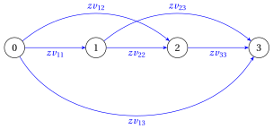

# 15.2 Modelli PLI per il problema di lot sizing capacitato { #sez-sec-lsf-CLS }

**Parte 2 · Formulazioni dei problemi e loro proprietà · Capitolo 15** · [:material-book-open-variant: Capitolo 15: Problemi di lot sizing](index.md) · [:material-file-pdf-box: Dispensa, volume 2 (PDF)](../../pdf/dispensa-2-formulazioni.pdf) · [:material-pencil: Esercizi: Problemi di lot sizing](../../esercizi/lot-sizing-formulations.md)

Il problema di lot sizing capacitato e la sua istanza di riferimento (Esempio 8.1) sono definiti nel [Capitolo 8 «Problemi di lot sizing», Sezione 8.2](../../problemi-di-ottimizzazione-combinatoria/lot-sizing/il-problema-del-lot-sizing-capacitato.md).

- Il CLS ha due formulazioni: la formulazione big-$M$ $\mathrm{ILP}_{\mathrm{CLSP}}$ della Sezione [15.3](#sez-sec-lsf-bigM) e la formulazione a cammino minimo $\mathrm{MIP}^{\mathrm{SP}}_{\mathrm{CLSP}}$ della Sezione [15.5](#sez-sec-lsf-SP).

- La Sezione [15.6](#sez-sec-lsf-compare) confronta i bound dei loro rilassamenti lineari sull'istanza di riferimento.

## 15.3 Una formulazione con un legame big-M { #sez-sec-lsf-bigM }

- Dato un insieme $T=\{1,2,\dots,m\}$ di periodi con domande $d_t$, per $j \le t$ scriviamo $D_{j,t}=\sum_{k=j}^{t} d_k$ per la domanda totale dei periodi $j,j+1,\dots,t$.

- Introduciamo le seguenti <strong>variabili intere</strong> e <strong>variabili binarie</strong>, per ogni periodo $t \in T$:

    $$
    x_t \in \Z_{\ge 0}~\text{(produzione)},\qquad s_t \in \Z_{\ge 0}~\text{(scorta alla fine del periodo)},
    $$

    $$
    y_t=\begin{cases}
    1 & \text{se c'è un setup nel periodo $t$}\\[1.5ex]
    0 & \text{altrimenti}
    \end{cases}
    $$

    La scorta all'inizio dell'orizzonte è la costante $s_0$.

- Le variabili di setup sono collegate alle quantità dall'implicazione logica

    $$
    x_t>0 ~~~\Longrightarrow~~~ y_t=1,
    $$

    modellata dal <strong>vincolo big-M</strong> $x_t \le M_t\, y_t$, dove $M_t$ è un upper bound sulla produzione del periodo $t$.

- Se si ignorano i setup, il piano migliore produce in ogni periodo esattamente la sua domanda: non ha scorte e, nell'istanza di riferimento, ha costo $0$. È un lower bound molto debole: i costi di setup vanno modellati.

!!! chiave ""

    Usando queste variabili, un modello di programmazione lineare intera (PLI) per il problema di lot sizing capacitato (CLS) è il seguente:

    

    \begin{align*}
    &&\min ~~ \sum_{t \in T} \left(sc_{t}\,y_{t} + vc_{t}\,x_{t} + hc_{t}\,s_{t} \right) \label{obj:CLS-1} \tag{15.1a}\\[1ex]
    && \text{soggetto a}\quad s_{t-1} + x_{t} & = d_{t} + s_{t}, & \forall t\in T, \label{CL1:bal} \tag{15.1b}\\[1ex]
    && x_{t} & \le M_{t}\, y_{t}, & \forall t\in T, \label{CL1:M} \tag{15.1c}\\[1ex]
    && x_{t} & \le cap_{t}, & \forall t\in T, \label{CL1:cap} \tag{15.1d}\\[1ex]
    && s_0 = s_m &= 0, \label{CL1:end} \tag{15.1e}\\[1ex]
    && x_{t} &\in \Z_{\ge 0}, & \forall t\in T, \label{CL1:int} \tag{15.1f}\\[1ex]
    && s_{t} &\in \Z_{\ge 0}, & \forall t\in T, \label{CL1:ints} \tag{15.1g}\\[1ex]
    && y_{t} & \in \{0, 1\}, & \forall t\in T. \label{CL1:bin} \tag{15.1h}
    \end{align*}

    Questo modello PLI si chiama modello $\mathrm{ILP}_{\mathrm{CLSP}}$, o <strong>formulazione big-M</strong>.

- Descrizione della funzione obiettivo e dei vincoli del modello $\mathrm{ILP}_{\mathrm{CLSP}}$:

    - la funzione obiettivo lineare $\eqref{obj:CLS-1}$ minimizza il costo dei setup, della produzione e del mantenimento a scorta;

    - i vincoli $\eqref{CL1:bal}$ sono i <strong>vincoli di bilanciamento del flusso</strong>: la domanda del periodo $t$ è soddisfatta dalla produzione del periodo e dalla scorta del periodo precedente, e l'eccedenza diventa la scorta alla fine del periodo $t$ ($m$ vincoli lineari);

    - i vincoli $\eqref{CL1:M}$ collegano le quantità con i setup, e i vincoli $\eqref{CL1:cap}$ sono i vincoli di capacità ($m$ vincoli lineari ciascuno);

    - il vincolo $\eqref{CL1:end}$ impone una scorta vuota all'inizio e alla fine dell'orizzonte;

    - infine, i vincoli $\eqref{CL1:int}$, $\eqref{CL1:ints}$ e $\eqref{CL1:bin}$ definiscono le variabili del modello PLI.

### 15.3.1 Valori deboli e forti di big-M

- <strong>Un valore debole.</strong> Poiché $s_m=0$ e le scorte sono non negative, la produzione del periodo $t$ non può superare la domanda dei periodi $t,\dots,m$: $M^{\mathrm{dem}}_{t}=D_{t,m}$ è un valore valido.

- <strong>Un secondo valore.</strong> Per i vincoli di capacità $\eqref{CL1:cap}$, anche $M^{\mathrm{cap}}_{t}=cap_t$ è valido.

- <strong>Un valore forte.</strong> Il valore migliore è il più piccolo dei due:

    $$
    M_t=\min\left\{cap_t,~D_{t,m}\right\}.
    $$

!!! chiave ""

    <strong>Più piccolo è il valore di big-M, più forte è il rilassamento lineare</strong>: il vincolo $x_t \le M_t y_t$ taglia i valori frazionari di $y_t$ inferiori a $x_t/M_t$. Un valore troppo piccolo, però, taglia piani ammissibili.

!!! esempio "Esempio 15.1: L'istanza di riferimento"

    Consideriamo $m=5$ periodi, con i seguenti dati:

    
<table>
    <tr>
    <th>periodo \(t\)</th>
    <th>\(1\)</th>
    <th>\(2\)</th>
    <th>\(3\)</th>
    <th>\(4\)</th>
    <th>\(5\)</th>
    </tr>
    <tr>
    <td>domanda \(d_t\)</td>
    <td>\(2\)</td>
    <td>\(1\)</td>
    <td>\(3\)</td>
    <td>\(4\)</td>
    <td>\(1\)</td>
    </tr>
    <tr>
    <td>capacità \(cap_t\)</td>
    <td>\(4\)</td>
    <td>\(4\)</td>
    <td>\(4\)</td>
    <td>\(4\)</td>
    <td>\(4\)</td>
    </tr>
    <tr>
    <td>costo di setup \(sc_t\)</td>
    <td>\(50\)</td>
    <td>\(50\)</td>
    <td>\(50\)</td>
    <td>\(50\)</td>
    <td>\(50\)</td>
    </tr>
    <tr>
    <td>costo di produzione \(vc_t\)</td>
    <td>\(0\)</td>
    <td>\(0\)</td>
    <td>\(0\)</td>
    <td>\(0\)</td>
    <td>\(0\)</td>
    </tr>
    <tr>
    <td>costo di mantenimento \(hc_t\)</td>
    <td>\(10\)</td>
    <td>\(10\)</td>
    <td>\(10\)</td>
    <td>\(10\)</td>
    <td>\(10\)</td>
    </tr>
    </table>

    È l'istanza dell'Esempio 8.1 del [Capitolo 8 «Problemi di lot sizing»](../../problemi-di-ottimizzazione-combinatoria/lot-sizing/index.md). I valori di big-M sono:

    
<table>
    <tr>
    <th>periodo \(t\)</th>
    <th>\(1\)</th>
    <th>\(2\)</th>
    <th>\(3\)</th>
    <th>\(4\)</th>
    <th>\(5\)</th>
    </tr>
    <tr>
    <td>\(M^{\mathrm{dem}}_t = D_{t,5}\)</td>
    <td>\(11\)</td>
    <td>\(9\)</td>
    <td>\(8\)</td>
    <td>\(5\)</td>
    <td>\(1\)</td>
    </tr>
    <tr>
    <td>\(M^{\mathrm{cap}}_t = cap_t\)</td>
    <td>\(4\)</td>
    <td>\(4\)</td>
    <td>\(4\)</td>
    <td>\(4\)</td>
    <td>\(4\)</td>
    </tr>
    <tr>
    <td>\(M_t\)</td>
    <td>\(4\)</td>
    <td>\(4\)</td>
    <td>\(4\)</td>
    <td>\(4\)</td>
    <td>\(1\)</td>
    </tr>
    </table>

    Chiamiamo questa istanza del CLS [Esempio 15.1](#box-1-ex-CLS-ref).

!!! esempio "Esempio 15.2: Modello $\mathrm{ILP}_{\mathrm{CLSP}}$"

    Il modello $\mathrm{ILP}_{\mathrm{CLSP}}$ con i valori forti di big-M per l'istanza del CLS dell'[Esempio 15.1](#box-1-ex-CLS-ref) è ($s_0=0$ è una costante e non compare):

    $$
    \begin{array}{rlcl}
    {\min} & {50\,y_1+50\,y_2+50\,y_3+50\,y_4+50\,y_5+10\,s_1+10\,s_2} &  &  \\
    & {+10\,s_3+10\,s_4+10\,s_5} &  &  \\[1ex]
    \text{soggetto a} & {x_1-s_1} & {=} & {2} \\
    & {s_1+x_2-s_2} & {=} & {1} \\
    & {s_2+x_3-s_3} & {=} & {3} \\
    & {s_3+x_4-s_4} & {=} & {4} \\
    & {s_4+x_5-s_5} & {=} & {1} \\
    & {x_1-4\,y_1} & {\le} & {0} \\
    & {x_2-4\,y_2} & {\le} & {0} \\
    & {x_3-4\,y_3} & {\le} & {0} \\
    & {x_4-4\,y_4} & {\le} & {0} \\
    & {x_5-y_5} & {\le} & {0} \\
    & {x_1} & {\le} & {4} \\
    & {x_2} & {\le} & {4} \\
    & {x_3} & {\le} & {4} \\
    & {x_4} & {\le} & {4} \\
    & {x_5} & {\le} & {4} \\
    & {s_5} & {=} & {0} \\[1ex]
    & {x_1,~x_2,~x_3,~x_4,~x_5} & {\in} & {\Z_{\ge 0}} \\
    & {s_1,~s_2,~s_3,~s_4,~s_5} & {\in} & {\Z_{\ge 0}} \\
    & {y_1,~y_2,~y_3,~y_4,~y_5} & {\in} & {\{0,1\}}
    \end{array}
    $$

    Una soluzione ottima $(\tilde{\vet y},\tilde{\vet x},\tilde{\vet s})(\mathrm{ILP}_{\mathrm{CLSP}})$ è:

    $$
    \tilde{\vet y}=(1,0,1,1,0),\qquad \tilde{\vet x}=(3,0,4,4,0),\qquad \tilde{\vet s}=(1,0,1,1,0)
    $$

    Il valore ottimo $z(\mathrm{ILP}_{\mathrm{CLSP}})$ è $3\cdot 50+3\cdot 10=180$, il costo del piano ottimo trovato per enumerazione nel [Capitolo 8 «Problemi di lot sizing»](../../problemi-di-ottimizzazione-combinatoria/lot-sizing/index.md). I valori deboli di big-M danno la stessa soluzione ottima.

## 15.4 Il rilassamento lineare della formulazione big-M

!!! chiave ""

    Per ottenere un rilassamento lineare (LP) del modello $\mathrm{ILP}_{\mathrm{CLSP}}$, rilassiamo i vincoli $\eqref{CL1:int}$–$\eqref{CL1:bin}$ in vincoli di non negatività e nei bound $y_t\le 1$. Il modello LP ottenuto è il seguente:

    

    \begin{align*}
    &&\min ~~ \sum_{t \in T} \left(sc_{t}\,y_{t} + vc_{t}\,x_{t} + hc_{t}\,s_{t} \right) \label{obj:CLS-LP} \tag{15.2a}\\[1ex]
    && \text{soggetto a}\quad s_{t-1} + x_{t} & = d_{t} + s_{t}, & \forall t\in T, \label{LP1:bal} \tag{15.2b}\\[1ex]
    && x_{t} & \le M_{t}\, y_{t}, & \forall t\in T, \label{LP1:M} \tag{15.2c}\\[1ex]
    && x_{t} & \le cap_{t}, & \forall t\in T, \label{LP1:cap} \tag{15.2d}\\[1ex]
    && s_0 = s_m &= 0, \label{LP1:end} \tag{15.2e}\\[1ex]
    && y_{t} & \le 1, & \forall t\in T, \label{LP1:ub} \tag{15.2f}\\[1ex]
    && x_{t} &\ge 0, & \forall t\in T, \label{LP1:x} \tag{15.2g}\\[1ex]
    && s_{t} &\ge 0, & \forall t\in T, \label{LP1:s} \tag{15.2h}\\[1ex]
    && y_{t} &\ge 0, & \forall t\in T. \label{LP1:y} \tag{15.2i}
    \end{align*}

    Questo modello LP si chiama modello $\mathrm{LP}_{\mathrm{CLSP}}^{\mathrm{dem}}$, $\mathrm{LP}_{\mathrm{CLSP}}^{\mathrm{cap}}$ o $\mathrm{LP}_{\mathrm{CLSP}}^{\mathrm{strong}}$, quando i valori di big-M sono $M^{\mathrm{dem}}_t$, $M^{\mathrm{cap}}_t$ o i valori forti $M_t$.

!!! esempio "Esempio 15.3: Valori di big-M e bound LP"

    Il modello LP [(15.2)](#eq-CLS-LP) per l'istanza del CLS dell'[Esempio 15.1](#box-1-ex-CLS-ref) è:

    $$
    \begin{array}{rlcl}
    {\min} & {50\,y_1+50\,y_2+50\,y_3+50\,y_4+50\,y_5+10\,s_1+10\,s_2} &  &  \\
    & {+10\,s_3+10\,s_4+10\,s_5} &  &  \\[1ex]
    \text{soggetto a} & {x_1-s_1} & {=} & {2} \\
    & {s_1+x_2-s_2} & {=} & {1} \\
    & {s_2+x_3-s_3} & {=} & {3} \\
    & {s_3+x_4-s_4} & {=} & {4} \\
    & {s_4+x_5-s_5} & {=} & {1} \\
    & {x_1-M_1\,y_1} & {\le} & {0} \\
    & {x_2-M_2\,y_2} & {\le} & {0} \\
    & {x_3-M_3\,y_3} & {\le} & {0} \\
    & {x_4-M_4\,y_4} & {\le} & {0} \\
    & {x_5-M_5\,y_5} & {\le} & {0} \\
    & {x_1} & {\le} & {4} \\
    & {x_2} & {\le} & {4} \\
    & {x_3} & {\le} & {4} \\
    & {x_4} & {\le} & {4} \\
    & {x_5} & {\le} & {4} \\
    & {s_5} & {=} & {0} \\
    & {y_1} & {\le} & {1} \\
    & {y_2} & {\le} & {1} \\
    & {y_3} & {\le} & {1} \\
    & {y_4} & {\le} & {1} \\
    & {y_5} & {\le} & {1} \\[1ex]
    & {x_1,~x_2,~x_3,~x_4,~x_5} & {\ge} & {0} \\
    & {s_1,~s_2,~s_3,~s_4,~s_5} & {\ge} & {0} \\
    & {y_1,~y_2,~y_3,~y_4,~y_5} & {\ge} & {0}
    \end{array}
    $$

    con i valori $M_1,\dots,M_5$ della tabella dell'[Esempio 15.1](#box-1-ex-CLS-ref). Le tre scelte danno le seguenti soluzioni ottime $(\tilde{\vet y},\tilde{\vet x},\tilde{\vet s})$, con $\tilde s_5=0$:

    
<table>
    <tr>
    <th>Modello</th>
    <th>\(\tilde{\vet y}\)</th>
    <th>\(\tilde{\vet x}\)</th>
    <th>\((\tilde s_1,\dots,\tilde s_4)\)</th>
    <th>valore ottimo</th>
    </tr>
    <tr>
    <td>\(\mathrm{LP}_{\mathrm{CLSP}}^{\mathrm{dem}}\)</td>
    <td>\((\frac{2}{11},\frac{1}{9},\frac{1}{2},\frac{4}{5},0)\)</td>
    <td>\((2,1,4,4,0)\)</td>
    <td>\((0,0,1,1)\)</td>
    <td>\(\frac{9865}{99}\approx 99.65\)</td>
    </tr>
    <tr>
    <td>\(\mathrm{LP}_{\mathrm{CLSP}}^{\mathrm{cap}}\)</td>
    <td>\((\frac{1}{2},\frac{1}{4},\frac{3}{4},1,\frac{1}{4})\)</td>
    <td>\((2,1,3,4,1)\)</td>
    <td>\((0,0,0,0)\)</td>
    <td>\(\frac{275}{2}=137.5\)</td>
    </tr>
    <tr>
    <td>\(\mathrm{LP}_{\mathrm{CLSP}}^{\mathrm{strong}}\)</td>
    <td>\((\frac{1}{2},\frac{1}{4},1,1,0)\)</td>
    <td>\((2,1,4,4,0)\)</td>
    <td>\((0,0,1,1)\)</td>
    <td>\(\frac{315}{2}=157.5\)</td>
    </tr>
    </table>

    In ogni soluzione $\tilde y_t=\tilde x_t/M_t$: più piccolo è $M_t$, maggiore è il costo dei setup pagato dal rilassamento. La soluzione ottima intera dell'[Esempio 15.2](#box-2-ex-CLS-ILP) ha valore $z(\mathrm{ILP}_{\mathrm{CLSP}})=180$.

## 15.5 Una formulazione a cammino minimo { #sez-sec-lsf-SP }

- La seconda formulazione non decide direttamente le quantità. Per ogni $t,k \in T$, con $k \ge t$, introduciamo la seguente <strong>variabile continua</strong>: $zv_{tk} \ge 0$, la frazione della domanda $D_{t,k}$ dei periodi $t,\dots,k$ prodotta nel periodo $t$.

- Produrre nel periodo $t$ la domanda dei periodi $t,\dots,k$ costa la produzione di $D_{t,k}$ unità e il mantenimento a scorta delle unità che attendono il loro periodo:

    $$
    cv_{tk}=vc_{t}\;D_{t,k}+\sum_{s=t+1}^{k}\sum_{u=t}^{s-1}hc_{u}\,d_{s}.
    $$

!!! chiave ""

    Usando queste variabili e le variabili binarie $y_t$, un modello di programmazione lineare intera mista (MIP) per il CLS è il seguente:

    

    \begin{align*}
    &&\min ~~ \sum_{t \in T} sc_{t}\,y_{t} + \sum_{t \in T}\sum_{k=t}^{m} cv_{tk}\,zv_{tk} \label{obj:CLS-2} \tag{15.3a}\\[1ex]
    && \text{soggetto a}\quad \sum_{k=1}^{m} zv_{1k} &= 1, \label{SP1} \tag{15.3b}\\[1ex]
    && \sum_{u=1}^{t-1}zv_{u,t-1} - \sum_{k=t}^{m}zv_{tk} &= 0, & \forall t\in T\setminus\{1\}, \label{SP2} \tag{15.3c}\\[1ex]
    && \sum_{k=t}^{m}zv_{tk} &\leq y_{t}, & \forall t\in T, \label{SP3} \tag{15.3d}\\[1ex]
    && \sum_{k=t}^{m} D_{t,k}\,zv_{tk} &\leq cap_t, & \forall t\in T, \label{SP4} \tag{15.3e}\\[1ex]
    && zv_{tk} & \geq 0, & \forall t,k\in T,~ k\geq t, \label{SP5} \tag{15.3f}\\[1ex]
    && y_{t} & \in \{0, 1\}, & \forall t \in T. \label{SP6} \tag{15.3g}
    \end{align*}

    Questo modello MIP si chiama modello $\mathrm{MIP}^{\mathrm{SP}}_{\mathrm{CLSP}}$, o <strong>formulazione a cammino minimo</strong>.

- Descrizione della funzione obiettivo e dei vincoli del modello $\mathrm{MIP}^{\mathrm{SP}}_{\mathrm{CLSP}}$:

    - la funzione obiettivo lineare $\eqref{obj:CLS-2}$ minimizza il costo dei setup e degli archi del piano;

    - i vincoli $\eqref{SP1}$ e $\eqref{SP2}$ sono i vincoli di flusso di una rete ($m$ vincoli lineari);

    - i vincoli $\eqref{SP3}$ impongono il setup se il prodotto è prodotto nel periodo $t$, e i vincoli $\eqref{SP4}$ impongono le capacità ($m$ vincoli lineari ciascuno);

    - infine, i vincoli $\eqref{SP5}$ e $\eqref{SP6}$ definiscono le variabili del modello MIP.

- La rete è disegnata nella Figura $\ref{fig:CLS-SP}$: i nodi sono $0,1,\dots,m$, e la variabile $zv_{tk}$ è l'arco dal nodo $t-1$ al nodo $k$, con costo $cv_{tk}$. Un'unità di flusso esce dal nodo $0$ (vincolo $\eqref{SP1}$), e il flusso si conserva negli altri nodi (vincoli $\eqref{SP2}$).

- Un cammino dal nodo $0$ al nodo $m$ è un piano che produce solo quando la scorta è vuota: ogni arco $(t-1,k)$ è una produzione nel periodo $t$ per i periodi $t,\dots,k$. Per questo la formulazione si chiama formulazione a cammino minimo: rilassate le capacità, il piano ottimo è un cammino minimo.

- I vincoli $\eqref{SP3}$ collegano gli archi con i setup con il coefficiente $1$ invece di un valore di big-M. Nei vincoli $\eqref{SP4}$ la quantità prodotta nel periodo $t$ è $x_t=\sum_{k} D_{t,k}\,zv_{tk}$.

- I cammini sono i mattoni elementari, e un piano che non è un cammino è una <strong>combinazione di cammini</strong>: le quantità sono intere, ma le variabili $zv_{tk}$ possono essere frazionarie.

{ .fig loading=lazy  }

Rete delle variabili \(zv_{tk}\) per \(m=3\): la variabile \(zv_{tk}\) è l'arco dal nodo \(t-1\) al nodo \(k\).

!!! esempio "Esempio 15.4: Modello $\mathrm{MIP}^{\mathrm{SP}}_{\mathrm{CLSP}}$ e combinazioni di cammini"

    Per l'istanza del CLS dell'[Esempio 15.1](#box-1-ex-CLS-ref) le domande $D_{t,k}$ e i costi $cv_{tk}$ sono (il costo di produzione è nullo, quindi $cv_{tk}$ è solo costo di mantenimento a scorta):

    $$
    \begin{array}{l|ccccc|ccccc}
    \hline  & {D_{t,k}} & & & & & {cv_{tk}} & & & & \\
    {t \backslash k} & {1} & {2} & {3} & {4} & {5} & {1} & {2} & {3} & {4} & {5} \\
    \hline {1} & {2} & {3} & {6} & {10} & {11} & {0} & {10} & {70} & {190} & {230} \\
    {2} &  & {1} & {4} & {8} & {9} &  & {0} & {30} & {110} & {140} \\
    {3} &  &  & {3} & {7} & {8} &  &  & {0} & {40} & {60} \\
    {4} &  &  &  & {4} & {5} &  &  &  & {0} & {10} \\
    {5} &  &  &  &  & {1} &  &  &  &  & {0} \\
    \hline
    \end{array}
    $$

    Il modello $\mathrm{MIP}^{\mathrm{SP}}_{\mathrm{CLSP}}$ per questa istanza è:

    $$
    \begin{array}{rlcl}
    {\min} & {50\,y_1+50\,y_2+50\,y_3+50\,y_4+50\,y_5+10\,zv_{12}+70\,zv_{13}} &  &  \\
    & {+190\,zv_{14}+230\,zv_{15}+30\,zv_{23}+110\,zv_{24}+140\,zv_{25}+40\,zv_{34}} &  &  \\
    & {+60\,zv_{35}+10\,zv_{45}} &  &  \\[1ex]
    \text{soggetto a} & {zv_{11}+zv_{12}+zv_{13}+zv_{14}+zv_{15}} & {=} & {1} \\
    & {zv_{11}-zv_{22}-zv_{23}-zv_{24}-zv_{25}} & {=} & {0} \\
    & {zv_{12}+zv_{22}-zv_{33}-zv_{34}-zv_{35}} & {=} & {0} \\
    & {zv_{13}+zv_{23}+zv_{33}-zv_{44}-zv_{45}} & {=} & {0} \\
    & {zv_{14}+zv_{24}+zv_{34}+zv_{44}-zv_{55}} & {=} & {0} \\
    & {zv_{11}+zv_{12}+zv_{13}+zv_{14}+zv_{15}-y_1} & {\le} & {0} \\
    & {zv_{22}+zv_{23}+zv_{24}+zv_{25}-y_2} & {\le} & {0} \\
    & {zv_{33}+zv_{34}+zv_{35}-y_3} & {\le} & {0} \\
    & {zv_{44}+zv_{45}-y_4} & {\le} & {0} \\
    & {zv_{55}-y_5} & {\le} & {0} \\
    & {2\,zv_{11}+3\,zv_{12}+6\,zv_{13}+10\,zv_{14}+11\,zv_{15}} & {\le} & {4} \\
    & {zv_{22}+4\,zv_{23}+8\,zv_{24}+9\,zv_{25}} & {\le} & {4} \\
    & {3\,zv_{33}+7\,zv_{34}+8\,zv_{35}} & {\le} & {4} \\
    & {4\,zv_{44}+5\,zv_{45}} & {\le} & {4} \\
    & {zv_{55}} & {\le} & {4} \\[1ex]
    & {zv_{11},~zv_{12},~zv_{13},~\dots,~zv_{55}} & {\ge} & {0} \\
    & {y_1,~y_2,~y_3,~y_4,~y_5} & {\in} & {\{0,1\}}
    \end{array}
    $$

    Una soluzione ottima $(\tilde{\vet{zv}},\tilde{\vet y})(\mathrm{MIP}^{\mathrm{SP}}_{\mathrm{CLSP}})$ è:

    $$
    \tilde{zv}_{12}=1,\qquad \tilde{zv}_{33}=\tfrac{4}{5},\quad \tilde{zv}_{35}=\tfrac{1}{5},\qquad \tilde{zv}_{45}=\tfrac{4}{5},
    \qquad \tilde{\vet y}=(1,0,1,1,0),
    $$

    e tutte le altre variabili $zv_{tk}$ sono nulle. È il piano ottimo $\tilde{\vet x}=(3,0,4,4,0)$, che non è un cammino: nel periodo $3$ produce $4$ unità, più della domanda $3$ del periodo $3$ e meno della domanda $7$ dei periodi $3$ e $4$. È la combinazione, con pesi $\tfrac{4}{5}$ e $\tfrac{1}{5}$, dei cammini $0\to2\to3\to5$ (piano $(3,0,3,5,0)$) e $0\to2\to5$ (piano $(3,0,8,0,0)$). Le quantità sono $x_1=D_{1,2}\,zv_{12}=3$, $x_3=3\cdot\tfrac{4}{5}+8\cdot\tfrac{1}{5}=4$ e $x_4=5\cdot\tfrac{4}{5}=4$. Il valore ottimo $z(\mathrm{MIP}^{\mathrm{SP}}_{\mathrm{CLSP}})$ è

    $$
    \underbrace{3 \cdot 50}_{\text{setup}} + \underbrace{10 \cdot 1 + 0 \cdot \tfrac{4}{5} + 60 \cdot \tfrac{1}{5} + 10 \cdot \tfrac{4}{5}}_{=\,30} = 180.
    $$

!!! chiave ""

    Per ottenere un rilassamento lineare del modello $\mathrm{MIP}^{\mathrm{SP}}_{\mathrm{CLSP}}$, rilassiamo i vincoli $\eqref{SP6}$ nei bound $0\le y_t\le 1$. Il modello LP ottenuto è il seguente:

    

    \begin{align*}
    &&\min ~~ \sum_{t \in T} sc_{t}\,y_{t} + \sum_{t \in T}\sum_{k=t}^{m} cv_{tk}\,zv_{tk} \label{obj:CLS-LPSP} \tag{15.4a}\\[1ex]
    && \text{soggetto a}\quad \sum_{k=1}^{m} zv_{1k} &= 1, \label{LPSP1} \tag{15.4b}\\[1ex]
    && \sum_{u=1}^{t-1}zv_{u,t-1} - \sum_{k=t}^{m}zv_{tk} &= 0, & \forall t\in T\setminus\{1\}, \label{LPSP2} \tag{15.4c}\\[1ex]
    && \sum_{k=t}^{m}zv_{tk} &\leq y_{t}, & \forall t\in T, \label{LPSP3} \tag{15.4d}\\[1ex]
    && \sum_{k=t}^{m} D_{t,k}\,zv_{tk} &\leq cap_t, & \forall t\in T, \label{LPSP4} \tag{15.4e}\\[1ex]
    && y_{t} & \le 1, & \forall t \in T, \label{LPSP5} \tag{15.4f}\\[1ex]
    && zv_{tk} & \geq 0, & \forall t,k\in T,~ k\geq t, \label{LPSP6} \tag{15.4g}\\[1ex]
    && y_{t} & \ge 0, & \forall t \in T. \label{LPSP7} \tag{15.4h}
    \end{align*}

    Questo modello LP si chiama modello $\mathrm{LP}^{\mathrm{SP}}_{\mathrm{CLSP}}$.

!!! esempio "Esempio 15.5: Modello $\mathrm{LP}^{\mathrm{SP}}_{\mathrm{CLSP}}$"

    Il modello $\mathrm{LP}^{\mathrm{SP}}_{\mathrm{CLSP}}$ per l'istanza del CLS dell'[Esempio 15.1](#box-1-ex-CLS-ref) è:

    $$
    \begin{array}{rlcl}
    {\min} & {50\,y_1+50\,y_2+50\,y_3+50\,y_4+50\,y_5+10\,zv_{12}+70\,zv_{13}} &  &  \\
    & {+190\,zv_{14}+230\,zv_{15}+30\,zv_{23}+110\,zv_{24}+140\,zv_{25}+40\,zv_{34}} &  &  \\
    & {+60\,zv_{35}+10\,zv_{45}} &  &  \\[1ex]
    \text{soggetto a} & {zv_{11}+zv_{12}+zv_{13}+zv_{14}+zv_{15}} & {=} & {1} \\
    & {zv_{11}-zv_{22}-zv_{23}-zv_{24}-zv_{25}} & {=} & {0} \\
    & {zv_{12}+zv_{22}-zv_{33}-zv_{34}-zv_{35}} & {=} & {0} \\
    & {zv_{13}+zv_{23}+zv_{33}-zv_{44}-zv_{45}} & {=} & {0} \\
    & {zv_{14}+zv_{24}+zv_{34}+zv_{44}-zv_{55}} & {=} & {0} \\
    & {zv_{11}+zv_{12}+zv_{13}+zv_{14}+zv_{15}-y_1} & {\le} & {0} \\
    & {zv_{22}+zv_{23}+zv_{24}+zv_{25}-y_2} & {\le} & {0} \\
    & {zv_{33}+zv_{34}+zv_{35}-y_3} & {\le} & {0} \\
    & {zv_{44}+zv_{45}-y_4} & {\le} & {0} \\
    & {zv_{55}-y_5} & {\le} & {0} \\
    & {2\,zv_{11}+3\,zv_{12}+6\,zv_{13}+10\,zv_{14}+11\,zv_{15}} & {\le} & {4} \\
    & {zv_{22}+4\,zv_{23}+8\,zv_{24}+9\,zv_{25}} & {\le} & {4} \\
    & {3\,zv_{33}+7\,zv_{34}+8\,zv_{35}} & {\le} & {4} \\
    & {4\,zv_{44}+5\,zv_{45}} & {\le} & {4} \\
    & {zv_{55}} & {\le} & {4} \\
    & {y_1} & {\le} & {1} \\
    & {y_2} & {\le} & {1} \\
    & {y_3} & {\le} & {1} \\
    & {y_4} & {\le} & {1} \\
    & {y_5} & {\le} & {1} \\[1ex]
    & {zv_{11},~zv_{12},~zv_{13},~\dots,~zv_{55}} & {\ge} & {0} \\
    & {y_1,~y_2,~y_3,~y_4,~y_5} & {\ge} & {0}
    \end{array}
    $$

    Una soluzione ottima $(\tilde{\vet{zv}},\tilde{\vet y})(\mathrm{LP}^{\mathrm{SP}}_{\mathrm{CLSP}})$ è:

    $$
    \tilde{zv}_{12}=1,\qquad \tilde{zv}_{33}=\tfrac{4}{5},\quad \tilde{zv}_{35}=\tfrac{1}{5},\qquad \tilde{zv}_{45}=\tfrac{4}{5},
    \qquad \tilde{\vet y}=(1,0,1,\tfrac{4}{5},0),
    $$

    e tutte le altre variabili $zv_{tk}$ sono nulle: sono gli archi del piano ottimo, con il setup del periodo $4$ pagato solo per la frazione $\tfrac{4}{5}$. Il valore ottimo $z(\mathrm{LP}^{\mathrm{SP}}_{\mathrm{CLSP}})$ è $180-\tfrac{1}{5}\cdot 50=170$.

## 15.6 Confronto fra le formulazioni { #sez-sec-lsf-compare }

- Le formulazioni hanno lo stesso valore ottimo $z(\mathrm{ILP}_{\mathrm{CLSP}})=z(\mathrm{MIP}^{\mathrm{SP}}_{\mathrm{CLSP}})=180$, ma i loro rilassamenti lineari hanno valori ottimi diversi. Sull'istanza di riferimento i lower bound, calcolati con l'algoritmo del simplesso in aritmetica esatta e verificati con Gurobi, sono i seguenti.

- L'ultima colonna è il gap del [Capitolo 1 «Problemi di ottimizzazione combinatoria»](../../problemi-di-ottimizzazione-combinatoria/combinatorial-optimization/index.md) fra il bound e il valore ottimo; non è definito per il bound $0$.

<table>
<tr>
<th>Modello</th>
<th>Lower bound</th>
<th>Gap \(\frac{180-\LB}{\LB}\)</th>
</tr>
<tr>
<td>Senza setup</td>
<td>\(0\)</td>
<td>non definito</td>
</tr>
<tr>
<td>\(\mathrm{LP}_{\mathrm{CLSP}}^{\mathrm{dem}}\) (\(M_t=D_{t,m}\))</td>
<td>\(99.65\)</td>
<td>\(80.6\%\)</td>
</tr>
<tr>
<td>\(\mathrm{LP}_{\mathrm{CLSP}}^{\mathrm{cap}}\) (\(M_t=cap_t\))</td>
<td>\(137.50\)</td>
<td>\(30.9\%\)</td>
</tr>
<tr>
<td>\(\mathrm{LP}_{\mathrm{CLSP}}^{\mathrm{strong}}\) (\(M_t=\min\{cap_t,D_{t,m}\}\))</td>
<td>\(157.50\)</td>
<td>\(14.3\%\)</td>
</tr>
<tr>
<td>\(\mathrm{LP}_{\mathrm{CLSP}}^{\mathrm{SP}}\) (cammino minimo)</td>
<td>\(170\)</td>
<td>\(5.9\%\)</td>
</tr>
</table>

- Il bound $170$ della formulazione a cammino minimo è il valore ottimo del problema senza capacità (piano $(3,0,8,0,0)$, di costo $170$): i vincoli di capacità $\eqref{LPSP4}$ agiscono solo sulle quantità, e una combinazione di cammini può soddisfarli.

- Il prezzo della formulazione a cammino minimo è la sua dimensione: ci sono $O(m^2)$ variabili $zv_{tk}$, contro le $O(m)$ variabili della formulazione big-M.

---

**Avanti:** [15.7 Modelli PLI per le varianti](modelli-pli-per-le-varianti.md)
