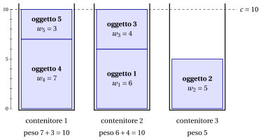

# 3.2 Il problema del bin packing { #sez-sec-bp-BPP }

**Parte 1 · Problemi di ottimizzazione combinatoria · Capitolo 3** · [:material-book-open-variant: Capitolo 3: Problemi di packing](index.md) · [:material-file-pdf-box: Dispensa, volume 1 (PDF)](../../pdf/dispensa-1-problemi-di-ottimizzazione-combinatoria.pdf) · [:material-pencil: Esercizi: Problemi di packing](../../esercizi/bin-packing.md)

!!! definizione "Definizione 3.1: problema del bin packing"

    Dati:

    1. un numero infinito di contenitori, ciascuno di <em>capacità</em> $c \in \Z_{\ge 1}$,

    2. un insieme $\mathscr{I} = \{1,2,\dots,n\}$ di $n$ oggetti,

    3. per ogni oggetto $j \in \mathscr{I}$, un <em>peso</em> $w_j \in \Z_{\ge 1}$,

    il <strong>problema del bin packing</strong> (BPP) chiede di decidere in quale contenitore sistemare ogni oggetto, in modo che il peso totale degli oggetti in ogni contenitore non superi la capacità del contenitore e il numero totale di contenitori usati sia minimo.

- Un'<strong>istanza del BPP</strong> è specificata da:

    1. due numeri interi:

        - la capacità dei contenitori $c \in \Z_{\ge 1}$,

        - il numero di oggetti $n \in \Z_{\ge 1}$,

    2. un vettore di numeri interi di lunghezza $n$:

        - $\vet{w} \in \Z_{\ge 1}^n$, che contiene i pesi degli oggetti.

- Una <strong>soluzione ammissibile del BPP</strong> è una famiglia di <strong>schemi di carico</strong>, ossia sottoinsiemi di oggetti ciascuno assegnato a un contenitore,

    $$
    \mathcal{P} \subseteq 2^{\mathscr{I}}
    $$

    tale che:

    - **(i)** $\mathcal{P}$ forma una partizione di $\mathscr{I}$ in schemi di carico <em>non vuoti</em>, ossia

        $$
        \begin{gathered}
        P\neq \emptyset, \quad \text{per ogni } \, P\in\mathcal{P},\\
        P\cap P'=\emptyset, \quad \text{per ogni } \, P,P'\in\mathcal{P}\ \text{con } P\neq P',\\
        \bigcup_{P\in\mathcal{P}} P=\mathscr{I};
        \end{gathered}
        $$

    - **(ii)** il peso totale di ogni schema di carico in $\mathcal{P}$ rispetta la capacità del contenitore, ossia

        $$
        \sum_{j\in P} w_j \le c, \quad \text{per ogni }\, P\in\mathcal{P}.
        $$

    Di conseguenza, il BPP si può enunciare in modo equivalente come il problema di determinare una partizione dell'insieme degli oggetti in schemi di carico tale che il peso totale degli oggetti in ogni schema di carico non superi la capacità del contenitore e il numero di schemi di carico (contenitori) sia minimo.

    !!! chiave ""

        Data un'istanza del BPP, il BPP si può enunciare formalmente come:

        \begin{equation*}
        \label{BPP}
        \tilde{\mathcal{P}}
        \in
        \argmin_{\mathcal{P}\subseteq 2^{\mathscr{I}}}
        \left\{
        |\mathcal{P}|
        \;:\;
        \begin{array}{l}
        P\neq \emptyset, \quad \forall\, P\in\mathcal{P},\\[8pt]
        P\cap P'=\emptyset, \quad \forall\, P,P'\in\mathcal{P},\, P\neq P',\\[8pt]
        \displaystyle \bigcup_{P\in\mathcal{P}} P=\mathscr{I},\\[14pt]
        \displaystyle \sum_{j\in P} w_j \le c, \quad \forall\, P\in\mathcal{P}
        \end{array}
        \right\}. \tag{3.1}
        \end{equation*}

!!! esempio "Esempio 3.1: istanze del BPP"

    Consideriamo contenitori di capacità $c = 10$ e un insieme $\mathscr{I} = \{1,2,3,4,5\}$ di $5$ oggetti ($n = 5$), con i seguenti pesi:

    
<table>
    <tr>
    <th>Oggetti</th>
    <th></th>
    <th>\(j=1\)</th>
    <th>\(j=2\)</th>
    <th>\(j=3\)</th>
    <th>\(j=4\)</th>
    <th>\(j=5\)</th>
    </tr>
    <tr>
    <td>Pesi</td>
    <td>\(w_j\)</td>
    <td>\(6\)</td>
    <td>\(5\)</td>
    <td>\(4\)</td>
    <td>\(7\)</td>
    <td>\(3\)</td>
    </tr>
    </table>

    Nel disegno ogni contenitore è una scatola di altezza $c=10$ e ogni oggetto un blocco di altezza $w_j$. I tre contenitori contengono $\{4,5\}$, $\{1,3\}$ e $\{2\}$; mostriamo più avanti che $3$ contenitori sono il minimo.

    { .fig loading=lazy  }

    Chiamiamo questa istanza del BPP [Esempio 3.1](#box-2-ex-bpp): è l'istanza di riferimento del capitolo.

## 3.2.1 Ipotesi

- Facciamo le seguenti ipotesi:

    1. Il peso totale di tutti gli oggetti supera la capacità di un contenitore (altrimenti tutti gli oggetti entrerebbero in un solo contenitore). Formalmente:

        $$
        \sum_{j \in \mathscr{I}} w_j > c
        $$

    2. Ogni oggetto, da solo, entra in un contenitore (altrimenti non può essere impaccato). Formalmente:

        $$
        w_j \le c,~~~~ \forall j \in \mathscr{I}
        $$

## 3.2.2 Contare le soluzioni, una prima soluzione e un bound semplice

- <strong>Soluzioni candidate.</strong> Le soluzioni candidate sono le partizioni di $\mathscr{I}$: sono contate dai numeri di Bell ([Capitolo 1 «Problemi di ottimizzazione combinatoria»](../combinatorial-optimization/contare-le-soluzioni.md)). Per l'[Esempio 3.1](#box-2-ex-bpp) abbiamo $B(5) = 52$ partizioni.

- <strong>Soluzioni ammissibili.</strong> Una partizione è ammissibile se ogni contenitore pesa al più $10$. L'enumerazione dà $11$ partizioni ammissibili: $1$ con $5$ contenitori (un oggetto per contenitore), $6$ con $4$ contenitori e $4$ con $3$ contenitori. Due contenitori non bastano, poiché il peso totale $25$ supera $2 \cdot 10$.

- <strong>Una prima soluzione, a occhio.</strong> Accoppiamo gli oggetti pesanti con quelli leggeri: l'oggetto $4$ (peso $7$) con l'oggetto $5$ (peso $3$), e l'oggetto $1$ (peso $6$) con l'oggetto $3$ (peso $4$); l'oggetto $2$ (peso $5$) resta da solo. La soluzione

    $$
    \mathcal{P} = \big\{\, \{4,5\},~ \{1,3\},~ \{2\} \,\big\}
    $$

    usa $3$ contenitori, di pesi $10$, $10$ e $5$: è un <strong>bound primale</strong>, $\UB = 3 \ge z(I)$.

!!! teorema "Osservazione 3.2: bound sul peso"

    Ogni soluzione ammissibile usa almeno

    $$
    \left\lceil \frac{\sum_{j \in \mathscr{I}} w_j}{c} \right\rceil
    $$

    contenitori, quindi questo valore è un bound duale.

??? dimostrazione "Dimostrazione"

    Se una soluzione usa $k$ contenitori, il peso totale che trasporta è al più $k \, c$. Il peso totale degli oggetti è $\sum_{j} w_j$, quindi $k\,c \ge \sum_{j} w_j$. Il numero $k$ è intero, quindi $k \ge \lceil \sum_j w_j / c \rceil$. □

- <strong>Il bound duale e il gap.</strong> Nell'[Esempio 3.1](#box-2-ex-bpp) abbiamo $\sum_j w_j = 25$ e $c = 10$, quindi $\LB = \lceil 25/10 \rceil = 3$. I due bound coincidono: il gap è nullo, la soluzione trovata a occhio è ottima e $z(I) = 3$, senza enumerare le partizioni.

- La soluzione ottima non è unica: ci sono $4$ partizioni ottime,

    $$
    \begin{array}{ll}
    \{\{1\},\{2,3\},\{4,5\}\}, & \{\{2\},\{1,3\},\{4,5\}\},\\[0.5ex]
    \{\{4\},\{1,5\},\{2,3\}\}, & \{\{4\},\{1,3\},\{2,5\}\}.
    \end{array}
    $$

---

**Avanti:** [3.3 Il problema del cutting stock](il-problema-del-cutting-stock.md)
