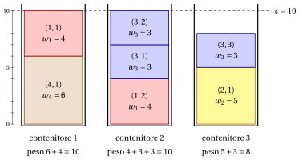

# 3.3 Il problema del cutting stock { #sez-sec-bp-CSP }

**Parte 1 · Problemi di ottimizzazione combinatoria · Capitolo 3** · [:material-book-open-variant: Capitolo 3: Problemi di packing](index.md) · [:material-file-pdf-box: Dispensa, volume 1 (PDF)](../../pdf/dispensa-1-problemi-di-ottimizzazione-combinatoria.pdf) · [:material-pencil: Esercizi: Problemi di packing](../../esercizi/bin-packing.md)

!!! definizione "Definizione 3.3: problema del cutting stock"

    Dati:

    1. un numero infinito di contenitori, ciascuno di <em>capacità</em> $c \in \Z_{\ge 1}$,

    2. un insieme $\mathscr{I} = \{1,2,\dots,n\}$ di $n$ oggetti,

    3. per ogni oggetto $j \in \mathscr{I}$, un <em>peso</em> $w_j \in \Z_{\ge 1}$ e un <em>numero di copie richieste</em> $d_j \in \Z_{\ge 1}$,

    il <strong>problema del cutting stock</strong> (CSP) chiede di decidere in quale contenitore sistemare ogni copia di ogni oggetto, in modo che il peso totale delle copie in ogni contenitore non superi la capacità del contenitore, che il numero richiesto di copie di ogni oggetto sia sistemato nei contenitori e che il numero totale di contenitori usati sia minimo.

- Un'<strong>istanza del CSP</strong> è specificata da:

    1. due numeri interi:

        - la capacità dei contenitori $c \in \Z_{\ge 1}$,

        - il numero di oggetti $n \in \Z_{\ge 1}$,

    2. due vettori di numeri interi di lunghezza $n$:

        - $\vet{w} \in \Z_{\ge 1}^n$, che contiene i pesi degli oggetti,

        - $\vet{d} \in \Z_{\ge 1}^n$, che contiene il numero di copie richieste di ogni oggetto.

- Il problema si chiama <em>cutting stock</em> (taglio del materiale) perché, nella sua applicazione classica, i contenitori corrispondono a grandi rotoli di materiale (o lastre) che devono essere tagliati per produrre le copie richieste degli oggetti, dette anche domande degli oggetti.

- Data un'istanza del CSP, definiamo l'<strong>insieme esteso degli oggetti</strong> come

    \begin{equation*}
    \label{ExtSetCSP}
    \hat{\mathscr{I}}
    =
    \big\{\, (j,k) : j \in \mathscr{I},~ k \in \{1,2,\dots,d_j\} \,\big\}, \tag{3.2}
    \end{equation*}

    dove ogni coppia $(j,k)$ rappresenta la $k$-esima copia richiesta dell'oggetto $j$. La cardinalità dell'insieme esteso degli oggetti è

    $$
    |\hat{\mathscr{I}}| = \sum_{j\in \mathscr{I}} d_j.
    $$

- Una <strong>soluzione ammissibile del CSP</strong> è una famiglia di <strong>schemi di carico</strong>, ossia sottoinsiemi di copie ciascuno assegnato a un contenitore,

    $$
    \mathcal{P} \subseteq 2^{\hat{\mathscr{I}}}
    $$

    tale che:

    - **(i)** $\mathcal{P}$ forma una partizione di $\hat{\mathscr{I}}$ in schemi di carico <em>non vuoti</em>, ossia

        $$
        \begin{gathered}
        P\neq \emptyset, \quad \text{per ogni } P\in\mathcal{P},\\
        P\cap P'=\emptyset, \quad \text{per ogni } P,P'\in\mathcal{P}\ \text{con } P\neq P',\\
        \bigcup_{P\in\mathcal{P}} P=\hat{\mathscr{I}};
        \end{gathered}
        $$

    - **(ii)** il peso totale delle copie in ogni schema di carico non supera la capacità del contenitore, ossia

        $$
        \sum_{(j,k)\in P} w_j \le c, \quad \text{per ogni } P\in\mathcal{P}.
        $$

    Di conseguenza, il CSP si può enunciare in modo equivalente come il problema di determinare una partizione dell'insieme esteso degli oggetti in schemi di carico tale che il peso totale in ogni schema di carico non superi la capacità del contenitore e il numero di schemi di carico (contenitori) sia minimo.

    !!! chiave ""

        Data un'istanza del CSP, il CSP si può enunciare formalmente come:

        \begin{equation*}
        \label{CSP}
        \tilde{\mathcal{P}}
        \in
        \argmin_{\mathcal{P}\subseteq 2^{\hat{\mathscr{I}}}}
        \left\{
        |\mathcal{P}|
        \;:\;
        \begin{array}{l}
        P\neq \emptyset, \quad \forall\, P\in\mathcal{P},\\[8pt]
        P\cap P'=\emptyset, \quad \forall\, P,P'\in\mathcal{P},\, P\neq P',\\[8pt]
        \displaystyle \bigcup_{P\in\mathcal{P}} P=\hat{\mathscr{I}},\\[14pt]
        \displaystyle \sum_{(j,k)\in P} w_j \le c, \quad \forall\, P\in\mathcal{P}
        \end{array}
        \right\}. \tag{3.3}
        \end{equation*}

!!! esempio "Esempio 3.2: istanze del CSP"

    Consideriamo contenitori di capacità $c = 10$ e un insieme $\mathscr{I} = \{1,2,3,4\}$ di $4$ oggetti ($n=4$), con i seguenti pesi e copie richieste:

    
<table>
    <tr>
    <th>Oggetti</th>
    <th></th>
    <th>\(j=1\)</th>
    <th>\(j=2\)</th>
    <th>\(j=3\)</th>
    <th>\(j=4\)</th>
    </tr>
    <tr>
    <td>Pesi</td>
    <td>\(w_j\)</td>
    <td>\(4\)</td>
    <td>\(5\)</td>
    <td>\(3\)</td>
    <td>\(6\)</td>
    </tr>
    <tr>
    <td>Copie</td>
    <td>\(d_j\)</td>
    <td>\(2\)</td>
    <td>\(1\)</td>
    <td>\(3\)</td>
    <td>\(1\)</td>
    </tr>
    </table>

    Nel disegno le copie dello stesso oggetto hanno lo stesso colore, e la copia $(j,k)$ è un blocco di altezza $w_j$. Le $7$ copie entrano in $3$ contenitori, di pesi $10$, $10$ e $8$.

    { .fig loading=lazy  }

    Chiamiamo questa istanza del CSP [Esempio 3.2](#box-5-ex-csp): è l'istanza di riferimento del CSP nel capitolo.

## 3.3.1 Ipotesi

- Facciamo le seguenti ipotesi:

    1. Il peso totale di tutte le copie richieste supera la capacità di un contenitore (altrimenti tutte le copie entrerebbero in un solo contenitore). Formalmente:

        $$
        \sum_{j\in \mathscr{I}} d_j\, w_j \;>\; c.
        $$

    2. Ogni oggetto, da solo, entra in un contenitore (altrimenti nessuna copia di quell'oggetto può essere impaccata). Formalmente:

        $$
        w_j \le c, \qquad \forall\, j\in \mathscr{I}.
        $$

## 3.3.2 Contare le soluzioni, una prima soluzione e un bound semplice

- <strong>Soluzioni candidate.</strong> L'istanza dell'[Esempio 3.2](#box-5-ex-csp) ha $2+1+3+1 = 7$ copie. Le partizioni dell'insieme esteso degli oggetti sono contate da $B(7) = 877$, dove copie identiche sono contate come oggetti diversi; $262$ di esse sono ammissibili.

- <strong>Una prima soluzione, a occhio.</strong> Accoppiamo l'oggetto $4$ (peso $6$) con una copia dell'oggetto $1$ (peso $4$), mettiamo l'altra copia dell'oggetto $1$ con due copie dell'oggetto $3$ ($4+3+3$), e l'ultima copia dell'oggetto $3$ con l'oggetto $2$ ($3+5$):

    $$
    \mathcal{P} = \big\{\, \{(4,1),(1,1)\},~ \{(1,2),(3,1),(3,2)\},~ \{(2,1),(3,3)\} \,\big\}
    $$

    usa $3$ contenitori, di pesi $10$, $10$ e $8$, quindi $\UB = 3$.

- <strong>Il bound duale e il gap.</strong> Il bound sul peso del bin packing vale con i pesi di tutte le copie: $\LB = \lceil \sum_j d_j w_j / c \rceil = \lceil 28/10 \rceil = 3$. Il gap è nullo, quindi la soluzione è ottima e $z(I) = 3$.

## 3.4 Osservazioni

- Il comportamento nel caso peggiore di semplici regole di packing, come First Fit, è stato analizzato da Garey, Graham e Ullman (1972) e da Johnson, Demers, Ullman, Garey e Graham (1974).

- Johnson et al. (1974) dimostrarono che First Fit usa al più $\tfrac{17}{10}$ del numero ottimo di contenitori, più $2$.

## 3.5 Errori tipici

!!! attenzione "Attenzione"

    - <strong>Credere che il bound sul peso sia sempre stretto.</strong> Con tre oggetti di peso $6$ e $c = 10$ il bound dà $\lceil 18/10 \rceil = 2$, ma due oggetti non entrano insieme, quindi servono $3$ contenitori.

    - <strong>Contare i contenitori solo in base ai pesi.</strong> Il bound sul peso ignora come gli oggetti si combinano; è un bound duale, e il bound primale richiede comunque una soluzione.

    - <strong>Elencare due volte lo stesso riempimento.</strong> Nel problema del cutting stock le copie di un oggetto sono intercambiabili: partizioni che differiscono solo per lo scambio di copie identiche sono lo stesso riempimento.

    - <strong>Ignorare che l'ordine dei contenitori non conta.</strong> Una soluzione è una partizione: $\{\{4,5\},\{1,3\},\{2\}\}$ e $\{\{2\},\{4,5\},\{1,3\}\}$ sono la stessa soluzione.

    - <strong>Dimenticare le ipotesi.</strong> Un oggetto con $w_j > c$ non entra in alcun contenitore, e se il peso totale è al più $c$ basta un contenitore.

## 3.6 In sintesi

!!! chiave "In sintesi"

    - Il BPP partiziona gli oggetti nel numero minimo di contenitori di capacità $c$; il problema del cutting stock è il BPP con più copie identiche di ogni oggetto, e il BPP è il caso $d_j = 1$.

    - Una soluzione è una partizione, quindi le candidate sono contate dai numeri di Bell e crescono molto rapidamente.

    - Una soluzione trovata a occhio è un bound primale; il bound sul peso $\lceil \sum_j w_j / c \rceil$ è un bound duale.

    - Quando i due bound coincidono, il gap è nullo e la soluzione è certificata ottima.

    <strong>Quadro riassuntivo delle istanze di riferimento.</strong>

    
<table>
    <tr>
    <th>istanza (min)</th>
    <th>lower bound</th>
    <th>upper bound</th>
    <th>da</th>
    </tr>
    <tr>
    <td>BPP, <a href="../il-problema-del-bin-packing/#box-2-ex-bpp">Esempio 3.1</a></td>
    <td>\(3\) (bound sul peso)</td>
    <td>\(3\) (a occhio)</td>
    <td>questo capitolo</td>
    </tr>
    <tr>
    <td>CSP, <a href="#box-5-ex-csp">Esempio 3.2</a></td>
    <td>\(3\) (bound sul peso)</td>
    <td>\(3\) (a occhio)</td>
    <td>questo capitolo</td>
    </tr>
    </table>

---

**Esercizi su questo capitolo:** [:material-pencil: Problemi di packing](../../esercizi/bin-packing.md)

---

**Approfondimento:** [:material-view-list: che cosa fa il corso su questo problema](../../catalogo/bin-packing-problem.md)

