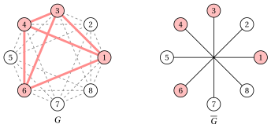

# 5.2 Il problema della clique massima { #sez-sec-mcp-MCP }

**Parte 1 · Problemi di ottimizzazione combinatoria · Capitolo 5** · [:material-book-open-variant: Capitolo 5: Problemi di clique](index.md) · [:material-file-pdf-box: Dispensa, volume 1 (PDF)](../../pdf/dispensa-1-problemi-di-ottimizzazione-combinatoria.pdf) · [:material-pencil: Esercizi: Problemi di clique](../../esercizi/clique.md)

!!! definizione "Definizione 5.2: problema della clique massima"

    Dato:

    1. un <em>grafo</em> semplice $G = (V,E)$, dove

        $$
        V = \{1,2,\dots,n\}
        $$

        è l'insieme degli $n$ <em>vertici</em> e

        $$
        E \subseteq \big\{\, \{u,v\} : u,v \in V,~ u \neq v \,\big\}
        $$

        è l'insieme degli $m$ <em>lati</em>,

    il <strong>problema della clique massima</strong> (MCP) chiede di trovare una clique $K \subseteq V$ di $G$ il cui numero di vertici sia massimo. Il suo valore ottimo è il numero di clique $\omega(G)$.

!!! definizione "Definizione 5.3: insieme stabile e problema dell'insieme stabile massimo"

    Sia $G=(V,E)$ un grafo.

    1. Un <strong>insieme stabile</strong> (detto anche <strong>insieme indipendente</strong>) è un sottoinsieme $Q \subseteq V$ di vertici a due a due non adiacenti: $\{u,v\} \notin E$ per ogni $u,v \in Q$ con $u \neq v$.

    2. Il <strong>problema dell'insieme stabile massimo</strong> (MSSP) chiede di trovare un insieme stabile di $G$ il cui numero di vertici sia massimo. Il suo valore ottimo è il <strong>numero di stabilità</strong> $\alpha(G)$.

!!! definizione "Definizione 5.4: grafo complementare"

    Il <strong>grafo complementare</strong> di $G=(V,E)$ è il grafo $\overline{G}=(V,\overline{E})$ con gli stessi vertici e l'insieme dei lati

    $$
    \overline{E} = \big\{\, \{u,v\} : u,v \in V,~ u \neq v,~ \{u,v\} \notin E \,\big\}.
    $$

    Le coppie in $\overline{E}$ sono i <strong>non-lati</strong> di $G$, e $|\overline{E}| = \binom{n}{2} - m$.

!!! teorema "Proposizione 5.5: numero di clique e numero di stabilità"

    Un sottoinsieme $K \subseteq V$ è una clique di $G$ se e solo se è un insieme stabile di $\overline{G}$. Quindi

    $$
    \omega(G) = \alpha(\overline{G}) \qquad\text{e}\qquad \alpha(G) = \omega(\overline{G}).
    $$

??? dimostrazione "Dimostrazione"

    Due vertici distinti $u,v$ sono adiacenti in $G$ se e solo se non sono adiacenti in $\overline{G}$. Quindi tutte le coppie di $K$ sono lati di $G$ esattamente quando nessuna coppia di $K$ è un lato di $\overline{G}$. I due problemi hanno le stesse soluzioni ammissibili, quindi lo stesso valore ottimo. La seconda uguaglianza segue poiché $\overline{\overline{G}} = G$. □

!!! chiave ""

    Il MCP su $G$ e il MSSP su $\overline{G}$ sono lo stesso problema: una clique massima di $G$ è un insieme stabile massimo di $\overline{G}$. Tutto ciò che impariamo su uno dei due problemi vale anche per l'altro.

- Un'<strong>istanza del MCP</strong> è specificata da:

    1. due numeri interi: il numero di vertici $n \in \Z_{\ge 1}$ e il numero di lati $m \in \Z_{\ge 1}$;

    2. due vettori di numeri interi di lunghezza $m$: $\vet{u} \in \Z_{\ge 1}^m$ e $\vet{v} \in \Z_{\ge 1}^m$, con i due estremi dei lati.

- Una <strong>soluzione ammissibile del MCP</strong> è una clique $K \subseteq V$. L'insieme vuoto e un singolo vertice sono clique, quindi ogni istanza ha soluzioni ammissibili.

!!! chiave ""

    Data un'istanza del MCP, il MCP si può enunciare formalmente come:

    \begin{equation*}
    \label{mcpP:MCP}
    \tilde{K}
    \in
    \argmax_{K\subseteq V}
    \Big\{\,
    |K|
    \;:\;
    \{u,v\}\in E, \quad \forall\, u,v\in K\ \text{con } u\neq v
    \,\Big\},
    \qquad |\tilde{K}| = \omega(G). \tag{5.1}
    \end{equation*}

!!! esempio "Esempio 5.1: istanza del MCP: un ciclo con una corda"

    Consideriamo il grafo $G=(V,E)$ con $7$ vertici ($n=7$) e $8$ lati ($m=8$): il ciclo $1,2,\dots,7,1$ e la corda $\{1,3\}$. A destra, il suo grafo complementare $\overline{G}$, con i $\binom{7}{2}-8=13$ non-lati di $G$.

    { .fig loading=lazy  }

    L'insieme dei vertici e l'insieme dei lati sono:

    $$
    V=\{1,\dots,7\},\qquad
    E=\big\{\{1,2\},\{1,3\},\{1,7\},\{2,3\},\{3,4\},\{4,5\},\{5,6\},\{6,7\}\big\}.
    $$

    Chiamiamo questa istanza del MCP [Esempio 5.1](#box-6-mcpP-ex1): è l'istanza di riferimento del capitolo.

!!! esempio "Esempio 5.2: istanza del MCP: un grafo denso con $8$ vertici"

    Consideriamo il grafo $G=(V,E)$ con $8$ vertici disposti su una circonferenza, in cui ogni vertice è adiacente a tutti gli altri tranne quello opposto. Ha $m=\binom{8}{2}-4=24$ lati, e il suo complementare ha solo i $4$ lati $\{1,5\},\{2,6\},\{3,7\},\{4,8\}$. Una clique massima $\tilde K=\{1,3,4,6\}$ è in rosso.

    { .fig loading=lazy  }

    In $\overline{G}$ i vertici rossi formano un insieme stabile: prendono un vertice da ciascuno dei $4$ lati. Chiamiamo questa istanza del MCP [Esempio 5.2](#box-7-mcpP-ex2).

- Il grafo di Petersen del [Capitolo 4 «Problemi di colorazione»](../coloring/il-problema-della-colorazione-dei-vertici.md) non ha triangoli, quindi le sue clique più grandi sono i suoi lati e $\omega(G)=2$.

## 5.2.1 Ipotesi

- Consideriamo istanze non banali: il grafo ha almeno un lato e almeno un non-lato. Formalmente:

    $$
    1 \le m < \binom{n}{2}.
    $$

- L'ipotesi si può fare senza perdita di generalità: se il grafo non ha lati, ogni singolo vertice è una clique massima e $\omega(G)=1$; se il grafo è completo, $V$ stesso è una clique e $\omega(G)=n$.

## 5.3 Contare le soluzioni, una prima soluzione e i bound

- <strong>Soluzioni candidate.</strong> Le soluzioni candidate sono tutti i sottoinsiemi di $V$, in numero di $2^n$. Per l'[Esempio 5.1](#box-6-mcpP-ex1) abbiamo $2^7=128$ sottoinsiemi, e solo $17$ di essi sono clique:

    
<table>
    <tr>
    <th>numero di vertici</th>
    <th>\(0\)</th>
    <th>\(1\)</th>
    <th>\(2\)</th>
    <th>\(3\)</th>
    <th>totale</th>
    </tr>
    <tr>
    <td>clique</td>
    <td>\(1\)</td>
    <td>\(7\)</td>
    <td>\(8\)</td>
    <td>\(1\)</td>
    <td>\(17\)</td>
    </tr>
    </table>

    L'unica clique con $3$ vertici è $\{1,2,3\}$, quindi la soluzione ottima è unica e $\omega(G)=3$.

- Per l'[Esempio 5.2](#box-7-mcpP-ex2) abbiamo $2^8=256$ sottoinsiemi e $81$ clique. Una clique prende al più un vertice da ciascuna coppia $\{1,5\},\{2,6\},\{3,7\},\{4,8\}$: le clique massime ne prendono esattamente uno, quindi sono $2^4=16$ e $\omega(G)=4$.

- <strong>Una prima soluzione, a mano.</strong> Partiamo da un vertice di grado massimo e aggiungiamo, uno alla volta, un vertice adiacente a tutti i vertici già scelti. Nell'[Esempio 5.1](#box-6-mcpP-ex1), il vertice $1$ ha grado $3$; aggiungiamo il suo vicino $2$, e poi $3$, che è adiacente a entrambi.

- Nessun altro vertice è adiacente a $1$, $2$ e $3$, quindi ci fermiamo con $K=\{1,2,3\}$. È un <strong>bound primale</strong>: $\LB = 3 \le \omega(G)$.

### 5.3.1 Upper bound semplici

- Il MCP è un problema di massimo: un bound duale è un <strong>upper bound</strong> su $\omega(G)$. Indichiamo con $\deg(v)$ il grado di un vertice e con $\Delta$ il grado massimo del grafo.

!!! teorema "Osservazione 5.6: bound sul grado"

    Per ogni grafo $G=(V,E)$ abbiamo $\omega(G) \le \Delta + 1$.

??? dimostrazione "Dimostrazione"

    In una clique $K$, ogni vertice è adiacente agli altri $|K|-1$ vertici di $K$, quindi il suo grado è almeno $|K|-1$. Quindi $|K|-1 \le \Delta$ per ogni clique. □

!!! teorema "Osservazione 5.7: bound sui lati"

    Per ogni grafo $G=(V,E)$ abbiamo $\omega(G)\,(\omega(G)-1)/2 \le m$.

??? dimostrazione "Dimostrazione"

    Una clique con $k$ vertici contiene come lati tutte le $\binom{k}{2} = k(k-1)/2$ coppie dei suoi vertici, e questi sono lati di $G$. □

!!! teorema "Osservazione 5.8: bound sul conteggio dei gradi"

    Sia $k^{\max}$ il massimo intero $k$ tale che almeno $k$ vertici di $G$ abbiano grado almeno $k-1$. Allora $\omega(G) \le k^{\max}$.

??? dimostrazione "Dimostrazione"

    Una clique con $k$ vertici ha $k$ vertici, ciascuno di grado almeno $k-1$ (dimostrazione del bound sul grado). Quindi $k=\omega(G)$ soddisfa la condizione, e $\omega(G)\le k^{\max}$. □

!!! teorema "Osservazione 5.9: bound di colorazione"

    Per ogni grafo $G=(V,E)$ abbiamo $\omega(G) \le \chi(G)$. In particolare, il numero di colori di una qualunque colorazione ammissibile di $G$ è un upper bound su $\omega(G)$.

??? dimostrazione "Dimostrazione"

    I vertici di una clique sono a due a due adiacenti, quindi ricevono colori a due a due diversi: una colorazione con $k$ colori ha $k \ge |K|$ per ogni clique $K$. È il bound di clique del Capitolo 4 [«Problemi di colorazione»](../coloring/index.md), letto dal lato della clique. □

- <strong>Bound sull'[Esempio 5.1](#box-6-mcpP-ex1).</strong> I vertici $1$ e $3$ hanno grado $3$, gli altri cinque hanno grado $2$. Il bound sul grado dà $\Delta+1=4$, e anche il bound sui lati dà $4$, poiché $4\cdot 3/2 = 6 \le 8 < 10 = 5 \cdot 4/2$.

- Solo $2$ vertici hanno grado almeno $3$, quindi $k=4$ non soddisfa la condizione del bound sul conteggio dei gradi, mentre $k=3$ la soddisfa: $k^{\max}=3$. La colorazione $\{1,4,6\},\{2,5,7\},\{3\}$ dà anch'essa $3$. Il gap con $\LB=3$ è nullo.

- <strong>Bound sull'[Esempio 5.2](#box-7-mcpP-ex2).</strong> Ogni vertice ha grado $6$: il bound sul grado e il bound sul conteggio dei gradi danno $7$, e il bound sui lati dà $7$, poiché $7 \cdot 6/2 = 21 \le 24 < 28$.

- Le quattro coppie $\{1,5\},\{2,6\},\{3,7\},\{4,8\}$ sono insiemi stabili, quindi colorano il grafo con $4$ colori: il bound di colorazione dà $4 = \omega(G)$. Sui grafi densi i bound basati sui gradi sono deboli, e una buona colorazione è molto migliore.

## 5.4 Complessità

- La <strong>versione decisionale</strong> del MCP chiede, dati un grafo $G$ e un intero $k$, se $G$ abbia una clique con $k$ vertici. Karp (1972) la incluse fra i suoi $21$ problemi NP-completi, quindi il MCP è NP-difficile. Per la [Proposizione 5.5](#box-5-mcpP-prop-omega-alpha), lo stesso vale per il MSSP.

- Elencare tutti i sottoinsiemi di $V$ e controllare le coppie di ciascuno richiede $O(2^n\, n^2)$ passi. Per un $k$ <em>fissato</em>, i $\binom{n}{k}$ sottoinsiemi con $k$ vertici si controllano in $O(n^k\, k^2)$ passi: un polinomio per ogni $k$ fissato, ma l'esponente cresce con la cardinalità della clique.

- Il MCP è anche difficile da approssimare: Håstad (1999) dimostrò che, per ogni $\varepsilon>0$, nessun algoritmo polinomiale garantisce una clique con almeno $\omega(G)/n^{1-\varepsilon}$ vertici, a meno che ogni problema in NP si possa risolvere in tempo polinomiale randomizzato.

---

**Avanti:** [5.5 Varianti pesate](varianti-pesate.md)
