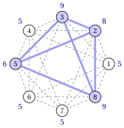

# 5.5 Varianti pesate { #sez-sec-mcp-weighted }

**Parte 1 · Problemi di ottimizzazione combinatoria · Capitolo 5** · [:material-book-open-variant: Capitolo 5: Problemi di cricca](index.md) · [:material-file-pdf-box: Dispensa, volume 1 (PDF)](../../pdf/dispensa-1-problemi-di-ottimizzazione-combinatoria.pdf) · [:material-pencil: Esercizi: Problemi di cricca](../../esercizi/clique.md)

- Sia $\vet{w} \in \Z_{\ge 1}^n$ un <strong>vettore dei pesi dei vertici</strong>, con un peso $w_v$ per ogni vertice $v \in V$, e sia $\vet{r} \in \Z_{\ge 1}^m$ un <strong>vettore dei pesi dei lati</strong>, con un peso $r_{uv}$ per ogni lato $\{u,v\} \in E$. Per una cricca $K$ definiamo

    $$
    w(K) = \sum_{v \in K} w_v
    \qquad\text{e}\qquad
    r(K) = \sum_{\{u,v\} \in E[K]} r_{uv},
    $$

    dove $E[K]$ è l'insieme dei lati con entrambi gli estremi in $K$.

!!! definizione "Definizione 5.10: problemi della cricca massima pesata"

    1. Dati un grafo $G$ e un vettore dei pesi dei vertici $\vet{w}$, il <strong>problema della cricca massima pesata sui vertici</strong> (VWMCP) chiede di trovare una cricca $K$ di $G$ con peso totale dei vertici $w(K)$ massimo.

    2. Dati un grafo $G$ e un vettore dei pesi dei lati $\vet{r}$, il <strong>problema della cricca massima pesata sui lati</strong> (EWMCP) chiede di trovare una cricca $K$ di $G$ con peso totale dei lati $r(K)$ massimo.

- Con tutti i pesi $w_v=1$ il primo problema è il MCP. Il problema pesato sui lati premia le cricche con molti lati pesanti, e con $r_{uv}=1$ è di nuovo il MCP, poiché $r(K)=\binom{|K|}{2}$ cresce con $|K|$.

!!! esempio "Esempio 5.3: problema della cricca massima pesata sui vertici"

    Aggiungiamo al grafo dell'[Esempio 5.2](il-problema-della-cricca-massima.md#box-7-mcpP-ex2) i pesi dei vertici in blu. La cricca massima pesata sui vertici è $\{2,3,5,8\}$, con peso $8+9+6+9=32$: è unica, e non è la cricca massima in rosso dell'[Esempio 5.2](il-problema-della-cricca-massima.md#box-7-mcpP-ex2), il cui peso è $5+9+5+5=24$.

    { .fig loading=lazy  }

    Una cricca prende al più un vertice da ciascuna coppia $\{1,5\},\{2,6\},\{3,7\},\{4,8\}$; prendere il più pesante di ciascuna coppia dà $6+8+9+9=32$, e questi quattro vertici formano una cricca.

!!! esempio "Esempio 5.4: problema della cricca massima pesata sui lati"

    Aggiungiamo al grafo dell'[Esempio 5.2](il-problema-della-cricca-massima.md#box-7-mcpP-ex2) i pesi dei lati in rosso. La cricca massima pesata sui lati è $\{2,5,7,8\}$, in arancione: i suoi sei lati pesano $6+4+9+7+3+8=37$, e l'enumerazione delle $16$ cricche massime mostra che è l'unica soluzione ottima.

    { .fig loading=lazy  }

## 5.6 Osservazioni

- In una colorazione, ogni classe di colore è un insieme stabile: il MSSP è il problema della classe di colore più grande, e il numero di cricca è il bound duale del Capitolo 4 [«Problemi di colorazione»](../coloring/index.md).

- Applicazioni delle cricche e degli insiemi stabili:

    - gruppi di membri a due a due connessi nelle reti sociali;

    - gruppi di attività o di esami a due a due compatibili, nello scheduling e nella pianificazione degli orari;

    - sottostrutture comuni a due molecole, in chimica e in biologia;

    - codici a correzione d'errore, come grandi insiemi di parole a due a due lontane.

## 5.7 Errori tipici

!!! attenzione "Attenzione"

    - <strong>Confondere una cricca massimale con una cricca massima.</strong> Una cricca è massimale quando non le si può aggiungere alcun vertice; è massima quando nessuna cricca è più grande. Nell'[Esempio 5.1](il-problema-della-cricca-massima.md#box-6-mcpP-ex1), $\{4,5\}$ è massimale ma non massima.

    - <strong>Costruire il grafo complementare con i lati di $G$.</strong> I lati di $\overline{G}$ sono esattamente le coppie che <em>non</em> sono lati di $G$: sono $\binom{n}{2}-m$.

    - <strong>Usare un lower bound come upper bound.</strong> Una cricca trovata a mano dà $\LB \le \omega(G)$; i bound sui gradi e una colorazione danno $\UB \ge \omega(G)$. In questo capitolo il problema è di massimo.

    - <strong>Credere che il bound di colorazione sia stretto.</strong> Sul ciclo con $5$ vertici $\omega(G)=2$ e $\chi(G)=3$.

## 5.8 In sintesi

!!! chiave "In sintesi"

    - Il MCP cerca il più grande insieme di vertici a due a due adiacenti; il suo valore ottimo è il numero di cricca $\omega(G)$.

    - Una cricca di $G$ è un insieme stabile di $\overline{G}$: il MCP su $G$ è il MSSP su $\overline{G}$, e $\omega(G)=\alpha(\overline{G})$.

    - Una cricca trovata a mano è un bound primale; il bound sul grado, il bound sui lati, il bound sul conteggio dei gradi e il numero di colori di una colorazione sono bound duali.

    - Il MCP è NP-difficile e difficile da approssimare; le sue varianti pesate pesano i vertici o i lati.

    <strong>Quadro riassuntivo delle istanze di riferimento.</strong>

    
<table>
    <tr>
    <th>istanza (max)</th>
    <th>lower bound</th>
    <th>upper bound</th>
    <th>da</th>
    </tr>
    <tr>
    <td><a href="../il-problema-della-cricca-massima/#box-6-mcpP-ex1">Esempio 5.1</a> (ciclo con corda)</td>
    <td>\(3\) (a mano)</td>
    <td>\(3\) (conteggio dei gradi, colorazione)</td>
    <td>questo capitolo</td>
    </tr>
    <tr>
    <td><a href="../il-problema-della-cricca-massima/#box-7-mcpP-ex2">Esempio 5.2</a> (grafo denso)</td>
    <td>\(4\) (a mano)</td>
    <td>\(4\) (colorazione)</td>
    <td>questo capitolo</td>
    </tr>
    </table>

---

**Esercizi su questo capitolo:** [:material-pencil: Problemi di cricca](../../esercizi/clique.md)

---

**Approfondimento:** [:material-view-list: che cosa fa il corso su questo problema](../../catalogo/maximum-clique-problem.md)

