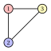

# 4.2 Il problema della colorazione dei vertici { #sez-sec-col-VCP }

**Parte 1 · Problemi di ottimizzazione combinatoria · Capitolo 4** · [:material-book-open-variant: Capitolo 4: Problemi di colorazione](index.md) · [:material-file-pdf-box: Dispensa, volume 1 (PDF)](../../pdf/dispensa-1-problemi-di-ottimizzazione-combinatoria.pdf) · [:material-presentation: Slide](../../pdf/slide-coloring.pdf) · [:material-pencil: Esercizi: Problemi di colorazione](../../esercizi/coloring.md) · [:material-gesture-tap: App: Colorazione: greedy e DSATUR](../../laboratorio/colorazione-greedy-dsatur.md)

!!! definizione "Definizione 4.3: problema della colorazione dei vertici"

    Dato:

    1. un <em>grafo</em> semplice $G = (V,E)$, dove

        $$
        V = \{1,2,\dots,n\}
        $$

        è l'insieme degli $n$ <em>vertici</em> e

        $$
        E \subseteq \big\{\, \{u,v\} : u,v \in V,~ u \neq v \,\big\}
        $$

        è l'insieme degli $m$ <em>lati</em>,

    il <strong>problema della colorazione dei vertici</strong> (VCP) chiede di decidere come assegnare un colore a ogni vertice, in modo che due vertici adiacenti non abbiano lo stesso colore e il numero totale di colori usati sia minimo.

- Un'<strong>istanza del VCP</strong> è specificata da:

    1. due numeri interi:

        - il numero di vertici $n \in \Z_{\ge 1}$,

        - il numero di lati $m \in \Z_{\ge 1}$,

    2. due vettori di numeri interi di lunghezza $m$:

        - $\vet{u} \in \Z_{\ge 1}^m$, che contiene il primo estremo dei lati,

        - $\vet{v} \in \Z_{\ge 1}^m$, che contiene il secondo estremo dei lati.

- Una <strong>soluzione ammissibile del VCP</strong> è una famiglia di <strong>classi di colore</strong>, ossia sottoinsiemi di vertici ciascuno assegnato a un colore,

    $$
    \mathcal{Q} \subseteq 2^{V}
    $$

    tale che:

    - **(i)** $\mathcal{Q}$ forma una partizione di $V$ in classi di colore <em>non vuote</em>, ossia

        $$
        \begin{gathered}
        Q\neq \emptyset, \quad \text{per ogni } Q\in\mathcal{Q},\\
        Q\cap Q'=\emptyset, \quad \text{per ogni } Q,Q'\in\mathcal{Q}\ \text{con } Q\neq Q',\\
        \bigcup_{Q\in\mathcal{Q}} Q=V;
        \end{gathered}
        $$

    - **(ii)** ogni classe di colore in $\mathcal{Q}$ è un <em>insieme stabile</em>, ossia

        $$
        \{u,v\}\notin E, \quad \text{per ogni } Q\in\mathcal{Q},\ \text{per ogni } u,v\in Q\ \text{con } u\neq v.
        $$

    Di conseguenza, il VCP si può enunciare in modo equivalente come il problema di determinare una partizione dell'insieme dei vertici in classi di colore tale che ogni classe di colore sia un insieme stabile (ossia i suoi vertici possano ricevere lo stesso colore) e il numero di classi di colore (colori) sia minimo.

!!! chiave ""

    Data un'istanza del VCP, il VCP si può enunciare formalmente come:

    \begin{equation*}
    \label{VCP}
    \tilde{\mathcal{Q}}
    \in
    \argmin_{\mathcal{Q}\subseteq 2^{V}}
    \left\{
    |\mathcal{Q}|
    \;:\;
    \begin{array}{l}
    Q\neq \emptyset, \quad \forall\, Q\in\mathcal{Q},\\[8pt]
    Q\cap Q'=\emptyset, \quad \forall\, Q,Q'\in\mathcal{Q}\ \text{con } Q\neq Q',\\[8pt]
    \displaystyle \bigcup_{Q\in\mathcal{Q}} Q=V,\\[12pt]
    \{u,v\}\notin E, \quad \forall\, Q\in\mathcal{Q},\ \forall\, u,v\in Q\ \text{con } u\neq v
    \end{array}
    \right\}. \tag{4.1}
    \end{equation*}

- Il valore ottimo del VCP è il <strong>numero cromatico</strong> $\chi(G)$ del grafo: il numero minimo di colori (insiemi stabili) necessari per colorare tutti i vertici. Le classi di colore di una soluzione sono insiemi stabili, e il numero di classi è il numero di colori usati.

!!! esempio "Esempio 4.1: istanza del VCP: un triangolo"

    Consideriamo il seguente grafo $G = (V,E)$ con $3$ vertici ($n=3$) e $3$ lati ($m=3$):

    { .fig .ovale loading=lazy style="width:24%" }

    L'insieme dei vertici $V$ e l'insieme dei lati $E$ sono:

    $$
    V = \big\{~ 1,~ 2,~ 3 ~\big\}, \qquad E = \big\{~ \{1,2\},~ \{1,3\},~ \{2,3\} ~\big\}.
    $$

    Chiamiamo questa istanza del VCP [Esempio 4.1](#box-4-ex-vcp1).

!!! esempio "Esempio 4.2: istanza del VCP: il grafo di Petersen"

    Consideriamo ora il seguente grafo $G = (V,E)$ con $10$ vertici ($n=10$) e $15$ lati ($m=15$):

    { .fig .ovale loading=lazy style="width:47%" }

    L'insieme dei vertici $V$ e l'insieme dei lati $E$ sono:

    $$
    V = \big\{~ 1,~ 2,~ 3,~ 4,~ 5,~ 6,~ 7,~ 8,~ 9,~ 10 ~\big\},
    $$

    $$
    \begin{aligned}
    E = \big\{~ & \{1,2\},~ \{1,5\},~ \{1,6\},~ \{2,3\},~ \{2,7\},\\
    & \{3,4\},~ \{3,8\},~ \{4,5\},~ \{4,9\},~ \{5,10\},\\
    & \{6,8\},~ \{6,9\},~ \{7,9\},~ \{7,10\},~ \{8,10\} ~\big\}.
    \end{aligned}
    $$

    Chiamiamo questa istanza del VCP [Esempio 4.2](#box-5-ex-vcp2): è l'istanza di riferimento del capitolo.

## 4.2.1 Ipotesi

- Facciamo le seguenti ipotesi:

    1. Il grafo non ha vertici isolati. Un vertice isolato può ricevere un qualunque colore usato dal resto del grafo; se il grafo non ha lati, il valore ottimo è uno. Formalmente:

        $$
        \deg(v) \ge 1, \qquad \forall\, v \in V.
        $$

    2. Nessun vertice ha l'intorno contenuto nell'intorno di un altro vertice. Formalmente:

        $$
        N(u) \not\subseteq N(v), \qquad \forall\, u,v \in V,~ u \neq v.
        $$

- La seconda ipotesi si può fare senza perdita di generalità, perché:

    1. se $N(u) \subseteq N(v)$, il vertice $u$ si può eliminare senza cambiare il numero cromatico: ogni colorazione di $G \setminus \{u\}$ si estende a $u$ con il colore di $v$;

    2. i vertici $u$ e $v$ non sono adiacenti: altrimenti $v \in N(u) \subseteq N(v)$, il che è impossibile in un grafo semplice, quindi $u$ e $v$ possono condividere un colore.

## 4.2.2 Due bound semplici

!!! teorema "Osservazione 4.4: bound di clique"

    Per ogni grafo $G = (V,E)$ abbiamo

    $$
    \omega(G) \le \chi(G).
    $$

??? dimostrazione "Dimostrazione"

    Poiché tutti i vertici di una clique sono a due a due adiacenti, devono ricevere colori diversi in ogni soluzione ammissibile del VCP. Quindi servono almeno $\omega(G)$ colori diversi per colorare i vertici di una clique massima, da cui $\omega(G) \le \chi(G)$. □

!!! teorema "Osservazione 4.5: bound degli insiemi stabili"

    Per ogni grafo $G = (V,E)$ abbiamo

    $$
    \left\lceil \frac{n}{\alpha(G)} \right\rceil \le \chi(G).
    $$

??? dimostrazione "Dimostrazione"

    In una soluzione ammissibile con $k$ classi di colore, ogni classe è un insieme stabile, quindi ha al più $\alpha(G)$ vertici. Gli $n$ vertici sono coperti dalle classi, quindi $n \le k \, \alpha(G)$. Il numero $k$ è intero, quindi $k \ge \lceil n/\alpha(G) \rceil$. □

- Il bound di clique è utile quando il grafo ha una clique grande, e il bound degli insiemi stabili quando i suoi insiemi stabili sono piccoli. Entrambi sono bound duali: una clique e un insieme stabile si trovano senza conoscere $\chi(G)$.

## 4.2.3 Contare le soluzioni, una prima soluzione e i bound

- <strong>Soluzioni candidate.</strong> Le soluzioni candidate sono le partizioni di $V$, contate dai numeri di Bell (Capitolo 1 [«Problemi di ottimizzazione combinatoria»](../combinatorial-optimization/index.md)). Per l'[Esempio 4.1](#box-4-ex-vcp1) abbiamo $B(3) = 5$ partizioni e una sola è ammissibile: tre singoletti, poiché ogni coppia di vertici è adiacente. Quindi $\chi(G) = 3$.

- Per l'[Esempio 4.2](#box-5-ex-vcp2) abbiamo $B(10) = 115\,975$ partizioni, e $7\,430$ di esse sono ammissibili, cioè hanno come classi solo insiemi stabili.

- <strong>Una prima soluzione, a occhio.</strong> La colorazione mostrata nell'[Esempio 4.2](#box-5-ex-vcp2) usa $3$ colori:

    $$
    \mathcal{Q} = \big\{\, \{1,4,7,8\},~ \{2,5,6\},~ \{3,9,10\} \,\big\}.
    $$

    Nessun lato unisce due vertici della stessa classe, quindi è ammissibile: è un <strong>bound primale</strong>, $\UB = 3 \ge \chi(G)$.

- <strong>Bound duali sul grafo di Petersen.</strong> Il grafo non ha triangoli, quindi $\omega(G) = 2$ e il bound di clique dà solo $\LB = 2$: resta un gap di $1$.

- I vertici $1,2,3,4,5$ formano un ciclo con $5$ vertici, e così $6,7,8,9,10$ (i lati della figura). Un insieme stabile contiene al più $2$ vertici di ogni ciclo, quindi $\alpha(G) \le 4$; l'insieme $\{1,4,7,8\}$ mostra che $\alpha(G) = 4$.

- Il bound degli insiemi stabili dà $\lceil 10/4 \rceil = 3$. I due bound coincidono: il gap è nullo e $\chi(G) = 3$.

## 4.3 Osservazioni

- Brooks (1941) dimostrò che un grafo connesso che non è né completo né un ciclo dispari si può colorare con al più $\Delta$ colori, dove $\Delta$ è il grado massimo.

- Karp (1972) incluse il numero cromatico fra i suoi $21$ problemi NP-completi. Garey, Johnson e Stockmeyer (1976) dimostrarono che stabilire se $3$ colori bastano resta NP-completo sui grafi planari di grado massimo $4$.

## 4.4 Errori tipici

!!! attenzione "Attenzione"

    - <strong>Confondere una clique con un insieme stabile.</strong> In una clique tutte le coppie sono lati e i vertici richiedono colori diversi; in un insieme stabile nessuna coppia è un lato e i vertici possono condividere un colore.

    - <strong>Credere che il bound di clique sia stretto.</strong> Non lo è: il grafo di Petersen ha $\omega(G) = 2$ e $\chi(G) = 3$, e lo stesso accade per un ciclo con $5$ vertici.

    - <strong>Contare le permutazioni dei colori come soluzioni diverse.</strong> Una soluzione è una partizione dei vertici in insiemi stabili: scambiare i nomi di due colori dà la stessa soluzione.

    - <strong>Usare una classe che non è un insieme stabile.</strong> Una classe di colore con due vertici adiacenti rende la soluzione inammissibile, qualunque sia il numero di colori.

    - <strong>Dimenticare le ipotesi.</strong> Un vertice isolato e un vertice con $N(u) \subseteq N(v)$ si possono eliminare prima di risolvere, senza cambiare il numero cromatico.

## 4.5 In sintesi

!!! chiave "In sintesi"

    - Il VCP partiziona i vertici di un grafo nel numero minimo di insiemi stabili; il valore ottimo è il numero cromatico $\chi(G)$.

    - Una clique richiede colori diversi e un insieme stabile può condividerne uno; le clique di $G$ sono gli insiemi stabili del grafo complementare.

    - Una colorazione trovata a occhio è un bound primale; il bound di clique $\omega(G)$ e il bound degli insiemi stabili $\lceil n/\alpha(G) \rceil$ sono bound duali.

    - I bound non sempre si incontrano: sul grafo di Petersen il bound di clique lascia un gap, il bound degli insiemi stabili lo chiude.

    <strong>Quadro riassuntivo delle istanze di riferimento.</strong>

    
<table>
    <tr>
    <th>istanza (min)</th>
    <th>lower bound</th>
    <th>upper bound</th>
    <th>da</th>
    </tr>
    <tr>
    <td><a href="#box-4-ex-vcp1">Esempio 4.1</a> (triangolo)</td>
    <td>\(3\) (bound di clique)</td>
    <td>\(3\) (a occhio)</td>
    <td>questo capitolo</td>
    </tr>
    <tr>
    <td><a href="#box-5-ex-vcp2">Esempio 4.2</a> (Petersen)</td>
    <td>\(3\) (bound degli insiemi stabili)</td>
    <td>\(3\) (a occhio)</td>
    <td>questo capitolo</td>
    </tr>
    </table>

---

**Esercizi su questo capitolo:** [:material-pencil: Problemi di colorazione](../../esercizi/coloring.md)

---

**Approfondimento:** [:material-view-list: che cosa fa il corso su questo problema](../../catalogo/vertex-coloring-problem.md)

