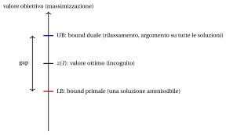

# 1.5 Bound primali, bound duali e gap { #sez-sec-bounds }

**Parte 1 · Problemi di ottimizzazione combinatoria · Capitolo 1** · [:material-book-open-variant: Capitolo 1: Ottimizzazione combinatoria](index.md) · [:material-file-pdf-box: Dispensa, volume 1 (PDF)](../../pdf/dispensa-1-problemi-di-ottimizzazione-combinatoria.pdf) · [:material-presentation: Slide](../../pdf/slide-combinatorial-optimization.pdf) · [:material-pencil: Esercizi: Ottimizzazione combinatoria](../../esercizi/combinatorial-optimization.md) · [:material-gesture-tap: App: Forza bruta sul problema dello zaino 0/1](../../laboratorio/zaino-forza-bruta.md)

- Gli approcci più intelligenti si basano su un'idea semplice: invece di calcolare direttamente $z(I)$, lo <strong>racchiudiamo</strong> fra due numeri. Uno viene da una soluzione ammissibile, l'altro da un argomento che vale per <em>tutte</em> le soluzioni ammissibili.

!!! definizione "Definizione 1.4: bound primali e duali"

    Consideriamo un'istanza $I$ di un problema di ottimizzazione combinatoria con soluzioni ammissibili $\mathcal F$, funzione obiettivo $f$ e valore ottimo $z(I)$.

    1. Un <strong>bound primale</strong> è il valore $f(\bar S)$ di una soluzione ammissibile $\bar S \in \mathcal F$.

    2. Un <strong>bound duale</strong> è un numero $\beta$ tale che

        $$
        f(S) \le \beta, \qquad \forall S \in \mathcal F \qquad \text{(forma di massimo)},
        $$

        oppure tale che

        $$
        f(S) \ge \beta, \qquad \forall S \in \mathcal F \qquad \text{(forma di minimo)}.
        $$

- Nella <strong>forma di massimo</strong> un bound primale è un <strong>lower bound</strong> e un bound duale è un <strong>upper bound</strong>:

    $$
    \LB = f(\bar S) \;\le\; z(I) \;\le\; \UB .
    $$

- Nella <strong>forma di minimo</strong> i ruoli si scambiano: un bound primale è un <strong>upper bound</strong> $\UB = f(\bar S)$ e un bound duale è un <strong>lower bound</strong> $\LB$, con $\LB \le z(I) \le \UB$.

- I bound primali vengono da soluzioni ammissibili, per esempio trovate da <strong>algoritmi euristici</strong>; i bound duali vengono da <strong>rilassamenti</strong> (per esempio il rilassamento lineare) o da argomenti combinatori.

{ .fig loading=lazy  }

!!! definizione "Definizione 1.5: gap"

    Siano $\LB \le z(I) \le \UB$ un lower bound e un upper bound di un'istanza $I$, uno primale e uno duale. Il <strong>gap assoluto</strong> è $\UB - \LB$ e, per $\LB \neq 0$, il <strong>gap relativo</strong> (o semplicemente <strong>gap</strong>) è

    $$
    gap(I) = \frac{\UB - \LB}{|\LB|}.
    $$

- Il denominatore è sempre il <strong>lower bound</strong>: nella forma di massimo è il valore della soluzione ammissibile, come nel gap di ottimalità del modulo <em>Programmazione lineare intera</em>, [Capitolo 2 «Bound primali e duali»](https://fabiofurini.github.io/programmazione-lineare-intera/modelli-e-bound/lp-relaxation/); nella forma di minimo è il bound duale.

- Con questa scelta il gap non è mai minore dell'errore relativo $|f(\bar S) - z(I)|/z(I)$ della soluzione ammissibile $\bar S$: un gap del $5\%$ garantisce una soluzione entro il $5\%$ dall'ottimo.

- Se il gap è nullo, la soluzione ammissibile $\bar S$ è ottima e il bound duale è un <strong>certificato</strong> della sua ottimalità.

!!! teorema "Osservazione 1.6"

    Se $f(S) \in \Z$ per ogni $S \in \mathcal F$, allora nella forma di massimo anche $\lfloor \beta \rfloor$ è un bound duale, e nella forma di minimo anche $\lceil \beta \rceil$ è un bound duale.

??? dimostrazione "Dimostrazione"

    Nella forma di massimo, per ogni $S \in \mathcal F$ abbiamo $f(S) \le \beta$ e $f(S) \in \Z$; il più grande intero non maggiore di $\beta$ è $\lfloor \beta \rfloor$, quindi $f(S) \le \lfloor \beta \rfloor$. La forma di minimo è analoga. □

!!! esempio "Esempio 1.4: bound sulla piccola istanza"

    Consideriamo di nuovo l'istanza dell'[Esempio 1.1](problemi-di-ottimizzazione-combinatoria.md#box-2-ex-oc1-small) (massimizzazione), e supponiamo di non avere enumerato i suoi sottoinsiemi.

    - <em>Bound primale.</em> Partiamo da $\emptyset$ ed esaminiamo gli elementi per peso non crescente, aggiungendo ciascuno se l'insieme resta ammissibile: $\{1\}$ è ammissibile, $\{1,2\}$ no, $\{1,3\}$ è ammissibile, $\{1,3,4\}$ no. La soluzione ammissibile $\bar S = \{1,3\}$ dà $\LB = 11$.

    - <em>Un primo bound duale.</em> I pesi sono positivi, quindi $f(S) \le f(\mathscr{U}) = 20$ per ogni $S \in \mathcal F$.

    - <em>Un bound duale migliore.</em> Nessun sottoinsieme ammissibile contiene sia $1$ sia $2$, quindi un sottoinsieme ammissibile prende al più uno dei pesi $7$ e $6$:

        $$
        f(S) \le \max\{7,6\} + 4 + 3 = 14, \qquad \forall S \in \mathcal F .
        $$

        Il gap assoluto è $14-11 = 3$ e il gap relativo è $\tfrac{3}{11} \approx 27.3\%$.

    - <em>Un bound primale migliore.</em> La soluzione ammissibile $\{2,3,4\}$ dà $\LB = 13$: il gap scende a $\tfrac{1}{13} \approx 7.7\%$.

    - <em>Chiusura del gap.</em> L'unico sottoinsieme ammissibile con $3$ elementi è $\{2,3,4\}$, e un sottoinsieme con al più $2$ elementi ha valore al più $7+6 = 13$. Quindi $\UB = 13 = \LB$: il gap è nullo, e questo argomento è un certificato che $\{2,3,4\}$ è ottima, senza elencare i $16$ sottoinsiemi.

    Se invece un argomento desse il bound duale $13.5$, anche $\lfloor 13.5 \rfloor = 13$ sarebbe un bound duale, poiché tutti i valori $f(S)$ sono interi ([Osservazione 1.6](#box-9-obs-rounding)).

- Nel resto del corso, ogni capitolo su un problema registra, per le sue istanze, i migliori bound primali e duali trovati fino a quel punto; ogni metodo migliora l'uno o l'altro lato.

---

**Avanti:** [Cenni di complessità computazionale](cenni-di-complessita-computazionale.md)
