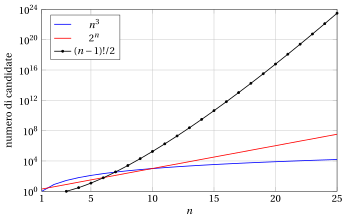

# 1.4 Esplosione combinatoria e forza bruta { #sez-sec-bruteforce }

**Parte 1 · Problemi di ottimizzazione combinatoria · Capitolo 1** · [:material-book-open-variant: Capitolo 1: Ottimizzazione combinatoria](index.md) · [:material-file-pdf-box: Dispensa, volume 1 (PDF)](../../pdf/dispensa-1-problemi-di-ottimizzazione-combinatoria.pdf) · [:material-pencil: Esercizi: Ottimizzazione combinatoria](../../esercizi/combinatorial-optimization.md) · [:material-gesture-tap: App: Forza bruta sul problema dello zaino 0/1](../../laboratorio/zaino-forza-bruta.md)

- Poiché la regione ammissibile è finita, un problema di ottimizzazione combinatoria si può sempre risolvere per <strong>enumerazione completa</strong>: elenchiamo tutte le soluzioni candidate, scartiamo quelle non ammissibili e teniamo la migliore. Questo algoritmo si chiama <strong>forza bruta</strong>.

!!! algoritmo "Algoritmo"

    - <strong>Input:</strong> un'istanza di un problema di ottimizzazione combinatoria in forma di massimo.

    - <strong>Output:</strong> una soluzione ottima e il valore ottimo.

    - **Passo 0:** <strong>Inizializzazione</strong>. Porre $\bar S \leftarrow$ nessuna e $\LB \leftarrow -\infty$.

    - **Passo 1:** <strong>Enumerazione</strong>. Per ogni soluzione candidata $S$ (sottoinsieme, ordinamento, partizione):

        1. se $S$ non è ammissibile, scartarla;

        2. se $S$ è ammissibile e $f(S) > \LB$, porre $\bar S \leftarrow S$ e $\LB \leftarrow f(S)$.

    - **Passo 2:** <strong>Output</strong>. Restituire $\tilde S = \bar S$ e $z(I) = \LB$. <code>STOP</code>

!!! esempio "Esempio 1.3: forza bruta sulla piccola istanza"

    Per l'istanza dell'[Esempio 1.1](problemi-di-ottimizzazione-combinatoria.md#box-2-ex-oc1-small) i $2^4=16$ sottoinsiemi di $\mathscr{U}$ sono:

    
<table>
    <tr>
    <th>\(S\)</th>
    <th>\(f(S)\)</th>
    <th>ammissibile</th>
    <th>\(S\)</th>
    <th>\(f(S)\)</th>
    <th>ammissibile</th>
    </tr>
    <tr>
    <td>\(\emptyset\)</td>
    <td>\(0\)</td>
    <td>sì</td>
    <td>\(\{2,3\}\)</td>
    <td>\(10\)</td>
    <td>sì</td>
    </tr>
    <tr>
    <td>\(\{1\}\)</td>
    <td>\(7\)</td>
    <td>sì</td>
    <td>\(\{2,4\}\)</td>
    <td>\(9\)</td>
    <td>sì</td>
    </tr>
    <tr>
    <td>\(\{2\}\)</td>
    <td>\(6\)</td>
    <td>sì</td>
    <td>\(\{3,4\}\)</td>
    <td>\(7\)</td>
    <td>sì</td>
    </tr>
    <tr>
    <td>\(\{3\}\)</td>
    <td>\(4\)</td>
    <td>sì</td>
    <td>\(\{1,2,3\}\)</td>
    <td>\(17\)</td>
    <td>no</td>
    </tr>
    <tr>
    <td>\(\{4\}\)</td>
    <td>\(3\)</td>
    <td>sì</td>
    <td>\(\{1,2,4\}\)</td>
    <td>\(16\)</td>
    <td>no</td>
    </tr>
    <tr>
    <td>\(\{1,2\}\)</td>
    <td>\(13\)</td>
    <td>no</td>
    <td>\(\{1,3,4\}\)</td>
    <td>\(14\)</td>
    <td>no</td>
    </tr>
    <tr>
    <td>\(\{1,3\}\)</td>
    <td>\(11\)</td>
    <td>sì</td>
    <td>\(\{2,3,4\}\)</td>
    <td>\(\mathbf{13}\)</td>
    <td>sì</td>
    </tr>
    <tr>
    <td>\(\{1,4\}\)</td>
    <td>\(10\)</td>
    <td>sì</td>
    <td>\(\{1,2,3,4\}\)</td>
    <td>\(20\)</td>
    <td>no</td>
    </tr>
    </table>

    Fra gli $11$ sottoinsiemi ammissibili, il migliore è $\tilde S = \{2,3,4\}$, con $z(I)=13$. È l'unica soluzione ottima: anche il sottoinsieme $\{1,2\}$ ha valore $13$, ma non è ammissibile.

## 1.4.1 Crescita esponenziale

- La forza bruta funziona per le piccole istanze viste sopra, ma il numero di candidate cresce molto rapidamente con la dimensione $n$ dell'istanza. La tabella seguente confronta la crescita polinomiale e quella esponenziale.

$$
\begin{array}{rrrrrr}
\hline {n} & {n^2} & {n^3} & {2^n} & {(n-1)!/2} & {B(n)} \\
\hline {5} & {25} & {125} & {32} & {12} & {52} \\
{10} & {100} & {1\,000} & {1\,024} & {181\,440} & {115\,975} \\
{15} & {225} & {3\,375} & {32\,768} & {\approx 4.36 \cdot 10^{10}} & {\approx 1.38 \cdot 10^{9}} \\
{20} & {400} & {8\,000} & {1\,048\,576} & {\approx 6.08 \cdot 10^{16}} & {\approx 5.17 \cdot 10^{13}} \\
{25} & {625} & {15\,625} & {\approx 3.36 \cdot 10^{7}} & {\approx 3.10 \cdot 10^{23}} & {\approx 4.64 \cdot 10^{18}} \\
{30} & {900} & {27\,000} & {\approx 1.07 \cdot 10^{9}} & {\approx 4.42 \cdot 10^{30}} & {\approx 8.47 \cdot 10^{23}} \\
\hline
\end{array}
$$

{ .fig .cornice loading=lazy style="width:65%" }

## 1.4.2 Tempi di calcolo

- Supponiamo che un calcolatore valuti $10^9$ soluzioni candidate al secondo, e calcoliamo il tempo di un'enumerazione completa (un anno $=365.25$ giorni):

<table>
<tr>
<th>\(n\)</th>
<th>\(2^n\)</th>
<th>tempo a \(10^9\) al secondo</th>
<th>tempo a \(10^{12}\) al secondo</th>
</tr>
<tr>
<td>\(10\)</td>
<td>\(1\,024\)</td>
<td>\(\approx 1.02\) microsecondi</td>
<td>\(\approx 1.02\) nanosecondi</td>
</tr>
<tr>
<td>\(20\)</td>
<td>\(\approx 1.05 \cdot 10^{6}\)</td>
<td>\(\approx 1.05\) millisecondi</td>
<td>\(\approx 1.05\) microsecondi</td>
</tr>
<tr>
<td>\(30\)</td>
<td>\(\approx 1.07 \cdot 10^{9}\)</td>
<td>\(\approx 1.07\) secondi</td>
<td>\(\approx 1.07\) millisecondi</td>
</tr>
<tr>
<td>\(40\)</td>
<td>\(\approx 1.10 \cdot 10^{12}\)</td>
<td>\(\approx 18.3\) minuti</td>
<td>\(\approx 1.10\) secondi</td>
</tr>
<tr>
<td>\(50\)</td>
<td>\(\approx 1.13 \cdot 10^{15}\)</td>
<td>\(\approx 13.0\) giorni</td>
<td>\(\approx 18.8\) minuti</td>
</tr>
<tr>
<td>\(60\)</td>
<td>\(\approx 1.15 \cdot 10^{18}\)</td>
<td>\(\approx 36.5\) anni</td>
<td>\(\approx 13.3\) giorni</td>
</tr>
<tr>
<td>\(70\)</td>
<td>\(\approx 1.18 \cdot 10^{21}\)</td>
<td>\(\approx 3.74 \cdot 10^{4}\) anni</td>
<td>\(\approx 37.4\) anni</td>
</tr>
<tr>
<td>\(80\)</td>
<td>\(\approx 1.21 \cdot 10^{24}\)</td>
<td>\(\approx 3.83 \cdot 10^{7}\) anni</td>
<td>\(\approx 3.83 \cdot 10^{4}\) anni</td>
</tr>
</table>

<table>
<tr>
<th></th>
<th colspan="3">ordinamenti ciclici: \((n-1)!/2\)</th>
<th colspan="2">partizioni: \(B(n)\)</th>
</tr>
<tr>
<td>\(n\)</td>
<td>numero</td>
<td>\(10^9\) al secondo</td>
<td>\(10^{12}\) al secondo</td>
<td>numero</td>
<td>\(10^9\) al secondo</td>
</tr>
<tr>
<td>\(10\)</td>
<td>\(181\,440\)</td>
<td>\(\approx 181\) microsecondi</td>
<td>\(\approx 181\) nanosecondi</td>
<td>\(115\,975\)</td>
<td>\(\approx 116\) microsecondi</td>
</tr>
<tr>
<td>\(15\)</td>
<td>\(\approx 4.36 \cdot 10^{10}\)</td>
<td>\(\approx 43.6\) secondi</td>
<td>\(\approx 43.6\) millisecondi</td>
<td>\(\approx 1.38 \cdot 10^{9}\)</td>
<td>\(\approx 1.38\) secondi</td>
</tr>
<tr>
<td>\(20\)</td>
<td>\(\approx 6.08 \cdot 10^{16}\)</td>
<td>\(\approx 1.93\) anni</td>
<td>\(\approx 16.9\) ore</td>
<td>\(\approx 5.17 \cdot 10^{13}\)</td>
<td>\(\approx 14.4\) ore</td>
</tr>
<tr>
<td>\(25\)</td>
<td>\(\approx 3.10 \cdot 10^{23}\)</td>
<td>\(\approx 9.83 \cdot 10^{6}\) anni</td>
<td>\(\approx 9.83 \cdot 10^{3}\) anni</td>
<td>\(\approx 4.64 \cdot 10^{18}\)</td>
<td>\(\approx 147\) anni</td>
</tr>
</table>

- Un calcolatore $1000$ volte più veloce non cambia il quadro: poiché $2^{10} = 1024 > 1000$, nello stesso tempo enumera i sottoinsiemi di soli $10$ elementi in più, circa. Per gli ordinamenti ciclici il guadagno è ancora minore: passare da $n$ a $n+1$ elementi moltiplica il loro numero per $n$, e $15 \cdot 16 \cdot 17 = 4080 > 1000$, quindi da $15$ elementi in su il calcolatore più veloce guadagna meno di $3$ elementi.

!!! chiave ""

    L'enumerazione completa è possibile solo per <strong>istanze molto piccole</strong>. Calcolatori più veloci non aiutano: un numero esponenziale di candidate vanifica qualunque accelerazione costante. Servono approcci più intelligenti, che <strong>escludono</strong> intere parti dello spazio delle soluzioni senza esplorarle.

---

**Avanti:** [1.5 Bound primali, bound duali e gap](bound-primali-bound-duali-e-gap.md)
