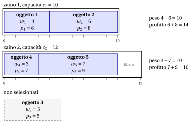

# 2.7 Il problema degli zaini multipli { #sez-sec-kp-MKP }

**Parte 1 · Problemi di ottimizzazione combinatoria · Capitolo 2** · [:material-book-open-variant: Capitolo 2: Problemi di zaino](index.md) · [:material-file-pdf-box: Dispensa, volume 1 (PDF)](../../pdf/dispensa-1-problemi-di-ottimizzazione-combinatoria.pdf) · [:material-pencil: Esercizi: Problemi di zaino](../../esercizi/knapsack.md) · [:material-gesture-tap: App: Forza bruta sul problema dello zaino 0/1](../../laboratorio/zaino-forza-bruta.md)

!!! definizione "Definizione 2.7: problema degli zaini multipli"

    Dati:

    1. $m \in \Z_{\ge 1}$ zaini,

    2. per ogni zaino $k \in \underbrace{\{1,2,\dots,m\}}_{=\mathscr{K}}$, una <em>capacità</em> $c_k \in \Z_{\ge 1}$,

    3. un insieme $\mathscr{I} = \{1,2,\dots,n\}$ di $n$ oggetti,

    4. per ogni oggetto $j \in \mathscr{I}$, un <em>profitto</em> $p_j \in \Z_{\ge 1}$ e un <em>peso</em> $w_{j} \in \Z_{\ge 1}$,

    il <strong>problema degli zaini multipli</strong> (MKP) chiede di decidere quali oggetti inserire in ogni zaino, in modo che in ogni zaino il peso totale degli oggetti assegnati non superi la sua capacità e il profitto totale degli oggetti selezionati sia massimo.

- Un'<strong>istanza dell'MKP</strong> è specificata da:

    1. due numeri interi:

        - il numero di oggetti $n \in \Z_{\ge 1}$,

        - il numero di zaini $m \in \Z_{\ge 1}$,

    2. un vettore di numeri interi di lunghezza $n$:

        - $\vet{p} \in \Z_{\ge 1}^n$, che contiene i profitti degli oggetti,

    3. un vettore di numeri interi di lunghezza $n$:

        - $\vet{w} \in \Z_{\ge 1}^n$, che contiene i pesi degli oggetti,

    4. un vettore di numeri interi di lunghezza $m$:

        - $\vet{c} \in \Z_{\ge 1}^m$, che contiene le capacità degli zaini.

- Una <strong>soluzione ammissibile dell'MKP</strong> è una famiglia di sottoinsiemi di oggetti

    $$
    \mathcal{S}=\{S_k\}_{k\in \mathscr{K}},
    \qquad S_k \subseteq \mathscr{I} \ \ \text{per ogni } k\in \mathscr{K},
    $$

    tale che:

    - **(i)** ogni oggetto è assegnato ad al più uno zaino, ossia

        $$
        S_k \cap S_{k'}=\emptyset \quad \text{per ogni } k,k'\in \mathscr{K}\ \text{con } k\neq k';
        $$

    - **(ii)** il peso totale degli oggetti assegnati a ogni zaino rispetta la sua capacità, ossia

        $$
        \sum_{j\in S_k} w_j \le c_k \quad \text{per ogni } k\in \mathscr{K}.
        $$

    Di conseguenza, l'MKP si può enunciare in modo equivalente come il problema di selezionare sottoinsiemi di oggetti a due a due disgiunti, uno per ogni zaino, in modo che ogni capacità sia rispettata e il profitto totale sia massimo.

    !!! chiave ""

        Data un'istanza dell'MKP, l'MKP si può enunciare formalmente come:

        \begin{equation*}
        \label{MKP}
        \tilde{\mathcal{S}}
        \in
        \argmax_{\mathcal{S}=\{S_k\}_{k\in \mathscr{K}}}
        \left\{
        \sum_{k\in \mathscr{K}} \ \sum_{j\in S_k} p_j
        \;:\;
        \begin{array}{l}
        S_k \subseteq \mathscr{I} \quad \forall\, k\in \mathscr{K},\\[6pt]
        S_k \cap S_{k'}=\emptyset \quad \forall\, k,k'\in \mathscr{K}\ \text{con } k\neq k',\\[10pt]
        \displaystyle \sum_{j\in S_k} w_j \le c_k \quad \forall\, k\in \mathscr{K}
        \end{array}
        \right\}. \tag{2.9}
        \end{equation*}

!!! esempio "Esempio 2.6: istanza dell'MKP"

    Consideriamo $m = 2$ zaini con capacità $c_1 = 10$ e $c_2 = 12$, e un insieme $\mathscr{I} = \{1,2,3,4,5\}$ di $5$ oggetti ($n = 5$), con i seguenti profitti e pesi:

    
<table>
    <tr>
    <th>Oggetti</th>
    <th></th>
    <th>\(j = 1\)</th>
    <th>\(j = 2\)</th>
    <th>\(j = 3\)</th>
    <th>\(j = 4\)</th>
    <th>\(j = 5\)</th>
    </tr>
    <tr>
    <td>Profitti</td>
    <td>\(p_j\)</td>
    <td>\(6\)</td>
    <td>\(8\)</td>
    <td>\(5\)</td>
    <td>\(7\)</td>
    <td>\(9\)</td>
    </tr>
    <tr>
    <td>Pesi</td>
    <td>\(w_j\)</td>
    <td>\(4\)</td>
    <td>\(6\)</td>
    <td>\(5\)</td>
    <td>\(3\)</td>
    <td>\(7\)</td>
    </tr>
    </table>

    Il disegno mostra una soluzione ottima: $S_1=\{1,2\}$ nello zaino $1$ e $S_2=\{4,5\}$ nello zaino $2$, con profitto totale $14+16=30$; l'oggetto $3$ resta fuori.

    { .fig loading=lazy  }

## 2.7.1 Ipotesi

- Facciamo le seguenti ipotesi:

    1. L'insieme di tutti gli oggetti <em>non</em> entra nel complesso degli zaini (altrimenti selezionare tutti gli oggetti è ammissibile e ottimo). Formalmente,

        $$
        \sum_{j\in \mathscr{I}} w_j \;>\; \sum_{k\in \mathscr{K}} c_k .
        $$

    2. Ogni oggetto, da solo, entra in (almeno) uno zaino (altrimenti non può mai essere selezionato). Formalmente,

        $$
        \exists\, k\in \mathscr{K}\ \text{tale che}\ w_j \le c_k, \qquad \forall\, j\in \mathscr{I}.
        $$

---

**Avanti:** [2.8 Il problema dello zaino a scelta multipla](il-problema-dello-zaino-a-scelta-multipla.md)
