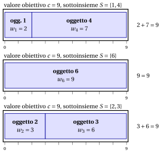

# 2.3 Il problema del subset sum { #sez-sec-kp-SSP }

**Parte 1 · Problemi di ottimizzazione combinatoria · Capitolo 2** · [:material-book-open-variant: Capitolo 2: Problemi di zaino](index.md) · [:material-file-pdf-box: Dispensa, volume 1 (PDF)](../../pdf/dispensa-1-problemi-di-ottimizzazione-combinatoria.pdf) · [:material-presentation: Slide](../../pdf/slide-knapsack.pdf) · [:material-pencil: Esercizi: Problemi di zaino](../../esercizi/knapsack.md) · [:material-gesture-tap: App: Forza bruta sul problema dello zaino 0/1](../../laboratorio/zaino-forza-bruta.md)

!!! definizione "Definizione 2.3: problema del subset sum"

    Dati:

    1. un valore obiettivo $c \in \Z_{\ge 1}$,

    2. un insieme $\mathscr{I} = \{1,2,\dots,n\}$ di $n$ oggetti,

    3. per ogni oggetto $j \in \mathscr{I}$, un <em>peso</em> $w_j \in \Z_{\ge 1}$,

    il <strong>problema del subset sum</strong> (SSP) chiede se esiste un sottoinsieme di oggetti il cui peso totale è esattamente uguale al valore obiettivo $c$.

- Un'<strong>istanza del SSP</strong> è specificata da:

    1. due numeri interi:

        - il numero di oggetti $n \in \Z_{\ge 1}$,

        - il valore obiettivo $c \in \Z_{\ge 1}$,

    2. un vettore di numeri interi di lunghezza $n$:

        - $\vet{w} \in \Z_{\ge 1}^n$, che contiene i pesi degli oggetti.

- Una <strong>soluzione ammissibile del SSP</strong> è un sottoinsieme di oggetti

    $$
    S \subseteq \mathscr{I}
    $$

    tale che il peso totale degli oggetti selezionati è esattamente uguale al valore obiettivo, ossia

    $$
    \sum_{j\in S} w_j = c .
    $$

    Di conseguenza, il SSP si può enunciare in modo equivalente come il problema di selezionare un sottoinsieme di oggetti il cui peso totale coincide esattamente con il valore obiettivo.

    !!! chiave ""

        Data un'istanza del SSP, il SSP si può enunciare formalmente come:

        \begin{equation*}
        \label{SSP}
        \text{trovare } S \subseteq \mathscr{I}
        \quad \text{tale che} \quad
        \sum_{j \in S} w_j = c . \tag{2.2}
        \end{equation*}

!!! esempio "Esempio 2.2: istanza del SSP"

    Consideriamo un valore obiettivo $c = 9$ e un insieme $\mathscr{I} = \{1,2,3,4,5,6\}$ di $6$ oggetti ($n = 6$), con i seguenti pesi:

    
<table>
    <tr>
    <th>Oggetti</th>
    <th></th>
    <th>\(j = 1\)</th>
    <th>\(j = 2\)</th>
    <th>\(j = 3\)</th>
    <th>\(j = 4\)</th>
    <th>\(j = 5\)</th>
    <th>\(j = 6\)</th>
    </tr>
    <tr>
    <td>Pesi</td>
    <td>\(w_j\)</td>
    <td>\(2\)</td>
    <td>\(3\)</td>
    <td>\(6\)</td>
    <td>\(7\)</td>
    <td>\(5\)</td>
    <td>\(9\)</td>
    </tr>
    </table>

    Per esempio, il sottoinsieme $S=\{1,4\}$ è ammissibile poiché $w_1+w_4=2+7=9$. Anche il sottoinsieme $S=\{6\}$ è ammissibile poiché $w_6=9$. Il disegno mostra i tre sottoinsiemi i cui pesi riempiono esattamente la scatola di lunghezza $c=9$: $\{1,4\}$, $\{6\}$ e $\{2,3\}$.

    { .fig loading=lazy  }

- Il SSP non è un <strong>problema di ottimizzazione</strong>, poiché la sua risposta è <strong>sì</strong> oppure <strong>no</strong>. Tuttavia, si può risolvere usando un problema di ottimizzazione.

- Un'istanza del SSP si può risolvere come un'istanza del KP ponendo il profitto di ogni oggetto uguale al suo peso, ossia

    $$
    p_j = w_j, \qquad \forall j\in \mathscr{I}.
    $$

    In questo caso, risolviamo il seguente KP:

    \begin{equation*}
    \tilde{S}\in \arg\max_{S \subseteq \mathscr{I}}
    \left\{~~ \sum_{j \in S} w_j \;\;:\;\; \sum_{j \in S} w_j \le c ~~\right\}.
    \end{equation*}

    Se $\sum_{j\in \tilde{S}} w_j = c$, la risposta al SSP è <strong>sì</strong>; altrimenti, se $\sum_{j\in \tilde{S}} w_j < c$, la risposta è <strong>no</strong>.

## 2.3.1 Ipotesi

- Facciamo le seguenti ipotesi:

    1. Il peso totale di tutti gli oggetti è almeno pari al valore obiettivo (altrimenti non può esistere alcun sottoinsieme ammissibile). Formalmente:

        $$
        \sum_{j \in \mathscr{I}} w_j \ge c
        $$

    2. Il peso di ogni oggetto non supera il valore obiettivo (altrimenti l'oggetto non può appartenere ad alcun sottoinsieme ammissibile). Formalmente:

        $$
        w_j \le c,~~~~ \forall j \in \mathscr{I}
        $$

---

**Avanti:** [2.4 Il problema dello zaino limitato](il-problema-dello-zaino-limitato.md)
