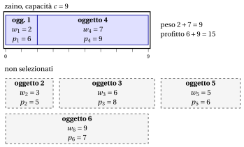

# 2.2 Il problema dello zaino 0/1 { #sez-sec-kp-KP }

**Parte 1 · Problemi di ottimizzazione combinatoria · Capitolo 2** · [:material-book-open-variant: Capitolo 2: Problemi di zaino](index.md) · [:material-file-pdf-box: Dispensa, volume 1 (PDF)](../../pdf/dispensa-1-problemi-di-ottimizzazione-combinatoria.pdf) · [:material-presentation: Slide](../../pdf/slide-knapsack.pdf) · [:material-pencil: Esercizi: Problemi di zaino](../../esercizi/knapsack.md) · [:material-gesture-tap: App: Forza bruta sul problema dello zaino 0/1](../../laboratorio/zaino-forza-bruta.md)

!!! definizione "Definizione 2.1: problema dello zaino 0/1"

    Dati:

    1. uno zaino di <em>capacità</em> $c \in \Z_{\ge 1}$,

    2. un insieme $\mathscr{I} = \{1,2,\dots,n\}$ di $n$ oggetti,

    3. per ogni oggetto $j \in \mathscr{I}$, un <em>profitto</em> $p_j \in \Z_{\ge 1}$ e un <em>peso</em> $w_j \in \Z_{\ge 1}$,

    il <strong>problema dello zaino 0/1</strong> (KP) chiede di decidere quali oggetti inserire nello zaino, in modo che il peso totale degli oggetti selezionati non superi la capacità dello zaino e il profitto totale degli oggetti selezionati sia massimo.

- Un'<strong>istanza del KP</strong> è specificata da:

    1. due numeri interi:

        - il numero di oggetti $n \in \Z_{\ge 1}$,

        - la capacità dello zaino $c \in \Z_{\ge 1}$,

    2. due vettori di numeri interi di lunghezza $n$:

        - $\vet{p} \in \Z_{\ge 1}^n$, che contiene i profitti degli oggetti,

        - $\vet{w} \in \Z_{\ge 1}^n$, che contiene i pesi degli oggetti.

- Una <strong>soluzione ammissibile del KP</strong> è un sottoinsieme di oggetti

    $$
    S \subseteq \mathscr{I}
    $$

    tale che il peso totale degli oggetti selezionati non supera la capacità dello zaino, ossia

    $$
    \sum_{j\in S} w_j \le c .
    $$

    Di conseguenza, il KP si può enunciare in modo equivalente come il problema di selezionare un sottoinsieme di oggetti il cui peso totale rispetta la capacità dello zaino e il cui profitto totale è massimo.

    !!! chiave ""

        Data un'istanza del KP, il KP si può enunciare formalmente come:

        \begin{equation*}
        \label{KP}
        \tilde{S}\in \arg\max_{S \subseteq \mathscr{I}}
        \left\{~~ \sum_{j \in S} p_j \;\;:\;\; \sum_{j \in S} w_j \le c ~~\right\}. \tag{2.1}
        \end{equation*}

!!! esempio "Esempio 2.1: istanza del KP"

    Consideriamo uno zaino di capacità $c = 9$ e un insieme $\mathscr{I} = \{1,2,3,4,5,6\}$ di $6$ oggetti ($n = 6$), con i seguenti profitti e pesi:

    
<table>
    <tr>
    <th>Oggetti</th>
    <th></th>
    <th>\(j = 1\)</th>
    <th>\(j = 2\)</th>
    <th>\(j = 3\)</th>
    <th>\(j = 4\)</th>
    <th>\(j = 5\)</th>
    <th>\(j = 6\)</th>
    </tr>
    <tr>
    <td>Profitti</td>
    <td>\(p_j\)</td>
    <td>\(6\)</td>
    <td>\(5\)</td>
    <td>\(8\)</td>
    <td>\(9\)</td>
    <td>\(6\)</td>
    <td>\(7\)</td>
    </tr>
    <tr>
    <td>Pesi</td>
    <td>\(w_j\)</td>
    <td>\(2\)</td>
    <td>\(3\)</td>
    <td>\(6\)</td>
    <td>\(7\)</td>
    <td>\(5\)</td>
    <td>\(9\)</td>
    </tr>
    </table>

    Nel disegno, lo zaino è una scatola di lunghezza $c=9$ e ogni oggetto è un blocco di lunghezza $w_j$. Gli oggetti $1$ e $4$ riempiono lo zaino, con peso $9$ e profitto $15$; gli altri oggetti restano fuori (tratteggiati).

    { .fig loading=lazy  }

    Chiamiamo questa istanza del KP [Esempio 2.1](#box-2-ex-kp): è l'istanza di riferimento del capitolo.

## 2.2.1 Ipotesi

- Facciamo le seguenti ipotesi:

    1. Il peso totale di tutti gli oggetti supera la capacità dello zaino (altrimenti si potrebbero selezionare tutti gli oggetti). Formalmente:

        $$
        \sum_{j \in \mathscr{I}} w_j > c
        $$

    2. Ogni oggetto, da solo, entra nello zaino (altrimenti non può essere selezionato). Formalmente:

        $$
        w_j \le c,~~~~ \forall j \in \mathscr{I}
        $$

## 2.2.2 Contare le soluzioni, una prima soluzione e un bound semplice

- <strong>Soluzioni candidate.</strong> Ogni sottoinsieme di $\mathscr{I}$ è una soluzione candidata, quindi ce ne sono $2^n$ ([Capitolo 1 «Problemi di ottimizzazione combinatoria»](../combinatorial-optimization/contare-le-soluzioni.md)). Per l'[Esempio 2.1](#box-2-ex-kp) abbiamo $2^6 = 64$.

- <strong>Soluzioni ammissibili.</strong> I tre oggetti più leggeri pesano $2+3+5 = 10 > 9$, quindi nessun sottoinsieme con tre o più oggetti è ammissibile. Le soluzioni ammissibili sono l'insieme vuoto, i $6$ singoletti e le $6$ coppie della tabella seguente: $13$ soluzioni su $64$.

<table>
<tr>
<th>coppia \(S\)</th>
<th>\(\{1,2\}\)</th>
<th>\(\{1,3\}\)</th>
<th>\(\{1,4\}\)</th>
<th>\(\{1,5\}\)</th>
<th>\(\{2,3\}\)</th>
<th>\(\{2,5\}\)</th>
</tr>
<tr>
<td>peso</td>
<td>\(5\)</td>
<td>\(8\)</td>
<td>\(9\)</td>
<td>\(7\)</td>
<td>\(9\)</td>
<td>\(8\)</td>
</tr>
<tr>
<td>profitto</td>
<td>\(11\)</td>
<td>\(14\)</td>
<td>\(\mathbf{15}\)</td>
<td>\(12\)</td>
<td>\(13\)</td>
<td>\(11\)</td>
</tr>
</table>

- <strong>Una prima soluzione, a occhio.</strong> L'oggetto $4$ ha il profitto massimo ($9$, peso $7$). La capacità residua $9-7=2$ basta per l'oggetto $1$ (peso $2$, profitto $6$). Il sottoinsieme $\{1,4\}$ ha peso $9$ e profitto $15$: è un <strong>bound primale</strong>, $\LB = 15 \le z(I)$.

!!! teorema "Osservazione 2.2: bound di cardinalità"

    Sia $\bar k$ il più grande intero tale che i $\bar k$ oggetti più leggeri pesano al più $c$. Ogni sottoinsieme ammissibile ha al più $\bar k$ oggetti, quindi $z(I)$ è al più la somma dei $\bar k$ profitti più grandi.

??? dimostrazione "Dimostrazione"

    Un sottoinsieme con $k$ oggetti pesa almeno quanto i $k$ oggetti più leggeri. Se $k > \bar k$, i $k$ oggetti più leggeri pesano più di $c$, quindi il sottoinsieme non è ammissibile. Il profitto di un sottoinsieme con al più $\bar k$ oggetti è al più la somma dei $\bar k$ profitti più grandi. □

- <strong>Un primo bound duale.</strong> Nell'[Esempio 2.1](#box-2-ex-kp) abbiamo $\bar k = 2$, poiché $2+3 = 5 \le 9$ e $2+3+5 = 10 > 9$. I due profitti più grandi sono $9$ e $8$, quindi $\UB = 17$. La somma di tutti i profitti, $41$, è un bound duale molto più debole.

- <strong>Il gap.</strong> Abbiamo $15 \le z(I) \le 17$: il gap assoluto è $2$ e il gap relativo è $\tfrac{2}{15}$. Elencando i $13$ sottoinsiemi ammissibili si vede che $\{1,4\}$ è l'unica soluzione ottima e $z(I) = 15$; per istanze più grandi servono bound più forti, che vengono dai rilassamenti (modulo <em>Programmazione lineare intera</em>, [Capitolo 2 «Bound primali e duali»](https://fabiofurini.github.io/programmazione-lineare-intera/modelli-e-bound/lp-relaxation/)).

---

**Avanti:** [2.3 Il problema del subset sum](il-problema-del-subset-sum.md)
