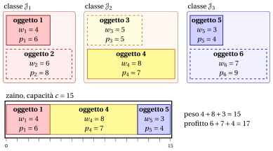

# 2.8 Il problema dello zaino a scelta multipla { #sez-sec-kp-MCKP }

**Parte 1 · Problemi di ottimizzazione combinatoria · Capitolo 2** · [:material-book-open-variant: Capitolo 2: Problemi di zaino](index.md) · [:material-file-pdf-box: Dispensa, volume 1 (PDF)](../../pdf/dispensa-1-problemi-di-ottimizzazione-combinatoria.pdf) · [:material-pencil: Esercizi: Problemi di zaino](../../esercizi/knapsack.md) · [:material-gesture-tap: App: Forza bruta sul problema dello zaino 0/1](../../laboratorio/zaino-forza-bruta.md)

!!! definizione "Definizione 2.8: problema dello zaino a scelta multipla"

    Dati:

    1. uno zaino di <em>capacità</em> $c \in \Z_{\ge 1}$,

    2. un insieme $\mathscr{I} = \{1,2,\dots,n\}$ di $n$ oggetti,

    3. una partizione dell'insieme degli oggetti in $q \in \Z_{\ge 2}$ classi,

    4. per ogni classe $h \in \{1,2,\dots,q\}$, il sottoinsieme $\mathscr{J}_h \subseteq \mathscr{I}$ degli oggetti di quella classe,

    5. per ogni oggetto $j \in \mathscr{I}$, un <em>profitto</em> $p_j \in \Z_{\ge 1}$ e un <em>peso</em> $w_j \in \Z_{\ge 1}$,

    il <strong>problema dello zaino a scelta multipla</strong> (MCKP) chiede di decidere quali oggetti inserire nello zaino, in modo che da ogni classe sia selezionato esattamente un oggetto, che il peso totale degli oggetti selezionati non superi la capacità dello zaino e che il profitto totale degli oggetti selezionati sia massimo.

- Un'<strong>istanza dell'MCKP</strong> è specificata da:

    1. due numeri interi:

        - il numero di oggetti $n \in \Z_{\ge 1}$,

        - la capacità dello zaino $c \in \Z_{\ge 1}$,

    2. un vettore di numeri interi di lunghezza $n$:

        - $\vet{p} \in \Z_{\ge 1}^n$, che contiene i profitti degli oggetti,

    3. un vettore di numeri interi di lunghezza $n$:

        - $\vet{w} \in \Z_{\ge 1}^n$, che contiene i pesi degli oggetti,

    4. un numero intero:

        - il numero di classi $q \in \Z_{\ge 2}$,

    5. una famiglia di sottoinsiemi:

        - $\{ \mathscr{J}_1, \mathscr{J}_2, \dots, \mathscr{J}_q \}$, una partizione di $\mathscr{I}$ in $q$ classi, dove $\mathscr{J}_h \subseteq \mathscr{I}$ è l'insieme degli oggetti che appartengono alla classe $h$.

- Una <strong>soluzione ammissibile dell'MCKP</strong> è un sottoinsieme di oggetti

    $$
    S \subseteq \mathscr{I}
    $$

    tale che:

    - **(i)** da ogni classe è selezionato esattamente un oggetto, ossia

        $$
        |S \cap \mathscr{J}_h| = 1 \qquad \text{per ogni } h\in\{1,2,\dots,q\};
        $$

    - **(ii)** il peso totale degli oggetti selezionati non supera la capacità dello zaino, ossia

        $$
        \sum_{j\in S} w_j \le c.
        $$

    Di conseguenza, l'MCKP si può enunciare in modo equivalente come il problema di selezionare esattamente un oggetto da ogni classe in modo che la capacità dello zaino sia rispettata e il profitto totale sia massimo.

    !!! chiave ""

        Data un'istanza dell'MCKP, l'MCKP si può enunciare formalmente come:

        \begin{equation*}
        \label{MCKP}
        \tilde{S}\in \argmax_{S \subseteq \mathscr{I}}
        \left\{
        ~~ \sum_{j \in S} p_j
        \;\;:\;\;
        \sum_{j \in S} w_j \le c,\ \
        |S \cap \mathscr{J}_h| = 1 \ \ \forall\, h\in\{1,2,\dots,q\}
        ~~\right\}. \tag{2.10}
        \end{equation*}

!!! esempio "Esempio 2.7: istanza dell'MCKP"

    Consideriamo uno zaino di capacità $c = 15$ e un insieme $\mathscr{I} = \{1,2,3,4,5,6\}$ di $6$ oggetti ($n = 6$). Gli oggetti sono partizionati in $q = 3$ classi: $\mathscr{J}_1 = \{1,2\}$, $\mathscr{J}_2 = \{3,4\}$, $\mathscr{J}_3 = \{5,6\}$. I profitti e i pesi sono i seguenti:

    
<table>
    <tr>
    <th>Oggetti</th>
    <th></th>
    <th>\(j = 1\)</th>
    <th>\(j = 2\)</th>
    <th>\(j = 3\)</th>
    <th>\(j = 4\)</th>
    <th>\(j = 5\)</th>
    <th>\(j = 6\)</th>
    </tr>
    <tr>
    <td>Profitti</td>
    <td>\(p_j\)</td>
    <td>\(6\)</td>
    <td>\(8\)</td>
    <td>\(5\)</td>
    <td>\(7\)</td>
    <td>\(4\)</td>
    <td>\(9\)</td>
    </tr>
    <tr>
    <td>Pesi</td>
    <td>\(w_j\)</td>
    <td>\(4\)</td>
    <td>\(6\)</td>
    <td>\(5\)</td>
    <td>\(8\)</td>
    <td>\(3\)</td>
    <td>\(7\)</td>
    </tr>
    </table>

    Nel disegno ogni classe è un gruppo colorato, e l'oggetto scelto in ogni classe è disegnato pieno, l'altro tratteggiato. Una soluzione ottima, $\{1,4,5\}$, riempie lo zaino, con peso $4+8+3=15$ e profitto $6+7+4=17$.

    { .fig loading=lazy  }

## 2.8.1 Ipotesi

- Facciamo le seguenti ipotesi:

    1. Ogni classe contiene almeno un oggetto (altrimenti selezionare esattamente un oggetto da ogni classe è impossibile). Formalmente:

        $$
        \mathscr{J}_h \neq \emptyset \qquad \forall\, h\in\{1,\dots,q\}.
        $$

    2. L'istanza è ammissibile, ossia esiste almeno una scelta di esattamente un oggetto per classe che entra nello zaino. Una condizione necessaria e sufficiente (e facile da verificare) è:

        $$
        \sum_{h=1}^{q}\ \min_{j\in \mathscr{J}_h} w_j \;\le\; c.
        $$

---

**Avanti:** [2.9 Il problema dello zaino con setup](il-problema-dello-zaino-con-setup.md)
