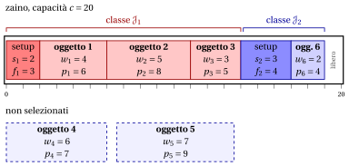

# 2.9 Il problema dello zaino con setup { #sez-sec-kp-KPS }

**Parte 1 · Problemi di ottimizzazione combinatoria · Capitolo 2** · [:material-book-open-variant: Capitolo 2: Problemi di zaino](index.md) · [:material-file-pdf-box: Dispensa, volume 1 (PDF)](../../pdf/dispensa-1-problemi-di-ottimizzazione-combinatoria.pdf) · [:material-pencil: Esercizi: Problemi di zaino](../../esercizi/knapsack.md) · [:material-gesture-tap: App: Forza bruta sul problema dello zaino 0/1](../../laboratorio/zaino-forza-bruta.md)

!!! definizione "Definizione 2.9: problema dello zaino con setup"

    Dati:

    1. uno zaino di <em>capacità</em> $c \in \Z_{\ge 1}$,

    2. un insieme $\mathscr{I} = \{1,2,\dots,n\}$ di $n$ oggetti,

    3. una partizione dell'insieme degli oggetti in $q \in \Z_{\ge 2}$ classi,

    4. per ogni classe $h \in \{1,2,\dots,q\}$, il sottoinsieme $\mathscr{J}_h \subseteq \mathscr{I}$ degli oggetti di quella classe, con un <em>costo di setup</em> $f_h \in \Z_{\ge 1}$ e un <em>peso di setup</em> $s_h \in \Z_{\ge 1}$ associati,

    5. per ogni oggetto $j \in \mathscr{I}$, un <em>ricavo</em> $p_j \in \Z_{\ge 1}$ e un <em>peso</em> $w_j \in \Z_{\ge 1}$,

    il <strong>problema dello zaino con setup</strong> (KPS) chiede di decidere quali oggetti inserire nello zaino, in modo che il peso totale degli oggetti selezionati più i pesi di setup delle loro classi non superi la capacità dello zaino e il ricavo totale degli oggetti selezionati meno i costi di setup delle loro classi sia massimo.

- Un'<strong>istanza del KPS</strong> è specificata da:

    1. due numeri interi:

        - il numero di oggetti $n \in \Z_{\ge 1}$,

        - la capacità dello zaino $c \in \Z_{\ge 1}$,

    2. un vettore di numeri interi di lunghezza $n$:

        - $\vet{p} \in \Z_{\ge 1}^n$, che contiene i ricavi degli oggetti,

    3. un vettore di numeri interi di lunghezza $n$:

        - $\vet{w} \in \Z_{\ge 1}^n$, che contiene i pesi degli oggetti,

    4. un numero intero:

        - il numero di classi $q \in \Z_{\ge 2}$,

    5. una famiglia di sottoinsiemi:

        - $\{ \mathscr{J}_1, \mathscr{J}_2, \dots, \mathscr{J}_q \}$, una partizione di $\mathscr{I}$ in $q$ classi, dove $\mathscr{J}_h \subseteq \mathscr{I}$ è l'insieme degli oggetti che appartengono alla classe $h$,

    6. due vettori di numeri interi di lunghezza $q$:

        - $\vet{f} \in \Z_{\ge 1}^q$, che contiene i costi di setup delle classi,

        - $\vet{s} \in \Z_{\ge 1}^q$, che contiene i pesi di setup delle classi.

- Una <strong>soluzione ammissibile del KPS</strong> è un sottoinsieme di oggetti

    $$
    S \subseteq \mathscr{I}.
    $$

    Dato $S$, definiamo l'insieme delle <strong>classi attivate</strong> come

    $$
    \mathscr{H}(S) \;:=\; \big\{\, h\in\{1,2,\dots,q\} : S\cap \mathscr{J}_h \neq \emptyset \,\big\}.
    $$

    Il sottoinsieme $S$ è ammissibile se il peso totale degli oggetti selezionati più i pesi di setup delle classi attivate non supera la capacità dello zaino, ossia

    $$
    \sum_{j\in S} w_j \;+\; \sum_{h\in \mathscr{H}(S)} s_h \;\le\; c.
    $$

    Di conseguenza, il KPS si può enunciare in modo equivalente come il problema di selezionare un sottoinsieme di oggetti che massimizza il ricavo totale degli oggetti selezionati meno i costi di setup delle classi attivate.

    !!! chiave ""

        Data un'istanza del KPS, il KPS si può enunciare formalmente come:

        \begin{equation*}
        \label{KPS}
        \tilde{S}\in \argmax_{S \subseteq \mathscr{I}}
        \left\{~~
        \sum_{j \in S} p_j \;-\; \sum_{h\in \mathscr{H}(S)} f_h
        \;\;:\;\;
        \sum_{j\in S} w_j \;+\; \sum_{h\in \mathscr{H}(S)} s_h \le c
        ~~\right\}. \tag{2.11}
        \end{equation*}

!!! esempio "Esempio 2.8: istanza del KPS"

    Consideriamo uno zaino di capacità $c = 20$ e un insieme $\mathscr{I} = \{1,2,3,4,5,6\}$ di $6$ oggetti ($n = 6$). Gli oggetti sono partizionati in $q = 2$ classi: $\mathscr{J}_1 = \{1,2,3\}$ e $\mathscr{J}_2 = \{4,5,6\}$. Ogni classe ha un costo di setup e un peso di setup: $f_1 = 3$, $s_1 = 2$ per la classe 1, e $f_2 = 4$, $s_2 = 3$ per la classe 2. I ricavi e i pesi degli oggetti sono i seguenti:

    
<table>
    <tr>
    <th>Oggetti</th>
    <th></th>
    <th>\(j = 1\)</th>
    <th>\(j = 2\)</th>
    <th>\(j = 3\)</th>
    <th>\(j = 4\)</th>
    <th>\(j = 5\)</th>
    <th>\(j = 6\)</th>
    </tr>
    <tr>
    <td>Ricavi</td>
    <td>\(p_j\)</td>
    <td>\(6\)</td>
    <td>\(8\)</td>
    <td>\(5\)</td>
    <td>\(7\)</td>
    <td>\(9\)</td>
    <td>\(4\)</td>
    </tr>
    <tr>
    <td>Pesi</td>
    <td>\(w_j\)</td>
    <td>\(4\)</td>
    <td>\(5\)</td>
    <td>\(3\)</td>
    <td>\(6\)</td>
    <td>\(7\)</td>
    <td>\(2\)</td>
    </tr>
    </table>

    Nel disegno le classi hanno due colori, e un blocco più scuro è il setup di una classe, con il suo peso $s_h$ e il suo costo $f_h$. Una soluzione ottima, $\{1,2,3,6\}$, attiva entrambe le classi: il peso è $(2+4+5+3)+(3+2)=19\le 20$ e il valore è $(6+8+5+4)-(3+4)=16$.

    { .fig loading=lazy  }

## 2.9.1 Ipotesi

- Facciamo le seguenti ipotesi:

    1. Ogni classe contiene almeno un oggetto. Formalmente:

        $$
        \mathscr{J}_h \neq \emptyset \qquad \forall\, h\in\{1,2,\dots,q\}.
        $$

    2. Ogni oggetto entra nello zaino insieme al peso di setup della sua classe (altrimenti non può mai essere selezionato). Formalmente:

        $$
        w_j + s_h \le c \qquad \forall\, h\in\{1,2,\dots,q\},\ \forall\, j\in \mathscr{J}_h.
        $$

## 2.10 Osservazioni

- Dantzig (1957) ordinò gli oggetti per efficienza $p_j/w_j$ non crescente e usò questo ordine per risolvere la versione continua del KP; lo stesso ordine ritorna nei bound dei capitoli successivi.

- Karp (1972) inserì il problema del subset sum, chiamato knapsack nel suo articolo, fra i primi $21$ problemi NP-completi. Il KP contiene il SSP come caso particolare $p_j = w_j$, quindi è NP-hard.

- Ibarra e Kim (1975) diedero il primo schema di approssimazione pienamente polinomiale (FPTAS) per il KP.

## 2.11 Errori tipici

!!! attenzione "Attenzione"

    - <strong>Confondere il KP con il SSP.</strong> Il SSP chiede un peso totale <em>esattamente</em> uguale a $c$ e ha una risposta sì/no; è il KP con $p_j = w_j$, in cui la risposta è sì se il valore ottimo è $c$.

    - <strong>Fermarsi all'ordine di efficienza.</strong> Prendere gli oggetti nell'ordine $1, 2, 3, \dots$ di $p_j/w_j$ non crescente dà $\{1,2\}$ con profitto $11$, mentre la soluzione ottima dell'[Esempio 2.1](il-problema-dello-zaino-0-1.md#box-2-ex-kp) è $\{1,4\}$ con profitto $15$.

    - <strong>Contare copie identiche come soluzioni diverse.</strong> Nel BKP e nell'UKP le copie $(j,k)$ dello stesso oggetto sono intercambiabili: sottoinsiemi diversi dell'insieme esteso degli oggetti possono dare lo stesso riempimento.

    - <strong>Scegliere al più un oggetto per classe.</strong> Nell'MCKP si seleziona esattamente un oggetto per classe, quindi un'istanza può essere inammissibile; nel KPS una classe senza oggetti selezionati non costa nulla.

    - <strong>Dimenticare le ipotesi.</strong> Un oggetto con $w_j > c$ non può mai essere selezionato, e se tutti gli oggetti entrano il problema è banale: entrambi i casi si eliminano prima di risolvere.

## 2.12 In sintesi

!!! chiave "In sintesi"

    - Il KP seleziona un sottoinsieme di oggetti di peso al più $c$ e profitto massimo; una soluzione è un sottoinsieme, e le candidate sono $2^n$ sottoinsiemi.

    - Il SSP, il BKP, l'UKP, l'MDKP, l'MKP, l'MCKP e il KPS cambiano il numero di copie, di risorse, di zaini o la struttura degli oggetti; ciascuno ha le sue ipotesi sui dati.

    - Una soluzione trovata a occhio è un bound primale; il bound di cardinalità è un bound duale che usa solo i pesi e i profitti.

    - L'ordine di efficienza non basta a trovare una soluzione ottima, neppure su una piccola istanza.

    <strong>Quadro riassuntivo dell'istanza di riferimento.</strong>

    
<table>
    <tr>
    <th>KP, <a href="../il-problema-dello-zaino-0-1/#box-2-ex-kp">Esempio 2.1</a> (max)</th>
    <th>lower bound</th>
    <th>upper bound</th>
    <th>da</th>
    </tr>
    <tr>
    <td>questo capitolo</td>
    <td>\(15\) (a occhio)</td>
    <td>\(17\) (bound di cardinalità)</td>
    <td>definizione</td>
    </tr>
    </table>

---

**Esercizi su questo capitolo:** [:material-pencil: Problemi di zaino](../../esercizi/knapsack.md)

---

**Approfondimento:** [:material-view-list: che cosa fa il corso su questo problema](../../catalogo/knapsack-problem.md)

