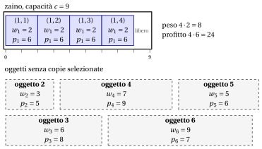

# 2.5 Il problema dello zaino illimitato { #sez-sec-kp-UKP }

**Parte 1 · Problemi di ottimizzazione combinatoria · Capitolo 2** · [:material-book-open-variant: Capitolo 2: Problemi di zaino](index.md) · [:material-file-pdf-box: Dispensa, volume 1 (PDF)](../../pdf/dispensa-1-problemi-di-ottimizzazione-combinatoria.pdf) · [:material-pencil: Esercizi: Problemi di zaino](../../esercizi/knapsack.md) · [:material-gesture-tap: App: Forza bruta sul problema dello zaino 0/1](../../laboratorio/zaino-forza-bruta.md)

!!! definizione "Definizione 2.5: problema dello zaino illimitato"

    Dati:

    1. uno zaino di <em>capacità</em> $c \in \Z_{\ge 1}$,

    2. un insieme $\mathscr{I} = \{1,2,\dots,n\}$ di $n$ oggetti,

    3. per ogni oggetto $j \in \mathscr{I}$, disponibile in un numero illimitato di copie, un <em>profitto</em> $p_j \in \Z_{\ge 1}$ e un <em>peso</em> $w_j \in \Z_{\ge 1}$,

    il <strong>problema dello zaino illimitato</strong> (UKP) chiede di decidere quante copie di ogni oggetto inserire nello zaino, in modo che il peso totale di tutte le copie selezionate non superi la capacità dello zaino e il profitto totale di tutte le copie selezionate sia massimo.

- Un'<strong>istanza dell'UKP</strong> è specificata da:

    1. due numeri interi:

        - il numero di oggetti $n \in \Z_{\ge 1}$,

        - la capacità dello zaino $c \in \Z_{\ge 1}$,

    2. due vettori di numeri interi di lunghezza $n$:

        - $\vet{p} \in \Z_{\ge 1}^n$, che contiene i profitti degli oggetti,

        - $\vet{w} \in \Z_{\ge 1}^n$, che contiene i pesi degli oggetti.

- Data un'istanza dell'UKP, definiamo prima, per ogni oggetto $j \in \mathscr{I}$, il <strong>massimo numero ammissibile di copie</strong>

    \begin{equation*}
    \label{maxCopies}
    \hat{b}_j \;=\; \left\lfloor \frac{c}{w_j} \right\rfloor, \tag{2.5}
    \end{equation*}

    ossia il massimo numero di copie dell'oggetto $j$ che si possono inserire nello zaino senza superarne la capacità.

- Definiamo poi l'<strong>insieme esteso degli oggetti</strong> come

    \begin{equation*}
    \label{ExtSetUKP}
    \hat{\mathscr{I}} \;=\; \big\{\, (j,k) : j \in \mathscr{I},~ k \in \{1,2,\dots,\hat{b}_j\} \,\big\}, \tag{2.6}
    \end{equation*}

    dove ogni coppia $(j,k)$ rappresenta la $k$-esima copia dell'oggetto $j$. La cardinalità dell'insieme esteso degli oggetti è

    $$
    |\hat{\mathscr{I}}| \;=\; \sum_{j \in \mathscr{I}} \hat{b}_j.
    $$

- Una <strong>soluzione ammissibile dell'UKP</strong> è un sottoinsieme di oggetti

    $$
    S \subseteq \hat{\mathscr{I}}
    $$

    tale che il peso totale degli oggetti selezionati non supera la capacità dello zaino, ossia

    $$
    \sum_{(j,k)\in S} w_j \le c .
    $$

    Di conseguenza, l'UKP si può enunciare in modo equivalente come il problema di selezionare un sottoinsieme dell'insieme esteso degli oggetti il cui peso totale rispetta la capacità dello zaino e il cui profitto totale è massimo.

    !!! chiave ""

        Data un'istanza dell'UKP, l'UKP si può enunciare formalmente come:

        \begin{equation*}
        \label{UKP}
        \tilde{S} \in
        \argmax_{S \subseteq \hat{\mathscr{I}} }
        \left\{ \sum_{(j,k) \in S} p_j
        \;:\; \sum_{(j,k) \in S} w_j \le c \right\}. \tag{2.7}
        \end{equation*}

!!! esempio "Esempio 2.4: istanza dell'UKP"

    Consideriamo uno zaino di capacità $c = 9$ e un insieme $\mathscr{I} = \{1,2,3,4,5,6\}$ di $6$ oggetti ($n = 6$), con i seguenti profitti e pesi:

    
<table>
    <tr>
    <th>Oggetti</th>
    <th></th>
    <th>\(j = 1\)</th>
    <th>\(j = 2\)</th>
    <th>\(j = 3\)</th>
    <th>\(j = 4\)</th>
    <th>\(j = 5\)</th>
    <th>\(j = 6\)</th>
    </tr>
    <tr>
    <td>Profitti</td>
    <td>\(p_j\)</td>
    <td>\(6\)</td>
    <td>\(5\)</td>
    <td>\(8\)</td>
    <td>\(9\)</td>
    <td>\(6\)</td>
    <td>\(7\)</td>
    </tr>
    <tr>
    <td>Pesi</td>
    <td>\(w_j\)</td>
    <td>\(2\)</td>
    <td>\(3\)</td>
    <td>\(6\)</td>
    <td>\(7\)</td>
    <td>\(5\)</td>
    <td>\(9\)</td>
    </tr>
    </table>

    I massimi numeri ammissibili di copie dei singoli oggetti sono:

    $$
    \hat b_1 = \underbrace{\left\lfloor \tfrac{9}{2} \right\rfloor}_{=4}, \quad
    \hat b_2 = \underbrace{\left\lfloor \tfrac{9}{3} \right\rfloor}_{=3}, \quad
    \hat b_3 = \underbrace{\left\lfloor \tfrac{9}{6} \right\rfloor}_{=1}, \quad
    \hat b_4 = \underbrace{\left\lfloor \tfrac{9}{7} \right\rfloor}_{=1}, \quad
    \hat b_5 = \underbrace{\left\lfloor \tfrac{9}{5} \right\rfloor}_{=1}, \quad
    \hat b_6 = \underbrace{\left\lfloor \tfrac{9}{9} \right\rfloor}_{=1}.
    $$

    L'insieme esteso degli oggetti è:

    $$
    \hat{\mathscr{I}} \;=\; \big\{~ (1,1),(1,2),(1,3),(1,4),\; (2,1),(2,2),(2,3),\; (3,1),\; (4,1),\; (5,1),\; (6,1) ~\big\}.
    $$

    Ogni copia $(j,k)$ ha profitto $p_j$ e peso $w_j$.

    
<table>
    <tr>
    <th>Etichetta della copia</th>
    <th>1</th>
    <th>2</th>
    <th>3</th>
    <th>4</th>
    <th>5</th>
    <th>6</th>
    <th>7</th>
    <th>8</th>
    <th>9</th>
    <th>10</th>
    <th>11</th>
    </tr>
    <tr>
    <td>\((j,k)\)</td>
    <td>\((1,1)\)</td>
    <td>\((1,2)\)</td>
    <td>\((1,3)\)</td>
    <td>\((1,4)\)</td>
    <td>\((2,1)\)</td>
    <td>\((2,2)\)</td>
    <td>\((2,3)\)</td>
    <td>\((3,1)\)</td>
    <td>\((4,1)\)</td>
    <td>\((5,1)\)</td>
    <td>\((6,1)\)</td>
    </tr>
    <tr>
    <td>Profitto \(p_j\)</td>
    <td>\(6\)</td>
    <td>\(6\)</td>
    <td>\(6\)</td>
    <td>\(6\)</td>
    <td>\(5\)</td>
    <td>\(5\)</td>
    <td>\(5\)</td>
    <td>\(8\)</td>
    <td>\(9\)</td>
    <td>\(6\)</td>
    <td>\(7\)</td>
    </tr>
    <tr>
    <td>Peso \(w_j\)</td>
    <td>\(2\)</td>
    <td>\(2\)</td>
    <td>\(2\)</td>
    <td>\(2\)</td>
    <td>\(3\)</td>
    <td>\(3\)</td>
    <td>\(3\)</td>
    <td>\(6\)</td>
    <td>\(7\)</td>
    <td>\(5\)</td>
    <td>\(9\)</td>
    </tr>
    </table>

    Il disegno mostra una soluzione ottima: quattro copie dell'oggetto $1$, con peso $4\cdot 2=8$ e profitto $4\cdot 6=24$; resta libera un'unità di capacità.

    { .fig loading=lazy  }

## 2.5.1 Ipotesi

- Facciamo le seguenti ipotesi:

    1. Il peso totale di tutte le copie possibili di tutti gli oggetti (fino al numero massimo che entra nello zaino) supera la capacità dello zaino (altrimenti si potrebbero selezionare tutte le copie). Formalmente:

        $$
        \sum_{j \in \mathscr{I}} \hat b_j \, w_j > c
        $$

    2. Ogni oggetto, da solo, entra nello zaino (altrimenti non può essere selezionato). Formalmente:

        $$
        w_j \le c, \qquad \forall j \in \mathscr{I}
        $$

---

**Avanti:** [2.6 Il problema dello zaino multidimensionale](il-problema-dello-zaino-multidimensionale.md)
